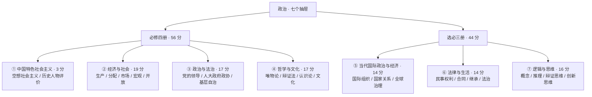
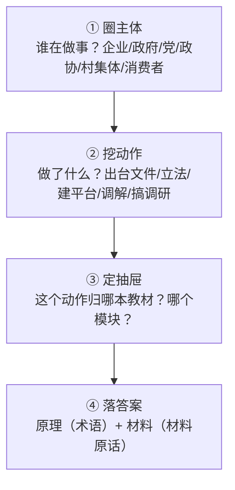

# 高考政治：七本教材定位与材料应答（2026 云南卷口径）

| 编写人 | 编写内容 | 编写时间 |
| --- | --- | --- |
| growdu | 面向**中等水平**（60~75 分）的考生，目标是**稳定到 85 分以上**。政治和物理、化学、数学、生物都不一样：**它一分都不用算，它考的是你能不能把知识写成材料的样子**。本文讲清三件事：**2026 云南卷政治到底长什么样**、**七本教材各出多少分、怎么用**、**每一类题的破题动作与给分规则**。 | 2026-11-12 |

> **TL;DR**
>
> **政治最容易被忽略的一条：你的失分主力不是「不会」，是「答非所问」。**
>
> 数学的失分主力是运算，物理是建模，化学是陌生，生物是琐碎——**政治的失分主力是「落点」**：知识点你都会背，但答案要写成「教材原理 + 材料信息」的样子，考官按点给分，你的原理没落到材料上，**一个字都不给**。
>
> 2026 云南卷政治的四个硬数字：
> - **100 分 / 75 分钟 / 21 题**：选择 16×3 = **48 分**，非选择 5 大题 = **52 分**（17 题 16、18 题 8、19 题 8、20 题 10、21 题 10）。**非选择占了 52%**，和生物一样是「写作考试」；
> - **七本教材并行**：必修四册合计 **56 分（56%）**，选择性必修三册合计 **44 分（44%）**。**只学必修，等于主动扔掉 44 分**；
> - **模块分布**：《经济与社会》19% 最重，《政治与法治》《哲学与文化》各 17%，《逻辑与思维》16%，《当代国际政治与经济》《法律与生活》各 14%，《中国特色社会主义》只有 3%；
> - **难度**：全卷难度值稳定在 **0.65—0.68** 区间，**科学精神素养占比 38%**——2026 年最明显的变化是**逻辑思维考查密度大涨**（15、16、20 三题）。
>
> **三个核心动作**：① **先判断「这是哪本教材的题」，再调用知识**；② **答案写成「原理 + 材料」二段式**，只写原理等于没答；③ **术语就是采分点**，写大白话不给分。
>
> **一句话**：高考政治拼的不是背得多，而是**把背过的东西放到题目里去**。

> **口径说明**：题型、题量、分值、注意事项原文、21 题题干来自 **2026 年云南省普通高中学业水平选择性考试·思想政治**原卷（省自主命题）。**逐题答案为网络收集版 / 考生回忆版整理结果，仅用于讲解例题**，正式答案以省招考院发布为准。七本教材的分值分布、难度值、素养占比与 2025→2026 变化，来自第三方试卷评析与讲评材料，已在《资料来源与核对入口》逐条标注。2027 届请以当年卷面为准。

---

## 目录

- [一、先定位：政治到底哪里不一样](#一、先定位：政治到底哪里不一样)
- [二、卷面结构：48 : 52 与七本教材的分布](#二、卷面结构：48-52-与七本教材的分布)
- [三、等级赋分：政治的分也不完全由你决定](#三、等级赋分：政治的分也不完全由你决定)
- [四、学习方法：七本教材一张图](#四、学习方法：七本教材一张图)
- [五、考试技巧：分题型的破题动作](#五、考试技巧：分题型的破题动作)
- [六、2026 云南卷逐题拆解](#六、2026-云南卷逐题拆解)
- [七、六个政治专属陷阱](#七、六个政治专属陷阱)
- [八、给自己的行动清单](#八、给自己的行动清单)
- [九、一页纸速查表](#九、一页纸速查表)

---

## 一、先定位：政治到底哪里不一样

### 1.1 政治科目的三个特殊性

**第一，它是一科完全不用算的科目。**

数学要算、物理要算、化学要配平、生物要写遗传图解、地理要算数——**政治一分都不用算**。这意味着它的每一个失分点，都只能由「表达」来解释。别的科失分你会说「我算错了」「我没想到」，政治失分你只能承认一件事：**我没把答案写成它要的那个样子**。

这也是为什么政治是所有选考科目里**性价比最高、也最容易被自以为会的人低估**的一科：不需要额外刷题量，但需要**改答题习惯**。

**第二，它是七本教材并行的科目。**

思想政治统编教材共 7 册（必修 4 册 + 选择性必修 3 册），2026 云南卷**七册全部命题、全部有分**：

| 册次 | 教材 | 选择题 | 非选择题 | 合计 | 占比 |
| --- | --- | --- | --- | --- | --- |
| 必修 1 | 《中国特色社会主义》 | 3 分 | 0 分 | 3 分 | 3% |
| 必修 2 | 《经济与社会》 | 9 分 | 10 分 | 19 分 | 19% |
| 必修 3 | 《政治与法治》 | 9 分 | 8 分 | 17 分 | 17% |
| 必修 4 | 《哲学与文化》 | 9 分 | 8 分 | 17 分 | 17% |
| 选必 1 | 《当代国际政治与经济》 | 6 分 | 8 分 | 14 分 | 14% |
| 选必 2 | 《法律与生活》 | 6 分 | 8 分 | 14 分 | 14% |
| 选必 3 | 《逻辑与思维》 | 6 分 | 10 分 | 16 分 | 16% |
| — | **必修合计** | **30 分** | **26 分** | **56 分** | **56%** |
| — | **选必合计** | **18 分** | **26 分** | **44 分** | **44%** |
| — | **总计** | **48 分** | **52 分** | **100 分** | 100% |

> **这张表是整篇最重要的东西。**它把「我要复习多少」这个问题变成了可算的题：**《经济与社会》19 分是七册里最重的；《中国特色社会主义》只有 3 分，而且只在选择题里考——不需要为它背大块内容，但必须会做那 1 题。**
>
> 另一个反直觉的结论：**《逻辑与思维》占 16 分，比《法律与生活》还多 2 分**。很多人因为「逻辑是数学」就把它放最后——2026 卷直接用第 15、16、20 三题告诉你，逻辑是政治的一门主课，不是点缀。

**第三，它一半以上的分是主观题，而且踩点给分。**

非选择 52 分里，17 题 16 分、18 题 8 分、19 题 8 分、20 题 10 分、21 题 10 分。**这 52 分全部是文字**。给分规则只有一条：**你写了那个术语，那个点才给分**。

写「经济决定政治」和写「经济基础决定上层建筑」，意思一样，但后者才是教材原句、才是采分点。

### 1.2 政治的三张失分表

政治的分几乎全部丢在这三张表上，而且这三张表可以**互相独立诊断**——先看你在哪张表上，再决定练什么。

| 失分表 | 考场上的表现 | 根因 | 修法 |
| --- | --- | --- | --- |
| **原则错** | 选择题选了一个「听起来很对」但和材料无关的选项 | 没读材料就往上套原理 | 划材料：先圈主体和关键词，再看选项 |
| **术语错** | 原理答对了，但写成大白话；或者多写少写导致要点没覆盖 | 不知道哪些词是采分点 | 背**术语**，不背整句 |
| **落点错** | 原理写了一堆，材料没写；或者材料抄了一遍，原理没写 | 没有建立「原理 → 材料」的连接 | 二段式：**原理 + 材料**用箭头连起来 |

**这三张表的对应练习完全不同，不要混着练**：

- **原则错**练的是**审题**：把最近 20 道错题的错误选项抄下来，标注它错在哪一类（主体错位 / 范围扩大 / 与材料无关 / 两对选一）。这是**选择题专属**的错题本用法。
- **术语错**练的是**背诵**：把非选择题的采分点抄成一个「术语表」，一条一行，不写句子。
- **落点错**练的是**写作**：每次主观题写完后，用红笔检查「每一个点后面有没有跟材料」。没有材料跟着的点，**直接划掉重写**。

### 1.3 2026 云南卷政治的分数拆解

| 项目 | 2026 云南卷 | 说明 |
| --- | --- | --- |
| 满分 | 100 | 与其他再选科目一致 |
| 时长 | 75 分钟 | 四门再选科目同 |
| 命题 | **云南省自主命题** | 省外同组合卷子不能当标准答案用 |
| 计入方式 | **等级赋分** | 原始分不公布，只公布赋分 |
| 题量 | 21 题 | 选择 16 + 非选择 5 |
| 题型结构 | 48 : 52 | 选择 16×3；材料分析题（17/18/19/21）+ 综合探究题（20） |
| 主观题字数要求 | 21 题 250 字左右 | 2025 年是 200 字左右（红嘴鸥保护短文） |
| 难度值 | 0.65—0.68 | 第三方评析口径 |
| 素养结构 | 科学精神占 38% | 第三方评析口径 |

> **注意「16 道选择 + 5 道大题」和「6 个非选择题」两种说法**：前者是原卷的**题数**口径（非选择题共 5 小题），后者是评析材料按**设问**口径统计的（第 17 题含两问）。看卷子时以原卷的 5 小题为准，看分析材料时注意口径差异即可。

---

## 二、卷面结构：48 : 52 与七本教材的分布

### 2.1 题型结构与分值

| 部分 | 题号 | 题数 | 分值 | 占比 | 性质 |
| --- | --- | --- | --- | --- | --- |
| 选择题 | 1—16 | 16 | 48 | 48% | 单项选择，每题 3 分 |
| 材料分析题 | 17（16 分）、18（8 分）、19（8 分）、21（10 分） | 4 | 42 | 42% | 原理 + 材料二段式 |
| 综合探究题 | 20（10 分） | 1 | 10 | 10% | 逻辑思维专项，两问 |
| **合计** | 1—21 | **21** | **100** | 100% | — |

**17 题是全卷最特殊的一题**：16 分，两问，**跨两个教材模块**——第 (1) 问用《中国特色社会主义》的「中国共产党的领导」答滇中引水工程，第 (2) 问用《当代国际政治与经济》答澜湄合作。

这是 2026 卷最重要的一个信号：**「一题一模块」的连排题正在变成「一题两模块」的专题题**。2025 卷的第 17 题也是双模块（多式联运 + 合同纠纷），2026 卷进一步把它做成了**同一主题下的双模块**（水）。

### 2.2 七本教材的分布

除了分值表，更有用的是**「哪本教材出什么题型」的规律**：

| 教材 | 选择题考什么（2026 实例） | 非选择题考什么（2026 实例） | 该教材的复习重点 |
| --- | --- | --- | --- |
| 《中国特色社会主义》 | 空想社会主义者的劳动观 | **不考** | 只需 1 题的判断力：谁说的、对历史做了什么 |
| 《经济与社会》 | 政府职能、零售模式、对外开放 | **21 题开放对策题（10 分）** | 术语密度最高、也是开放题的主战场 |
| 《政治与法治》 | 基层治理、政协履职、地方立法 | 17(1) 党的领导（8 分） | **主体不能错**：党、政府、人大、政协、基层自治各管各的 |
| 《哲学与文化》 | 矛盾观、系统优化、联系、文化传承 | 18 题主观能动性（8 分） | 一套原理能覆盖多题，性价比最高 |
| 《当代国际政治与经济》 | 国际组织与全球治理 | 17(2) 澜湄合作（8 分） | 命题量少但每年必考，**不能放** |
| 《法律与生活》 | 合同订立、遗嘱继承 | 19 题德法并用（8 分） | **背术语 + 会算法律后果**，不要背案例 |
| 《逻辑与思维》 | 概念外延关系、辩证思维 | 20 题联想思维与推理规则（10 分） | **规则少、得分稳**，性价比最高的 16 分 |

### 2.3 75 分钟时间分配

政治的时间分配有一个特殊之处：**选择题不能像理科那样靠速度碾压**。每道选择题都要在材料上划三到五处，16 道题划下来就是 20 分钟以上。

```mermaid
gantt
    title 高考政治 75 分钟时间分配（中等水平）
    dateFormat  mm:ss
    axisFormat  %M:%S
    section 选择区
    选择 1-6 送分区   :a1, 00:00, 600s
    选择 7-12 磨合区  :a2, 10:00, 600s
    选择 13-16 劝退区 :a3, 20:00, 540s
    section 写作区
    解答 17 双模块     :a4, 29:00, 780s
    解答 18 哲学       :a5, 42:00, 480s
    解答 19 法律       :a6, 50:00, 420s
    解答 20 逻辑       :a7, 57:00, 480s
    解答 21 开放对策   :a8, 65:00, 480s
    section 收尾
    只查材料落地       :a9, 73:00, 120s
```

> **时间纪律三条**：
> 1. **选择题 29 分钟封顶**。一道选择题超过 90 秒还没定，**直接标记跳过**——政治的选择题不像物理有「算一遍就出来」的确定性，硬磨的边际收益极低。
> 2. **21 题放最后，但不要放到没时间**。它是 10 分，250 字左右，**给了 8 分钟**。如果只剩 5 分钟，宁可写上游 + 中游两段（按分算约 6—7 分），也不要三段都写半句。
> 3. **最后 2 分钟只做一件事**：检查每个点后面**有没有跟材料**。这一步能救回 2—4 分，是全卷性价比最高的 2 分钟。

---

## 三、等级赋分：政治的分也不完全由你决定

政治和化学、生物一样，是**再选科目、走等级赋分**。完整的赋分规则（比例、档位、原始分不公布等）见《[云南高考：政策与科目划分](../yunnan-policy/index.html)》，这里只讲**对政治有特殊影响的三条**。

**第一条：背得越模板，在同分段里越拉不开差距。**

这是政治独有的。赋分看的是**位次**，不是分数。模板化答法在低分段是「性价比最高」的（背一句就能拿 2 分），但在同分段竞争时，**你和另一个也会背模板的人之间的区分度是零**。而 2026 云南卷明确「**摒弃模板化、机械记忆考查**」，评析直接点名「弱化机械背诵、强化教材主干与基本方法」。

**结论：模板是保底手段，不是提分手段。** 中等水平考生应该把模板压缩到「术语 + 一句原理」，把省下来的时间用于「原理 + 材料」的结合。

**第二条：选必三册合计 44 分，选科组合要选自己排得住的。**

物理、历史是首选科目，**原始分计入总分**；化学、地理、政治、生物是再选科目，**赋分后计入**。四门再选科目同位次赋分相同。

对政治的含义是：如果你选的是「化学 + 地理 + 政治」而另一个人选的是「化学 + 地理 + 生物」，**你们的前两门是同一把尺子，第三门是另一把尺子**。在化学、地理上你俩同分（假设），政治上你的位次会被单独拿出来和所有选政治的人比。

**所以选科要看的是「我在这一门里的相对水平」，不是「这一门我能考多少分」。**这和化学篇、生物篇的结论完全一致，但政治更容易被忽略，因为政治通常被认为是「靠背的、不分化的」——**恰恰相反，政治同分区间的人最多，赋分后被拉开的距离也最狠**。

**第三条：估分要估等级，不估分数。**

「我政治考了 78 分」这句话在云南没有意义。你要做的是：**这次模考我在选政治的人里排第几**。模考排名比原始分有用得多。

---

## 四、学习方法：七本教材一张图

### 4.1 政治的知识是「按抽屉存放」的，不是线性的

理科的知识有依赖关系（先函数后导数），政治**没有**。政治是七个大抽屉，每个抽屉里装着一批「概念 + 原理 + 术语」。

这个结构的直接后果是：**复习的最优单位不是「章节」，是「抽屉」**。拿起一套卷子，把 21 题按教材归位，你就知道哪个抽屉是空的。



**抽屉的使用法**：

1. 每个抽屉准备**一张 A4 术语表**——左边写术语，右边写一句原理。**不写完整段落**，只写采分点。
2. 做题时，**先归抽屉再想答案**。归错抽屉比想错答案更致命，因为它会让你调出一整片无关的知识去套。
3. 每张表背熟后**盖住左边，只看右边**，反向再练一遍：给出材料情境，说出对应术语。**这一遍比第一遍值钱得多**——因为考场上你是从材料出发去找术语，不是从术语出发去套材料。

### 4.2 必背清单：十二条主干（按 2026 卷实际命中排序）

下面这 12 条覆盖了 2026 云南卷七册的主要采分点。**注意它们都是「术语 + 原理」的最小单位，不是完整段落。**

| # | 抽屉 | 术语 | 一句原理 | 2026 命中 |
| --- | --- | --- | --- | --- |
| 1 | 经济与社会 | 社会主义市场经济体制 | 有效市场 + 有为政府相结合 | 3、4、21 |
| 2 | 经济与社会 | 新发展理念 | 创新、协调、绿色、开放、共享 | 21（绿色） |
| 3 | 经济与社会 | 现代化经济体系 | 建设现代化产业体系，推动高质量发展 | 21 |
| 4 | 政治与法治 | 党的领导 | 中国共产党是最高政治领导力量 | 5、17(1) |
| 5 | 政治与法治 | 人民当家作主 | 人民代表大会制度是根本政治制度 | 5、6 |
| 6 | 政治与法治 | 依法行政 | 政府要坚持法定职责必须为、法无授权不可为 | 3、7 |
| 7 | 哲学与文化 | 正确发挥主观能动性 | 尊重客观规律是前提，发挥主观能动性是必要条件 | 18 |
| 8 | 哲学与文化 | 矛盾问题的精髓 | 矛盾普遍性与特殊性辩证统一，坚持具体问题具体分析 | 8 |
| 9 | 哲学与文化 | 系统优化方法与联系的多样性 | 把握整体与部分的有序性；事物联系是多样的，要具体问题具体分析 | 8、9 |
| 10 | 当代国际政治与经济 | 国家利益 | 国家利益是国际关系的决定性因素，共同利益是合作基础 | 11、17(2) |
| 11 | 法律与生活 | 全面履行合同 / 合同订立 | 要约与承诺；依法订立合同，全面履行义务 | 13、19 |
| 12 | 逻辑与思维 | 三段论 / 假言推理 | 三段论中项不周延无效；必要条件假言只有否定前件式、肯定后件式有效 | 15、16、20 |

> **第 12 条是 2026 年最值钱的一条**：第 20 题的第 (2) 问 4 分，两个网络评论的推理，一个用直言三段论、一个用必要条件假言推理，**判对错全靠这一条规则**。而第 15 题考概念外延（全异 / 种属 / 相容 / 反对关系），第 16 题考辩证思维，**三题 16 分全在逻辑这一册**。

### 4.3 情境题的通用四步读法

2026 云南卷**所有情境都是真实原生场景**——低空经济、店仓一体新零售、国际人才、邻里纠纷、校园噪鹃、报废手机产业链，**没有虚构模板素材**。这意味着「背模板」越来越不管用，「读材料」才是硬功夫。

四步读法（和化学篇的版本同源，但落点不同）：



**第 ① 步「圈主体」是政治独有的、也是最值钱的一步。**

同一件事，主体不同，考点就完全不同：

| 情境 | 主体 | 考点 | 如果主体看错会答成什么 |
| --- | --- | --- | --- |
| 低空飞行管理服务平台 | **政府** | 职能（经济建设、社会建设） | 写成企业的经营策略 |
| 村委会主任「一肩挑」 | **村党组织 + 村委会** | 基层群众自治、党的领导 | 写成基层政权的行政效率 |
| 政协提案「1+N」并案 | **政协** | 参政议政、协商民主 | 写成人大的立法权 |
| 「小切口」地方立法 | **地方人大** | 立法权、科学立法 | 写成政府的依法行政 |

**这四个考点，2026 云南卷的第 3、5、6、7 题各考一道。**主体看错，16 分就没了——而这 16 分只需要在材料上圈四个字。

### 4.4 错题本怎么记：记「点」不记「题」

化学篇记「反应」，生物篇记「概念」，**政治篇记「点 + 错在哪」**。三本错题本，一个字都不重复。

**选择题错题本**（练原则错）：

```
【题号】2026-3
【我选】C（②④）  【对】B（①③）
【错因】主体错位——②「弥补市场滞后性」是市场调节的局限，不是政府职能的表述
【术语】政府职能：经济建设 / 社会建设 / 文化建设 / 生态文明建设
【同类题】2026-5、2026-6、2026-7 都是主体题
```

**非选择题错题本**（练术语错 + 落点错）：

```
【题号】2026-18（8 分）
【材料关键词】提问 / 好奇 / 人工智能是搬运工 / 创新方向盘在人手中
【我漏的点】③ 尊重客观规律是正确发挥主观能动性的前提
【补的原理】人能够能动地认识世界 + 人能够能动地改造世界 + 尊重客观规律是前提，发挥主观能动性是必要条件
【自查问题】这三个点里，哪个后面我写了材料？→ 都没有 → 所以我只拿了 4 分
```

**关键在最后那行「自查问题」**：它把「我漏了什么」升级成「我漏的是哪种失分表」。**前三个月的错题本只记术语；第四个月起，每条错题后面必须多写一句「这属于哪张失分表」。**

---

## 五、考试技巧：分题型的破题动作

### 5.1 选择题（16 题 / 48 分）：**排除干扰项的五个套路**

政治选择题的干扰项不是随便编的，2026 云南卷的五个套路高度集中：

**套路一：决定关系错位。**把「A 决定 B」的原理换了个主体，写成「C 决定 B」。

> 第 2 题 ②「社会制度的性质决定科技发展的水平」——错。**决定科技发展水平的是生产力发展水平**；社会制度的性质决定的是**上层建筑**。①④才是对的：人民既是科技实践的创造者也是科技成果的受益者（①）；出台科技伦理、人工智能监管等制度文件说明合理的制度是科技健康发展的有力保障（④）。**答案 B（①④）。**

**套路二：主体错位。**把甲主体的职能安到乙主体头上。见 4.3 的四行表。

> 第 9 题 ①「为思维运动找到了新的载体」——错。**语言才是思维的载体**；倒序词典只是字词编排方式的创新，撑不起「思维运动的新载体」。**选项看着在讲词典，其实在讲语言和思维，主体换了。**

**套路三：方向颠倒。**材料说「甲为乙提供了 X」，选项写成「甲借助乙才 X」。

> 第 10 题 ②「借助文艺创作，凝聚社会共识」——错。材料说「斗百草」**为**诗画戏曲创作**提供素材**，方向是「文艺创作 ← 斗百草」；选项倒过来说成「斗百草 **借助** 文艺创作」才流传。**方向反了。**

**套路四：夸大作用 / 机制对不上。**原理本身没问题，但**程度超出了材料给的边界**，或者**具体机制张冠李戴**。

> 第 3 题 ④「能够释放数据要素价值，**转变经济发展方式**」——错。**一个管理平台建起来，转变不了经济发展方式**，这是夸大。
> 同题 ②「弥补市场滞后性」——错在**机制对不上**：对无人机实施全流程监管，主要弥补的是市场调节的**自发性**；而**滞后性**讲的是事后调节的时间差。③「增加公共服务供给，推动低空经济发展」才是对的。**答案 B（①③）。**

**套路五：术语张冠李戴。**术语是真的，但被搬到了不该出现的语境里。

> 第 9 题 ③「达到对字词认识的高级阶段」——错。**认识的高级阶段指的是理性认识**；倒序词典只是检索工具的创新，不代表「对字词的认识」进入了高级阶段。④ 对，因为词典编纂具有**社会历史性**，历经八年再出新版正说明它受一定历史条件制约。**答案 D（②④）。**

**五个套路的破解动作**：**读选项的时候，逐个追问「这句话错在哪」——如果找不到错点，再回到材料找「它对应材料的哪句话」。两步都落空，说明题目或选项有问题，标记跳过。**

> **最省时间的判断顺序**：先扫**主体**（套路二）和**方向**（套路三），这两个一眼能看出来；再看**术语**（套路五），这个需要你真背过；最后才看**程度**（套路一、四）。**按这个顺序过一遍，48 分的选择题能省下至少 5 分钟。**

### 5.2 材料分析题（17、18、19 题）：**原理 + 材料 二段式**

这三种题（8 分 / 8 分 / 8 分）的给分逻辑完全一样：**每问 4 个点，每点 2 分，一个点 = 术语 + 材料**。

**唯一的差别是题型的「前半句」给的定位有多具体**：

| 题 | 设问原文 | 你要做的定位 |
| --- | --- | --- |
| 17(1) | 运用「中国共产党的领导」相关知识 | 教材章节已给，照着写 4 个领导作用 |
| 18 | 运用「正确发挥主观能动性」相关知识 | 教材章节已给，但**范围比标题大**，要自己拆成 3 个层次 |
| 19 | 运用《法律与生活》相关知识 | **只给了书名，没给章节**——必须自己从材料里判断是「全面履行合同」「相邻关系」「人格权」「调解」哪几块 |

**第 19 题是本篇最值得练的一道**，因为它要求你自己完成「材料 → 章节」这一步。参考答案是三层：

> ① **法治是调解的根本遵循**——调解员依法厘清法律责任：甲驾驶不慎造成乙财产损失与人身损害，应承担侵权责任；乙擅自堵门阻碍甲通行，侵犯相邻权，也存在过错。
> ② **德治是调解的重要支撑**——调解员巧用「罗威饲犊」传统故事融入调解，以中华传统美德与公序良俗引导双方互谅互让。
> ③ **德法并用，实现良法善治**——既发挥法律的规范约束作用，又发挥道德的教化引导作用，兼顾法理与人情，实现法律效果与社会效果的统一。

**注意第 ① 条**：它不是「依法调解」的套话，而是**具体到甲担侵权责任、乙侵犯相邻权**。这就是「材料」部分的分。

**二段式的书写模板**：

```
【术语】：依法定责，彰显法治权威。
【材料】：调解员依据《民法典》侵权责任编相关规定，明确甲因驾驶过失致车辆侧翻，
        造成乙家院墙损坏及乙过敏，应承担侵权责任；同时指出乙将农用车堵在甲家门口，
        也侵害了甲的通行权利。
```

**写完检查两件事**：

1. 每个点前面**必须有术语**（不是「首先」不是「因此」，是「依法定责，彰显法治权威」）；
2. 每个术语后面**必须有材料**（不能只有术语，也不能只有材料）。

### 5.3 综合探究题（20 题 / 10 分）：**联想思维与推理规则**

2026 第 20 题是全卷唯一的**综合探究题**，两问 6 + 4 分，考点是《逻辑与思维》。它的特殊之处在于**问的不是知识，是「你的思维过程对不对」**。

**第 (1) 问 6 分：分析校方的回应体现了哪些联想思维方法。**

参考答案是两个词：**迁移**和**想象**。

- **迁移**是联想思维的「联结」方式，指把不同认识对象的性质、作用进行**位置变迁与功能移植**。校方把「人与自然和谐共生」的生态理念，**迁移**到学生成长教育的育人场景中；
- **想象**是联想思维的「畅想」方式，指在头脑中对已有事物表象进行**加工改造、形成新认识**。校方从当下的鸟鸣困扰，**想象**推演出蛙叫、蝉鸣、宿舍呼噜声等同类困扰场景。

**第 (2) 问 4 分：判断两个推理是否符合逻辑规则。**

这是全卷最精确的 4 分，两个推理一个对一个错：

| 人物 | 推理 | 判定 | 依据 |
| --- | --- | --- | --- |
| 小丁 | 所有符合健康学校建设的举措我都支持 ＋ 学校的做法符合健康学校建设 → 所以学校的做法我支持 | **符合** | 直言三段论，三个不同的项，中项在前提中周延一次，前提不周延的项在结论中没有扩大范围 |
| 小文 | 只有学会与万物共存才能成长 → 没能成长 → 没学会与万物共存 | **不符合** | 必要条件假言推理的有效式只有**否定前件式**和**肯定后件式**；「否定后件」不能必然推出「否定前件」 |

**这一问的破题动作只有一个**：把题干里的条件句翻译成逻辑形式。

- 「**只有** A 才 B」→ 必要条件假言：**B → A**。有效式：否定前件（A 假 → B 假）、肯定后件（B 真 → A 真）。
- 「**如果** A 那么 B」→ 充分条件假言：**A → B**。有效式：肯定前件、否定后件。

**翻译错形式，后面全错。**这一步是纯机械的，值得单独练 20 分钟。

### 5.4 开放对策题（21 题 / 10 分）：**按材料结构分层写**

第 21 题是全卷分值最高的主观题（10 分），要求围绕产业链各环节写对策建议，**250 字左右**，明确要求「层次分明、表述清楚、逻辑清晰、学科术语使用规范」。

**它给了你一个现成的结构：上游 / 中游 /下游。**不用自己设计结构——**按材料给的顺序写**。

参考答案是这样的三段：

> **上游回收环节**：制定统一的手机检测与回收定价标准，推动回收价格公开透明，稳定回收商经营预期；建立标准化数据销毁流程，消除消费者隐私顾虑，提升回收意愿；健全县乡村三级回收网络，扩大回收覆盖范围。
> **中游拆解环节**：加大高效清洁回收技术研发与推广力度，发挥国企技术引领作用，通过技术共享帮扶中小企业升级设备，提升贵金属回收率与环保处理水平。
> **下游利用环节**：对接航空航天、新能源等新兴产业需求，拓宽再生贵金属应用场景；出台产业扶持政策，提升循环利用经济效益，推动产业链上下游协同，实现资源高效循环。

**每一段的结构都是同一个三段式**：

```
【对策的定性词】规范 / 健全 / 加大 / 发挥 / 推动 / 对接 / 拓展 / 完善
   ↓
【具体动作】制定标准 / 建立流程 / 研发推广 / 技术共享 / 供需对接
   ↓
【要达成的目的】提升意愿 / 提高回收率 / 降低成本 / 增加供给 / 减少进口依存
```

**「定性词 + 动作 + 目的」三段齐了才是一个完整采分点。**只有「政府要加大力度」是空话，只有「完善机制」也空。

**250 字的分配**：三段各 70—80 字，最后留 10—20 字收尾一句（如「通过多方协同，畅通循环链条，实现资源节约与经济高质量发展」）。**宁可三段写满，不要两段写长**——按点给分，段数比字数重要。

---

## 六、2026 云南卷逐题拆解

### 6.1 二十一道题的情境、考点与答案

| 题号 | 情境 | 教材模块 | 核心考点 | 答案 |
| --- | --- | --- | --- | --- |
| 1 | 空想社会主义者圣西门重视劳动 | 必修 1 | 空想社会主义的思想价值 | A（①③） |
| 2 | 科技伦理治理、AI 生成内容标识 | 必修 2 | 以人民为中心的发展思想、经济基础与上层建筑 | B（①④） |
| 3 | 低空飞行管理服务平台 | 必修 2 | 政府职能与资源配置 | B（①③） |
| 4 | 店仓一体新型零售 | 必修 2 | 消费与生产、市场配置资源 | D（③④） |
| 5 | 村委会主任「一肩挑」入法 | 必修 3 | 基层党建法治化、基层群众自治 | C（②④） |
| 6 | 政协提案「1+N」并案 | 必修 3 | 政协参政议政、协商民主 | C（②③） |
| 7 | 云南「小切口」地方立法 | 必修 3 | 地方立法权、科学立法 | B（①③） |
| 8 | 中国青少年阅读素养框架「四阶十二梯」 | 必修 4 | 矛盾问题的精髓（普遍性与特殊性）、系统内部结构的有序性 | A（①③） |
| 9 | 倒序词典 2026 新版 | 必修 4 | 联系的多样性、编纂的社会历史性 | D（②④） |
| 10 | 传统民俗「斗百草」 | 必修 4 | 文化传承、贴近生活引发情感共鸣 | A（①③） |
| 11 | 「中国使者」进入国际组织 | 选必 1 | 国际组织与全球治理 | D（②④） |
| 12 | 国际人才「磁吸力」 | 必修 2 | 高水平对外开放 | A（①③） |
| 13 | 杨桃买卖：要约、承诺、合同订立 | 选必 2 | 合同订立规则 | B（①④） |
| 14 | 遗嘱效力与财产继承 | 选必 2 | 遗嘱继承、法定继承、夫妻共同财产 | C（②③） |
| 15 | 四季之风的概念外延关系 | 选必 3 | 全异 / 种属 / 相容 / 反对关系 | C（②④） |
| 16 | 青年精神赡养 | 选必 3 | 辩证思维与认识创新 | B（①④） |
| 17 | 滇中引水 + 澜湄合作（双材料） | 必修 3 + 选必 1 | 党的领导 / 命运共同体 | （1）8 分（2）8 分 |
| 18 | 提问的价值与 AI 时代 | 必修 4 | 正确发挥主观能动性 | 8 分 |
| 19 | 农村院墙纠纷与「罗威饲犊」调解 | 选必 2 | 德法并用、民事权利 | 8 分 |
| 20 | 健康学校噪鹃 + 网友推理 | 选必 3 | 联想思维 / 三段论与假言推理 | （1）6 分（2）4 分 |
| 21 | 报废手机循环利用产业链 | 必修 2 | 对策建议（250 字） | 10 分 |

> **答案口径**：以上为**网络收集版 / 考生回忆版**整理结果，用于讲解例题，**正式答案以省招考院发布为准**。

### 6.2 走完三道题

#### 第一道：第 3 题（低空飞行管理服务平台）—— 看懂「主体」这道题

材料说某地政府打造低空飞行管理服务平台：绘制「空间蓝图」实现空域资源数据共享、建立「服务舱」提供一体化支撑、织就「守护网」实施全流程监管。

四个选项：

> ①通过信息共享，提高空域资源利用率
> ②利于发挥政府职能，弥补市场滞后性
> ③旨在增加公共服务供给，推动低空经济发展
> ④能够释放数据要素价值，转变经济发展方式

**动作序列**：

1. **圈主体**：政府。→ 排除所有把行为说成企业、市场主体的选项。
2. **挖动作**：信息共享、服务供给、流程监管。→ 三个动作分别对应三个选项的关键词。
3. **验选项**：①「资源利用率」——材料说的是空域资源数据共享，**对得上**；②「弥补市场滞后性」——对无人机全流程监管弥补的是市场调节的**自发性**，而**滞后性**讲的是事后调节的时间差，**机制对不上**；③「增加公共服务供给」——「服务舱」正是这个，**对得上**；④「转变经济发展方式」——通篇没有提发展方式的转变，**夸大了**。
4. **答案 B（①③）**。

**这一道题教你的事**：④是典型的「正确但材料没提」，②是典型的「对但不是这一问」。**政治选择题的分，几乎都丢在「这句话和材料对不对得上」上，而不是「这句话对不对」上。**

#### 第二道：第 17 题（滇中引水 + 澜湄合作）—— 一题两模块怎么答

**第 (1) 问 8 分，材料一（滇中引水）**，要求用「中国共产党的领导」知识。参考答案是**四个领导作用**，一条一个采分点：

> ① **党是最高政治领导力量**：党中央对国家水网建设统一部署、科学谋划，坚持以人民为中心的发展思想，从顶层设计上锚定工程的民生导向，为水润民生提供**根本政治保证**。
> ② **发挥党总揽全局、协调各方的领导核心作用**：云南省委统筹带领参建单位协同发力，凝聚工程建设的强大合力。
> ③ **发挥基层党组织的战斗堡垒作用**：参建单位党组织加强党风廉政建设，强化工程监督，严把工程质量关。
> ④ **发挥共产党员的先锋模范作用**：党员干部带头开展技术创新，攻克世界级建设难题。

**注意四个点的顺序是「中央 → 省委 → 基层党组织 → 党员」，正好对应材料里的四句话。**这就是第 17 题的破题动作：**答案的条数由材料决定，不是由你能背多少决定。**材料写了四层组织关系，你就写四条，一一对应。

**第 (2) 问 8 分，材料二（澜湄合作）**，要求用《当代国际政治与经济》知识。参考答案是四条：

> ① **国家利益是国际关系的决定性因素，共同利益是国家合作的基础**——澜湄流域国家在水资源开发利用上存在利益分歧，同时在水治理、流域稳定与发展方面具有广泛共同利益，这是澜湄合作「因水而生」的现实基础。
> ② 澜湄合作以水资源治理为切入点，完善合作顶层设计，建立应急补水、信息共享机制，提升了流域水资源治理能力，妥善化解利益分歧，维护了区域和平稳定。
> ③ 澜湄合作从水资源领域延伸至生态环境、绿色经济、跨国安全、人文交流等多领域，织密利益共融纽带，夯实惠民根基，增进了各国民生福祉，实现了合作的「因水而兴」。
> ④ **秉持共商共建共享原则**，澜湄合作推动流域国家命运共同体意识增强，顺应和平与发展的时代主题。

**同一道题，两问用了两本完全不同的教材。**如果你在第 (1) 问写国际关系、在第 (2) 问写党的领导，**14 分全丢**。所以第 17 题的第一件事不是读材料，是**看清设问里的书名**。

#### 第三道：第 21 题（报废手机循环利用）—— 开放题怎么分层

材料给了一张产业链信息清单，上中下游各有对应角色的问题：

| 环节 | 材料里的问题 |
| --- | --- |
| 上游（检测、回收） | 回收价格偏低、不透明；担心隐私泄露；约六成手机闲置在家；检测标准不一、定价波动大；县乡村三级回收网络不健全 |
| 中游（拆解、破碎、熔炼） | 国企联合创建安全回收处置模式，贵金属回收率超 99%；但高效清洁回收技术普及率低、部分中小企业技术更新慢 |
| 下游（再生资源利用） | 航空航天、新能源对贵金属需求持续增长，国内供需缺口巨大、进口依存度高；电子废弃物回收效率远高于一次开采 |

**破题动作三步**：

1. **圈结构**：材料给了上中下游 → **答案必须分三段**。
2. **每段先定性再动作**：上游定性词是「规范 / 健全」，中游是「加大 / 发挥 / 推动」，下游是「对接 / 拓展 / 出台」。
3. **每段末尾给目的**：上游 → 提升回收意愿、稳定经营预期；中游 → 提升回收率与环保水平；下游 → 拓宽应用场景、降低进口依存度。

**最常见的两种丢分**：

- **把三段写成一大段**——阅卷按点给分，结构断了就找不到点；
- **目的写成主语**（「提高回收率」是结果不是目的，答案里要写成「提升回收意愿、稳定经营预期」这种指向性表达）。

---

## 七、六个政治专属陷阱

### 陷阱一：只写原理，不写材料

「依法定责，彰显法治权威。」——**这句话本身可能就得 1 分，但拿不到第 2 分**。第 2 分在「甲承担侵权责任、乙侵犯相邻权」。

**判断标准**：把你写的答案遮住材料，如果这段话可以贴到任何一道同类题上，那它就没有材料。

### 陷阱二：把大白话当术语

「经济基础决定上层建筑」不能写成「经济决定政治」；「国家利益是国际关系的决定性因素」不能写成「国家之间要看利益」。

**判断标准**：这句话能在你的教材目录里找到标题吗？找不到，就是大白话。

### 陷阱三：主体看错

2026 年第 3、5、6、7 题连续四道考主体。第 7 题最容易错：**地方立法的权力主体是地方人大，不是政府**。「小切口」条例由人大通过，政府是执行者。

### 陷阱四：把逻辑题当语文题

第 20 题第 (2) 问不是让你「评价小丁小文说得对不对」，是让你**用规则判定推理形式是否有效**。不写出规则（「中项不周延」「否定后件不能必然否定前件」），只说「小丁说得对」，**4 分全丢**。

### 陷阱五：开放题写成流水账

第 21 题要求「层次分明」。写成「首先……其次……最后……」且每段没有小标题、没有定性词，阅卷时找不到层次，**按点给分只能给到碰上的那两三个点**。

### 陷阱六：用模考原始分报志愿

政治是赋分科目。模考 78 分，在选政治的人里可能排第 800 名（赋 72），也可能排第 300 名（赋 80）。**估分要估位次，不估分数**——详见《[云南高考：政策与科目划分](../yunnan-policy/index.html)》。

---

## 八、给自己的行动清单

### 立刻可以做的三件事

1. **做一张七抽屉表**。七个抽屉，每格写清「教材名 + 术语 + 一句原理」。今天做第一格（经济与社会，因为 19 分最重），三天做完。
2. **把最近一套卷子的 21 题按教材归位**。看一眼就知道哪个抽屉是空的——**这个动作 20 分钟，信息量比刷两套卷子大**。
3. **把 12 条主干抄成一张卡片**，正反两面。正面写术语，背面写原理。每天看一遍，看完遮住背面自问自答。

### 一周内可以做的三件事

4. **专攻主体**：把 2026 年第 3、5、6、7、11、12 题抄在一起，标出每题的主体和主体对应的职权。**这是 18 分。**
5. **专攻逻辑**：花 20 分钟把「如果…那么…」和「只有…才…」的翻译规则默写一遍，然后用《逻辑与思维》教材的例题验证。**这是 16 分里最容易拿的 10 分。**
6. **专攻落点**：找 5 道非选择题，只做一件事——在每个采分点后面手动补一句材料原文。**不做新题，只改旧答案。**

### 一个月内可以做的三件事

7. **建立选择题错因表**，每条错题标注「主体错位 / 范围扩大 / 与材料无关 / 两对选一」四类之一。**一个月后你会发现某一类占了一半——那一类就是你的提分空间。**
8. **把 21 题模板化到 5 分钟**：写一段「定性词 + 动作 + 目的」的骨架，背下来，考场上只填内容。**但记住：模板保底，不提分。**
9. **每周一次限时 75 分钟**，严格按考场时间分配做一套卷，只用三色笔（黑笔答、红笔查原理是否落地、蓝笔改答案）。

### 考前一周

10. **只看 12 条主干 + 七张抽屉表 + 自己的错因表**。不做新题、不碰难题——**最后一周的新题只会制造焦虑，不会制造分数**。

---

## 九、一页纸速查表

```
【科目】云南卷 100 分 / 75 分钟 / 省自主命题 / 再选科目·等级赋分
【结构】选择 48（16×3）+ 非选择 52（17:16 / 18:8 / 19:8 / 20:10 / 21:10）= 100
        17 题一题两模块（党的领导 + 当代国际政治与经济）→ 16 分
        21 题开放对策 250 字左右，按上中下游分三段
【七册】经济与社会 19%｜政治与法治 17%｜哲学与文化 17%｜逻辑与思维 16%
        当代国际政治与经济 14%｜法律与生活 14%｜中国特色社会主义 3%
        必修合计 56%，选必合计 44% ← 只学必修 = 丢掉 44 分
【难度】全卷 0.65—0.68；科学精神素养占比 38%
        逻辑三题（15/16/20）= 16 分 ← 性价比最高的抽屉
【时间】选择 1-6 10min｜7-12 10min｜13-16 9min
        解答 17:13 / 18:8 / 19:7 / 20:8 / 21:8 分钟｜最后 2min 只查「材料落地」

【三张失分表】原则错（没读材料就套原理）→ 练审题
            术语错（写成大白话）→ 练术语表
            落点错（原理与材料没接上）→ 练二段式
【四步读法】圈主体 → 挖动作 → 定抽屉 → 落答案（主体看错 = 全题崩）

【五条干扰套路】决定关系错位（换主体）｜主体错位｜方向颠倒
        夸大作用与机制对不上｜术语张冠李戴
        判断顺序：主体 → 方向 → 术语 → 程度（省 5 分钟）
【二段式】原理（教材术语）+ 材料（材料原话），两者缺一不可
【开放题三段】定性词（规范/健全/加大/推动/对接）+ 具体动作 + 目的
【逻辑】只有A才B = 必要条件（B→A），有效式只有否定前件式、肯定后件式
        如果A那么B = 充分条件（A→B），有效式肯定前件、否定后件

【政治专属陷阱】只写原理不写材料｜大白话冒充术语｜主体看错
        逻辑题不讲规则｜开放题写流水账｜用模考原始分报志愿
【底线】政治是赋分科目，估分即估位次；模板保底不提分，术语才给分
```

---

## 相关阅读

- [云南高考：政策与科目划分（2026 官方口径）](../yunnan-policy/index.html) —— **赋分规则的原文出处**：3+1+2 科目切分 → 六门选考全是省命题 → 等级赋分五档 → 选科四类要求 → 2025/2026 分数线
- [高考化学：云南卷的结构、赋分策略与考场操作（2026 口径）](../chemistry-methods/index.html) —— **姊妹篇**：化学的难点是「陌生」，政治的难点是「落点」；两篇都先讲赋分策略，再讲答题规范
- [高考生物：模块化记忆与实验探究应答（2026 云南卷口径）](../biology-methods/index.html) —— **姊妹篇**：生物的非选择题同样是踩点给分，生物篇讲「要点式书写」，政治篇讲「原理 + 材料」
- [云南高考报考指南：选校、选专业与各类特殊计划](../yunnan-apply/index.html) —— **下游**：政治是很多专业组的选科要求，**选科不匹配则志愿根本填不进去**
- [高考数学：中等水平者的做题方法与学习路径](../math-methods/index.html) —— 同一套「先诊断丢分在哪，再选方法」框架

---

## 资料来源与核对入口

| 内容 | 来源 |
| --- | --- |
| 2026 云南卷政治的题型、题量、分值、注意事项原文、21 题题干、题号与分值分配 | 《云南省 2026 年普通高中学业水平选择性考试·思想政治》原卷（2026-06 考试） |
| 七本教材分值表（必修 56 分 / 选必 44 分及逐册占比）、双向细目表、题型分类 | 2026 年云南高考政治真题（解析版）——艾小志《2026年云南高考政治试题结构分析》（四季读书网转载） |
| 全卷难度值 0.65—0.68、科学精神素养占比 38%、2025→2026 变化（开放题字数、情境迭代、跨模块融合、逻辑题密度）、五育融合落点 | 《2026年云南高考政治真题（含参考答案、解析、试题分析）及教学备考启示》——云南玉溪一中龚华小憨老师（四季读书网） |
| 逐题教材模块对应、情境归类、本土素材清单 | 2026 年高考政治真题完全解读（云南卷）——学科网 |
| 逐题答案 | 网络收集版 / 考生回忆版整理（**非官方发布，仅用于讲解例题**） |
| 试卷难度系数 0.6、题量与分值元数据 | 组卷网 / 出卷网试卷条目 |
| 政治为再选科目、等级赋分、75 分钟 100 分 | 《云南省 2025 年普通高校招生考试安排和录取工作实施方案》、2026 网上填报志愿考生须知 |

> **核对入口**：[云南省招考频道](https://www.ynzs.cn) ｜ [教育部阳光高考平台](https://gaokao.chsi.com.cn) ｜ 考生服务平台 <https://gk.ynzs.cn>
>
> **时效提醒**：本文取自 **2026 年**云南卷。**七册分值占比、难度值、素养结构逐年会变**，但方法论部分（七抽屉定位、二段式书写、四条干扰套路、逻辑规则翻译、开放题三段结构）**与具体年份无关**。
>
> **一处需要自己核对的地方**：网上流传的一些「2026 云南卷结构指南」给出了和原卷对不上的题量、分值，还引用了查不到出处的文件编号。**这类内容不是「参考」，是噪声。**本系列全部以原卷为准；核对方法见《[地理篇](../geography-methods/index.html)》末尾的同名提醒——**看到具体数字时，先回去核对原卷。**

---

| 编写人 | 校验内容 | 时间 |
| --- | --- | --- |
| growdu | 题型、题量、分值、注意事项、21 题题干与题号分值分配逐条对照 2026 云南卷政治原卷；七册分值表、难度值、素养占比与 2025→2026 变化对齐第三方试卷评析并标注来源；逐题答案已标注为网络收集版 | 2026-11-12 |
