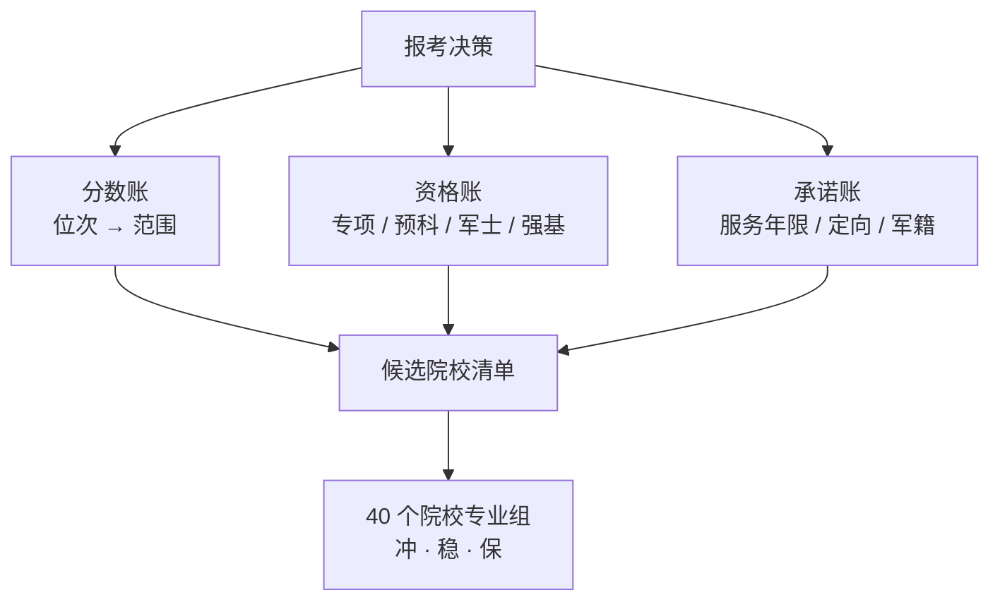
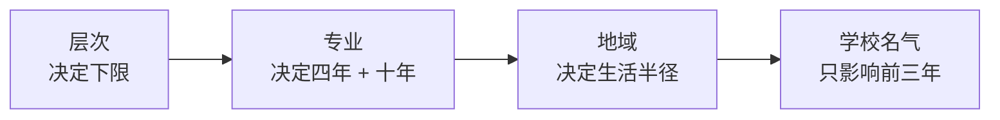
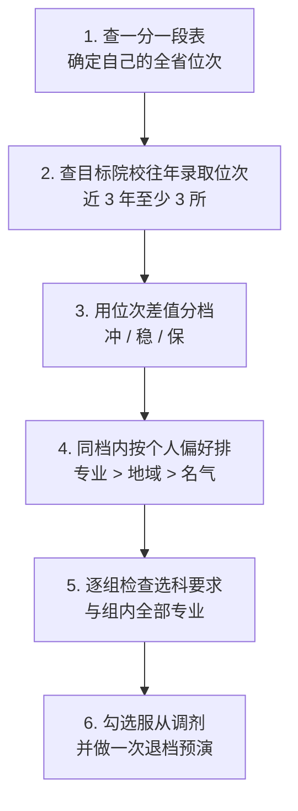
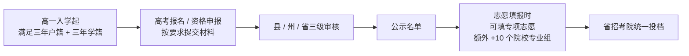

# 云南高考报考指南：选校、选专业与各类特殊计划（2026 官方口径）

| 编写人 | 编写内容 | 编写时间 |
| --- | --- | --- |
| growdu | 上一篇讲**规则**（分怎么来、志愿怎么填、投档怎么走），这一篇讲**决策**——**学校、地域、专业怎么选**，**强基/综合评价/三大专项/民族预科/军校这些特殊通道各自的门槛与代价**，以及**录取环节里最容易把人漏掉的 24 个坑**。政策数字全部以云南省招生考试院 2026 年公开口径为准。 | 2026-11-11 |

> **TL;DR**
>
> **三个最贵的误解**：
> ① **"专项计划是降分录取"** —— 错。专项是**另一批计划、另一批资格人群**在竞争。2025 年云南大学国家专项最低 **590 分**，比它自己普通组最低（569）还高 21 分；昆明理工专项 585–589，比普通组 545 高出 40 分。**专项的价值在"资格"，不在"分数"**。
> ② **"提前批填了不影响本科"** —— 只对了一半。**提前批没录取不影响本科批**；但**一旦被提前批录取，后面所有批次志愿全部作废**。军校的诱惑在于专业和就业，而不在于分数低。
> ③ **"专业服从调剂是保底用的"** —— 调剂**只在院校专业组内**进行，不跨组。填了服从调剂 = 用"组内任意一个专业"换"不被退档"；不填 = 组内任何一个专业都不接受，直接退档。**这两个选项的差别，是你未来四年的专业。**
>
> **三句话讲完怎么选**：
> - **学校**：先定**层次**，再定**地域**，最后才在同层次里挑名气——因为**层次决定你的下限，名气只影响前三年**；
> - **专业**：专业**影响的时间比学校长**（转专业难、就业看专业、考研看专业），**同层次里优先选专业**；
> - **地域**：云南的高等资源**高度集中在一城**，出省是"用四年换一个更大的平台"，省内是"用四年换一个更近的家"。
>
> **口径说明**：本文以 **2026 年**云南省招生考试院公开发布的口径为准（网上填报志愿考生须知、志愿填报百问百答、军队院校招收政治考核公告、各高校招生简章）。**2025 年的录取分与位次为往年参考值**，来自公开汇总，仅供定位用，**不代表 2026 年的分数线**。核对入口见文末。

---

## 目录

- [一、先把报考这件事拆成三笔账](#一、先把报考这件事拆成三笔账)
- [二、学校怎么选：层次、地域、专业谁是第一](#二、学校怎么选：层次、地域、专业谁是第一)
- [三、地域怎么选：留在云南还是出去](#三、地域怎么选：留在云南还是出去)
- [四、专业怎么选：比选学校更影响前三年](#四、专业怎么选：比选学校更影响前三年)
- [五、40 个志愿怎么排：冲稳保的正确写法](#五、40-个志愿怎么排：冲稳保的正确写法)
- [六、自主招生与提前通道总览](#六、自主招生与提前通道总览)
- [七、三大专项计划：国家专项、地方专项、高校专项](#七、三大专项计划：国家专项、地方专项、高校专项)
- [八、少数民族预科班与民族班](#八、少数民族预科班与民族班)
- [九、军校、公安院校与定向培养军士](#九、军校、公安院校与定向培养军士)
- [十、录取环节最容易忽视的 24 个问题](#十、录取环节最容易忽视的-24-个问题)
- [十一、按时间倒排的行动清单](#十一、按时间倒排的行动清单)
- [十二、一页纸速查表](#十二、一页纸速查表)

---

## 一、先把报考这件事拆成三笔账

大多数考生把"报考"理解成一道题：**我考了多少分，能上哪所学校**。这个模型漏掉了至少一半的变量。真实的报考是**三笔账同时结算**。

### 1.1 三笔账

| 账目 | 问的问题 | 决定什么 | 什么时候结算 |
| --- | --- | --- | --- |
| **分数账** | 我的位次能到哪里？ | 候选院校的**范围** | 高考出分那一刻 |
| **资格账** | 我手里有哪几张通行证？ | 候选院校的**入口**（能不能报） | 高一高二就要开始攒 |
| **承诺账** | 录取之后我要付出什么？ | 候选院校的**代价** | 填志愿那一刻 |



**这三笔账的关系是"取交集"，不是"取并集"。**

举一个具体的例子：一名云南物理类考生，模考 620 分（全省约 4500 位），户籍在昭通某县、该县属于 88 个国家专项县区之一。

- **分数账**：620 分对应 4511 位左右，够得着昆明医科大学（2025 最低 620/4511）、云南大学 03 组（614/5801）——这是**普通批**能覆盖的范围；
- **资格账**：他同时有国家专项资格，可以报一批国家专项计划里**更好的学校**（比如省外 985 的专项名额）；
- **承诺账**：如果报了**地方专项**，通常意味着毕业后要回定向县工作；如果报了**定向军士**，意味着 5 年服役 + 3 年学费资助。

**所以真正的问题不是"620 分能去哪"，而是"620 分 + 国家专项资格 + 愿意接受什么承诺，最优解是什么"。** 只算分数账，等于自动放弃了另外两笔账带来的全部增益。

### 1.2 资格账的六张通行证

云南考生常见的、可提前 1–3 年布局的"资格"有以下几类（详见后续章节）：

| 通行证 | 什么时候开始攒 | 能不能补 | 对应章节 |
| --- | --- | --- | --- |
| **选科组合** | 高一 | **不能补** | 见 [政策篇 §四](../yunnan-policy/index.html) |
| **国家专项** | 高一入学（连续三年户籍 + 学籍） | **不能补** | [§七](#七、三大专项计划：国家专项、地方专项、高校专项) |
| **地方专项 / 高校专项** | 高一入学（连续三年农村户籍 + 学籍） | **不能补** | [§七](#七、三大专项计划：国家专项、地方专项、高校专项) |
| **少数民族预科资格** | 高考报名时确认民族成分 | 能（在报名阶段申报） | [§八](#八、少数民族预科班与民族班) |
| **强基计划入围** | 4 月报名，校测入围 | 不能（今年只有一次） | [§六](#六、自主招生与提前通道总览) |
| **军籍 / 军士 / 公费师范** | 高考报名 + 政考体检 | 不能 | [§六](#六、自主招生与提前通道总览)、[§九](#九、军校、公安院校与定向培养军士) |

> **最重要的一条**：**"连续三年"这三个字是硬约束**。国家专项要求户籍所在县**连续三年以上**（2023-09-01 前转入）且在户籍所在县高中**连续三年学籍并实际就读**；地方专项/高校专项要求连续三年以上**农村户籍**并在同校实际就读。这意味着——**高三才想到自己可能是专项考生，基本来不及了**，必须高一、高二就在状态。

### 1.3 承诺账：三类"录取即绑定"

云南的提前通道里，有三类计划是**录取即绑定**，不是"先上着，以后再说"：

| 类型 | 典型代表 | 承诺内容 | 违约后果 |
| --- | --- | --- | --- |
| **服务期绑定** | 农村免费医学生、公费（定向）师范生 | 毕业回指定县服务（通常 6 年，含规培） | 违约需退还资助费用 |
| **服役期绑定** | 定向培养军士 | 至少服现役 5 年 | 提前退出现役按规定处理 |
| **就业定向绑定** | 地方专项、乡村振兴专项预科、定向西藏 | 毕业后回定向县/到定向地区就业 | 需签协议，拒签取消入学资格 |

**这三类必须在填志愿之前就想清楚**，不是填完再想。它们决定的是你**未来 5–10 年在哪**。

---

## 二、学校怎么选：层次、地域、专业谁是第一

### 2.1 三选一先做排序

"学校、地域、专业怎么选"这个问题，问错了顺序会浪费掉全部精力。**三个维度不是并列的，它们的正确优先级是：**



| 优先级 | 维度 | 为什么排这个位置 | 什么情况下可以提前 |
| --- | --- | --- | --- |
| **1** | **层次** | 层次决定了你的**下限**——普通二本和双一流之间差的不是名头，是**保研率、转专业机会、实习渠道、校友网络**这些结构性资源 | 很少能提前。层次主要由分数账决定 |
| **2** | **专业** | 专业影响**四年的日常 + 就业方向 + 考研选择 + 考公岗位表**。学校可以换赛道，专业很难换 | **可以提前**：高一选科时就要倒推专业 |
| **3** | **地域** | 地域影响生活成本、家庭距离、就业市场半径、气候 | 可以通过"选省内的好学校"或"出省的好学校"提前设计 |
| **4** | **名气** | 名气主要影响**前三年**（保研/实习/校招简历筛选），工作 5 年后基本被履历盖过 | 基本不构成决策依据 |

> **一句话**：**同层次里，优先选专业；同专业里，优先选地域；同层次同专业，再看名气。**

### 2.2 云南 37 所本科的层次地图

云南省现有 **37 所本科院校**：**27 所公办 + 10 所民办**。下表是 2025 年第三方榜单（校友会）对云南**公办本科**院校的层次参考，**仅用于建立"云南境内院校大致在什么位置"的概念**，不是官方排名，也不能替代官方招生计划：

| 梯队（第三方榜单参考） | 院校 |
| --- | --- |
| **第一档** | 云南大学（全国第 90 位量级） |
| **第二档** | 昆明理工大学 |
| **第三档** | 云南民族大学 |
| **第四档** | 云南师范大学 |
| **第五档** | 昆明医科大学 |
| **第六档** | 云南财经大学、云南农业大学（并列） |
| **第七档** | 西南林业大学、大理大学 |
| **第八档** | 云南艺术学院 |
| **第九档** | 昭通学院 |

**读这张表要读出三件事**：

1. **云南没有"双一流"以外的全国顶尖名校**（云南大学是唯一的"双一流"）。这意味着**如果你执意留在省内，天花板是明确的**——想突破这个天花板，只能出省。
2. **省内公办本科的第一梯队（云大、昆工）位次相当高**（2025 年物理类云大 03 组最低 614/5801，昆工各组多在 545–600 区间），**和省内普通一本已经不在一个层次上**。
3. **省内还有大量"独立学院转设"的民办本科**（滇池学院、昆明城市学院、丽江文化旅游学院等），它们在民办里位置靠前，但**与公办不在一条赛道上**，这一点后面会说。

### 2.3 省内公办 2025 物理类录取分与位次（参考）

> **数据性质说明**：下表为 **2025 年**公开汇总的录取数据（**非省招考院官方发布，仅作定位参考**）。**2026 年的实际分数线、位次会变**，使用前必须以当年《填报志愿指要》和一分一段表重新核对。

| 院校 / 组别 | 2025 物理类最低分 | 对应位次 | 相对 2025 物理类本科线 430 |
| --- | ---: | ---: | ---: |
| 昆明医科大学 | 620 | 4511 | +190 |
| 云南大学 03 组 | 614 | 5801 | +184 |
| **云南大学（普通组最低）** | **569** | — | **+139** |
| **云南大学（国家专项）** | **590** | **12809** | **+160** |
| **昆明理工大学（普通组最低）** | **545** | **33484** | **+115** |
| **昆明理工大学（地方专项）** | **589** | **13168** | **+159** |
| **昆明理工大学（国家专项）** | **585** | **14638** | **+155** |
| **昆明医科大学（国家专项）** | **581** | **16174** | **+151** |
| **昆明医科大学（地方专项）** | **579** | **16984** | **+149** |
| **云南大学（预科班）** | **574** | **19142** | **+144** |
| 云南大学（合作办学，高收费） | 573 | — | +143 |
| 云南师范大学 | 554 | 29087 | +124 |
| 云南民族大学 | 549 | 31830 | +119 |
| 云南中医药大学 | 544 | 34605 | +114 |
| 大理大学 | 550 | 31275 | +120 |
| 西南林业大学 | 515 | 52004 | +85 |
| 云南农业大学 | 507 | 57508 | +77 |
| 红河学院（省内公办垫底参考） | 461 | — | +31 |
| 最低公办物理（合作办学高收费） | 433 | — | +3 |

**这张表最值得看的，是加粗的那几行。**

**专项组的分数全面高于同校普通组**：

- 云南大学：普通组最低 **569**，国家专项 **590**，**专项高 21 分**；
- 昆明理工大学：普通组最低 **545**，专项 **585–589**，**专项高 40–44 分**。

这在数学上完全说得通：**专项计划是单独划出来的一批计划**，报的人只有符合资格的那一群（88 个县 / 100 个县的农村学生），**竞争的是那一小撮人**，而不是全省考生。

> **所以"专项是给低分生的降分通道"这个说法，在云南的数据上直接不成立。** 专项真正给你的是——**用同样的分数，够到本来够不到的更好的学校**（省外 985 的专项名额），而**不是**在省内降分捡漏。

### 2.4 民办本科的现实位置

2025 年历史类民办本科最低录取分（参考值）：

| 院校 | 2025 历史类最低分 |
| --- | ---: |
| 昆明理工大学津桥学院 | 482 |
| 滇池学院 | 474 |
| 昆明医科大学海源学院 | 474 |
| 云南工商学院 | 466 |
| 昆明文理学院 | 465 |
| 昆明传媒学院 | 465 |
| 云南经济管理学院 | 458 |
| 昆明城市学院 | 447 |
| 丽江文化旅游学院 | 426 |

**看这张表要注意一个事实**：这些分数**普遍高于或接近历史类本科线（465）**，也就是说——**上民办本科，在云南不是"没书读"的兜底，而是要真刀真枪跟公办竞争的结果**。最差的民办本科（426）也只是比本科线低 39 分，仍然远高于专科线。

**选民办本科前必须问的三个问题**：

1. **学费多少？** 民办普遍 1.5–2.5 万/年，四年 6–10 万，是公办的四到十倍。这笔钱要和你未来的收入预期放在一起算。
2. **有没有"公办"的内核？** 比如**云南大学（合作办学）**、**昆明理工大学（合作办学）**——学校牌子是公办母体，但**专业通常是高收费专业，且部分专业不出具普通本科学籍**。这是**分数换不来的东西**，得提前确认。
3. **它在哪座城市？** 多数民办本科集中在昆明，个别在丽江、楚雄等地。**在昆明读一个一般院校 vs 在地州读一个同层次院校**，生活成本差一大截。

### 2.5 选校的四条硬判断

| # | 判断 | 具体做法 | 别信什么 |
| --- | --- | --- | --- |
| 1 | **用位次，不用分数** | 拿当年一分一段表，把你的位次和目标院校往年位次对齐 | "去年 600 分今年也能报 600 分的" |
| 2 | **查专业，不是查学校** | 在阳光高考上逐个专业查**选科要求 + 单科成绩要求 + 体检受限** | 学校名录取线最低的那个专业 |
| 3 | **看组内专业全名单** | 院校专业组里有 10 个专业，你要能接受**任何一个** | 只看组内第一志愿那个专业 |
| 4 | **算承诺成本** | 定向类把服务期折算成现金，民办把四年学费折算进去 | "先上了再说" |

---

## 三、地域怎么选：留在云南还是出去

### 3.1 云南的高等教育格局：一城独大

云南省内本科院校**绝大多数集中在昆明**（云南大学、昆明理工大学、云南师范大学、云南民族大学、昆明医科大学、云南财经大学、云南农业大学、西南林业大学、云南艺术学院、昆明冶金高等专科学校等），地州主要有**大理大学、昭通学院、红河学院、文山学院、楚雄师范学院**等。

**这个格局决定了两件事**：

1. **在省内读本科，"在不在昆明"几乎等同于"是不是公办"**。非昆明的公办本科（大理大学、昭通学院等）在**层次上明显低一档**（红河学院 2025 物理类 461，已是省内公办垫底），但在**生活成本和就业半径**上占优。
2. **出省就是离开这个单一市场**——意味着放弃本地校友密度，换取更大的平台和更宽的就业地域。

### 3.2 省内 vs 省外：三条真实差异

| 维度 | 留在云南 | 出省 | 怎么判断 |
| --- | --- | --- | --- |
| **平台上限** | 天花板是云大/昆工 | 可以够 985 / 双一流 / 强势省属高校 | 你是否够到省外同层次更好的学校？ |
| **就业半径** | 主要面向省内国企、公务员、事业单位、部分省外企业在滇分支 | 面向全国，行业选择更宽 | 你的专业是全国性岗位还是本地性岗位？ |
| **生活成本** | 昆明租房与生活成本明显低于一二线；地州更低 | 一线/新一线成本高出 1.5–3 倍 | 家里是否需要你反哺？ |

**第三条经常被忽略**：如果家庭经济需要你本科后就开始反哺，**出省的一线城市会把 4 年变成 8 年的经济负担**。这时"省内公办层次低一档"往往比"省外高一层但成本翻倍"更划算。

### 3.3 地域选择里的四个隐藏变量

| 变量 | 说明 | 问自己的问题 |
| --- | --- | --- |
| **目标行业的地理集中度** | 互联网、金融、外科医疗、法律等高度集中在一线与强省会；地质、矿业、电力、师范（省内定向）在云南本地更有优势 | 我要去的行业，**在云南有总部吗**？ |
| **气候与身体** | 昆明"四季如春"是真实的居住优势，但湿冷/紫外线强对部分人是负担 | 家里有没有人适应不了 |
| **家庭距离与照护** | 父母年龄、是否有需要照护的长辈 | 四年 + 三年读研后，我还能不能常回家 |
| **人脉网络的归属** | 在昆明读大学，实习、兼职、导师、校友全在本地 | 我要在这座城市**工作**吗？**如果不在，这段人脉我用得上吗**？ |

### 3.4 一张地域决策表

| 你的情况 | 建议倾向 |
| --- | --- |
| 想读**省内顶尖**（云大、昆工），且专业在省内有强需求（法律、医药、师范、电力、矿业） | **留在云南**，把层次优势吃满 |
| 分数够省外 **985 / 强势双一流**的普通组，目标是全国性行业（计算机、金融、航天、基础科学） | **出省**，平台跃迁值得 |
| 分数够省外院校但只能上**民办 / 独立学院**，而省内公办有相近层次可选 | **留省内公办**，性价比差距太大 |
| 分数只够**省内民办** vs **省外公办高职/专科**，且要读专科 | 认真算**四年学费总额**再决定 |
| 家庭需要你本科后反哺 | **优先省内**（公办 + 低成本 + 本地就业） |

> **提醒**：以上是**倾向性建议，不是结论**。真正的决策依据是你**要去哪个行业、要在哪个城市工作、家里需要你做什么**——这三个问题答完，地域基本自己会浮出来。

---

## 四、专业怎么选：比选学校更影响前三年

### 4.1 三个筛选信号

选专业不要靠"喜欢/不喜欢"拍脑袋，用三个可验证的信号：

| 信号 | 含义 | 怎么查 |
| --- | --- | --- |
| **可迁移性** | 这个专业的能力/知识，**能不能带到你未来想去的任何行业** | 想象 5 年后你想去三类公司，这个专业让你能做什么 |
| **准入门槛** | 能不能**跨专业考研/跨行业就业**，或者门槛高到锁死这条路 | 看看该专业有多少比例的学生考研、考研方向集中度 |
| **天花板** | 这个专业的**头部**长什么样（研究科学家？医生？工程师？管理层？） | 查该专业 Top 院校的典型职业路径 |

**举例**：

- **计算机类**：可迁移性极高（学什么语言/方向都行），门槛中等（学历+项目），天花板高。**适合基础一般但想留出选择权的人**。
- **临床医学**：可迁移性低（几乎锁定从医），门槛高（5+3、规培、专硕），天花板高但路径极长。**适合能熬的人**。
- **汉语言文学 / 法学**：可迁移性中等（考公考编适配广），门槛中低，天花板看平台。**适合目标明确指向体制内的人**。
- **生物科学 / 环境科学 / 农林类**：可迁移性低，门槛中，天花板中低，且**读研几乎是必需品**。**适合真心喜欢且确定读研的人**。

### 4.2 物理类与历史类的专业地图

云南 2026 年**普通类分物理科目组合、历史科目组合分别编制**院校专业组及招生专业计划，两者的可选范围差别很大。

| | 物理类 | 历史类 |
| --- | --- | --- |
| **可报专业** | 理工农医为主 + 少量文史（按选科要求） | 文史法教为主 + 少量理工（需物化组合） |
| **计划总量** | 相对多 | 相对少，**竞争更集中在少数院校** |
| **可报院校层次** | 覆盖最全，可达省内公办全层次 + 省外大量理工科强校 | 头部院校（尤其 985 的热门文科专业）**可选面窄** |
| **典型路径** | 工程、理科、医科、军校（绝大多数）、定向军士、预科 | 师范、法学、语言、管理、部分定向师范、预科 |

> **一个必须提前知道的结论**：**历史类在云南的院校可选面明显窄于物理类**。同样 560 分，物理类能报的院校组合数量、可报专业数量、层次跨度都更大。所以——**选科不是纯偏好问题，它同时是一次资源配置决策**。（选科的具体规则见 [政策篇 §四](../yunnan-policy/index.html)）

### 4.3 医学、师范、军校：三条代价明确的路

这三条路的共同点是：**代价在前四年之前就已经写好了**。

| 路径 | 代价 | 收益 | 适合谁 |
| --- | --- | --- | --- |
| **医学（临床）** | 5+3 年 + 规培，读到博士是常态；本科阶段几乎无自由 | 稳定、高天花板、社会认可度高 | **确定能熬**、家庭能支持、无强烈即时回报诉求 |
| **师范（公费/定向）** | 服务期 + 农村/边远就业可能 | 工作稳定、有编制路径 | **明确想进体制内**、能接受去边远地区 |
| **军校** | 军籍 + 服从分配 + 体检政考门槛 + 30 日复审不合格即取消 | 专业、就业、待遇一体化 | **能适应高度纪律性**、且体检政考过关 |

**这三条路的"代价"必须在填志愿前就想清楚**，因为它们都不是"进去了再后悔还能退出"的设计。

### 4.4 五个常见误区

| # | 误区 | 实际情况 |
| --- | --- | --- |
| 1 | **"我分数高，专业随便挑"** | 组内调剂、专业级差、单科成绩要求、性别限制（部分军警类）、体检受限（色弱色盲影响化工、设计、飞行）——**限制会直接把你筛掉** |
| 2 | **"文科生专业少，就只能选管理类"** | 历史类可报的**法学、师范、中文、财会、外语、护理、康复、地理科学**等并不少；关键在**提前按选科要求倒推** |
| 3 | **"热门专业一定好"** | 热门 = 竞争者多 = 同分数被挤出。**冷门但对口的专业，在就业端可能是优势** |
| 4 | **"先随便填，进去再转专业"** | 转专业受**名额、成绩、学院意愿**三重限制，热门专业几乎转不动；**且转专业后课程要补修** |
| 5 | **"专业名称好听的就业就好"** | 看**专业培养方案和去向**，不看名字。名字会改，技能不会 |

---

## 五、40 个志愿怎么排：冲稳保的正确写法

### 5.1 先定位，再排序

40 个志愿不是凭感觉从高到低排下来的。正确顺序是：



### 5.2 冲稳保的比例

一个可执行的参考排布（**不是硬规则**）：

| 档位 | 组数（40 组里） | 位次口径 | 说明 |
| --- | ---: | --- | --- |
| **冲** | 8–10 | 目标院校往年最低位次 **比你靠前 5%–20%** | 录上是赚到，录不上不亏 |
| **稳** | 18–20 | 往年最低位次 **与你相当或略靠后 5%** | 主力区间，录取概率最高 |
| **保** | 8–10 | 往年最低位次 **比你靠后 10% 以上**，或层次明显低一档 | 底线，确保**不滑档** |

> **两个细节**：
> ① **"保"必须有**。平行志愿只有一轮投档，**一个批次内退档后没有第二次机会**（只能等征集志愿）。没有保底组 = 拿本科赌专科。
> ② **同一位次口径下，"冲"的学校不要超过 10 个**。冲太多 = 有效稳保被挤掉，等于没做梯度。

### 5.3 组内 10 个专业怎么排

院校专业组内可以填 10 个专业，**按你自己的接受度从高到低排列**：

| 位置 | 放什么 |
| --- | --- |
| 1–3 | **最想去的**，这里放得下心仪专业，命中即最优 |
| 4–7 | **能接受但不是首选的**——不要在这里放"完全不能接受"的 |
| 8–10 | **保底位**（如果组内有的话），但**如果一个都不能接受，就应该整体不填这个组** |

> **关键原则**：这 10 个专业是**"你能接受的集合"**，不是"你想去的 + 不可接受的凑数"。因为服从调剂是在这个集合里做选择。

### 5.4 "服从调剂"到底在赌什么

| 选项 | 实际发生什么 |
| --- | --- |
| **勾选服从调剂** | 投档到这个组后，若你填的 10 个专业都不够分/有身体限制，院校在**组内**安排一个你填过的、你分数够、且**符合你选科与体检要求**的专业 |
| **不勾选** | 只要你填的任何专业都不满足，**直接退档**。退档 = 本批次后面所有志愿作废 |

**两个必须知道的边界**：

1. **调剂不跨组**。一个组调剂出来的专业，一定是你在这个组里填过的专业之一。
2. **调剂不会跨大类去给你一个"从没填过的"专业**。所以**"组内随便填，反正还能调"是错的**——你填的那 10 个专业，就是你的全部底牌。

### 5.5 填完必做的一次"退档预演"

在确认提交前，用 3 个问题自检：

1. 如果我的位次比预期掉了 3000 名，我会被哪个组接住？那个组我**真的能接受**吗？
2. 我填的每个组里，**有没有一个专业是我绝对不能接受的**？如果有，那个组不能填，或者必须确认该组内该专业不会被调剂到（做不到，所以更该慎填）。
3. 我的**单科成绩**（尤其语文/外语）和**体检结论**，能不能满足我最想去的那个专业？

---

## 六、自主招生与提前通道总览

### 6.1 一张表看全云南的提前通道

云南 2026 年的录取顺序是：

```
强基计划批 → 香港自主招生院校 → 提前本科批（A → B → C → D 四段）
→ 本科批 → 高本贯通批 → 提前高职专科批 → 高职专科批
```

提前本科批四段的分工：

| 段 | 装的是谁 | 志愿设置 |
| --- | --- | --- |
| **A 段** | 国家优师专项、地方优师专项、免费定向计划（分县区定向/州市定向/全省定向）、省属免费医学生、公费定向师范生、**定向西藏** | 各类均为**县区志愿**：国家优师专项 15 个县志愿（每县 1 专业 + 3 院校）；地方优师专项 15 个县志愿（每县 1 专业 + 2 院校）；免费定向计划分县区/州市/全省定向各 5 个县志愿（每县 1 专业 + 3 院校） |
| **B 段** | **军队院校**、**公安院校公安专业** | 10 个院校专业组，每组 10 个专业 |
| **C 段** | 消防、招飞、航海、**综合评价**院校 | **仅 1 个**院校专业组，下设 10 个专业 |
| **D 段** | 国家公费师范、香港高校、特殊重点院校 | 10 个院校专业组，每组 10 个专业 |

**普通类其余批次**：本科批 40 个院校专业组；高本贯通批 20 个组 × 1 专业；提前高职专科批 1 个组 × 10 专业；高职专科批 20 个组 × 10 专业。

### 6.2 强基计划

| 项目 | 云南 2026 口径 |
| --- | --- |
| 报名时间 | **4 月启动，4 月 30 日截止**（各校截止时间不同，系统关闭后不能补报） |
| 报名平台 | 学信网账号登录，**每人限报 1 所高校** |
| 录取时点 | **在提前本科批录取开始前**，单独投档 |
| 对后续志愿的影响 | **未被强基录取，不影响后续普通批次志愿**；**被强基录取，则不再参加后续批次录取** |
| 招生专业 | 数学、物理、化学、生物、力学、历史、哲学、古文字学、基础医学等**基础学科**，以及核技术、生物育种等国家重大战略领域 |

**强基计划到底值不值得报？** 三个判断：

1. **它不"降分"**，它改变的是**录取通道**——强基的录取依据是**高考成绩 + 校测成绩 + 综合公式**，校测（笔试/面试/体测）在其中占相当权重，所以**平时成绩稳定、面试能说清楚的人更有优势**。
2. **它的专业很窄**——全是基础学科。想报计算机、金融、临床的，**强基帮不上忙**。
3. **它的代价是"锁专业"**——一旦被强基录取，专业基本定死，且不再参与普通批。

> **建议**：**基础学科有意向 + 校测准备充分 → 必须报**（限报 1 所，别浪费在没准备的学校上）；**只想读热门应用专业 → 可以不报**，把精力放在普通批的 40 个组上。

### 6.3 综合评价

综合评价在云南 2026 年安排在**提前本科批 C 段**（与消防、招飞、航海同段），**C 段只设 1 个院校专业组、10 个专业**——这意味着**报综合评价的机会非常有限，值得单独做规划**。

综合评价的一般流程：

| 环节 | 内容 |
| --- | --- |
| 报名 | 4 月启动，各校时间不同，**学信网或高校招生网** |
| 高校审核 | 高校自行审核报名材料，公示 |
| 校测 | 高考后由高校组织（笔试/面试/体测，各校不同） |
| 录取 | 按省招考院投档，**录取在提前本科批 C 段**，进档后不再参加后续批次 |
| 对普通批的影响 | 同强基：**不影响**后续普通批志愿；但**一旦录取，后续批次作废** |

> **各省的综评试点院校名单不同**（2026 年江苏省就有 24 所高校开展试点），**云南具体哪些高校在云南投放综评计划、名额多少，必须以当年省招考院《填报志愿指要》和高校简章为准**，本文不列名单以免误导。

### 6.4 优师专项与免费定向计划

| 计划 | 志愿形态 | 特点 |
| --- | --- | --- |
| **国家优师专项** | **15 个县志愿**，每个县志愿 1 个专业 + 3 所院校 | 面向**国家乡村振兴重点帮扶县**的定向师范生，毕业后回县任教 |
| **地方优师专项** | **15 个县志愿**，每个县志愿 1 个专业 + 2 所院校 | 面向**省级确定的县**的定向师范生 |
| **免费定向计划** | 分**县区定向 / 州市定向 / 全省定向**三类，**各类 5 个县志愿**，每县 1 个专业 + 3 所院校 | 定向到县区/州市/全省范围的公费定向培养（师范、医学等） |

**这类计划的三个特点**：

1. **是"县志愿"不是"院校专业组"**——填法完全不同：一个县志愿里同时给 1 个专业和 3 所院校，**3 所院校之间会按投档情况排序录取**。
2. **分数低是设计的一部分**，但**服务承诺是硬约束**——毕业要回定向单位，通常有服务期。
3. **优师专项是"教师编制"的快速通道**，适合**确定要当老师**、且**能接受去县乡**的人。

### 6.5 公费师范生与农村免费医学生

| | 公费师范生 / 公费（定向）师范生 | 农村免费医学生 |
| --- | --- | --- |
| 批次 | 提前本科批 **D 段**（国家公费师范）、**A 段**（地方定向师范、免费定向） | 提前本科批 **A 段**（省属免费医学生） |
| 培养 | 师范类，本科 + 培养 | 临床医学类，**本科 5 年**（含规培衔接） |
| 服务 | 回指定学校/地区任教，**服务期通常 6 年** | 回指定乡镇卫生院/村卫生室，**服务期通常 6 年** |
| 费用 | 免学费、免住宿费、发放生活补助（具体以当年政策为准） | 同左 |
| 违约 | 需退还已享受的资助费用 | 同左 |
| 关键动作 | **农村免费医学生须在志愿确认环节完成资格审核** | 同左 |

**农村免费医学生的"确认时审核"是很多人漏掉的动作**——填完不算完成，**确认环节不通过资格审核，计划就白填了**。

### 6.6 高本贯通 3+2

2026 年新增的批次，给"本科线上下 30 分"这一分数段一条独立的升学通道。

| 项目 | 口径 |
| --- | --- |
| 性质 | 云南省内**本科高校与高职专科院校联合贯通培养** |
| 批次 | **高本贯通批**，安排在本科批之后、提前高职专科批之前 |
| 学制 | 高职 **3 年** + 本科 **2 年** = 5 年；前 3 年为**高职学籍**，第 3 学年上学期**转段测试**，第 4 学年上学期进入本科院校 |
| 志愿设置 | **20 个院校专业组，每组 1 个专业**（投档即锁定，无组内调剂） |
| 文化控制线 | 各科类本科线**下 30 分**；艺术类、体育类按**专科线**执行 |
| 转段测试性质 | **过程性 + 终结性评价，合格性转段原则，不是选拔性测试**；合格者由省招考院按"专升本"程序录取 |
| 转段失败/放弃 | 可转**高职同专业按专科毕业** |
| 毕业证 | **专科起点本科**（冠"贯通培养"字样），符合学位条例者授予学士学位 |
| 学费 | 前 3 年按**高职**标准、后 2 年按**本科**标准 |

**2026 年部分对接关系（供理解结构，不代表完整名单）**：

| 高职院校 | 对接本科院校与专业 |
| --- | --- |
| 云南交通职业技术大学 | 昆明理工大学城市学院（汽车服务工程）、云南农业大学（土木工程，物理 + 地理）、云南农业大学（人工智能）、西南林业大学 |
| 楚雄医药高等专科学校 | 药学（50 人）、医学检验技术（50 人）、康复治疗技术（30 人） |
| 德宏职业学院 | 保山学院（老年保健与管理，50 人） |
| 临沧职业学院 | 滇西应用技术大学（茶学，50 人） |
| 大理护理职业学院 | 大理大学（康复治疗学，50 人）、滇西应用技术大学（医养照护与管理，50 人） |
| 云南国土资源职业学院 | 昆明理工大学 / 云南农业大学 / 云南财经大学（共 140 人） |

**读这张表要注意三点**：

1. **专业是锁死的**——每组只有 1 个专业，填了就定，**没有组内调剂**。
2. **前 3 年在中职/高职读，氛围与本科不同**——要有心理准备。
3. **"合格性转段"意味着不是筛人，但也不是躺平**——转段测试是**过程性 + 终结性**评价，**摆烂会挂**。

---

## 七、三大专项计划：国家专项、地方专项、高校专项

**这一节是全文最容易被理解错的部分，先看结论。**

### 7.1 先纠正一个普遍误解：专项不是降分

| 常见说法 | 实际情况 |
| --- | --- |
| "专项计划是给农村娃降分" | **错**。专项是**单独划出来的一批计划**，报的人只有符合资格的那一群，竞争的是**那一小撮人**，不是全省考生 |
| "报了专项就能低分上名校" | **更错**。2025 年云南大学国家专项最低 **590 分**，比它自己普通组最低（569）**还高 21 分**；昆明理工专项 **585–589**，比普通组（545）高 40 分以上 |
| "专项没影响，随便报" | **错**。专项志愿**占用了本科批额外的 10 个组**，而且**报了专项 + 报了普通组，是两个不同的竞争池** |

**专项真正的价值，用一句话说清**：

> **专项给你的是"资格"——用同样的分数，去够一批**普通批够不到的名额**（尤其是省外名校的专项计划）；它不是"降价"。**

### 7.2 国家专项：88 个县区

| 项目 | 口径 |
| --- | --- |
| 覆盖范围 | 云南省 **88 个县区** |
| 计划性质 | 由**中央财政专项 funding**、高校定向招收的本科计划 |
| 录取方式 | 按**国家专项方式**录取 |
| 分数要求 | 2026 年起，**不低于特殊类型录取资格线**（2026 年物理类 505 / 历史类 545） |

### 7.3 地方专项与高校专项：100 个县市区的农村区域

| 项目 | 地方专项 | 高校专项 |
| --- | --- | --- |
| 覆盖范围 | 云南省 **100 个县市区的农村区域** | 同（按国家专项方式录取） |
| 录取方式 | 按**地方专项方式**录取 | **按国家专项方式录取**（2026 起） |
| 分数要求 | 不低于特殊类型录取资格线 | **不低于特殊类型录取资格线** |
| 2026 的变化 | — | **不再由高校组织报名、资格审核、校测；不单独发简章；改为省级审核** |

**2026 年高校专项的变化是这一节最该记住的一条**：

- 过去：高校自己发简章、自己报名、自己校测、自己录取；
- **现在（2026 起）：高校专项不再由高校组织报名 / 资格审核 / 校测，不单独发简章，改由省级审核，按国家专项方式录取**。

**这条变化的实际影响**：① **你不能指望通过"校测"获得额外优势了**；② **报名与审核走省级通道，时间节点要盯省招考频道**；③ 云南原本科批 A 段/B 段**合并为本科批**。

### 7.4 资格认定：三年三条件与时间点

**国家专项**（三个条件必须同时满足）：

| # | 条件 | 具体口径 |
| --- | --- | --- |
| 1 | **户籍** | 在 88 个县区之一**连续三年以上**具有户籍（**2023-09-01 前转入**） |
| 2 | **学籍与就读** | 在**户籍所在县**的高中**连续三年学籍并实际就读** |
| 3 | **父母或法定监护人户籍** | 父/母或法定监护人**在户籍所在县具有户籍** |

**地方专项 / 高校专项**（同样三个条件，但限定农村区域）：

| # | 条件 | 具体口径 |
| --- | --- | --- |
| 1 | **农村户籍** | 在 100 个县市区的**农村区域**连续三年以上具有**农村户籍** |
| 2 | **学籍与就读** | 在同校**连续三年学籍并实际就读** |
| 3 | **父母或监护人农村户籍** | 父/母或法定监护人具有**当地农村户籍**（按 **2024 年城乡划分代码**认定） |

> **两条硬约束**：
> ① **"连续三年"是从高一入学起算的**，不是高三那年想办法就能凑出来的；
> ② **随迁审核结论为受限的考生，不得报考专项计划**。

### 7.5 资格申报与审核的时间线

专项计划**必须先过资格申报审查**，才有资格填志愿：



**云南 2026 年的时间节点**：

| 时间 | 动作 |
| --- | --- |
| **6 月 14 日前** | 军队院校招生的**政治考核表**须填写完毕（交县级征兵办） |
| **6 月 26 日 8:00–18:00** | **志愿填报演练**（19:00 确认） |
| **6 月 28 日 – 7 月 2 日** | **正式填报**（7 月 2 日 18:00 截止，19:00 确认） |
| **7 月 7 日前** | 定向培养军士的县级征兵办通知 |
| **7 月 10 日前** | 州级征兵办组织体检政考 |

> **专项计划的额外 10 个志愿**：本科批基础 40 个院校专业组，**符合国家专项、地方专项、高校专项条件的各可再加 10 个**；**符合少数民族预科班条件的再加 10 个**。**但非专项、非预科部分的上限仍然是 40 个**——别以为加了专项就是 70 个普通组。

### 7.6 专项资格真正的价值

| 价值 | 说明 |
| --- | --- |
| **够到普通批够不到的批次** | 尤其省外 985 / 强势省属高校的专项名额，**这些名额在普通批里根本不存在** |
| **扩大选校池** | 多 10 个组 = 多 10 次机会，**是"多报"而不是"降分"** |
| **专业与地区定向** | 部分专项计划**指定到州/县**，也就是承诺了毕业去向 |
| **同校同专业，位置可能更优** | 专项组人数少，**同分段内的竞争强度低于普通组**（这是相对优势，不是绝对降分） |

### 7.7 三个必须注意的坑

| # | 坑 | 说明 |
| --- | --- | --- |
| 1 | **往年专项录取后放弃或退学，会丧失专项资格** | 这是**资格管理**，不是"填了不读也没事" |
| 2 | **专项计划的分数要求是"特殊类型录取资格线"** | 2026 年物理类 505 / 历史类 545，**不是本科线**——分数太低报专项，等于浪费一个组 |
| 3 | **专项 ≠ 定向就业**（部分计划除外） | 专项计划中**部分类别带定向就业义务**（如乡村振兴专项预科、面向特定地区的专项），**填之前必须读该计划的招生章程**，确认是否需要签订就业协议 |

---

## 八、少数民族预科班与民族班

### 8.1 两条通道的区别

云南把少数民族考生的本科通道分成**两条**，很多人混为一谈：

| | **民族班** | **少数民族预科班** |
| --- | --- | --- |
| 学制 | 一般 **4 年**，直接读本科 | **先 1 年预科**（1+4 年），考核合格后转入本科 |
| 录取线 | 不低于本科批各有关高校调档线**以下 40 分** | 不低于本科批各有关高校调档线**以下 80 分** |
| 招生对象 | **仅少数民族考生** | **仅少数民族考生**；本科预科志愿填报资格**仅限少数民族考生及边防军人子女预科班** |
| 毕业证 | 与普通本科相同 | 考核合格转本科后，**发与普通本科相同的毕业证与学位证** |

**一句话**：**民族班是"低 40 分直接上本科"，预科班是"低 80 分先读一年预科再上本科"。**

### 8.2 两条线的实际口径

| 项目 | 口径 |
| --- | --- |
| **投档规则** | 投档成绩达不到上述分数线的**不予投档** |
| **省属高校预科志愿** | 实行**平行志愿，设 20 个院校专业组** |
| **其他专项** | 另有「**乡村振兴专项预科**」「**民族团结进步示范班**」等专项类别 |

**要注意"调档线以下 40/80 分"是以"该高校在本科批的调档线"为基准**，不是以省本科线为基准。同样的 40 分，在不同高校对应的绝对分数不一样。

### 8.3 云南省属高校的预科志愿

- **云南省属高校的少数民族本科预科实行平行志愿，设 20 个院校专业组**；
- 每组按普通类规则填专业（每组 10 个专业 + 服从调剂）；
- 预科期间**学籍在预科阶段**，转段后才转入本科阶段。

### 8.4 2025 实际录取参考

> **数据性质**：2025 年公开汇总的往年参考值，**不代表 2026 年**。以当年《填报志愿指要》为准。

| 类别 | 2025 物理类最低分 | 相对 2025 物理类本科线（430） |
| --- | ---: | ---: |
| **省内预科最低**（滇西科技师范学院 / 玉溪师范学院） | **452** | **+22** |
| **省外预科最低** | **467** | **+37** |
| 云南大学（预科） | 574 | +144 |
| 昆明理工大学（预科） | 521 | +91 |
| 滇西应用技术大学（民族班） | 437 | +7 |

**这张表给出一个非常反直觉但重要的结论**：

> **少数民族预科班在云南，实际上"超本科线"录取。** 省内预科最低 452 分，**比 2025 年物理类本科线 430 高出 22 分**；省外预科最低 467 分，高出 37 分。

**为什么？** 因为预科的名额也是**按分数线竞争**的——预科的分数门槛只是**"可以投档的下限"**，不是"实际录取线"。实际录取线由**该批次的报考热度**决定。

**所以正确的认知是**：

1. **预科不是"低分捡漏通道"，而是一条"独立竞争通道"**——你和所有符合资格的少数民族考生一起竞争预科名额，**不是在普通批里打折**。
2. **省内预科（452）低于省外预科（467）**，说明**云南省属高校的预科竞争更激烈**（省内考生多、认可度高）。
3. **云南大学预科 574 分**——这个分数放在普通批里能上不少省内公办。**如果你能到 574 左右，预科班对你不是"福利"，而是"限制"**（限定了可选专业范围）。

### 8.5 预科生转段之后拿什么证

| 环节 | 结果 |
| --- | --- |
| 预科阶段 | 预科学籍，修读预科课程 |
| 转段考核 | 考核合格后转入本科阶段相应专业学习 |
| **毕业证** | **与普通本科相同的毕业证**（不含"预科"字样） |
| **学位证** | **与普通本科相同的学位证** |
| 未合格 | 按学校规定处理（通常无法转入本科） |

**但要注意**：**"预科一年"是实打实多花一年**，且预科阶段按专科/预科标准收费。这不是"没有代价的通道"。

### 8.6 四个必须提前想清楚的问题

| # | 问题 | 为什么重要 |
| --- | --- | --- |
| 1 | **我的分数到底够不够？** | 预科的实际录取线**可能高于本科线**（2025 年省内预科最低 452 > 本科线 430）。**不要按"低于本科线"去预期** |
| 2 | **专业能选什么？** | 预科可选专业**范围窄于普通批**，很多热门专业不开放预科计划 |
| 3 | **多读一年值不值？** | 如果你本来就能上普通本科同等层次的学校，**预科是"用一年换一个受限的选择集"，不划算** |
| 4 | **转段考核通过率如何？** | 各校口径不同，**必须查目标校的预科培养方案**，别只看招生简章 |

---

## 九、军校、公安院校与定向培养军士

这一章是**提前本科批 B 段和提前高职专科批**的内容，也是云南考生最容易被"看起来很美"的信息误导的地方。

### 9.1 提前本科批 B 段：两个硬门槛

军校的门槛不在分数，在**资格**：

| 门槛 | 具体要求 |
| --- | --- |
| **年龄** | **16–20 周岁**（截至 **2026-08-31**） |
| **婚姻状况** | **未婚** |
| **身体** | 高中阶段**体质测试及格以上**；高考后按军队标准体检 |
| **政治面貌/政考** | 需通过政治考核（由**县级征兵办**组织） |
| **分数** | 需预估达到**特殊类型录取资格线**（2026 年物理类 505 / 历史类 545） |

### 9.2 2026 年军校的盘子

| 项目 | 2026 年在云南招生口径 |
| --- | --- |
| 院校数量 | **15 所**军队院校 |
| 招生人数 | **576 人** |
| 结构 | 男生物理 **526** ｜ 男生历史 **14** ｜ 女生物理 **33** ｜ 女生历史 **3** |
| 批次 | **本科提前批**（B 段） |
| 体检标准 | 《军队选拔军官和文职人员体检标准》（军后卫〔2023〕116 号） |
| 费用 | **体检与面试同步进行，不收费** |
| 报名渠道 | 军队人才网 [www.81rc.mil.cn](https://www.81rc.mil.cn) |

**从这组数字能读出两件事**：

1. **男生物理 526 人**占绝对主体——**军校的主要机会在物理类男生**；
2. **女生历史只有 3 人**，女生历史类几乎不存在军校路径（公安院校和定向军士是另外的通道）。

### 9.3 政治考核：县级征兵办替你跑

这是 2026 年公告里**最省事也最容易被忽略**的一条：

| 环节 | 责任方 | 考生要做的 |
| --- | --- | --- |
| **填写《政治考核表》** | 考生填写，**6 月 14 日前**完成 | 交回**县级征兵办**（或学校），**考生不用自己跑政考** |
| **政治考核组织** | **县级征兵办**统一组织走访、调查 | **等待通知，配合问询** |
| **特殊政考** | 信息工程大学等部分院校 | **网络空间部队信息工程大学**：除测绘工程等 **7 个专业**外，其余专业需**特殊政考（走访调查）** |

> **"考生不用跑政考"是官方公告里明确写的**——很多家庭因为"怕麻烦"而放弃了军校这条路，这是**不必要的放弃**。

### 9.4 体检、面试与 30 日复审

| 环节 | 规则 |
| --- | --- |
| 体检 | 按《军队选拔军官和文职人员体检标准》（军后卫〔2023〕116 号）；与面试**同步进行**，**不收费** |
| 投档 | 按**院校调档比例**投档 |
| 征集志愿 | 计划不足时，从**政考、面试、体检合格但未被录取**的考生中征集，按**高分到低分 100% 投档** |
| 优先录取 | **烈士子女、因公牺牲军人子女、现役军人子女、一至四级残疾军人子女**等，在投档比例内**优先录取** |
| **入学复审** | **新生入学 30 日内复审复查，不合格者取消入学资格** |

> **"30 日内复审复查"是硬约束**：高考体检通过不等于入学体检通过。**有色弱色盲、身高视力体重不达标、有伤病史等情况的考生，务必提前查《体检标准》原文**，不要到 8 月底才知道。

### 9.5 公安院校

公安院校同样在**提前本科批 B 段**，但流程和军校不同：

| 环节 | 要求 |
| --- | --- |
| **体检** | 按公安院校体检标准（与军队标准不同） |
| **体能测评** | 需通过 |
| **面试** | 需通过 |
| **政治考察** | 由**云南省公安厅**（通过"云南警方"公众号等渠道）组织 |

**两者的关键差异**：军队的政考由**县级征兵办**组织，公安的政考由**省级公安机关**组织——**两条路的后台不一样，材料准备方式也不同**。

### 9.6 定向培养军士：完全不同的另一条路

定向培养军士是**提前高职专科批**录取，和军校是**两回事**（不是本科、不是军籍）。

| 项目 | 2026 年口径 |
| --- | --- |
| 招生院校 | **25 所**高校面向云南招生 |
| 招生人数 | **349 人**（含女军士 **2 人**） |
| 批次 | **提前高职专科批** |
| 年龄 | **不超过 20 周岁**（**2006-08-31 后出生**） |
| 婚姻 | **未婚** |
| **服役承诺** | 志愿**至少服现役满 5 年** |
| 政治身体条件 | 按**征集义务兵标准** |
| 体检对象 | 专科线上**按比例确定**；**超本科线（含）且填了军士志愿的全部纳入体检名单** |
| 体检政考时间 | **7 月 7 日前**县级征兵办通知；**7 月 10 日前**州级征兵办组织体检政考 |
| 逾期后果 | **联系不上或不按时参检，视为自动放弃** |
| 入伍时间 | 毕业当年 **3 月 1 日**入伍 |
| 军衔起算 | 自毕业当年 **9 月 1 日**起算 |
| 期间待遇 | 按**第一年度义务兵标准**发放津贴 |
| 身体不合格 | 因身体原因不适宜服现役 → **取消定向培养资格**，按普通地方生调整班次；**淘汰计划不再递补** |

**三个必须看清的点**：

1. **这是专科**（提前高职专科批），**不是本科**——和军校完全不是一个学历层次。
2. **"超本科线且填了军士志愿的全部纳入体检名单"** 是有利条款——**只要你填了且超本科线，就有体检机会**，体检合格就有录取可能。
3. **"因身体原因不适宜服现役 → 取消定向培养资格，按普通地方生调整班次"** —— 这条是兜底，不算最坏，但意味着**你的五年服役计划可能落空**，要有 Plan B。

### 9.7 两条路的对照表

| 维度 | **军队院校** | **定向培养军士** |
| --- | --- | --- |
| 批次 | 提前本科批 B 段 | 提前高职专科批 |
| 学历 | **本科** | **专科** |
| 招生规模（云南 2026） | 15 校 **576 人** | 25 校 **349 人** |
| 年龄上限 | 20 周岁（截至 2026-08-31） | 20 周岁（2006-08-31 后出生） |
| 组织方 | 军队院校 + 县级征兵办（政考） | 高校 + 征兵办（体检政考） |
| 核心承诺 | 军籍 + 服从分配 | 至少服役 **5 年** |
| 入学复审 | **30 日内复审复查，不合格取消入学资格** | 体检政考前置 |
| 主要风险 | 体检复审不合格、政考不通过 | 身体不合格被取消资格 |
| 适合谁 | 要本科学历 + 要稳定职业方向 | 要低分上一条确定的、有资助的服役 + 就业路径 |

---

## 十、录取环节最容易忽视的 24 个问题

这一章是**逐条对照官方口径整理的避坑清单**。前 8 条是**资格与材料**（填错就白填），中间 8 条是**志愿与投档**（排错就白排），后 8 条是**体检、复审与后续**（录取后仍可能翻车）。

### 10.1 资格与材料（1–8）

| # | 问题 | 后果 / 正确做法 |
| --- | --- | --- |
| 1 | **少数民族预科志愿，填报资格只有少数民族考生和边防军人子女预科班** | 不是少数民族考生，**填不进去**（系统限制） |
| 2 | **专项计划必须先过资格申报审查** | 没审过 = 填不了专项。**这是"报名时"的动作，不是"填报时"的动作** |
| 3 | **随迁审核结论为受限的考生，不得报考专项计划** | 受限考生只能按限制范围报（见第 8 条） |
| 4 | **随迁受限考生的可报范围** | "限报省属院校" → 只能报本科批**云南省属院校/独立学院/民办**、高本贯通批及全部高职专科；"限报原二本民办院校及高职专科" → 只能报**独立学院或民办**及除高本贯通批外的高职专科 |
| 5 | **农村免费医学生须在志愿确认时完成资格审核** | **填了不等于完成**。确认环节不通过，计划白填 |
| 6 | **定向西藏须签《报考定向西藏就业志愿申请书》并由家长签字** | 录取后须与西藏自治区人社厅（定向教师培养为教育厅）、学校三方签协议；**拒签不予报到注册，取消入学资格** |
| 7 | **往年专项计划录取后放弃或退学者，丧失专项资格** | 专项资格**有后续管理**，不是填了不读也没事 |
| 8 | **艺术类与体育类不能互填** | 艺术、体育考生**可以兼报普通类**（未被录取则继续参与同批次普通类投档）；但**普通类考生不得兼报艺术类、体育类** |

### 10.2 志愿与投档（9–16）

| # | 问题 | 后果 / 正确做法 |
| --- | --- | --- |
| 9 | **提前批未录取不影响本科批，但提前批已录取，后面全部作废** | 报军校/公安/公费师范 = **同时放弃普通批的 40 个组** |
| 10 | **强基计划入围者仍须参加志愿填报** | 但**无需填强基志愿**；被强基录取即不再参加后续批次 |
| 11 | **本科批退档不会直接去专科批** | 先参加**本科征集志愿**，征集结束才进入高本贯通、专科批次 |
| 12 | **轮次顺序是强基 → 港校自主招生 → 提前本科批（A→B→C→D）→ 本科批 → 高本贯通 → 提前高职专科 → 高职专科** | 同一批次内**先投艺术体育，再投普通类** |
| 13 | **提前本科批 A 段填的是"县志愿"，不是院校专业组** | 每县志愿 1 专业 + 3 院校（国家优师）/ 1 专业 + 2 院校（地方优师）；**填法与 B/C/D 段完全不同** |
| 14 | **C 段只有 1 个院校专业组** | 消防、招飞、航海、综合评价**全挤在这 1 个组里**，需要专门规划 |
| 15 | **艺术类本科批 / 高本 / 高职专科是"每组 1 个专业"** | 投档即锁定院校与专业，**没有组内调剂** |
| 16 | **艺术类提前本科 A/B 段、高职专科批之外，艺术类不能与体育类互填；体育类本科批 B 段是 40 组 × 1 专业** | 看清自己类别的**志愿矩阵结构**再排 |

### 10.3 体检、复审与后续（17–24）

| # | 问题 | 后果 / 正确做法 |
| --- | --- | --- |
| 17 | **军校新生入学 30 日内复审复查** | 不合格**取消入学资格**。高考体检通过 ≠ 入学体检通过 |
| 18 | **网络空间部队信息工程大学的部分专业需特殊政考（走访调查）** | 除测绘工程等 **7 个专业**外，其余专业需**特殊政考** |
| 19 | **定向军士因身体原因不适宜服现役 → 取消定向培养资格** | 按普通地方生调整班次，**淘汰计划不再递补** |
| 20 | **定向军士 7 月 7 日前县级征兵办通知、7 月 10 日前州级体检政考** | **联系不上或不按时参检，视为自动放弃**——保持手机畅通 |
| 21 | **志愿确认的三个节点** | 演练 6/26 8:00–18:00（19:00 确认）；正式 6/28–7/2（**7/2 18:00 截止，19:00 确认**）。**以现场确认为主**，征集志愿阶段可短信确认 |
| 22 | **志愿填报全程免费** | 任何收费的"代填""查名额""保录取"都是骗局 |
| 23 | **正式录取后一律不得变更录取院校和专业** | **不可退档参加下一批次**——这是规则，不是建议 |
| 24 | **收到多个录取通知书，必有假的** | 通过省招生考试院投档录取的院校**只发一份**；核实以[省招考频道](https://www.ynzs.cn)查询结果为准 |

**另外三条官方口径，一并记住**：

| # | 内容 |
| --- | --- |
| 25 | **照顾加分符合多项的，只取幅度最大的一项，不累加**；农业人口独生子女照顾加分**只在报考省内高校时有效** |
| 26 | **"内部指标""计划外扩招""低分补录""花钱买征集名额"全是骗局**——不是"小心"，是**不存在** |
| 27 | **第三方志愿填报机构谨慎对待**：收费数千至上万，声称"掌握录取内幕""低分捡漏名校"，实际只是利用网上公开可查的往年数据，**且不承担任何责任**。优先使用**官方填报志愿辅助系统（免费）**和公开政策资料 |

---

## 十一、按时间倒排的行动清单

| 时间 | 动作 | 为什么必须是现在 |
| --- | --- | --- |
| **高一入学起** | 确认自己是否属于 **88 个国家专项县 / 100 个县市区的农村区域**；确认**户籍与学籍连续三年**的要求能持续满足 | **连续三年是硬约束**，错过就永久失去专项资格 |
| **高一选科时** | 按**目标专业**倒推选科组合（政策篇 §四） | **选科不可逆**，且不匹配的志愿根本填不进去 |
| **高一 / 高二** | 保持**学业成绩位次稳定**（专项、预科、强基都看高考成绩） | 位次决定分数账 |
| **高二下 / 高三上** | 研究目标院校的**选科要求 + 招生章程 + 体检受限** | 有些专业**到填志愿时才发现报不了** |
| **4 月** | 决定是否报**强基计划**（限报 1 所，需校测准备）与**综合评价** | 4 月 30 日截止，**系统关闭不能补报** |
| **5 月** | 准备**综合评价**高校材料与校测 | 各校时间不同 |
| **6 月 14 日前** | **军校的《政治考核表》**填完交县级征兵办 | 逾期影响政考 |
| **6 月 25 日前后** | 分数线公布，**用位次重新定位**（不是用分数） | 估分段的分数没有意义 |
| **6 月 26 日** | **参加志愿填报演练** | 演练是唯一一次免费试错的机会 |
| **6 月 28 日 – 7 月 2 日** | 正式填报 + **现场确认**；农村免费医学生做资格审核；定向西藏签《申请书》 | 7 月 2 日 18:00 截止，**逾期无效** |
| **7 月 7 / 10 日前** | 定向军士保持手机畅通，配合通知与体检政考 | 不按时参检视为放弃 |
| **录取后** | 核对录取通知书真伪（省招考频道查询）；军校准备**入学 30 日复审** | 假通知书高发 |

---

## 十二、一页纸速查表

```
【三笔账】分数账（位次→范围）｜资格账（专项/预科/强基/军籍）｜承诺账（服务期/服役/定向）
        三者取交集，不是并集

【选校】层次 → 专业 → 地域 → 名气
        省内公办层次：云大 > 昆工 > 民大 > 师大 > 昆医大 > 财大/农大 > 西南林大 > 大理大学
        民办本科在云南要真刀真枪跟公办抢，最低也只比本科线低 39 分

【专项】不是降分！是另一批计划、另一批人竞争
        国家专项 88 县区；地方/高校专项 100 县市区的农村区域
        三年三条件：三年户籍 + 三年学籍实际就读 + 父母当地户籍
        2026 起高校专项改为省级审核，按国家专项方式录取，不低于特殊类型线
        云南大学国家专项 590 > 普通组 569；昆工专项 585–589 > 普通组 545

【预科/民族班】民族班 4 年，线 −40；预科班 1+4 年，线 −80
        仅少数民族考生 + 边防军人子女预科班
        省内预科 2025 最低 452 > 本科线 430（是独立竞争，不是降分通道）
        转段合格发与普通本科相同的毕业证与学位证

【军校】15 校 576 人（男物理 526 / 男历史 14 / 女物理 33 / 女历史 3）
        未婚、16–20 周岁、体质测试及格、政考 + 体检 + 面试
        政考由县级征兵办组织，考生不用自己跑；6/14 前填《政考表》
        军后卫〔2023〕116 号体检；体检面试不收费；入学 30 日复审不合格即取消

【定向军士】25 校 349 人；提前高职专科批；专科不是本科
        未婚、≤20 周岁、至少服役 5 年；超本科线且填了军士志愿的全部进体检名单
        7/7 县级通知、7/10 州级体检政考；不按时参检视为放弃

【强基】4 月报名、4/30 截止、限报 1 所；提前本科批录取前投档
        不被录取不影响后续；被录取则不再参加后续批次

【批次】强基 → 港校自主招生 → 提前本科批(A→B→C→D) → 本科批
        → 高本贯通 → 提前高职专科 → 高职专科
        A 段填县志愿（国家优师 15 + 地方优师 15 + 免费定向 5/5/5，每县 1 专业 + 3 院校）
        B 段 10 组×10；C 段（消防/招飞/航海/综评）仅 1 组；D 段 10 组×10
        本科批 40 组×10；专项 +10、预科 +10（普通部分上限仍 40）
        高本贯通 20 组×1；提前高职专科 1 组×10；高职专科 20 组×10

【投档】分数优先 · 遵循志愿 · 一轮投档
        退档后本批次剩余志愿作废（只能等征集）
        调剂只在组内，不跨组；不服从调剂 = 组内一个都不接受 = 退档
        提前批未录取不影响本科批；提前批已录取 → 后续全部作废

【时间】6/14 前 军校政考表 ｜ 6/26 演练 ｜ 6/28–7/2 正式（7/2 18:00 截止）
        7/7、7/10 军士体检政考

【底线】志愿填报全程免费；收到多个通知书必有一假；
        内部指标/计划外扩招/低分补录全不存在
```

---

## 相关阅读

- [云南高考：政策与科目划分（2026 官方口径）](../yunnan-policy/index.html) —— **规则层**：3+1+2 科目切分 → 全国卷 vs 省卷 → 等级赋分 → 选科四类要求 → 院校专业组 → 平行志愿与一轮投档 → 2025/2026 分数线
- [高考数学：中等水平者的做题方法与学习路径](../math-methods/index.html) —— **分数账怎么来**：失分三分类 → 分题型破题动作 → 错题本与限时训练 → 90 天路径
- [全国卷二逐题拆解：一个普通高三学生的答题思路与考场操作](../math-paper2/index.html) —— **考场流水与踩点给分**，语数外用的就是新课标II卷
- [高考英语：用词根词缀把猜词变成认词](../english-roots/index.html) —— 外语单科的打法拆解

---

## 资料来源与核对入口

| 内容 | 来源 |
| --- | --- |
| 各批次志愿设置、提前本科批四段分工、县志愿规则、填报与确认时间、专项与预科填报资格 | 《云南省2026年普通高校招生网上填报志愿考生须知》（云南省招考频道，ynzs.cn/html/content/8835.html） |
| 专项计划资格条件（88 县 / 100 县、三年三条件）、民族班与预科班分数口径、随迁受限范围、投档与退档规则、录取通知书辨别、风险防范 | 《云南省2026年高考志愿填报百问百答》（云南省招考频道，ynzs.cn/html/content/8890.html） |
| 军队院校在滇招生院校数、招生人数、年龄婚姻条件、政考流程、特殊政考专业、体检标准、投档与优先录取、入学复审 | 《2026年军队院校在滇招收政治考核公告》（云南省招考频道，ynzs.cn/html/content/8683.html） |
| 定向培养军士招生院校数、人数、年龄、服役承诺、体检政考时间、入伍与军衔起算 | 2026 年云南省普通高校定向培养军士招生公告（云南省招考频道） |
| 强基计划报名与录取规则 | 各高校 2026 年强基计划招生简章、教育部《普通高校部分特殊类型招生工作通知》 |
| 高本贯通 3+2 学制、转段机制、对接专业 | 各高职院校 2026 年贯通培养招生简章 |
| 2025 年云南院校录取分与位次、省内本科院校层次 | 公开汇总数据（**非官方发布，仅作往年参考**）；院校层次参考校友会 2025 年榜单 |
| 2026 年批次与志愿设置图解 | 中国教育在线（转述省招考院图解，**与官方口径一致**） |

> **核对入口**：[云南省招考频道](https://www.ynzs.cn) ｜ [教育部阳光高考平台](https://gaokao.chsi.com.cn) ｜ 考生服务平台 <https://gk.ynzs.cn> ｜ 军队人才网 <https://www.81rc.mil.cn>
>
> **时效提醒**：本文记录的是 **2026 年**口径，**2027 年请以省招考频道当年发布的《填报志愿指要》和《招生计划》为准**。文中 **2025 年的录取分与位次为往年参考值**，不构成对 2026 年分数线的预测。

---

| 编写人 | 校验内容 | 时间 |
| --- | --- | --- |
| growdu | 批次与志愿设置对齐 2026 考生须知；专项/预科/投档规则对齐 2026 百问百答；军校口径对齐 2026 军招政治考核公告；强基与高本贯通对齐各校简章；2025 录取数据已标注为往年参考；与《政策篇》交叉核对分数线与投档规则 | 2026-11-11 |
