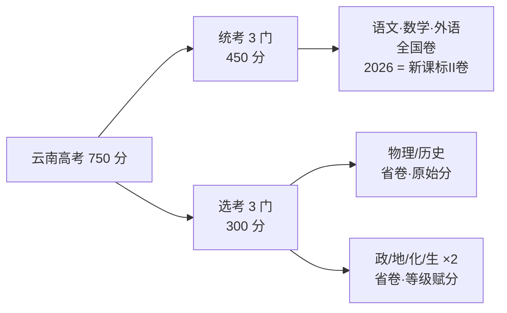
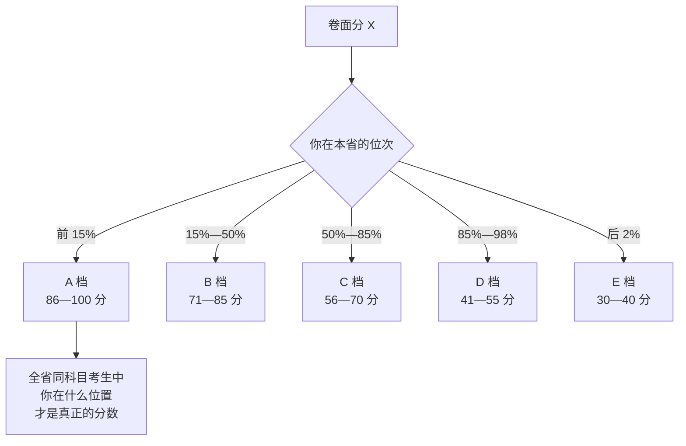
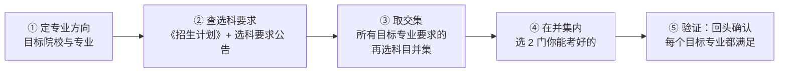
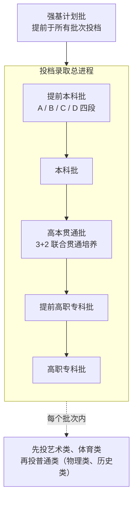

# 云南高考：政策与科目划分（2026 官方口径）

| 编写人 | 编写内容 | 编写时间 |
| --- | --- | --- |
| growdu | 把云南省现行高考政策拆成三块：**科目怎么分**（3+1+2、试卷来源、等级赋分）、**志愿怎么填**（院校专业组、批次、40 个志愿）、**录取怎么走**（平行志愿、一轮投档、同分排序）。全部以云南省招生考试院公开发布口径为准，并把 2025 与 2026 的差别标出来。 | 2026-11-11 |

> **TL;DR**
>
> **云南高考三件事，一句话各说清**：
> ① **科目**：语数外用全国卷（2026 为新课标II卷），**选考 6 门全是云南省自主命题**——"云南高考全科全国卷"是最常见的误解；
> ② **分数**：750 = 语数外 450（原始分）+ 首选科目 100（原始分）+ 再选 2 门 200（**等级赋分，原始分不公布**）；
> ③ **志愿**：填报单位从"院校"变成"**院校专业组**"，本科批 **40 个**平行志愿，每组 10 个专业 + 1 个服从调剂，**一轮投档，退了没有第二次**。
>
> **三条最该记住的硬规则**：
> - **选科按"目标专业"倒推，不按"我擅长什么"正推**——选科不匹配的志愿**根本填不进去**。
> - **赋分科目看排名，不看卷面分**——再选科目卷面 80 分可能赋 60，也可能赋 90。
> - **一轮投档 + 组内调剂**——退档后本批次后面所有志愿直接作废，**服从调剂是唯一有效的防退档动作**。
>
> **口径说明**：本文以 **2026 年**云南省招生考试院公开发布的口径为准（网上报名考生须知、志愿填报百问百答、录取最低控制分数线）。2027 届考生可以此为基线，但招生年度的具体数字（分数线、批次计划、选科要求）**一律以当年公告为准**，核对入口见文末。

---

## 目录

- [一、先把坐标定死](#一、先把坐标定死)
- [二、科目划分：3+1+2 到底怎么切开](#二、科目划分：3-1-2-到底怎么切开)
- [三、等级赋分：再选科目的分是怎么算出来的](#三、等级赋分：再选科目的分是怎么算出来的)
- [四、选科：按目标专业倒推，不按喜好正推](#四、选科：按目标专业倒推，不按喜好正推)
- [五、志愿单位变了：从院校到院校专业组](#五、志愿单位变了：从院校到院校专业组)
- [六、投档录取：一轮投档是最容易吃暗亏的规则](#六、投档录取：一轮投档是最容易吃暗亏的规则)
- [七、2025 与 2026 的实际分数线](#七、2025-与-2026-的实际分数线)
- [八、2026 年的三处新变化](#八、2026-年的三处新变化)
- [九、给自己的五条行动项](#九、给自己的五条行动项)
- [十、一页纸速查表](#十、一页纸速查表)

---

## 一、先把坐标定死

### 1.1 云南现在处在新高考的第几年

| 年份 | 状态 | 关键节点 |
| --- | --- | --- |
| 2022 秋 | 改革起点 | 秋季入学的普通高中一年级学生开始按新高考方案培养 |
| 2024 | 旧高考最后一年 | 仍有文理分科、一本二本批次 |
| **2025** | **新高考首年** | 首次实行 3+1+2，首次院校专业组，首次只划本科批 |
| **2026** | **新高考第二年** | 新增"高本贯通批"；高校专项计划改为省级审核 |
| **2027** | 报名已在进行 | 网上报名 2026-10-25 至 11-05；高考考生号前缀由 2653 变为 2753 |

**这三个"首次"是理解云南新高考的钥匙**：不区分文理、不分一本二本、专业组调剂。2026 年的口径变化（见 §八）是在这个新框架内做的调整，不是又一次颠覆。

### 1.2 规模

| 指标 | 2026 年 | 说明 |
| --- | --- | --- |
| 高考报名人数 | **37.79 万人** | 省招生考试院公布的当年报名口径 |
| 考区 / 考点 / 考场 | 128 个 / 232 个 / 9905 间 | — |
| 评卷模式 | "2+1+1" | 云南连续采用该模式 |
| 分数线公布时间 | 6 月 25 日左右 | 经省招生考试委员会审定后公布 |
| 志愿填报时间 | 6 月 28 日—7 月 2 日 | 6 月 26 日先做一次填报演练 |

### 1.3 三个信息源，其余都可以不信

| 信息源 | 用途 | 权威性 |
| --- | --- | --- |
| [云南省招考频道](https://www.ynzs.cn) | 报名须知、填报志愿须知、百问百答、分数线、招生计划 | **唯一官方** |
| [教育部阳光高考平台](https://gaokao.chsi.com.cn) | 各高校招生章程、选科要求、特殊类型计划 | 官方 |
| 《填报志愿指要》+《招生计划》 | 逐校逐专业的计划、选科要求、学费、特殊要求 | 官方（纸本/电子版） |

> **反诈提醒**：全省招生计划统一公布，录取结果由省招生考试院统一投档、统一公布。**"内部指标""计划外扩招""低分补录""花钱买征集名额"全是骗局**——不是"小心"，是**不存在**。

---

## 二、科目划分：3+1+2 到底怎么切开

### 2.1 六门选考科目 + 三门统考科目

| 段位 | 科目 | 满分 | 计入方式 | 命题 | 时长 |
| --- | --- | ---: | --- | --- | --- |
| **3** 统考 | 语文 | 150 | 原始分 | 教育部统一命题（全国卷） | 150 分钟 |
| | 数学 | 150 | 原始分 | 教育部统一命题（全国卷） | 120 分钟 |
| | 外语 | 150 | 原始分 | 教育部统一命题（全国卷） | 120 分钟 |
| **1** 首选 | 物理 / 历史 | 100 | **原始分** | **云南省自主命题** | 75 分钟 |
| **2** 再选 | 化学、地理、思想政治、生物学（任选 2 门） | 各 100 | **等级赋分** | **云南省自主命题** | 各 75 分钟 |

**外语的细节**：考生从英语、俄语、日语、法语、德语、西班牙语中任选 1 门；含**听力 30 分 + 笔试 120 分**；听力与笔试**同步进行**，**没有"一年两考"**。报考外语专业或对外语口试有要求的专业，须再参加全省统一的外语口语测试（时间另行通知）。

### 2.2 云南最容易被误解的一点



> **一句话**：**"全国二卷"只覆盖语数外三门。物理、历史、化学、地理、政治、生物这六门，云南全是自己命题。**

这条为什么重要：

1. **选考科目没有全国统一卷可对**——省外同组合的卷子**不能当标准答案用**，只能当知识点自测。刷题要刷**云南省历年选考真题 + 省内联考卷**。
2. **选考科目是云南命题组的口味**，不是全国命题组的。往年的省卷比全国卷更有参考价值。
3. 语数外用全国卷，意味着**这三门可以横向对比各省真题、共享题库和教辅**——这是《[全国卷二逐题拆解](../math-paper2/index.html)》能成立的前提。

### 2.3 12 种科目组合

| 首选 | 再选组合 | 组合 |
| --- | --- | --- |
| 物理 | 化学 + 生物 | 物化生（俗称"理科三剑客"） |
| 物理 | 化学 + 地理 | 物化地 |
| 物理 | 化学 + 政治 | 物化政 |
| 物理 | 生物 + 地理 | 物生地 |
| 物理 | 生物 + 政治 | 物生政 |
| 物理 | 地理 + 政治 | 物地政 |
| 历史 | 化学 + 生物 | 史化生 |
| 历史 | 化学 + 地理 | 史化地 |
| 历史 | 化学 + 政治 | 史化政 |
| 历史 | 生物 + 地理 | 史生地 |
| 历史 | 生物 + 政治 | 史生政 |
| 历史 | 地理 + 政治 | 史地政 |

**物理 + 化学**是唯一能覆盖绝大多数工科、理科、医科专业的组合——这就是"物化生"成为默认选项的原因（理由见 §四）。

### 2.4 三天九场

| 日期 | 时段 | 科目 | 分值 |
| --- | --- | --- | ---: |
| 6 月 7 日 | 09:00—11:30 | 语文 | 150 |
| | 15:00—17:00 | 数学 | 150 |
| 6 月 8 日 | 09:00—10:15 | 物理 / 历史（首选） | 100 |
| | 15:00—17:00 | 外语（含听力） | 150 |
| 6 月 9 日 | 08:30—09:45 | 化学（再选） | 100 |
| | 11:00—12:15 | 地理（再选） | 100 |
| | 14:30—15:45 | 思想政治（再选） | 100 |
| | 17:00—18:15 | 生物学（再选） | 100 |

**排布里的三个信号**：

1. **首选科目排在 6 月 8 日上午**——夹在语文数学和外语之间，这是全天最靠前的时段之一。**首选科目只有 100 分却占了一整个上午**，说明**节奏紧、要求一次成型**。
2. **再选科目一天四场**（每场 75 分钟）——表面轻松，实际是**连续四场消耗战**。6 月 9 日的策略不是"每场都拼"，而是**按分值收益分配体力**：把最稳的科目排在状态最好的时段。
3. **外语在 6 月 8 日下午**——与首选科目之间隔 4 小时 45 分钟，中间是一整段复习时间。

---

## 三、等级赋分：再选科目的分是怎么算出来的

### 3.1 规则

把每门再选科目**全体考生**的原始分从高到低排序，划成 5 个等级，按比例分配人数，再线性转换到分数区间：

| 等级 | 人数占比 | 分数区间 |
| --- | ---: | --- |
| A | 15% | 100—86 分 |
| B | 35% | 85—71 分 |
| C | 35% | 70—56 分 |
| D | 13% | 55—41 分 |
| E | 2% | 40—30 分 |

**两条必须记住的规则**：

- **再选科目的原始分不公布**，投档录取以**赋分后**的总成绩为准。查分时看不到自己化学考了多少分，只看到赋了多少分。
- **同一位次在四门再选科目里赋出的分是一样的**。这是赋分存在的理由：让"选的人少"的科目和"选的人多"的科目**可比**。

### 3.2 赋分对策略的三个影响



1. **"我化学考了 85 分"这句话在云南没有意义**，除非你同时知道全省位次。**卷面分只决定等级，不决定分数**。
2. **赋分是"相对分"**。在一个选化学只有几百人的组合里，考 85 分可能是全省前 5%；在几万人报考的组合里，考 85 分可能只是中游。
3. **不要用模拟考的卷面分估总分**。估分只能估等级区间，估出来的总分误差比想象中大。**估"我在多少名"，比估"我考多少分"靠谱得多**。

### 3.3 一个容易被忽略的兜底机制

当某门再选科目**选考人数过低**时（极端情况下可能只有一个人考），启动**最低保障机制**：以保障数量为基数进行等级赋分，规避科目选考失衡。**这对你意味着：只要选了某科，它一定会被折算成一个可比的分数，不会出现"因为只有你一个人考所以没法赋分"的尴尬。**

---

## 四、选科：按目标专业倒推，不按喜好正推

### 4.1 选科要求的四种类型

按教育部《普通高校本科招生专业选考科目要求指引（通用版）》口径，高校提出的选科要求分四类：

| 类型 | 表述示例 | 含义 |
| --- | --- | --- |
| **不提科目要求** | 无 | 首选物理或历史、再选任意 2 门均可报考 |
| **只要求首选科目** | 物理（1 门科目考生必须选考方可报考） | 首选物理，再选任意 2 门 |
| **只要求再选科目** | 化学（1 门必须选考）<br>化学、生物学（2 门均须选考） | 首选物理或历史；再选须含化学，或同时含化学与生物 |
| **首选 + 再选都要求** | 物理、化学（2 门均须选考）<br>物理、化学、生物学（3 门均须选考） | 首选物理，且再选必须同时含化学（及生物） |

云南官方口径与此一致：**选科要求分三种**——不提再选科目要求（符合首选即可）、提出 1 门再选科目要求（须选考该门）、提出 2 门再选科目要求（须同时选考这 2 门）。**选科不匹配的志愿无法进行填报**——不是"填了会被退档"，是**根本填不进去**。

### 4.2 三条硬约束

| 约束 | 内容 | 触发后果 |
| --- | --- | --- |
| **首选不可兼报** | 物理、历史**必须且只能选 1 门** | 报名时即锁定，全周期不可改 |
| **再选必须同时满足** | 要求 2 门时，是**同时**选考，不是"任选其一" | 物化生不符合"化学+生物"以外的双科要求 |
| **物理类要带化学** | 2024 年起新设本科专业，凡"物理+化学"才开设的（如临床医学、工科试验班），**必须物化** | 选"物理+生物+地理"直接被挡在门外 |

> **第三条是最贵的一条**。教育部要求 2024 年后新招生的本科专业，凡培养目标需要化学基础的，必须在选科要求中同时提出"物理"和"化学"。**这意味着：选了物理却没选化学，你的一部分专业大门会在填志愿那天直接关掉。**

### 4.3 选科决策的正确顺序



**必须倒推，不能正推**。常见的错误是"我物理好、化学一般，就选物化生"——如果化学恰好是你最弱的一门，赋分后很可能落在 C 档甚至更低，而选科要求里写着"化学"的那些专业**直接失格**。

**实操建议**：

1. 先列出 **3~5 个"够得着"的目标专业**（不是"所有感兴趣的专业"）。
2. 逐个查它们的选科要求，取**再选科目的并集**。
3. 如果并集超过 2 门，**说明这几个专业不能都报**，要砍掉其中几个或换方向。
4. 在并集内，选你**能排到前列**的 2 门。

---

## 五、志愿单位变了：从院校到院校专业组

### 5.1 什么是院校专业组

> **"院校专业组"指某一高校对若干专业的组合。**

- 一所高校可设置 **1 个或多个**院校专业组，每个组内可含数量不等的专业。
- **同一组内各专业对考生的选考科目要求相同**；选考要求不同的专业**必须分设不同的组**。
- 选考要求相同的专业，也可以拆到不同的组里。

**改革前 vs 改革后**：

| | 改革前 | 改革后（现行） |
| --- | --- | --- |
| 填报单位 | 院校 | **院校专业组** |
| 专业调剂范围 | 校内所有专业 | **仅同一专业组内**，不跨组 |
| 好处 | — | 专业志愿的"含金量"提高，不会被调剂到毫不相关的专业 |

### 5.2 2026 年云南的批次与志愿数量

**普通类 5 个批次**，按顺序依次录取：



| 批次（段） | 院校专业组志愿数 | 每组专业志愿数 | 服从调剂标志 | 投档方式 |
| --- | ---: | ---: | --- | --- |
| 提前本科批 A 段 | 按有关要求 | — | — | 优师专项、免费定向计划 |
| 提前本科批 B 段 | 10 | 10 | 1 | 平行志愿（军队院校、公安院校公安专业） |
| 提前本科批 C 段 | **1** | 10 | 1 | **单志愿**（消防救援、空军招飞、民航飞行、航海、政法公安、综合评价） |
| 提前本科批 D 段 | 10 | 10 | 1 | 平行志愿（国家公费师范生等） |
| **本科批** | **40** | **10** | **1** | 平行志愿 |
| 高本贯通批 | 20 | **1** | — | 平行志愿 |
| 提前高职专科批 | **1** | 10 | 1 | 定向培养军士、航海类 |
| 高职专科批 | 20 | 10 | 1 | 平行志愿 |

**本科批的 40 个还有附加规则**：符合国家专项、地方专项、高校专项计划条件的考生可**多填 10 个**；符合少数民族预科班条件的可**多填 10 个**；但**非专项、非预科的院校专业组志愿合计不得超过 40 个**。

**艺术类、体育类的本科批是特例**：设 40 个院校专业组志愿，但**每个院校专业组只设 1 个专业志愿**（高职专科批 20 个组、每组 1 个专业志愿）。

### 5.3 艺术类、体育类怎么算综合分

| 类别 | 综合排序成绩算法 |
| --- | --- |
| **艺术类** | 院校在编制计划时**三选一**：① 文化 50% + 专业 50%；② 文化 70% + 专业 30%；③ **只按文化总成绩折算**。选定办法在《招生计划》上公布 |
| **体育类** | 一般为考生专业成绩；院校有特殊要求的，按其在《招生计划》上公布的要求执行 |

---

## 六、投档录取：一轮投档是最容易吃暗亏的规则

### 6.1 平行志愿三原则

| 原则 | 含义 | 后果 |
| --- | --- | --- |
| **分数优先** | 按投档成绩从高到低排序，高分考生**先**被检索 | 低分考生把某院校填在第 1 位，**排不到**高分考生填的第 5 位 |
| **遵循志愿** | 按考生填报的志愿顺序依次检索，**一旦符合投档条件即投档** | 投档成功后，后续志愿**全部失效** |
| **一轮投档** | 同一批次每位考生**只有一次投档机会** | 投档后无论是否录取，本批次不再检索后续志愿 |

**投档比例**：云南平行志愿批次原则上按**线上生源数与招生计划数 1:1** 投档；经高校申请可协商确定比例，但须确保符合条件的进档考生均录取。单志愿批次原则上在 **1:1.2** 以内。

### 6.2 同分怎么排序（普通类）

这是"同分考生处理"的唯一依据，也是分数够但没被投出去的直接原因：

| 顺序 | 比较项 | 说明 |
| ---: | --- | --- |
| 1 | **文化课实考成绩** | 不含照顾加分 |
| 2 | 语文 | 依次比较 |
| 3 | 数学 | 依次比较 |
| 4 | 首选科目成绩 | 依次比较 |
| 5 | 再选科目总成绩 | 依次比较 |
| 6 | 再选科目单科最高成绩 | 依次比较 |

**全部相同** → 按同分数考生处理。

> **这张表解释了"我分数一样为什么他进了我没进"**：比的不是总分，是**语文**。两人都 600 分，先比语文，谁高谁进。**语文单科在同分排序里排在数学前面**——这不是巧合，是因为语文卷面区分度在同分段更细。

艺术类、体育类同分时：**先比专业成绩** → 再比文化总成绩**超出该批次文化控制线的分值** → 再比照顾加分分值（**优先录取加分分值较低者**）→ 再按语文、数学、首选、再选总成绩、再选单科最高成绩依次比较。

### 6.3 滑档 vs 退档

| | 滑档 | 退档 |
| --- | --- | --- |
| 发生了什么 | 所填志愿**投档线都高于你的分数**，档案没投出去 | 档案投出去了，又被退回 |
| 档案状态 | 没被任何院校提取 | 已投出又被退回 |
| 还能怎么办 | **可以**参加征集志愿或下一批次 | **本批次后续所有志愿直接作废**，只能等征集志愿 |

**退档的三个原因**（记住这三条，就知道要防什么）：

1. **不服从专业调剂**，所填专业分数都不够；
2. **身体条件不符**（色盲、色弱、身高、视力等硬性限制）；
3. **单科成绩不达标**（学校对某科成绩的最低要求）。

### 6.4 唯一的防退档动作

> **尽量勾选"专业服从院校调剂"。**

- 不勾选：所填专业都不满足录取条件 → **退档**，本批次后面所有院校专业组**不再投档**；
- 勾选：可能被调剂到组内不理想的专业，但**档案留住了**。

**专业调剂只在考生被投档的院校专业组内进行，不跨组。** 这意味着：**组内专业搭配要有梯度**（冲 / 稳 / 保各占几个），把不喜欢的专业放后面而不是不填——空着等于放弃了组内调剂的可能。

### 6.5 几条容易忽略的限制

| 限制 | 内容 |
| --- | --- |
| **艺术体育与普通类的兼报** | **普通类考生不得兼报艺术类、体育类**；艺术类、体育类考生**可以兼报普通类**（未被录取则继续参与同批次普通类投档） |
| **提前批录取后** | 不再参加后面各批次投档；**提前批没被录取不影响本科批** |
| **正式录取后** | **一律不得变更录取院校和专业**，不可退档参加下一批次 |
| **随迁受限考生** | 审核结论为"限报省属院校"的，只能报本科批云南省属院校/独立学院/民办院校、高本贯通批及全部高职专科；"限报原二本民办院校及高职专科"的，只能报独立学院或民办院校及除高本贯通批外的高职专科 |
| **照顾加分** | 符合多项的**只取幅度最大的一项，不累加**；农业人口独生子女照顾加分**只在报考省内高校时有效** |

---

## 七、2025 与 2026 的实际分数线

### 7.1 普通类（控制线）

| 类别 | 2025 年 | 2026 年 | 变化 |
| --- | ---: | ---: | ---: |
| 历史类 特殊类型录取资格线 | 535 | **545** | +10 |
| 历史类 本科线 | 465 | **465** | 0 |
| 物理类 特殊类型录取资格线 | 495 | **505** | +10 |
| 物理类 本科线 | 430 | **435** | +5 |
| 高职专科线（历史 / 物理） | 180 | **180** | 0 |

### 7.2 艺术类、体育类（文化成绩控制线）

| 类别 | 2025 年 | 2026 年 | 变化 |
| --- | --- | --- | ---: |
| 艺术类 历史类本科线 | 345 | **345** | 0 |
| 艺术类 物理类本科线 | 320 | **325** | +5 |
| 体育类 历史类本科线 | 385 | **380** | −5 |
| 体育类 物理类本科线 | 370 | **365** | −5 |
| 高职专科线 | 180 | **180** | 0 |

### 7.3 艺术类省级统考专业成绩控制线

| 专业方向 | 2025 本科 | 2025 专科 | 2026 本科 | 2026 专科 |
| --- | ---: | ---: | ---: | ---: |
| 音乐类 | 140 | 120 | **130** | 120 |
| 美术设计类 | 210 | 190 | **185** | 175 |
| 表（导）演类 · 戏剧影视表演 | 170 | — | **130** | — |
| 表（导）演类 · 服装表演 | 180 | — | **185** | — |
| 表（导）演类 · 戏剧影视导演 | 140 | — | **160** | — |
| 舞蹈类 | 140 | — | **120** | — |
| 播音与主持类 | 170 | — | **165** | — |
| 书法类 | 180 | — | **190** | — |

### 7.4 三条读数

1. **历史类本科线两年没动（465 → 465）**，物理类本科线只涨了 5 分。**"新高考第二年分数线大涨"的说法在云南不成立**——涨的是**特殊类型线（+10）**，那是强基计划、高校专项、军队院校的门槛，跟普通本科不是一回事。
2. **艺术类统考线 2026 年普遍下移**（音乐 −10、美术 −25、舞蹈 −20），但**表（导）演类的服装表演 +5、导演 +20、书法 +10 是涨的**。艺术类内部的分化比整体涨跌更值得看。
3. **专科线两年都是 180，一分没动**。这条线是真正的地板。

> **用分数线的正确姿势**：拿**位次**，不拿分数。同一个 500 分，2025 和 2026 的含义完全不同——要看当年的一分一段表，以及那一年对应位次的院校录取情况。

---

## 八、2026 年的三处新变化

### 8.1 高校专项计划：不再由高校组织报名、审核、校测

> 根据教育部规定，**自 2026 年起，高校专项计划不再由高校组织报名、资格审核和校测，不单独发布招生简章。**

| 变化点 | 2026 年口径 |
| --- | --- |
| 报名与资格审核 | 由**省级**组织审核，不再由高校自行组织 |
| 校测 | **取消** |
| 招生简章 | **不单独发布** |
| 录取方式 | 按国家专项计划招生方式录取 |
| 分数要求 | **不低于特殊类型录取资格线** |
| 批次变化 | 云南将原本科批 A 段、B 段**合并为本科批**，高校专项与普通类、国家专项、地方专项在**同一批次**填报志愿和投档录取 |

**实操影响**：以前要盯各高校的高校专项简章，现在**只需要盯省考试院的公告**。少了一个信息源，但也少了一条"校测"这条通道——**符合条件就报，不必再为校测专门准备**。

### 8.2 高本贯通批："3+2"项目单列成批

| 项目 | 内容 |
| --- | --- |
| 是什么 | 云南省本科高校与高职专科院校**联合贯通培养**项目 |
| 批次位置 | **单列为"高本贯通批"**，安排在本科批之后、提前高职专科批之前 |
| 文化最低控制线 | 各科类本科最低控制分数线下 **30 分**；艺术类、体育类专业成绩分数线**按专科线执行** |
| 志愿设置 | 普通类、艺术类、体育类均设 **20 个院校专业组**，每组 **1 个专业志愿** |

**这条线的意义**：它给"本科线上下 30 分"这个分数段提供了一条**独立的升学通道**——**不上本科批的竞争**，去争一个本科院校打头的联合培养项目。

### 8.3 民族班 vs 少数民族预科班

| | 民族班 | 少数民族预科班 |
| --- | --- | --- |
| 学制 | 一般 4 年，直接读本科 | **先读 1 年预科**，考核合格后转入本科 |
| 录取线 | 不低于本科批各有关高校调档线**以下 40 分** | 不低于本科批各有关高校调档线**以下 80 分** |
| 投档 | 投档成绩达不到上述分数线**不予投档** | 同 |

另：**非西藏生源定向西藏就业**录取标准不低于各有关高校在云南本科相应批次学校调档线**以下 40 分**，须填写《报考定向西藏就业志愿申请书》并由家长签字，录取后须与西藏自治区人社厅（定向教师培养计划为教育厅）、招生学校三方签订"定向西藏就业协议书"，**拒签不予办理报到注册，取消入学资格**。

---

## 九、给自己的五条行动项

| # | 动作 | 什么时候做 | 为什么 |
| --- | --- | --- | --- |
| 1 | **把目标专业的选科要求查一遍，取再选科目的并集** | 高一选科前 | 选科不可逆，且"物理没带化学"会直接关掉一批专业的大门 |
| 2 | **赋分科目用位次评估，不用卷面分** | 每次模考后 | 卷面分只决定等级；估等级比估分数靠谱 |
| 3 | **选考科目只刷省卷和省内联考** | 复习全程 | 云南六门选考全是省命题，省外卷只能当知识点自测 |
| 4 | **每组专业志愿做成"冲 / 稳 / 保"梯度，勾服从调剂** | 填志愿那 5 天 | 调剂只在组内进行；不服从调剂是退档第一大原因 |
| 5 | **只信省招考频道、阳光高考、招生章程** | 全程 | 计划统一公布、录取统一投档；"内部指标"不存在 |

---

## 十、一页纸速查表

```
【科目】3+1+2 = 750 分
  统考 3 门：语文/数学/外语，各 150，原始分，全国卷（2026 = 新课标II卷）
  首选 1 门：物理/历史，100，原始分，云南省命题
  再选 2 门：政/地/化/生，各 100，等级赋分，云南省命题
  外语：英/俄/日/法/德/西任选 1 门，听力 30 + 笔试 120，同步进行，无一年两考

【赋分】A 15% → 100-86 ｜ B 35% → 85-71 ｜ C 35% → 70-56
        D 13% → 55-41 ｜ E 2% → 40-30
        原始分不公布；同位次在四门再选科目赋分相同

【时间】6/7 语文、数学 ｜ 6/8 首选、外语 ｜ 6/9 再选 4 场
        首选 75 分钟，再选各 75 分钟

【志愿】本科批 40 个院校专业组，每组 10 专业 + 1 服从调剂
        高职专科批 20 个；提前本科批 B/D 段各 10 个，C 段 1 个

【批次】强基 → 提前本科批 → 本科批 → 高本贯通批 → 提前高职专科批 → 高职专科批
        每批次先艺术体育，再普通类（物理类、历史类）

【投档】分数优先 · 遵循志愿 · 一轮投档，比例 1:1（单志愿 1:1.2）
        退档三因：不服从调剂、身体不符、单科不达标
        调剂只在组内，不跨组

【同分排序】文化实考 → 语文 → 数学 → 首选 → 再选总分 → 再选单科最高

【2026 分数线】历史 545/465/180 ｜ 物理 505/435/180
              艺术 历史345 物理325 ｜ 体育 历史380 物理365 ｜ 专科 180
```

---

## 相关阅读

- [全国卷二逐题拆解：一个普通高三学生的答题思路与考场操作](../math-paper2/index.html) —— 语数外用的就是新课标II卷，这份是**考场流水与踩点给分**
- [高考数学：中等水平者的做题方法与学习路径](../math-methods/index.html) —— **先诊断丢分在哪，再选方法**
- [高考英语：用词根词缀把猜词变成认词](../english-roots/index.html) —— 外语单科的打法拆解

---

## 资料来源与核对入口

| 内容 | 来源 |
| --- | --- |
| 3+1+2 模式、科目划分、试卷来源、等级赋分比例 | 《云南省2025年普通高校招生考试安排和录取工作实施方案》（云南省招考频道） |
| 批次设置、志愿数量、院校专业组、投档规则、同分排序、滑档退档 | 《云南省2026年高考志愿填报百问百答》（云南省招考频道，2026-06-28） |
| 2026 年录取最低控制分数线、艺术类统考分数线 | 云南省招生考试院（2026-06-25 公布） |
| 2027 年报名时间与流程 | 《云南省2027年普通高校招生网上报名考生须知》（云南省招考频道，2026-10-21 发布） |
| 选科要求四种类型 | 教育部《普通高校本科招生专业选考科目要求指引（通用版）》 |
| 2025 年分数线 | 昆明市人民政府网 / 昆明日报（2025-06-25 公布） |

> **核对入口**：[云南省招考频道](https://www.ynzs.cn) ｜ [教育部阳光高考平台](https://gaokao.chsi.com.cn) ｜ 考生服务平台 <https://gk.ynzs.cn>
>
> **时效提醒**：分数线、批次计划、选科要求**每年都会变**。本文记录的是 **2026 年**口径，2027 年请以省招考频道当年发布的《填报志愿指要》和《招生计划》为准。

---

| 编写人 | 校验内容 | 时间 |
| --- | --- | --- |
| growdu | 科目与赋分口径对齐省招考院方案；批次与志愿数量对齐 2026 百问百答；分数线对齐省招考院公布值；2025 与 2026 逐项比对 | 2026-11-11 |
