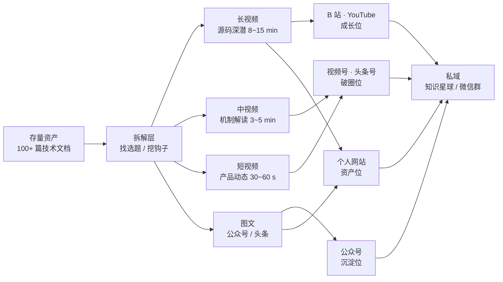
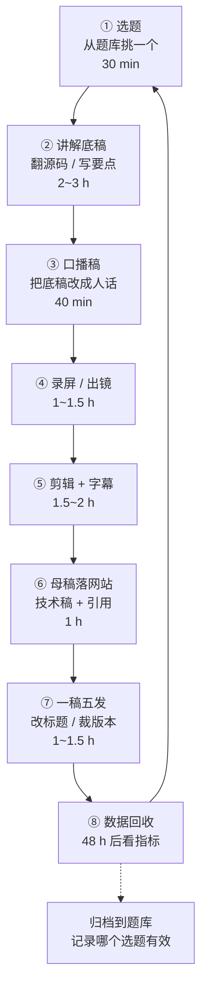
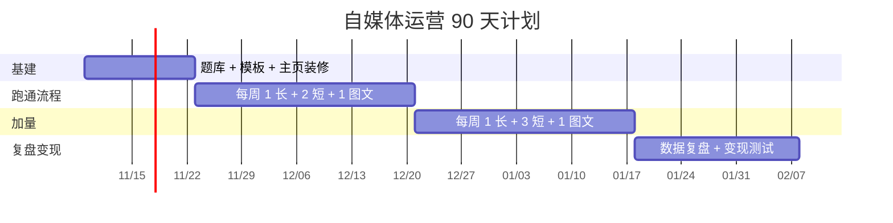

# 数据库技术自媒体运营手册：把 100 篇源码文档变成 5 个平台的持续内容

| 编写人 | 编写内容 | 编写时间 |
| --- | --- | --- |
| growdu | 给自己的运营手册。已有：**个人网站（Hexo）+ 微信公众号 + 视频号 + 头条号 + B 站 + YouTube** 六条阵地，题材是**数据库内核源码的深入研究**。仓库里已经躺着 95+ 个技术专题、26 篇 PostgreSQL 源码深潜、17 篇逻辑复制源码分析、15 个视频成片素材——但**对外输出几乎是零**。所以这篇不写"怎么做好内容",写的是**怎么把存量资产变成可复用的内容流水线**。 | 2026-11-09 |

> **先说结论**：
>
> 我不是"没有内容"，是**没有把内容变成视频**。仓库里 `docs/database/` 58 个专题、`docs/db/postgresql/` 26 个源码深潜、`docs/db/logical_decode/` 11 个子专题 + 17 篇长文，加起来 100+ 篇——**这些每一篇都能拆出 3~8 条视频**。而且**配音、字幕、海报、分镜这套生产链路我已经跑通过一遍**（在公司物料目录里，见 §1.4：流程可以借鉴，素材不能带出来）。
>
> **所以我的问题不是产能，是转化率。** 这篇手册要解决的就是：**怎么把"写过的文档"以 1/5 的边际成本，变成 5 个平台可持续更新的内容流。**
>
> 文章里所有数字分两类：一类是我**已经在做的**（资产盘点、生产链路、命名规范），一类是我**给自己定的目标**（发布节奏、指标阈值、变现路径）。目标类的我都会标出来，**不假装已经做到**。

---

## 一、先做资产盘点：你手上到底有什么

运营的第一步不是"我想做什么内容"，是**把已有的东西数一遍**。很多人做自媒体失败在第一步就错了——从零想选题，结果想出来的东西和自己已有的 100 篇文档毫无关系，做不到 50 篇就放弃了。

### 1.1 我的存量资产

| 资产 | 位置 | 量级 | 能变成什么 |
| --- | --- | --- | --- |
| PostgreSQL 源码深潜 | `docs/db/postgresql/` | **26 个专题** | 长视频（每篇 1 集）+ 短视频切片（每篇 2~3 条） |
| 逻辑复制专题 | `docs/db/logical_decode/` | **11 个子专题 + 17 篇长文**（最长一篇 75K） | 主力长视频，单篇能拆 8 条 |
| 数据库通用专题 | `docs/database/` | **58 个专题** | 中视频 + 公众号图文 |
| openGauss 专题 | `docs/db/opengauss-*/` | 并行解码设计、CSN 全序 | 稀缺内容，竞品几乎没人讲 |
| 性能与火焰图 | `docs/db/performance/flame-graph-analysis/` | 1 套方法论 | 工具型内容，搜索长尾极好 |
| 自托管手册 | `docs/life/self-host/index.md` | 88K | 泛技术 audiences 引流入口 |
| 视频生产链路（**只借鉴流程，不复用素材**） | `docs/db/aiv/` | 15 mp4 + 6 md + 字幕 + 配音 + 海报 | 分镜 / 配音 / 字幕 / 落版的**流程**可以照着搭；**画面、吉祥物、配色、脚本本身是公司物料，个人号不能用**（见 §1.4） |
| 视频元文章 | `docs/database/postgresql-senior-kernel-developer/index.md` | 49.7K | 学习路径类内容，长期搜索流量 |

**总量换算**：保守估计，**存量文档至少能支撑 200 条以上的视频选题**。按每周 1 条长视频 + 2 条切片算，**够做两年半**。

### 1.2 盘点出来的三个真问题

**问题一：内容"重"得没法直接拍。**

`逻辑复制源码分析.md` 75K 字。**没有人会看 75 分钟的视频，也没有人能从 75K 字里"剪"出一条 8 分钟的成片**——因为它没有叙事结构，它是一份参考手册。

**问题二：每个平台的形态要求完全不同，而我在做"一稿一投"。**

公司的物料目录里那些 30 秒短视频，逻辑是**产品传播**——钩子 → 痛点 → 能力 → 价值 → 落版。这个结构在视频号、头条上成立，**在 B 站和 YouTube 上会死**，因为那两个平台的用户是来"学东西"的，给他们一个 30 秒广告他们会直接划走。

而且这套结构**本身就不适合独立号**：它的落点必然是"某个产品支持了什么"，那是公司号的活。个人号要换一套结构——**问题 → 机制 → 我怎么测的 → 你也可以这么测**。

**问题三：最值钱的东西——源码深潜——恰好是最难变现的。**

源码分析吸引的是**同行**，不是采购决策者。这不是坏事，但**要清楚它负责什么**。

### 1.3 所以整体策略是三条腿



一句话记住每个位置的职责：

| 位置 | 职责 | 成功指标 | 不该指望它 |
| --- | --- | --- | --- |
| **个人网站** | **资产位**——所有内容的原始出处、SEO 入口、可无限引用的底座 | 搜索来路、自然外链、**内容寿命** | 流量规模 |
| **公众号** | **沉淀位**——长图文、可检索、可转发、可放订阅入口 | 打开率、**粉丝数**、阅读完成度 | 单篇阅读量 |
| **B 站** | **成长位**——技术浓度最高、用户最精准、算法最公允 | 播放、**完播率**、三连 | 快速起量 |
| **YouTube** | **成长位**——搜索长尾最强、变现最好、**内容能睡后赚钱** | 观看时长、订阅、外链点击 | 国内流量 |
| **视频号** | **破圈位**——社交推荐强、能承接微信生态 | 完播、**分享转发数** | 技术深度 |
| **头条号** | **破圈位**——**搜索 + 推荐双引擎**，图文也能跑 | 阅读量、单价 | 精准度 |

**这张表是我这份手册的核心。** 后面所有"一稿多发"的规则，都是从它推出来的。

### 1.4 独立账号的第一条边界：不蹭雇主的品牌

这件事必须放在最前面说，因为它决定了后面所有内容能不能做。

**这个账号是"我"的，不是"我们公司"的。** 这不是矫情，是两个硬约束：

**约束一：物料归属。** 公司 logo、吉祥物、品牌色、内部模板、录好的成片——**归属权在雇主**。拿它们做个人账号做个人变现，在多数公司的员工协议和知识产权归属条款里是明确禁止的。轻则要求删除，重则算违约。

**约束二：信息来源。** 我现在的工作内容里，有相当一部分是商业秘密或未公开的路线图。**哪怕技术上完全正确、哪怕全世界都能推导出这个结论，也不能讲。**

所以两条线必须**物理隔离**：

| | 公司号 | 我的独立号 |
| --- | --- | --- |
| 主体 | 公司品牌 | **我个人**（growdu） |
| 内容 | 产品能力、版本特性、方案 | **开源实现、通用机制、源码原理** |
| 视觉 | 公司 logo / 吉祥物 / 品牌色 | **我自己的配色和形象**（或者干脆真人出镜） |
| 物料 | 公司仓库 | **我自己的仓库 / 个人机器** |
| 数据 | 内部压测、客户案例 | **我自己搭的环境、公开可复现的数据** |
| 叙事口吻 | "我们支持了 X" | "这件事是这样运作的，你可以自己这么测" |

**核心那句话**：

> **公司号说"我们做到了什么"，独立号说"这件事是这样运作的"。**
>
> 前者会随产品迭代过时，后者会随时间增值——**因为讲机制的内容不会因为下个版本改了实现就作废**，观众还会主动来搜、引用、转发。

**落到具体动作**：

1. **简介只写职业身份**——"数据库内核开发 / PostgreSQL 源码 / openGauss 社区"，**不写公司名、不写"某司内核团队"这种头衔**
2. **头像、背景、片头、字幕角标里不出现公司元素**，配色和吉祥物换成我自己的
3. **个人号的物料单独建仓**（个人 GitHub 仓库或本地目录），**不要放在公司仓库里**——这是最容易被忽略的一条，你的稿件、配音、成片，都算
4. **两条线不互导流、不同期发同一主题**。个人号里一旦出现"我们公司"，观众就会把你当成公司代表，个人号的中立性瞬间归零
5. **公开的开源项目可以讲，但要切到"社区视角"**：比如 openGauss 是 Mulan PSL v2 的开源社区项目，我讲它的并行解码设计、CSN 全序，是**以社区贡献者的身份讲公开代码**——这不是泄密，和讲"我们公司的内部实现"完全是两码事
6. **性能数字只用我自己搭的环境的**。用公司的压测平台、公司内部机型跑出来的数字，即使数字是真的，**发布在个人号上也等于用雇主资源做个人变现**

---

## 二、平台不是复制的，是分发的

### 2.1 五平台能力矩阵（2026 年我的实测口径）

| 维度 | B 站 | YouTube | 视频号 | 头条号 | 公众号 | 个人网站 |
| --- | --- | --- | --- | --- | --- | --- |
| 最佳时长 | 8~15 min | 10~20 min | 1~3 min | 3~8 min | 图文 | 不限 |
| 核心分发 | 关注 + 推荐 | 订阅 + 推荐 | 社交推荐 | 推荐 + 搜索 | 订阅 + 分享 | 搜索 |
| 搜索长尾 | 强 | **最强** | 弱 | **强** | 中 | 强 |
| 用户精准度 | **最高** | 高 | 中 | 低 | 高 | — |
| 封面决定打开率 | 高 | 中 | **最高** | 中 | 低 | — |
| 前 3 秒决定完播 | 高 | 中 | **最高** | 高 | — | — |
| 互动形态 | 弹幕 / 三连 | 评论 / 订阅 | 点赞 / 转发 | 评论 / 收藏 | 在看 / 转发 | — |
| 直接变现 | 创作激励 | **AdSense + 会员** | 流量主 | 收益分成 | 广告 / 付费阅读 | 赞助 / 付费 |
| 内容寿命 | 长 | **很长** | 短 | 中长 | 长 | **最长** |

### 2.2 一条 12 分钟深潜视频的五个版本

这是本文最实用的一张表。假设我做一期《PostgreSQL 逻辑复制并行 apply：leader / worker 怎么协调》：

| 平台 | 版本 | 时长 | 改了什么 | 为什么这么改 |
| --- | --- | --- | --- | --- |
| **YouTube** | 完整版 | 12 min | 原样 + 英文字幕 + 章节标记（Chapters） | 海外有搜索需求，**章节标记能显著提升"看了一半继续看"** |
| **B 站** | 完整版 + 分 P | 12 min / 3P | 拆成「问题」「实现」「调优」三 P，每 P 一个独立钩子 | B 站用户**吃"系列"**，分 P 提升连播和关注转化 |
| **公众号** | 深度图文 | 8~12K 字 | **保留全部源码引用和代码块**，加源码路径、commit 行号 | 公众号用户**要能复制粘贴的代码**，视频给不了 |
| **视频号** | 精华剪辑 | 90 s | 只留"30 分钟 → 3 分钟"这个对比 + 一个结论 | 视频号是**社交推荐**，前 3 秒不给结论就完蛋 |
| **头条号** | 图文 + 视频双投 | 图文 3K / 视频 6 min | 图文版把"问题—方案—收益"写透，视频版裁成 6 min | 头条**图文单价通常高于视频**，两条都投 |
| **个人网站** | 原始出处 | — | 完整技术稿 + 全部引用 + 版本信息 + 时间戳 | **这一份是"母版"**，其他都是它的派生物 |

**关键原则：个人网站是母版，其他五个是切片。**

我以前搞反了——先写视频脚本，再想着"顺便发个公众号"。**正确的顺序是：先有一篇能独立成立的技术母稿，再从它派生。** 这样保证了：

1. 内容的**技术深度上限**由母稿决定，不会因为平台限制而降级
2. **一份工作产出六份内容**，边际成本接近 0
3. 网站是**永久资产**，视频号的流量 24 小时后就沉了

### 2.3 三个平台的"最后 10%"，别偷懒

同一份内容在不同平台，**最后的 10% 决定能不能爆**：

**B 站**

- 标题带**具体名词 + 具体动作**：`【源码】PostgreSQL 逻辑复制并行 apply：leader 与 worker 如何协调 commit 顺序`（不要叫"浅谈逻辑复制"）
- 封面**放大字**，写"leader/worker"这种关键词，不写人脸（技术号人脸封面点击率不一定高）
- 简介**前三行**放最重要的源码路径和章节
- **分 P 一定做**，哪怕只拆 2 P

**YouTube**

- **英文标题要重写**，不要机翻。`How PostgreSQL Coordinates Commit Order Across Parallel Apply Workers`
- **缩略图 = 封面**，和 B 站是同一张，但要单独设计一版横版
- **前 30 秒必须有结论**，YouTube 的留存曲线比 B 站更陡
- 描述里**放源码链接**（GitHub 永久链接，带 commit hash），这是给开发者引用的入口
- 一定要加 **Chapters**（时间戳章节）

**头条号**

- 标题**带数字和反常识**：`逻辑复制大事务同步要 30 分钟？换个参数降到 3 分钟`
- 开头**第一段就抛结论**（头条是信息流，读者不读第二段）
- 图文版**段落之间加小标题**，手机屏阅读靠小标题续命

---

## 三、生产流水线：一条视频要花多少时间

这是整篇手册里**最需要你照做**的部分。我的原则是：**把重复劳动流水线化，把创造性工作留给源料。**

### 3.1 单期 SOP 与工时



| 阶段 | 做什么 | 工时 | **能不能省 / 怎么省** |
| --- | --- | --- | --- |
| ① 选题 | 从题库挑，**不临时想** | 30 min | 题库满 50 条后，选题 = 挑现成的，5 min |
| ② 讲解底稿 | 翻源码，写清楚"这段代码干什么 + 为什么这么写" | 2~3 h | **不能省，这是质量的地基**；但可以复用已有文档 |
| ③ 口播稿 | 把底稿改成"能念出来的句子" | 40 min | **不能省**。直接从文档念 = 播报员，不是作者 |
| ④ 录制 | 录屏（代码 + 画板）为主 | 1~1.5 h | 可批量：一天录 2~3 期 |
| ⑤ 剪辑 + 字幕 | 剪 + 轴 + 字幕 + 关键帧 | 1.5~2 h | 字幕可用 TTS 自动生成后**人工校一遍** |
| ⑥ 母稿落网站 | 技术稿 + 源码引用 + 版本信息 | 1 h | 基本是把底稿整理一下 |
| ⑦ 一稿五发 | 改标题、裁版本、各平台发布 | 1~1.5 h | 模板化后 45 min |
| ⑧ 数据回收 | 48h 后看指标，记进题库 | 20 min | **最容易省，也最不该省** |
| **合计** | | **8~11 h / 期** | 长视频（12 min）口径 |

**如果只有 5 小时怎么办？** 砍长度，不砍流程：

| 档位 | 时长 | 做法 | 适合的阶段 |
| --- | --- | --- | --- |
| **轻量** | 3 min | 讲**一个**函数 / 一个参数 / 一个报错 | 冷启动期，每周 2 条 |
| **标准** | 8 min | 讲**一条**完整链路（一个特性从入口到落地） | 主力档，每周 1 条 |
| **重型** | 15 min | 讲**一个子系统**（多个特性的交互） | 有存量后，每周 1 条 |

### 3.2 底稿和口播稿必须分离（这是最重要的一条）

我的教训是：**第一次写视频稿时，我直接把文档改改就念了**。结果是——念出来像读论文，句子长、术语密、没有停顿。

后来我改成两稿制：

**讲解底稿**（给自己看，允许啰嗦）

- 完整源码路径、函数名、行号
- 每个分支为什么这么写
- 所有异常情况和边界条件
- 关键结论的**推导过程**（不能只给结论）

**口播稿**（给耳朵听，必须啰嗦地删）

- 句子**短**，每句不超过 25 个字
- **每 15~20 秒必须有一个"锚"**：一个数字、一个对比、一个结论
- **必须有"我们"和"你"**：把"该函数会校验 x 的合法性"改成"这里有一个坑——你的 x 如果不合法，PG 会直接报错"
- **删掉所有"如图所示"**，视频里没有"图"
- 开头 15 秒必须出现**最反直觉的那个结论**

口播稿长什么样，我拿自己写过的一份举例。**注意这是个人号口径——讲机制，不报产品名**：

```text
大家好，我是 growdu，一个在数据库内核里写代码的开发者
今天我们聊一聊逻辑复制的并行 apply
【问题 1】订阅端 apply 跟不上 publisher，怎么办？
默认订阅端只有一个 apply worker，串行回放
大事务 10 万条 INSERT 要等 30 分钟
【解决 1】把大事务切分成多个 stream，多 worker 并行回放
大事务自动切分为多 stream
多 worker 并行回放，订阅端延迟从 30 分钟降到 3 分钟
leader 按 publisher 的 commit LSN 顺序协调
同一个事务内部仍然按顺序回放，所以一致性不受影响
```

注意它的特征：**短句、每行一个意群、有数字、有对比、有明确的"问题→解决"标签**。这就是口播稿和文档稿的区别。

还有一个**刻意为之**的地方：**整段话里没有一个产品名**。我讲的是"这个机制怎么运作"，观众听完能自己去任何一个实现了这套机制的系统上验证。

**这正是个人号和公司号最根本的区别**：

- 公司号的口播稿会说"我们原生集成了 Apply Parallel Worker"——这是**产品通告**
- 个人号的口播稿说"把大事务切分成多个 stream，多 worker 并行回放"——这是**知识**

如果我在个人号里报产品名，这条视频的价值就变成了"替某厂商做宣传"；我自己的技术信誉也就跟着产品宣传的信誉一起被消耗。**技术号的信用是独立资产，不能寄生在雇主品牌上。**

### 3.3 一鱼多吃：一次研读，五个选题

以 `docs/db/postgresql/postgresql-apply-parallel-worker-code-analysis/` 为例，我一次源码研读可以拆出：

| # | 选题 | 形态 | 角度 |
| --- | --- | --- | --- |
| 1 | 逻辑复制并行 apply：leader / worker 如何协调 commit 顺序 | 长视频 12 min | **机制全貌**（主力） |
| 2 | 为什么大事务能并行、小事务反而更慢？ | 中视频 5 min | **反常识角度**（切片） |
| 3 | 订阅端 apply 延迟怎么定位？先看这 4 个 GUC | 中视频 4 min | **工具型**（搜索长尾） |
| 4 | 我把 leader-worker 协调逻辑画成了 3 张图 | 短图文 | 图解（B 站/公众号/头条） |
| 5 | 实测：单 worker vs 8 worker 的延迟曲线 | 短视频 60 s | **实验数据**（最容易被转发） |

**这就是"一鱼多吃"**。一次 3 小时的源码研读，产出 5 条内容，覆盖 3 种形态、2 个平台组。

**关键动作**：拆选题这一步**必须写下来**。我在**自己的仓库**里建一个 `选题库.md`，每条一行，四个字段：

```text
选题 | 拆解角度 | 关联文档 | 状态（未做/已出稿/已发布/数据）
```

**状态字段是复盘的锚点**——三个月后你回头看，就知道哪种角度真的有效。

### 3.4 素材目录与命名规范

**先说位置**：个人号的物料**单独建仓**（个人 GitHub 仓库，或至少是公司仓库之外的独立目录）。**不要把个人账号的稿件、配音、成片放进公司仓库**——那是公司的资产池，你的个人变现不该寄居在里面。

命名规范我吃过的亏很具体：公司的物料目录里现在躺着一堆 `16-9-提高+logo尾版.mp4`、`9-16-提高+logo尾版.mp4`、`最终成片-修复音频.mp4` 这种名字——**半年后完全不知道它是哪一期、讲什么**。成片一旦超过 10 个，命名不统一就是灾难。

所以个人号的目录定成这样，之后不再改：

```text
media-account/            # 个人独立仓库（或个人机器上的独立目录）
  <episode-slug>/            # 每期一个目录，slug 用英文小写连字符
    00-source.md             # 源码笔记 / 引用清单
    01-poster.md             # 海报文案
    02-script.md             # 口播稿（最终版，编号 01 之后）
    03-outline.md            # 分镜 / 章节结构
    04-subtitle.srt          # 字幕（最终版）
    05-thumbnail.png         # 封面
    06-desc-<platform>.md    # 各平台发布文案与标题备选
    final.mp4                # 成片（母版，16:9）
    final-9x16.mp4           # 竖版切片
```

**唯一强制规则：成片文件名里必须带 slug**。`pg-parallel-apply-20261115-final.mp4` 优于 `最终成片-修复音频.mp4`。

---

## 四、三种视频形态，和 AI 的边界

我手上有三种视频形态，**它们的用途完全不同，不能混用**。这是按**个人独立号**的口径排的：

| 形态 | 做法 | 适合内容 | 时长 | 对个人号的判断 |
| --- | --- | --- | --- | --- |
| **A. 真人口播 + 屏幕/画板** | 出镜或只出声，屏幕放代码/架构图 | **源码深潜、机制解读** | 5~15 min | **主力**。技术号的可信度来自"这是一个真在写代码的人" |
| **B. 纯屏幕录制 + 旁白** | 无露脸，IDE + 终端 + 画板 | 工具型、演示型 | 3~8 min | **次主力**。最省事，也不依赖出镜状态，适合高频更新 |
| **C. AI 形象 + 字幕** | AI 生成形象 + TTS 配音 + 字幕 | 概念速览、无真人出镜时的补充 | 30~60 s | **慎用**，见 §4.1 |

### 4.1 形态 C 是有严格边界的（个人号尤其）

**先说三条不能碰的**：

1. **形象必须是我自己的**。公司吉祥物、logo、品牌配色**一律不用**——那是公司资产，个人号用它做封面，等于用公司品牌给自己背书或者做产品宣传，两头都不对。
2. **AI 形象的可信度天花板很低**。观众看到一只卡通形象讲 PostgreSQL 源码，第一反应是"这是个营销号"。所以形态 C **只能做补充，不能做主力**；真人在画面里，信任就成立一大半。
3. **形态 C 天然适配"产品通告"结构**——钩子 → 痛点 → 能力 → 价值 → 落版。**这套结构是给产品发布设计的，个人号用它必然落到"某产品支持了什么"，最后把独立号做成了产品号。** 我个人号的短视频走的是**问题 → 机制 → 我怎么测的**，不是"我们支持了 X"。

**AI 能做的**：配音、字幕、形象、背景、转场、海报文案

**绝对不能交给 AI 的**：**技术结论、代码讲解、对 bug 的判断、对版本差异的断言**

原因很实在——**AI 编出来的那句"PG 在这个场景下会加锁"如果错了，视频没法撤回，而文字博客可以改**。技术账号的信任是一次性的，毁一次要一年挣回来。

所以我的规矩是：

1. 形态 C **不承载技术结论**，只做"这个概念一句话是什么"的补充
2. 形态 C **不出现任何雇主的产品名**，形象、配色、脚本全部自建
3. 所有性能数字 **必须能追溯到我自己搭的环境的压测记录**，并公开测试方法让人复现

### 4.2 形态 A 的"可信度"来自细节

同样是讲源码，**为什么有人看不下去**？我总结了几条自己在改的：

| 无聊的做法 | 改成 |
| --- | --- |
| 开头自我介绍 30 秒 | 第一句就是结论：`PG 的并行 apply 在大事务上能快 4 倍，但小事务反而更慢，原因在第 3 分钟` |
| 逐行念代码 | **只念关键分支**，其余用图和箭头表示 |
| "这里是 XXX 函数" | "这里做的是 XXX 判断——注意这里是**热点路径**，每行都要判一次" |
| 干巴巴的界面 | **鼠标轨迹、缩放、框选**要有节奏（我剪的时候每 8 秒必须有视觉变化） |
| 没有停顿 | 关键结论后**留 1 秒空白**，让观众消化 |

### 4.3 字幕是技术视频的"检索层"

这一条我很早就想通了：**技术视频的观众 60% 是"搜到之后跳着看"的**。

所以：

1. 字幕**必须**烧录（不能只提供外挂字幕），国外观众没开字幕的比例很高
2. 字幕**要分句**，一行不超过 20 个字，不能整段糊上去
3. 字幕里**保留英文术语原文**（`commit LSN`、`leader`、`worker`），不要全翻译——这是给搜索和引用的
4. **关键函数名用高亮**（我现在的做法是改成自己的主题色），观众扫一眼就知道"这段在讲什么"

字幕链路我跑通了：**配音文件 → 时间戳字幕 JSON → `.ass` → 烧录**，专有名词再人工校一遍。这套流程是从公司的物料目录里学来的，**但个人号的字幕工程要单独建**（见 §1.4 和 §3.4）。

---

## 五、选题：数据库技术视频的四类金矿

我把自己的选题分成四类。**四类的流量、精准度、变现能力完全不同，要配比着做。**

### 5.1 四类选题对照

| 类型 | 例子 | 流量 | 精准度 | 变现 | 产量 | 我的占比目标 |
| --- | --- | --- | --- | --- | --- | --- |
| **① 源码深潜** | 逻辑复制 apply 的 leader/worker 协调 | 中 | **最高** | 中 | 低（3~5 h/期） | **30%** |
| **② 痛点排查** | apply 延迟怎么定位、先看这 4 个 GUC | **高** | 高 | 中 | 中（2~3 h/期） | **30%** |
| **③ 新特性首发** | 并行解码、DDL 同步、CSN 全序 | 中高 | **最高** | **高** | 低 | **20%** |
| **④ 工具方法** | 火焰图怎么读、pg_stat_statements 怎么用 | **最高** | 中 | 低 | 中 | **20%** |

**为什么"痛点排查"值得占 30%**：它是**唯一一类"用户带着问题来搜索"的选题**。搜"逻辑复制延迟高怎么办"的人，会看完、收藏、还会去看你的下一条——**这是自然流量里转化率最高的一类**。

**为什么"新特性首发"值得占 20%**：这是**竞品做不出来的东西**。你手上有 openGauss 并行解码设计、DDL 同步的完整设计文档，**别人没有**。这类内容在专业圈子里传播极快，而且是**B 端询价的最佳入口**。

### 5.2 标题模板（可直接套用）

**标题公式 = 具体对象 + 反常识/具体数字 + 明确的收益或问题**

| 模板 | 例子 |
| --- | --- |
| `【对象】做 X 的时候，为什么会 Y？` | `逻辑复制做大事务同步时，为什么订阅端 CPU 打满？` |
| `【对象】从 A 到 B 的完整链路` | `从 WAL 到订阅端落盘：PG 逻辑复制的一条数据的一生` |
| `【数字】把 X 从 A 降到 B` | `把大事务同步从 30 分钟压到 3 分钟：并行 apply 调优实录` |
| `【避坑】N 个我踩过的坑` | `源码读逻辑复制，我踩过的 5 个坑（最后一个很蠢）` |
| `【对比】A vs B` | `pgoutput vs pglogical：协议、锁、顺序的三个关键差别` |

**别用的标题**：

- ❌ `浅谈 XXX` —— "浅谈"是信号：这个人没深入
- ❌ `XXX 详解（一）` —— 没有信息量，用户不知道能学到什么
- ❌ `XXX 学习笔记` —— "笔记"暗示这是给自己看的二手货
- ✅ `XXX：从入口到落地的完整链路` —— 有承诺

### 5.3 一期视频的"钩子"从哪来

钩子不是文案技巧，**是从源码里挖出来的**。我在写稿前会专门花 20 分钟找这三样东西：

1. **一个反直觉的事实**：比如"并行 worker 数量并不是越多越好" / "PG 的 apply worker 在某些情况下反而比串行慢"
2. **一个具体的数字**：延迟从 30 分钟到 3 分钟、耗时占比 87%、一次事务要扫 3 张系统表
3. **一个具体的坑**：某个 GUC 默认值在新版本才生效 / 某个参数调了不生效因为需要重启

**这三样凑不出来，说明这个选题不适合做视频**——先回文档里再挖，或者直接放弃。**这也是我题库里标记"状态：待挖钩子"的原因。**

### 5.4 同一个主题，两条线的口径必须不一样

讲同一个技术点，公司号和个人号要落成两个东西。这张表是我给自己定的对照：

| 主题 | 公司号口径 | 我的独立号口径 |
| --- | --- | --- |
| 并行 apply | "内核原生集成，大事务快 4~5 倍" | "大事务为什么能并行、小事务为什么反而更慢——机制和实测" |
| DDL 同步 | "我们已支持，运维零负担" | "逻辑复制里 DDL 为什么难做，现有几种解法各自的代价是什么" |
| 选型对比 | "我们的方案更适合金融场景" | **不讲优劣**，只讲机制差异：PG 用 LSN 位点、MySQL 用 GTID，各自的适用边界在哪 |
| 性能 | "我们比某某快 N 倍" | **只报自己环境的数据**，公开测试方法让人复现 |
| 踩坑 | "某版本有已知问题，我们已修复" | "这个坑的根因在源码的哪一行，为什么会出现" |

**为什么必须分开**：公司号的口径会随产品迭代过时——**下一代换了实现，上一条视频就成了历史**。而独立号讲的是机制，**机制不会因为下个版本改了实现就作废**，观众还会主动来搜、引用、转发。

**这就是独立号的时间复利**，也是它值得长期做的唯一理由。

---

## 六、冷启动：数据库垂类的残酷真相

### 6.1 先接受一个现实

**做数据库技术，前 1000 个精准粉丝比 10 万泛粉丝值钱 10 倍。**

原因：

- 泛流量来自"XX 数据库好用吗"这种搜索，**来了也不看你源码**
- 精准粉丝是**同行**，他们的每一次点赞/三连/转发都在告诉算法"这是好内容"，会持续推给同类
- 精准粉丝是**未来的客户、同行、合作者、讲师机会**，泛粉丝不是

**所以冷启动期的目标不是"爆款"，是"找到 1000 个对的人，并且让他们知道你在持续输出"。**

### 6.2 三个起跑位（按性价比排序）

**起跑位一：技术社区（最高效，转化最好）**

| 社区 | 适合投什么 | 规矩 |
| --- | --- | --- |
| Hacker News | 英文摘要 + 源码链接 | 标题要中性、不夸张，评论区要**认真回复每一条技术质疑** |
| Reddit r/PostgreSQL | 英文技术帖 | 先看社区规范，别发纯 promotion |
| PostgreSQL 邮件列表 | 深度讨论 | `pgsql-hackers` 讨论设计，`pgsql-general` 讨论用法，**不要发到不合适的列表** |
| PG 中国用户组（QQ/微信群） | 中文分享 | 先回答别人的问题，别一上来就发自己的链接 |
| openGauss / TiDB / 人大金仓 社区 | 跨库对比 | **中立口径**，讲机制不讲优劣 |

**关键动作**：我的 `docs/db/postgresql/pgsql-hackers-parallel-apply-discussion/` 就是这个思路的产物——**先去社区参与讨论，再把讨论变成内容**。这类内容的可信度是其他内容给不了的。

**起跑位二：搜索引擎长尾（复利最强）**

YouTube 和头条号的搜索流量，**三年后还在给你带量**。这是所有渠道里唯一"睡后收入"的。

所以：

- 标题里**必须有别人会搜的词**（"逻辑复制 延迟"、"pg_stat_statements"、"PG 源码"）
- 视频简介**第一段重复关键词**，但要写得像人话（Google 的 SEO 和 B 站检索不完全一样）
- B 站**投 tags** 要填满（我一般填 10 个，含中英文）
- 公众号/头条**图文的标题同样要做 SEO**

**起跑位三：已有社群（最省力）**

我已经有公众号和视频号了。**前 100 个粉丝应该来自这里**——把已有的技术读者转化成"会看视频"的人：文章里放视频、群里发视频、私信发视频。

### 6.3 发布节奏表（冷启动期，目标值）

| 周 | 长视频 | 短视频 | 图文 | 重点 |
| --- | --- | --- | --- | --- |
| 第 1~2 周 | 0 | 0 | 0 | **基建**：题库 30 条、模板、主页装修、素材规范 |
| 第 3~4 周 | 1（3 min 轻量档） | 2 | 1 | **先跑通流程**，不追质量 |
| 第 5~8 周 | 1（8 min 标准档） | 2 | 1 | 稳定节奏，**开始回收数据** |
| 第 9~13 周 | 1 | 3 | 1 | 加量，**试探变现入口** |

**为什么冷启动期日更是错的**：

1. 每周 3 条意味着每条要压到 2 小时，**质量必然崩**，而质量崩了会毒化账号标签（算法一旦给你贴上"低质"标签，后面很难翻身）
2. **数据量不足的时候，加量不等于加算法信号**
3. 数据库垂类的观众对**烂视频的容忍度是零**——他们会直接取关，而且取关率高会拉低账号权重

---

## 七、增长与变现

### 7.1 指标体系：不要只看播放量

我给自己的核心指标只有三个，按优先级：

| 指标 | 定义 | 为什么重要 | 健康值（我的目标） |
| --- | --- | --- | --- |
| **完播率** | 看完 / 播放 | **唯一真正反映内容质量的指标** | 长视频 > 40%，中视频 > 50% |
| **三连/订阅转化** | （三连 + 订阅）/ 播放 | 反映"这条内容是否让人想长期看" | > 1.5% |
| **主动搜索来量** | 搜索带来的播放占比 | 反映内容是否有**长尾资产** | 3 个月后 > 15% |

辅助指标：平均观看时长、外链点击数（网站导流）、公众号在看数、视频号分享数。

**看播放量是最危险的**——它受推荐位影响太大，而推荐位受"这一条是否被算法试投成功"影响。**完播率才是你真正能控制的。**

### 7.2 三层变现路径

数据库技术自媒体的变现，**顺序不能反**：

**第一层：平台广告（起步，验证内容有流量）**

| 平台 | 门槛 | 收益特点 |
| --- | --- | --- |
| YouTube AdSense | 1000 订阅 + 4000 小时 | 单位收益最高，**但要求量级** |
| B 站创作激励 | 电磁力创作分 | 收益低但起步快，**主要作用是"激励"不是"赚钱"** |
| 头条号分成 | 100 粉丝 | 图文单价通常高于视频 |
| 视频号 / 公众号广告 | 粉丝门槛 | 视频号单价不错，但要求**有私域承接** |

**我的判断**：这一层**年收入大概在几千到几万**，不要指望它养家。**它的作用是给你一个"这个内容有人看"的反馈信号。**

**第二层：知识付费（数据库垂类的主力变现）**

这是我认为**最适合技术人**的路径：

| 产品 | 定价参考 | 工作量 | 我的可行性 |
| --- | --- | --- | --- |
| **源码拆解专栏**（文字） | 199~599 元 | 已有 100+ 篇，**边际成本接近 0** | ⭐⭐⭐⭐⭐ |
| **视频课**（内核源码 / 逻辑复制专题） | 599~2999 元 | 需要录制 + 答疑 | ⭐⭐⭐⭐ |
| **训练营 / 内训**（企业版） | 1 万 ~ 10 万/天 | 需要现场 + 定制 | ⭐⭐⭐⭐ |
| **知识星球**（持续答疑 + 源码笔记） | 99~299 元/年 | 每周一次答疑 | ⭐⭐⭐⭐ |

**注意 `docs/database/postgresql-senior-kernel-developer/index.md` 这篇 49.7K 的元文章**——它就是一个**现成的专栏大纲**（18 个月路线 + 36 主题地图 + 12 子系统架构）。**从"公众号文章"到"付费专栏"之间，只差一个付费入口和一次交付承诺。**

**第三层：B 端（天花板最高，但最慢）**

- 企业级 PostgreSQL 内训 / 源码定制培训
- 逻辑复制、DDL 同步、并行 apply 的专项咨询
- **选型咨询**（这个收入最高，但要求最广的知识面和最强的信任）

**这层的入口是内容**：一个 DBA 刷到你的《逻辑复制延迟定位》，搜到你的名字，然后公司正好要做跨库同步——**这就是询价**。

**但这一层有一条不能碰的红线**：

> **不接竞对公司的付费咨询。**

数据库圈很小。你在一家数据库公司做内核，同时在个人号上接另一家数据库公司的技术咨询——**这件事在圈子里传开，你的技术信誉和你的职业身份会同时受损**。而且这不只是职业道德问题，它同时违反雇主协议里的竞业与利益冲突条款。

**个人号的变现只能来自这三类**：

| 类型 | 例子 | 是否可做 |
| --- | --- | --- |
| **面向学习者** | 源码专栏、视频课、训练营、一对一辅导 | 可以 |
| **面向非竞争行业** | 金融、政务、电信等场景的选型与调优咨询 | 可以（不涉及现任雇主的直接竞品） |
| **面向个人** | 职业建议、内推、学习路径规划 | 可以 |
| **竞对的技术咨询** | 另一家数据库厂商的付费咨询 | **不接** |

**判断标准只有一句话**：**如果这笔钱会让现任雇主的竞争对手满意，就别接。**

### 7.3 私域承接：别让流量白来

技术自媒体的通用漏斗：

```text
平台内容 → 引导（简介 / 置顶 / 文末）→ 公众号 → 私域（星球 / 群 / 邮件）→ 复购与转化
```

我的具体做法（目标，不是现状）：

| 内容类型 | 引导动作 | 落点 |
| --- | --- | --- |
| 长视频 | 简介最后一句 + 置顶评论 + 章节末尾 | **个人网站**（技术母稿 + 全部源码引用） |
| 公众号图文 | 文末"视频版"链接 + 原文链接 | 网站 + 公众号菜单 |
| 视频号 | 简介 + 主页 | 公众号 |
| 头条号 | 文末 | 公众号 |

**个人网站在这里的作用被低估了**：它是**唯一你能控制、不会被平台限流、不会被删帖的落点**。每个平台都只给我一次改简介的机会，**网站是唯一的永久主页**。

---

## 八、合规与风险：数据库领域特别要小心

这一节我写得比较重，因为**数据库是厂商密集、代码有版权、很多内容涉及雇主的领域**。踩线一次可能不是删视频，是丢工作。

### 8.1 五条红线

**① 代码版权与开源协议**

| 代码来源 | 能怎么讲 | 约束 |
| --- | --- | --- |
| PostgreSQL / openGauss 等开源项目 | **可以逐行讲、贴片段、贴调用栈** | 遵守对应许可证的署名要求；openGauss 遵循 Mulan PSL v2，**商业使用/改名需看条款** |
| **我现在雇主的产品代码** | ❌ **不要贴具体代码** | 商业秘密 |
| **雇主提供的资源**（压测平台、内部机型、内部数据、已录成片） | ❌ **不要用在个人号变现里** | 归属权在雇主 |
| 第三方商业产品源码 | ❌ **不要贴** | 可能违反 EULA / 构成侵权 |

**具体做法**：讲 MySQL/Oracle/SQL Server 时，**只讲公开的架构、公开的文档、公开的行为**，用自己搭的实验环境验证行为，**不贴他们的代码**。讲雇主的特性时，**只讲已经在公开渠道出现过的设计思路和接口层面的东西，不贴实现**——而且要看雇佣协议和保密协议到底写了什么。

**② 雇佣关系与保密协议**

这条是我给自己划的**最硬的一条线**，也是独立账号最容易被踩的一条：

- **未公开的、处于开发中的、或者涉及内部路线图的功能** —— 一个字都不讲
- **已经公开发布的**（GA 了、开源了、有公开文档了） —— 可以讲，但要**基于公开资料**，而且**用"社区 / 开源项目"的口吻**，不用"我们公司"的口吻
- **开源社区项目的贡献** —— **可以讲，而且这是独立号最硬的差异化**。openGauss 是 Mulan PSL v2 的社区项目，我讲它的并行解码设计、CSN 全序，是**以社区贡献者身份讲公开代码**，这和"讲公司内部实现"完全是两码事
- **公司提供的资源** —— 不能用在个人号上

**技术上和合规上的界限，我自己的判断标准是**：

> **如果这个信息在官网/公开仓库/公开演讲里已经出现过，我讲它没问题；如果只有内部同事知道，我讲它就有问题——即使技术上完全正确。**

**还有一层，是关于"独立"本身的**：

> 独立号一旦开始替雇主做宣传，读者就会把我当成"某厂商的人"——**中立性和个人品牌的价值同时归零**。
>
> 所以个人号的简介里**不写公司名**，口播开头**不出现"我们公司"**，选题清单里**不列雇主的产品特性**。我介绍自己的方式是职业身份和技术观点，不是单位名称。

**③ 厂商中立**

我在 `docs/db/` 下同时有 PostgreSQL、openGauss、MySQL、SQLServer、Taos 的内容。**一旦你开始"贬低 A 来抬 B"，观众立刻把你归类为"某家的托"。**

我的口径：**只讲机制差异，不讲优劣**。比如"PG 的逻辑复制用 LSN 做位点，MySQL 用 GTID，这是两种设计哲学"是好的；"MySQL 的逻辑复制很烂"是坏的——**哪怕后者也是事实。**

**④ 版本锁定**

技术视频最容易翻车的地方。PG 16 的行为在 PG 18 可能变了。

**每期视频必须标注版本**。我在视频角标和文章头部都写一行，例如 `PostgreSQL 18 · commit <hash>`——**hash 现取，别手写**（`git rev-parse --short HEAD`）。**这不仅是严谨，也是护城河**：别人抄你的内容时抄不走这个精确度，而且版本一标，"你这个结论在新版还成立吗"这类评论区质疑会少一大半。

**⑤ AI 生成内容**

AI 帮你写稿、配音、做字幕，**不构成问题**；**AI 替你编造技术结论，构成问题**。我的规矩：

- AI 生成的**事实性断言**必须逐条核对源码
- **不引用不存在的函数名、不引用不存在的参数名**
- AI 配音我会声明（很多平台的 AI 内容规范也要求）

### 8.2 四条"不做"

| 不做 | 原因 |
| --- | --- |
| **不做"XX 数据库 vs XX 数据库 谁更好"** | 引战、掉粉、伤中立性 |
| **不做未公开的内部实现** | 合规红线 |
| **不做没有实测数据支撑的性能对比** | 这是自媒体的信任杀手，比不做好一百倍 |
| **不接竞对公司的付费咨询** | 利益冲突。数据库圈极小，这条比什么都敏感 |

**关于第三条我想多说一句**：数据库圈子里，性能对比视频是流量密码，也是**翻车密码**。测环境的差异（硬件、缓存、参数、数据量、预热）能造成 3~5 倍的差异。**如果你做了对比，必须把测试方法、参数、数据规模、环境全写出来，并且允许别人复现。** 做不到这个，就只讲自己环境里的绝对数字（"我的环境上从 30 分钟降到 3 分钟"），**别做跨产品的横评**。

---

## 九、时间与精力：一个人怎么扛住

### 9.1 每周工时预算

按"每周 1 条长视频 + 2 条短视频 + 1 篇图文"（约 12 h 产出）：

| 活动 | 周工时 | 能不能压 |
| --- | --- | --- |
| 源码研读（**创造性，不可压缩**） | 3 h | ❌ 压了就变水稿 |
| 写口播稿 + 母稿 | 2 h | ⚠️ 可压到 1.5 h |
| 录制 | 1.5 h | ✅ **批量：一天录 2~3 期** |
| 剪辑 + 字幕 | 3 h | ✅ 可外包 / 可模板化 |
| 一稿五发 | 2 h | ✅ 可模板化 |
| 数据回收 + 选题库维护 | 0.5 h | ❌ **最容易省，也最不该省** |
| **合计** | **12 h** | 可压到 **9 h**（牺牲剪辑质量） |

**12 h/周 ≈ 每天 1.7 h**。这个量级是可持续的——**前提是你把它当成"第二份工作"而不是"下班后的娱乐"**。

### 9.2 批量化的三个技巧

**① 一天录三期（口播）**

录制最大的成本是"进入状态"，不是录制时长。**一次布置好录屏、灯光、麦克风，连续录 2~3 期**，状态成本摊薄。

**② 剪辑模板化**

固定的片头（5 s）、固定的角标（版本号 + 公众号二维码）、固定的字幕样式、固定的片尾（引导关注 + 下期预告）。**这些做成模板后，每期的剪辑时间从 2 h 降到 1 h。**

**③ 字幕半自动化**

我用 TTS 生成配音时，同步拿到带时间戳的字幕 JSON，再人工校一遍专有名词和代码标识符。**这一步把字幕制作从 1 h 压到 20 min，而且质量比听写好。**（这套流程我在公司的物料目录里跑通过，个人号这边原样重建一遍就行，**产物放自己的仓库**。）

### 9.3 止损线：什么时候该降速或停

做自媒体最容易死在**沉没成本**上。我给自己定了三条止损线：

| 条件 | 判断 | 动作 |
| --- | --- | --- |
| **连续 8 周发布，但完播率始终 < 20%** | 内容形式有问题（不是选题问题） | **停 2 周，改形式**——从"讲源码"改成"演示 + 讲解"试试 |
| **连续 3 个月，公众号 + B 站 + YouTube 合计新增 < 500 精准粉** | **定位或选题有问题** | 重新审视第四章的四类选题配比 |
| **投入超过 200 h 仍无任何变现信号** | 商业模型不成立 | **降级为"个人技术笔记 + 兴趣"**，保留网站，砍掉视频 |

**止损线的意义是防止"再坚持一下就好"**——这个念头本身是内容创业最大的现金黑洞。

**特别提醒**：如果因为**工作忙**（比如公司项目冲刺）导致断更，**正确做法是公开说明，而不是硬撑低质量**。数据库圈子的观众对"作者消失"很敏感，但**对"作者诚实说明情况"很宽容**。

---

## 十、90 天执行计划



### 第 1~2 周：基建（不发布任何内容）

| 任务 | 交付物 | 验收标准 |
| --- | --- | --- |
| 题库 | `选题库.md` **30 条**（四类配比） | 每条都有"钩子"和"关联文档" |
| 独立仓 | 个人 GitHub 仓库（或个人目录） | **个人号的稿件 / 配音 / 成片都不在公司仓库里** |
| 命名规范 | `<slug>/` 目录结构 | 成片文件名带 slug，不出现"最终成片"这类名字 |
| 模板 | 片头 / 角标 / 字幕样式 / 片尾 | 后期每期省 1 h |
| 主页装修 | 6 个平台的简介、头像、封面、背景图 | **同一套视觉**，能互相认出来；**简介只写职业身份，不写公司名** |
| 视觉规范 | **自己的**配色、字体、形象 | **不用雇主的 logo / 吉祥物 / 品牌色**（见 §1.4） |
| 引导链路 | 网站母版页 + 公众号菜单 + 各平台简介 | 从任一平台能点到网站 |

**为什么第一周不发布**：**先把流水线跑通再放量。** 我过去的教训是"边做边改"，结果每次发布都要返工。

### 第 3~6 周：跑通流程（每周 1 长 + 2 短 + 1 图文）

目标**不是数据，是流程**。这个阶段的唯一 KPI 是：**每一条都按时发出去，且不返工。**

- 长视频先做**轻量档（3 min）**，降低单期成本
- 短视频直接从长视频里剪，**不单独制作**
- 每期发布后 48 h，**把数据记进题库的状态字段**

### 第 7~10 周：加量 + 调配比

- 长视频升到**标准档（8 min）**
- 短视频增加到 3 条，开始测"哪种钩子有效"
- **每 4 周做一次选题配比复盘**：如果痛点排查类的完播率明显更高，下一个周期就往它倾斜

### 第 11~13 周：复盘 + 变现测试

| 动作 | 具体做什么 |
| --- | --- |
| 资产盘点 | 把 13 周产出整理成"合集"，沉淀到网站 |
| 数据复盘 | 三平台数据横向对比，**找出完播率最高的那一类内容** |
| 变现试探 | 上线一个**最小可行产品**：比如 199 元的源码拆解专栏（已有 100+ 篇素材，成本极低） |
| 下一季度规划 | 按数据重排选题配比和工时预算 |

---

## 十一、发布前 / 发布后 checklist

### 发布前（每条视频必过）

- [ ] **版本标注**：视频角标 + 简介都写了基于哪个版本、哪个 commit
- [ ] **前 15 秒有结论**，不是自我介绍
- [ ] **结论可被验证**：性能数字能追溯到压测记录，代码结论能定位到文件行号
- [ ] **没有未公开的内部信息**，没有其他厂商的实现代码
- [ ] **字幕烧录 + 专有名词校对**（`commit LSN`、`leader` 这类词不能被自动字幕改错）
- [ ] **封面文字 ≤ 12 个字**，3 米外能看清
- [ ] **5 个平台的标题分别改过**（不是复制粘贴）
- [ ] **引导路径通**：随便点一个平台，都能到达网站母稿
- [ ] **合规自检**：中立口径、不贬低竞品、不承诺未公开特性

### 发布后（48 h）

- [ ] 看**完播率**（不看播放量）
- [ ] 看**三连 / 订阅转化**
- [ ] 看**前 30 秒的掉点**（B 站/YouTube 都有留存曲线）
- [ ] **读一遍评论区**，技术问题全部回复（这是最划算的互动）
- [ ] 把有效结论**记进题库**，无效的角度**标记为"已试，无效"**
- [ ] 高价值评论**置顶**（等于免费做了一条"用户最关心什么"的调研）

---

## 十二、写在最后

做数据库技术自媒体，**最难的不是做视频，是"长期稳定地做"**。

我手上的牌其实不差：

- **95+ 个技术专题**（`docs/database/` 58 个 + `docs/db/postgresql/` 26 个 + `docs/db/logical_decode/` 11 个 + 17 篇长文）
- **一条已经跑通的 AI 视频生产链路**（分镜 / 配音 / 字幕 / 落版，流程现成，**个人号重建一遍即可**）
- **六个分发阵地**
- **一线内核开发经验**（逻辑复制并行 apply、DDL 同步、并行解码——**这些是别人没有的一手理解**，讲机制、讲源码、讲踩坑，都不违反 §8.1 的边界）

**缺的不是素材，是节奏和复盘。**

所以这篇手册最后落到一句话上：

> **先把"每周一条"这件事连续做满 13 周，再谈爆款。**
>
> 数据库这个垂类，**一年做 50 条有条理的内容，胜过三个月做 200 条然后放弃**。因为前者会积累成**搜索长尾资产**（三年后还在带量）、**同事和同行的认知**（换工作、换城市都不丢）、**以及一条可变现的管道**（专栏、课程、内训、咨询）。
>
> 而后者只会留下一堆发完就沉的视频。

**如果这份手册只留一句话，就留这个**：

> **内容资产的三位一体：网站是母版，视频是切片，私域是沉淀。**
>
> **每周一条，只做一件新东西，其余全部复用。**

---

## 附：本文引用的仓库现状

| 项目 | 数据 | 位置 |
| --- | --- | --- |
| 数据库通用专题 | 58 个 | `docs/database/` |
| PostgreSQL 源码深潜 | 26 个 | `docs/db/postgresql/` |
| 逻辑复制专题 | 11 个子专题 + 17 篇长文 | `docs/db/logical_decode/` |
| openGauss 专题 | 并行解码设计、CSN 全序 | `docs/db/opengauss-*/` |
| 内核开发者元文章 | 49.7K（18 月路线 + 36 主题地图） | `docs/database/postgresql-senior-kernel-developer/index.md` |
| 视频生产链路（**流程可借鉴，素材不外带**） | 6 份 md + 15 个 mp4 + 字幕 + 配音 + 海报 | `docs/db/aiv/` |
| 自托管手册 | 88.5K | `docs/life/self-host/index.md` |

**相关阅读**

- [PostgreSQL 逻辑复制 Stream 执行逻辑源码级拆解](../../db/postgresql/postgresql-logical-replication-stream-publisher/index.html) —— 上面反复提到的"并行 apply / commit 顺序"的源码底稿
- [如何成为资深的 PostgreSQL 内核开发者](../../database/postgresql-senior-kernel-developer/index.html) —— 36 个内核主题地图，就是现成的选题库
- [经济下行周期下的数据库内核工程师](../economic-downturn-strategy/index.html) —— 另一条线：**周期里个人怎么攒资产**
