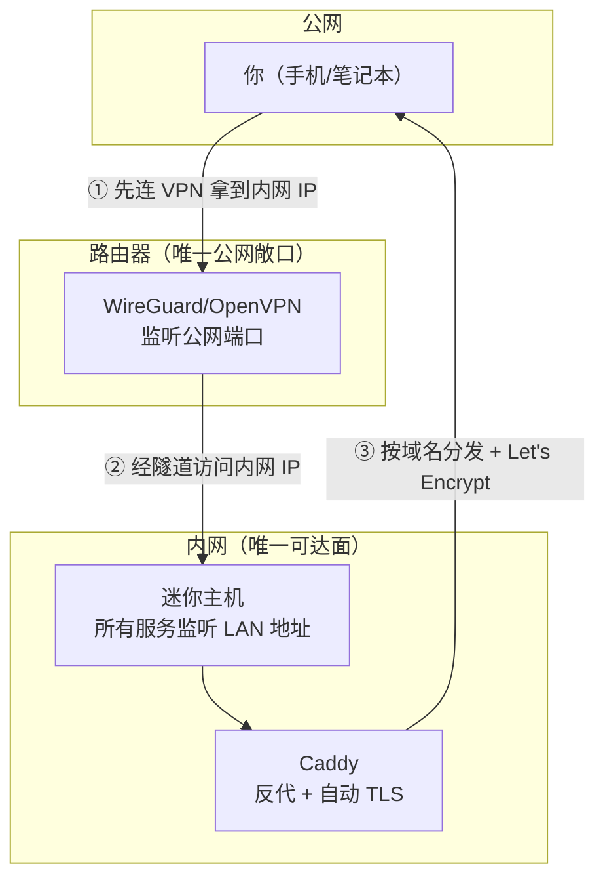
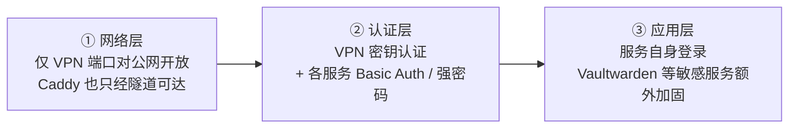
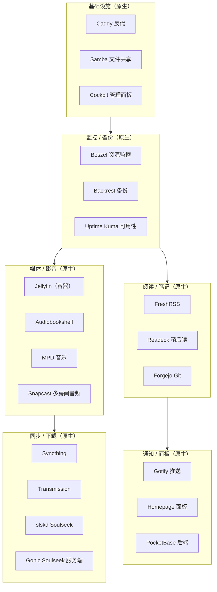
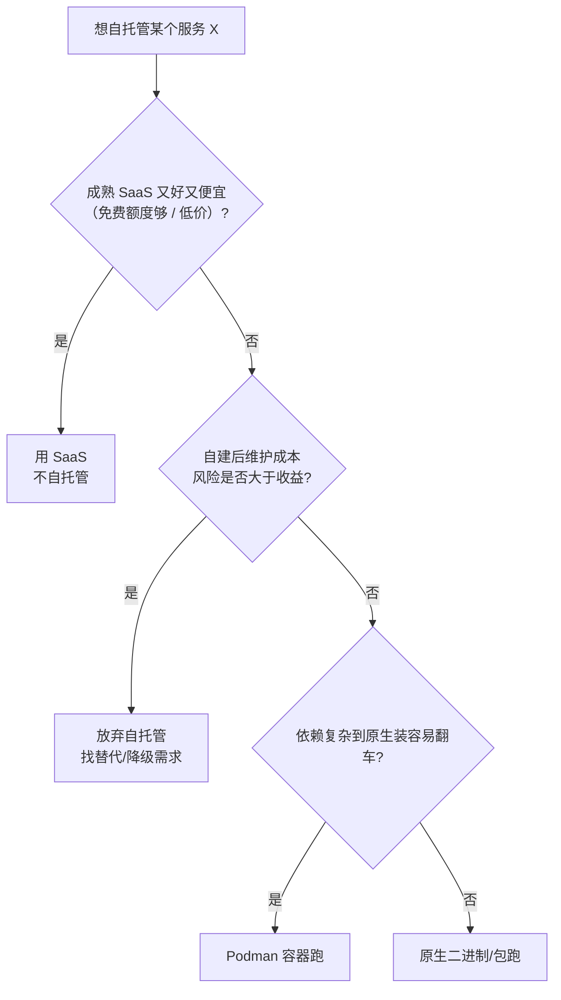
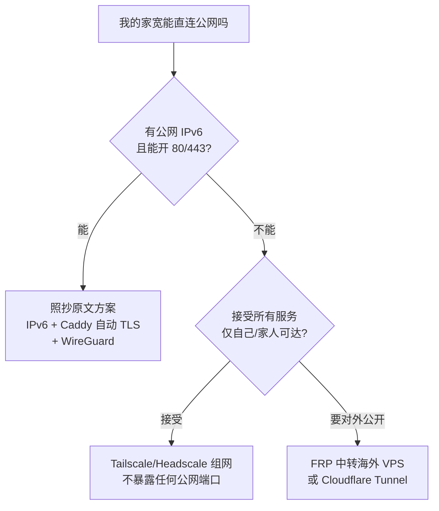

# 自托管服务全家桶：从原文方案到可复制实操手册

| 编写人 | 编写时间 | 参考原文 |
| --- | --- | --- |
| growdu | 2026-10-23 | [What I Self-Host, What I Don't, and Why](https://viceconsole.fyi/blog/2026/10/10/what-i-self-host/) |

> **TL;DR**：原文作者的方案是「**17 个原生 systemd 服务 + 11 个 Podman 容器**，跑在一台 180~359 欧元的 N100 迷你主机上，只通过 IPv6 + VPN 暴露到公网」。
>
> 本文档在原文基础上做了三件事：**(1) 逐条拆解他的设计决策**；**(2) 把每个服务写成可复制的实操步骤**；**(3) 补上原文没覆盖但你会踩的坑——尤其是中国大陆网络环境（CGNAT / 备案 / 443 端口）的适配**。
>
> ⚠️ **动手前必读**：这套方案默认你在**有公网 IPv6 的欧洲/北美宽带**下。中国大陆家庭宽带基本没有公网 IPv4（CGNAT），直接照抄会卡在第一步。本文第 5 章专门讲中国大陆怎么改。

---

## 目录

- [第 1 章 原文精读：他的 4 条原则](#第-1-章-原文精读他的-4-条原则)
- [第 2 章 硬件基线：为什么是 N100 + 16GB](#第-2-章-硬件基线为什么是-n100--16gb)
- [第 3 章 网络前置：整套方案的地基](#第-3-章-网络前置整套方案的地基)
- [第 4 章 17 个原生 systemd 服务逐个实操](#第-4-章-17-个原生-systemd-服务逐个实操)
- [第 5 章 Podman + Quadlet：11 个容器服务](#第-5-章-podman--quadlet11-个容器服务)
- [第 6 章 明确「不自托管」的服务及替代方案](#第-6-章-明确不自托管的服务及替代方案)
- [第 7 章 中国大陆网络适配（重点）](#第-7-章-中国大陆网络适配重点)
- [第 8 章 资源规划与容量估算](#第-8-章-资源规划与容量估算)
- [第 9 章 验收清单与常见故障](#第-9-章-验收清单与常见故障)

---

## 第 1 章 原文精读：他的 4 条原则

原文最有价值的不是那 28 个服务清单，而是**他反复强调的 4 条判断原则**。清单会过时，原则不会。

### 1.1 原则一：任何服务都不直接暴露到公网

他的原话大意是：除了路由器上跑的 VPN，**没有任何服务直接把端口开到公网**。所有 Web 服务（Caddy、Jellyfin、Immich…）都只监听内网，公网唯一入口是 VPN。

**为什么这是对的？**

| 暴露方式 | 攻击面 | 被打穿的代价 |
| --- | --- | --- |
| 直接开公网端口 | 每天 24h 全球扫描 | 一个弱密码 = 数据全泄 |
| 只走 VPN | 只对有 VPN 密钥的人开放 | 密钥泄露 = 同上，但可控可审计 |

逻辑很简单：**公网 = 全世界的靶场，内网 = 自家客厅**。把「全家福」全挂到大街上不如留一扇门（VPN）自己开门。

**落地三件套：**
1. 路由器上装 WireGuard/OpenVPN，**只有 VPN 端口对公网开放**。
2. 所有 Web 服务的 `listen` 绑 `127.0.0.1` 或内网网卡地址。
3. 出门用手机连 VPN，再访问内网地址——体验和连家里 WiFi 一样。

> **国内落地提醒**：家里没有公网 IPv4 时，第 3 条要改用第 5 章的 Tailscale/FRP 方案。

### 1.2 原则二：优先原生二进制，其次容器；能不装包就不装

他的优先级是：**原生二进制（Native）> 容器（Podman）**。原文列的 17 个原生服务都是单二进制或单包，装完 `systemctl enable` 就完事。

**为什么优先原生？**

- **省内存**：一个 systemd 服务常驻 10~80MB；同功能容器因为要跑 runc + 镜像层，基线开销多 20~50MB。他 16GB 内存要跑 28 个服务，这直接决定了他「原生优先」的取舍。
- **省磁盘 + 免 CVE 维护**：容器每次重建拉镜像，镜像层几十 MB 到几百 MB；原生包装完就固定，不受上游镜像更新影响。
- **启动快、依赖少**：原生服务 systemd 直接拉起，不依赖镜像仓库可达性。

**什么时候才用容器？** 依赖复杂、组件多的服务（Home Assistant、Immich、Frigate 这类需要一堆依赖库/Python 环境的），原生装容易踩依赖地狱，容器打包好了一切自洽。

### 1.3 原则三：弃用 Docker，改用 Podman rootless

这是他最有主张的一点。他放弃 Docker 的理由：
- **rootless**：容器进程以普通用户跑，容器逃逸也拿不到 root。
- **systemd 原生集成**：用 **Quadlet** 把容器声明成 systemd unit（`podman generate systemd` 已弃用），`systemctl` 直接管，体验和原生服务一致。
- **守护进程模型更干净**：Podman 是「一次调用即退出」，不需要常驻 dockerd，也就没有那个历史上的 root 等价提权漏洞。

**落地要点（后面第 5 章会详细展开）：**
- 配置放 `~/.config/containers/systemd/*.container`（Quadlet 格式）。
- 用 `systemctl --user` 管理，配合 `loginctl enable-linger` 保证开机自启、不依赖登录会话。

### 1.4 原则四：监控 + 备份 + 可用性三件套

他不是"装完就算"，而是配了完整可观测性：
- **Beszel**：轻量监控面板（CPU/内存/磁盘/容器），看"资源趋势"。
- **Uptime Kuma**：可用性探针（容器），看"服务活着没"。
- **Backrest**：基于 Restic 的备份 Web UI，看"备份成功没、能不能恢复"。

**这三个解决的是不同问题，别混为一谈：**
- Beszel 回答"机器怎么样"；
- Uptime Kuma 回答"服务在线吗"；
- Backrest 回答"数据安全吗、能恢复吗"。

### 1.5 他的取舍哲学（一句话总结）

> **"只自托管那些'自己搭起来比找现成服务更省心'的东西；凡是'成熟 SaaS 又好又便宜'的，一律不自托管。"**

他明确不装的：\*arr 全家桶（资源重、易坏）、Collabora（不如 Google Docs）、Firefly III（容器一堆，不如 Actual Budget）、OwnTracks（手机耗电、定位不准）、Email（风险高）。每个都给了替代或放弃理由。**做减法比做加法难，这是自托管最值钱的心智。**

---

## 第 2 章 硬件基线：为什么是 N100 + 16GB

### 2.1 原文配置与成本

| 硬件 | 型号/规格 | 用途 | 成本（原文） |
| --- | --- | --- | --- |
| 迷你主机 | Beelink Mini PC S12 Pro，Intel **N100** | 跑全部 28 个服务 | EUR 180 → 后涨到 **EUR 359** |
| 内存 | **16GB DDR4** | 主力 | 含在上面 |
| 存储 | **512GB SSD** 系统盘 | 根分区 + 容器镜像 | 含在上面 |
| 存储 | **6TB HDD** | 媒体库（影视/音乐/有声书） | 额外 |
| 网络 | 依赖路由器（IPv6 + WireGuard） | — | 额外 |

> 涨价那笔他归因于 "rampocalypse"（**Ramp** 是美国加密货币借记卡公司破产，导致发币相关硬件/芯片产能被抢），属于供应链黑天鹅，不影响选型逻辑。

### 2.2 N100 够用吗：算一笔账

Intel N100 是 Alder Lake-N 系列的低功耗入门 U（6W 默认功耗墙，可 turbo 到 ~25W），**8 核 8 线程、16GB LPDDR5/双通道 D4、 UHD 核显（支持 AV1/H.265 硬解）**。

**关键优势正好命中自托管场景：**
- **原生 AV1/H.265 硬解**：Jellyfin 直接走核显 GPU 转码，CPU 占用极低——这是他能用 N100 跑媒体库的关键。
- **双通道内存 + 硬件单通道 ECC 之外**：16GB 内存跑 28 个服务偏紧但可行（他自述用 7.5GB / 16GB，CPU 30~40%）。
- **x86_64**：和主流教程、镜像兼容性好，不碰 ARM 的 docker 镜像坑。

**它不适合什么：**
- **Frigate（NVR）**——原文自己承认 Frigate「immediately pushed it to its limits」。Frigate 吃 GPU（最好 Coral TPU）和大量内存，N100 跑起来吃力，他装了 6TB 硬盘但 NVR 大概率另配设备。
- **重度转码/多路 4K**——N100 只能硬解 1~2 路 4K，他自己妥协到**媒体统一下 720p** 就为了省资源。

### 2.3 选购建议（原文逻辑的复制）

选一台迷你主机时按这个顺序看：

1. **CPU 带 AV1/H.265 硬解核显**（N100/N305、J4125、锐龙 6xxx G 系列都行）——决定了媒体服务能不能不炸 CPU。
2. **内存 ≥16GB，且要双通道**——能加内存更好；28 个服务 16GB 是他的实测下限。
3. **双网口（可选）**：想以后拿它做软路由 / 跑 WireGuard 落地、或把 6TB 存储单独挂一台时有用。
4. **至少 1 个 M.2 NVMe 槽 + SATA 口**——系统/容器镜像放 NVMe（快），媒体放 SATA 大盘（性价比）。
5. **功耗 6~15W 待机**：常年 7×24 开着，功耗直接乘 8760 小时进电费。N100 这类低功耗 U 是对的选择。

**存储规划提醒（原文的关键经验）**：
- **SSD 只放系统 + 容器镜像 + 频繁读写的小文件**（Beszel/SQLite 类数据库、Backrest 元数据、Podman 镜像层）。SSD 小、贵，但随机 IO 强。
- **HDD 只放媒体流**（影视/音乐/有声书）——顺序读、容量优先。原文的 6TB 就是干这个的。
- **绝别把 SQLite 数据库（Beszel/Actual/Gotify 数据）放 HDD**——N100 的存储栈扛不住频繁小写。

---

## 第 3 章 网络前置：整套方案的地基

原文的方案能跑，前提是他的网络同时满足三个条件：**IPv6 直连、路由器能跑 WireGuard、自有域名可 DNS 解析**。这一章把这三件事拆开讲，并给可复制命令。



### 3.1 前提一：IPv6 直连（原文的关键前提）

原文提到他用 **IPv6** 访问 VPN。这是绕开 CGNAT 的正道：主流运营商的 IPv4 普遍走 **CGNAT**（Carrier-Grade NAT），你的 IPv4 不是公网 IP，**外部主动连不进来**；但 IPv6 几乎全球直连。

**检测你有没有真 IPv6 / 在不在 CGNAT：**

```bash
# 1) 查本机有没有全局 IPv6 地址（inet6 且不是 link-local fe80::）
ip -6 addr show scope global

# 2) 查出口 IPv6（会显示你的公网 IPv6）
curl -6 https://ifconfig.co
#    或
dig -6 myip.opendns.com @resolver1.opendns.com +short

# 3) 查出口 IPv4，判断是否 CGNAT（对比是否为私有段 100.64.0.0/10 等）
curl -4 https://ifconfig.co
```

**判读：**
- **有 `scope global` 的 IPv6 地址 + `curl -6` 能出公网 IP** → 你有原生 IPv6，可以走原文路线。
- **只有 IPv4 且出口 IP 落在 `100.64.0.0/10` / `10.0.0.0/8` / `192.168.0.0/16`** → 你在 CGNAT 后面，原文路线走不通，**看第 7 章国内适配方案**。

**要真公网 IPv6，联系运营商开通**，一般免费，说「要公网 IPv6，用于自建服务」即可。部分宽带套餐才给，这一步是整套方案的前提，务必先确认。

### 3.2 前提二：路由器上跑 WireGuard（唯一公网敞口）

原文让 VPN 跑在**路由器**上（而不是主机上），好处是：不管主机怎么重装/换机器，VPN 入口都在；同时主机可以只跑内网服务。

**最省事：路由器自带 WireGuard。** 大多数新路由（OpenWrt、爱快、小米/华硕支持 Mesh 的）后台有 WireGuard 选项，新建一个 Peer（对端）填客户端公钥即可。

**进阶：软路由/树莓派上开 WireGuard。** Debian 系：

```bash
sudo apt update && sudo apt install wireguard qn-gateway  # qn 脚本见下
# 用 wg-easy / qnbwg 更省事；纯手工生成密钥：
wg genkey | tee privatekey | wg pubkey < privatekey
# 写 /etc/wireguard/wg0.conf（见下）
sudo sysctl -w net.ipv4.ip_forward=1
```

`/etc/wireguard/wg0.conf`（服务端 = 路由器侧，监听公网端口，示例 51820）：

```ini
[Interface]
Address = 10.7.0.1/24
ListenPort = 51820
PrivateKey = <服务端私钥>
PostUp   = iptables -A FORWARD -i wg0 -j ACCEPT; iptables -t nat -A POSTROUTING -o eth0 -j MASQUERADE
PostDown = iptables -D FORWARD -i wg0 -j ACCEPT; iptables -t nat -D POSTROUTING -o eth0 -j MASQUERADE

[Peer]
# 你的手机/笔记本
PublicKey = <客户端公钥>
AllowedIPs = 10.7.0.2/32
```

> ⚠️ **AllowedIPs 要配客户端的隧道内网 IP**，多设备就多 `[Peer]` 段，每个设备一个公钥。别把 AllowedIPs 写成 `0.0.0.0/0`（那是客户端主动指路用的，服务端侧写了会让流量乱）。

客户端（手机/笔记本）对应 `wg0.conf`，连上后你就拿到 `10.7.0.x`，可以直连内网服务了。

### 3.3 前提三：Caddy 做唯一反代 + 自动 TLS

原文用 **Caddy** 做反向代理和自动 Let's Encrypt 证书。Caddy 的杀手锏是：**自动申请并续期 HTTPS 证书**，配置极简——只要域名指过来、80/443 通，它全自动。

**安装 Caddy（Debian/Ubuntu）：**

```bash
sudo apt install -y debian-keyring debian-archive-keyring apt-transport-https curl
curl -1sLf 'https://dl.cloudsmith.io/public/caddy/stable/gpg.key' | sudo gpg --dearmor -o /usr/share/keyrings/caddy-stable-archive-keyring.gpg
curl -1sLf 'https://dl.cloudsmith.io/public/caddy/stable/debian.deb.txt' | sudo tee /etc/apt/sources.list.d/caddy-stable.list
sudo apt update && sudo apt install -y caddy
```

**Caddy 配置**（`/etc/caddy/Caddyfile`）：

```caddyfile
# 全局：邮件用于证书到期告警
{
    email you@example.com
}

jellyfin.example.com {
    # 反代到内网 jellyfin（监听 8096）
    reverse_proxy 10.0.0.10:8096
}

immich.example.com {
    reverse_proxy 10.0.0.10:2283
}

# 可以挂基本认证兜一层（VPN 之外的第二道，见下 3.4）
immich.example.com {
    basic_auth {
        admin $2a$14$xxxx  # htpasswd 生成
    }
    reverse_proxy 10.0.0.10:2283
}
```

```bash
sudo systemctl reload caddy
sudo systemctl status caddy    # 确认 active
sudo caddy validate --config /etc/caddy/Caddyfile   # 语法自检
```

**证书自动化的前提（很容易翻车）：**
- 域名 A/AAAA 记录**必须已指向这台机器**（IPv6 就指 AAAA）。
- **80 和 443 端口从公网可达**。若走 VPN 入口，Let’s Encrypt 的 HTTP-01 验证要能打到你的 Caddy——所以**做证书时可能要临时把 80 开到公网**，或用 DNS-01 验证。
- 若你在 CGNAT 后面（第 7 章），HTTP-01 无法自动完成，需改用 **DNS-01**（用你的 DNS 服务商 API 签发）。

**Caddy 支持 DNS-01 自动签发**，只要插件 + API 凭证，例如 Cloudflare：

```bash
# 安装 cloudflare DNS 插件版 Caddy（官方提供 xcaddy 构建，见 https://caddyserver.com/docs/automatic-https）
# 配置改为：
# tls {
#     dns cloudflare {env.CF_API_TOKEN}
# }
```

### 3.4 架构总览：三层纵深防御

原文的实际防线是三层的（自述"三重保障"）：



这个纵深思维值得照抄：**任一层被突破，后两层仍能拦一道**。比如有人扫到你的 Web 服务端口（不该发生），还有认证和应用权限挡着。

### 3.5 检查网络是否按预期工作

```bash
# 1) VPN 未连接时，从手机 4G/5G 访问 jellyfin 域名 → 应该打不开（唯一敞口是 VPN）
# 2) 连上 VPN 后再访问 → 应该正常
# 3) 在内网直接 curl 服务端口 → 通
curl -s -o /dev/null -w "%{http_code}\n" http://10.0.0.10:8096

# 4) 确认没有意外的公网暴露（从外部视角看，只应有 VPN 端口）
#    在内网机器上 ss 监听检查：
ss -tlnp | grep -E "8096|2283|:80|:443"
```

---

## 第 4 章 17 个原生 systemd 服务逐个实操

原文 28 个服务里，**17 个用原生 systemd 跑**（单二进制/单包），11 个用 Podman 跑（本章讲原生，第 5 章讲 Podman）。

**统一约定（后面每个服务都默认遵守）：**
- 安装用户假设为 `selfhost`（或你自己的普通用户，**不要用 root 跑服务**）。
- 二进制装到 `/usr/local/bin` 或用发行版包，数据放 `~/services/<name>` 或 `/srv/<name>`。
- 每个服务给出「用途 + 安装 + 配置/运行」，配置项挑关键的讲。



### 4.1 基础设施三件套

#### 4.1.1 Caddy（反代 + 自动 TLS）

第 3 章已详述，这里只列核心安装。**它是所有 Web 服务的唯一对外门面**。

```bash
# 安装见 3.3；核心：写 /etc/caddy/Caddyfile，reload
sudo systemctl enable --now caddy
```

#### 4.1.2 Samba（Samba 文件共享）

内网共享媒体目录给 Windows/macOS 客户端。

```bash
sudo apt install -y samba samba-common-bin
sudo nano /etc/samba/smb.conf
```

`/etc/samba/smb.conf` 关键段：

```ini
[media]
    path = /srv/media
    browseable = yes
    read only = no
    valid users = @mediausers
    create mask = 0664
    directory mask = 0775

[global]
    workgroup = WORKGROUP
    server string = selfhost
    # 关掉 SMB1，防 EternalBlue 类攻击
    server min protocol = SMB2
    map to guest = never
```

```bash
# 建用户组与用户
sudo groupadd mediausers && sudo useradd -G mediausers -M -s /usr/sbin/nologin selfhost
sudo smbpasswd -a selfhost          # 设 Samba 密码
# 授权目录（注意 -R 递归 + 归属）
sudo chown -R selfhost:mediausers /srv/media
sudo chmod -R 2775 /srv/media
# 生效
sudo systemctl restart smbd nmb
# 防火墙（内网才开）
sudo ufw allow from 10.0.0.0/24 to any app samba
```

#### 4.1.3 Cockpit（服务器管理面板）

Web 版服务器控制台（终端、日志、服务、网络、存储）。

```bash
# Debian/Ubuntu
sudo apt install cockpit
sudo systemctl enable --now cockpit.socket
sudo ufw allow 9090/tcp        # 或仅限内网
```

访问 `https://<内网IP>:9090`，用系统用户登录。⚠️ 生产上建议**只经 VPN 访问**。

### 4.2 监控与备份三件套

#### 4.2.1 Beszel（轻量资源监控）

比 Grafana + Prometheus 轻得多，专为家用服务器设计（Agent 模式）。

```bash
# 1) 建专用用户
sudo adduser --disabled-password --gecos "" beszel
# 2) 官方安装脚本（下载对应架构二进制）
#    通用做法：
cd /tmp
ARCH=$(uname -m)   # x86_64 / aarch64
wget https://github.com/henrygd/beszel/releases/latest/download/beszel_0.9_$(echo $ARCH | sed 's/x86_64/x86_64/;s/aarch64/arm64/')_linux_amd64.tar.gz 2>/dev/null || true
```

> 📌 **实操建议**：Beszel 版本迭代快，直接按官方仓库的安装说明走最稳（`curl -sSL https://raw.githubusercontent.com/henrygd/beszel/main/supervisor/install.sh | bash` 或解压放 `/usr/local/bin`）。核心是**两份配置**：
> - **Server（hub）**：装在你的主机上，收数据。
> - **Agent**：装在被监控的机器上，上报 CPU/内存/磁盘/容器指标。

这里给出 Agent 的 systemd 配置思路：写一个 `/etc/systemd/system/beszel-agent.service`，`ExecStart=/usr/local/bin/beszel-agent`，配 `KEY` 环境变量指向 hub 生成的 key，`Restart=always`，然后 `systemctl enable --now beszel-agent`。

#### 4.2.2 Backrest（Restic 备份 Web UI）

给全家桶做定时备份（照片、文档、配置），带 Web 面板看备份历史。

```bash
# Backrest 官方提供二进制/容器。用二进制（原生）：
cd /tmp
curl -LO https://github.com/garethgeorge/backrest/releases/latest/download/backrest_linux_amd64.tar.gz
tar xzf backrest_linux_amd64.tar.gz
sudo install -m755 backrest /usr/local/bin/backrest
# 数据目录
sudo mkdir -p /var/lib/backrest && sudo chown $USER /var/lib/backrest
```

```bash
# 用 systemd 跑（示例，放 ~/.config/systemd/user/backrest.service）
```

```ini
[Unit]
Description=Backrest backup UI
After=network-online.target

[Service]
ExecStart=/usr/local/bin/backrest serve --data-dir /var/lib/backrest --listen 127.0.0.1:9898
Restart=always
Environment=BACKREST_DATA_DIR=/var/lib/backrest

[Install]
WantedBy=default.target
```

```bash
systemctl --user daemon-reload
systemctl --user enable --now backrest
loginctl enable-linger $USER   # 关键：不用登录也常驻
```

**Restic 备份要点**：在 Backrest UI 里加 repo（本地盘 / SFTP / S3 / Backblaze），配 plan（路径 + 排除 + 计划 cron）。建议：
- 媒体库（6TB）**不必进 Restic**（可重新获取、变动低），重点备份的是**不可再生的数据**：Immich 照片、Vaultwarden 密码库、文档、备份本身。
- 遵循 **3-2-1**：至少 3 份副本、2 种介质、1 份异地（异地的云端副本）。

#### 4.2.3 Uptime Kuma（服务可用性）

监控你的各个服务"还活着没"，挂了发通知。（原文归在 Podman，第 5 章讲；此处记住它和 Beszel 分工：Beszel 看资源，Kuma 看在线。）

### 4.3 媒体与影音（原生部分）

#### 4.3.1 Audiobookshelf（有声书服务器）

管理/串流有声书，服务端原生安装。

```bash
# 官方提供 deb 包或二进制。二进制方式：
cd /tmp
curl -LO https://github.com/advplyr/audiobookshelf/releases/latest/download/audiobookshelf-linux-x64.deb
sudo dpkg -i audiobookshelf-linux-x64.deb
# 初始化并配置
audiobookshelf --config /home/selfhost/services/abs
sudo systemctl enable --now audiobookshelf   # 官方包自带 unit
```

数据目录（音频、podcast、元数据、用户）都在 `--config` 指向的目录，**把这个目录纳入 Backrest 备份**。

#### 4.3.2 MPD（Music Player Daemon + 音乐库）

极轻量的服务端音乐播放器（无状态、纯协议），配合 ncmpcpp/客户端使用。

```bash
sudo apt install -y mpd mpd-mpdtag
```

`/etc/mpd.conf` 关键配置：

```ini
music_directory "/srv/media/music"
playlist_directory "/srv/mpd/playlists"
db_file "/srv/mpd/mpd.db"
state_file "/var/lib/mpd/state"
bind_to_address "127.0.0.1"      # 只本机/内网，不公网
port "6600"
audio_output {
    type "alsa"
    name "My ALSA"
    device "hw:0,0"
}
```

```bash
chown -R mpd:mpd /srv/mpd
systemctl restart mpd
```

#### 4.3.3 Snapcast（多房间音频同步）

把 MPD/任何音频流同步到多个房间设备（树莓派音箱等）。原文用它做全屋音频。

```bash
# Snapcast 官方 deb
sudo snapcast-server 2>/dev/null || \
  (cd /tmp && curl -LO https://github.com/badaix/snapcast/releases/latest/download/snapserver_0.3x_amd64.deb && sudo dpkg -i snapserver_*.deb)
sudo systemctl enable --now snapserver
# 客户端（每台播放设备）：snapclient 连到 snapserver 的 :4953
```

**工作模式**：Snapcast server 收一路流，分发给所有 snapclient；客户端（如树莓派）本地播放，实现低延迟同步。

> 原文明确：为省资源他**媒体统一压到 720p**，摄像头用**低分辨率子码流**——这是 N100 + 单机器跑满的取舍。**自托管媒体不要追求画质，够看即可。**

### 4.4 阅读 / 知识管理（原生）

#### 4.4.1 FreshRSS（RSS 聚合）

自托管 RSS 阅读器，配合 Fever/Google Reader API 接入。

```bash
# 原生：PHP 应用。Debian/Ubuntu：
sudo apt install -y php-cli php-mbstring php-xml php-curl php-sqlite3 nginx
git clone https://github.com/FreshRSS/FreshRSS.git ~/freshrss
# 内置 php -S 即可跑；生产建议配 nginx + php-fpm
cd ~/freshrss && php -S 0.0.0.0:8080 -t ./p/ > /tmp/freshrss.log 2>&1 &
# 做成 systemd 服务托管（示例）
```

```ini
# ~/.config/systemd/user/freshrss.service
[Unit]
Description=FreshRSS
After=network-online.target

[Service]
WorkingDirectory=%h/freshrss
ExecStart=/usr/bin/php -S 127.0.0.1:8080 -t ./p/
Restart=always

[Install]
WantedBy=default.target
```

#### 4.4.2 Readeck（稍后读）

收集文章链接、稍后阅读、标签整理。

```bash
# Readeck 提供 deb/静态包。数据存 PostgreSQL 或 SQLite。
# 二进制 + SQLite 简单方式：
cd /tmp
curl -LO https://github.com/readeck/readeck/releases/latest/download/readeck_linux_amd64.tar.gz
tar xzf readeck_*.tar.gz && sudo install -m755 readeck /usr/local/bin/readeck
```

```ini
# ~/.config/systemd/user/readeck.service
[Unit]
Description=Readeck

[Service]
ExecStart=/usr/local/bin/readeck serve --database sqlite:///var/lib/readeck/readeck.db --listen 127.0.0.1:8010
Environment=READECK_BASE_URL=https://readeck.example.com
Environment=READECK_SECRET_KEY=<改成随机长串>
Restart=always

[Install]
WantedBy=default.target
```

⚠️ `SECRET_KEY` 一定要改成随机值。**Readeck 官方明确警告**：默认密钥会让人猜出你的账户管理权限。

#### 4.4.3 Forgejo（自建 Git，类似 Gitea）

轻量自建 Git 服务（不像 GitLab 重）。

```bash
# 官方提供二进制包。Debian：
cd /tmp
curl -LO https://codeberg.org/forgejo/forgejo/releases/download/v1.21/forgejo-1.21.3-0-linux-amd64
sudo install -m755 forgejo-*-linux-amd64 /usr/local/bin/forgejo
```

```ini
# /etc/systemd/system/forgejo.service（系统级）
[Unit]
Description=Forgejo
After=network-online.target
Wants=network-online.target

[Service]
Type=simple
User=git
Group=git
WorkingDirectory=/var/lib/forgejo
ExecStart=/usr/local/bin/forgejo web --config /etc/forgejo/app.ini
Restart=always
RestartSec=5

[Install]
WantedBy=multi-user.target
```

```bash
sudo useradd -r -s /usr/sbin/nologin -d /var/lib/forgejo git
sudo mkdir -p /etc/forgejo /var/lib/forgejo && sudo chown -R git:git /var/lib/forgejo
# 生成 app.ini（DB_TYPE=sqlite3 最省事；DISABLE_REGISTRATION=true 更安全）
sudo -u git forgejo generate secret SECRET_KEY
systemctl enable --now forgejo
```

**安全建议**：`[server] DISABLE_REGISTRATION = true`（自用无需开放注册），或用 `ALLOW_ONLY_EXTERNAL_REGISTRATION`。数据库个人用 SQLite，多用户才上 Postgres/MySQL。

### 4.5 同步与下载（原生）

#### 4.5.1 Syncthing（设备间文件同步）

点对点文件同步（类 Dropbox，但自己掌控、去中心化）。

```bash
# 官方 deb
curl -LO https://github.com/syncthing/syncthing/releases/download/v1.27/syncthing-amd64.deb
# 或解压官方 tar
cd /tmp && curl -LO https://github.com/syncthing/syncthing/releases/download/v1.27/syncthing-linux-amd64-v1.27.tar.gz
tar xzf syncthing-linux-*.tar.gz
sudo install -m755 syncthing-linux-*/syncthing /usr/local/bin/
sudo useradd -r -m -d /var/lib/syncthing -s /usr/sbin/nologin syncthing
```

```ini
# /etc/systemd/system/syncthing@.service
[Unit]
Description=Syncthing for %i
After=network-online.target

[Service]
User=syncthing
ExecStart=/usr/local/bin/syncthing serve --no-browser --home=/var/lib/syncthing/%i
Restart=always

[Install]
WantedBy=multi-user.target
```

```bash
systemctl enable --now syncthing@syncthing
# Web UI: http://127.0.0.1:8384（设 GUI 密码）
```

⚠️ 注意 Syncthing 的默认是**同步而非备份**（会传播删除）。要"版本化备份"需开启 `.stversions` 文件版本控制。

#### 4.5.2 Transmission Daemon（BT 下载）

```bash
sudo apt install -y transmission-daemon
```

```bash
# 配置（先停服务再改，否则会被覆盖）
sudo systemctl stop transmission-daemon
sudo mkdir -p /srv/downloads /var/lib/transmission-daemon/info
sudo chown -R debian-transmission:debian-transmission /srv/downloads /var/lib/transmission-daemon
sudo nano /var/lib/transmission-daemon/settings.json
# 关键项： "download-dir": "/srv/downloads",
#         "rpc-authentication-required": true,
#         "rpc-whitelist-enabled": true （或关掉并用强密码）
#         "rpc-password": <bcrypt 密码>
sudo systemctl start transmission-daemon
```

Web UI 默认 `http://127.0.0.1:9091`。⚠️ Transmission RPC 是**高危面**（曾爆多个远程漏洞），务必限制在内网/VPN 后。

#### 4.5.3 slskd（Soulseek 客户端守护版）

Soulseek（音乐分享网络）的 CLI 客户端，守护进程化便于远程管理。原文用它从 Soulseek 下载音乐（MPD 库或媒体库来源之一）。

```bash
# slskd 是 .NET 应用，提供 deb 或二进制。
sudo dpkg -i slskd*.deb     # 或解压 tar 到 /usr/local/bin
# 配置目录通常 /var/slskd 或 ~/.local/share/slskd
```

用 systemd（示例）：

```ini
[Unit]
Description=slskd
After=network-online.target

[Service]
User=selfhost
ExecStart=/usr/local/bin/slskd --http-port 5030 --https-port 5031 --directory /srv/music
Restart=always

[Install]
WantedBy=default.target
```

⚠️ **Soulseek 的版权灰色性**：它主要用于未经授权的音乐共享，作者用来合法地获取自己已购买/可免费分发的资源。**使用时请遵守当地版权法，不要用它大规模下载盗版。**

#### 4.5.4 Gonic（Soulseek 服务端）

Soulseek 网络的**服务端**，让你的库可被搜到/下载。原文把它和 slskd 搭配（slskd 下、Gonic 分享出去）。

```bash
# Gonic 是 Go 单二进制
cd /tmp
curl -LO https://github.com/sirrobot01/gonic/releases/latest/download/gonic_linux_amd64
sudo install -m755 gonic_linux_amd64 /usr/local/bin/gonic
```

`/etc/gonic.toml`：

```toml
[music]
path = "/srv/media/music"

[shares]
  [shares."0"]
  path = "/srv/media/music"

[web]
port = 4747
```

```bash
gonic -c /etc/gonic.toml
# systemd：
# ExecStart=/usr/local/bin/gonic -c /etc/gonic.toml
```

---

### 4.6 通知 / 面板 / 后端（原生）

#### 4.6.1 Gotify（自建推送）

轻量推送服务器（类 ntfy），手机装 Gotify App，服务发 HTTP 就能推到手机。

```bash
# Gotify 是单二进制
cd /tmp
curl -LO https://github.com/matrix-org/gotify/releases/download/v2.5.0/gotify_2.5.0_linux_amd64.zip
unzip gotify_*.zip && sudo install -m755 gotify /usr/local/bin/gotify
```

```bash
# 初始化数据库
gotify -configuration gotify.yml migrate
```

`gotify.yml` 关键项：

```yaml
server:
  listenaddr: "0.0.0.0:8080"
database:
  type: sqlite3
  connection: "/var/lib/gotify/gotify.db"
```

```ini
# /etc/systemd/system/gotify.service
[Unit]
Description=Gotify
After=network-online.target

[Service]
User=selfhost
WorkingDirectory=/var/lib/gotify
ExecStart=/usr/local/bin/gotify -configuration /etc/gotify.yml
Restart=always

[Install]
WantedBy=multi-user.target
```

**用法**：Gotify 很适合做"家庭自动化中枢"——Uptime Kuma 挂了通知你、Backrest 备份失败通知你、Shell 脚本执行完通知你。全文的 Gotify 应用 token 在 UI 里生成。

#### 4.6.2 Homepage（导航面板）

自托管服务入口页（原文明说它用 Podman，但本质上极轻，本节讲逻辑）。它就是一个 Dashboard，把 28 个服务做成卡片，点进去访问。

（安装见第 5 章 Podman 部分。）

#### 4.6.3 PocketBase（轻量 BaaS）

Go 写的单二进制"后端即服务"（数据库 + Auth + 文件存储 + API），原文用它给 Homepage/小工具做后端。

```bash
cd /tmp
curl -LO https://github.com/pocketbase/pocketbase/releases/download/v0.28.4/pocketbase_0.28.4_linux_amd64.zip
unzip pocketbase_*.zip && sudo install -m755 pocketbase /usr/local/bin/pocketbase
```

```bash
# 数据目录（务必放进 Backrest 备份！）
cd /var/lib/pocketbase
pocketbase serve --http=127.0.0.1:8090
# systemd: ExecStart=/usr/local/bin/pocketbase serve --http=127.0.0.1:8090
# 首次打开 Web UI 建管理员账号
```

⚠️ PocketBase 的 SQLite 文件 `pb_data/` 就是全部家当，**丢了全丢**，务必备份。

---

## 第 5 章 Podman + Quadlet：11 个容器服务

原文的 11 个容器服务：**Actual Budget、ARM（Automatic Ripping Machine）、Frigate、Home Assistant、Homepage、Immich、Jellyfin、Uptime Kuma、Vaultwarden、Vikunja、Yubal**。

### 5.1 为什么弃用 Docker，改 Podman

| 维度 | Docker | Podman（rootless） | 对自托管的意义 |
| --- | --- | --- | --- |
| 权限模型 | 默认 root daemon | **无 daemon**，rootless 用户态 | 容器逃逸也拿不到 root；不用给 Docker 组 sudo 等价提权 |
| 常驻进程 | 需要 dockerd 常驻 | 一次调用即退出 | 省一个常驻进程 + 攻击面 |
| systemd 集成 | 需第三方插件（`podman generate systemd` 已弃用） | **Quadlet** 原生 | 容器像原生服务一样被 systemd 管 |
| 兼容性 | — | 命令行刻意兼容 Docker | 迁移基本无痛 |

> 📌 **原文明确点名**：`podman generate systemd` 已经弃用/移除，现在的标准做法是 **Quadlet**。

### 5.2 安装 Podman + Quadlet 基础

```bash
# Debian/Ubuntu
sudo apt update
sudo apt install -y podman uidmap fuse-overlayfs slirp4netns

# 确认版本 ≥ 4.4（Quadlet 需 4.4+，推荐 5.x）
podman --version
# 5.x 建议开启 Quadlet（Debian 12+ 默认开；Debian 11 需手动）
sudo systemctl enable --now podman.socket        # 提供 /run/podman/podman.sock 给工具
```

**rootless 用户的前置条件**：用普通用户（非 root）运行，Podman 会自动走 rootless。

```bash
# 验证 rootless 可用
podman info | grep -i "rootless"
# 确保 subuid/subgid 已配（通常装包时已自动加）
grep selfhost /etc/subuid /etc/subgid
# 没有就补：
sudo usermod --add-subuids 100000-165535 --add-subgids 100000-165535 selfhost
```

### 5.3 Quadlet 机制详解（核心）

**Quadlet** 是 Podman 4.4+ 内置的特性：你把一个 `.container` 文件丢进 Quadlet 目录，`systemctl --user daemon-reload` 后，Podman 会**自动生成**一个同名 `.service`，之后 `systemctl --user start xxx` 就像管原生服务一样。

**目录：**
- **用户级**（rootless，推荐）：`~/.config/containers/systemd/` → 生成 `systemctl --user` 单元。
- **系统级**：`/etc/containers/systemd/` → `systemctl`（系统）单元。

**启用 Quadlet（Debian/Ubuntu 用户级）：**

```bash
mkdir -p ~/.config/containers/systemd
# Debian 12/Ubuntu 22.04+ 一般默认开；若没有：
grep -n Quadlet /usr/lib/systemd/user-generators/podman-system-generator 2>/dev/null || true
# 确保 podman 版本足够新（Quadlet 稳定于 5.x）
```

**一个 Quadlet `.container` 文件长这样**（以 Jellyfin 为例）：

```ini
# ~/.config/containers/systemd/jellyfin.container
[Unit]
Description=Jellyfin Media Server
After=network-online.target
Wants=network-online.target

[Container]
Image=docker.io/jellyfin/jellyfin:latest
ContainerName=jellyfin
# 端口：hostPort:containerPort
PublishPort=8096:8096
# 卷：hostPath:containerPath[:options]
Volume=/srv/jellyfin/config:/config:Z
Volume=/srv/media:/media:ro
# 环境变量
Environment=TZ=Asia/Shanghai
Environment=JELLYFIN_PublishedServerUrl=https://jellyfin.example.com

[Service]
Restart=always
RestartSec=10
# 可选：资源限制、额外能力等在这里加

[Install]
WantedBy=default.target
```

**加载并启动：**

```bash
systemctl --user daemon-reload        # 触发 Quadlet 生成 jellyfin.service
systemctl --user enable --now jellyfin.service
systemctl --user status jellyfin
journalctl --user -u jellyfin -f      # 看日志

# ⭐ 关键一步：允许用户服务在未登录时也常驻
sudo loginctl enable-linger $USER
```

> ⚠️ **`loginctl enable-linger` 一定要做**，否则你退出 SSH 后 `systemctl --user` 的服务会被杀掉，重启机器后也不会自动起。

**`[Container]` 常用指令速查：**

| 指令 | 作用 | 例子 |
| --- | --- | --- |
| `Image` | 镜像 | `docker.io/jellyfin/jellyfin:latest` |
| `ContainerName` | 容器名 | `jellyfin` |
| `PublishPort` | 端口映射 | `8096:8096`、`127.0.0.1:8096:8096`（只绑本地） |
| `Volume` | 卷挂载 | `/srv/media:/media:ro`（`:ro` 只读，`:Z` SELinux） |
| `Environment` | 环境变量 | `TZ=Asia/Shanghai` |
| `User` | 容器内以何用户跑 | `User=1000:1000` |
| `AddDevice` | 透传设备 | `AddDevice=/dev/dri:/dev/dri` |
| `Device` | 同上（旧名） | Frigate 用它接 GPU |
| `SecurityLabelDisable` | 关 SELinux 标签 | 需要时 |

**`:Z` / `:z` 说明**：SELinux 系统（Fedora/RHEL/部分 Debian）需要给卷加标签；Debian/Ubuntu 用 AppArmor，一般写 `:Z` 也不冲突；**纯只读挂载建议 `:ro`**，既安全又让 Jellyfin/Immich 之类不会误写源盘。

### 5.4 逐个服务的 Quadlet 配置

下面给出每个容器的 `.container` 模板。**公共前提**：

```bash
mkdir -p /srv/{immich,jellyfin,uptime,vaultwarden,home-assistant,homepage,actual,frigate,vikunja,arm,yubal}
mkdir -p ~/.config/containers/systemd
# 数据目录属主对齐容器内用户
```

#### 5.4.1 Jellyfin（媒体库）

```ini
# jellyfin.container
[Unit]
Description=Jellyfin
After=network-online.target

[Container]
Image=docker.io/jellyfin/jellyfin:latest
ContainerName=jellyfin
PublishPort=8096:8096
Volume=/srv/jellyfin/config:/config:Z
Volume=/srv/media/movies:/data/movies:ro
Volume=/srv/media/tv:/data/tv:ro
# GPU 硬解透传（利用 N100 核显，关键！）
AddDevice=/dev/dri:/dev/dri
Environment=TZ=Asia/Shanghai
# 硬件加速
Environment=JELLYFIN_HardwareAccelerationType=intel

[Service]
Restart=always

[Install]
WantedBy=default.target
```

#### 5.4.2 Immich（照片管理）

```ini
# immich.container —— Immich 官方是 docker-compose，但也能用 Quadlet 单容器跑
[Unit]
Description=Immich
After=network-online.target

[Container]
Image=docker.io/ghcr.io/immich-app/immich-server:latest
ContainerName=immich
PublishPort=2283:2283
Volume=/srv/immich/config:/usr/src/app/upload:Z
Environment=TZ=Asia/Shanghai
Environment=IMMICH_PORT=2283

[Service]
Restart=always

[Install]
WantedBy=default.target
```

> 📌 Immich 官方推荐 compose（app + postgres + redis）。若要完整依赖，**用 compose 文件也行**，但原文坚持统一 Quadlet。**建议**：Immich 是"数据最重要"的服务（照片不可再生），它的 Postgres/Redis 数据目录一定要进 Backrest 备份。

#### 5.4.3 Home Assistant（智能家居）

```ini
# home-assistant.container
[Unit]
Description=Home Assistant
After=network-online.target

[Container]
Image=docker.io/homeassistant/home-assistant:stable
ContainerName=hassio
PublishPort=8123:8123
Volume=/srv/home-assistant:/config:Z
Volume=/run/dbus:/run/dbus:ro
Environment=TZ=Asia/Shanghai

[Service]
Restart=always

[Install]
WantedBy=default.target
```

⚠️ Home Assistant 对 `/dev/dbus`、蓝牙/Zigbee 直连有需求。上面挂 dbus 是常见做法；深度集成可能还要透传 `/dev/serial` 或 USB dongle。

#### 5.4.4 Uptime Kuma（可用性监控）

```ini
# uptime-kuma.container
[Unit]
Description=Uptime Kuma
After=network-online.target

[Container]
Image=louislam/uptime-kuma:1
ContainerName=uptime-kuma
PublishPort=3001:3001
Volume=/srv/uptime/data:/app/data:Z
Environment=PORT=3001
Environment=TZ=Asia/Shanghai

[Service]
Restart=always

[Install]
WantedBy=default.target
```

#### 5.4.5 Vaultwarden（密码库）

```ini
# vaultwarden.container —— ⚠️ Bitwarden 的轻量实现，最敏感的密码库
[Unit]
Description=Vaultwarden
After=network-online.target

[Container]
Image=docker.io/vaultwarden/server:latest
ContainerName=vaultwarden
PublishPort=127.0.0.1:8080:80       # 只绑本地，由 Caddy 反代
Volume=/srv/vaultwarden/data:/data:Z
Environment=DOMAIN=https://vault.example.com
Environment=ROCKET_PORT=80
Environment=SIGNUPS_ALLOWED=false        # 关键：禁掉注册，防被薅
Environment=TZ=Asia/Shanghai
# 反代后拿到真实 IP（Cloudflare Tunnel/反代时必配）
Environment=ROCKET_TRUSTED_PROXIES=10.0.0.0/8,172.17.0.0/16

[Service]
Restart=always

[Install]
WantedBy=default.target
```

🔒 **Vaultwarden 铁律**：
1. `SIGNUPS_ALLOWED=false`（注册完立刻关，否则任何知道域名的人都能注册）。
2. 一定经 Caddy 反代 + HTTPS，不要裸奔 80。
3. **`/srv/vaultwarden/data` 是你全部密码，必须进 Backrest，且备份要加密异地**。

#### 5.4.6 Frigate（NVR 摄像头）

```ini
# frigate.container —— 全文最吃资源的容器，原文说它"immediately pushed to limits"
[Unit]
Description=Frigate NVR

[Container]
Image=docker.io/blakeblackshear/frigate:latest
ContainerName=frigate
PublishPort=5000:5000
PublishPort=8554:8554
PublishPort=1984:1984
Volume=/srv/frigate/config:/config:Z
Volume=/srv/frigate/media:/media
AddDevice=/dev/dri:/dev/dri            # Intel 核显解码
AddDevice=/dev/bus/usb:/dev/bus/usb   # Coral TPU / USB 摄像头
Environment=TZ=Asia/Shanghai

[Service]
Restart=always
TimeoutStartSec=300

[Install]
WantedBy=default.target
```

> ⚠️ Frigate 要 **Intel 核显（VAAPI）+ 摄像头 RTSP 流**，且吃内存/CPU 很重。**在 N100 + 16GB 上要克制**：摄像头数量控制在 2~4 路、分辨率用**子码流（sub-stream）**。这正是原文说的"用低分辨率子码流省资源"。

#### 5.4.7 Actual Budget（个人财务）

```ini
# actual-budget.container
[Unit]
Description=Actual Budget

[Container]
Image=actualbudget/actual-server:latest
ContainerName=actual
PublishPort=5006:5006
Volume=/srv/actual/data:/appdata:Z
Environment=ACTUAL_PORT=5006
Environment=ACTUAL_HOSTNAME=0.0.0.0
Environment=TZ=Asia/Shanghai

[Service]
Restart=always

[Install]
WantedBy=default.target
```

> 原文用它替代 Firefly III（后者容器太多）。单容器、无外部 DB，最省心。

#### 5.4.8 Homepage（服务导航面板）

```ini
# homepage.container
[Unit]
Description=Homepage Dashboard

[Container]
Image=gethomepage/homepage:latest
ContainerName=homepage
PublishPort=3000:3000
Volume=/srv/homepage/config:/app/config:Z
Volume=/var/run/docker.sock:/var/run/docker.sock:ro   # 显示容器状态（可选）
Environment=HOMEPAGE_ALLOWED_HOSTS=vinceconsole.fyi,localhost

[Service]
Restart=always

[Install]
WantedBy=default.target
```

> Homepage 里用一个 `services.yaml` 定义所有卡片（这是它连接 28 个服务的"总目录"）。把本书提到的服务都做成卡片，点即达。

#### 5.4.9 ARM（Automatic Ripping Machine，光驱自动刻录）

```ini
# arm.container —— CD/DVD 自动抓轨（ripping）
[Unit]
Description=Automatic Ripping Machine

[Container]
Image=ghcr.io/hejalsy/arm:latest
ContainerName=arm
PublishPort=8080:8080
PublishPort=7900:7900
Volume=/srv/arm/config:/config:Z
Volume=/srv/arm/music:/music
Volume=/srv/arm/video:/video
AddDevice=/dev/sr0:/dev/sr0       # 光驱
AddDevice=/dev/bus/usb:/dev/bus/usb
Environment=CONFIGSTRING=y:raw
Environment=TZ=Asia/Shanghai

[Service]
Restart=always

[Install]
WantedBy=default.target
```

> ARM 用来把实体 CD  ripping 成音乐/视频入库（喂给 MPD/Snapcast）。无光驱可忽略。

#### 5.4.10 Vikunja（待办 / Todo）

```ini
# vikunja.container
[Unit]
Description=Vikunja Todo

[Container]
Image=docker.io/go-vikunja/vikunja:latest
ContainerName=vikunja
PublishPort=3456:3456
Volume=/srv/vikunja/data:/app/data:Z
Environment=VIKUNJA_SERVICE_URL=https://todo.example.com
Environment=TZ=Asia/Shanghai

[Service]
Restart=always

[Install]
WantedBy=default.target
```

#### 5.4.11 Yubal（可选）

原文列表里还有 **Yubal**（用量/余额聚合看板），同样用容器。模板：

```ini
# yubal.container
[Unit]
Description=Yubal

[Container]
Image=<yubal-official-image>:latest   # 按其文档填实际镜像
ContainerName=yubal
PublishPort=8091:8091
Volume=/srv/yubal:/data:Z

[Service]
Restart=always

[Install]
WantedBy=default.target
```

### 5.5 Quadlet 一键批量加载

```bash
cd ~/.config/containers/systemd/
systemctl --user daemon-reload
# 批量启动所有 *.container 对应的服务
for svc in jellyfin immich hassio uptime-kuma vaultwarden frigate actual homepage vikunja; do
  systemctl --user enable --now "$svc.service"
done
# 查看所有用户服务
systemctl --user list-units --type=service | grep -E "jellyfin|immich|..."
```

**排查三板斧：**

```bash
systemctl --user status <svc>        # 状态/最近错误
journalctl --user -u <svc> -n 100    # 容器日志
podman ps -a                          # 容器层面状态（rootless 你的用户）
podman logs <containerName>           # 容器 stdout/stderr
```

---

## 第 6 章 明确「不自托管」的服务及替代方案

原文最有价值的部分之一是**他明确不装的东西**——每个都给了理由。**做减法比做加法难**，这是自托管最值钱的心智。

| 不自托管的服务 | 原文理由 | 替代方案 |
| --- | --- | --- |
| **\*arr 全家桶**（Sonarr/Lidarr/Radarr） | 资源占用大、容易坏、依赖链复杂 | Jellyfin + 手动整理；或用「整理册」自动化脚本轻量替代 |
| **Collabora Online** | Google Docs 更好用，没必要自建 | Google Docs / Microsoft 365；本地用 **LibreOffice** |
| **Firefly III** | 容器太多太重 | **Actual Budget**（单容器，替代方案更简单） |
| **OwnTracks** | 手机耗电、定位不准 | 放弃精确轨迹；需要的话用别的方案 |
| **Dawarich**（照片轨迹） | 要 4+ 个容器，太重 | 放弃；或直接用 Immich 的定位功能 |
| **Music Assistant** | "什么都要自己管"太折腾 | **MPD + Snapcast**（更简单直接） |
| **Email 服务器** | 安全风险太高（配置反垃圾/DKIM 等极易踩坑） | 用 Gmail/Outlook/ProtonMail 等托管邮箱 |

**这张表的通用判据（可复用到任何服务）：**



一句话：**「要么 SaaS 搞定，要么用最简工具替代，要么容器跑，实在不值得就别装。」**

---

## 第 7 章 中国大陆网络适配（重点）

这是原文**默认成立、但国内会翻车**的部分。原文的网络前提（公网 IPv6 + 域名直连 + 80/443 可达）在国内大多不满足。逐条给出国内可行的改法。

### 7.1 国内三大网络障碍

| 障碍 | 说明 | 原文假设 | 国内现实 |
| --- | --- | --- | --- |
| **CGNAT（IPv4）** | 运营商不给公网 IPv4 | 用 IPv6 绕过 | 家宽大多仍无公网 IPv4，且**很多地区连公网 IPv6 也难配** |
| **域名备案** | 用国内服务器对外提供服务需备案 | 无需（用海外/自有 IP） | **云服务器建站要备案**（否则 80/443 被拦） |
| **80/443 端口** | HTTP/HTTPS 标准端口 | 直接可用 | 国内云主机**未备案不能开 80/443**；家宽端口可能被封 |

### 7.2 方案一（推荐）：Tailscale / WireGuard 组网

**思路**：**不把任何服务暴露公网，只在设备间组加密网**——这恰好**就是原文原则一在国内的等价实现**，而且不需要公网 IP。

```bash
# 服务器（你的迷你主机）装 Tailscale
curl -fsSL https://tailscale.com/install.sh | sh
sudo tailscale up --advertise-routes=192.168.1.0/24 --accept-dns=false
# 手机/笔记本装 Tailscale 客户端，登同一账号
```

**好处**：
- 天然打洞，**不需要公网 IPv4/IPv6、不需要端口映射、不需要备案**。
- 你的所有服务只监听内网，只有装了 Tailscale 的设备能访问。
- 免费版 100 设备，家用绰绰有余。

**国内注意**：Tailscale 有国内直连但偶尔不稳，可搭配 **自建 Headscale + DERP**，或用 WireGuard + 一台便宜的海外 VPS 做中转（见 7.3）。

### 7.3 方案二：VPS 中转 + FRP（放弃家宽直连）

**思路**：既然家宽出不去，就在**一台便宜的海外/国内 VPS** 上跑中转，家里的机器主动连出去。

- **家宽 → VPS**：家宽主动向 VPS 建隧道（无需入站）。
- **外部访问**：用户先连 VPS，再经隧道回家里的服务。
- 工具：**FRP**（国内生态好，文档多）或 **rathole**（更轻）。

FRP 服务端（VPS 上）`frps.toml`：

```toml
bindPort = 7000
auth.method = "token"
auth.token = "<改成随机长串>"
```

家宽机器上的客户端 `frpc.toml`（**家用服务仍只监听本地**）：

```toml
serverAddr = "<你的VPS_IP>"
serverPort = 7000
auth.token = "<同一个token>"

[[proxies]]
name = "jellyfin"
type = "tcp"
localIP = "127.0.0.1"
localPort = 8096
remotePort = 18096      # 外部访问 VPS:18096
```

```bash
./frpc -c frpc.toml    # 用 systemd 托管
```

**VPS 怎么选**：
- 要低延迟 + 便宜：**Vultr / Hetzner / Oracle 免费层**（海外，走 FRP 回国）。
- 要免备案直连国内云：只能**备案后**用国内轻量服务器。

### 7.4 方案三：Cloudflare Tunnel（零公网 IP + 免备案）

如果你的服务都是 HTTP(S)，**Cloudflare Tunnel** 最省事：家里机器主动连 Cloudflare，Cloudflare 给你一个公网 HTTPS 域名，**不需要公网 IP、不需要备案**（域名解析在 Cloudflare）。

```bash
# 家里机器
docker run cloudflare/cloudflared:latest tunnel run
# 或 Podman 同理；之后在 Cloudflare 后台把子域名指向 tunnel，
# 服务本身用 localhost:port，cloudflared 负责反代到公网 HTTPS
```

⚠️ **取舍**：Cloudflare Tunnel 把入口交给 Cloudflare（国内访问质量/合规性需自行评估），且**失去了"仅 VPN 可达"的隔离**——务必配合各服务的强认证（Vaultwarden 关注册、Caddy 加 basic auth）。

### 7.5 域名与证书（国内适配）

- **域名**：`.com/.net` 可在 Cloudflare/DNSPod 免费解析并**托管到 Cloudflare**，方便用 DNS-01 签证书。
- **证书**：国内云（阿里/腾讯）有免费 DV 证书；或统一用 **Caddy + DNS-01** 自动签。
- **备案**：只有把服务开在**中国大陆云服务器**且用域名对外时才强制备案。**家宽 + Tailscale/FRP 到海外 VPS，通常无需在国内备案**（FRP 中转的海外 VPS 按当地法规）。

### 7.6 国内选型小结（可直接照做）



---

## 第 8 章 资源规划与容量估算

### 8.1 原文实测资源

| 指标 | 实测值 |
| --- | --- |
| 内存 | 16GB 中约 **7.5GB 已用** |
| CPU | **30~40%** 常态（空载轻量服务） |
| 系统盘 | 512GB SSD |
| 媒体盘 | 6TB HDD |

**注意**：这是**不含 Frigate**（NVR）的常态占用；Frigate 一开，CPU/内存会显著上升。原文也承认 Frigate 是瓶颈。

### 8.2 各服务内存粗估（规划用）

| 服务 | 容器/原生 | 典型内存 | 备注 |
| --- | --- | --- | --- |
| Caddy | 原生 | ~20MB | 极轻 |
| Samba | 原生 | ~50MB | 取决共享数 |
| Cockpit | 原生 | ~80MB+ | Web 面板 |
| Beszel | 原生 | ~30MB | 轻 |
| Backrest | 原生 | ~50MB | 备份时才高 |
| Uptime Kuma | Podman | ~150MB | Node |
| Jellyfin | Podman | ~300MB+ | 转码时飙升 |
| Immich | Podman | ~500MB+ | 含 DB/redis 更多 |
| Home Assistant | Podman | ~300MB+ | 集成多则涨 |
| Vaultwarden | Podman | ~30MB | 极轻量 |
| Frigate | Podman | **1~2GB+** | 最重，需 GPU |
| Actual / Vikunja / Gonic | 混合 | 各 ~50~150MB | 轻 |

**规划公式**：`总内存 ≈ Σ常态内存 × 1.5`（留转码/备份峰值余量）。16GB 跑 28 个轻服务 + 少量媒体是可行的；**加 Frigate 前要三思**。

### 8.3 磁盘容量估算

| 用途 | 建议位置 | 估算 |
| --- | --- | --- |
| 系统 + Podman 镜像 + SQLite（Beszel/Actual/Backrest/Gotify/PocketBase 数据） | SSD | 512GB 足够 |
| 媒体库（影视/音乐/有声书） | HDD | 按码率估算：720p 约 1~1.5GB/集；无损音乐 FLAC ~1GB/张 |
| Immich 照片库（不可再生） | HDD/SSD + **独立备份** | 手机照片很多年可到 1~2TB |
| 备份暂存 | SSD 或另一块盘 | 与被备份量同级 |

> 🔒 **唯一必须"多份 + 异地"备份的**：Immich 照片、Vaultwarden 密码库、Gonic 音乐库元数据、Homepage/Forgejo 配置。媒体电影丢了可以再下，**照片和密码丢了找不回**。

### 8.4 省资源的两条原文经验（值得直接抄）

1. **媒体统一 720p**：不追求 1080p/4K，媒体服务器 CPU/带宽压力骤降。
2. **摄像头用低分辨率子码流**：Frigate 调检测用子码流（sub-stream），录原码流，降 CPU 和存储。

---

## 第 9 章 验收清单与常见故障

### 9.1 上线逐条验收

```bash
# 1) 所有服务状态
systemctl --user list-units --type=service --state=running | grep -E "jellyfin|immich|homepage|vaultwarden|uptime|actual"
systemctl --user list-timers                      # 定时任务（若有）

# 2) 没有意外公网暴露（只应有 VPN/Tailscale 相关端口）
ss -tlnp | grep LISTEN | awk '{print $4}' | sort -u
#    内网正常项：127.0.0.1:* 和 10.0.0.*:*
#    出现 0.0.0.0:某陌生端口 → 排查

# 3) linger 已开（保证开机自启）
loginctl show-user $USER | grep Linger        # 期望 Linger=yes

# 4) 备份可恢复性验证（最重要，别只备不测！）
#    在 Backrest 里选一个 repo，跑一次 restore 测试，能还原出文件才算数
```

### 9.2 常见故障速查

| 现象 | 常见原因 | 处理 |
| --- | --- | --- |
| 容器起不来 / `exit code` | 镜像拉不动 / 端口占用 / 权限 | `podman ps -a`、`podman logs <c>`、`journalctl --user -u <svc>` |
| systemd 服务重启循环 | 配置语法错 / 依赖 DB 未起 | 看 `status` 里 Last Log |
| 退出 SSH 后服务被杀 | 没开 linger | `sudo loginctl enable-linger $USER` |
| Jellyfin 不转码 / 卡 | 核显未透传 | 检查 `AddDevice=/dev/dri`、HA 类型=intel |
| Caddy 证书签发失败 | 80/443 不通 / DNS 未生效 / 非 HTTP-01 可达 | 改 DNS-01；检查 AAAA 与防火墙 |
| 远程访问打不开 | 未连 VPN / 防火墙拦 / 只绑 127.0.0.1 | 从内网 curl；确认 `ss` 绑定地址 |
| Frigate 重启 / OOM | 内存不足 / GPU 未透传 | 降摄像头数与分辨率、确认 `/dev/dri` |
| 数据"丢了" | SQLite 在 HDD / 没备份 | 恢复 Backrest 备份；把 DB 移到 SSD |
| Backrest 备份失败 | 路径不存在 / 权限 / 磁盘满 | 看 Backrest 日志；`df -h` 查空间 |

### 9.3 一句话验收标准


---

## 附：与原文的差异说明（本文档做的增补）

| 项 | 原文 | 本文档 |
| --- | --- | --- |
| 网络前提 | 公网 IPv6 + VPN | **新增第 7 章：中国大陆 CGNAT/备案/端口 的完整适配（Tailscale/FRP/Cloudflare Tunnel）** |
| 服务安装 | 列了名字，未给命令 | 每个服务给出**可复制安装/配置/systemd/Quadlet 步骤** |
| 容器管理 | 提了 Podman/Quadlet 概念 | **补全 Quadlet 机制细节 + 每个容器的 `.container` 模板 + linger 等必踩坑** |
| 安全 | 原则一（不暴露公网） | 落地为**三层纵深防御图 + Vaultwarden 关注册等硬规矩** |
| 容量 | 给了实测（7.5G/16G、30-40% CPU） | **补内存/磁盘估算表 + 存储规划（DB 放 SSD、媒体放 HDD）** |
| 验收 | 无 | **新增逐条验收清单 + 故障速查表** |
| 不自托管 | 列了 6 个 + 理由 | **提炼成通用判据决策树，可复用到任何服务** |

> ⚠️ **免责与校验说明**：本文档中 systemd unit、Quadlet 文件、配置文件均为**按各服务官方文档与通用实践整理的模板**，服务版本迭代较快，**具体镜像 tag、命令行参数请以各项目官方文档为准**；落地时请先用单个服务验证通再批量应用。国内网络章节是结合通用情况的工程方案，涉及付费服务（VPS/Tailscale 等）请自行评估合规与成本。
