# 电子科技大学计算机自考：以 HFUT 机械本科为起点补一个 B0809 学位

| 编写人 | 编写时间 |
| --- | --- |
| growdu | 2026-10-13 |

> **配套文档**：[腾冲事业编 / 公务员备考计划](../腾冲事业编-公务员备考计划/index.html) — 建议先读懂那一份，再回头看这份。
>
> **TL;DR**：自考能拿 B0809 代码，但**不解决 35 岁年龄线**——你必须清楚这条政策线再决定。
> **决策结论**：38 岁、本科、合工大机械—— **先评估是否走"非全日制硕士"更划算**（5 万左右，2.5 年，双证，年龄放宽到 40），**自考只是备选**。

---

## 一、决策分析：**3 个选项的量化对比**

你的核心约束（**先把这些写死**）：

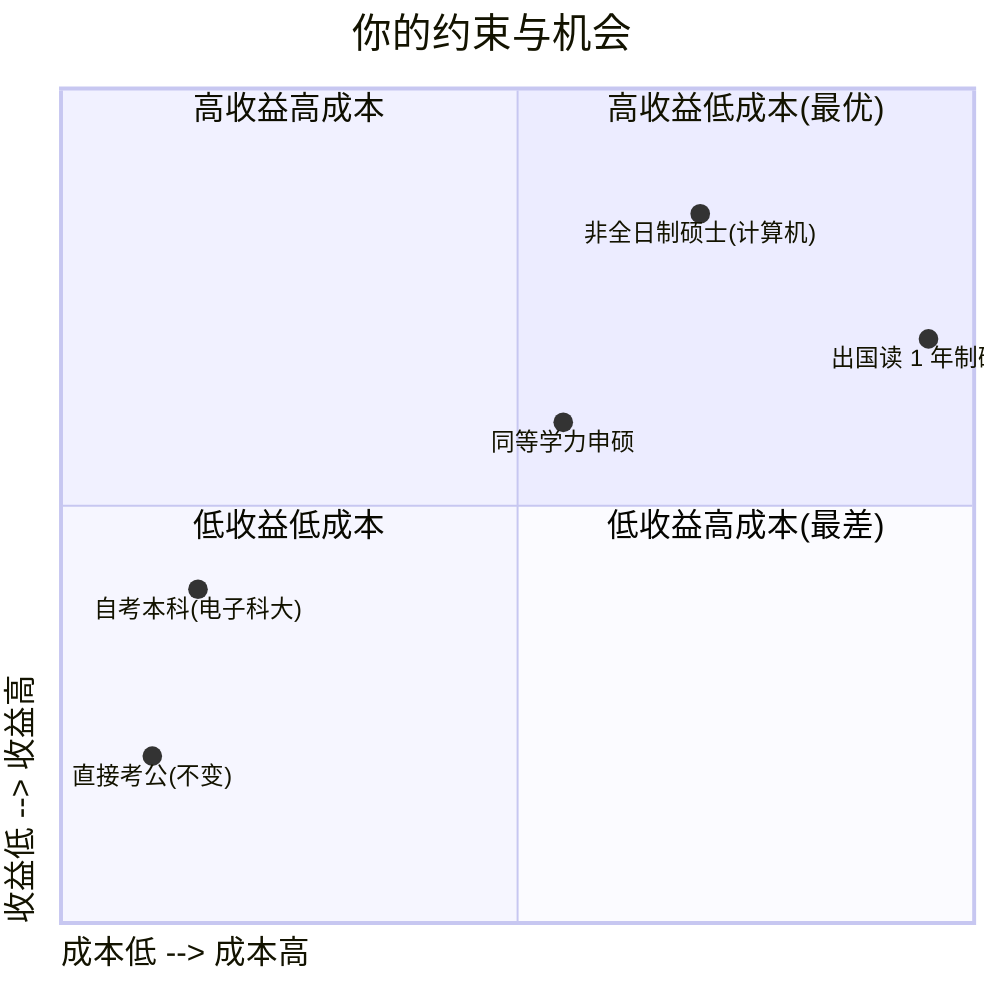

### 1.1 三种"补学历"路径的对比（**核心结论**）

| 维度 | A. 自考本科（电子科大计算机） | B. 非全日制硕士（计算机） | C. 同等学力申硕 |
| --- | --- | --- | --- |
| **招生对象** | 任何人均可报名 | 国民教育序列本科毕业 | 学士学位满 3 年 |
| **报考条件** | 无 | 学历/学位证 + 学位英语 | 学士学位 + 学位英语 |
| **学制** | **1.5~2 年**（无固定学制） | 2~3 年 | 2~3 年 |
| **证书** | **自考本科毕业证** + 学士学位证（**条件性**） | **研究生毕业证** + **硕士学位证**（**双证**） | **仅硕士学位证**（**单证**，无毕业证） |
| **专业代码（考公用）** | **B0809 计算机类** | 研究生：可填 B080901 / B0809 均可 | **仍按原本科专业**（**机械类 B0802**） |
| **年龄放宽** | ❌ **不享受**（仍按本科 35 岁线） | ✅ **享受 40 岁** | ✅ 部分岗位可享 40 岁 |
| **总费用** | **0.6~2.5 万** | **5~15 万** | **3~8 万** |
| **难度** | 中（程序员优势大） | 中（需考 GCT/统考/校考） | 高（5 月统考 + 论文） |
| **含金量（考公/求职）** | ★★★（B0809 + 学信网可查） | ★★★★★（双证，**40 岁线**） | ★★（单证，部分岗位受限） |
| **通过率** | 60~80%（小自考）/ 30~50%（大自考） | 70~90% | 30~50% |
| **是否值得** | 看你年龄与岗位匹配 | **强烈建议** | 性价比一般 |

**关键结论**：

- **如果 2026 年你 ≤ 36 岁**（即 1990 年后出生）→ **A 方案自考完全够用**（35 岁线还能赶上一两次）
- **如果 2026 年你 ≥ 37 岁**（即 1989 年及之前出生）→ **A 方案救不了年龄**（已经超 35），**B 方案才是救命药**（40 岁线）
- **如果 2026 年你正好 35 岁**（1988 年）→ **A 方案是基础项 + B 方案是升级项**

### 1.2 **年龄敏感性**（**这条最重要**）

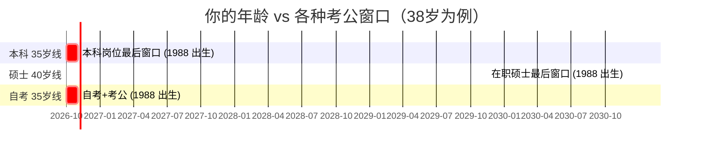

**精确推算**（**假设 1988 年某月生**）：

| 出生日期 | 2026-10 年龄 | 35 岁线最后报考 | 40 岁线最后报考 | 自考能否赶上 35 岁线？ |
| --- | --- | --- | --- | --- |
| 1988-01 | 38 岁 9 月 | 2023-01 已过 ❌ | 2028-01 ⚠️ | ❌ 已超 |
| 1988-07 | 38 岁 3 月 | 2023-07 已过 ❌ | 2028-07 ⚠️ | ❌ 已超 |
| 1990-01 | 36 岁 9 月 | 2025-01 已过 ❌ | 2030-01 ✅ | ❌ 已超 |
| 1990-07 | 36 岁 3 月 | 2025-07 已过 ❌ | 2030-07 ✅ | ❌ 已超 |
| 1992-01 | 34 岁 9 月 | 2027-01 ✅ | 2032-01 ✅ | ✅ **能赶上** |
| 1992-07 | 34 岁 3 月 | 2027-07 ✅ | 2032-07 ✅ | ✅ **能赶上** |

**冷酷结论**：

- **如果你 ≥ 36 岁（1990 年及之前出生）**：**35 岁线已过**，自考**不能解决年龄问题**——你必须**直接走 B 方案在职硕士**（40 岁线）
- **如果你 ≤ 35 岁（1991 年及之后出生）**：**自考 + 考公并行**是最佳路径

> **建议**：请立即**确认你的出生年月**。这个数字决定**整盘棋**。

### 1.3 **如果坚持自考**——电子科技大学的合理性

| 维度 | 电子科技大学 | 替代选择 | UESTC 优势 |
| --- | --- | --- | --- |
| **学校层级** | 985 / 211 / 双一流 | 多数主考校是普通一本 | **UESTC 牌子在考公网申时直接加分** |
| **计算机学科** | A 类（前 5%） | — | **学信网可查、考公专业代码 B0809** |
| **自考助学** | 继续教育学院有官方助学点 | 部分省份无电子科大助学点 | **可选小自考（通过率提升 30%）** |
| **学位授予** | 学士学位证（满足条件） | 同 | **UESTC 学位证** — 在考公审核中**与统招同等效力** |
| **地理位置** | 成都（西南中心） | 合肥、南京都有 | 距离你目标**腾冲**较近（飞行 2h） |
| **学费** | 小自考约 8000~12000 元/2 年 | 同 | **性价比较高** |

**结论**：UESTC 是自考计算机的**最优选择之一**——985 牌子 + 计算机强 + 有助学点。

---

## 二、自考基础：**6 件事必须懂**

### 2.1 自考的两种模式

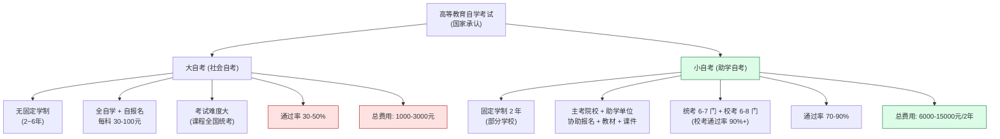

**你的选择**：**强烈建议小自考**——程序员最大的优势是自学，**省下的时间**比省下的钱更值。

### 2.2 自考**报名**流程

```
2026-10 现在 ── 关注 ──→ 2026-12 ── 联系 ──→ 2027-01 报名 ──→ 2027-04 第一次考试
                       │ 电子科大       │ 助学点           │ 省教育考试院
                       │ 继续教育学院   │                  │ (安徽: 安徽教育招生考试院)
                       └───────────────┴──────────────────┴────────────
```

**具体动作**：

1. **2026-11~12**：搜索 "**电子科技大学继续教育学院 高等教育自学考试**"，找官方助学点（**注意甄别"野鸡"助学点**）
2. **2026-12~2027-01**：联系助学点，提交身份证 + HFUT 毕业证 + 学位证 + 1 寸照片
3. **2027-01-15 前**：在 **安徽省教育招生考试院** 网站报名（自考在户籍地或工作地）
4. **2027-04-15~16**（**4 月统考**，周六周日）：第一次考试（4 门）
5. **2027-10-28~29**（**10 月统考**）：第二次考试（4 门）
6. 循环到 2028 年底 / 2029 年中：所有科目考完
7. **2029-上半年**：申请毕业 + 学位
8. **2029-下半年**：拿到毕业证 + 学位证

### 2.3 自考**考试时间**

| 考试 | 时间 | 报名时间 | 备注 |
| --- | --- | --- | --- |
| **4 月统考** | 4 月第 2 个周末（4-15/4-16） | 1 月初报名 | 计算机专业必考 |
| **10 月统考** | 10 月最后周末（10-28/10-29） | 7 月初报名 | 计算机专业必考 |
| **1 月校考**（小自考） | 1 月中旬 | 12 月报名 | 仅小自考有 |
| **7 月校考**（小自考） | 7 月中旬 | 6 月报名 | 仅小自考有 |

**关键**：**每次最多报 4 门**（小自考可能放宽到 6 门）——这是**节奏控制的关键**。

### 2.4 学位申请条件（**UESTC 继续教育学院**）

**以电子科技大学官方公告为准（2026 政策）**——下面给的是**通用框架**，具体看学校当年通知。

| 条件 | 要求 | 你的情况 |
| --- | --- | --- |
| **平均成绩** | **所有科目平均 ≥ 70 分** | ✅ 程序员逻辑强，容易过 |
| **学位英语** | **PETS-3 / 全国英语等级考试三级 / 自考学位英语** 三选一 | ⚠️ 需要单独考 |
| **毕业论文** | 论文成绩 ≥ 70 分 | ✅ 用工作经验写论文 |
| **学位主干课** | 通常要求 4 门学位课程**单科 ≥ 70 分** | ⚠️ 不能"卡线过"，要**主动提分** |
| **申请时间** | 毕业后 **1 年内**（即拿毕业证后 1 年内） | 把握窗口 |
| **补授** | 未在窗口内申请可补授，但**仅 1 次机会** | 一次性 |

**学位英语是关键瓶颈**——**提前 6 个月准备**，建议和自考同期。

### 2.5 自考**考籍** vs **学籍**

| 项目 | 自考 | 统招 |
| --- | --- | --- |
| **学籍** | ❌ **无学籍** | ✅ 有 |
| **考籍** | ✅ **有**（终身有效） | — |
| **学信网可查** | ✅ 毕业后查 | ✅ 入学即可查 |
| **公考审核** | ✅ 认可 | ✅ |
| **考研** | ✅ 需拿到学位证 | ✅ |
| **认证报告编号** | ✅ 学历认证 | ✅ |

**重要**：**自考没学籍，只有考籍**——所以**考公时无法提供"应届生身份"**，但**可以以"社会人员"身份考**。

### 2.6 学位证 vs 毕业证

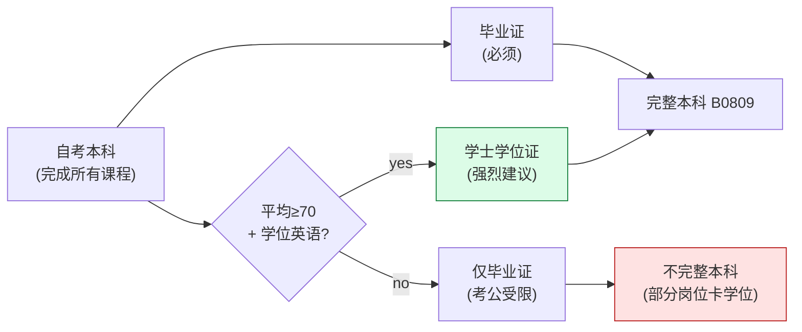

**关键**：

- **毕业证**：所有课程合格 + 论文通过 = 必然拿到
- **学位证**：**需要单独申请** + 满足平均分 + 学位英语 + 论文 70+
- **考公时**：**部分岗位卡"学士以上"**——**学位证必须有**

**建议**：**必须拿学位证**——否则等于一半的努力白费。

---

## 三、计算机自考专业对比

### 3.1 4 个可选专业对比

| 专业 | 主考院校 | 难度 | 考公岗位数（B0809 内） | 与你工作匹配度 | 推荐度 |
| --- | --- | --- | --- | --- | --- |
| **计算机科学与技术** | UESTC | ★★★★ | **最多**（80% 岗位） | ★★★★（程序员对版） | ⭐⭐⭐⭐⭐ |
| **软件工程** | UESTC | ★★★ | 较多 | ★★★★★ | ⭐⭐⭐⭐ |
| **网络工程** | UESTC | ★★★ | 较少 | ★★★ | ⭐⭐⭐ |
| **信息管理与信息系统** | UESTC | ★★ | 较多（但竞争激烈） | ★★ | ⭐⭐ |

**首选**：**计算机科学与技术**（B080901）—— 岗位数最多、UESTC 牌子最硬。

### 3.2 计算机科学与技术自考科目（**UESTC 计划**）

**总科目**：**13~15 门**（必修 + 选修）

#### 3.2.1 公共基础课（3~4 门，必考）

| 科目 | 学分 | 难度 | 你的优势 |
| --- | --- | --- | --- |
| **马克思主义基本原理** | 4 | ★★ | 死记硬背 |
| **中国近现代史纲要** | 2 | ★ | 死记硬背 |
| **英语（二）** | 14 | ★★★ | 程序员英语 OK，**但要专门练** |
| **高等数学** | 部分专业 | ★★★ | 看学校要求 |

#### 3.2.2 专业课（8~10 门，**核心**）

| 科目 | 学分 | 难度 | 你的优势 | 备注 |
| --- | --- | --- | --- | --- |
| **数据结构** | 4~5 | ★★★★ | ★★★★★（天天写代码） | **学位课程** |
| **计算机组成原理** | 4~5 | ★★★★ | ★★★★（理解硬件层） | **学位课程** |
| **操作系统** | 4~5 | ★★★★ | ★★★★（理解 Linux 进程/内存） | **学位课程** |
| **数据库系统原理** | 4~5 | ★★★ | ★★★★★（天天写 SQL） | **学位课程** |
| **C++ 程序设计** | 4~5 | ★★★ | ★★★★★（10 年 C/C++/Java 经验） | — |
| **Java 语言程序设计（一）** | 4~5 | ★★ | ★★★★★ | 部分学校合并 |
| **软件工程** | 4~5 | ★★★ | ★★★★（项目管理经验） | — |
| **计算机网络** | 4~5 | ★★★ | ★★★ | TCP/HTTP 是基础 |
| **网页设计与制作** | 2~3 | ★★ | ★★★★★ | 选修 |
| **人工智能导论** | 3~4 | ★★★ | ★★★★ | 选修，2024+ 新加 |

**学位课程 4 门**（UESTC 必抓）：**数据结构 + 计算机组成原理 + 操作系统 + 数据库系统原理**——这 4 门**必须 ≥ 70 分**。

#### 3.2.3 实践课（2~3 门）

| 科目 | 形式 | 难度 |
| --- | --- | --- |
| **C++ 程序设计（实践）** | 上机考试 | ★★★ |
| **数据库系统原理（实践）** | 上机考试 | ★★ |
| **毕业论文（设计）** | 5000+ 字论文 | ★★（用工作写） |

#### 3.2.4 总学分要求

**UESTC 计算机科学与技术自考总学分**：约 **70~80 学分**（必考 13~15 门）

### 3.3 学位课程特别关注

**学位课程 ≠ 普通课程**——**单科必须 ≥ 70 分**才能用于学位申请。

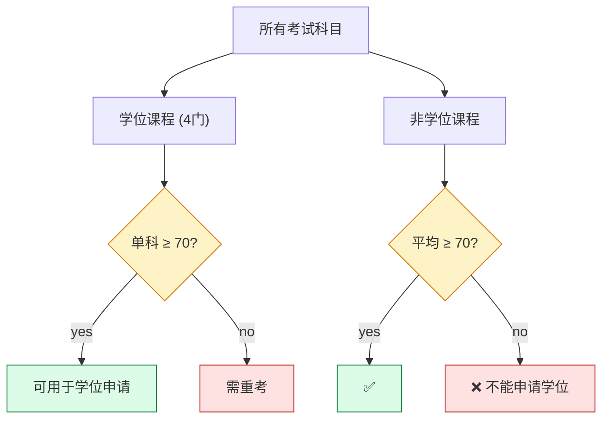

**应对**：

- **学位课程每门都要"考 75+ 才稳"**——不能"卡 60 过"
- **非学位课程保持平均 70+**
- **学位英语提前 6 个月考过**

---

## 四、费用预算

### 4.1 总预算（**小自考模式，2 年**）

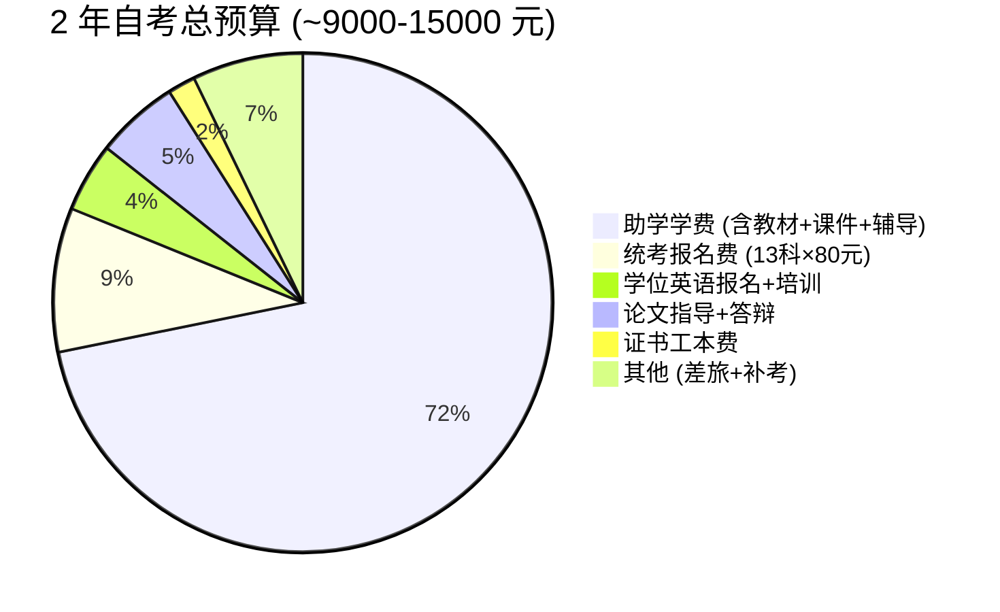

### 4.2 详细费用清单

| 项目 | 金额 | 一次性 / 每年 | 备注 |
| --- | --- | --- | --- |
| **小自考助学学费** | 7000~12000 元 | 一次性（部分学校分 2 年） | 包含教材、课件、网课、班主任 |
| **统考报名费** | 30~100 元/科 | 每次考试 | 安徽 35 元/科，13 科 ≈ 455 元 |
| **校考报名费** | 100~200 元/科 | 每次校考 | 小自考特有，6~8 科 ≈ 800~1600 元 |
| **学位英语考试** | 50~100 元/次 | 一次性 | 自考学位英语 / PETS-3 |
| **学位英语培训** | 0~2000 元 | 一次性 | 自学可省，**基础差建议报** |
| **论文指导费** | 500~1000 元 | 一次性 | 主考院校收 |
| **毕业审定费** | 50~100 元 | 一次性 | 申请毕业时 |
| **学位申请费** | 100~300 元 | 一次性 | 申请学位时 |
| **教材 / 资料** | 500~1000 元 | 一次性（部分含在学费） | — |
| **差旅费**（如线下答辩） | 500~2000 元 | 一次性 | 视学校要求 |
| **补考费**（如挂科） | 200~500 元 | 视情况 | **不要挂** |
| **总计（保守）** | **8500~12000 元** | 2 年内 | 视学校和省份 |
| **总计（精打细算）** | **6000~8000 元** | 2 年内 | 大自考路径 |

### 4.3 学费对比

| 模式 | 总学费 | 通过率 | 时间 | 推荐场景 |
| --- | --- | --- | --- | --- |
| **大自考（自学）** | 1000~3000 元 | 30~50% | 2~6 年 | **预算紧 / 时间多** |
| **小自考（助学）** | 7000~15000 元 | 70~90% | 2~3 年 | **工作忙 / 求稳** |
| **网络助学加分** | 4000~8000 元 | 50~70% | 2~4 年 | **折中** |

**你的选择**：

- **工作忙 + 程序员背景** → **小自考**最划算（**多花 5000 元买 30% 通过率提升**）
- **预算 ≤ 5000 元** → **大自考**也可（你有 10 年自学能力）

---

## 五、考试时间表：**3 年通关路径**

### 5.1 总体规划

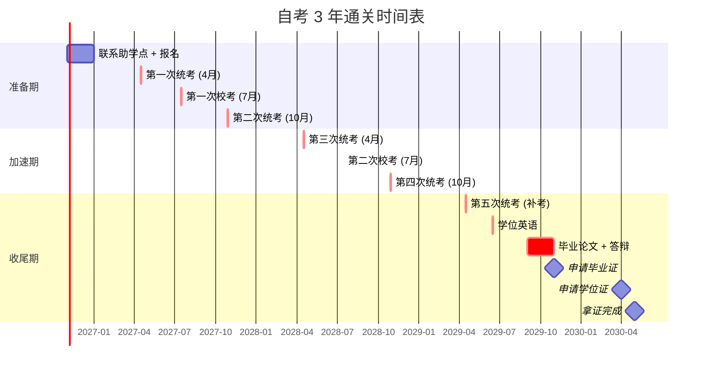

### 5.2 13 门课程的考试时间安排

**目标**：**2.5 年考完 13 门**（统考 6 门 + 校考 7 门）

| 考试时间 | 统考（4 门/次） | 校考（2~4 门/次） | 累计完成 |
| --- | --- | --- | --- |
| **2027-04** | 马克思主义基本原理、英语（二）、C++ 程序设计、Java 程序设计 | — | 4 |
| **2027-07** | — | 软件工程、人工智能导论 | 6 |
| **2027-10** | 数据结构、操作系统、计算机组成原理 | 网页设计 | 9 |
| **2028-04** | 数据库系统原理、计算机网络 | 数据库系统原理（实践） | 12 |
| **2028-07** | — | C++ 程序设计（实践） | 13 ✅ |
| **2029-04** | 补考（如有挂科） | — | — |
| **2029-09** | **毕业论文** | — | — |
| **2029-11** | **申请毕业** | — | — |
| **2030-04** | **申请学位** | — | — |

**关键节点**：

- **2027-04 第一次考试**：**背水一战**——已经错过 2026-10，这次必须过
- **2028-07 全部课程考完** —— 然后准备论文
- **2029-11 拿毕业证** —— **3 年完成**
- **2030-04 拿学位证** —— **3.5 年完成**

### 5.3 与考公的时间叠加

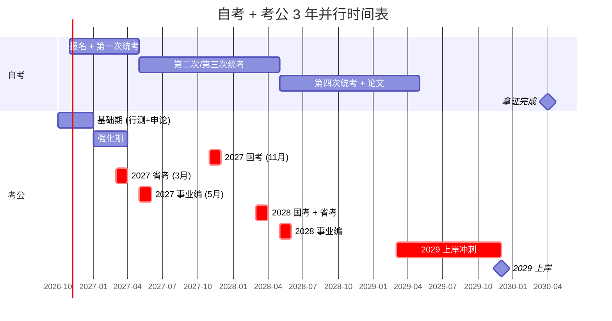

**每天 14 小时**（工作日）：

```
06:30   起床
07:00-08:00  晨读 (行测常识 + 自考英语单词)  ← **并行 1**
09:00-12:00  工作（保留现有工作，不裸辞）
12:00-13:00  午饭 + 午休
13:00-14:00  自考刷题（中午 1 小时，**轻量复习**）  ← **并行 2**
14:00-18:00  工作
18:30-20:30  行测/申论 1.5 模块  ← **考公主战场**
20:30-22:00  自考 1.5 小时（**重头戏**）  ← **自考主战场**
22:00-23:00  复盘 + 错题 + 素材
23:00   睡觉
```

**周末**：

```
周六 09:00-12:00  行测模考
周六 14:00-18:00  自考刷题 1 套卷
周日 09:00-12:00  自考刷题 1 套卷
周日 14:00-17:00  申论精做
周日 17:00-18:00  周复盘
周日 19:00-22:00  自由（休息 / 运动 / 家人）
```

### 5.4 与"在职硕士"路径的对比

| 项 | 自考 + 考公 | 在职硕士（5~15w） | 自考 + 在职硕士（双证） |
| --- | --- | --- | --- |
| 2026-10 | 自考报名 | 报名 2027 春季入学 | 自考 + 硕士同时报名 |
| 2027 | 自考 4 门 | 修学分 + 课程 | 自考 4 门 + 硕士课程 |
| 2028 | 自考 4 门 | 修学分 + 课程 | 自考 4 门 + 硕士课程 |
| 2029 | 论文 + 毕业 | 论文 + 答辩 | 自考毕业 + 硕士答辩 |
| 2030 | 拿自考双证 | 拿硕士双证 | **双证齐全**（自考本+硕士） |
| 2029 年龄 | 41-42 岁 | 41-42 岁 | 41-42 岁 |
| 35 岁线 | 已超 | 硕士 → 40 岁 | 双证 → 40 岁 |
| 40 岁线 | 已超 | ✅ **能考** | ✅ **能考** |
| 总费用 | 0.8-1.5w | 5-15w | 6-17w |
| 时间投入 | 每天 2.5h | 每天 3-4h | 每天 4-5h |

**结论**：

- **如果 2026 年 ≤ 35 岁**：**A 方案自考 + 2027~2028 考公**（赶 35 岁线）
- **如果 2026 年 ≥ 36 岁**：**B 或 C 方案**（硕士路径拿 40 岁线，**这是救命药**）
- **如果 2026 年正好 35**：**C 方案最稳**（双证 + 双线推进）

---

## 六、4 阶段复习计划（**总投入 800~1200 小时**）

### 6.1 总览

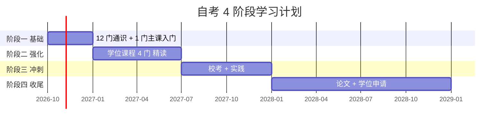

### 6.2 阶段一：基础期（2026-10 ~ 2026-12，3 个月）

**目标**：**完成报名 + 启动第一门课**（C++ 程序设计）—— 因为你最强。

#### 6.2.1 第 1 个月行动清单

| 周次 | 任务 | 时长 |
| --- | --- | --- |
| W1（10.15-10.21） | 联系电子科大继续教育学院、找官方助学点 | 5h |
| W2（10.22-10.28） | 提交报名材料、缴费、拿教材 | 5h |
| W3（10.29-11.04） | 启动 C++ 程序设计学习（通读教材） | 8h |
| W4（11.05-11.11） | C++ 视频课程（精读 5 节） | 8h |

#### 6.2.2 第 2~3 个月重点

- **C++ 程序设计**：14 章 + 实践 → **2 个月精学**
- **英语（二）**：每天 30 分钟背单词 + 1 套真题
- **马克思主义基本原理**：通读 1 遍教材

#### 6.2.3 4 月统考目标

| 科目 | 目标分 | 难度 |
| --- | --- | --- |
| **C++ 程序设计** | 80+ | ★★★ |
| **马克思主义基本原理** | 70+ | ★★ |
| **英语（二）** | 70+ | ★★★ |
| **Java 程序设计** | 75+ | ★★ |

**预期通过率**：**4 门全过 90%**（**前提是投入 2.5h/天**）。

### 6.3 阶段二：强化期（2027-01 ~ 2027-06，6 个月）

**目标**：**学位课程 4 门拿 75+**——学位申请的命脉。

#### 6.3.1 4 月统考 + 7 月校考冲刺

| 4 月统考 | 7 月校考 |
| --- | --- |
| **数据结构**（学位课） | 软件工程（校考） |
| **操作系统**（学位课） | 人工智能导论（校考） |
| — | 网页设计（校考） |

**学位课程攻坚**（5 个月，**每天 1.5h**）：

- **数据结构**（60h）：算法 + 链表/栈/树/图
- **操作系统**（60h）：进程/内存/文件系统
- **每门做 5 套真题**——目标 75+

#### 6.3.2 10 月统考再冲 3 门

| 科目 | 性质 | 目标 |
| --- | --- | --- |
| **计算机组成原理** | 学位课 | 75+ |
| **数据库系统原理** | 学位课 | 75+ |
| **英语（二）补考**（如 4 月没过） | 公共课 | 70+ |

**到此累计**：**学位 4 门全过 + 公共课全过 + 选修 3 门过** = **12 门完成**

### 6.4 阶段三：冲刺期（2027-07 ~ 2028-12，6 个月）

**目标**：**完成剩余 1~2 门 + 实践课 + 论文准备**。

| 时间 | 任务 | 备注 |
| --- | --- | --- |
| 2028-04 | 统考：计算机网络 + 数据库系统原理（实践） | 冲刺 2 门 |
| 2028-07 | 校考：C++ 程序设计（实践） | 1 门 |
| 2028-10 | 补考（如有）+ 论文开题 | 收尾 |
| 2028-12 | **所有 13 门课程 + 实践课全部通过** ✅ | — |

### 6.5 阶段四：收尾期（2029-01 ~ 2030-04，15 个月）

**目标**：**论文 + 学位申请 + 拿证**。


### 6.6 学位英语专项（**最大的坑**）

**学位英语难度**：

- 词汇量 3500+（低于 CET-4）
- 完形填空 + 阅读 + 翻译 + 作文
- **通过率仅 20~30%**（很多自考生的痛点）

**复习计划**（**提前 6 个月，每天 1 小时**）：

| 阶段 | 时间 | 任务 |
| --- | --- | --- |
| **基础** | T-6 ~ T-4 月 | 背 3500 单词（每天 20 个） |
| **强化** | T-4 ~ T-2 月 | 5 套真题精做 + 错题复盘 |
| **冲刺** | T-2 ~ T 月 | 模考 + 作文模板（5 套） |
| **应考** | T 月 | 1 次机会（部分可补考 1 次） |

**T = 2029-12 学位英语考试**（假设）

**与自考同期——不冲突**：把英语（二）和学位英语合并复习，**省 1/3 时间**。

---

## 七、每科学习策略（**按程序员优势排序**）

### 7.1 优先级矩阵

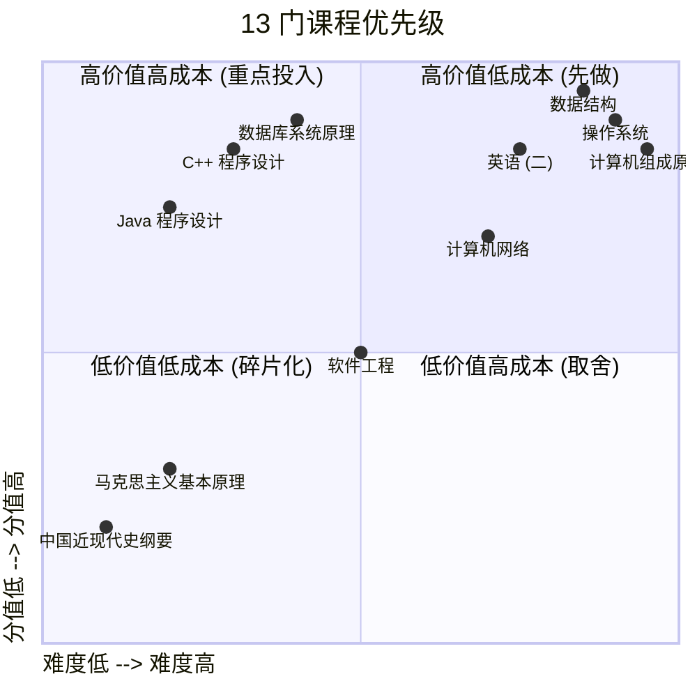

### 7.2 4 门学位课程重点策略

#### 7.2.1 数据结构（**学位课，最重要**）

**程序员的最强科目**——但**自考版不考代码**，**只考概念+算法+复杂度**。

**重点章节**：

| 章节 | 考试占比 | 你的复习策略 |
| --- | --- | --- |
| 线性表（数组/链表） | 15% | 直接过，1 天 |
| 栈和队列 | 10% | 直接过，半天 |
| 串和数组 | 5% | 略 |
| **树和二叉树** | **25%** | **重点**，2 周（遍历/查找/平衡） |
| **图** | **20%** | **重点**，2 周（BFS/DFS/MST/最短路） |
| 查找（B 树/Hash） | 10% | 重点，1 周 |
| 排序 | 10% | 重点，1 周 |
| 算法分析 | 5% | 理解，1 天 |

**总投入**：60h，**3 个月**拿下。

#### 7.2.2 操作系统（**学位课**）

**次强科目**——Linux 用户天然熟悉。

| 章节 | 占比 | 你的优势 |
| --- | --- | --- |
| 进程管理 | 20% | ★★★★★（你天天用 ps/top） |
| 内存管理 | 20% | ★★★★（了解页表/换页） |
| 文件系统 | 15% | ★★★★（了解 inode/ext4） |
| 设备管理 | 10% | ★★★ |
| 同步互斥 | 15% | ★★★（mutex/semaphore） |
| 死锁 | 10% | ★★★ |
| 调度算法 | 10% | ★★ |

**总投入**：60h，**3 个月**拿下。

#### 7.2.3 计算机组成原理（**学位课，**硬骨头**）

**最难的科目**——硬件层需要重新学。

| 章节 | 占比 | 难度 |
| --- | --- | --- |
| 数制与编码 | 5% | ★ |
| 数据的机器表示 | 10% | ★★ |
| 运算器与控制器 | 15% | ★★★ |
| **存储器层次结构** | **20%** | ★★★★ |
| 指令系统 | 15% | ★★★ |
| 中央处理器 | 15% | ★★★ |
| 总线与 I/O | 10% | ★★★ |
| 流水线 | 10% | ★★★★ |

**总投入**：80h，**4 个月**拿下。

#### 7.2.4 数据库系统原理（**学位课**）

**强项**——天天写 SQL。

| 章节 | 占比 | 你的优势 |
| --- | --- | --- |
| 关系数据库 | 20% | ★★★★★ |
| SQL | 25% | ★★★★★ |
| 关系数据库设计 | 15% | ★★★★ |
| **关系运算** | **20%** | ★★★（需要刷题） |
| 事务处理 | 10% | ★★★★ |
| 数据库保护 | 10% | ★★★ |

**总投入**：50h，**2.5 个月**拿下。

### 7.3 6 门非学位课程速通

| 科目 | 投入 | 你的方法 |
| --- | --- | --- |
| **英语（二）** | 100h | 单词 + 5 套真题 + 作文模板（合并复习学位英语） |
| **C++ 程序设计** | 40h | 教材通读 + 5 套真题（**最强优势**） |
| **Java 程序设计** | 30h | 教材通读 + 5 套真题（**最强优势**） |
| **软件工程** | 30h | 教材 + 5 套真题（**项目管理经验**直接套用） |
| **计算机网络** | 50h | TCP/HTTP 强，DNS/路由弱（**专项补 10h**） |
| **马克思主义基本原理** | 30h | 死记硬背，无技巧 |
| **中国近现代史纲要** | 20h | 死记硬背 |
| **网页设计 / 人工智能导论** | 各 20h | 选修，校考通过率 95% |

### 7.4 论文（**用工作写**）

**核心建议**：**用工作项目写论文**——你有 10 年项目经验，随便挑一个 5000 字的扩展。

**选题方向**（**与你的工作结合**）：

- "**基于 Spring Boot 的 XX 系统的设计与实现**"
- "**PostgreSQL 在高并发场景下的性能调优实践**"
- "**逻辑复制在数据迁移中的应用研究**"
- "**基于 Vue + Node.js 的 XX 平台开发**"

**论文要求**（UESTC）：

- 5000~8000 字
- 重复率 ≤ 30%
- 格式规范（封面 + 摘要 + 目录 + 正文 + 参考文献 + 致谢）
- 答辩 PPT 15 分钟

**投入**：80h，**2 个月准备**（2029-09 ~ 2029-11）。

---

## 八、风险与备选方案

### 8.1 风险矩阵

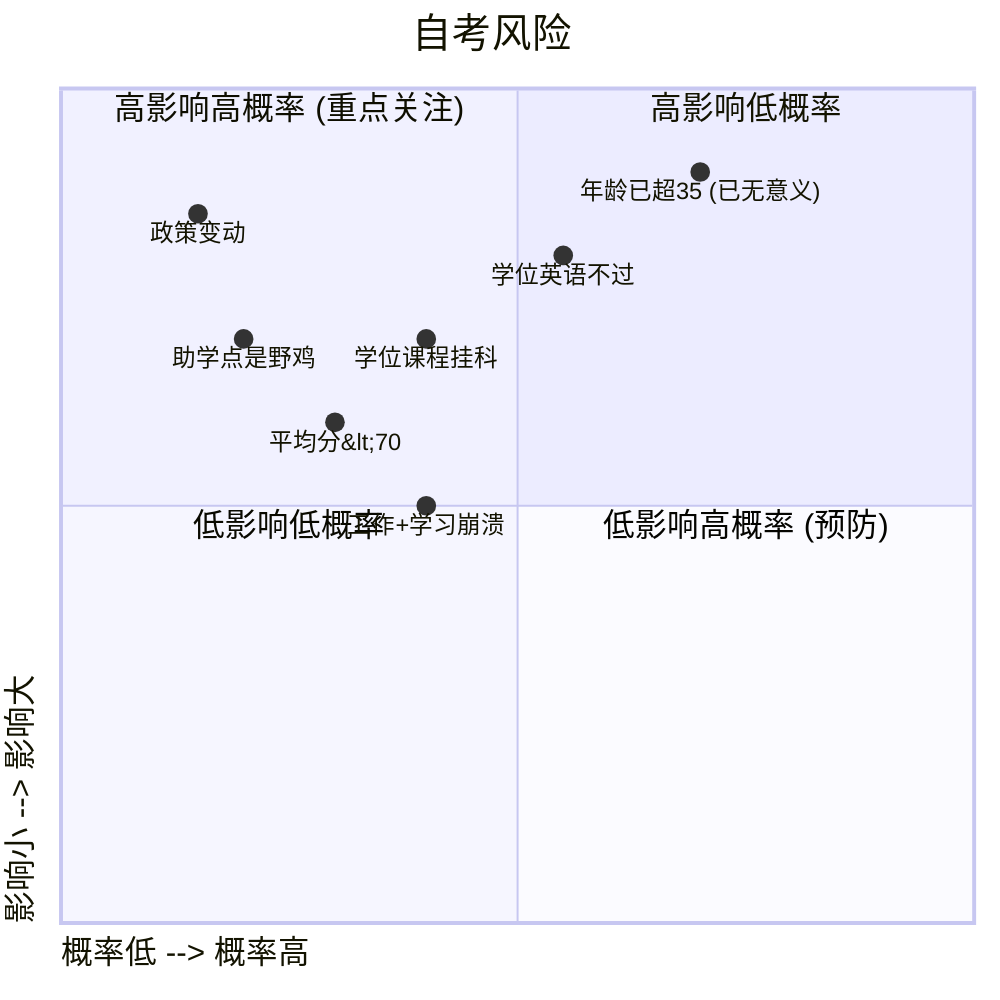

### 8.2 5 大风险及应对

| 风险 | 概率 | 影响 | 应对 |
| --- | --- | --- | --- |
| **学位课程挂科** | 中 | 拖延 1 年 | 投入 ≥ 70h/门；**学位 4 门每门必 75+** |
| **学位英语不过** | 高 | 不能拿学位证 | 提前 6 个月，每天 1h 单词 + 5 套真题 |
| **平均分 < 70** | 中 | 不能申请学位 | **学位 4 门考高分**（拿 80+）拉动平均 |
| **助学点是野鸡** | 中 | 学信网不认 | **必须是电子科技大学继续教育学院官方助学点**（看官网） |
| **年龄已超 35 岁** | 高 | 自考**不能解决年龄** | **必须同时启动"在职硕士"路径**（拿 40 岁线） |

### 8.3 备选方案（**如果自考失败**）

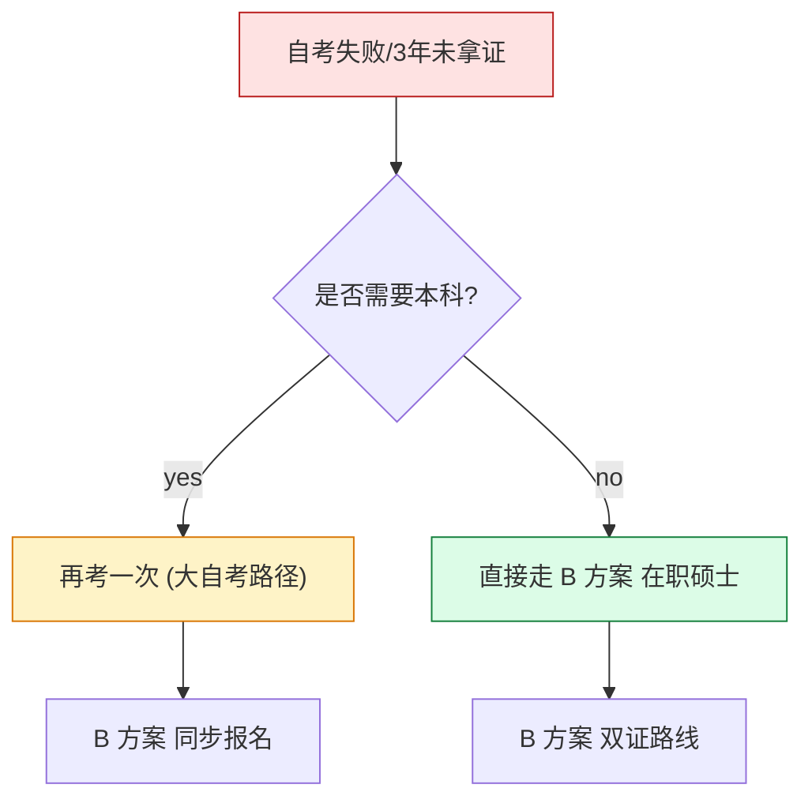

**关键应急**：

- **如果 2028-04 还差 3 门以上** → **停止自考**，**全力在职硕士**
- **如果 2029-04 学位英语没过** → 2029-10 补考 1 次（**若再失败则放弃学位**）
- **如果政策变动**（如学历改革） → 转入**在职硕士**（政策风险小）

### 8.4 "在职硕士"路径详解（**B 方案**）

**如果你发现 2026 年已超 35 岁** → **必须立即启动 B 方案**。

#### 8.4.1 适合你的"在职硕士"

| 类型 | 学校 | 学费 | 学制 | 难度 | 推荐度 |
| --- | --- | --- | --- | --- | --- |
| **非全日制计算机硕士** | 电子科技大学（成都） | 5~8w | 2.5 年 | 需 12 月统考 + 校考 | ⭐⭐⭐⭐⭐ |
| **非全日制计算机硕士** | 合肥工业大学（本地） | 4~6w | 2.5 年 | 同上 | ⭐⭐⭐⭐ |
| **非全日制计算机硕士** | 安徽大学 | 4~6w | 2.5 年 | 同上 | ⭐⭐⭐⭐ |
| **同等学力申硕** | 多校 | 3~6w | 2~3 年 | 5 月统考 + 论文 | ⭐⭐（单证） |
| **中外合办硕士** | 1 年制 | 10~20w | 1~1.5 年 | 申请制 | ⭐⭐⭐（贵但快） |

**推荐**：**合肥工业大学（母校）+ 非全日制计算机硕士**——**有校友优势，机械本 + 合工大硕 = 完美**

#### 8.4.2 非全日制硕士的 12 月统考

**考 4 科**：

- 政治（全国统考）
- 英语（二）（全国统考，**比自考难**）
- 数学（学校自主命题）
- 计算机专业基础（学校自主命题）

**你的优势**：

- 工程师逻辑强，数学不是问题
- 程序员英语有基础
- 专业课直接覆盖工作内容

**投入**：6 个月，每天 2h

#### 8.4.3 关键时间

| 时间 | 动作 |
| --- | --- |
| **2026-10 ~ 2026-12** | 联系合工大研究生院，咨询非全日制政策 |
| **2026-12** | 网上报名（研招网） |
| **2026-12-23~25** | **12 月统考**（**不要错过**） |
| **2027-03** | 复试（面试） |
| **2027-06** | 录取 + 入学 |
| **2027-09 ~ 2029-06** | 周末上课 + 论文 |
| **2029-06** | 拿硕士双证（**研究生毕业证 + 硕士学位证**） |

#### 8.4.4 关键：**35~40 岁是"硕士最后窗口"**

- **2026-10 报名，2026-12 统考**——是 1988 年生人的**最后一次 12 月统考机会**
- **若 2026-12 错过**——**2027-12 还能考**（39 岁）
- **若 2027-12 错过**——**2028-12 还能考**（40 岁，**最后一次**）
- **若 2028-12 错过**——**终身不能再考**（40 岁线一过）

> **重要**：**如果已 36+，12 月统考是头等大事**——**比 4 月自考还重要**。

### 8.5 双轨方案（**自考 + 在职硕士同时**）

**最稳的方案**——**3.5 年拿双证**（自考本 + 硕士）。

| 年份 | 自考 | 在职硕士 |
| --- | --- | --- |
| 2026-10 ~ 12 | 报名自考 + 启动 C++ | 报名合工大非全 |
| 2027-04 | 自考 4 门 | 12 月统考（已过） |
| 2027-09 | 自考 6 门 | 硕士入学 |
| 2028-10 | 自考全部完成 | 硕士课程进行中 |
| 2029-04 | 自考论文 + 学位 | 硕士论文开题 |
| 2029-12 | 拿自考双证 | 硕士答辩 |
| 2030-06 | — | 拿硕士双证 ✅ |

**总投入**：

- 时间：每天 **4~5 小时**（自考 2h + 硕士 1.5h + 考公 1h）
- 费用：自考 0.8~1.5w + 硕士 5~8w = **6~9.5w**

---

## 九、与腾冲考公计划的时间协调（**整合版**）

### 9.1 3 年双线推进表

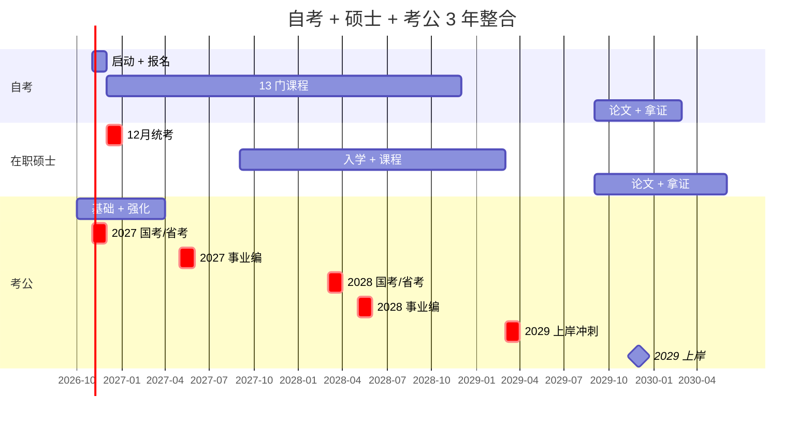

### 9.2 每天 4~5 小时分配

| 时段 | 内容 | 时长 | 项目 |
| --- | --- | --- | --- |
| 06:30-07:00 | 晨读（行测常识 + 自考单词） | 30min | 考公 + 自考 |
| 19:00-20:30 | 行测/申论 | 1.5h | 考公主战场 |
| 20:30-22:00 | 自考刷题 | 1.5h | 自考主战场 |
| 22:00-22:30 | 在职硕士课程（如已入学） | 30min | 硕士 |
| 周末模考 | 行测套卷 + 自考真题 | 6h | 考公 + 自考 |
| **总计** | — | **4h/工作日 + 8h/周末** | — |

### 9.3 关键时间节点（**不能错过**）

| 时间 | 动作 | **错过后果** |
| --- | --- | --- |
| **2026-12 报名** | 在职硕士 12 月统考报名 | **失去 1 年窗口** |
| **2026-12-23~25** | **12 月统考** | **失去 1 年窗口** |
| **2027-01 报名** | 自考 4 月统考报名 | 第一次自考延期半年 |
| **2027-04-15** | 自考 4 月统考 | 第一次自考延期半年 |
| **2027-08 报名** | 自考 10 月统考报名 | 第二次自考延期半年 |
| **2027-10-28** | 自考 10 月统考 | 第二次自考延期半年 |
| **2027-11-28** | **国考笔试** | 失去 1 次考公机会 |

**所有日期用日历 APP 提醒**——错过 1 个 = 拖延 6 个月 ~ 1 年。

---

## 十、最终决策矩阵（**给 3 种情况的建议**）

### 10.1 按年龄分类的方案

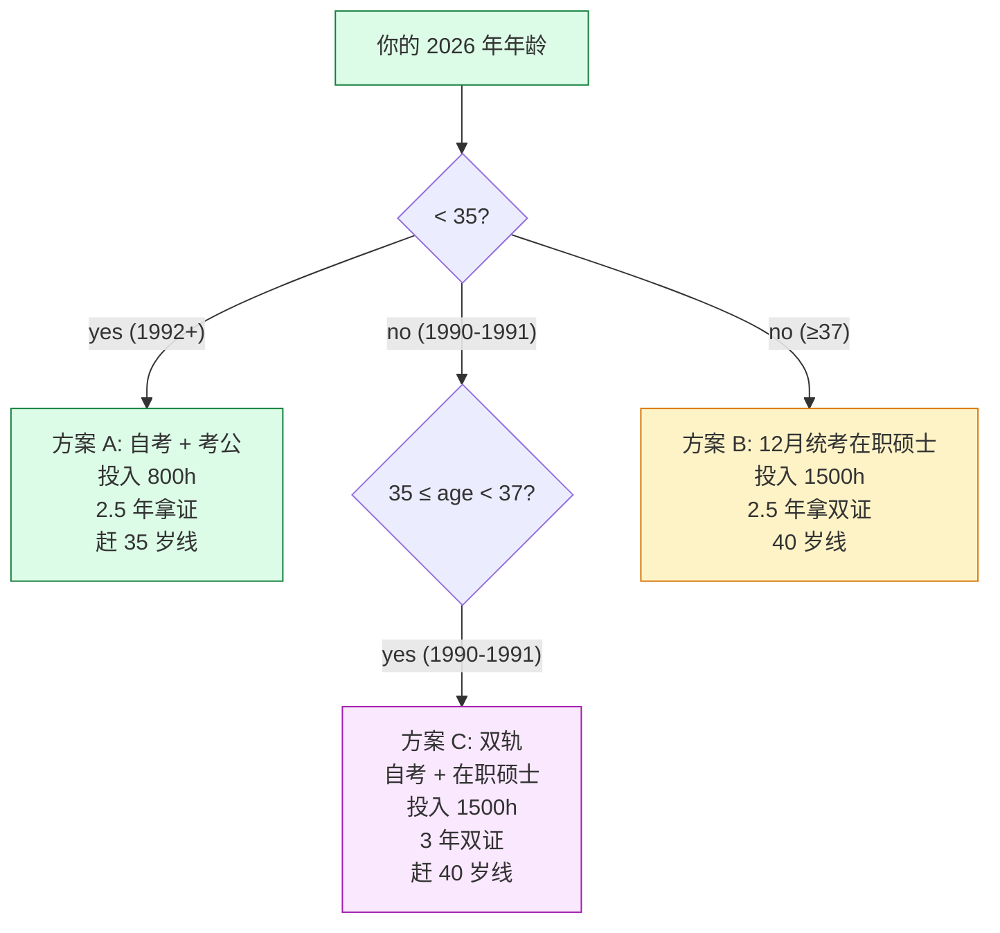

### 10.2 方案对比表

| 项 | A: 自考 + 考公 | B: 在职硕士 | C: 双轨 |
| --- | --- | --- | --- |
| 适用年龄 | ≤ 35 | ≥ 36 | 36~40 |
| 总投入 | 800h + 300h = 1100h | 1500h | 1500h |
| 总费用 | 0.8~1.5w | 5~8w | 6~9.5w |
| 拿证时间 | 3 年（自考） | 2.5 年（硕士） | 3.5 年（双证） |
| 35 岁线 | ✅ 赶得上 | 已超 | 已超 |
| 40 岁线 | ❌ | ✅ | ✅ |
| 风险 | 低 | 中 | 中 |
| 推荐度 | ⭐⭐⭐⭐ | ⭐⭐⭐⭐ | ⭐⭐⭐⭐⭐ |

### 10.3 终极建议（**直接抄**）

#### 场景 1：你是 1992 年后出生（2026 年 ≤ 35 岁）

**主选 A 方案**：

1. **2026-10 启动自考报名**（电子科大计算机）
2. **2026-10 启动考公基础**（行测+申论）
3. **2027-04 自考 4 门 + 2027-11 国考**
4. **2028-04 全部 13 门 + 2028-03 省考 + 2028-05 事业编**
5. **2029-12 拿自考学位证 + 拿到 offer**

#### 场景 2：你是 1990~1991 年（2026 年 35~36 岁）

**主选 C 方案（双轨）**：

1. **2026-10 启动自考 + 2026-12 统考合工大非全**
2. **2027-04 自考 4 门 + 2027-09 硕士入学**
3. **2028-10 自考全部 + 2028 硕士课程**
4. **2029-12 拿自考学位 + 2030-06 拿硕士双证**
5. **2029~2030 边拿证边考公（40 岁线救场）**

#### 场景 3：你是 1988~1989 年（2026 年 37~38 岁）

**主选 B 方案（在职硕士）**：

1. **2026-10 立即联系合工大非全政策**（**优先**）
2. **2026-12 参加 12 月统考**（**生死线**）
3. **2027-09 硕士入学**
4. **2029-12 拿硕士双证 + 2029-2030 持续考公**

#### 场景 4：你是 1985~1987 年（2026 年 ≥ 39 岁）

**B 方案 + Plan B**：

1. **2026-12 立即统考**（**最后一次**）
2. **若 2026-12 落榜**：重新评估——**Plan D 决定**（参见上一份文档）

---

## 十一、**立刻就要做的 5 件事**（**24 小时内**）

1. **【最关键】确认你的出生年月**（决定 1.2 节方案）—— 看身份证
2. **【最关键】搜索"电子科技大学继续教育学院 自考"** —— 加 1 个官方电话咨询
3. **【最关键】搜索"合肥工业大学 非全日制研究生"** —— 找 2027 招生政策
4. **在日历 APP 添加 6 个提醒**：
   - 2026-12 报名 12 月统考
   - 2026-12-25 12 月统考
   - 2027-01 自考 4 月报名
   - 2027-04-15 自考 4 月统考
   - 2027-11-28 国考
   - 2028-03 省考
5. **预算 8~15 万元**（自考 + 硕士费用）—— 准备**专门账户**

---

## 附录 A：自考 vs 在职硕士 vs 同等学力 申硕 终极对比

| 维度 | 自考本科 | 非全日制硕士 | 同等学力申硕 |
| --- | --- | --- | --- |
| **学历** | 本科 | 研究生 | **仅学位，无学历** |
| **年龄放宽** | ❌ | ✅ 40 岁 | ✅ 部分 40 岁 |
| **考公认 B0809** | ✅ | ✅ | ❌ **仍按原专业** |
| **考公认硕士岗** | ❌ | ✅ | ⚠️ 部分认可 |
| **总费用** | 0.8~1.5w | 5~8w | 3~6w |
| **时间** | 2~3 年 | 2.5 年 | 2~3 年 |
| **难度** | 中 | 中高 | 高 |
| **证书价值** | ★★★ | ★★★★★ | ★★ |
| **推荐人群** | ≤ 35 岁 | ≥ 36 岁 | 已有学位想补强 |

**一票否决**：

- **如果你需要硕士双证**（40 岁线、考公硕士岗、人才补贴）→ **必须非全日制硕士**
- **如果你 1992+ 出生**（35 岁线还在）→ **自考足够**
- **如果你 1990-1991 出生**（35 岁线已过）→ **必须双轨（自考 + 硕士）**

## 附录 B：电子科技大学计算机自考 — 13 门课目进度表

| 序号 | 课程 | 类型 | 学分 | 考试 | 状态 | 分数 |
| --- | --- | --- | --- | --- | --- | --- |
| 1 | 马克思主义基本原理 | 公共 | 4 | 2027-04 | ⬜ | — |
| 2 | 中国近现代史纲要 | 公共 | 2 | 2027-04 | ⬜ | — |
| 3 | 英语（二） | 公共 | 14 | 2027-04 | ⬜ | — |
| 4 | C++ 程序设计 | 专 | 5 | 2027-04 | ⬜ | — |
| 5 | Java 程序设计（一） | 专 | 5 | 2027-04 | ⬜ | — |
| 6 | 软件工程 | 专 | 4 | 2027-07 | ⬜ | — |
| 7 | 人工智能导论 | 选修 | 3 | 2027-07 | ⬜ | — |
| 8 | 网页设计与制作 | 选修 | 3 | 2027-07 | ⬜ | — |
| 9 | **数据结构** | **学位** | 5 | 2027-10 | ⬜ | — |
| 10 | **操作系统** | **学位** | 5 | 2027-10 | ⬜ | — |
| 11 | **计算机组成原理** | **学位** | 5 | 2027-10 | ⬜ | — |
| 12 | **数据库系统原理** | **学位** | 5 | 2028-04 | ⬜ | — |
| 13 | 计算机网络 | 专 | 4 | 2028-04 | ⬜ | — |
| 14 | C++ 程序设计（实践） | 实践 | 2 | 2028-07 | ⬜ | — |
| 15 | 数据库系统原理（实践） | 实践 | 2 | 2028-04 | ⬜ | — |
| 16 | 毕业论文 | 论文 | — | 2029-09 | ⬜ | — |
| 17 | 学位英语 | 学位 | — | 2029-12 | ⬜ | — |

## 附录 C：每日自考 2 小时时间表

```
19:00 - 19:30  单词 / 知识点速记 (英语 / 马原)
19:30 - 20:30  教材精读 (1 章, 做笔记)
20:30 - 21:30  课后习题 + 章节真题
21:30 - 22:00  错题复盘 + 错题本
```

**周末**：

```
周六 14:00 - 18:00  1 套完整真题 (模拟考试)
周日 09:00 - 12:00  错题分析 + 弱项突破
```

## 附录 D：与**腾冲事业编/公务员备考计划**的整合

**共同原则**：

- **时间分配**：自考 2.5h + 考公 1.5h + 工作 = **一天 4h 副业学习**
- **周末**：自考 4h + 考公 4h = **周末 8h 高强度**
- **错题本**：自考与考公**分开**——自考"概念题"和考公"题型题"完全不同
- **真题资料**：自考的真题做 3~5 套 / 科；考公的真题做 10+ 套

**关键同步点**：

- 2026-12：**双线报名**（自考 + 在职硕士）
- 2027-04：自考首考 + 考公强化期
- 2027-11：国考 + 自考第 2 次
- 2028-04：自考学位 4 门冲刺 + 2028 省考
- 2029-12：**双证到手** + 考公最后冲刺

---

**最后修改时间**：2026-10-13
**下次复盘**：2026-11-13（**关键决策：年龄 + 报名状态确认**）
**关联文档**：[腾冲事业编 / 公务员备考计划](../腾冲事业编-公务员备考计划/index.html)
