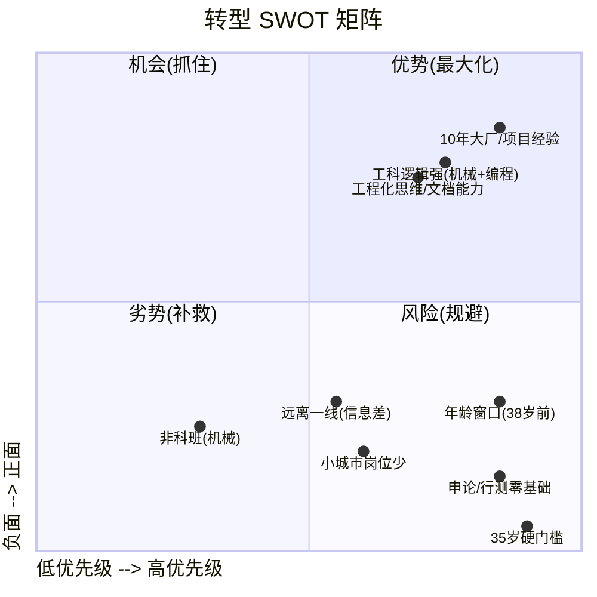
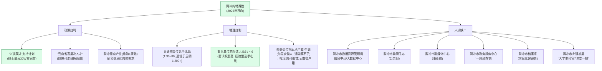
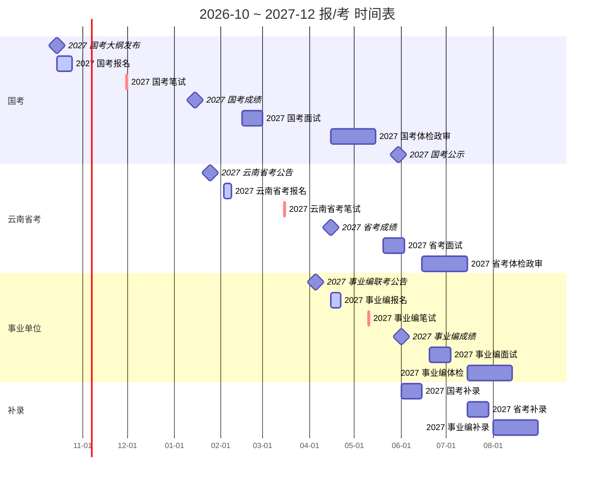
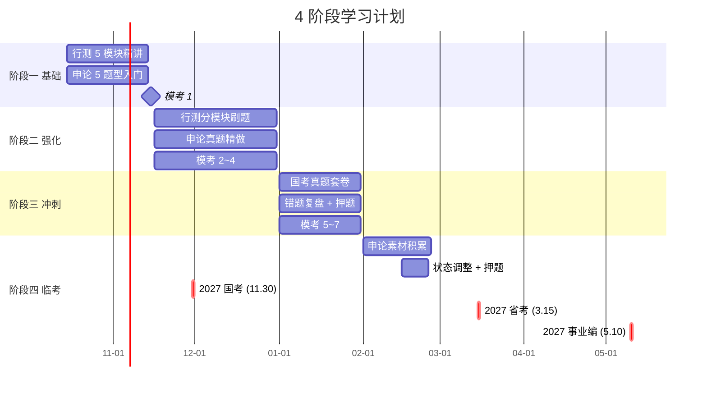
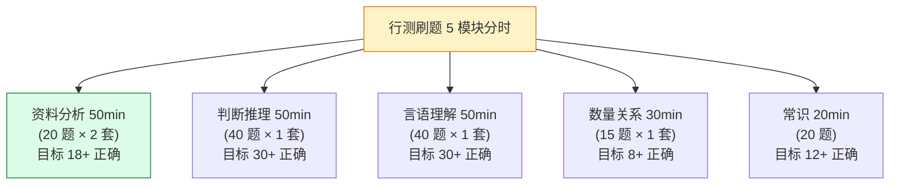
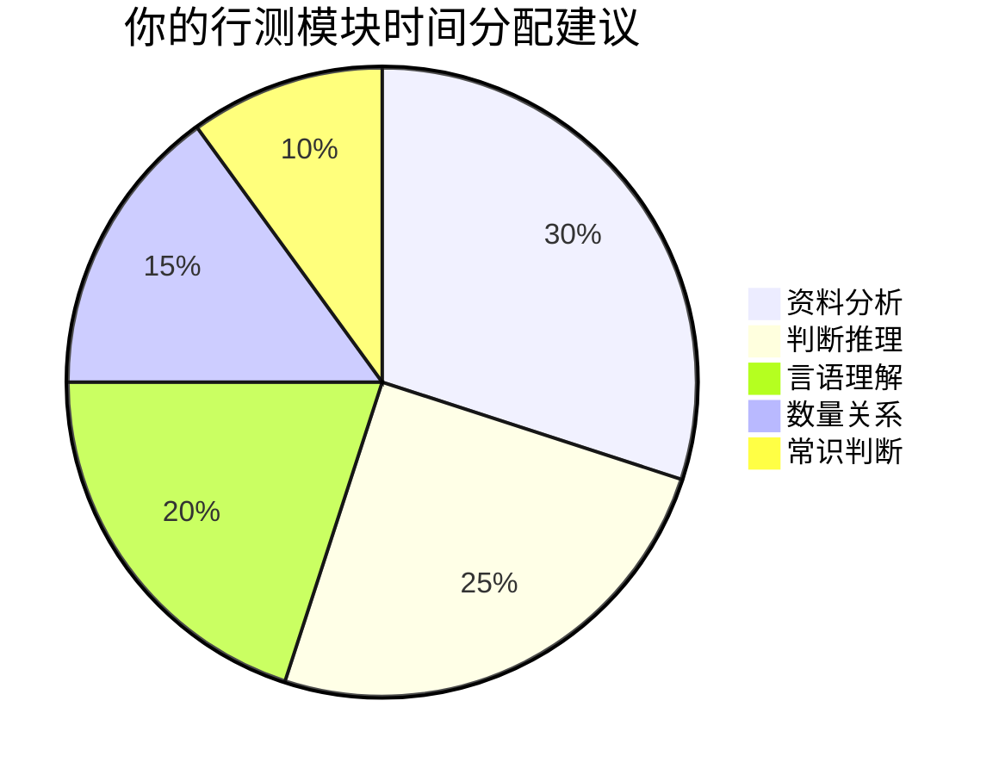
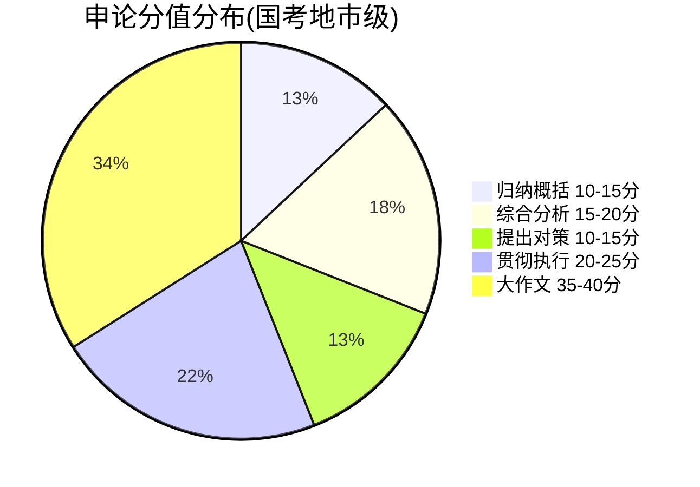
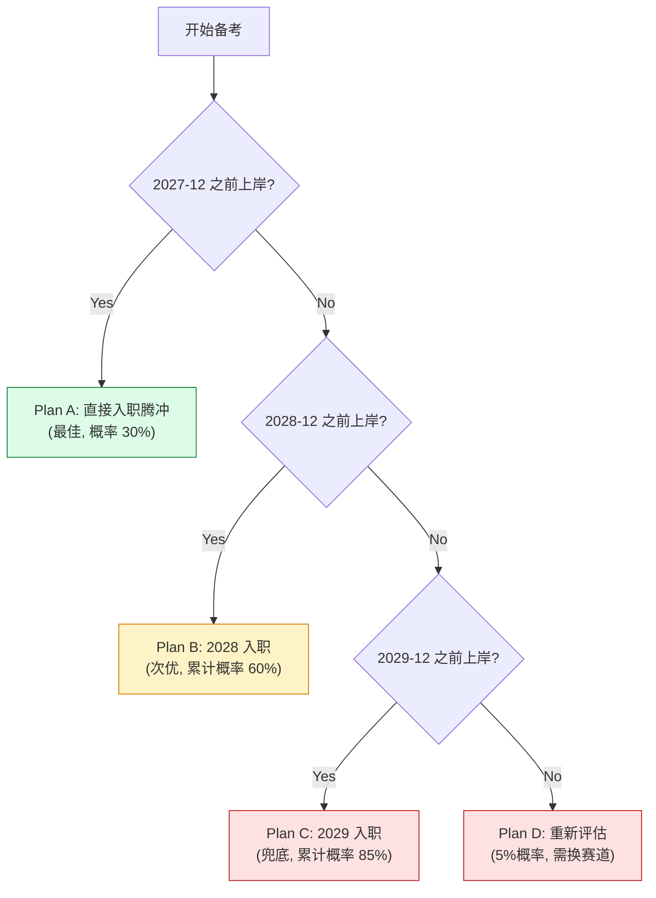
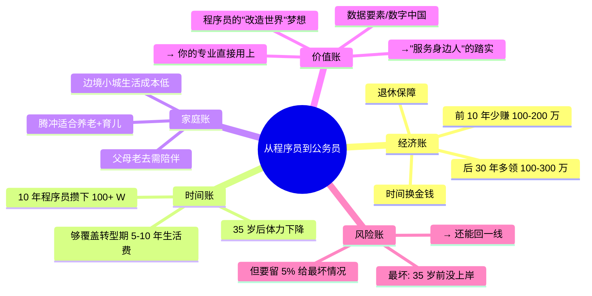
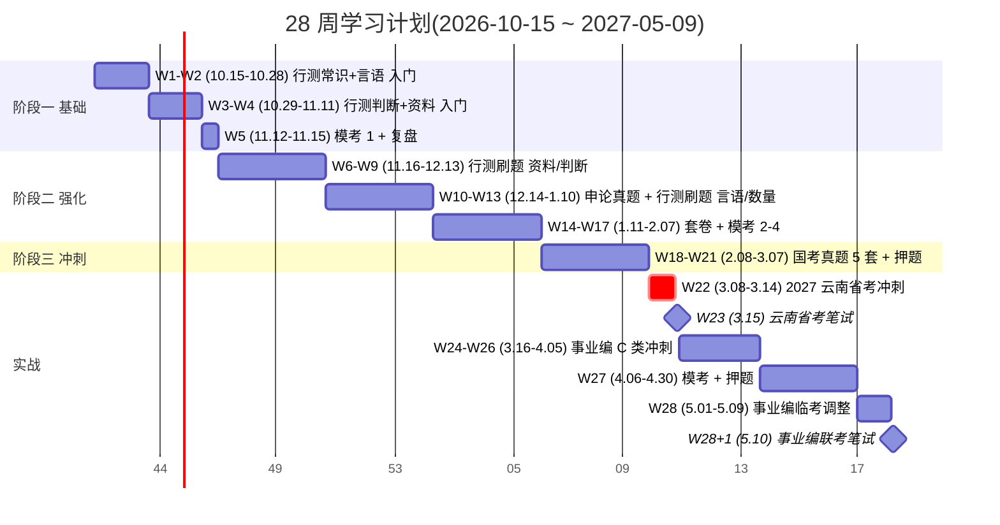

# 腾冲事业编 / 公务员备考计划：从 10 年程序员到体制内的转型

| 编写人 | 编写时间 |
| --- | --- |
| growdu | 2026-10-13 |

> 这份文档不写鸡汤，只写**可执行**。所有时间线、数字、检查点都用工程师的方式量化。
> **适用对象**：30~38 岁、非计算机科班、有 5+ 年工作经验、希望进入体制内的工程师。
> **目标地点**：云南省保山市腾冲市（边境县级市）的**计算机 / 信息中心 / 数据资源 / 网信**类事业编或公务员岗位。
> **当前时间**：2026 年 10 月（事业单位联考 5 月、国考 11 月底笔试、云南省考 3 月）。

---

## 一、个人情况评估（SWOT 量化）



### 1.1 优势（能换分的）

| 优势 | 量化打分 | 转化为考试优势 |
| --- | --- | --- |
| **10 年软件工程经验** | ★★★★★ | **行测「资料分析」** 几乎白送——Excel/SQL/脚本熟练；**申论「综合分析题」** 工程化拆解能力直接套用；**面试「计划组织题」** 项目管理经验可移植 |
| **机械 + 软件双背景** | ★★★★ | 工科逻辑（行测「判断推理」「数量关系」强项）；申论「乡村振兴/产业升级」类话题有现实感 |
| **合肥工业大学（211）** | ★★★★ | 多数岗位要求本科起步，211 是**硬通货**；**部分岗位要求 985/211 学历**，腾冲这种县级市的"信息化中心"经常卡学历 |
| **自学习惯** | ★★★★★ | 10 年自学编程的能力迁移到考公内容，**不需要线下班** |

### 1.2 劣势（必须补的）

| 劣势 | 影响科目 | 量化差距 | 补救时长 |
| --- | --- | --- | --- |
| **非计算机科班（机械）** | 网申/资格审核 | 80% 岗位要求"**计算机类**"专业（代码 B0809），机械类是 **B0802** | 找**"三不限"**或"**机械类/工科类**"岗位 |
| **行测/申论零基础** | 行测 5 模块、申论 5 题型 | 从未系统学过的科目 | **2~3 个月**集中突破可上线 |
| **年龄窗口 38 岁** | 国考/省考 | **35 岁硬门槛**——本科截止 35、硕士 40、博士 45 | **硕士学历可争取 +5 年**（要权衡机会成本）|
| **远离一线** | 信息差 | 招录公告、岗位表、面试流程变动 | 建 1 个公考群 + 关注 1 个本地号 |

### 1.3 机会（**腾冲的特殊性**）



**腾冲的现实选择**（按可行性排序）：

1. **腾冲市数据资源管理局 / 政务服务中心 / 大数据中心**（事业编）—— 招"计算机类 + 本科 + 35 岁以下"最多
2. **腾冲市委网信办 / 公安局网安大队**（公务员）—— 每年 1~2 个名额
3. **腾冲市融媒体中心 / 电视台**（事业编）—— 技术岗较少
4. **腾冲市直机关下属事业单位**（如发改委、旅发委）—— 偶尔有"信息化"岗

### 1.4 风险（**必须正视**）

| 风险 | 概率 | 影响 | 缓解 |
| --- | --- | --- | --- |
| **2026 年是 38 周岁** —— 2026 年是 1988 年出生，**普通岗位超龄** | **高** | 无效报名 | **必须硕士学历**或找"年龄放宽至 40 周岁"岗位；或考**2027 国考**（37 岁）作为最后一次机会 |
| **岗位要求"计算机类"专业代码 B0809** | **高** | 机械类（B0802）被卡 | 找"**三不限**"或"**理工科**"岗位，云南每年 30% 岗位三不限 |
| **面试权重高（5:5 或 4:6）** | 中 | 笔试分数差被抹平 | 提前 2 个月练面试，**结构化面试是软技能** |
| **边疆小城收入降低** | 高 | 月薪 4k~6k vs 程序员 2w+ | **用 10~15 年时间窗口算总账**：稳定性+时间自由+退休保障+家属安置 |
| **政策变动（机构改革）** | 中 | 数据局/网信办可能合并 | 选**保留下来的核心部门**（如政务服务中心、档案馆、公安局） |

---

## 二、目标分解（**3 个时间锚点**）

```mermaid
gantt
    title 3 年转型时间线（2026-10 → 2029-12）
    dateFormat  YYYY-MM
    axisFormat  %Y-%m
    section 学习期
    行测基础 2 个月 (基础)      :active, s1, 2026-10, 2M
    申论 + 行测强化 3 个月     :s2, after s1, 3M
    冲刺 + 模考 2 个月          :s3, after s2, 2M
    2027 国考 / 省考 (主战场)   :crit, s4, 2027-03, 9M
    2027 事业单位联考           :crit, s5, 2027-05, 1M
    2027 下半年事业编补录       :s6, after s5, 3M
    section 备选期
    2028 国考 (兜底)            :crit, s7, 2028-11, 1M
    2028 云南省考               :crit, s8, 2028-03, 2M
    2028 事业编                 :s9, 2028-05, 1M
    section 终局期
    2029 国考/省考 (最后窗口)   :crit, s10, 2029-03, 9M
    2029 事业编                 :s11, 2029-05, 1M
    体检 / 政审 / 公示          :milestone, s12, 2029-08, 2M
    入职 (目标: 2029-12)        :milestone, s13, after s12, 0M
```

### 2.1 目标分级

| 目标 | 时间 | 通过标准 | 概率自评 |
| --- | --- | --- | --- |
| **T0: 拿到 2027 云南省考/国考面试资格** | 2027-04 | 行测 ≥ 65 + 申论 ≥ 60 | 60% |
| **T1: 2027 上岸（事业编/省考/国考任一）** | 2027-12 | 体检+政审通过 | 40% |
| **T2: 2027~2029 累计 3 次进面 + 1 次上岸** | 2029-12 | 终局 | 75% |
| **T3: 2029 年底前稳定入职腾冲** | 2029-12 | 拿到 offer | 90% |

**核心原则**：**不要把鸡蛋放一个篮子**——T2/T3 是 3 年累计概率，远比 T1 单独看高。

### 2.2 **关键决策点**（K1/K2/K3）

| 决策点 | 触发 | 选项 A | 选项 B | 决策依据 |
| --- | --- | --- | --- | --- |
| **K1: 是否读在职硕士** | 2026-12 | 报**非全日制计算机硕士**（2~3 年，5~10w 学费） | 不读，专注备考 | 35 岁线 vs 投入时间；若 2027 报名能放宽到 40，**强烈建议读** |
| **K2: 2027 国考 vs 省考** | 2027-01 | 国考岗位少但竞争稍小 | 省考岗位多但限户籍 | 看岗位表哪边有"全国可报"且专业不限 |
| **K3: 是否接受异地** | 2027-08 | 保山其他县区 / 昆明 / 曲靖 | 坚守腾冲 | 看 T1 失败后是否调整预期 |

---

## 三、考试信息梳理（**2026~2027 必报清单**）

### 3.1 三类考试对比（**核心结论**）

| 维度 | 国家公务员（国考） | 云南省公务员（省考） | 云南事业单位 |
| --- | --- | --- | --- |
| **报名时间** | **10 月报名 / 11 月底笔试** | 2 月报名 / 3 月笔试 | 4 月报名 / 5 月联考（5.10 左右） |
| **笔试科目** | 行测 + 申论（地市级以下） | 行测 + 申论 | **职测 + 综应**（ABCDE 类） |
| **行测/职测题量** | 130 题 / 120 分钟 | 120 题 / 120 分钟 | 100~110 题 / 90 分钟（更紧凑） |
| **申论/综应** | 5 大题型（概括/分析/对策/应用文/文章论述） | 同国考 | C 类：科技文献阅读 + 论证评价 + 科技实务 |
| **计算机专业加试** | 部分岗位加试**专业科目**（副省级） | 罕见加试 | C 类天然含"科技/计算机"内容 |
| **进面比例** | 1:5 或 1:3 | 1:3 | 1:3（部分 1:2） |
| **面试形式** | 结构化为主 | 结构化 + 无领导小组（云南特色） | 结构化为主 |
| **2026 关键日期** | 报名 10.15~10.24, 笔试 **11.30** | 报名 2026-2-3, 笔试 2026-3-15 | 联考 2026-5-10 |
| **2027 关键日期（计划）** | 报名 2027-10, 笔试 2027-11-28 | 报名 2027-2, 笔试 2027-3-14 | 联考 2027-5-9 |
| **腾冲岗位数（估算）** | 0~2 | 3~5 | 8~15 |
| **竞争比** | 1:80~200 | 1:50~150 | 1:30~80 |

**最重要**：**三类考试可以同时报**——国考/省考/事业单位互不冲突，最大化命中率。

### 3.2 2026~2027 必报清单（**按时间顺序**）



**关键动作清单**：

| 时间 | 动作 | 工具 |
| --- | --- | --- |
| 2026-10-15 | 关注 2027 国考公告 | 国家公务员局官网 |
| 2026-10-20 | 筛选"全国可报"+"三不限"+"35~40 岁"岗位 | 粉笔 / 公考雷达 APP |
| 2026-10-24 | 提交国考报名 | 国家公务员局 |
| 2026-11-30 | 参加国考笔试 | 线下考点 |
| 2027-01-15 | 国考成绩公布 | 查分系统 |
| 2027-02-03 | 报云南省考 | 云南人事考试网 |
| 2027-03-15 | 云南省考笔试 | 线下考点（昆明/保山/腾冲） |
| 2027-04-15 | 报事业编联考 | 全国事业单位招聘网 |
| 2027-05-10 | 事业编联考 | 线下考点 |

---

## 四、4 阶段学习计划（**总投入 1200~1500 小时**）

### 4.1 总览



### 4.2 阶段一：基础期（2026-10-15 ~ 2026-11-15，共 30 天）

**目标**：行测 5 模块全过一遍，申论 5 题型全入门，**模考 1 达到 50~55 分**。

#### 4.2.1 行测基础（每天 3 小时，共 90 小时）

| 模块 | 题量 / 时间 | 重点 | 你的优势 |
| --- | --- | --- | --- |
| **常识判断** | 15 题 / 10h | 政治、法律、科技（计算机优先）、云南地方 | ★★（程序员科技面 OK） |
| **言语理解** | 40 题 / 20h | 逻辑填空、片段阅读、语句表达 | ★★★（理工科阅读强） |
| **数量关系** | 15 题 / 25h | 工程问题、行程问题、利润问题、几何 | ★★★★（工程师的数学底子） |
| **判断推理** | 40 题 / 20h | 图形推理、定义判断、类比推理、逻辑判断 | ★★★★（逻辑是程序员的本职） |
| **资料分析** | 20 题 / 15h | 增长率、比重、平均数、倍数 | ★★★★★（Excel 熟手，1 题 30 秒） |

**每天节奏**：

```
06:30-07:30  早间背诵 (常识 30 个 + 申论素材 2 段)
09:00-12:00  行测专项 (1 模块 / 1 章节, 听网课 + 课后题)
14:00-17:00  申论专项 (1 题型, 1 篇精读 + 1 篇仿写)
19:00-21:00  复盘 + 错题 + 章节模考
21:00-22:00  常识 + 申论素材
22:00       睡觉
```

#### 4.2.2 申论基础（每天 2 小时，共 60 小时）

| 题型 | 时间 | 学法 |
| --- | --- | --- |
| **归纳概括** | 10h | "**抄材料**"——读 100 篇范文，**总结 10 个开头模板** |
| **综合分析** | 12h | "**是什么-为什么-怎么办**"三段式 |
| **提出对策** | 8h | 抄材料中的"做法"段 |
| **贯彻执行（应用文）** | 15h | 12 种文种各写 1 篇（讲话稿、倡议书、汇报、调查报告……） |
| **大作文** | 15h | **背 10 个开头 + 5 个结尾 + 5 个论证结构** |

**网课选择**（2026 推荐）：

- 粉笔 980 系统班（980 元，行测申论全套）
- B 站免费资源：站长申论、刘文超数量、聂佳判断
- **不要**选地面班（性价比低，且你在小城市没有名师）

#### 4.2.3 阶段一检查点（模考 1）

```sql
-- 11月15日模考(粉笔模考或华图在线)
-- 通过标准:
行测  >= 50  (130题/120分钟, 正确率 38%)
申论  >= 45  (按百分制)
总分  >= 95   (笔试合格线 100, 留 5 分空间)
```

### 4.3 阶段二：强化期（2026-11-16 ~ 2027-01-31，共 75 天）

**目标**：分模块刷题，**每模块正确率 ≥ 75%**，**模考 2~4 达到 60~65 分**。

#### 4.3.1 行测刷题策略（每天 2.5 小时）



**关键技巧**：

- **资料分析**：**强制 7 分钟 / 套**——你是工程师，**手算比做题快**（截位法、估算法）
- **判断推理**：图形推理**用套路库**（点线面素角）；逻辑判断**画箭头**比文字快
- **言语理解**：背高频成语 500 + 关联词 50 个
- **数量关系**：**只做 8 道稳拿的**，剩 7 道蒙 C（统计学上 25% 命中率）

#### 4.3.2 申论刷题策略（每天 1.5 小时）

- **每周 2 篇真题精做**（国考 + 联考真题交替）
- **每周 5 篇仿写**（背范文 + 改写）
- **每周 1 篇大作文**（计时 60 分钟）

#### 4.3.3 阶段二检查点

| 检查点 | 时间 | 通过标准 |
| --- | --- | --- |
| 模考 2 | 2026-12-01 | 行测 ≥ 58，申论 ≥ 50 |
| 模考 3 | 2026-12-15 | 行测 ≥ 62，申论 ≥ 53 |
| 模考 4 | 2027-01-15 | 行测 ≥ 65，申论 ≥ 55 |

### 4.4 阶段三：冲刺期（2027-01-16 ~ 2027-02-15，共 30 天）

**目标**：套卷练习，**模考 5~7 稳定 70+ 分**，**重点：2027 国考真题 5 套**。

#### 4.4.1 每日节奏

```
06:30-07:30  晨读 (申论范文 + 时政热点)
09:00-11:00  套卷 (行测 130 题 / 120 分钟, 严格计时)
11:00-12:00  对答案 + 错题分析
14:00-16:30  申论套卷 (按真实时间)
16:30-18:00  申论对照参考答案 + 复盘
19:00-21:00  错题集 + 模考分析 + 弱项突破
21:00-22:00  押题班 / 时政热点
```

#### 4.4.2 国考押题重点（**2027 国考**）

**2026 国考真题复盘**（10 月新出）——**所有出题新方向**：

- "**新质生产力**"（必定考）
- "**数字中国 / 数据要素 ×**"（与你的专业最相关）
- "**乡村全面振兴**"（云南特色）
- "**一带一路 / 西部陆海新通道**"（腾冲是边境）
- "**AI 大模型监管 / 智能算力**"（程序员背景加分）
- "**基层减负 / 数字赋能基层**"（事业编高频）

### 4.5 阶段四：临考调整（2027-02-16 ~ 2027-05-10）

**目标**：3 场实战 + 状态保持。

| 时间 | 考试 | 重点 |
| --- | --- | --- |
| 2027-02-20 ~ 03-10 | 省考冲刺 | **云南特色**——无领导小组讨论；云南时政（COP15、王予波讲话） |
| 2027-03-15 | **云南省考笔试** | 实战 |
| 2027-04-01 ~ 05-05 | 事业编冲刺 | C 类——**科技文献阅读 + 论证评价 + 科技实务** |
| 2027-05-10 | **事业编联考** | 实战 |

---

## 五、3 科详细学习方案

### 5.1 行测（占笔试 50%）

**5 模块分时策略**（基于你的工程师优势）：



#### 5.1.1 资料分析（**必拿满分**）

**你的优势**：天天写 SQL/Excel，看到"增长率、比重" 类比看 `GROUP BY`。

| 题型 | 你的目标时间 | 实战目标 | 关键公式 |
| --- | --- | --- | --- |
| **增长率** | 30 秒 | 100% 正确 | `(现期-基期)/基期` |
| **增长量** | 35 秒 | 100% 正确 | `现期-基期` |
| **比重** | 40 秒 | 95% 正确 | `部分/整体` |
| **倍数** | 25 秒 | 100% 正确 | `A/B` |
| **平均数** | 30 秒 | 95% 正确 | `总额/份数` |
| **综合判断** | 60 秒 | 90% 正确 | 复合公式 |

**资料分析 30 天速成表**：

| 周次 | 任务 | 目标正确率 |
| --- | --- | --- |
| W1 | 听粉笔系统班 5 节（增长率/增长量/比重/倍数/平均数） | 80% |
| W2 | 套题 5 套（每套 4 篇 = 20 题） | 85% |
| W3 | 套题 10 套 + 错题 | 90% |
| W4 | 套题 15 套 + 模拟考 | 95% |

**到 2027-01-01，你的资料分析应该稳定 18~20 题 / 20 题正确**。

#### 5.1.2 数量关系（**取舍策略**）

**工程师的天然优势**：工程问题、行程问题、几何问题强项。

**取舍**：15 题里**做 8 道稳拿 + 蒙 7 道**（蒙 B/C 概率最高）。

| 题型 | 难度 | 是否做 | 备注 |
| --- | --- | --- | --- |
| 工程问题 | ★★ | ✅ | 你最熟 |
| 行程问题 | ★★ | ✅ | 速度/时间/路程 |
| 利润问题 | ★★ | ✅ | 打折/折扣 |
| 容斥原理 | ★★ | ✅ | 三集合公式 |
| 几何问题 | ★★★ | 部分做 | 会的做，不会的蒙 |
| 数列问题 | ★★★ | 部分做 | 等差/等比 |
| 排列组合 | ★★★★ | ❌ 蒙 | 工程师也怕 |
| 概率问题 | ★★★★ | ❌ 蒙 | 古典概率 / 条件概率 |

#### 5.1.3 判断推理（**拿分主力**）

**优势**：你 10 年都在画流程图、UML 状态机。

| 题型 | 题量 | 你的目标 |
| --- | --- | --- |
| 图形推理 | 10 | **8/10**（套路库：点线面素角） |
| 定义判断 | 10 | **8/10**（细心即可） |
| 类比推理 | 10 | **7/10**（常识） |
| 逻辑判断 | 10 | **7/10**（箭头法 + 列表法） |

#### 5.1.4 言语理解（**短期提分难**）

**学法**：每天 30 分钟，**积累比技巧更重要**。

- 高频成语 500 个 → 每天 20 个，**30 天过完**
- 实词辨析 200 组 → 每天 10 组
- 行文分析 → **看 5 套真题讲解视频**

#### 5.1.5 常识判断（**佛系拿分**）

**不要花大时间**——20 题里拿 8~10 分就够。

- **科技**（计算机为主）——你天然强
- **法律**（宪法/民法典/刑法基础）——听 5 节网课
- **政治**（二十大、新质生产力）——背诵 50 个关键词
- **云南时政**——考前 1 个月突击

### 5.2 申论（占笔试 50%）

#### 5.2.1 5 题型分值



#### 5.2.2 大作文（**35 分，关键**）

**你的背景 + 公务员大作文** 是**强强联合**——工程师的项目经验能写出有深度的论证。

**5 个万能开头**（背熟）：

1. **"国之大者"开头**：从"两个维护"高度切入
2. **"新质生产力"开头**：从二十大精神切入
3. **"基层治理"开头**：从乡村振兴切入
4. **"科技创新"开头**：从数字中国切入（**你最适合**）
5. **"文化自信"开头**：从中华文化切入

**3 个论证结构**：

- **是什么-为什么-怎么办**（最常用）
- **正反对比**（适合政策类）
- **古今中外对比**（适合文化/技术类）

**2027 押题方向**（**与你的专业结合**）：

- "**数字中国建设中的青年担当**"
- "**让数据要素流动起来——浅谈基层数据治理**"
- "**以新质生产力推动边疆民族地区高质量发展**"
- "**从'东数西算'看西部地区数字基建机遇**"
- "**AI 大模型赋能基层治理的机遇与挑战**"

#### 5.2.3 申论素材库（**每天 30 分钟**）

- **半月谈**（杂志 + 公众号）
- **人民日报评论**（"评论员观察"专栏）
- **学习强国**（重要时政原文）
- **理论热点面对面**

**建议每天摘抄 1 段 200 字 + 仿写 1 段**——30 天积累 60 段，足够应对 5 类题型。

### 5.3 面试（**事业编 5:5 / 公务员 5:5**）

**面试决定生死**——笔试 65 分 vs 65 分差 0.2 分，面试能差 5~10 分。

#### 5.3.1 结构化面试 5 题型

| 题型 | 比例 | 重点 | 你的优势 |
| --- | --- | --- | --- |
| **综合分析** | 30% | 政策理解、社会现象 | ★★★（工程师的逻辑拆解） |
| **计划组织** | 25% | 调研、宣传、活动策划 | ★★★★（项目管理的类比） |
| **人际关系** | 15% | 同事/领导/群众关系 | ★★★（职场经验） |
| **应急应变** | 20% | 突发事件处理 | ★★★★（线上故障演练） |
| **岗位匹配** | 10% | 自我介绍、职业规划 | ★★（要提前准备） |

#### 5.3.2 面试准备（2 个月，每天 1.5 小时）

- **W1~W2**：看 5 节结构化面试网课，了解题型
- **W3~W4**：每天 2 题**开口练**（录视频回放）
- **W5~W6**：找 1~2 个**考友**互练
- **W7~W8**：**全真模拟**（计时 15 分钟 / 题）

**面试核心技巧**：

1. **第一句话最重要**——决定考官印象分
2. **逻辑词**（首先/其次/最后/因此）——**听起来有条理**
3. **结尾升华**——联系"中国式现代化" / "人民立场"
4. **眼神交流**——**看主考官鼻梁**
5. **语速适中**——**260~280 字/分钟**为佳

#### 5.3.3 云南特色：无领导小组讨论

**省考必考**——你需要掌握**4 种角色扮演**：

- **破冰者**（第一个发言）——**抢话语权**
- **领导者**（引导讨论）——**你适合**
- **总结者**（最后总结）——**也适合**
- **计时者**（提醒时间）——**辅助角色**

---

## 六、特殊准备（**专业背景转化**）

### 6.1 公务员/事业编"信息化"岗需要的"软"能力

| 能力 | 你的情况 | 如何在面试体现 |
| --- | --- | --- |
| **公文写作** | 写过技术文档/PRD | 强调"写过 X 份技术方案" |
| **政策理解** | 弱项 | 突击学二十大、习近平新时代 |
| **群众工作** | 弱项 | 编一个"做技术期间对接过业务"的故事 |
| **项目管理** | 强项 | 5 个万能例子（提前准备） |
| **系统思维** | 强项 | 用 STAR 法则讲一个完整项目 |
| **学习能力** | 强项 | "10 年从机械转行到软件"就是例子 |

### 6.2 5 个万能面试例子（**提前写 300 字/个**）

1. **"我主导了一个 X 万级用户的系统从 0 到 1"** —— 系统思维
2. **"我在 X 项目里发现了 Y 严重 bug，最终避免 X 万损失"** —— 解决问题
3. **"我协调了 5 个团队完成 X 跨部门项目"** —— 协调能力
4. **"我 10 年内自学了 5 项新技术栈"** —— 学习能力
5. **"我处理过一次 X 小时的线上事故"** —— 应急应变

### 6.3 自传/自我介绍（**必背**）

**3 分钟版本**（适用于公务员面试）：

> 各位考官好，我叫 XXX，合肥工业大学机械设计制造及其自动化专业本科毕业，1988 年生，38 岁以下。
>
> 我有 10 年软件工程经验，先后在 X 公司和 Y 公司任职，从机械工程师成功转型为软件工程师，主导过 X 个项目。这段经历让我具备了三项核心竞争力：
>
> 一是**工程化思维**——能用系统化方法解决复杂问题；
> 二是**学习迁移能力**——10 年间自学了 5 门新技术栈；
> 三是**踏实肯干**——在腾冲这个边境县级市，我希望用 10 年的工程经验服务基层。
>
> 我注意到咱们单位的岗位是 X（信息化/数据治理/网信），这与我的专业背景高度匹配。如果有幸加入，我计划从 X、Y、Z 三个方面快速进入角色……
>
> 谢谢。

---

## 七、资源清单（**完整工具栈**）

### 7.1 必备 APP

| APP | 用途 | 预算 |
| --- | --- | --- |
| **粉笔** | 刷题 / 模考 / 估分 | 0~30 元/月 |
| **公考雷达** | 岗位筛选 / 报名 | 0 |
| **学习强国** | 时政 / 政策原文 | 0 |
| **半月谈** | 申论素材 | 0 |
| **人民日报** | 评论员文章 | 0 |
| **Notion / Obsidian** | 错题本 / 学习笔记 | 0 |

### 7.2 必备教材（**2026~2027 版**）

| 教材 | 出版社 | 价格 | 用途 |
| --- | --- | --- | --- |
| **粉笔行测 5000 题** | 粉笔 | 90 | 行测刷题 |
| **粉笔申论 100 题** | 粉笔 | 60 | 申论刷题 |
| **中公行政职业能力测验** | 中公 | 80 | 教材查阅 |
| **中公申论** | 中公 | 60 | 教材查阅 |
| **半月谈申论字帖** | 半月谈 | 30 | 字迹练习（**面试加分**） |
| **2027 国考真题** | 粉笔 | 50 | 真题 |
| **2027 联考真题** | 中公 | 50 | 事业编真题 |

### 7.3 必备网课（**粉笔 980 系统班**）

- **2027 国考** 980 系统班（**980 元**）：10 月开课
- **2027 联考** C 类 980 系统班（**980 元**）：3 月开课
- **面试班**（**3000~8000 元**）：进面后再报

**预算总计**：

```
教材:        ~420 元
980 班 × 2:   1960 元
面试班:       5000 元 (平均)
其他:         500 元
─────
总计:        ~7900 元
```

### 7.4 必关注的微信公众号

- **粉笔公考**（行测/申论技巧 + 模考）
- **人民日报评论**（申论素材）
- **半月谈**（时政）
- **云南人事考试网**（招录公告）
- **腾冲发布**（本地动态）
- **公考雷达**（岗位推送）

### 7.5 必加的 QQ 群 / 微信群

- **2027 国考交流群**（QQ 搜"2027 国考"）
- **云南事业编备考群**（QQ 搜"云南事业编 2027"）
- **腾冲/保山考公群**（本地群，**面试阶段特别重要**）

---

## 八、风险预案（**Plan B / Plan C**）

### 8.1 三种可能结局



### 8.2 Plan D 详细预案（**5% 兜底**）

如果到 2029 年底还没上岸（35 岁硕士可延到 40，**但年龄是单行道**），需要重新评估：

| 选项 | 评估 |
| --- | --- |
| **继续刷到 2029**（最末班车，40 岁硕士限制） | ⚠️ 35~38 岁只算"已经付出"的机会成本 |
| **回一线城市**（互联网继续） | 收入回升，但**走回头路** |
| **转行自由职业**（远程工作） | 收入中等，**时间自由** |
| **读全日制硕士**（再 +3 年年龄） | ❌ 不推荐 |

**关键决策窗口**：**2029-03**（最后一次国考/省考后）——根据 T1/T2/T3 的累计通过率决定是否换赛道。

### 8.3 经济账（**10 年时间窗口**）

**假设**：

| 路径 | 10 年总收入 | 10 年工作时长 | 退休保障 |
| --- | --- | --- | --- |
| **程序员继续** | 200~300 万 | 996 高强度 | 0（自己养老） |
| **事业编（腾冲）** | 80~120 万 | 955 正常 | **充足**（五险一金 + 退休工资） |
| **公务员（腾冲）** | 100~150 万 | 955 正常 | **优厚**（额外年金） |

**结论**：10 年总账**少 100~200 万**，但**退休后 30 年**多领 + 健康 + 时间自由——**用前 10 年换后 50 年**。

---

## 九、量化里程碑（**每周可检查**）

### 9.1 周度检查清单（**复制到 Obsidian 每周用**）

```markdown
## 本周 (2026-W__)
- [ ] 行测刷题 ___ 题 (目标 200)
- [ ] 申论真题 ___ 篇 (目标 2)
- [ ] 模考 ___ 套 (目标 1)
- [ ] 错题整理 ___ 个 (目标 50)
- [ ] 申论素材摘抄 ___ 段 (目标 7)
- [ ] 晨读时间 ___ 分钟 (目标 350)
- [ ] 总学习时长 ___ 小时 (目标 35)
- [ ] 重点突破：____________________

## 本周错题 TOP 3
1. 
2. 
3. 

## 下周计划重点
1. 
2. 
3. 
```

### 9.2 月度里程碑

| 月份 | 检查点 | 通过 | 不通过应对 |
| --- | --- | --- | --- |
| 2026-11 | 模考 1 达到 50 分 | ✅ 进入阶段二 | ❌ 行测/申论各加 1h/天 |
| 2026-12 | 模考 2 达到 60 分 | ✅ 维持节奏 | ❌ 弱项专题突破 2 周 |
| 2027-01 | 模考 3 达到 65 分 | ✅ 准备国考 | ❌ 行测专项刷题 1 个月 |
| 2027-03 | **省考笔试** | 估分 ≥ 60 进入面试 | 调整策略，主攻事业编 |
| 2027-04 | **事业编笔试** | 估分 ≥ 60 进面 | 准备 2027 国考补录 |
| 2027-12 | **累计通过率 ≥ 50%** | ✅ Plan A/B 启动 | 调整 2028 计划 |
| 2029-12 | **累计通过率 ≥ 85%** | ✅ 上岸 | 进入 Plan D 评估 |

### 9.3 每周固定动作（**雷打不动**）

| 时间 | 动作 | 时长 |
| --- | --- | --- |
| 周一 | 周计划制定 + 行测/申论时间分配 | 1h |
| 周二 | **行测专项刷题**（弱项模块） | 6h |
| 周三 | **申论真题精做** | 6h |
| 周四 | **行测专项刷题**（次弱模块） | 6h |
| 周五 | **申论真题 + 仿写** | 6h |
| 周六 | **周末模考**（行测 + 申论套卷） | 6h |
| 周日 | **错题复盘 + 模考分析 + 下周计划** | 4h |
| — | **每日晨读** | 1h/天 |
| — | **每日复盘** | 0.5h/天 |

### 9.4 总投入计算

```
阶段一 (30 天):  30 × 6h = 180h
阶段二 (75 天):  75 × 7h = 525h
阶段三 (30 天):  30 × 8h = 240h
阶段四 (75 天):  75 × 4h = 300h (含实战)
─────
总计:                    1245h ≈ 31 周 ≈ 8 个月
```

**与程序员类比**：1245 小时 = **一个中级项目**（如"独立做一个 React 全栈 SaaS"）的开发时长。

---

## 十、**最后的话**（**为什么这件事值得做**）



**为什么**：

- 30~38 岁是考公的**最后窗口**——再晚 5 年，**结构性失业** + **年龄歧视**会让"程序员"成为**沉没成本**。
- 你 10 年的工程化能力是**稀缺资源**——基层单位**急缺**能写代码又懂政策的人。
- 腾冲是**性价比之选**——竞争小、生活美、岗位真实存在。
- **不要"边工作边考"**——断掉后路，**All in 6~12 个月**。

**不要做的事**：

- ❌ 不要等"准备好了"再开始——**10 月 15 日就是 0 天**
- ❌ 不要"只报国考"——**3 类考试同时报**
- ❌ 不要"自学不报班"——980 元/班的网课是**性价比最高**的投入
- ❌ 不要"为了上岸而上岸"——**岗位匹配**决定入职后 5 年是否痛苦
- ❌ 不要"一个人闷头学"——**找 1~2 个考友**互相监督

---

## 附录 A：28 周时间表（**详细到每一天**）



## 附录 B：5 个必须说服自己的认知

1. **你不是"loser 才去体制"**——你只是把"10 年工程经验"换一种**使用方式**。
2. **35 岁不是你的瓶颈**——**结构化思维 + 工程师的表达力**是你 30 岁程序员的**稀缺性**。
3. **边疆小城不等于"落后"**——腾冲的"数据局/网信办"和一线城市的"信息化中心"做的是**同样的事**。
4. **机械不是障碍**——你用 5 年从机械转码成功，**再用 1 年转体制成功**，这都是**同一种能力**。
5. **35 岁到 38 岁是黄金窗口**——**学习力 + 经验 + 体力**都在峰值，**别等**。

## 附录 C：每日时间表（**终极版本**）

```
06:30   起床
07:00   晨读 (申论范文 + 常识 30 个)
08:00   早饭
09:00   行测专项 (听网课 + 课后题)
12:00   午饭 + 休息
13:30   申论专项 (1 篇精做 + 1 篇仿写)
17:00   晚饭
18:30   错题复盘 + 模考分析
20:30   申论素材 + 常识
22:00   睡觉

总学习时间: 11 小时/天 (其中 6h 听课/刷题, 2h 申论, 2h 复盘, 1h 素材)
周末模考: 6 小时
周末休息: 周日下午 3 小时
```

**与"高级程序员"作息对比**：

| 时间 | 程序员 996 | 考公 996 |
| --- | --- | --- |
| 06:30-22:00 | 写代码 | 学行测/申论 |
| 22:00 后 | oncall 风险 | 睡觉 |
| 周末 | 经常加班 | **半天模考 + 半天休息** |
| 健康风险 | 颈椎/胃病 | 久坐（注意运动） |
| 收入 | 高 | 0（前期）/ 4-6k（后期） |
| **时间自由** | **没有** | **周末 + 法定假日** |

**结论**：备考的 1 年**比 996 还累**——但上岸后是**真正的"955"**。

---

**最后修改时间**：2026-10-13
**下次复盘**：2026-11-13（一个月后）——根据模考 1 调整策略
**联系方式**：本文档在 `docs/life/` 下持续更新
