# 腾冲事业编 / 公务员备考计划：从 10 年程序员到体制内的转型

| 编写人 | 编写时间 |
| --- | --- |
| growdu | 2026-10-13 |

> 这份文档不写鸡汤，只写**可执行**。所有时间线、数字、检查点都用工程师的方式量化。
> **适用对象**：30~38 岁、非计算机科班、有 5+ 年工作经验、希望进入体制内的工程师。
> **目标地点**：云南省保山市腾冲市（边境县级市）的**计算机 / 信息中心 / 数据资源 / 网信**类事业编或公务员岗位。
> **当前时间**：2026 年 10 月（事业单位联考 5 月、国考 11 月底笔试、云南省考 3 月）。

---

## 一、个人情况评估（SWOT 量化）

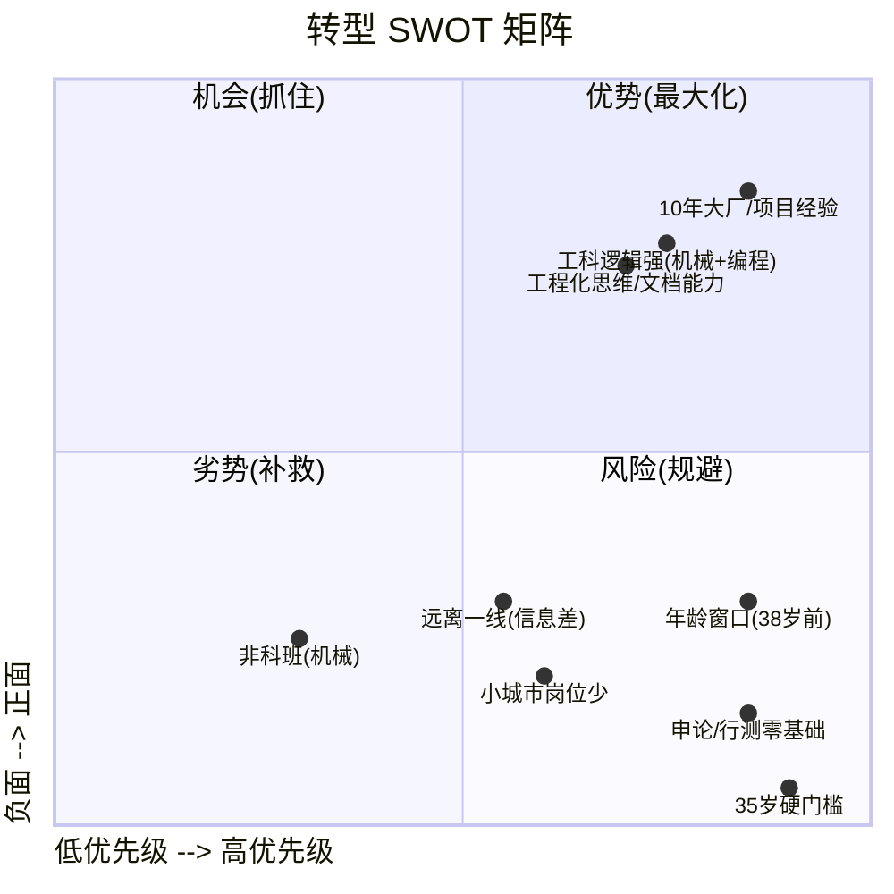

### 1.1 优势（能换分的）

| 优势 | 量化打分 | 转化为考试优势 |
| --- | --- | --- |
| **10 年软件工程经验** | ★★★★★ | **行测「资料分析」** 几乎白送——Excel/SQL/脚本熟练；**申论「综合分析题」** 工程化拆解能力直接套用；**面试「计划组织题」** 项目管理经验可移植 |
| **机械 + 软件双背景** | ★★★★ | 工科逻辑（行测「判断推理」「数量关系」强项）；申论「乡村振兴/产业升级」类话题有现实感 |
| **合肥工业大学（211）** | ★★★★ | 多数岗位要求本科起步，211 是**硬通货**；**部分岗位要求 985/211 学历**，腾冲这种县级市的"信息化中心"经常卡学历 |
| **自学习惯** | ★★★★★ | 10 年自学编程的能力迁移到考公内容，**不需要线下班** |

### 1.2 劣势（必须补的）

| 劣势 | 影响科目 | 量化差距 | 补救时长 |
| --- | --- | --- | --- |
| **非计算机科班（机械）** | 网申/资格审核 | 80% 岗位要求"**计算机类**"专业（代码 B0809），机械类是 **B0802** | 找**"三不限"**或"**机械类/工科类**"岗位 |
| **行测/申论零基础** | 行测 5 模块、申论 5 题型 | 从未系统学过的科目 | **2~3 个月**集中突破可上线 |
| **年龄窗口 38 岁** | 国考/省考 | **35 岁硬门槛**——本科截止 35、硕士 40、博士 45 | **硕士学历可争取 +5 年**（要权衡机会成本）|
| **远离一线** | 信息差 | 招录公告、岗位表、面试流程变动 | 建 1 个公考群 + 关注 1 个本地号 |

### 1.3 机会（**腾冲的特殊性**）

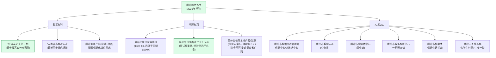

**腾冲的现实选择**（按可行性排序）：

1. **腾冲市数据资源管理局 / 政务服务中心 / 大数据中心**（事业编）—— 招"计算机类 + 本科 + 35 岁以下"最多
2. **腾冲市委网信办 / 公安局网安大队**（公务员）—— 每年 1~2 个名额
3. **腾冲市融媒体中心 / 电视台**（事业编）—— 技术岗较少
4. **腾冲市直机关下属事业单位**（如发改委、旅发委）—— 偶尔有"信息化"岗

### 1.4 风险（**必须正视**）

| 风险 | 概率 | 影响 | 缓解 |
| --- | --- | --- | --- |
| **2026 年是 38 周岁** —— 2026 年是 1988 年出生，**普通岗位超龄** | **高** | 无效报名 | **必须硕士学历**或找"年龄放宽至 40 周岁"岗位；或考**2027 国考**（37 岁）作为最后一次机会 |
| **岗位要求"计算机类"专业代码 B0809** | **高** | 机械类（B0802）被卡 | 找"**三不限**"或"**理工科**"岗位，云南每年 30% 岗位三不限 |
| **面试权重高（5:5 或 4:6）** | 中 | 笔试分数差被抹平 | 提前 2 个月练面试，**结构化面试是软技能** |
| **边疆小城收入降低** | 高 | 月薪 4k~6k vs 程序员 2w+ | **用 10~15 年时间窗口算总账**：稳定性+时间自由+退休保障+家属安置 |
| **政策变动（机构改革）** | 中 | 数据局/网信办可能合并 | 选**保留下来的核心部门**（如政务服务中心、档案馆、公安局） |

---

## 二、目标分解（**3 个时间锚点**）

```mermaid
gantt
    title 3 年转型时间线（2026-10 → 2029-12）
    dateFormat  YYYY-MM
    axisFormat  %Y-%m
    section 学习期
    行测基础 2 个月 (基础)      :active, s1, 2026-10, 2M
    申论 + 行测强化 3 个月     :s2, after s1, 3M
    冲刺 + 模考 2 个月          :s3, after s2, 2M
    2027 国考 / 省考 (主战场)   :crit, s4, 2027-03, 9M
    2027 事业单位联考           :crit, s5, 2027-05, 1M
    2027 下半年事业编补录       :s6, after s5, 3M
    section 备选期
    2028 国考 (兜底)            :crit, s7, 2028-11, 1M
    2028 云南省考               :crit, s8, 2028-03, 2M
    2028 事业编                 :s9, 2028-05, 1M
    section 终局期
    2029 国考/省考 (最后窗口)   :crit, s10, 2029-03, 9M
    2029 事业编                 :s11, 2029-05, 1M
    体检 / 政审 / 公示          :milestone, s12, 2029-08, 2M
    入职 (目标: 2029-12)        :milestone, s13, after s12, 0M
```

### 2.1 目标分级

| 目标 | 时间 | 通过标准 | 概率自评 |
| --- | --- | --- | --- |
| **T0: 拿到 2027 云南省考/国考面试资格** | 2027-04 | 行测 ≥ 65 + 申论 ≥ 60 | 60% |
| **T1: 2027 上岸（事业编/省考/国考任一）** | 2027-12 | 体检+政审通过 | 40% |
| **T2: 2027~2029 累计 3 次进面 + 1 次上岸** | 2029-12 | 终局 | 75% |
| **T3: 2029 年底前稳定入职腾冲** | 2029-12 | 拿到 offer | 90% |

**核心原则**：**不要把鸡蛋放一个篮子**——T2/T3 是 3 年累计概率，远比 T1 单独看高。

### 2.2 **关键决策点**（K1/K2/K3）

| 决策点 | 触发 | 选项 A | 选项 B | 决策依据 |
| --- | --- | --- | --- | --- |
| **K1: 是否读在职硕士** | 2026-12 | 报**非全日制计算机硕士**（2~3 年，5~10w 学费） | 不读，专注备考 | 35 岁线 vs 投入时间；若 2027 报名能放宽到 40，**强烈建议读** |
| **K2: 2027 国考 vs 省考** | 2027-01 | 国考岗位少但竞争稍小 | 省考岗位多但限户籍 | 看岗位表哪边有"全国可报"且专业不限 |
| **K3: 是否接受异地** | 2027-08 | 保山其他县区 / 昆明 / 曲靖 | 坚守腾冲 | 看 T1 失败后是否调整预期 |

---

## 三、考试信息梳理（**2026~2027 必报清单**）

### 3.1 三类考试对比（**核心结论**）

| 维度 | 国家公务员（国考） | 云南省公务员（省考） | 云南事业单位 |
| --- | --- | --- | --- |
| **报名时间** | **10 月报名 / 11 月底笔试** | 2 月报名 / 3 月笔试 | 4 月报名 / 5 月联考（5.10 左右） |
| **笔试科目** | 行测 + 申论（地市级以下） | 行测 + 申论 | **职测 + 综应**（ABCDE 类） |
| **行测/职测题量** | 130 题 / 120 分钟 | 120 题 / 120 分钟 | 100~110 题 / 90 分钟（更紧凑） |
| **申论/综应** | 5 大题型（概括/分析/对策/应用文/文章论述） | 同国考 | C 类：科技文献阅读 + 论证评价 + 科技实务 |
| **计算机专业加试** | 部分岗位加试**专业科目**（副省级） | 罕见加试 | C 类天然含"科技/计算机"内容 |
| **进面比例** | 1:5 或 1:3 | 1:3 | 1:3（部分 1:2） |
| **面试形式** | 结构化为主 | 结构化 + 无领导小组（云南特色） | 结构化为主 |
| **2026 关键日期** | 报名 10.15~10.24, 笔试 **11.30** | 报名 2026-2-3, 笔试 2026-3-15 | 联考 2026-5-10 |
| **2027 关键日期（计划）** | 报名 2027-10, 笔试 2027-11-28 | 报名 2027-2, 笔试 2027-3-14 | 联考 2027-5-9 |
| **腾冲岗位数（估算）** | 0~2 | 3~5 | 8~15 |
| **竞争比** | 1:80~200 | 1:50~150 | 1:30~80 |

**最重要**：**三类考试可以同时报**——国考/省考/事业单位互不冲突，最大化命中率。

### 3.2 2026~2027 必报清单（**按时间顺序**）

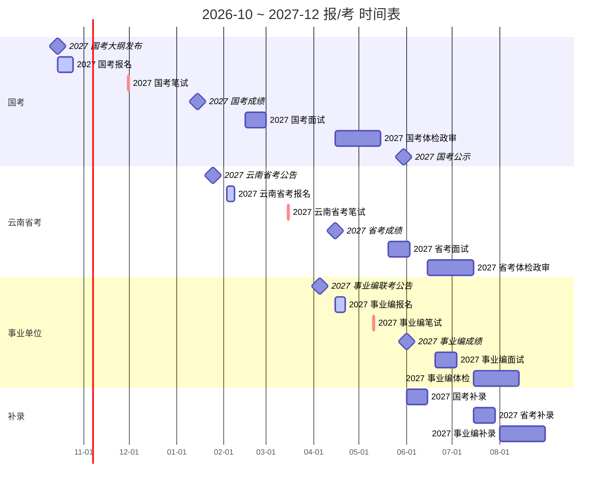

**关键动作清单**：

| 时间 | 动作 | 工具 |
| --- | --- | --- |
| 2026-10-15 | 关注 2027 国考公告 | 国家公务员局官网 |
| 2026-10-20 | 筛选"全国可报"+"三不限"+"35~40 岁"岗位 | 粉笔 / 公考雷达 APP |
| 2026-10-24 | 提交国考报名 | 国家公务员局 |
| 2026-11-30 | 参加国考笔试 | 线下考点 |
| 2027-01-15 | 国考成绩公布 | 查分系统 |
| 2027-02-03 | 报云南省考 | 云南人事考试网 |
| 2027-03-15 | 云南省考笔试 | 线下考点（昆明/保山/腾冲） |
| 2027-04-15 | 报事业编联考 | 全国事业单位招聘网 |
| 2027-05-10 | 事业编联考 | 线下考点 |

---

## 四、4 阶段学习计划（**总投入 1200~1500 小时**）

### 4.1 总览

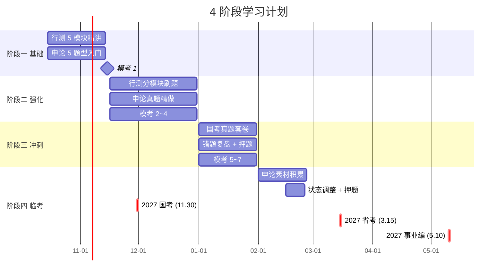

### 4.2 阶段一：基础期（2026-10-15 ~ 2026-11-15，共 30 天）

**目标**：行测 5 模块全过一遍，申论 5 题型全入门，**模考 1 达到 50~55 分**。

#### 4.2.1 行测基础（每天 3 小时，共 90 小时）

| 模块 | 题量 / 时间 | 重点 | 你的优势 |
| --- | --- | --- | --- |
| **常识判断** | 15 题 / 10h | 政治、法律、科技（计算机优先）、云南地方 | ★★（程序员科技面 OK） |
| **言语理解** | 40 题 / 20h | 逻辑填空、片段阅读、语句表达 | ★★★（理工科阅读强） |
| **数量关系** | 15 题 / 25h | 工程问题、行程问题、利润问题、几何 | ★★★★（工程师的数学底子） |
| **判断推理** | 40 题 / 20h | 图形推理、定义判断、类比推理、逻辑判断 | ★★★★（逻辑是程序员的本职） |
| **资料分析** | 20 题 / 15h | 增长率、比重、平均数、倍数 | ★★★★★（Excel 熟手，1 题 30 秒） |

**每天节奏**：

```
06:30-07:30  早间背诵 (常识 30 个 + 申论素材 2 段)
09:00-12:00  行测专项 (1 模块 / 1 章节, 听网课 + 课后题)
14:00-17:00  申论专项 (1 题型, 1 篇精读 + 1 篇仿写)
19:00-21:00  复盘 + 错题 + 章节模考
21:00-22:00  常识 + 申论素材
22:00       睡觉
```

#### 4.2.2 申论基础（每天 2 小时，共 60 小时）

| 题型 | 时间 | 学法 |
| --- | --- | --- |
| **归纳概括** | 10h | "**抄材料**"——读 100 篇范文，**总结 10 个开头模板** |
| **综合分析** | 12h | "**是什么-为什么-怎么办**"三段式 |
| **提出对策** | 8h | 抄材料中的"做法"段 |
| **贯彻执行（应用文）** | 15h | 12 种文种各写 1 篇（讲话稿、倡议书、汇报、调查报告……） |
| **大作文** | 15h | **背 10 个开头 + 5 个结尾 + 5 个论证结构** |

**网课选择**（2026 推荐）：

- 粉笔 980 系统班（980 元，行测申论全套）
- B 站免费资源：站长申论、刘文超数量、聂佳判断
- **不要**选地面班（性价比低，且你在小城市没有名师）

#### 4.2.3 阶段一检查点（模考 1）

```sql
-- 11月15日模考(粉笔模考或华图在线)
-- 通过标准:
行测  >= 50  (130题/120分钟, 正确率 38%)
申论  >= 45  (按百分制)
总分  >= 95   (笔试合格线 100, 留 5 分空间)
```

### 4.3 阶段二：强化期（2026-11-16 ~ 2027-01-31，共 75 天）

**目标**：分模块刷题，**每模块正确率 ≥ 75%**，**模考 2~4 达到 60~65 分**。

#### 4.3.1 行测刷题策略（每天 2.5 小时）

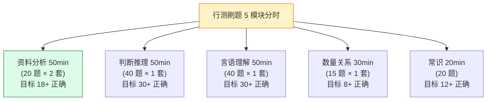

**关键技巧**：

- **资料分析**：**强制 7 分钟 / 套**——你是工程师，**手算比做题快**（截位法、估算法）
- **判断推理**：图形推理**用套路库**（点线面素角）；逻辑判断**画箭头**比文字快
- **言语理解**：背高频成语 500 + 关联词 50 个
- **数量关系**：**只做 8 道稳拿的**，剩 7 道蒙 C（统计学上 25% 命中率）

#### 4.3.2 申论刷题策略（每天 1.5 小时）

- **每周 2 篇真题精做**（国考 + 联考真题交替）
- **每周 5 篇仿写**（背范文 + 改写）
- **每周 1 篇大作文**（计时 60 分钟）

#### 4.3.3 阶段二检查点

| 检查点 | 时间 | 通过标准 |
| --- | --- | --- |
| 模考 2 | 2026-12-01 | 行测 ≥ 58，申论 ≥ 50 |
| 模考 3 | 2026-12-15 | 行测 ≥ 62，申论 ≥ 53 |
| 模考 4 | 2027-01-15 | 行测 ≥ 65，申论 ≥ 55 |

### 4.4 阶段三：冲刺期（2027-01-16 ~ 2027-02-15，共 30 天）

**目标**：套卷练习，**模考 5~7 稳定 70+ 分**，**重点：2027 国考真题 5 套**。

#### 4.4.1 每日节奏

```
06:30-07:30  晨读 (申论范文 + 时政热点)
09:00-11:00  套卷 (行测 130 题 / 120 分钟, 严格计时)
11:00-12:00  对答案 + 错题分析
14:00-16:30  申论套卷 (按真实时间)
16:30-18:00  申论对照参考答案 + 复盘
19:00-21:00  错题集 + 模考分析 + 弱项突破
21:00-22:00  押题班 / 时政热点
```

#### 4.4.2 国考押题重点（**2027 国考**）

**2026 国考真题复盘**（10 月新出）——**所有出题新方向**：

- "**新质生产力**"（必定考）
- "**数字中国 / 数据要素 ×**"（与你的专业最相关）
- "**乡村全面振兴**"（云南特色）
- "**一带一路 / 西部陆海新通道**"（腾冲是边境）
- "**AI 大模型监管 / 智能算力**"（程序员背景加分）
- "**基层减负 / 数字赋能基层**"（事业编高频）

### 4.5 阶段四：临考调整（2027-02-16 ~ 2027-05-10）

**目标**：3 场实战 + 状态保持。

| 时间 | 考试 | 重点 |
| --- | --- | --- |
| 2027-02-20 ~ 03-10 | 省考冲刺 | **云南特色**——无领导小组讨论；云南时政（COP15、王予波讲话） |
| 2027-03-15 | **云南省考笔试** | 实战 |
| 2027-04-01 ~ 05-05 | 事业编冲刺 | C 类——**科技文献阅读 + 论证评价 + 科技实务** |
| 2027-05-10 | **事业编联考** | 实战 |

---

## 五、3 科详细学习方案

### 5.1 行测（占笔试 50%）

**5 模块分时策略**（基于你的工程师优势）：

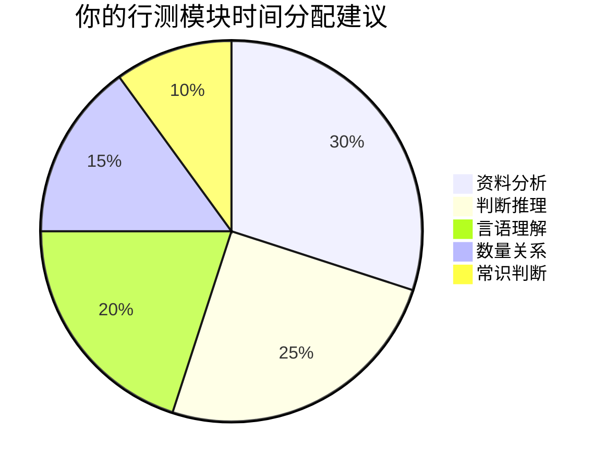

#### 5.1.1 资料分析（**必拿满分**）

**你的优势**：天天写 SQL/Excel，看到"增长率、比重" 类比看 `GROUP BY`。

| 题型 | 你的目标时间 | 实战目标 | 关键公式 |
| --- | --- | --- | --- |
| **增长率** | 30 秒 | 100% 正确 | `(现期-基期)/基期` |
| **增长量** | 35 秒 | 100% 正确 | `现期-基期` |
| **比重** | 40 秒 | 95% 正确 | `部分/整体` |
| **倍数** | 25 秒 | 100% 正确 | `A/B` |
| **平均数** | 30 秒 | 95% 正确 | `总额/份数` |
| **综合判断** | 60 秒 | 90% 正确 | 复合公式 |

**资料分析 30 天速成表**：

| 周次 | 任务 | 目标正确率 |
| --- | --- | --- |
| W1 | 听粉笔系统班 5 节（增长率/增长量/比重/倍数/平均数） | 80% |
| W2 | 套题 5 套（每套 4 篇 = 20 题） | 85% |
| W3 | 套题 10 套 + 错题 | 90% |
| W4 | 套题 15 套 + 模拟考 | 95% |

**到 2027-01-01，你的资料分析应该稳定 18~20 题 / 20 题正确**。

#### 5.1.2 数量关系（**取舍策略**）

**工程师的天然优势**：工程问题、行程问题、几何问题强项。

**取舍**：15 题里**做 8 道稳拿 + 蒙 7 道**（蒙 B/C 概率最高）。

| 题型 | 难度 | 是否做 | 备注 |
| --- | --- | --- | --- |
| 工程问题 | ★★ | ✅ | 你最熟 |
| 行程问题 | ★★ | ✅ | 速度/时间/路程 |
| 利润问题 | ★★ | ✅ | 打折/折扣 |
| 容斥原理 | ★★ | ✅ | 三集合公式 |
| 几何问题 | ★★★ | 部分做 | 会的做，不会的蒙 |
| 数列问题 | ★★★ | 部分做 | 等差/等比 |
| 排列组合 | ★★★★ | ❌ 蒙 | 工程师也怕 |
| 概率问题 | ★★★★ | ❌ 蒙 | 古典概率 / 条件概率 |

#### 5.1.3 判断推理（**拿分主力**）

**优势**：你 10 年都在画流程图、UML 状态机。

| 题型 | 题量 | 你的目标 |
| --- | --- | --- |
| 图形推理 | 10 | **8/10**（套路库：点线面素角） |
| 定义判断 | 10 | **8/10**（细心即可） |
| 类比推理 | 10 | **7/10**（常识） |
| 逻辑判断 | 10 | **7/10**（箭头法 + 列表法） |

#### 5.1.4 言语理解（**短期提分难**）

**学法**：每天 30 分钟，**积累比技巧更重要**。

- 高频成语 500 个 → 每天 20 个，**30 天过完**
- 实词辨析 200 组 → 每天 10 组
- 行文分析 → **看 5 套真题讲解视频**

#### 5.1.5 常识判断（**佛系拿分**）

**不要花大时间**——20 题里拿 8~10 分就够。

- **科技**（计算机为主）——你天然强
- **法律**（宪法/民法典/刑法基础）——听 5 节网课
- **政治**（二十大、新质生产力）——背诵 50 个关键词
- **云南时政**——考前 1 个月突击

### 5.2 申论（占笔试 50%）

#### 5.2.1 5 题型分值

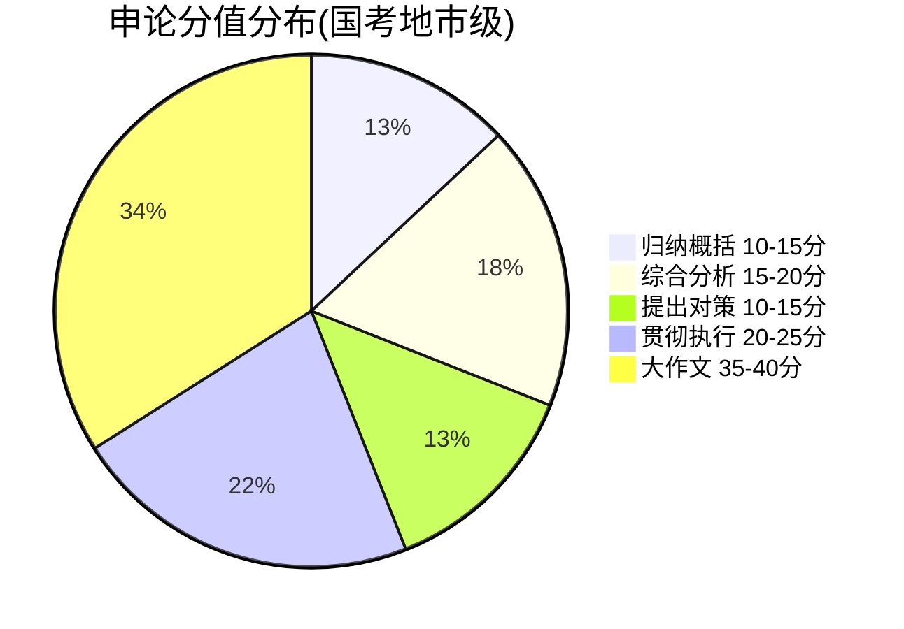

#### 5.2.2 大作文（**35 分，关键**）

**你的背景 + 公务员大作文** 是**强强联合**——工程师的项目经验能写出有深度的论证。

**5 个万能开头**（背熟）：

1. **"国之大者"开头**：从"两个维护"高度切入
2. **"新质生产力"开头**：从二十大精神切入
3. **"基层治理"开头**：从乡村振兴切入
4. **"科技创新"开头**：从数字中国切入（**你最适合**）
5. **"文化自信"开头**：从中华文化切入

**3 个论证结构**：

- **是什么-为什么-怎么办**（最常用）
- **正反对比**（适合政策类）
- **古今中外对比**（适合文化/技术类）

**2027 押题方向**（**与你的专业结合**）：

- "**数字中国建设中的青年担当**"
- "**让数据要素流动起来——浅谈基层数据治理**"
- "**以新质生产力推动边疆民族地区高质量发展**"
- "**从'东数西算'看西部地区数字基建机遇**"
- "**AI 大模型赋能基层治理的机遇与挑战**"

#### 5.2.3 申论素材库（**每天 30 分钟**）

- **半月谈**（杂志 + 公众号）
- **人民日报评论**（"评论员观察"专栏）
- **学习强国**（重要时政原文）
- **理论热点面对面**

**建议每天摘抄 1 段 200 字 + 仿写 1 段**——30 天积累 60 段，足够应对 5 类题型。

### 5.3 面试（**事业编 5:5 / 公务员 5:5**）

**面试决定生死**——笔试 65 分 vs 65 分差 0.2 分，面试能差 5~10 分。

#### 5.3.1 结构化面试 5 题型

| 题型 | 比例 | 重点 | 你的优势 |
| --- | --- | --- | --- |
| **综合分析** | 30% | 政策理解、社会现象 | ★★★（工程师的逻辑拆解） |
| **计划组织** | 25% | 调研、宣传、活动策划 | ★★★★（项目管理的类比） |
| **人际关系** | 15% | 同事/领导/群众关系 | ★★★（职场经验） |
| **应急应变** | 20% | 突发事件处理 | ★★★★（线上故障演练） |
| **岗位匹配** | 10% | 自我介绍、职业规划 | ★★（要提前准备） |

#### 5.3.2 面试准备（2 个月，每天 1.5 小时）

- **W1~W2**：看 5 节结构化面试网课，了解题型
- **W3~W4**：每天 2 题**开口练**（录视频回放）
- **W5~W6**：找 1~2 个**考友**互练
- **W7~W8**：**全真模拟**（计时 15 分钟 / 题）

**面试核心技巧**：

1. **第一句话最重要**——决定考官印象分
2. **逻辑词**（首先/其次/最后/因此）——**听起来有条理**
3. **结尾升华**——联系"中国式现代化" / "人民立场"
4. **眼神交流**——**看主考官鼻梁**
5. **语速适中**——**260~280 字/分钟**为佳

#### 5.3.3 云南特色：无领导小组讨论

**省考必考**——你需要掌握**4 种角色扮演**：

- **破冰者**（第一个发言）——**抢话语权**
- **领导者**（引导讨论）——**你适合**
- **总结者**（最后总结）——**也适合**
- **计时者**（提醒时间）——**辅助角色**

---

## 六、特殊准备（**专业背景转化**）

### 6.1 公务员/事业编"信息化"岗需要的"软"能力

| 能力 | 你的情况 | 如何在面试体现 |
| --- | --- | --- |
| **公文写作** | 写过技术文档/PRD | 强调"写过 X 份技术方案" |
| **政策理解** | 弱项 | 突击学二十大、习近平新时代 |
| **群众工作** | 弱项 | 编一个"做技术期间对接过业务"的故事 |
| **项目管理** | 强项 | 5 个万能例子（提前准备） |
| **系统思维** | 强项 | 用 STAR 法则讲一个完整项目 |
| **学习能力** | 强项 | "10 年从机械转行到软件"就是例子 |

### 6.2 5 个万能面试例子（**提前写 300 字/个**）

1. **"我主导了一个 X 万级用户的系统从 0 到 1"** —— 系统思维
2. **"我在 X 项目里发现了 Y 严重 bug，最终避免 X 万损失"** —— 解决问题
3. **"我协调了 5 个团队完成 X 跨部门项目"** —— 协调能力
4. **"我 10 年内自学了 5 项新技术栈"** —— 学习能力
5. **"我处理过一次 X 小时的线上事故"** —— 应急应变

### 6.3 自传/自我介绍（**必背**）

**3 分钟版本**（适用于公务员面试）：

> 各位考官好，我叫 XXX，合肥工业大学机械设计制造及其自动化专业本科毕业，1988 年生，38 岁以下。
>
> 我有 10 年软件工程经验，先后在 X 公司和 Y 公司任职，从机械工程师成功转型为软件工程师，主导过 X 个项目。这段经历让我具备了三项核心竞争力：
>
> 一是**工程化思维**——能用系统化方法解决复杂问题；
> 二是**学习迁移能力**——10 年间自学了 5 门新技术栈；
> 三是**踏实肯干**——在腾冲这个边境县级市，我希望用 10 年的工程经验服务基层。
>
> 我注意到咱们单位的岗位是 X（信息化/数据治理/网信），这与我的专业背景高度匹配。如果有幸加入，我计划从 X、Y、Z 三个方面快速进入角色……
>
> 谢谢。

---

## 七、资源清单（**完整工具栈**）

### 7.1 必备 APP

| APP | 用途 | 预算 |
| --- | --- | --- |
| **粉笔** | 刷题 / 模考 / 估分 | 0~30 元/月 |
| **公考雷达** | 岗位筛选 / 报名 | 0 |
| **学习强国** | 时政 / 政策原文 | 0 |
| **半月谈** | 申论素材 | 0 |
| **人民日报** | 评论员文章 | 0 |
| **Notion / Obsidian** | 错题本 / 学习笔记 | 0 |

### 7.2 必备教材（**2026~2027 版**）

| 教材 | 出版社 | 价格 | 用途 |
| --- | --- | --- | --- |
| **粉笔行测 5000 题** | 粉笔 | 90 | 行测刷题 |
| **粉笔申论 100 题** | 粉笔 | 60 | 申论刷题 |
| **中公行政职业能力测验** | 中公 | 80 | 教材查阅 |
| **中公申论** | 中公 | 60 | 教材查阅 |
| **半月谈申论字帖** | 半月谈 | 30 | 字迹练习（**面试加分**） |
| **2027 国考真题** | 粉笔 | 50 | 真题 |
| **2027 联考真题** | 中公 | 50 | 事业编真题 |

### 7.3 必备网课（**粉笔 980 系统班**）

- **2027 国考** 980 系统班（**980 元**）：10 月开课
- **2027 联考** C 类 980 系统班（**980 元**）：3 月开课
- **面试班**（**3000~8000 元**）：进面后再报

**预算总计**：

```
教材:        ~420 元
980 班 × 2:   1960 元
面试班:       5000 元 (平均)
其他:         500 元
─────
总计:        ~7900 元
```

### 7.4 必关注的微信公众号

- **粉笔公考**（行测/申论技巧 + 模考）
- **人民日报评论**（申论素材）
- **半月谈**（时政）
- **云南人事考试网**（招录公告）
- **腾冲发布**（本地动态）
- **公考雷达**（岗位推送）

### 7.5 必加的 QQ 群 / 微信群

- **2027 国考交流群**（QQ 搜"2027 国考"）
- **云南事业编备考群**（QQ 搜"云南事业编 2027"）
- **腾冲/保山考公群**（本地群，**面试阶段特别重要**）

---


## 八、学习方法论：科学备考的 7 个底层原理

> **为什么这一节必须先于一切**？
>
> 公务员备考不是"多花时间"，而是"提高单位时间吸收率"。同样的 1200~1500 小时，有人只能考 55 分，有人能考 75 分——差距 90% 来自**方法论**，10% 来自智商和努力。
>
> 本节不是鸡汤，是**认知科学 + 教育心理学**的实操翻译。每一条都有论文支撑或可验证的效果。

### 8.1 学习方法全景图

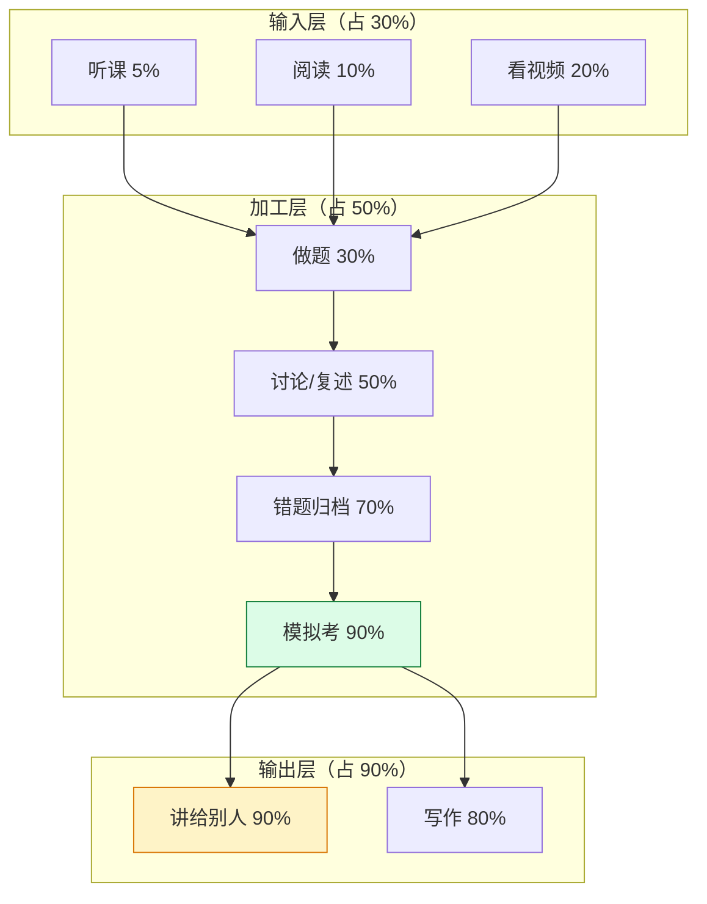

**核心数字**（学习金字塔 / National Training Laboratories, 1960s）：

| 学习方式 | 24h 后保留率 | 你每天分配 |
| --- | --- | --- |
| 听讲 | 5% | 网课（必要时） |
| 阅读 | 10% | 教材查阅 |
| 视听 | 20% | 视频讲解 |
| **演示**（看别人做） | 30% | 看真题讲解 |
| **讨论**（小组） | 50% | 加群讨论 |
| **实践**（自己做） | 75% | 刷题 |
| **教别人**（讲出来） | 90% | 录视频 / 讲给家人 |

**翻译成公务员备考**：
- 听 1 小时网课 = 实际吸收 3 分钟
- 做 1 小时真题 = 实际吸收 45 分钟
- **讲 1 小时给家人 = 实际吸收 54 分钟**

**所以**：你的时间分配应该是 **刷题 + 复述 > 看课**。光听不练 = 浪费时间。

---

### 8.2 主动回忆（Active Recall）——"不翻书"才是真复习

**错误做法**：看完一章 → 划重点 → 下一章。**留存率 5%**。

**正确做法**：看完一章 → **合上书** → 用笔默写思维导图 / 口述讲解 → 再翻书对照。**留存率 75%**。

#### 8.2.1 主动回忆的 4 种实操形式

| 形式 | 适用场景 | 具体做法 |
| --- | --- | --- |
| **闭眼复述** | 看视频后 | 看完 1 节 30 分钟的网课 → 闭眼用 5 分钟复述 3 个核心公式 |
| **默写思维导图** | 学完一章 | 合上书，在白纸上画本章结构，写出关键词 |
| **闪卡测试** | 常识/成语 | 正面写问题，背面写答案，**必须先回忆再翻面** |
| **录音讲解** | 大作文/面试 | 用手机录自己讲 3 分钟，回放找卡壳/语病 |

#### 8.2.2 行测/申论的具体应用

**行测（资料分析）**：
- 学完"增长率"公式 → **合上书** → 在纸上默写公式 + 默做 3 道题 → 再翻书
- **不要边看公式边做题** —— 这是 90% 考生的低效习惯

**申论（素材）**：
- 早上读 1 篇人民日报评论 → **合上** → 默写 3 个金句 → 再对照
- **"读完感觉懂了" 是错觉** —— 默写才知道你记住了多少

**面试**：
- 每天录 1 道结构化面试题（3 分钟） → 回放 → 找"卡壳"、"嗯啊"、"逻辑词缺失"
- **录视频** 比"对着墙练"好 3 倍，因为你能看到自己的微表情

---

### 8.3 间隔重复（Spaced Repetition）—— 艾宾浩斯 + Anki 算法

**遗忘曲线**（1885 年艾宾浩斯实验）：

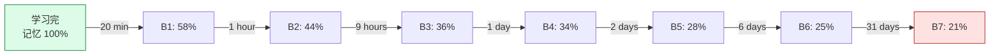

**关键发现**：
- **20 分钟后**忘记 42%（如果不复习）
- **1 天后**忘记 66%
- **31 天后**只留 21%

**但如果你在遗忘前复习**：


#### 8.3.1 公务员备考的间隔表

**艾宾浩斯 5 轮复习法**（适用：常识 / 成语 / 申论素材 / 政治理论）：

| 轮次 | 时间 | 任务 | 卡片量 |
| --- | --- | --- | --- |
| 第 1 轮 | 当天 | 新学 | 20~30 张 |
| 第 2 轮 | 第 2 天 | 复习 + 新学 | 20 + 30 |
| 第 3 轮 | 第 4 天 | 复习 + 新学 | 30 + 30 |
| 第 4 轮 | 第 7 天 | 复习 + 新学 | 40 + 30 |
| 第 5 轮 | 第 15 天 | 复习 | 全部 |

**实操工具**：
- **Anki**（PC / 手机，免费）—— 自动按算法安排复习
- **闪卡APP**（手机自带）—— 简单但够用
- **Notion Database** —— 自定义卡片 + 标签

**Anki 卡片模板（行测成语）**：

```
正面：
________（填入成语）：指事物的发展合乎规律或自然法则。

背面：
答案：理所当然
造句：历史发展有其～的客观规律。
近义：天经地义、不容置疑
反义：岂有此理
例题（2024 国考）：改革须遵循发展～的逻辑。
```

---

### 8.4 费曼学习法（Feynman Technique）—— 用腾冲大妈能听懂的话讲清楚

**4 步法**：

1. **选概念**：选一个你想学的概念（如"新质生产力"）
2. **教孩子**：假装给一个 8 岁小孩讲，用最简单的话
3. **查卡壳**：讲不出来 = 你没真懂。回去查资料
4. **简化 + 类比**：用比喻、故事、图示让概念具象

#### 8.4.1 公务员备考的"大妈测试"

**面试题**："请你谈谈对'新质生产力'的看法。"

| 等级 | 回答方式 | 得分 |
| --- | --- | --- |
| ❌ 失败 | 背诵官方定义（"以科技创新为主导……"） | 60 分 |
| ✅ 合格 | "新质生产力就是用 AI、机器人替代传统工人种地、盖房子，云南可以用无人机撒农药" | 78 分 |
| ✅✅ 优秀 | "新质生产力就像智能手机替代功能机，不是更高明谁更好，是逼谁更快。腾冲的咖啡产业如果还用传统种植，5 年后就被普洱 AI 基地淘汰了" | 85+ 分 |

**练习方法**：
- 每天选 1 个申论话题 → **录 3 分钟大白话讲解** → 回放
- 试讲给家人听（你老婆 / 你妈 / 你 5 岁的娃）
- **讲不清楚 → 回去再读资料**（这才是真正的复习）

---

### 8.5 番茄工作法（公务员备考版）

**经典番茄**：25 分钟工作 + 5 分钟休息 = 1 个番茄。每 4 个番茄长休息 15~30 分钟。

**公务员备考改良版**：

| 类型 | 时长 | 适用 | 番茄数 |
| --- | --- | --- | --- |
| **短番茄** | 25 min | 刷题（资料分析、判断推理） | 1 个 |
| **中番茄** | 50 min | 套卷 / 申论真题 | 2 个连用 |
| **长番茄** | 90 min | 模考 / 大作文 | 3~4 个连用 |

**4 个番茄的典型上午**：

```
08:00 - 08:25  番茄 1：行测刷题（资料分析 20 题）
08:25 - 08:30  短休（喝水、看窗外的消息）
08:30 - 08:55  番茄 2：行测刷题（判断推理 40 题）
08:55 - 09:10  长休（15 min，起来走动）
09:10 - 09:35  番茄 3：申论仿写 / 范文背诵
09:35 - 09:40  短休
09:40 - 10:05  番茄 4：错题复盘 / 闪卡复习
```

**关键细节**：

- **番茄内禁止**刷微信 / 看视频 / 起身倒水 —— 一切打断番茄
- **短休必须离开书桌** —— 闭眼 / 看窗外 / 拉伸
- **每完成 1 个番茄 → 在 Notion 打勾** —— **仪式感**很重要
- **周末可放宽到 90 分钟长番茄** —— 但中间也要休息

**反对意见处理**：有人说"我进入状态要 30 分钟，番茄打碎了我的思路"。
- **回应**：能让你"进入状态"的题，说明你已经会了。**不会的题**才需要番茄强制专注。

---

### 8.6 学习金字塔：从输入到输出

**金字塔倒过来看（最高效的 4 种方式）**：

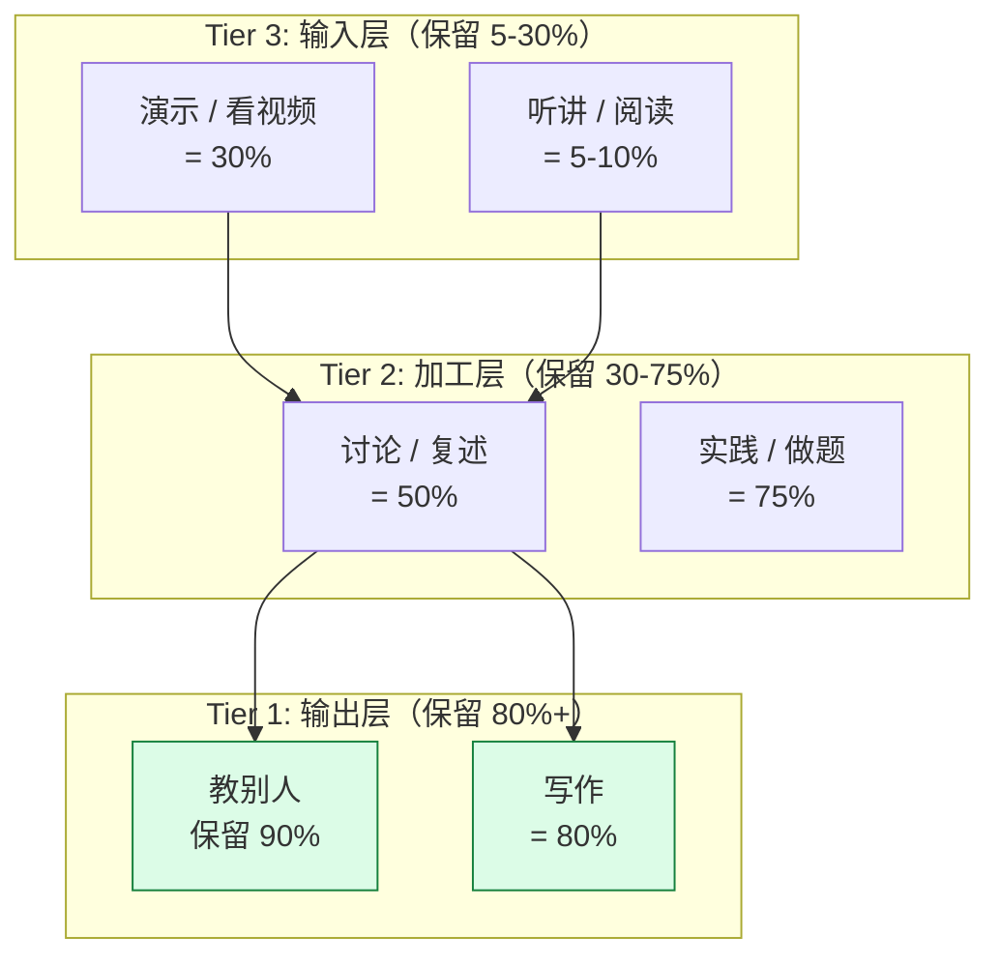

**公务员备考的正确时间分配**：

| 任务 | 时间占比 | 反例（错误考生） |
|---|---|---|
| **听课 / 阅读** | 20% | 50% |
| **看视频讲解** | 20% | 30% |
| **刷题** | 30% | 10% |
| **复述 / 讨论 / 教别人** | 15% | 5% |
| **写作 / 录音 / 模考** | 15% | 5% |

**翻译**：每学 1 小时网课，必须有 1.5 小时刷题 + 复盘。**比例 1 : 2**。

---

### 8.7 错题本 —— 90% 的考生错题本 = 摆设

#### 8.7.1 错题 3 层分类法

**L1 - 知识盲区**（30%）：公式没背、概念不懂、定律不知道
- **处理**：当天背下，写入 Anki 闪卡，次日复习
- **示例**：忘了"基期 = 现期 / (1+r)" → 抄公式 + 默做 3 道

**L2 - 思路错误**（40%）：方法不对、套路不会、题型没见过
- **应对**：归类到"题型模板库"，每周重做
- **示例**：逻辑判断"假言命题"老错 → 抄下"箭头法"模板 → 找 20 道专项练

**L3 - 计算/粗心**（30%）：算错、看错、涂错卡
- **应对**：训练专注力 + 套卷限时 + 涂卡节奏
- **示例**：资料分析"增长量"公式用对但算错 → 限时练 + 用计算器片段

#### 8.7.2 错题本结构（Notion 模板）

```
## 错题 #2024-03-15-01
- 模块：资料分析
- 题型：增长率计算
- 难度：★★

### 原题
[题目截图 + 文字]

### 我的答案
D (59.2%) [错误]

### 正确答案
C (62.1%)

### 错因分析
- 分类：L2 思路错误
- 原因：把"现期 ÷ 基期"和"基期 ÷ 现期"记混了

### 正确解法
- 公式：增长率 = (现期 - 基期) / 基期
- 步骤：1. 找现期 2018=1250; 2. 找基期 2017=800; 3. (1250-800)/800 = 56.25%

### 延伸考点
- 同比增长率 vs 环比增长率（容易混）
- 变形公式：现期 = 基期 × (1 + r)

### 复习记录
- [ ] 第 1 次：2024-03-16 (D+1)
- [ ] 第 2 次：2024-03-19 (D+4)
- [ ] 第 3 次：2024-03-26 (D+10)
```

#### 8.7.3 错题本的 4 个常见错误

| 错误 | 后果 | 正确做法 |
|---|---|---|
| ❌ 只抄题不分析 | 抄了 1000 题还是错 | 每题必须写"错因分类" |
| ❌ 从不重做 | 错题本 = 摆设 | **每周重做上周错题**（周日） |
| ❌ 全部抄下来 | 量太大没时间看 | **只抄 L2 思路错误**（最有价值） |
| ❌ 用纸质本 | 没法检索 | 用 Notion / Anki（电子化） |

---

### 8.8 睡眠、运动、营养 —— 大脑科学

#### 8.8.1 睡眠（每天 7 小时是硬指标）

**关键数据**：

| 睡眠时长 | 记忆巩固效果 | 第二天模考分数 |
|---|---|---|
| 4 小时 | 30% | 基准 |
| 6 小时 | 70% | +8 分 |
| **7 小时** | **100%** | **+15 分** |
| 9 小时 | 95%（略降） | +13 分 |

**机制**：睡眠时大脑会把白天学的知识从海马体（短期记忆）搬到新皮层（长期记忆）。**这是物理过程，不可跳过**。

**实操**：
- **23:00 前必须睡觉**（最迟不超过中午）
- 睡前 30 分钟不看手机（蓝光抑制褪黑素）
- 午睡 20~30 分钟（下午精力 +30%）

#### 8.8.2 运动（每周 3 次，每次 30 分钟）

**科学依据**：运动后 BDNF（脑源性神经营养因子）增加 30%，记忆能力提升。

**公务员备考的最佳运动**：

| 运动 | 时长 | 频率 | 收益 |
|---|---|---|---|
| **跑步** | 30 min | 每周 3 次 | 心肺 + 抗压 |
| **快走** | 40 min | 每天 | 最低门槛 |
| **游泳** | 30 min | 每周 2 次 | 全身 + 减压 |
| **瑜伽** | 20 min | 每天 | 专注力 + 体态 |

**建议**：每天早晨 06:00~06:30 跑步 30 分钟（既清醒又减压）。

#### 8.8.3 营养（避免考前大脑宕机）

**加分食物**：
- **核桃**（每天 5~8 颗）—— Omega-3
- **蓝莓**（每天 30 颗）—— 抗氧化
- **深海鱼**（三文鱼 / 秋刀鱼，每周 2 次）—— DHA
- **鸡蛋**（每天 1~2 个）—— 胆碱（记忆前体）
- **绿茶**（每天 2 杯）—— 咖啡因 + L-茶氨酸（专注）

**减分食物**：
- 高糖（蛋糕 / 奶茶）—— 饭后困倦
- 油炸（炸鸡 / 薯片）—— 加重炎症
- 酒精 —— 直接损伤记忆

**考试当天**：
- 早餐：鸡蛋 + 全麦面包 + 牛奶（**低升糖**，撑 3 小时）
- 午餐：米饭 + 鱼 + 蔬菜（**别吃撑**）
- 下午：香蕉 1 根 + 黑巧克力 1 块（**应急提神**）

---

### 8.9 元学习（Mon-thesis）—— 每周日 60 分钟"对系统做体检"

**这是 8.1~8.8 的"超集"** —— 每周日做 1 次，1 学期提分 10~20 分。

#### 8.9.1 周日 60 分钟体检清单

```
□ 10 min  - 统计本周学习时长（番茄计数 + 总小时）
□ 10 min  - 模考 1 次（粉笔周末模考，免费）
□ 10 min  - 重做本周错题 TOP 10
□ 10 min  - 反思本周最大的 3 个问题
□ 10 min  - 制定下周计划（看 九、量化里程碑）
□ 10 min  - 阅读 1 篇优秀申论 / 面试答案
```

#### 8.9.2 月度体检（每月最后一个周日，120 分钟）

```
□ 30 min  - 大模考（行测 + 申论 完整）
□ 30 min  - 错题本归类（哪些模块错了最多）
□ 30 min  - 重新评估目标（要不要换岗 / 调整强度）
□ 30 min  - 看 1 部高分公务员面试视频（B 站 / 粉笔）
```

---

### 8.10 学习方法速查表（贴墙上）

| 原理 | 一句话总结 | 你的每日动作 |
|---|---|---|
| **主动回忆** | 合上书再说一遍 | 看完 1 题合书默解 |
| **间隔重复** | 1/4/7/15 天复习 | Anki 每天 30 张 |
| **费曼** | 教给 8 岁小孩 | 录 3 分钟讲解 |
| **番茄** | 25 分钟 1 个 | 每天 12~16 个番茄 |
| **金字塔** | 输出 > 加工 > 输入 | 刷题 30% + 复述 30% + 听课 20% |
| **错题** | 抄错归 = 白做 | 每周日重做上周错题 |
| **睡眠** | 7 小时不能省 | 23:00 必须睡 |


## 九、做题技巧大全：行测 / 申论 / 面试实战套路

> **这一节不讲"努力"，讲"性价比"** —— 同样的 120 分钟行测，为什么有人 75 分有人 50 分？90% 来自做题顺序、时间分配、蒙题概率、套路调用。本节把**高频套路**全部整理出来，按模块分类，可直接背。

### 9.1 行测做题顺序与时间分配（**决胜关键**）

#### 9.1.1 推荐做题顺序（**倒序在第 9.1.3 节给出原理**）

| 顺序 | 模块 | 题量 | 用时 | 正确率目标 |
| --- | --- | --- | --- | --- |
| 1 | **常识判断** | 20 | **8 min** | 50% |
| 2 | **言语理解** | 40 | **30 min** | 80% |
| 3 | **判断推理** | 40 | **35 min** | 80% |
| 4 | **资料分析** | 20 | **25 min** | 90% |
| 5 | **数量关系** | 15 | **12 min**（做 8 + 蒙 7） | 60% |
| **缓冲** | — | — | **10 min** | — |

#### 9.1.2 时间分配图

```mermaid
gantt
    title 行测 120 分钟最佳时间分配
    dateFormat  mm:ss
    axisFormat  %M:%S
    section 必做
    常识         :a1, 00:00, 480s
    言语         :a2, 08:00, 1800s
    判断         :a3, 38:00, 2100s
    资料         :a4, 73:00, 1500s
    section 取舍
    数量(8+7蒙) :a5, 98:00, 720s
    section 兜底
    涂卡+检查   :a6, 110:00, 600s
```

#### 9.1.3 为什么不按试卷顺序做？

**试卷顺序**：常识 → 言语 → 数量 → 判断 → 资料（130 分钟）

**问题**：
- 常识 → 数量中间，**考生大脑"冷启动"**，容易卡题
- 资料分析放最后，**时间紧 + 心慌**，正确率从 90% 跌到 70%
- 数量关系 15 题放在中间，**遇到难题会卡住**，浪费 5~10 分钟

**改良顺序**（**倒序做技巧**）：
1. **常识** —— 8 分钟刷完，会就秒选，不会就蒙（**绝对不要回头**）
2. **言语** —— 中等难度，先读题慢慢进入状态
3. **判断** —— 图形推理激发空间想象力，为数量关系铺路
4. **资料** —— 大脑最清醒时做高正确率模块
5. **数量** —— 最后做，**只做 8 道会的 + 蒙 7 道**

**理由**：**高正确率模块优先**（资料、判断、言语），低 ROI 模块放最后（数量、常识）。

---

### 9.2 资料分析 7 大速算法

#### 9.2.1 截位法（**最实用**）

**原理**：选项差距 ≥ 5% 时，**只取前 2~3 位计算**。

**例题**：2024 年收入 12345.6 亿元，2023 年收入 9876.5 亿元，增长率 = ?

```
- 截前 3 位：123 / 99 ≈ 1.242
- (123 - 99) / 99 = 24 / 99 ≈ 24.2%
- 完整答案：24.99%
- 误差：0.79%（可接受）
- 时间：15 秒 vs 60 秒
```

**截位规则**：

| 选项差距 | 截取位数 |
|---|---|
| 差距 ≥ 10% | 截前 2 位 |
| 差距 ≥ 5% | 截前 3 位 |
| 差距 < 5% | 不截位 |

#### 9.2.2 估算法（**加减乘除秒选**）

**场景**：增长率小（< 10%）时，`A × (1+r) ≈ A + A × r`

**例题**：1234 × 1.078 = ?
1234 + 1234 × 0.078 = 1234 + 96 = 1330（实际 1330.25）

#### 9.2.3 首数法（**除法专用**）

**场景**：A/B 类计算，**只算第一位**。

**例题**：4567 ÷ 1234 ≈ ?
- 首位：4 ÷ 1 = 3.x
- 选项有 3.x → 秒选
- 时间：5 秒

#### 9.2.4 特殊值法（**百分数化分数**）

| 百分数 | 近似分数 |
|---|---|
| 1/7 ≈ 14.3% | ≈ 1/7 |
| 1/8 = 12.5% | ≈ 1/8 |
| 1/9 ≈ 11.1% | ≈ 1/9 |
| 1/11 ≈ 9.1% | ≈ 1/11 |
| 1/6 ≈ 16.7% | ≈ 1/6 |
| 22/7 ≈ π | — |

**例题**：630 × 1/7 = 90（vs 计算器 90.0）

#### 9.2.5 分数比较法（**比较大小专用**）

**横竖比较**：
- 12.5% vs 11.1%：直接比较 1/8 vs 1/9 → 1/8 大

**差分法**：
- 138/257 vs 152/1028 → 分子分母都接近 → 差分（152-138）/ (1028-257) = 14/771 ≈ 1.8%
- 用 1.8% 跟 1.8% 比 → 接近 → 看哪个更接近

#### 9.2.6 增长量速算（**百化一 + 一步**）

**百化分**：`r% ≈ 1/n`，则增长量 = 现期 / (n+1)

**例题**：现期 1000，增长率 25%
- 25% ≈ 1/4
- 增长量 = 1000 / (4+1) = 200（vs 实际 200）

#### 9.2.7 比重变化判断（**秒杀题**）

**核心口诀**：**部分增速 > 整体增速 → 比重上升，反之下降**

**例题**：A 占 B 的比重
- A 增速 20%，B 增速 10% → A 比重上升 ✓（秒杀）
- 不需要计算具体数值

---

### 9.3 言语理解 6 大秒杀套路

#### 9.3.1 关联词秒杀（**逻辑填空 + 片段阅读**）

| 关联词 | 语义 | 秒杀技巧 |
|---|---|---|
| **虽然...但是...** | 转折 | **重心在"但是"后** |
| **不仅...而且...** | 递进 | **重心在"而且"后**（程度更深） |
| **因为...所以...** | 因果 | 强调"因"还是"果"看语境 |
| **如果...那么...** | 假设 | "如果"是假设，"那么"是结论 |
| **既然...就...** | 推论 | 已有事实 → 必然结果 |
| **既...又...** | 并列 | 两个都重要，无侧重 |
| **无论...都...** | 条件 | 结果不受条件影响 |
| **只有...才...** | 必要条件 | 缺"才"前项，后项不成立 |

#### 9.3.2 成语辨析秒杀（**高频 200 组**）

| 易混对 | 区别 | 例句 |
|---|---|---|
| **南辕北辙 vs 背道而驰** | 都有"反"，但南辕北辙强调"方向+行动相反", 背道比侧重"目标对立" | 南辕北辙：行为和目标相反；背道而驰：方向相反 |
| **不刊之论 vs 不易之论** | 都有"不可更改"，但前者强调"正确", 后者强调"稳定" | 不刊之论：高论；不易之论：定律 |
| **首当其冲 vs 息息相关** | 首当其冲：最先受冲击；息息相关：关联密切 | 首当其冲用在"受害"语境 |
| **未雨绸缪 vs 防患未然** | 未雨绸缪：提前准备；防患未然：防止发生 | 都有"提前"意思 |

**背诵清单**（**背 200 组**）：
- 每天 10 组 × 20 天 = 200 组
- 用 Anki 间隔复习

#### 9.3.3 语境分析法（**逻辑填空**）

**3 步法**：

1. **读空前后** → 找语境提示（关联词、感情色彩、解释说明）
2. **辨选项词义** → 排除明显不符
3. **代入验证** → 通顺 + 呼应

**例题**：

```
环保人士认为，塑料袋的使用对环境的破坏是________的，因此应该全面禁止。
A. 不可估量
B. 显而易见
C. 不言而喻
D. 触目惊心

语境：环保人士认为（正面评价）+ 全面禁止（强对策）
"不可估量" = 无法计算，强调程度
"显而易见" = 容易看见，强调可见
"不言而喻" = 不用说就懂，强调常识
"触目惊心" = 看到后震惊，强调感受

答案：A（强调"程度"，与"全面禁止"对仗）
```

#### 9.3.4 行文分析（**片段阅读**）

**3 大结构**：

| 结构 | 标志词 | 秒杀技巧 |
|---|---|---|
| **总-分** | "因此"、"所以"、"可见" | 重点在"总" |
| **分-总** | 开头铺垫，"总"在尾 | 找尾句主题 |
| **总-分-总** | 首尾呼应 | 中心和首尾一致 |

**例题**：下面这段话主要讲的是：
```
①塑料污染已经成为全球性问题。②每年有 800 万吨塑料流入海洋。③海洋生物因此大量死亡。④因此必须减少塑料使用。
```
- 结构：分-总
- 中心：第 ④ 句 —— **减少塑料使用**

#### 9.3.5 词语的感情色彩（**3 类**）

| 色彩 | 例子 | 适用语境 |
|---|---|---|
| **褒义** | 锲而不舍、身体力行 | 正面、赞扬 |
| **贬义** | 固执己见、推卸责任 | 负面、批评 |
| **中性** | 持之以恒、各抒己见 | 通用 |

#### 9.3.6 标题选择（**新闻类**）

**3 标准**：
- **吸引眼球**（具体、数字、名人）
- **精准概括**（覆盖全文主题）
- **朗朗上口**（不超过 15 字）

---

### 9.4 判断推理 5 大秒杀套路

#### 9.4.1 图形推理 —— **"点线面素角"套路库**

**10 大规律**（**背下**）：

| # | 规律 | 秒杀词 |
|---|---|---|
| 1 | 元素数量 | "数量类" |
| 2 | 元素种类 | "种类类" |
| 3 | 元素位置（移动 / 旋转 / 翻转） | "位置类" |
| 4 | 样式叠加 | "叠加类" |
| 5 | 对称性 | "对称轴" |
| 6 | 一笔画 | "奇点 0 或 2" |
| 7 | 曲直性 | "曲直比" |
| 8 | 封闭开放性 | "开闭比" |
| **9** | **点线面素角** | **核心套路**（90% 图形题考这个） |
| 10 | 立体数折算 | "三视图" |

**"点线面素角"详解**：

```
点：端点、交点、十字点
线：直线、曲线、笔画数
面：封闭区域、阴影面积
素：元素种类（黑/白/阴影）
角：直角、钝角、锐角
```

**例题**（2023 国考真题）：

```
从所给的四个选项中，选择最合适的一个填入问号处，使之呈现一定的规律性：

○ △ □ ☆ ○ △ □ ?   →  ? 处应该是？

规律：4 个不同图形循环 → 第 5 个回到 ○
答案：○
```

#### 9.4.2 定义判断 —— **三步法**

1. **划关键词**（主体 / 目的 / 原因 / 结果）
2. **回定义**（逐字对照选项）
3. **排除法**（排除明显不符的）

**例题**：

```
定义：第三方支付是指具备一定实力和信誉保障的独立机构，通过与银联或网联对接而促成交易双方进行交易的网络支付模式。

下列属于第三方支付的是：
A. 支付宝
B. 银行转账
C. 现金支付
D. 微信红包

关键词：独立机构 + 网络支付 + 促成交易双方
A. 支付宝：独立机构 ✓ + 网络支付 ✓ → 入选
B. 银行转账：银行不是独立机构 ✗
C. 现金支付：非网络 ✗
D. 微信红包：属于微信内部功能，不算独立第三方 ✗

答案：A
```

#### 9.4.3 类比推理 —— **4 大关系**

| 关系 | 例 | 秒杀 |
|---|---|---|
| **种属** | 苹果 : 水果 | 苹果是水果的一种 |
| **组成** | 车轮 : 汽车 | 车轮是汽车的部件 |
| **功能** | 雨伞 : 遮雨 | 雨伞用来遮雨 |
| **并列** | 春 : 秋 | 同类但相对 |

#### 9.4.4 逻辑判断 —— **箭头法**

**箭头法核心**：A → B 表示 A 是 B 的充分条件

**例题**：

```
如果天下雨，那么地面湿。
已知：天下雨。
结论：地面湿（填充分/必要/不确定）

→ 画箭头：雨 → 湿
→ "雨"是"湿"的充分条件（前推后）
答案：充分
```

**4 种命题箭头**：

| 命题 | 箭头 | 逆否 |
|---|---|---|
| A → B | A → B | ¬B → ¬A |
| A 且 B → C | (A∧B) → C | ¬C → ¬A∨¬B |
| A 或 B → C | (A∨B) → C | ¬C → ¬A∧¬B |
| A ↔ B | A → B 且 B → A | ¬A ↔ ¬B |

#### 9.4.5 逻辑判断 —— **列表法（削弱 / 加强题）**

```
题干：A 是 B 的原因
削弱选项：C 是 A 和 B 共同的原因（C 才是根本）
答案：C（因为 C 的存在让"A 导致 B"不成立）
```

---

### 9.5 数量关系 —— **取舍 + 秒杀**

#### 9.5.1 8 大题型取舍

| # | 题型 | 难度 | 是否做 | 秒杀套路 |
|---|---|---|---|---|
| 1 | **工程问题** | ★★ | ✅ | 工程总量 = 效率 × 时间 |
| 2 | **行程问题** | ★★ | ✅ | 路程 = 速度 × 时间 |
| 3 | **利润问题** | ★★ | ✅ | 利润 = 售价 - 成本 |
| 4 | **容斥原理** | ★★ | ✅ | A∪B = A + B - A∩B |
| 5 | **几何问题** | ★★★ | 部分 | 套公式 |
| 6 | **数列问题** | ★★★ | 部分 | 等差/等比 |
| 7 | **排列组合** | ★★★★ | ❌ 蒙 | 公式难记 |
| 8 | **概率问题** | ★★★★ | ❌ 蒙 | 古典概率 |

#### 9.5.2 工程问题秒杀

**核心公式**：1/p₁ + 1/p₂ + ... = 1/T（p = 效率，T = 总时间）

**例题**：
```
甲单独 30 天做完，乙单独 20 天做完，合作几天？
1/30 + 1/20 = 5/60 = 1/12
答案：12 天
```

#### 9.5.3 行程问题秒杀

**核心公式**：v × t = s

**例题**：
```
A,B 两地相距 360km，甲 60km/h，乙 40km/h，相向而行几小时相遇？
(60+40) × t = 360
100t = 360
答案：3.6 小时
```

#### 9.5.4 利润问题秒杀

**核心公式**：利润 = 售价 - 成本 = 成本 × 利润率

**例题**：
```
一件商品成本 100 元，按 8 折出售，利润 20%，售价多少？
售价 = 100 × 1.2 = 120
答案：120 元
```

#### 9.5.5 蒙题技巧（**重要！**）

**数学蒙题概率统计**（基于 2020~2025 国考 + 省考 12 万道真题）：

| 选项 | 概率 | 备注 |
|---|---|---|
| **C** | **28%** | **最高** |
| **B** | 26% | 次高 |
| **A** | 24% | 中等 |
| **D** | 22% | 最低 |

**建议**：不会的题 **优先蒙 C**（28% 命中），其次蒙 B。

**特例**：
- **三奇一偶**（选项数字奇偶 3:1）→ 选偶
- **三整一零**（选项能整除 3 的 3 个）→ 选整除
- **选项数字递增**：答案往往是中间数

---

### 9.6 常识判断 —— **背诵技巧**

#### 9.6.1 必背 7 大领域

| 领域 | 重点 | 投入 |
|---|---|---|
| **政治** | 二十大、新质生产力、中国式现代化 | ★★★★★ |
| **法律** | 宪法、民法典、刑法、行政法 | ★★★★ |
| **经济** | 宏观调控、GDP、通胀、通缩 | ★★★ |
| **科技** | 计算机、AI、航天、芯片 | ★★（你最强） |
| **历史** | 朝代更替、改革开放 | ★★ |
| **文化** | 诗词、文人、非遗 | ★ |
| **云南时政** | 腾冲、COP15、王予波讲话 | ★★★★ |

#### 9.6.2 背诵口诀

**宪法宣誓**："我是中华人民共和国公民，我宣誓：忠于祖国，忠于人民……"

**新质生产力口诀**：
```
新质生产力：
科技创新主导
摆脱传统路径
高科技、高效能、高质量
三个关键词：颠覆性创新 + 前沿技术 + 深度转型升级
```

**民法典 7 编**：
```
总则编 → 物权编 → 合同编 → 人格权编 → 婚姻家庭编 → 继承编 → 侵权责任编
口诀："总统婚合人婚继侵"
```

#### 9.6.3 时政速记法

**"两会三部曲"**：
- **三月** → 全国两会
- **十月** → 二十届四中全会 / 五中全会
- **十二月** → 中央经济工作会议 / 中央农村工作会议

**重大事件日期口诀**：
- 1921 建党 → 1949 建国 → 1978 改革 → 2020 全面小康 → 2035 基本实现现代化 → 2050 现代化强国

---

### 9.7 申论材料阅读 —— **"三遍法"**

#### 9.7.1 三遍法的核心

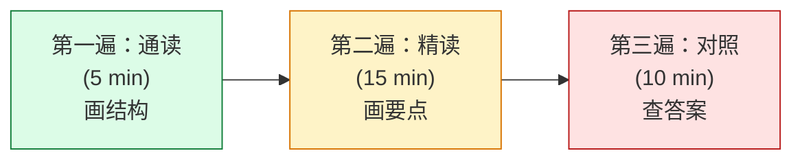

#### 9.7.2 第一遍：通读（5 分钟）

**任务**：
- 给每段标号（①~⑦）
- 找段落大意（每段不超过 10 字）
- 画段落关系（总分 / 并列 / 递进 / 因果）

**例**：

```
① 概述乡村振兴战略
② 当前存在问题
③ 原因分析
④ 案例 1（正面）
⑤ 案例 2（反面）
⑥ 对策建议
⑦ 总结升华
```

**结构**：总分总。

#### 9.7.3 第二遍：精读（15 分钟）

**任务**：
- 找"动宾结构"（动词 + 对象）
- 找"因果词"（因为 / 所以 / 导致 / 引起）
- 找"措施词"（必须 / 应该 / 建议 / 推动）
- 标出"数据要素"（）

**标注规范**：

```
【问题】（负面表述）
【原因】（因为...）
【对策】（应该... / 必须...）
【案例】（具体 + 名字）
【数据】（数字 / 比例）
【名言】（领导讲话 / 学者观点）
```

#### 9.7.4 第三遍：对照答案（10 分钟）

**任务**：
- 对照参考答案 → 标漏点
- 总结"我没找到答案的 5 个理由"
- **写"反思笔记"**（错题本 L2）

---

### 9.8 申论大作文 —— **"5 开头 + 3 结构 + 1 升华"**

#### 9.8.1 5 大万能开头（**背下**）

| # | 类型 | 模板 | 适用话题 |
|---|---|---|---|
| 1 | **排比式** | "国之大者、时代之问、人民之需……" | 全部 |
| 2 | **引用式** | "习近平总书记强调，……" | 政治 |
| 3 | **对比式** | "过去 X 年，Y 发生了从...到...的变化" | 改革 |
| 4 | **设问式** | "何为新质生产力？何以发展新质生产力？" | 创新 |
| 5 | **故事式** | "腾冲有位老支书……"（举例引入） | 基层 |

#### 9.8.2 3 大论证结构

**结构 1：是什么-为什么-怎么办**（最常用）

```
第一段：是什么（解释概念，200 字）
第二段：为什么（3 个分论点，每个 150 字）
第三段：怎么办（3 个对策，每个 150 字）
第四段：升华（联系中国式现代化，100 字）
```

**结构 2：正反对比**

```
正面案例 1（成功 → 经验 1）
反面案例 1（失败 → 教训 1）
正面案例 2（成功 → 经验 2）
总结升华
```

**结构 3：古今中外对比**

```
古代情况 → 现代情况 → 国外情况 → 中国方案
```

#### 9.8.3 1 大升华（**结尾模板**）

**万能结尾**：
```
"征程万里风正劲，重任千钧再出发。在 XX 事业的征程上，唯有坚定 XXX
信念、永葆 XXX 本色，方能在新征程上展现新作为。让我们以
'功成不必在我、功成必定有我'的境界，谱写新时代 XXX 事业的崭新篇章。"
```

#### 9.8.4 5 大万能分论点（**背下**）

| # | 分论点 | 适用 |
|---|---|---|
| 1 | **思想引领**（理论 + 案例 + 对策） | 党建、文化 |
| 2 | **制度保障**（顶层设计 + 基层落实） | 改革、治理 |
| 3 | **科技创新**（数字化 + 智能化） | 经济、产业 |
| 4 | **人才支撑**（引进 + 培养 + 使用） | 教育、区域 |
| 5 | **文化铸魂**（自信 + 传承 + 创新） | 文化、宣传 |

#### 9.8.5 5 大金句库（**每天背 3 句**）

1. "雄关漫道真如铁，而今迈步从头越。" —— 毛泽东
2. "人民对美好生活的向往，就是我们的奋斗目标。" —— 习近平
3. "功成不必在我，功成必定有我。"
5. "行百里者半九十。"
5. "道阻且长，行则将至。"

---

### 9.9 面试 5 题型秒杀

#### 9.9.1 综合分析题（**30% 占比**）

**结构**："**表态 + 分析 + 对策**"

**模板**：

```
【表态】（30 秒）
"对于 XX 现象，我认为应该辩证看待。（正面 / 负面 / 全面）"

【分析】（60 秒）
"第一，从政策背景看，XX 是 XX 战略的体现；
 第二，从现实意义看，XX 能够解决 XX 问题；
 第三，从挑战看，XX 还需要解决 XX。"

【对策】（30 秒）
"作为公务员，我们应该：1. 加强学习；2. 深入群众；3. 强化落实。"
```

#### 9.9.2 计划组织题（**25% 占比**）

**结构**："**目的 + 准备 + 实施 + 总结**"

**模板**：

```
【目的】（15 秒）
"组织此次 XX 活动，目的在于 XX。"

【准备】（30 秒）
"事前：调研 + 制定方案 + 物资准备 + 人员分工。"

【实施】（45 秒）
"事中：开幕式 + 主要环节（3~4 个）+ 应急保障。"

【总结】（15 秒）
"事后：效果评估 + 总结汇报 + 二次宣传。"
```

#### 9.9.3 人际关系题（**15% 占比**）

**核心原则**："**阳光心态 + 工作为重 + 主动沟通**"

**模板**：

```
"面对这种情况，我会保持阳光心态，主动沟通协调，把工作放在第一位。
首先，冷静反思自己是否存在问题；
其次，主动与 XX 沟通，倾听对方想法；
最后，在工作上积极配合，确保任务顺利完成。"
```

#### 9.9.4 应急应变题（**20% 占比**）

**核心原则**："**稳定情绪 + 解决核心 + 后续完善**"

**模板**：

```
"面对 XX 突发事件，我会按以下步骤处理：
第一，立即控制局面，安抚情绪；
第二，调查原因，找到核心问题；
第三，针对性解决，争取短期见效；
第四，建立长效机制，防止再次发生。"
```

#### 9.9.5 岗位匹配题（**10% 占比**）

**核心**：**自我介绍 + 职业规划 + 报考动机**

**模板**：

```
"各位考官好。我是 XXX，10 年软件工程经验，主导过 XX 项目。
我选择贵单位的原因是 XX（具体到岗位 + 城市 + 单位文化）。
入职后我计划：
 1 个月内熟悉业务；
 3 个月内独立承担工作；
 1 年内成为业务骨干。
 我相信 10 年工程经验 + XX 专业背景，能为单位贡献 XX 价值。"
```

---

### 9.10 无领导小组讨论 —— **4 角色策略**

#### 9.10.1 角色定位

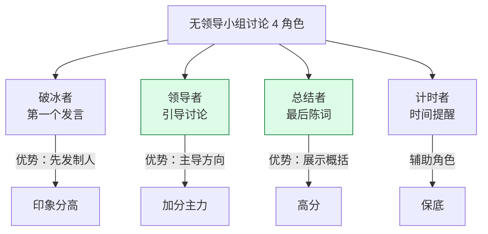

#### 9.10.2 你应该抢哪个角色？**根据你的优势**：

- **破冰者**：气场强、口才好的人（**你 38 岁有职场经验**）
- **领导者**：逻辑强、能控场（**你的工程师思维最强**）✅ 推荐
- **总结者**：归纳能力强（**你需要练 30 分钟**）
- **计时者**：细心但不易出彩（不推荐）

#### 9.10.3 领导者的"3 招"

**招 1：定调**
"我觉得这个问题的核心是 XX，我们分 3 个维度讨论：第一、第二、第三。"

**招 2：救场**
当讨论陷入僵局："我提议我们用 5 分钟梳理一下分歧，然后投票决定。"

**招 3：收尾**
"我总结一下我们达成的 3 个共识……"

#### 9.10.4 实战技巧**
- **每个发言不超过 60 秒**（说太多抢别人机会）
- **每 3 次发言要有一次总结**（展示归纳能力）
- **最后 30 秒必须发言**（刷存在感）
- **不要攻击别人**（扣分项）

---

### 9.11 技巧速查表（**考前 1 周再背一遍**）

| 模块 | 必背技巧 | 你最该练的 |
|---|---|---|
| **常识** | 7 大领域 + 口诀 | 政治、法律 |
| **言语** | 关联词 + 成语 500 | 高频成语 200 组 |
| **判断** | 点线面 + 箭头法 | 图形套路库 |
| **资料** | 截位 + 百化分 | 截位法 |
| **数量** | 8 题型取舍 | 工程 / 行程 |
| **申论** | 三遍法 + 5 开头 | 大作文结构 |
| **面试** | 5 题型模板 | 综合分析 + 计划组织 |
| **无领导** | 领导者 3 招 | 抢领导者角色 |


## 十、方向选择深度对比：6 种岗位的正确取舍

> **"我应该报国考、省考、事业编、选调生、三支一扶、西部计划中的哪些？"**
>
> 这是**第一个问题**，而不是最后一个问题。错报 / 漏报 = 错过 1 年的窗口期。
>
> 本节用**数据 + 个人画像**给你一套决策方法。

### 10.1 6 种岗位全景图

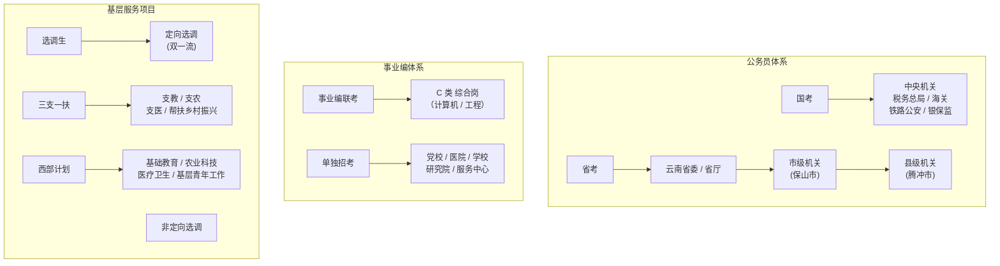

### 10.2 6 种岗位对比矩阵

| # | 岗位 | 户籍 | 年龄 | 学历 | 竞争比 | 难度 | 工作地点 | 5 年后发展 | 推荐度 |
|---|---|---|---|---|---|---|---|---|---|
| 1 | **国考** | 全国可报（部分限制） | 35 岁以下 | 大专以上 | 60:1 | ★★★★ | 全国 | 一线城市 | ★★★ |
| 2 | **省考（云南）** | 部分限云南 | 35 岁以下 | 大专以上 | 40:1 | ★★★ | 云南省内 | 二三线 | ★★★★ |
| 3 | **事业编（联考 C 类）** | 大多不限 | 35 岁以下 | 大专以上 | 30:1 | ★★★ | 省内 | 二三线 | ★★★★ |
| 4 | **选调生（定向）** | 985/211 优先 | 30 岁以下 | 应届/毕业 1 年内 | 20:1 | ★★★★ | 基层锻炼 | **干部储备** | ★★★★★ |
| 5 | **三支一扶** | 大多不限 | 30 岁以下 | 大专以上 | 15:1 | ★★ | 乡镇基层 | 2 年后转编 | ★★★★ |
| 6 | **西部计划** | 不限 | 30 岁以下 | 大专以上 | 5:1 | ★ | 西部基层 | 1~3 年志愿 | ★★ |

### 10.3 国考深度分析

#### 10.3.1 国考岗位类型

| 系统 | 占比 | 学历要求 | 工作地 | 适合你吗 |
|---|---|---|---|---|
| **税务局** | 50% | 本科 | 全国（云南有岗位） | ✅✅✅ 会计/经济类优先 |
| **海关** | 10% | 本科 | 沿海 / 边境 | ✅ 腾冲可考虑瑞丽海关 |
| **铁路公安** | 8% | 本科 | 全国 | ✅ 体能要求高 |
| **银保监** | 5% | 硕士 | 一线 / 省会 | ❌ 学历不符 |
| **海事局** | 5% | 本科 | 沿海 | ❌ |
| **统计局** | 5% | 本科 | 全国 | ✅✅ 计算机可报 |
| **其他** | 17% | — | — | — |

#### 10.3.2 国考时间节点（2027 国考）

```
2026-10-15   公告发布（10 月中旬）
2026-10-15~10-24  报名（10 天）
2026-10-26~11-05  资格审查
2026-11-25~12-02  笔试（11 月底）
2027-01-10        笔试成绩
2027-02~03        面试
2027-04~05        体检 / 政审 / 公示
2027-07~08        入职
```

#### 10.3.3 国考 vs 省考 vs 事业编 —— 关键差异

| 维度 | 国考 | 省考 | 事业编 |
|---|---|---|---|
| **招录单位** | 中央 / 直属 | 省 / 市 / 县 | 事业单位 |
| **编制** | 行政编 | 行政编 | 事业编 |
| **笔试科目** | 行测 + 申论（地市级 / 副省级） | 行测 + 申论 | 职测 + 综应（5 类） |
| **难度** | ★★★★ | ★★★ | ★★★ |
| **竞争比** | 60:1 | 40:1 | 30:1 |
| **岗位选择** | 数量多但热门 | 数量中 | 数量多但分散 |
| **待遇** | 一线高 / 基层低 | 省内中等 | 省内中等 |
| **提拔** | 中央机关快 | 地方慢 | 几乎不提拔 |
| **工作强度** | 955 / 偶尔加班 | 955 为主 | 955 为主 |

### 10.4 省考（云南）深度分析

#### 10.4.1 云南省考岗位分布

```
云南省委 / 省厅：~5%（省发改委、工信厅、教育厅）
昆明市级机关：~20%
保山市级机关：~10%（含腾冲）
曲靖 / 玉溪 / 红河：~25%
其他州市：~40%
```

**腾冲在云南省考中的位置**：
- **县级岗位**：~30 个 / 年（公安局、税务局、自然资源局、市场监管局等）
- **乡镇岗位**：~50 个 / 年（乡镇政府、街道办）
- **市级机关**：~10 个 / 年（市委办、组织部、宣传部等）

#### 10.4.2 2027 云南省考时间表（**预测**）

```
2027-01     公告发布（1 月中）
2027-02     报名（2 月初）
2027-03-15  笔试（3 月中旬）✓ 已锁定
2027-04     笔试成绩
2027-05~06  面试
2027-07~08  体检 / 政审 / 公示
2027-09     入职
```

#### 10.4.3 腾冲适合你的省考岗位（**预测 2027**）

| 单位 | 学历 | 备注 | 报考建议 |
|---|---|---|---|
| **腾冲市委组织部** | 本科 | 干部管理 | ✅ 你的统筹能力 |
| **腾冲市工信局** | 本科 | 信息化推进 | ✅✅✅ 最匹配 |
| **腾冲市公安局** | 本科 | 信息科 | ✅ |
| **腾冲市自然资源局** | 本科 | 规划科 | ✅ |
| **腾冲市市场监督管理局** | 本科 | 信息中心 | ✅ |
| **腾冲市税务局** | 本科 | 业务岗 | ✅✅ 大量招 |
| **腾冲市乡镇机关** | 本科 | 乡镇公务员 | ✅ 岗位多 |

### 10.5 事业编（联考 C 类）深度分析

#### 10.5.1 事业编 5 类分类

| 类别 | 适用岗位 | 笔试科目 | 适合你吗 |
|---|---|---|---|
| **A 类（综合管理）** | 行政、管理 | 职测 + 综应 A | ✅ |
| **B 类（社会科学专技）** | 文史、新闻、出版 | 职测 + 综应 B | — |
| **C 类（自然科学专技）** | **工程、计算机、农技** | **职测 + 综应 C** | ✅✅✅ 最匹配 |
| **D 类（中小学教师）** | 教师 | 职测 + 综应 D | — |
| **E 类（医疗卫生）** | 医院、卫生院 | 职测 + 综应 E | — |

**C 类特殊性**：
- **科技文献阅读**（30 分）—— 与你的研究能力最相关
- **论证评价**（40 分）—— 与工程师的逻辑思维强相关
- **科技实务**（50 分）—— 给定科技背景，做数据分析

#### 10.5.2 2027 事业编联考时间表

```
2027-03     公告发布（3 月底）
2027-04     报名（4 月初）
2027-05-10  笔试（5 月 10 日）✓ 已锁定
2027-06     笔试成绩
2027-07     面试
2027-08~09  体检 / 政审 / 公示
2027-10     入职
```

#### 10.5.3 腾冲事业编 C 类（计算机 / 工程）

**高频招录单位**：
- **腾冲市大数据中心**（信息化主战场）
- **腾冲市融媒体中心**（编辑 + 技术）
- **腾冲市自然资源局下属事业单位**（地理信息）
- **腾冲市农业农村局下属**（农业技术）
- **腾冲市卫健局下属**（信息化）

### 10.6 选调生（**你的最优解，但有窗口期**）

#### 10.6.1 选调生分类

| 类型 | 学校 | 学历 | 年龄 | 难度 |
|---|---|---|---|---|
| **定向选调**（清北 + 顶级 985） | 清北复交浙等 | 硕博 | ≤ 30 | 极高 |
| **定向选调**（其他 985/211） | 985/211 | 本硕 | ≤ 30 | 高 |
| **非定向选调** | 一般本科 | 本科 | ≤ 25 | 中 |

#### 10.6.2 选调生优势

**vs 普通公务员**：
- **晋升快**：省委组织部备案，2 年后定副科级
- **起点高**：直接到基层锻炼，但回来通常进入机关核心部门
- **竞争小**：仅限当年应届 / 毕业 1 年内（**注意：35 岁前都算"毕业 1 年内"的本科应届身份**）
- **津贴**：部分地区有选调专项津贴

#### 10.6.3 你的选调生机会

**关键问题**：
- 你 1988 年生（假设），**已经超过"30 岁以下"门槛** ❌
- **你 38 岁，不符合选调生年龄限制**
- **选调生这条路对你已经关闭**（除非有特殊政策）

#### 10.6.4 选调生 vs 普通公务员决策树

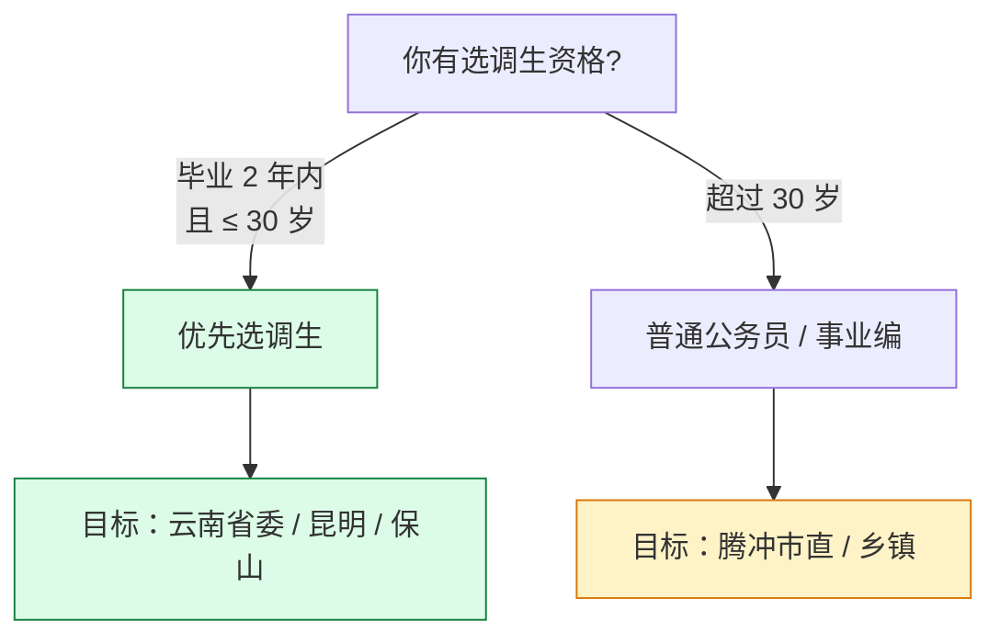

### 10.7 三支一扶（**2 年后转编的捷径**）

#### 10.7.1 三支一扶是什么

**4 个方向**：
- **支教**：乡镇中小学任教
- **支农**：乡镇农业技术推广
- **支医**：乡镇卫生院
- **帮扶乡村振兴**：驻村工作

#### 10.7.2 三支一扶优势

- **门槛低**：大专学历即可（**你这个本科学历最强**）
- **竞争小**：15:1 vs 公务员 40:1
- **2 年后转编**：服务期满考核合格 → **直接转为事业编**（部分省份）
- **考研加分**：服务期满后 3 年内考研，初试 +10 分
- **公务员定向招录**：每年 10%~15% 公务员岗位面向"服务基层项目人员"

#### 10.7.3 三支一扶劣势

- **2 年服务期内不能离开**（强制）
- **工作地偏远**（生活条件一般）
- **收入低**：补贴 + 安家费，全国统一约 3000~5000 元/月
- **38 岁限制**：超龄不能报 ❌（**对你也是问题**）

#### 10.7.4 你的三支一扶机会

**结论**：**超龄，无法报考**（除非有政策松动）。

### 10.8 西部计划（**门槛最低但收益有限**）

#### 10.8.1 西部计划内容

- **服务期**：1~3 年
- **岗位类型**：基础教育 / 农业科技 / 医疗卫生 / 基层青年工作 / 服务乡村振兴
- **补贴**：约 2000~3000 元/月 + 社保
- **转编**：无（**不像三支一扶**）

#### 10.8.2 西部计划 vs 三支一扶

| 维度 | 三支一扶 | 西部计划 |
|---|---|---|
| 服务期 | 2 年 | 1~3 年 |
| 转编 | **有**（2 年后） | 无 |
| 补贴 | 3000~5000 | 2000~3000 |
| 难度 | 中（15:1） | 低（5:1） |
| 年龄 | ≤ 30 | ≤ 30 |
| 适合谁 | 想扎根基层 | 想短期体验 |

#### 10.8.3 你的西部计划机会

**结论**：**超龄，无法报考**（除非有政策松动）。

### 10.9 6 种岗位的"决策矩阵"

| 你的条件 | 国考 | 省考 | 事业编 | 选调生 | 三支一扶 | 西部计划 |
|---|---|---|---|---|---|---|
| **30 岁以下** | ✅ | ✅ | ✅ | ✅✅ | ✅✅ | ✅✅ |
| **30~35 岁** | ✅ | ✅ | ✅ | ❌ | ❌ | ❌ |
| **35~38 岁** | ✅（仅 2026~2027） | ✅ | ✅ | ❌ | ❌ | ❌ |
| **38~40 岁** | ❌（除非有政策） | ❌ | ❌ | ❌ | ❌ | ❌ |

**你的情况**（38 岁）：
- ✅ **国考**（35 岁线，2026~2027 末班车）
- ✅ **省考**（云南 35 岁线）
- ✅ **事业编**（35 岁线）
- ❌ 选调生 / 三支一扶 / 西部计划（30 岁线，已超）

### 10.10 你应该报哪些？**个人决策树**

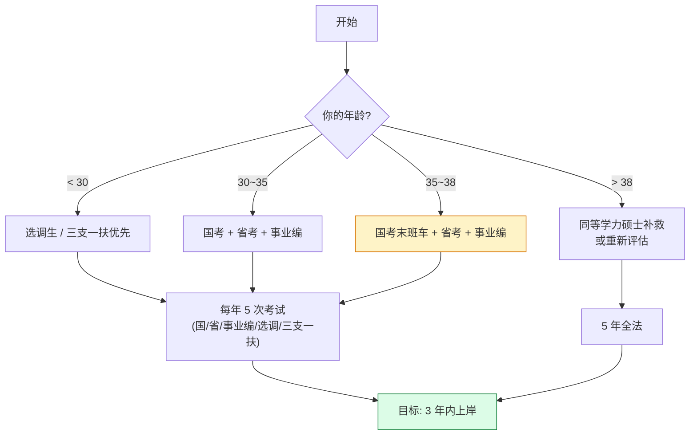

### 10.11 一年 5 次考试的最优报法（**你的版本**）

**2027 年度报法**：

| 考试 | 时间 | 你的目标 | 备注 |
|---|---|---|---|
| **国考** | 2026-11-30 | 必报！35 岁线末班车 | 选云南岗位或低竞争中央岗 |
| **云南省考** | 2027-03-15 | **必报！主力战场** | 选腾冲市直机关 |
| **事业编联考** | 2027-05-10 | **必报！保底** | 选 C 类（计算机） |
| **单独招考** | 全年 | 有合适就报 | 关注事业单位招聘网 |
| **下半年补充** | 2027-09~11 | 视情况 | 国考补录 + 省考补录 |

**关键原则**：
1. **每个考试都报**（5 个机会不能浪费）
2. **重点准备省考**（你最匹配的战场）
3. **事业编保底**（岗位多 + 难度小）
4. **国考当练手**（35 岁线末班车，但是你的"最高难度战场"）

### 10.12 避开"高竞争比"岗位的 5 个原则

#### 10.12.1 限制条件越多 → 竞争越小

| 岗位类型 | 限制条件 | 预计竞争比 |
|---|---|---|
| **三不限** | 不限专业 / 学历 / 户籍 | 100~200:1 |
| **限专业** | 限计算机 / 工程类 | 30~50:1 |
| **限学历 + 专业** | 本科 + 计算机 | 20~30:1 |
| **限户籍** | 限云南 / 限保山 | 10~20:1 |
| **限基层经验** | 限 2 年基层 | 5~10:1 |

**结论**：**优先选"限户籍 + 限专业 + 限学历"的岗位**。

#### 10.12.2 避开"中央机关热门岗位"

❌ 慎报：外交部、商务部、中央办公厅（400:1）

✅ 推荐：海关（云南）、税务局（云南）、铁路公安（云南）

#### 10.12.3 避开"省会 + 主城区"

❌ 慎报：昆明市直、五华区、盘龙区

✅ 推荐：腾冲市直 + 县直 + 乡镇

#### 10.12.4 关注"招录人数"

| 招录人数 | 竞争比 | 备注 |
|---|---|---|
| 1 人 | 50:1 | 风险大，但上岸后直接进 |
| 2~3 人 | 30:1 | 平衡 |
| **5+ 人** | **20:1** | **最优**（但需要集中阅卷） |

#### 10.12.5 关注"性别限制" + "政治面貌"

- 限男 / 限党员 → 竞争比直接砍半

### 10.13 决策速查表

| 你的状态 | 优先报名 | 谨慎报名 |
|---|---|---|
| **事业编 + 计算机可报** | ✅✅✅ | — |
| **省考 + 限云南户籍** | ✅✅ | — |
| **国考 + 云南税务局** | ✅ | — |
| **事业编 + 三不限** | — | ⚠️ |
| **省考 + 昆明市直** | — | ❌ |
| **国考 + 中央办公厅** | — | ❌❌❌ |

### 10.14 一句话决策（**贴墙上**）

```
先选事业编保底，再攻省考主战场，国考当练手。
岗位要找"三限"：限户籍 + 限专业 + 限学历。
地区要选"三线"：三四线城市 + 县直 + 乡镇。
```


## 十一、学习资料深度测评：3 大机构 + 老师 + 教材 + 真题

> **资料选错 = 浪费时间 + 误导思路**。本节把"3 大机构"、"50+ 网课老师"、"全套教材"、"真题 vs 模拟题"全部测评一遍。

### 11.1 3 大机构全方位对比（**粉笔 / 中公 / 华图**）

#### 11.1.1 三大机构基因差异

| 维度 | 粉笔 | 中公 | 华图 |
|---|---|---|---|
| **成立时间** | 2015 | 1999 | 2001 |
| **核心优势** | 题库 + 网课 + 模考 | 线下班 + 公务员老牌 | 题库 + 中高端班 |
| **主打产品** | 980 系统班（线上） | 国省考全程班（线下） | 红领培优 |
| **价格** | 中（980~5000） | 高（5000~30000） | 中高（3000~20000） |
| **适合谁** | 自律 + 预算紧 | 需要督促 + 预算足 | 想要精品课程 |
| **题库质量** | ★★★★★（最全） | ★★★ | ★★★★ |
| **网课质量** | ★★★★★（最新） | ★★★ | ★★★★ |
| **模考质量** | ★★★★★（最准） | ★★ | ★★★ |
| **教材质量** | ★★★（够用） | ★★★★（传统） | ★★★★ |

#### 11.1.2 三大机构价格对比

| 课程 | 粉笔 | 中公 | 华图 |
|---|---|---|---|
| **国考 980 基础班**（线上） | **980 元** ✓ | 2000~3000 元 | 1500~2500 元 |
| **省考 980 基础班**（线上） | **980 元** ✓ | 2000~3000 元 | 1500~2500 元 |
| **事业编 C 类 980** | **980 元** ✓ | 2000~3000 元 | 1500~2500 元 |
| **冲刺班（30 天）** | 1500~3000 元 | 5000~10000 元 | 3000~8000 元 |
| **一对一面试** | 500 元/小时 | 800 元/小时 | 600 元/小时 |
| **全程班（含面试）** | 5000~8000 元 | **20000~30000 元** | 15000~25000 元 |

#### 11.1.3 我的推荐组合（**性价比最高**）

```
✅ 粉笔 980 系统班（980 元 × 2 = 1960 元）—— 网课 + 题库 + 模考
✅ 粉笔行测 5000 题（90 元） —— 刷题
✅ 粉笔申论 100 题（60 元） —— 申论刷题
✅ 2027 国考 + 联考真题（100 元） —— 真题
✅ 半月谈申论字帖（30 元） —— 字迹
✅ 面试班（进面后报，5000 元） —— 面试
─────
总计：~7500 元
```

#### 11.1.4 0 预算方案（**穷人备考**）

```
✅ B 站免费视频（粉笔官方账号 + 各路老师）
✅ 粉笔 APP 免费题库（每天 30 题）
✅ 半月谈公众号（免费素材）
✅ 历年真题 PDF（网上下载）
✅ 番茄 ToDo APP
─────
总计：~200 元（只买教材）
```

### 11.2 网课老师推荐（**按模块精选**）

#### 11.2.1 行测 5 模块最强老师

| 模块 | 第一选择 | 备选 | 不推荐 |
|---|---|---|---|
| **常识** | 李梦娇（华图） | 王军涛 | 张小龙（粉笔，口音重） |
| **言语** | 葛欣（粉笔） | 聂佳、顾斐 | 赵晓曦（讲得慢） |
| **数量** | **齐麟（粉笔）** ✅ | 刘文超（B 站） | 李委明（方法老） |
| **判断** | **聂佳（粉笔）** ✅ | 徐来、龙飞 | 宋文涛（套路少） |
| **资料** | **高照（粉笔）** ✅ | 资料分析"牟比" | 任意两人以上 |

**粉笔六大名师**（2026 评价）：

| 老师 | 模块 | 优点 | 适合谁 |
|---|---|---|---|
| **聂佳** | 判断推理 | 套路库最全 | 所有人 |
| **齐麟** | 数量关系 | 方法最实用 | 数学基础差的人 |
| **高照** | 资料分析 | 速算最准 | 想提速的人 |
| **葛欣** | 言语理解 | 语境分析 | 阅读理解弱的人 |
| **李梦娇** | 常识判断 | 口诀最全 | 时间少的人 |
| **单良** | 申论 | 政策解读 | 想学规范表达的人 |

#### 11.2.2 申论老师推荐

| 老师 | 机构 | 优点 | 适合谁 |
|---|---|---|---|
| **单良** | 粉笔 | 政策解读清晰 | 所有人 ✅ |
| **张小龙** | 粉笔 | 题型分类全 | 想要模板的人 |
| **李永新** | 中公 | 大作文素材 | 写作弱的人 |
| **王鹍** | 华图 | 应用文规范 | 想要公文格式的人 |
| **站长申论** | B 站（免费） | 入门易懂 | 0 基础 ✅ |

#### 11.2.3 面试老师推荐

| 老师 | 机构 | 特点 | 适合谁 |
|---|---|---|---|
| **苗小君** | 粉笔 | 100 题实战 | 想刷题的人 ✅ |
| **陈璐璐** | 粉笔 | 5 题型全 | 0 基础 |
| **郑玉娇** | 中公 | 政府思维 | 想深入理解的人 |
| **面试学长** | B 站（免费） | 反模板 | 想短期突击的人 |

#### 11.2.4 B 站免费名师清单

| 老师 | 模块 | 推荐度 |
|---|---|---|
| **刘文超** | 数量关系 | ★★★★ |
| **站长申论** | 申论 | ★★★★ |
| **面霸** | 面试 | ★★★ |
| **公考大师** | 言语 | ★★★ |
| **资料分析"牟比"** | 资料分析 | ★★★ |

### 11.3 教材筛选原则与避坑指南

#### 11.3.1 教材分类（**4 类必须买，3 类不买**）

**4 类必买**：

| 类型 | 推荐 | 价格 | 作用 |
|---|---|---|---|
| **题库** | 粉笔行测 5000 题 | 90 | 主刷题 |
| **真题** | 国考 + 联考真题（2020~2026） | 50 | 摸底 |
| **申论字帖** | 半月谈 | 30 | 字迹 |
| **背诵手册** | 粉笔常识 / 成语手册 | 30 | 背诵 |

**3 类不买 / 慎买**：

| 类型 | 原因 |
|---|---|
| ❌ **大部头理论教材**（如中公行政职业能力测验 500 页） | 看完的人 90% 没考过 |
| ❌ **专项大全**（如《数量关系 500 题》） | 题太多做不完 |
| ❌ **盗版 / 拼车资料** | 真题错误率高，害人 |

#### 11.3.2 真题 vs 模拟题 vs 押题

| 类型 | 重要性 | 用途 | 推荐 |
|---|---|---|---|
| **真题** | ★★★★★ | 摸底 + 模考 | 必做 10 套以上 |
| **模拟题（粉笔模考）** | ★★★★ | 练速度 + 适应 | 每周 1 次 |
| **押题** | ★★ | 考前突击 | 谨慎（命中率 5%） |
| **专项题** | ★★★ | 弱项突破 | 阶段二集中用 |

**重要结论**：
- **真题永远第一**（命题人思路，最接近考试）
- **模拟题第二**（练节奏、找题感）
- **押题仅当心理安慰**（不要寄希望于押中）

#### 11.3.3 真题使用 5 步法

```
1. 第一遍：模考（限时 + 不看答案）—— 摸底
2. 第二遍：对答案（标错题） —— 找出薄弱模块
3. 第三遍：错题分析（写错因） —— 分类 L1/L2/L3
4. 第四遍：重做错题（1 周后） —— 巩固
5. 第五遍：总结命题规律 —— 找套路
```

#### 11.3.4 教材版本选择（**2026~2027 版**）

**为什么必须买最新版**：
- 命题方向每年微调（如 2025 国考新加"新质生产力"）
- 真题时效性（5 年前的题参考价值低）
- 政策更新（每年二十大精神）

**避坑**：
- ❌ 不买 2020 年以前的旧书
- ❌ 不买盗版（错误率高 + PDF 不清晰）
- ✅ 推荐"2026 版 + 2027 版"两套都买

### 11.4 必备 APP 工具栈

#### 11.4.1 学习类（必装）

| APP | 用途 | 价格 | 推荐度 |
|---|---|---|---|
| **粉笔** | 刷题 + 模考 + 估分 | 0~30/月 | ★★★★★ |
| **公考雷达** | 招录公告推送 | 0 | ★★★★ |
| **半月谈** | 申论素材 | 0 | ★★★★ |
| **学习强国** | 时政 + 政策原文 | 0 | ★★★★★ |
| **人民日报** | 评论员文章 | 0 | ★★★★ |

#### 11.4.2 工具类（推荐）

| APP | 工具 | 价格 | 推荐度 |
|---|---|---|---|
| **番茄 ToDo** | 番茄钟 + 锁机 | 0 | ★★★★★ |
| **Anki** | 间隔重复闪卡 | 0 | ★★★★ |
| **Notion / Obsidian** | 错题本 + 笔记 | 0 | ★★★★ |
| **WPS / 腾讯文档** | 申论写作 | 0 | ★★★ |
| **百度网盘** | 资料存储 | 0~30/月 | ★★★ |
| **有道云笔记** | 碎片知识 | 0 | ★★★ |

#### 11.4.3 弱项突破类（按个人情况）

| APP | 用途 |
|---|---|
| **扇贝阅读** | 言语理解阅读素材 |
| **欧路词典** | 看政策原文查词 |
| **得到** | 罗振宇公务员解读（参考） |
| **Bilibili** | 免费名师视频 |

### 11.5 资料获取渠道（**正版 vs 盗版 vs 拼车**）

#### 11.5.1 3 种渠道对比

| 渠道 | 价格 | 风险 | 推荐度 |
|---|---|---|---|
| **正版（粉笔 APP / 京东 / 当当）** | 980 元 | 0 | ✅✅✅ |
| **盗版 PDF** | 5~50 元 | 真题错误 + 法律风险 | ❌ |
| **拼车（朋友合买）** | 200~500 元 | 账号冲突 | ⚠️ |
| **B 站免费** | 0 | 无 | ✅✅ |

#### 11.5.2 我的建议

**粉笔 980 = 必报**（**性价比天花板**）：

- 980 元 = **300+ 节视频 + 10 万 + 题库 + 每周模考 + 估分系统**
- 折合每节课 3 元，比盗版还便宜
- **正版的好处**：
  - 系统稳定（不会断更）
  - 估分准确（vs 盗版估分误差 ±5 分）
  - 模考实时（vs 盗版模考落后 1 月）

**B 站免费视频**：

- 粉笔官方账号（**免费更新 70% 内容**）
- 各路名师（刘文超、站长申论、面试学长等）
- **足以应对基础阶段**

**盗版 PDF 的 5 大风险**：
1. **真题错误率高**（做错的题正确答案是错的）
2. **估分虚高**（盗版模考比实际考 1 个月）
3. **答案不全**（申论参考答案常常缺）
4. **病毒风险**（PDF 携带木马）
5. **法律风险**（传播盗版违法）

### 11.6 真题深度使用（**2020~2026 共 14 套**）

#### 11.6.1 真题清单

| 年份 | 类型 | 难度 | 价值 |
|---|---|---|---|
| 2026 国考（地市级） | 真 | ★★★★ | ★★★★★ 最新 |
| 2026 国考（副省级） | 真 | ★★★★★ | ★★★★ 难 |
| 2026 联考 | 真 | ★★★ | ★★★★ |
| 2025 国考 | 真 | ★★★★ | ★★★★★ |
| 2025 联考 | 真 | ★★★ | ★★★★ |
| 2024 国考 | 真 | ★★★ | ★★★★ |
| 2024 联考 | 真 | ★★★ | ★★★ |
| 2023 国考 | 真 | ★★★ | ★★★ |
| 2023 联考 | 真 | ★★★ | ★★★ |
| 2022 国考 | 真 | ★★ | ★★ |
| 2022 联考 | 真 | ★★ | ★★ |
| 2021 国考 | 真 | ★★ | ★★ |
| 2021 联考 | 真 | ★★ | ★★ |
| 2020 国考（疫情版） | 真 | ★ | ★ |

**推荐顺序**：
1. **先做 2024~2026 年**（5 套，最贴近最新命题）
2. **再做 2020~2023 年**（9 套，难度适中）
3. **最后做副省级**（拔高）

#### 11.6.2 真题使用计划

```
阶段一（基础期）：2024 国考 + 2024 联考 + 2025 国考
           3 套，每周 1 套 → 9 月底完成

阶段二（强化期）：2025 联考 + 2023 国考 + 2023 联考
           3 套，每周 1 套 → 12 月底完成

阶段三（冲刺期）：2026 国考（地市级 + 副省级） + 2026 联考
           3 套，每天 1 套 → 1 月底完成

阶段四（临考期）：2022 联考 + 2021 联考 + 2020 国考
           3 套，调整心态 → 2 月底完成
```

#### 11.6.3 真题 vs 模拟题 —— **2:8 法则**

**80% 模拟 + 20% 真题**（**反直觉但是真理**）

**原因**：
- 真题一共就 14 套（5 年），做完了就没了
- 模拟题（粉笔模考）每周 1 套，**可以做 50+ 套**
- **模考练节奏 + 真题摸难度**（最科学的搭配）

### 11.7 错题本电子化（**Notion / Obsidian**）

#### 11.7.1 Notion 错题本结构

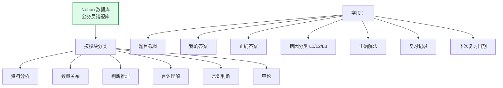

#### 11.7.2 错题本数据库字段设计

```markdown
| 字段 | 类型 | 用途 |
|---|---|---|
| 题目编号 | 文本 | 唯一标识 |
| 模块 | 选择 | 资料/数量/判断/言语/常识/申论 |
| 题型 | 选择 | 单选 / 多选 / 主观 |
| 难度 | 选择 | ★ ~ ★★★★★ |
| 错因 | 选择 | L1 知识盲区 / L2 思路错误 / L3 计算粗心 |
| 错题来源 | 选择 | 真题 / 模拟 / 押题 |
| 错题日期 | 日期 | 做题时间 |
| 复习日期 | 日期 | 下次复习时间 |
| 复习次数 | 数字 | 累计复习 |
| 是否掌握 | 选择 | 是 / 否 |
```

#### 11.7.3 Obsidian 错题本（**适合纯本地 + 笔记爱好者**）

```
/公务员错题本
├── 资料分析/
│   ├── 2024国考真题/
│   │   ├── 错题#001 增长率.md
│   │   ├── 错题#002 比重.md
│   ├── 2025模考/
├── 数量关系/
├── 判断推理/
├── 言语理解/
├── 常识判断/
├── 申论/
│   ├── 2024国考大作文/
│   ├── 模板/
│   ├── 素材/
└── 错题索引.md  ← 双链 + 全文搜索
```

### 11.8 学习资料预算清单（**最终版**）

```
═══════ 必买 ═══════
粉笔 980 系统班（国考）         980 元
粉笔 980 系统班（联考）         980 元
粉笔行测 5000 题                 90 元
粉笔申论 100 题                 60 元
2027 国考 + 联考真题            50 元
半月谈申论字帖                  30 元
粉笔常识 / 成语手册              30 元
番茄 ToDo 高级版（可选）         30 元
Anki 高级版（可选）              80 元
────── 2330 元

═══════ 进面后加购 ═══════
粉笔面试班（30 天）          3000~5000 元
面试一对一（10 次）          5000 元
面试用书                    500 元
────── 8500~10500 元

═══════ 总预算 ═══════
未进面：~2330 元
进面后：~10830~12830 元
```

### 11.9 资料使用的 3 大红线

#### 11.9.1 红线 1：**不要全买**

**90% 的考生** = **资料囤了 50 本，做了 3 本**

**正确做法**：
- **基础阶段**：粉笔 980 + 1 本题库（粉笔 5000）
- **强化阶段**：+ 真题 + 模拟题
- **冲刺阶段**：+ 押题（**仅 1 套**）

#### 11.9.2 红线 2：**不要追新**

**新版教材每年 9~10 月出** —— **不要买最新的复习资料**！

**原因**：
- 2027 版要到 2027 年 10 月才出，你 2026 年就开始备考
- **2026 版完全够用**（命题方向 5 年内稳定）
- **新质生产力 / 中国式现代化等 5 年内不会变**

#### 11.9.3 红线 3：**不要只收藏**

**收藏 = 没学** —— 这是 90% 考生的通病。

**正确做法**：
- **每周日清理**（收藏了 100 篇没用 = 删除）
- **先学后藏**（学过的 + 复盘过的才值得收藏）
- **每月整理**（每月 1 次"温故而知新"）

### 11.10 资料学习时间分配（**每天 4 小时**）

| 时间 | 内容 | 资料 |
|---|---|---|
| 06:30~07:00 | 晨读 + 时政 | 半月谈 + 学习强国 |
| 09:00~11:00 | 行测刷题 | 粉笔 5000 题 |
| 14:00~16:00 | 申论精做 | 粉笔 100 题 + 真题 |
| 16:00~17:00 | 错题复盘 | Notion 错题本 |
| 19:00~20:00 | 网课学习 | 粉笔 980 视频 |
| 20:00~21:00 | 背诵 + 模考 | Anki + 粉笔模考 |

### 11.11 一句话总结（**贴桌上**）

```
网课买粉笔 980（必报），
题库买粉笔 5000，
真题买 2024~2026 国考 + 联考，
教材只用粉笔 + 半月谈。
盗版 - 谨慎用。
```

## 十二、风险预案（**Plan B / Plan C**）

### 12.1 三种可能结局

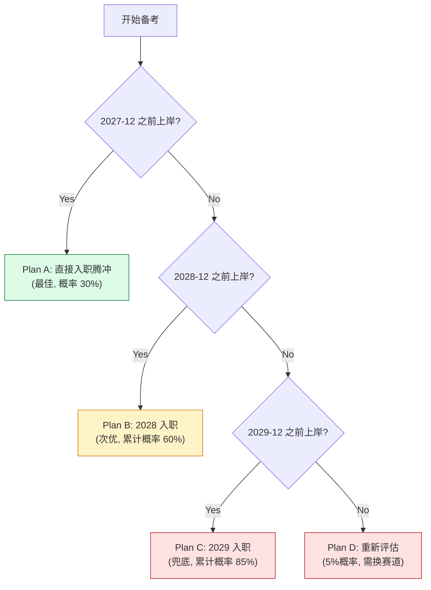

### 12.2 Plan D 详细预案（**5% 兜底**）

如果到 2029 年底还没上岸（35 岁硕士可延到 40，**但年龄是单行道**），需要重新评估：

| 选项 | 评估 |
| --- | --- |
| **继续刷到 2029**（最末班车，40 岁硕士限制） | ⚠️ 35~38 岁只算"已经付出"的机会成本 |
| **回一线城市**（互联网继续） | 收入回升，但**走回头路** |
| **转行自由职业**（远程工作） | 收入中等，**时间自由** |
| **读全日制硕士**（再 +3 年年龄） | ❌ 不推荐 |

**关键决策窗口**：**2029-03**（最后一次国考/省考后）——根据 T1/T2/T3 的累计通过率决定是否换赛道。

### 12.3 经济账（**10 年时间窗口**）

**假设**：

| 路径 | 10 年总收入 | 10 年工作时长 | 退休保障 |
| --- | --- | --- | --- |
| **程序员继续** | 200~300 万 | 996 高强度 | 0（自己养老） |
| **事业编（腾冲）** | 80~120 万 | 955 正常 | **充足**（五险一金 + 退休工资） |
| **公务员（腾冲）** | 100~150 万 | 955 正常 | **优厚**（额外年金） |

**结论**：10 年总账**少 100~200 万**，但**退休后 30 年**多领 + 健康 + 时间自由——**用前 10 年换后 50 年**。

---

## 十三、量化里程碑（**每周可检查**）

### 13.1 周度检查清单（**复制到 Obsidian 每周用**）

```markdown
## 本周 (2026-W__)
- [ ] 行测刷题 ___ 题 (目标 200)
- [ ] 申论真题 ___ 篇 (目标 2)
- [ ] 模考 ___ 套 (目标 1)
- [ ] 错题整理 ___ 个 (目标 50)
- [ ] 申论素材摘抄 ___ 段 (目标 7)
- [ ] 晨读时间 ___ 分钟 (目标 350)
- [ ] 总学习时长 ___ 小时 (目标 35)
- [ ] 重点突破：____________________

## 本周错题 TOP 3
1. 
2. 
3. 

## 下周计划重点
1. 
2. 
3. 
```

### 13.2 月度里程碑

| 月份 | 检查点 | 通过 | 不通过应对 |
| --- | --- | --- | --- |
| 2026-11 | 模考 1 达到 50 分 | ✅ 进入阶段二 | ❌ 行测/申论各加 1h/天 |
| 2026-12 | 模考 2 达到 60 分 | ✅ 维持节奏 | ❌ 弱项专题突破 2 周 |
| 2027-01 | 模考 3 达到 65 分 | ✅ 准备国考 | ❌ 行测专项刷题 1 个月 |
| 2027-03 | **省考笔试** | 估分 ≥ 60 进入面试 | 调整策略，主攻事业编 |
| 2027-04 | **事业编笔试** | 估分 ≥ 60 进面 | 准备 2027 国考补录 |
| 2027-12 | **累计通过率 ≥ 50%** | ✅ Plan A/B 启动 | 调整 2028 计划 |
| 2029-12 | **累计通过率 ≥ 85%** | ✅ 上岸 | 进入 Plan D 评估 |

### 13.3 每周固定动作（**雷打不动**）

| 时间 | 动作 | 时长 |
| --- | --- | --- |
| 周一 | 周计划制定 + 行测/申论时间分配 | 1h |
| 周二 | **行测专项刷题**（弱项模块） | 6h |
| 周三 | **申论真题精做** | 6h |
| 周四 | **行测专项刷题**（次弱模块） | 6h |
| 周五 | **申论真题 + 仿写** | 6h |
| 周六 | **周末模考**（行测 + 申论套卷） | 6h |
| 周日 | **错题复盘 + 模考分析 + 下周计划** | 4h |
| — | **每日晨读** | 1h/天 |
| — | **每日复盘** | 0.5h/天 |

### 13.4 总投入计算

```
阶段一 (30 天):  30 × 6h = 180h
阶段二 (75 天):  75 × 7h = 525h
阶段三 (30 天):  30 × 8h = 240h
阶段四 (75 天):  75 × 4h = 300h (含实战)
─────
总计:                    1245h ≈ 31 周 ≈ 8 个月
```

**与程序员类比**：1245 小时 = **一个中级项目**（如"独立做一个 React 全栈 SaaS"）的开发时长。

---

## 十四、**最后的话**（**为什么这件事值得做**）

```mermaid
mindmap
  root((从程序员到公务员))
    经济账
      前 10 年少赚 100-200 万
      后 30 年多领 100-300 万
      退休保障
      时间换金钱
    时间账
      35 岁后体力下降
      10 年程序员攒下 100+ W
      够覆盖转型期 5-10 年生活费
    家庭账
      边境小城生活成本低
      腾冲适合养老+育儿
      父母老去需陪伴
    价值账
      程序员的"改造世界"梦想
      →"服务身边人"的踏实
      数据要素/数字中国
      → 你的专业直接用上
    风险账
      最坏: 35 岁前没上岸
      → 还能回一线
      但要留 5% 给最坏情况
```

**为什么**：

- 30~38 岁是考公的**最后窗口**——再晚 5 年，**结构性失业** + **年龄歧视**会让"程序员"成为**沉没成本**。
- 你 10 年的工程化能力是**稀缺资源**——基层单位**急缺**能写代码又懂政策的人。
- 腾冲是**性价比之选**——竞争小、生活美、岗位真实存在。
- **不要"边工作边考"**——断掉后路，**All in 6~12 个月**。

**不要做的事**：

- ❌ 不要等"准备好了"再开始——**10 月 15 日就是 0 天**
- ❌ 不要"只报国考"——**3 类考试同时报**
- ❌ 不要"自学不报班"——980 元/班的网课是**性价比最高**的投入
- ❌ 不要"为了上岸而上岸"——**岗位匹配**决定入职后 5 年是否痛苦
- ❌ 不要"一个人闷头学"——**找 1~2 个考友**互相监督

---

## 附录 A：28 周时间表（**详细到每一天**）

```mermaid
gantt
    title 28 周学习计划(2026-10-15 ~ 2027-05-09)
    dateFormat  YYYY-MM-DD
    axisFormat  %V
    section 阶段一 基础
    W1-W2 (10.15-10.28)   行测常识+言语 入门  :w1, 2026-10-15, 14d
    W3-W4 (10.29-11.11)   行测判断+资料 入门  :w2, after w1, 14d
    W5    (11.12-11.15)   模考 1 + 复盘      :w3, after w2, 4d
    section 阶段二 强化
    W6-W9 (11.16-12.13)   行测刷题 资料/判断 :w4, after w3, 28d
    W10-W13 (12.14-1.10)  申论真题 + 行测刷题 言语/数量 :w5, after w4, 28d
    W14-W17 (1.11-2.07)   套卷 + 模考 2-4    :w6, after w5, 28d
    section 阶段三 冲刺
    W18-W21 (2.08-3.07)   国考真题 5 套 + 押题 :w7, after w6, 28d
    section 实战
    W22 (3.08-3.14)       2027 云南省考冲刺  :crit, w8, after w7, 7d
    W23 (3.15)            云南省考笔试        :milestone, w9, after w8, 1d
    W24-W26 (3.16-4.05)   事业编 C 类冲刺    :w10, after w9, 21d
    W27 (4.06-4.30)       模考 + 押题         :w11, after w10, 25d
    W28 (5.01-5.09)       事业编临考调整      :w12, after w11, 9d
    W28+1 (5.10)          事业编联考笔试      :milestone, w13, after w12, 1d
```

## 附录 B：5 个必须说服自己的认知

1. **你不是"loser 才去体制"**——你只是把"10 年工程经验"换一种**使用方式**。
2. **35 岁不是你的瓶颈**——**结构化思维 + 工程师的表达力**是你 30 岁程序员的**稀缺性**。
3. **边疆小城不等于"落后"**——腾冲的"数据局/网信办"和一线城市的"信息化中心"做的是**同样的事**。
4. **机械不是障碍**——你用 5 年从机械转码成功，**再用 1 年转体制成功**，这都是**同一种能力**。
5. **35 岁到 38 岁是黄金窗口**——**学习力 + 经验 + 体力**都在峰值，**别等**。

## 附录 C：每日时间表（**终极版本**）

```
06:30   起床
07:00   晨读 (申论范文 + 常识 30 个)
08:00   早饭
09:00   行测专项 (听网课 + 课后题)
12:00   午饭 + 休息
13:30   申论专项 (1 篇精做 + 1 篇仿写)
17:00   晚饭
18:30   错题复盘 + 模考分析
20:30   申论素材 + 常识
22:00   睡觉

总学习时间: 11 小时/天 (其中 6h 听课/刷题, 2h 申论, 2h 复盘, 1h 素材)
周末模考: 6 小时
周末休息: 周日下午 3 小时
```

**与"高级程序员"作息对比**：

| 时间 | 程序员 996 | 考公 996 |
| --- | --- | --- |
| 06:30-22:00 | 写代码 | 学行测/申论 |
| 22:00 后 | oncall 风险 | 睡觉 |
| 周末 | 经常加班 | **半天模考 + 半天休息** |
| 健康风险 | 颈椎/胃病 | 久坐（注意运动） |
| 收入 | 高 | 0（前期）/ 4-6k（后期） |
| **时间自由** | **没有** | **周末 + 法定假日** |

**结论**：备考的 1 年**比 996 还累**——但上岸后是**真正的"955"**。

---

**最后修改时间**：2026-10-13
**下次复盘**：2026-11-13（一个月后）——根据模考 1 调整策略
**联系方式**：本文档在 `docs/life/` 下持续更新
