# 从原理到实践，彻底告别 IPv6 上网不稳定的问题

| 编写人 | 编写内容 | 编写时间 |
| --- | --- | --- |
| growdu | 修订：补 H1 与定位段，图片本地化，修正 MSS/MTU 算术与 PREROUTING/POSTROUTING 错误，重写 ICMP 与 PMTUD 表述，收窄定位到 IPv6 视角 / 厂商配置清单 / 4G 实测，结尾补症状处置表 | 2026-11-14 |

开了 IPv6 之后，家里网络跟着变慢：网页有时加载很慢甚至打不开，视频卡顿，手机 App 也不流畅。把 IPv6 关掉，一切又正常。装宽带的师傅给的建议是「IPv6 不成熟，关掉吧」。

这个结论不准确。IPv6 的骨干网和城域网已经稳定运行多年，不成熟的是最后一公里——你家那台拨号路由器，以及它和运营商之间的那段链路。

本文回答三个问题：怎么确认自己遇到的是 PMTU 黑洞、各厂商设备上的 MSS Clamping 怎么配、4G 网络是怎么处理的。

读本文需要知道 TCP/IP 分层模型，以及 MTU、IP 分片这两个概念。MTU 与分片的通用原理，同目录的 [MTU 相关网络丢包问题分析处理](【网络】MTU相关网络丢包问题分析处理.md) 和 [Path MTU 概述](pmtu概述.md) 讲得更细，这里只保留跟 IPv6 直接相关的部分。

还有一件容易被忽略的事：运营商在局端默认给终端用户开通了公网 IPv6（截至本文写作时），但「开通」不等于「可用」——不少接入网并不给家用路由器下发 IPv6 PD 前缀。

没有 PD 前缀，路由器拿不到可委派的 IPv6 前缀，终端就用不上 IPv6。这种情况下先解决 PD 下发，再谈 MSS Clamping。

## 怎么确认自己是 PMTU 黑洞

先抓一次包，确认路由器到底钳没钳 MSS。这一步能直接排除掉一大半猜测。

用 Wireshark 抓你访问服务器时的 TCP 连接建立过程：先 ping 一下目标 IPv6 地址拿到它的 IP，然后过滤 `src host <你的IP> || dst host <目标IP>`，开始捕获。

只看两次握手里带 MSS 选项的报文，比对它们的大小：

| SYN 里的 MSS | SYN-ACK 里的 MSS | 结论 |
| --- | --- | --- |
| 1440 | 1440 | 没钳。路径上存在比源端 MTU 更小的环节 |
| 1440 | 1432 | 钳住了，钳掉 8 字节，正好是 PPPoE 的封装开销 |
| 1440 | 1300 | 钳过头了，取的是 4G 那类更保守的值 |

下面是 PPPoE 宽带下访问一个 IPv6 站点的三次握手抓包。客户端发 SYN 时报 MSS=1440（本地 MTU 1500 减去 IPv6 固定头 40 加 TCP 头 20），回来的 SYN-ACK 是 1432：

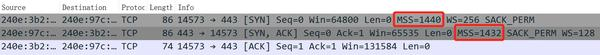

PPPoE 宽带下访问 IPv6 站点的三次握手抓包，SYN 的 MSS=1440，SYN-ACK 的 MSS=1432

如果两次握手都是 1440，说明钳制没生效，问题就落在路径上某个中间节点。继续往下看原理。

## 为什么 IPv4 很少遇到这个问题

IPv4 允许中间路由器分片，大部分应用因此能跑通——代价是效率下降：包被切成几片，多出的 IP 头要占带宽，中间路由器也要多花算力做解析和转发。

IPv6 不允许任何中间节点分片。IPv6 固定头里没有 MF 标志，分片信息（偏移量、More Fragments）挪到了分片扩展头里，而中间路由器不处理扩展头，所以分片只能由源主机做、由目的主机重组。RFC 8200 对此有明确规定。

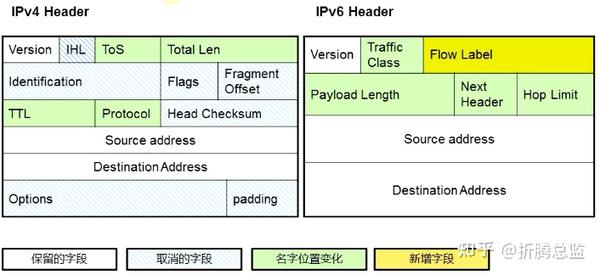

IPv6 包头相对 IPv4 的变化

IPv4 里那层「分片兜底」没了，兜底的活儿就得由 MSS Clamping 来干。而家用路由器普遍对 IPv4 默认开着 MSS Clamping、对 IPv6 却没开——这不是某一家的怪癖，是设备侧的普遍形态。

三条可核实的旁证摆在一起：Padavan 固件的转发规则里能看到 IPv4 的 TCPMSS 规则：

```
[XXX-Router /home/root]# iptables -L
...
Chain FORWARD (policy DROP)
...
TCPMSS   tcp  --  anywhere      anywhere      tcp flags:SYN,RST/SYN TCPMSS clamp to PMTU
```

这一条在 `iptables` 里，走的是 IPv4；IPv6 走 `ip6tables`，得另配一条。

第二条是 EdgeOS 把 v4 的 `mss-clamp` 和 v6 的 `mss-clamp6` 拆成了两个独立开关（命令见后文的配置清单），要 IPv6 生效就得单独打开 v6 那个。

第三条方向相反：企业路由器不默认开。Cisco IOS 的 `ip tcp adjust-mss` 缺省是不启用的，MSS 由发起主机决定，取值范围 500–1460。

所以「IPv6 网关要不要开 MSS Clamping」在厂商之间没有统一答案，得逐台看。可靠的验证只有一条：在自己的设备上 `iptables -L`（或 `ip6tables -L`）看一眼有没有 TCPMSS 规则，或者直接抓包比对 MSS。

## 原理：MTU、分片与 PMTU 黑洞

### 封装开销与链路 MTU

MTU（Maximum Transmission Unit）是某一网络能传输的最大 IP 包大小，以字节为单位。它是链路层对 IP 层的约束：从网络层交给二层的数据不能大于 MTU，超了就丢弃或分片。\[1\]

隧道封装会在 IP 头之外再套一层，于是有效载荷变小：

| 封装方式 | 额外开销 | 对应的 MTU |
| --- | --- | --- |
| PPPoE | 8 字节 | 1492 |
| GRE | 24 字节 | 1476 |
| VXLAN | 50 字节 | 1450 |

这几个数都以 1500 字节的以太网 MTU 为基准。VXLAN 的 50 字节 = 14 字节以太网头 + 20 字节 IP 头 + 8 字节 UDP 头 + 8 字节 VXLAN 头。

查自己设备的接口 MTU，Linux 用 `ifconfig`，Windows 用 `netsh interface ipv4 show subinterfaces`：

```
# ifconfig
ppp0      Link encap:Point-to-Point Protocol
          inet addr:112.91.246.207  P-t-P:113.90.244.1  Mask:255.255.255.255
          UP POINTOPOINT RUNNING NOARP MULTICAST  MTU:1492  Metric:1
          RX packets:339211 errors:0 dropped:0 overruns:0 frame:0
          TX packets:352650 errors:0 dropped:0 overruns:0 carrier:0
eth2      Link encap:Ethernet  HWaddr 20:76:93:53:E0:93
          UP BROADCAST RUNNING MULTICAST  MTU:1500  Metric:1
```

Windows 上设置 MTU 的命令（需要管理员身份）：

```
netsh interface ipv4 set subinterface "需修改的连接名" mtu=值 store=persistent
```

### 分片、DF 位与差错报文

IPv4 的分片发生在网络层。源节点或中间路由器收到超过 MTU 的 IP 包时，把它切成几片依次发送。每片记录自己在原包中的偏移量（以 8 字节为单位），非末片的 MF 标志置 1。

IP 头的 DF（Don't Fragment）位用来禁止分片。TCP、UDP、ICMP 这类上层报文为了完整性，宁可丢包也不愿被分片，于是它们会置上 DF，然后指望沿途有人回一条差错报文，告诉自己该发多大。\[3\]

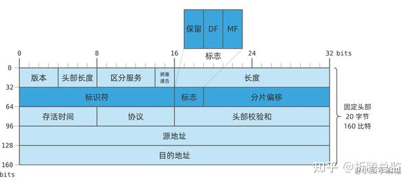

IPv4 的包头格式

分片会继续分片。\[2\] 假设源端网卡 MTU 是 1500，经过家用路由器拨号（1492）连到城域网，机房侧路由器又用了某种隧道（1484）。

1500 字节的 IP 包先被切成 1492+28 两片，1492 那片过机房路由器时再切成 1484+28 两片，服务器收到三片后重组。总长 1540，比原包多 40 字节（两个额外 IP 头各 20），分片偏移 1472 与 1464 都是 8 的倍数，合规。

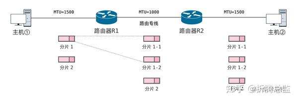

多次分片

IPv6 不允许任何中间节点分片，源主机也不能把包发得比链路的 MTU 大——RFC 8200 要求 Internet 上的每条链路 MTU 至少 1280 字节。

### PMTUD 与 PMTU 黑洞

PMTU（Path MTU）是路径上所有节点 MTU 的最小值。\[4\]PMTUD（Path MTU Discovery）用来动态发现它，IPv4 由 RFC 1191 定义，IPv6 由 RFC 1981 定义。

机制不复杂：源主机先假设路径 MTU 等于自己出接口的 MTU，置上 DF 发出试探包；沿途某个节点的 MTU 更小，它就回一条 ICMP 差错报文，附带自己能接受的 MTU；源主机调低假设值重发，如此反复，直到包抵达目的地。

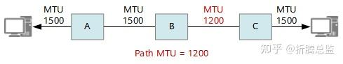

Path MTU 示意图

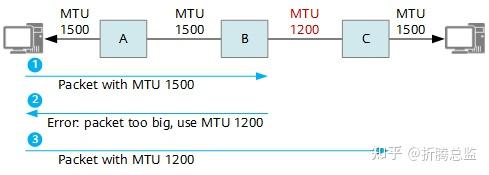

Path MTU 探测

IPv4 的这条链路有个众所周知的软肋：沿途设备过滤 ICMP「需要分片」报文，PMTUD 就断了。IPv4 有这个机制，只是经常用不上。

IPv6 对此更敏感。IPv6 不能分片，「数据包太大」（Packet Too Big，ICMPv6 类型 2）是源主机唯一的纠错途径；这条报文被丢弃，源主机就完全不知道该把包改小。

RFC 4890 明确要求：ICMPv6 的 Packet Too Big 不得被过滤。RFC 4884 则规定了 ICMP 承载 PMTU 信息的扩展格式。

ping 报「需要拆分数据包但是设置 DF」，就是收到了这条差错报文。\[5\] IPv4 的类型是 3（目的不可达）、代码 4（需要分片），报文里带上了下一跳的 MTU；IPv6 对应的是类型 2。

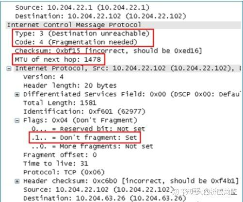

ICMP 需要分片但 DF 为 1 的解码格式

用 `ping -f -l [SIZE] [目标]` 可以手工测出 PMTU：`-f` 强制不分片，`-l` 指定数据大小，能正常 ping 通的最大 SIZE 加上 ICMP 头 28 字节就是 MTU。

```
C:\> ping -f -l 1465 www.baidu.com
正在 Ping www.a.shifen.com [14.119.104.254] 具有 1465 字节的数据:
需要拆分数据包但是设置 DF。
……

C:\> ping -f -l 1464 www.baidu.com
正在 Ping www.a.shifen.com [14.119.104.254] 具有 1464 字节的数据:
来自 14.119.104.254 的回复: 字节=1464 时间=7ms TTL=56
```

PMTU 黑洞就是这么来的：源端 MTU 设得太大，路径上恰好有个 MTU 更小的节点，包被丢掉，而差错报文在回程路上又被过滤掉了。源主机只知道「超时」，于是重传；重传的大包多半还是走同一条路，还是被丢。业务就这么卡住了。

IPv6 更容易中招，因为 IPv4 里还有分片兜底，IPv6 没有。

## MTU 该配多少

MTU 配大了会触发分片、拖慢效率，配小了白白浪费带宽。要按角色分开定，不能一刀切。

有一点要先说清楚：MTU 是链路层对 IP 层的约束，跟第三层用 IPv4 还是 IPv6 无关。IPv6 头比 IPv4 大 20 字节，那是 MSS 的事，不是 MTU 的事——「因为 IPv6 头更大所以要在路由器上把 MTU 改小」是错的。

基本原则：对接的两个三层设备，以太网接口的 MTU 要保持一致。还要算上封装标签，比如每层 MPLS 标签 4 字节，叠加后可能超出链路允许的长度。

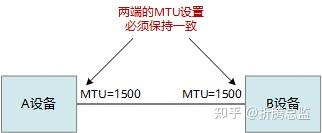

两端 MTU 保持一致

配 MTU 最容易踩的坑，是两端不一致。MTU 对不上时，OSPF、IS-IS 这类要协商 MTU 的路由协议会卡住：邻居关系停在 ExStart 或 Init 阶段，表现为「改完配置反而全断了」。

检查方法很直接——看邻居状态是不是停在 ExStart 或 Init，停住了就是 MTU 对不上。所以「尽量把 MTU 配大一些」这条建议有个前提：先确认对端能接受同一个值。\[6\]

**骨干网、城域网、运营商接入网**这类链路的链路层基本都是以太网，MTU 通常 ≥ 1500，而且有专业团队维护。理论上它们即便达不到 1500，也会配上正确的 MSS Clamping，但那是运维约定而不是协议的保证。普通用户可以先按「这些链路 MTU 足够」来处理；如果症状指向骨干方向，再找运营商确认。

**数据中心与机房**往往没有统一规划过 MTU。随着 VPLS、VXLAN 这类隧道大量使用，报文凭空多出几十字节，传输效率下降甚至业务中断。VXLAN 会在原始报文基础上增加 50 字节，\[7\] 建网时就要把这个余量留出来。

**家庭与企业终端网络**的路由器一侧要跟接入网对齐：国内常见的 PPPoE 拨号，路由器 MTU 设 1492，比以太网少 8 字节。局域网里的 PC 默认 1500，比它大 8 字节，所以 PC 也设成 1492，可以避免路由器替 PC 分片。

两种情况可以把 MTU 设得更小：一是 `ping -f -l 14xx [IP]` 实测出到某个目标的 PMTU 更小；二是用了 L2TP、IPSec 之类会加头的隧道。

反过来说，不要为了 IPv6 单独去改路由器的 MTU。拨号路由器被改成 1432 而 PC 还是 1500 的话，大包到达路由器就丢了——IPv6 不允许中间节点分片，没有第二次机会。要减小就减在源端（PC）上，包在源端就切好了，中间路由器不用管。

## MSS Clamping：为什么有效，边界在哪

MSS（Maximum Segment Size）是 TCP 提交给 IP 层的最大数据段长度，不含 TCP 头和 TCP 选项，只算 TCP 载荷。它是端到端协商出来的：连接建立时双方在 SYN / SYN-ACK 的选项里各报一个 MSS，最终取小的那个。

MSS 与 MTU 的换算要分协议版本：

- IPv4：MSS = MTU − 20（IP 头）− 20（TCP 头）
- IPv6：MSS = MTU − 40（固定头）− 20（TCP 头）= MTU − 60
- IPv6 带扩展头时，还要再减去扩展头占用的字节

再叠加 PPPoE 就要再减 8 字节。文中实测的 Windows WLAN MTU 1410 就对得上：IPv4 MSS = 1410 − 40 = 1370，IPv6 MSS = 1410 − 60 = 1350，后面 4G 那一节抓包看到的正是这两个数。\[8\]

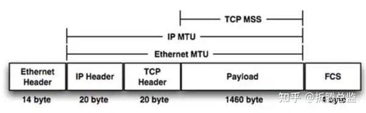

本机 MTU 与 MSS 的关系

MSS 钳制（MSS Clamping）做的事很朴素：路由器嗅探路过的握手包，发现 SYN / SYN-ACK 里报的 MSS 比「本机 MTU 换算出来的 MSS」大，就把它改小。通信双方并不知道被改过，会老老实实地按改小后的值去分段。\[9\]

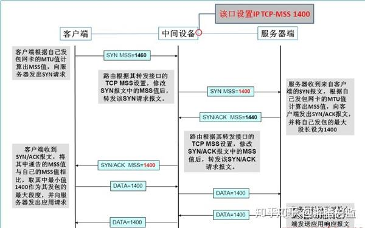

MSS 钳制的流程

这就是它能缓解 PMTU 黑洞的原因：钳制发生在数据包离开设备的那一刻，用的是这台设备自己链路的 MTU，而它通常是整条路径上最小的那一个。路径上每台钳制过的路由器都改一次，最终到达源端的 MSS 就是全路径的最小值。

边界也得说清楚：TCP 连接建立之后，路径可能变。钳制出来的 MSS 只对建连时那条路径有效，后续如果路由切换到了 MTU 更小的路径，MSS 就不准了。

这也是它被归为「缓解」而不是「解决」的原因。实践中问题仍然集中在用户端：骨干网和运营商接入网通常 ≥ 1500，IDC 机房也是以太网，而家里那台拨号路由器用了 PPPoE（1492），几乎是整条链路最小的 MTU。只要把这一台配好，基本就够了。

要重点配的设备，是那些连接不同网络、需要做协议转换的网关路由器，尤其是用了隧道封装的那些（IPSec、L2TP 等 VPN，IPv6-over-IPv4、IPv4-over-IPv6）。

PPPoE 拨号的路由器是典型的必配项：一端是 MTU 1500 的内网以太网，一端是 MTU 1492 的 PPPoE 链路，不开钳制，内网 PC 发出的 IPv6 大包会被它丢掉。

还有一类设备要留神：Cisco Catalyst 9000 系列的排障文档指出，MSS 调整的流量始终走软件交换，量一大就会压垮 COPP 限速器，表现是 SSH 卡死、TCP 变慢——开了反而更慢。

## 各厂商设备怎么开 MSS Clamping

**Cisco IOS** 的命令是 `ip tcp adjust-mss [size]`，作用在所配置接口的入站和出站 SYN / ACK 上，是双向的：\[10\]

```
interface GigabitEthernet0/0
 ip tcp adjust-mss 1452
```

这条命令默认不启用，取值范围 500–1460。1452 这个值有官方依据：1452 + 20 字节 IP 头 + 20 字节 TCP 头 + 8 字节 PPPoE 头 = 1500，正好对上以太网链路 MTU。PPPoE 链路本身的 MTU 是 1492，默认 MSS 是 1460。

**Linux 的 iptables / ip6tables** 在 mangle 表的 FORWARD 链上加 TCPMSS 规则。\[11\] `--set-mss` 指定固定值，`--clamp-mss-to-pmtu` 取的是路由表里的 PMTU，而不是接口 MTU：

```
# 钳制到 1452，适合 PPPoE 用户
iptables -t mangle -A FORWARD -p tcp --tcp-flags SYN,RST SYN -j TCPMSS --set-mss 1452
ip6tables -t mangle -A FORWARD -p tcp --tcp-flags SYN,RST SYN -j TCPMSS --set-mss 1452

# 自动钳制到 PMTU，此时应把本机 MTU 设对，如 PPPoE 为 1492
iptables -t mangle -A FORWARD -p tcp --tcp-flags SYN,RST SYN -j TCPMSS --clamp-mss-to-pmtu
ip6tables -t mangle -A FORWARD -p tcp --tcp-flags SYN,RST SYN -j TCPMSS --clamp-mss-to-pmtu
```

要只对某个接口生效，得走 POSTROUTING：

```
ip6tables -t mangle -A POSTROUTING -p tcp --tcp-flags SYN,RST SYN -o ppp0 -j TCPMSS --clamp-mss-to-pmtu
```

出接口信息只有在包选定路由之后才拿得到，所以指定 `-o` 必须用 POSTROUTING（或 OUTPUT），PREROUTING 里没有出接口可言。

IPv4 和 IPv6 要分别配：iptables 管 v4，ip6tables 管 v6。只配一边，v6 那条路径照样黑洞。

**OpenWrt** 除了改 iptables，也可以在【网络】【防火墙】【基本设置】【区域】里对对应接口勾选【MSS 钳制】。

**RouterOS**（MikroTik，pppoe-out1 是 WAN 口）：

```
/ipv6 firewall mangle add chain=forward out-interface=pppoe-out1 protocol=tcp tcp-flags=syn action=change-mss new-mss=1432
```

**EdgeOS**（Ubiquiti）：

```
set firewall options mss-clamp6 interface-type pppoe
set firewall options mss-clamp6 mss 1432
```

EdgeOS 把 v4 的 `mss-clamp` 与 v6 的 `mss-clamp6` 分成两个独立开关，v6 的这条要单独开才生效。

## 4G 网络实测：运营商是怎么做的

手机上的数据网络早就用上 IPv6 了，而且默认 IPv6 优先，上网却一直稳定流畅。那移动运营商的 4G 网关到底怎么处理 IPv6 的分片问题？为了弄清楚，我用电信手机（MIUI 系统、4G 数据）开热点，电脑（Windows 10）连上去，用 Wireshark 抓包。

先看 4G 网络下访问 IPv6 服务器的握手：客户端发的 SYN 报 MSS=1350，回来的 SYN-ACK 是 1300。

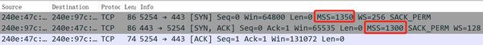

4G 网络下访问 IPv6 服务器的抓包，SYN 的 MSS=1350，SYN-ACK 的 MSS=1300

4G 网络下访问 IPv4 服务器则是另一组数：SYN 报 MSS=1460，SYN-ACK 是 1370。

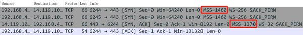

4G 网络下访问 IPv4 服务器的抓包，SYN 的 MSS=1460，SYN-ACK 的 MSS=1370

此时电脑上 WLAN 连接的 MTU 被改成了 1410：

```
C:\> netsh interface ipv6 show subinterfaces
   MTU  MediaSenseState   传入字节  传出字节      接口
------  ---------------  ---------  ---------  -------------
  1410                1  117539374   58911024  WLAN
  1500                5          0        152  本地连接* 1
```

作为对比，这是同一台电脑连 PPPoE 拨号路由器的 WiFi 后，访问 IPv6 服务器的握手：SYN 的 MSS=1440，SYN-ACK 是 1432，也就是上一节那张图。

PPPoE 拨号访问 IPv4 服务器则是 SYN 的 MSS=1460、SYN-ACK 的 MSS=1432：

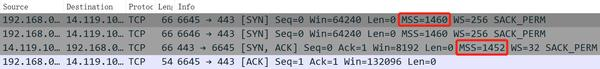

PPPoE 拨号访问 IPv4 服务器的抓包，SYN 的 MSS=1460，SYN-ACK 的 MSS=1432

这时电脑上 WLAN 连接的 MTU 恢复成 1500：

```
C:\> netsh interface ipv6 show subinterfaces
   MTU  MediaSenseState   传入字节  传出字节      接口
------  ---------------  ---------  ---------  -------------
  1500                1  118029364   62131090  WLAN
  1500                5          0        152  本地连接* 1
```

结论很直接：安卓热点程序或运营商的 4G 网关把 IPv6 的 MSS 砍到了 1300，把 IPv4 的 MSS 也砍到了 1370，比 PPPoE 拨号网络小很多。

1410 这个数与两个 MSS 完全吻合：IPv6 是 1410 − 60 = 1350，IPv4 是 1410 − 40 = 1370。

但手机热点究竟用什么机制把电脑 WLAN 的 MTU 改成 1410，我没有找到确切的规范依据——DHCP 本身没有 MTU 选项。能验证的是：连上热点后 `netsh interface ipv6 show subinterfaces` 显示 1410，且 1410 与抓包里的两个 MSS 严丝合缝。

至于为什么蜂窝侧要用更小的 MSS，社区里的实测报告过不同品牌手机热点 MTU 不同（有 1432 的，iPhone 只有 1280）。这些数字没有权威出处，但方向一致：蜂窝侧的 MTU 普遍比以太网小。

所以拨号路由器上已经开了 MSS Clamping、MTU 仍设 1492 却依然不稳的话，可以照搬 4G 的做法，把 IPv6 的 MSS 砍到 1300。IPv6 下 MSS 1300 对应的 MTU 是 1360（1300 + 40 字节 IPv6 固定头 + 20 字节 TCP 头）。更推荐的做法是只设 MSS、不动 MTU——MSS 是端到端协商出来的量，少一层换算就少一类错。

## 附：双栈 DNS 里谁决定走哪个协议栈

双栈环境下到底走哪个协议栈，是应用程序、DNS 服务器，还是操作系统决定的？答案是应用程序自己决策。标准 DNS 服务器没有能力控制程序优先使用哪个协议，它只能同时提供 IPv4（A 类型）和 IPv6（AAAA 类型）的记录供客户端查询。

客户端在建立 TCP 连接前要先把域名解析成 IP。绝大多数使用 BSD socket API 的程序会用 `getaddrinfo` 解析域名然后依次尝试连接，此时优先用哪个协议就由底层系统决定了，`getaddrinfo` 把哪个协议排在前面，程序就优先连哪个。

一些有特殊设计的程序则另有逻辑。比如 curl 和各类浏览器会先检查本机有没有 IPv6 地址：是内网地址就放弃用 IPv6，是公网地址则同时解析 A 与 AAAA，优先尝试 IPv6；若在较短的时间（比如 1 秒）内还没连上，就改试 IPv4，最后用最早建立成功的那个连接。【本段内容摘自 Richard Yu 的评论，感谢】

目前的终端设备，不论 PC 还是手机，大部分知名应用程序和操作系统默认都开启了 IPv6 支持。如果路由器开了 IPv6 DHCP，终端就能自动拿到运营商提供的 IPv6 DNS 服务器地址，而这个 DNS 服务器除了 A 记录还有 AAAA 记录，于是 `getaddrinfo` 通常优先查到 IPv6 地址。

比如访问知乎：知乎服务器是双栈的，域名 `www.zhihu.com` 同时有 IPv6 和 IPv4 地址，浏览器拿到两个地址后通常优先用 IPv6 建连，后续 Web 流量自然走 IPv6。

这种 IPv6 优先的策略本身无可厚非，只是当下多数互联网服务的 IPv4 网络质量优于 IPv6。如果想要自己挑选，可以在本地跑一个能测速的 DNS 服务器，从多个上游取结果、把最快的那个返回给客户端。

SmartDNS 就是干这个的：它接受本地客户端的 DNS 查询，把请求发给多个上游 DNS 服务器，检测从本地访问速度最快的那个 IP，再返回给客户端。\[12\]

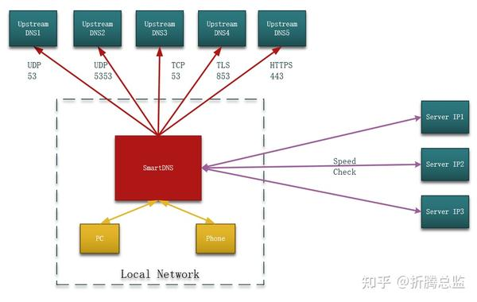

SmartDNS 的架构与运行原理

在 OpenWrt 上可以用插件形式安装 SmartDNS，具体过程不在本文赘述。

## 症状 → 怎么确认 → 怎么处置

| 症状 | 怎么确认 | 怎么处置 |
| --- | --- | --- |
| 网页慢、视频卡、App 不流畅，关掉 IPv6 就好 | 抓包比 SYN 与 SYN-ACK 的 MSS：两个都是 1440 就是没钳 | 在拨号路由器上开 MSS Clamping，命令见上文 |
| 开了钳制仍有大批量丢包 | `ping -f -l 14xx` 逐档试 PMTU；看 ICMP 类型 3 代码 4 报文里带的 MTU | 源端（PC）降 MTU 到实测值，或把 MSS 固定到 1300 |
| 连不上 IPv6，路由器上没有 IPv6 地址 | 看接口有没有运营商下发的 PD 前缀地址 | 先解决 PD 前缀下发，路由器没有 PD 就没有 IPv6 |
| 改了 MTU 之后全断了 | 看 OSPF / IS-IS 邻居状态是不是停在 ExStart / Init | 把两端 MTU 调回一致 |
| IPv6 优先但站点反而更慢 | 对比 AAAA 与 A 两条链路的访问质量 | 用 SmartDNS 一类的本地 DNS 挑更快的地址 |

## 延伸阅读

- [MTU 相关网络丢包问题分析处理](【网络】MTU相关网络丢包问题分析处理.md)——MTU 与 MSS 的基本概念、丢包排查
- [Path MTU 概述](pmtu概述.md)——PMTU 发现机制与 Linux 的处理方式
- [Path MTU 详解](mtu路径发现pmtu详解.md)——路径 MTU 探测的实现细节

## 参考资料

1. 华为 IP 百科 [什么是 MTU](https://info.support.huawei.com/info-finder/encyclopedia/zh/MTU.html)
2. 小菜学编程 [IP 分片](https://fasionchan.com/network/ip/fragmentation/)
3. 小菜学编程 [IP 分片](https://fasionchan.com/network/ip/fragmentation/)
4. 华为 IP 百科 [什么是 MTU](https://info.support.huawei.com/info-finder/encyclopedia/zh/MTU.html)
5. 大西洋里的鱼 [MTU TCP-MSS 详解](https://zhuanlan.zhihu.com/p/139537936)
6. 华为 IP 百科 [什么是 MTU](https://info.support.huawei.com/info-finder/encyclopedia/zh/MTU.html)
7. 华为 IP 百科 [什么是 MTU](https://info.support.huawei.com/info-finder/encyclopedia/zh/MTU.html)
8. Cisco [PPPoE 连接的以太网 MTU 和 TCP MSS 调整概念](https://www.cisco.com/c/zh_cn/support/docs/ip/transmission-control-protocol-tcp/200932-Ethernet-MTU-and-TCP-MSS-Adjustment-Conc.html)
9. 大西洋里的鱼 [MTU TCP-MSS 详解](https://zhuanlan.zhihu.com/p/139537936)
10. ipspace [TCP MSS Clamping – What Is It and Why Do We Need It?](https://blog.ipspace.net/2013/01/tcp-mss-clamping-what-is-it-and-why-do.html)
11. raysonx [开启 IPv6 后网速变得很慢？可能是 PMTU 黑洞的问题](https://www.v2ex.com/t/800024)
12. SmartDNS [SmartDNS 官方文档](https://pymumu.github.io/smartdns/)
13. RFC 791 [Internet Protocol](https://datatracker.ietf.org/doc/html/rfc791)
14. RFC 8200 [Internet Protocol, Version 6 (IPv6) Specification](https://datatracker.ietf.org/doc/html/rfc8200)
15. RFC 1191 [Path MTU Discovery](https://datatracker.ietf.org/doc/html/rfc1191)
16. RFC 1981 [Path MTU Discovery for IPv6](https://datatracker.ietf.org/doc/html/rfc1981)
17. RFC 4890 [Recommendations for Filtering ICMPv6 Messages in Firewalls](https://datatracker.ietf.org/doc/html/rfc4890)
18. RFC 4884 [Providing IPv6 Neighbors with Larger Path MTU Option](https://datatracker.ietf.org/doc/html/rfc4884)
