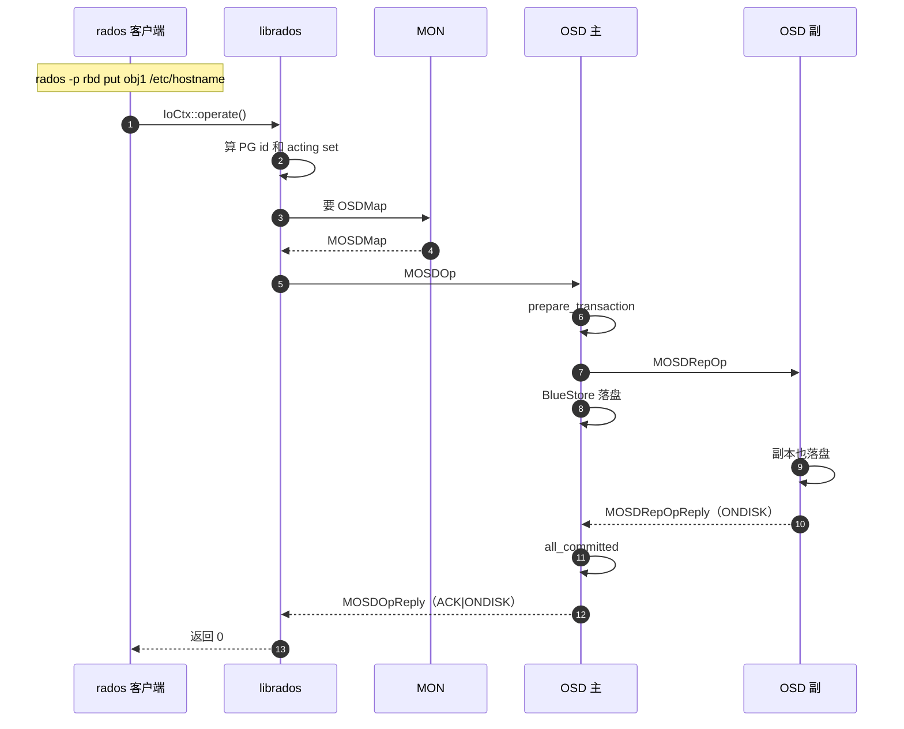

# 01 整体架构与一次写请求的完整链路

| 编写人 | 编写内容 | 编写时间 |
| --- | --- | --- |
| growdu | 初稿：一次写请求的完整链路（客户端 → Messenger → OSD → PG → BlueStore），ack 语义，以及 v22 结构变化对照。 | 2026-11-25 |

> 目标：把一次 `rados put` 从头到尾拆开，**每一段都给出 v22 树里真实存在的函数名和文件行号**。
> 读完你应该能回答：这次写请求经过了几个进程、几条消息？数据什么时候才算落盘？
> 客户端拿到 ack 的那一刻，盘上到底有什么？

本文所有行号基于 `/work/cwork/ceph`（`main` 分支，`v22.0.0-975-g4c8da9d1553`）。
**这棵树做过大规模重构，和网上流传的 v16/v17 文章差别很大** —— 每段末尾都有「注意」提示。

## 1.1 先看全景

一次写请求要跨过两个「世界」：

- **控制面**：MON 持有集群状态（OSDMap、PGMap），决定「这个 PG 该由哪些 OSD 存」。
  客户端需要知道 PG 落在哪儿，就得先从 MON 拿 OSDMap。
- **数据面**：客户端直接跟 OSD 说话，OSD 之间也直接互传数据，**全程不经过 MON**。



> 图里没画 BlueStore 这条泳道：它是每个 OSD **内部**的存储引擎，
> 所以被并进了「OSD 主 / OSD 副」两条泳道里 —— 1.10 节会展开。

**这张图里有三个关键点**，也是 Ceph 架构的核心：

1. **MON 不在数据路径上**。它只在客户端需要新的 OSDMap 时被问一次，
   之后的读写全程是 OSD 之间直连。
2. **写只发给 primary**。副本的数据不是客户端推过去的，是 primary 复制过去的。
3. **ack 回来之前，主副本和所有副本都已经本地提交了事务**。

## 1.2 数据模型：对象 → PG → OSD

理解链路之前，得先立住这三个层次。Ceph 的所有命名都从它们派生。

| 层 | 是什么 | 谁管 |
| --- | --- | --- |
| **对象（object）** | 一段数据 + 一份 xattr/omap 元数据 | 客户端 |
| **池（pool）** | 一组对象的命名空间 + 副本数 + 故障域规则 | 管理员 |
| **PG（placement group）** | 池里的对象按 hash 切成的逻辑分片 | 系统自动 |

写一个对象时，客户端做两步映射：

```text
对象名 "obj1"
   │  hash_key()                      ← src/osd/osd_types.cc:2067
   ▼
ps = hash % pg_num  →  pg_t
   │  pg_to_up_acting_osds()          ← src/osd/OSDMap.cc:3500
   ▼
acting set = [osd3, osd5, osd7]  (acting_primary = osd3)
```

**副本是以 PG 为单位复制的，不是以对象为单位** —— 这是 Ceph 一切设计的地基。
一个 PG 的三个副本，要么全在，要么一起没有；恢复的最小单位也是 PG。

## 1.3 五个角色

| 角色 | 干什么 | 源码入口 |
| --- | --- | --- |
| **MON** | 保存并分发集群状态（OSDMap、PGMap），Paxos 表决 | `src/ceph_mon.cc` → `src/mon/Monitor.cc` |
| **OSD** | 真正存数据：管 PG、接客户端写、跑复制和恢复 | `src/ceph_osd.cc` → `src/osd/OSD.cc` |
| **MGR** | 集群运维与观测：dashboard、orchestrator、balancer | `src/ceph_mgr.cc` → `src/mgr/` |
| **MDS** | CephFS 元数据：目录树、权限、多活 | `src/ceph_mds.cc` → `src/mds/MDSRank.cc` |
| **RGW** | 对象存储网关：S3 / Swift 协议 | `src/rgw/rgw_main.cc` → `src/rgw/` |

> MDS 自己也通过 librados 读写元数据 —— 元数据和普通数据走的是同一条 RADOS 链路，
> 只是池不同。所以 CephFS 挂了，RADOS 那层一点事没有。

## 1.4 客户端侧：从 API 到 MOSDOp

以 C++ API 为例（`rados` 命令行工具走的是 C API，最终汇到同一处）：

```cpp
// src/include/rados/librados.hpp:1297
librados::ObjectWriteOperation op;
op.write(bl, 0, bl.length());
ioctx.operate("obj1", &op);
```

### 1.4.1 librados → IoCtxImpl

| 步骤 | 位置 | 说明 |
| --- | --- | --- |
| 1 | `librados::IoCtx::operate`（`src/include/rados/librados.hpp:1297`） | 对外 API |
| 2 | `librados::IoCtxImpl::operate`（`src/librados/IoCtxImpl.cc:647`） | 真正的入口 |
| 3 | `Objecter::prepare_mutate_op`（`src/osdc/Objecter.h:3219`） | 构造 `Op`，flags 里强制加 `CEPH_OSD_FLAG_WRITE` |
| 4 | `Objecter::op_submit`（`src/osdc/Objecter.cc:2526`） | 提交 |

`IoCtxImpl::operate` 内部（`src/librados/IoCtxImpl.cc:675-683`）：

```cpp
auto objecter_op = objecter->prepare_mutate_op(oid, oloc, *o, snapc, ut,
                                                flags|extra_op_flags, oncommit,
                                                &ver, osd_reqid_t(), nullptr,
                                                otel_trace);
objecter->op_submit(objecter_op);
cond.wait(l, [&done]{ return done; });   // 同步接口在这里阻塞
```

同步的 `operate` 就是在这里等 `oncommit` 回调被触发 —— 而 `oncommit` 是服务端回 ack 时才调的。

### 1.4.2 Objecter：算 PG、算副本、选目标 OSD

`Objecter` 是客户端的「大管家」：它自己**也跑一份 OSDMap 缓存**，所以绝大多数请求不需要问 MON。

| 步骤 | 位置 | 说明 |
| --- | --- | --- |
| `Objecter::op_submit` | `src/osdc/Objecter.cc:2526` | 入口 |
| `Objecter::_op_submit` | `src/osdc/Objecter.cc:2721` | 取 session、排队 |
| `Objecter::_calc_target` | `src/osdc/Objecter.cc:3245` | **算 PG id + acting set** |
| `Objecter::_prepare_osd_op` | `src/osdc/Objecter.cc:3847` | 造 `MOSDOp` 消息 |
| `Objecter::_send_op` | `src/osdc/Objecter.cc:3906` | `con->send_message(m)` |

`_calc_target`（`src/osdc/Objecter.cc:3245`）是整条链路里最该记住的一个函数：

```text
:3331  osdmap->object_locator_to_pg(...)      ← src/osd/OSDMap.cc:2988
       └─ 没有显式 hash 时走 map_to_pg()
          └─ ps = pool->hash_key(name, nspace)  ← src/osd/osd_types.cc:2067
:3320  actual_ps = ceph_stable_mod(pgid.ps(), pg_num, pg_num_mask)
       （处理 PG split / merge 之后的真实 PG 号）
:3434  osdmap->pg_to_up_acting_osds(actual_pgid, &up, &up_primary,
                                    &acting, &acting_primary)
       ← src/osd/OSDMap.cc:3500
:3614  t->osd = acting_primary;                ← 写永远发给 acting primary
```

最后一行是重点：**写操作只发 acting primary**。
只有带 `CEPH_OSD_FLAG_BALANCE_READS` / `LOCALIZE_READS` 的读才会挑副本（`:3575-3613`）。

算出来的映射缓存在 `Objecter::pg_mappings` 里；OSDMap 一变，
`Objecter::handle_osd_map`（`src/osdc/Objecter.cc:1328`）就重算一遍。

### 1.4.3 消息

| 项 | 值 |
| --- | --- |
| 消息类型常量 | `CEPH_MSG_OSD_OP` = 42（`src/include/ceph_fs.h:178`） |
| 消息类 | `MOSDOp`（`src/messages/MOSDOp.h:42`） |
| 承载的 op | `std::vector<OSDOp>`（`OSDOp` 结构体在 `src/osd/osd_types.h:4310`） |
| 操作码 | `CEPH_OSD_OP_WRITE` / `WRITEFULL` / `CREATE` / `TRUNCATE` / `APPEND` / `SETXATTR` / `OMAPSETVALS` … |

> **注意**：v22 起**每种消息一个类**，全部在 `src/messages/` 下（179 个文件）。
> 老文章里的 `MSG_OSD_WRITE` 这类枚举已经不存在了 —— 消息类型现在是
> `CEPH_MSG_OSD_OP`（消息级）+ `CEPH_OSD_OP_*`（操作级）两层。

## 1.5 OSD 侧收包

OSD 收到 `MOSDOp` 之后：

| 步骤 | 位置 | 说明 |
| --- | --- | --- |
| `OSD::ms_dispatch` | `src/osd/OSD.cc:7624` | 拿 `osd_lock`，转 `_dispatch` |
| `OSD::ms_fast_dispatch` | `src/osd/OSD.cc:7744` | **客户端的 op 从这里进** |
| `OSD::enqueue_op` | `src/osd/OSD.cc:9993` | 算优先级，丢进 `op_shardedwq` |
| `OSD::dequeue_op` | `src/osd/OSD.cc:10051` | 从工作队列取出 |
| `PrimaryLogPG::do_request` | `src/osd/PrimaryLogPG.cc:1965` | 交给 PG |

`ms_fast_dispatch` 里有一段容易被忽略的逻辑（`src/osd/OSD.cc:7810-7850`）：
**老客户端**发来的 `MOSDOp` 没带 `spg_t`（分片后的 PG 号），
得先挂进 `session->waiting_on_map`，等 `OSD::dispatch_session_waiting()`
按当前 OSDMap 纠正之后再入队。EC 池尤其容易踩这个坑。

> **注意**：OSD 没有 `handle_op`。v22 的入口是 `ms_fast_dispatch` → `enqueue_op` → `dequeue_op`。

## 1.6 PG 层：把 op 变成事务

`PrimaryLogPG::do_request`（`src/osd/PrimaryLogPG.cc:1965`）先看 PG 处在什么状态：

| PG 状态 | 走哪条队列 |
| --- | --- |
| 还没 peered | `waiting_for_peered` |
| 还没 active | `waiting_for_active` |
| 需要 flush | `waiting_for_flush` |
| 都满足 | 直接 `do_op`（`:2077`） |

这些等待队列定义在 `src/osd/PG.h:1069-1084`，语义注释在 `PG.h:1010-1067`。

`do_op` → `do_op_impl`（`src/osd/PrimaryLogPG.cc:2142`）里做几件事：

1. 校验这个 object 属于本 PG（split bits 对不对）；
2. **必须是 primary**，否则 `osd->handle_misdirected_op(this, op); return;`
   （`src/osd/OSD.cc:1664`）—— 写错主了，主副本会拒收，客户端重发；
3. 各种 flag 检查（`CEPH_OSD_FLAG_IGNORE_REDIRECT`、blocklist、权限…）。

## 1.7 组事务：execute_ctx

这是 PG 层最核心的一个函数：

| 步骤 | 位置 | 说明 |
| --- | --- | --- |
| `PrimaryLogPG::execute_ctx` | `src/osd/PrimaryLogPG.cc:4579` | **总入口** |
| `ctx->op_t.reset(new PGTransaction)` | `:4593` | 建事务对象 |
| `ctx->at_version = get_next_version()` | `:4626` | 分配 oplog 版本号 |
| `prepare_transaction(ctx)` | `:9524` | 填事务内容 |
| `do_osd_ops(ctx, *ctx->ops)` | `:6509` | **把每个 `OSDOp` 翻译成事务动作** |
| `finish_ctx(ctx, log_op_type, result)` | `:9600` | 写 PG log、更新 object_info |
| `ctx->register_on_commit(...)` | `:4776` | **注册 ack 回调** |
| `issue_repop(repop, ctx)` | `:12323` | 把事务发给副本 |

`do_osd_ops`（`src/osd/PrimaryLogPG.cc:6509`）是「Ceph 语义 → 存储引擎动作」的翻译层：

```text
CEPH_OSD_OP_WRITE      (:7242)  → tx->write(soid, off, len, bl, flags)
CEPH_OSD_OP_WRITEFULL  (:7360)  → tx->truncate(soid,0) + tx->write(...)
CEPH_OSD_OP_WRITESAME  (:7394)  → do_writesame()
CEPH_OSD_OP_ZERO       (:7412)  → tx->zero(...)
CEPH_OSD_OP_CREATE     (:7439)  → 建对象（EXCL flag → -EEXIST）
CEPH_OSD_OP_TRUNCATE   (:7470)
CEPH_OSD_OP_APPEND     (:8115)  → 转成 CEPH_OSD_OP_WRITE (:8122)
CEPH_OSD_OP_READ       (:6619)  → do_read() (:6277)
```

`tx->write(...)` 的实现在 `src/os/Transaction.h:928` —— 这是 `ObjectStore::Transaction` 的接口，
BlueStore / MemStore 都实现它。

`finish_ctx` 之后，PG log 里会记一条 `pg_log_entry_t`，
类型是 `MODIFY`（`src/osd/osd_types.h:4458`）还是 `REPLACE`（`:4468`）——
取决于 `require_osd_release` 是否到了 `umbrella` 那个版本。

> **注意**：`MODIFY` 是 **PG log 的日志类型**，不是 op flag。
> op flag 在 `src/include/rados.h:465-470`（`CEPH_OSD_FLAG_ACK` / `ONDISK` / `READ` / `WRITE`）
> 和 `:504-512`（`CEPH_OSD_OP_FLAG_*`）。

## 1.8 副本复制：MOSDRepOp

primary 不会让客户端去推副本，它自己来：

| 步骤 | 位置 | 说明 |
| --- | --- | --- |
| `PrimaryLogPG::issue_repop` | `src/osd/PrimaryLogPG.cc:12323` | 建 `RepGather` |
| `ReplicatedBackend::submit_transaction` | `src/osd/ReplicatedBackend.cc:631` | 提交事务 |
| `ReplicatedBackend::issue_op` | `src/osd/ReplicatedBackend.cc:1270` | 生成子 op |
| `ReplicatedBackend::generate_subop` | `src/osd/ReplicatedBackend.cc:1210` | 造 `MOSDRepOp` |
| `send_message_osd_cluster` | `src/osd/ReplicatedBackend.cc:1327` | 发给每个副本 |

`MOSDRepOp` 里带的是**完整的事务载荷**（`op_t.encode(...)`），
不是「再执行一遍那个 op」—— 副本不需要重新理解语义，直接落盘就行。
消息类在 `src/messages/MOSDRepOp.h:26`。

副本那边：

| 步骤 | 位置 |
| --- | --- |
| `ReplicatedBackend::do_repop` | `src/osd/ReplicatedBackend.cc:1335` |
| `ReplicatedBackend::repop_commit` | `src/osd/ReplicatedBackend.cc:1440` → 回 `MOSDRepOpReply`（带 `ONDISK`） |
| `ReplicatedBackend::do_repop_reply` | `src/osd/ReplicatedBackend.cc:757` → 主副本收到副本 ack |

## 1.9 ack 到底是什么时候给的

这是整条链路里最容易被误解的地方。

**结论：ack 回来的那一刻，主副本和所有 acting 副本的本地事务都已经提交了。**

推导链条：

1. `execute_ctx` 里注册了 ack 回调（`src/osd/PrimaryLogPG.cc:4776`）：

   ```cpp
   ctx->register_on_commit([...]{
     osd->send_message_osd_client(reply, m->get_connection());
     ctx->sent_reply = true;
   });
   ```

2. 这个回调挂在 `RepGather::on_committed` 上，只有 `repop->all_committed == true`
   才会被 `PrimaryLogPG::eval_repop`（`:12274`）执行。

3. `all_committed` 由 `C_OSD_RepopCommit`（`:12235`）→ `repop_all_committed()`（`:12246`）置位。
   而 `C_OSD_RepopCommit` 是 `submit_transaction` 的 `on_all_commit`
   （`src/osd/PrimaryLogPG.cc:12342`），在 `ReplicatedBackend` 侧由
   `C_OSD_OnOpCommit`（`src/osd/ReplicatedBackend.cc:394`）在**本地 BlueStore 事务提交后**调用。

4. `waiting_for_commit` 这个集合里装着「还没提交好的副本」，
   **包括 primary 自己**。primary 自己由 `op_commit()`（`:731`） erase，
   各个副本由 `do_repop_reply()`（`:757`）erase。

5. 只有 `waiting_for_commit.empty()`（`:812`）才 `on_commit->complete(0)`。

所以：

```text
客户端拿到 ack  ⟺  primary 本地提交 ∧ 所有 acting 副本本地提交
```

这正好对应 `CEPH_OSD_FLAG_ONDISK` 这个 flag 的含义 ——
「数据已经落盘，不只是进了 page cache」。

客户端侧收到回执的地方是 `Objecter::handle_osd_op_reply`
（`src/osdc/Objecter.cc:4104`），它按 `m->is_ondisk()` 区分 ondisk / 普通 ack。

## 1.10 BlueStore：事务怎么变成盘上的字节

BlueStore 在 `src/os/bluestore/`。核心接口是 `ObjectStore::queue_transactions`：

| 步骤 | 位置 | 说明 |
| --- | --- | --- |
| `BlueStore::queue_transactions` | `src/os/bluestore/BlueStore.cc:12482` | **提交入口** |
| `_txc_add_transaction` | `:12505` | 逐条 op 翻译成写动作 |
| `_txc_write_nodes` | `:12509` | 写元数据节点 |
| `_txc_state_proc` | `:11127` | **事务状态机** |
| `_txc_apply_kv` | `:11398` | `db->submit_transaction(txc->t)` |
| `_txc_committed_kv` | `:11445` | 触发 `on_commit` 回调 |
| `_txc_finish` | `:11484` | 收尾、释放 |
| `_txc_release_alloc` | `:11566` | **按 txc 序回收空间** |

事务状态机（`_txc_state_proc`，`:11127`）：

```text
STATE_PREPARE
  → STATE_AIO_WAIT      （有异步 IO 要等）
  → STATE_IO_DONE
  → STATE_KV_QUEUED
  → STATE_KV_SUBMITTED  （_txc_apply_kv：RocksDB 事务提交）
  → STATE_KV_DONE
  → STATE_DEFERRED_QUEUED（如果有 deferred 写）
  → STATE_FINISHING
  → STATE_DONE
```

写数据本身：`BlueStore::_do_write`（`:14317`）→ `_do_write_data`（`:14112`）
→ 小写走 `_do_write_small`（`:13066`），大写走 `_do_write_big`（`:13541`）。

**空间回收的顺序是严格串行的**：`_txc_release_alloc`（`:11566`）里写着
「release to allocator only after all preceding txc's have also finished any deferred writes
that potentially land in these blocks」—— 先写的块后回收，不能反。

> **注意（v22 变化）**：
> - BlueStore **没有 journal 了**。`BlueStore::needs_journal()` / `wants_journal()` /
>   `allows_journal()` 全部 `return false`（`src/os/bluestore/BlueStore.h:1652-1654`）。
>   持久性靠的是 **BlueFS 的 WAL**（`src/os/bluestore/BlueFS.cc` 的
>   `_flush_and_sync_log_core` 等）。
> - RocksDB **只存元数据**（onode、omap、统计），**数据文件在 BlueFS**。
>   RocksDB 后端在 `src/rocksdb/RocksDBStore.{h,cc}`，抽象是 `src/kv/KeyValueDB.h`。
> - 老文章里的 `BlueStore::_do_write_trim` / `_do_flush` / `_do_sync` / `_do_fsync`
>   和 `BlueStore::transact` 在本树里**都不存在**。

## 1.11 MON 在哪里

回头看全景图，MON 只出现在「客户端要 OSDMap」那一格。具体地：

- MON 里 `OSDMonitor`（`src/mon/OSDMonitor.h:220`）是 `PaxosService` 的子类，
  负责 OSDMap 的产生与分歧处理；
- 分发走 `build_latest_full`（`src/mon/OSDMonitor.cc:4892`）和
  `build_incremental`（`:4901`），两者共用**同一个**消息类 `MOSDMap` ——
  全量放在 `maps` 字段、增量放在 `incremental_maps` 字段
  （`src/messages/MOSDMap.h:33-34`）。**没有 `MOSDMapIncremental` 这个类**；
- 客户端订阅后，OSDMap 变化会通过 `Objecter::handle_osd_map`
  （`src/osdc/Objecter.cc:1328`）推给 Objecter，重算映射。

**MON 不参与数据路径**。它挂了，集群读写照常，只是不能改配置、建池、调平衡。

> **注意**：`src/mon/PGMonitor.{h,cc}` 早在 2017 年就被删了。
> PG 状态的统计现在是 OSD 采集后报给 mgr（`OSD::collect_pg_stats`，
> `src/osd/OSD.cc:7982`），mon 侧只留了个摘要（`src/mon/PGMap.h`）。

## 1.12 完整调用链速查表

| # | 函数 | 文件:行 |
| --- | --- | --- |
| 1 | `librados::IoCtxImpl::operate` | `src/librados/IoCtxImpl.cc:647` |
| 2 | `Objecter::prepare_mutate_op` | `src/osdc/Objecter.h:3219` |
| 3 | `Objecter::op_submit` → `_op_submit` | `src/osdc/Objecter.cc:2526` / `:2721` |
| 4 | `Objecter::_calc_target` | `src/osdc/Objecter.cc:3245` |
| 5 | `OSDMap::object_locator_to_pg` | `src/osd/OSDMap.cc:2988` |
| 6 | `pg_pool_t::hash_key` | `src/osd/osd_types.cc:2067` |
| 7 | `OSDMap::_pg_to_up_acting_osds` | `src/osd/OSDMap.cc:3500` |
| 8 | `Objecter::_prepare_osd_op` | `src/osdc/Objecter.cc:3847` |
| 9 | `Objecter::_send_op` | `src/osdc/Objecter.cc:3906` |
| 10 | `OSD::ms_fast_dispatch` | `src/osd/OSD.cc:7744` |
| 11 | `OSD::enqueue_op` | `src/osd/OSD.cc:9993` |
| 12 | `OSD::dequeue_op` | `src/osd/OSD.cc:10051` |
| 13 | `PrimaryLogPG::do_request` | `src/osd/PrimaryLogPG.cc:1965` |
| 14 | `PrimaryLogPG::do_op` → `do_op_impl` | `src/osd/PrimaryLogPG.cc:2839` / `:2142` |
| 15 | `PrimaryLogPG::execute_ctx` | `src/osd/PrimaryLogPG.cc:4579` |
| 16 | `PrimaryLogPG::prepare_transaction` | `src/osd/PrimaryLogPG.cc:9524` |
| 17 | `PrimaryLogPG::do_osd_ops` | `src/osd/PrimaryLogPG.cc:6509` |
| 18 | `PrimaryLogPG::finish_ctx` | `src/osd/PrimaryLogPG.cc:9600` |
| 19 | `PrimaryLogPG::issue_repop` | `src/osd/PrimaryLogPG.cc:12323` |
| 20 | `ReplicatedBackend::submit_transaction` | `src/osd/ReplicatedBackend.cc:631` |
| 21 | `ReplicatedBackend::issue_op` | `src/osd/ReplicatedBackend.cc:1270` |
| 22 | `ReplicatedBackend::do_repop`（副本） | `src/osd/ReplicatedBackend.cc:1335` |
| 23 | `BlueStore::queue_transactions` | `src/os/bluestore/BlueStore.cc:12482` |
| 24 | `BlueStore::_txc_state_proc` | `src/os/bluestore/BlueStore.cc:11127` |
| 25 | `BlueStore::_txc_committed_kv` | `src/os/bluestore/BlueStore.cc:11445` |
| 26 | `PrimaryLogPG::eval_repop` | `src/osd/PrimaryLogPG.cc:12274` |
| 27 | `Objecter::handle_osd_op_reply` | `src/osdc/Objecter.cc:4104` |

## 1.13 动手：GDB 跟一次写

先跑起来（**必须在 build 目录里跑**）：

```bash
cd /work/cwork/ceph/build
make -j$(nproc) vstart
MON=1 OSD=3 MDS=0 MGR=1 ../src/vstart.sh -n -d
```

另开一个终端：

```bash
rados -p rbd put obj1 /etc/hostname
```

断点顺序（从客户端到盘上）：

| 断点 | 位置 | 看什么 |
| --- | --- | --- |
| `librados::IoCtxImpl::operate` | `src/librados/IoCtxImpl.cc:647` | 客户端 API 入口 |
| `Objecter::_calc_target` | `src/osdc/Objecter.cc:3245` | PG id 和 acting set 算出来了 |
| `Objecter::_send_op` | `src/osdc/Objecter.cc:3906` | 消息发出去那一刻 |
| `OSD::ms_fast_dispatch` | `src/osd/OSD.cc:7744` | OSD 收到消息 |
| `PrimaryLogPG::do_op_impl` | `src/osd/PrimaryLogPG.cc:2142` | 落到哪个 PG |
| `PrimaryLogPG::execute_ctx` | `src/osd/PrimaryLogPG.cc:4579` | 组事务 |
| `BlueStore::_do_write` | `src/os/bluestore/BlueStore.cc:14317` | 真的写盘 |
| `BlueStore::_txc_committed_kv` | `src/os/bluestore/BlueStore.cc:11445` | 事务提交，ack 从这儿出去 |

```text
(gdb) set pagination off
(gdb) b PrimaryLogPG::execute_ctx
(gdb) c
(gdb) bt
```

挂到正在跑的进程需要 `ptrace` 权限；容器里可能要 `--cap-add=SYS_PTRACE`，
或者把内核的 `kernel.yama.ptrace_scope` 设成 0。

## 1.14 小结

- 一次写请求跨 **3 类进程**：客户端（librados）、primary OSD、若干副本 OSD。
  **MON 不参与**。
- 客户端自己算 PG 和 acting set（`Objecter::_calc_target`），所以常态下不需要问 MON。
- **写只发给 acting primary**；副本由 primary 用 `MOSDRepOp` 推，副本不需要理解语义。
- **ack = 主副本本地提交 ∧ 全部 acting 副本本地提交**。
  `CEPH_OSD_FLAG_ONDISK` 就是这个意思。
- BlueStore 提交事务走 `queue_transactions` → `_txc_state_proc` 状态机，
  空间回收严格按事务序。

下一章（02）会讲怎么把 Ceph 编译起来、跑起来，以及怎么用 ctags / cscope / ripgrep
在这 30 万行里定位 —— 见
[02 环境、编译与代码地图](../../L1-getting-started/learning-path/02-环境编译与代码地图.md)。

再往后 [03 MON：集群状态是怎么产生和分发的](./03-MON集群状态的产生与分发.md)
补上控制面那一半：集群状态从哪来、到哪去。

## 1.15 v22 结构变化对照表

网上大多数 Ceph 中文材料写的是 v16/v17 那一代。下面这些地方会踩空：

| 老文章里通常这么写 | v22（本树）实际是 |
| --- | --- |
| `src/osd/BlueStore.cc` | `src/os/bluestore/BlueStore.cc` |
| `src/osdc/ObjectStore.h` | `src/os/ObjectStore.h`（`src/osdc/` 现在是 `Objecter`/`Filer`/`Striper`） |
| `OSD::handle_op` | `OSD::ms_fast_dispatch` → `enqueue_op` → `dequeue_op` |
| `PG::handle_op` / `PG::queue_op` | `PrimaryLogPG::do_request` / `do_op` / `do_op_impl` |
| `PrimaryLogPG::do_peer` / `PG::queue_all_peers` 等 peering 函数 | **整体搬到 `src/osd/PeeringState.{h,cc}`**（boost::statechart），`PrimaryLogPG.cc` 只剩数据面 |
| `PG::prepare_write_op` / `apply_write_op` | `PrimaryLogPG::prepare_transaction` + `submit_transaction` |
| `PG::send_pg_stats` | `PG::publish_stats_to_osd`（`src/osd/PG.cc:799`） |
| `PGStateMachine.h` | **不存在**。PG 状态机是 `src/osd/PeeringState.h` 里的 boost::statechart |
| `src/mon/PGMonitor.{h,cc}` | 2017 年已删除。PG 统计由 OSD 报给 mgr |
| `src/osd/PGRecovery.{h,cc}` | **不存在**，恢复逻辑散在 `PG.cc` 和 `PrimaryLogPG.cc` |
| `class MDS` | `class MDSRank`（`src/mds/MDSRank.h:171`） |
| `RGWMain` | `rgw::AppMain`（`src/rgw/rgw_main.h:97`） |
| `src/msg/message.h` 里的 `Framed` | `src/msg/Message.h` 的 `Message`，`encode_payload()` / `decode_payload()` |
| `MSG_OSD_WRITE` 这类枚举 | `CEPH_MSG_OSD_OP`（消息级）+ `CEPH_OSD_OP_*`（操作级） |
| `src/msg/seastar/` | **不存在**。seastar Messenger 只在 `src/crimson/net/` |
| BlueStore 有 journal | **没有**。持久性靠 BlueFS WAL |
| `BlueStore::_do_write_trim` / `_do_flush` / `_do_sync` | 都不存在 |
| FileStore | **已移除**，`ObjectStore::create()` 只认 `bluestore` 和 `memstore` |
| `src/common/ceph_strings.cc` 定义配置项 | 配置项在 `src/common/options/*.yaml.in`，生成到 `src/common/options.cc` |
| `md_config_t` 在 `ceph_context.h` | 在 `src/common/config.h`；`CephContext` 持有的是门面 `ConfigProxy` |
