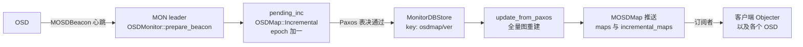

# 03 MON：集群状态是怎么产生和分发的

| 编写人 | 编写内容 | 编写时间 |
| --- | --- | --- |
| growdu | 初稿：MON 的启动与 11 个 Paxos service、选主、Paxos 提交条件与 lease、OSDMap 的产生（beacon + epoch 增量）与分发（订阅制）、PGMap 归属 mgr 的变化。 | 2026-11-26 |

> 上一章把一次写请求走完了。但那整条链路里，**没有一个字节经过 MON** ——
> 这正是 Ceph 和 GFS/HDFS 最大的架构差异。
>
> 这一章补上另一半：**集群的「谁该存哪个 PG」是怎么算出来、
> 怎么保证所有 MON 都同意、怎么发到客户端手里的**。
>
> 读完你应该能回答：
> 1. MON 挂了，为什么读写照常？
> 2. 3 个 MON 里挂了 1 个，还能不能选出 leader？
> 3. OSDMap 里的 epoch 是什么？客户端怎么知道自己该用哪一版？

本文所有行号基于 `/work/cwork/ceph`（`main` 分支，
`v22.0.0-975-g4c8da9d1553`）。

## 3.1 先纠正一个直觉

很多人第一次读 Ceph 会以为 MON 是「集群的中心节点」——
所有状态都在它那儿，所有决策都要问它。

**不是。** 更准确的模型是：

> MON 是**一组用 Paxos 表决的副本**，它持有一份**复制状态机**；
> 集群状态（OSDMap、MonMap、PGMap…）是这个状态机的输出。

这句话里有三个关键词：

| 关键词 | 含义 | 后果 |
| --- | --- | --- |
| 一组副本 | MON 通常是 3 个，不是一个 | 单个 MON 挂掉不影响集群 |
| Paxos 表决 | 状态变更要过半数同意才能生效 | 状态永远不会「脑裂」 |
| 复制状态机 | 每个 MON 跑同样的代码、同样的顺序 | 任意一个 MON 的状态都是权威的 |

所以「MON 不在数据路径上」不是一句口号，而是**结构性的必然**：
数据路径上根本没有 MON 这个角色能插手的地方。

## 3.2 启动链路：从 `ceph_mon.cc` 到一个活着的 MON

`src/ceph_mon.cc` 是薄壳，真正的活在 `Monitor` 类里：

| 步骤 | 位置 | 说明 |
| --- | --- | --- |
| `main()` | `src/ceph_mon.cc:266` | 入口 |
| `global_init(...)` | `src/ceph_mon.cc:329` | 造 `CephContext`，加载配置 |
| `MonitorDBStore store(g_conf()->mon_data)` | `src/ceph_mon.cc:438` | **MON 的持久化**：状态从这里恢复 |
| `Messenger::create(...)` | `src/ceph_mon.cc:919` | 造 `mon-mgrc`（给 mgr 用的那条 messenger） |
| `new Monitor(...)` | `src/ceph_mon.cc:925` | 主体对象 |
| `mon->preinit()` | `src/ceph_mon.cc:947` | 选项消毒、perf counter、logger |
| `msgr->bindv(...)` / `msgr->start()` | `src/ceph_mon.cc:955` / `:965` | **先绑定地址再启动** |
| `mon->init()` | `src/ceph_mon.cc:970` | 装消息分发器、启动 Paxos、引导 |

注意顺序：`preinit()` 在 `bindv()` **之前**，`init()` 在 `bindv()` + `start()` **之后**。
因为 `init()` 里会立刻开始选主，那时候地址必须已经可用了。

`Monitor::init()`（`src/mon/Monitor.cc:1094`）里最关键的几行：

```cpp
// src/mon/Monitor.cc:1116-1137
  finisher.start();
  timer.init();
  new_tick();
  cpu_tp.start();
  messenger->add_dispatcher_tail(this);      // 装上消息分发器
  mgr_client.init();
  mgr_messenger->add_dispatcher_tail(&mgr_client);
  mgr_messenger->add_dispatcher_tail(this);
  mgrmon()->prime_mgr_client();
  state = STATE_PROBING;
  bootstrap();                               // 引导
```

`bootstrap()`（`src/mon/Monitor.cc:1351`）做的事：等 Paxos 写完 → `sync_reset_requester()`
→ 算自己的 rank → `state = STATE_PROBING` → `start_election()`。

## 3.3 十一个 Paxos service：集群状态是怎么被切开的

MON 不是「一个大状态机」，而是**十一个各自独立表决的小状态机**。
它们在 `Monitor` 的构造函数里一次性建好（`src/mon/Monitor.cc:289-300`）：

```cpp
// src/mon/Monitor.cc:289-300
  paxos = std::make_unique<Paxos>(*this, "paxos");
  paxos_service[PAXOS_MDSMAP].reset(new MDSMonitor(*this, *paxos, "mdsmap"));
  paxos_service[PAXOS_MONMAP].reset(new MonmapMonitor(*this, *paxos, "monmap"));
  paxos_service[PAXOS_OSDMAP].reset(new OSDMonitor(cct, *this, *paxos, "osdmap"));
  paxos_service[PAXOS_LOG].reset(new LogMonitor(*this, *paxos, "logm"));
  paxos_service[PAXOS_AUTH].reset(new AuthMonitor(cct, *this, *paxos, "auth"));
  paxos_service[PAXOS_MGR].reset(new MgrMonitor(*this, *paxos, "mgr"));
  paxos_service[PAXOS_MGRSTAT].reset(new MgrStatMonitor(*this, *paxos, "mgrstat"));
  paxos_service[PAXOS_HEALTH].reset(new HealthMonitor(*this, *paxos, "health"));
  paxos_service[PAXOS_CONFIG].reset(new ConfigMonitor(*this, *paxos, "config"));
  paxos_service[PAXOS_KV].reset(new KVMonitor(*this, *paxos, "kv"));
  paxos_service[PAXOS_NVMEGW].reset(new NVMeofGwMon(*this, *paxos, "nvmeofgw"));
```

| service | 管什么 | 状态存哪 |
| --- | --- | --- |
| `PAXOS_OSDMAP` | **OSDMap**：哪个 OSD 在、每个 PG 的 up/acting set | `osdmap/<版本号>` |
| `PAXOS_MONMAP` | MonMap：集群里有哪几个 MON | `monmap/<版本号>` |
| `PAXOS_MDSMAP` | MDS 的 rank 分配 | `mdsmap/<版本号>` |
| `PAXOS_AUTH` | CephX 认证信息（密钥、caps） | `auth/<版本号>` |
| `PAXOS_MGR` | MgrMap：谁是 active mgr、装了哪些模块 | `mgr/<版本号>` |
| `PAXOS_MGRSTAT` | mgr 报上来的**摘要**（PGMapDigest） | `mgrstat/<版本号>` |
| `PAXOS_HEALTH` | 健康检查与告警 | `health/<版本号>` |
| `PAXOS_CONFIG` | 持久化配置项 | `config/<版本号>` |
| `PAXOS_LOG` | MON 自己的操作日志 | `logm/<版本号>` |
| `PAXOS_KV` | 通用 KV 存储 | `kv/<版本号>` |
| `PAXOS_NVMEGW` | NVMe-oF 网关状态 | `nvmeofgw/<版本号>` |

**分开的意义**：每个 service 有**独立的 epoch 和版本号**。
改一个配置项（`PAXOS_CONFIG`）不会让 OSDMap 的 epoch 前进 ——
这条性质在排查问题时很关键（`ceph osd dump` 里的 epoch 只跟 OSDMap 有关）。

存储的 key 规则在 `src/mon/PaxosService.h:457-458`：
全量图前缀是 `"full"`，最新全量指针是 `"latest"`。
所以 store 里长这样：

```text
osdmap/17          ← 第 17 版的增量
osdmap/full_17     ← 第 17 版的全量
osdmap/latest      ← 指向最新全量版本
```

### 3.3.1 一个容易忽略的细节：全量图由 OSDMonitor 自己管

`OSDMonitor` 把 PaxosService 的两个「全量图」钩子**重写成了空实现**：

```cpp
// src/mon/OSDMonitor.h:351-365
  /**
   * we haven't delegated full version stashing to paxosservice for some time
   * now, making this function useless in current context.
   */
  void encode_full(MonitorDBStore::TransactionRef t) override { }
  /**
   * do not let paxosservice periodically stash full osdmaps, or we will break our
   * locally-managed full maps. ...
   */
  bool should_stash_full() override {
    return false;
  }
```

也就是说：**全量 OSDMap 不是 PaxosService 存的**，而是 `OSDMonitor` 自己在
`update_from_paxos()` 里从增量一层层重建出来的（`src/mon/OSDMonitor.cc:852-885`）。

老文章说「PaxosService 会周期性把全量图存下来」——在 v22 的这棵树里**不成立**。

## 3.4 消息进来之后

MON 的消息入口分成两段：

```text
Monitor::_ms_dispatch(Message*)      src/mon/Monitor.cc:4708
   └─ Monitor::dispatch_op(op)       src/mon/Monitor.cc:4818
```

`_ms_dispatch` 只做两件事：登记 op（`op_tracker.create_request<MonOpRequest>`，`:4716`），
然后转给 `dispatch_op`。**真正的分类派发全在 `dispatch_op`**（`:4818-5090`）：

| 消息类型 | 处理者 | 行号 |
| --- | --- | --- |
| `CEPH_MSG_MON_GET_MAP` | `Monitor::handle_mon_get_map` | `:4888` / `:5757` |
| `CEPH_MSG_MON_SUBSCRIBE` | `Monitor::handle_subscribe` | `:4895` / `:5547` |
| `MSG_OSD_BEACON` | `paxos_service[PAXOS_OSDMAP]->dispatch` | `:4916` |
| `MSG_OSD_MARK_ME_DOWN` / `DEAD` / `FULL` / `BOOT` / `ALIVE` / `PGTEMP` … | 同上 | `:4914-4929` |
| `MSG_MDS_BEACON` | `paxos_service[PAXOS_MDSMAP]->dispatch` | `:4933` |
| `MSG_MGR_BEACON` | `paxos_service[PAXOS_MGR]->dispatch` | `:4938` |
| `MSG_MON_COMMAND` | `Monitor::handle_command` | `:4956` / `:3579` |
| `MSG_MON_PROBE` | `Monitor::handle_probe` | `:5010` / `:2079` |
| `MSG_MON_SYNC` | `Monitor::handle_sync` | `:5014` / `:1756` |
| `MSG_MON_PAXOS` | `paxos->dispatch(op)` | `:5034-5059` |
| `MSG_MON_ELECTION` | `elector.dispatch(op)` | `:5066-5077` |
| `MSG_MON_JOIN` | `paxos_service[PAXOS_MONMAP]->dispatch` | `:5026` |

**看这张表就能验证「MON 不在数据路径上」**：
里面**没有任何 `CEPH_MSG_OSD_OP` 之类的业务消息**。
MON 收的全是「状态汇报」和「集群管理命令」。

## 3.5 选主：Elector + ElectionLogic

选主不写在 `Monitor` 里，而是拆成了两个类：

- `src/mon/Elector.{h,cc}` —— 负责发消息、收 ACK/NAK、广播 VICTORY；
- `src/mon/ElectionLogic.{h,cc}` —— **决定胜负**。

消息类 `MMonElection`（`src/messages/MMonElection.h:25`），四种 op（`:31-34`）：

```text
OP_PROPOSE = 1   我要竞选
OP_ACK     = 2   我投你
OP_NAK     = 3   我不投你
OP_VICTORY = 4   我赢了（广播）
```

流程：

```text
Monitor::start_election()              src/mon/Monitor.cc:2362
  └─ Elector::propose_to_peers(...)    src/mon/Elector.cc:151   → 广播 OP_PROPOSE
  └─ Elector::handle_propose(op)       src/mon/Elector.cc:278
  └─ Elector::handle_ack(op)           src/mon/Elector.cc:324
  └─ Elector::handle_nak(op)           src/mon/Elector.cc:426
  └─ Elector::handle_victory(op)       src/mon/Elector.cc:373
  └─ Elector::message_victory(quorum)  src/mon/Elector.cc:233
  └─ Monitor::win_election(...)        src/mon/Monitor.cc:2437
```

**胜负的唯一判定点**（`src/mon/ElectionLogic.cc:190-198`）：

```cpp
// src/mon/ElectionLogic.cc:194-198
  if (electing_me &&
      acked_me.size() > (elector->paxos_size() / 2)) {
    // i win
    declare_victory();
```

`Elector::paxos_size()`（`src/mon/Elector.cc:136`）返回的是
**monmap 里的 MON 总数**（不是当前存活数）。

所以**多数派 = floor(N/2) + 1**：

| MON 总数 | 需要的 ACK 数 |
| ---: | ---: |
| 1 | 1（走 `Monitor::win_standalone_election`，`src/mon/Monitor.cc:2376`） |
| 3 | 2 |
| 5 | 3 |
| 7 | 4 |

**3 个 MON 挂 1 个，还能选出 leader**（2 > 3/2 = 1）。
挂 2 个就不行了（1 > 1 不成立）—— 这就是为什么生产环境最少 3 个 MON。

epoch 也在这里分两种：**选举用奇数 epoch，正常期用偶数 epoch**
（`ElectionLogic::declare_victory`，`src/mon/ElectionLogic.cc:207`）。
这样一眼就能从 epoch 的奇偶看出「现在是选举期还是稳定期」。

## 3.6 Paxos：状态变更是怎么被表决的

这是本章的核心。三个类：

- `src/mon/Paxos.h:176` —— `class Paxos`，**一个 service 一份 Paxos 状态**；
- `src/mon/PaxosService.h:159` —— `class PaxosService`，**11 个 service 的基类**；
- 消息类 `MMonPaxos`（`src/messages/MMonPaxos.h:31-37`），七种 op：

```cpp
// src/messages/MMonPaxos.h:31-37
  static constexpr int OP_COLLECT =   1; // proposer: propose round
  static constexpr int OP_LAST =      2; // voter:    accept proposed round
  static constexpr int OP_BEGIN =     3; // proposer: value proposed for this round
  static constexpr int OP_ACCEPT =    4; // voter:    accept propsed value
  static constexpr int OP_COMMIT =    5; // proposer: notify learners of agreed value
  static constexpr int OP_LEASE =     6; // leader: extend peon lease
  static constexpr int OP_LEASE_ACK = 7; // peon: lease ack
```

### 3.6.1 一次提案的完整流程

```text
service 层产生变更（OSDMonitor::prepare_beacon 等）
  └─ PaxosService::request_proposal()      src/mon/PaxosService.h:253
       └─ PaxosService::should_propose(delay)   src/mon/PaxosService.cc:194
       └─ PaxosService::propose_pending()       src/mon/PaxosService.cc:211
            ├─ Paxos::get_pending_transaction()  src/mon/Paxos.cc:1570
            ├─ PaxosService::_encode_pending(t)  src/mon/PaxosService.cc:522
            ├─ Paxos::queue_pending_finisher(...) src/mon/Paxos.cc:1563
            └─ Paxos::trigger_propose()          src/mon/Paxos.cc:1580
                 └─ Paxos::propose_pending()      src/mon/Paxos.cc:1538
                      └─ Paxos::begin(bl)         src/mon/Paxos.cc:621
```

`Paxos::begin` 里有两个关键断言（`src/mon/Paxos.cc:628-632`）：

```cpp
// src/mon/Paxos.cc:628-632
  ceph_assert(mon.is_leader());
  ceph_assert(is_updating() || is_updating_previous());

  // we must already have a majority for this to work.
  ceph_assert(mon.get_quorum().size() == 1 ||
	      num_last > (unsigned)mon.monmap->size()/2);
```

第一行：**只有 leader 能提案**。
第三行：**提案之前必须已经拿到多数派**。

然后 leader 把 `new_value` 写进 store 的 `pending_v`，向 quorum 广播 `OP_BEGIN`
（`src/mon/Paxos.cc:694-707`），并挂上超时定时器
（`accept_timeout_event`，超时时间 `mon_accept_timeout_factor * mon_lease`，`:709-717`）。

peon 侧收到后走 `Paxos::handle_begin`（`:720`）→ `handle_accept`（`:780`）→ 回 `OP_ACCEPT`。

### 3.6.2 提交条件：**全体 quorum 都要 accept**

这是最容易被讲错的一点。看 `src/mon/Paxos.cc:808-818`：

```cpp
// src/mon/Paxos.cc:808-818
  // only commit (and expose committed state) when we get *all* quorum
  // members to accept.  otherwise, they may still be sharing the now
  // stale state.
  // FIXME: we can improve this with an additional lease revocation message
  // that doesn't block for the persist.
  if (accepted == mon.get_quorum()) {
    // yay, commit!
    dout(10) << " got majority, committing, done with update" << dendl;
    op->mark_paxos_event("commit_start");
    commit_start();
  }
```

**条件是 `accepted == mon.get_quorum()`——集合相等，全体 quorum 成员都 accept 了才提交。**

注意日志文案写的是 "got majority"，但条件是全体。**别被日志骗了。**

所以要分清两个不同的多数派概念：

| 概念 | 位置 | 用途 | 3 个 MON 时 |
| --- | --- | --- | ---: |
| 多数派（majority） | `ElectionLogic::end_election_period`，`src/mon/ElectionLogic.cc:196` | **选主** | 2 |
| quorum 全集 | `Monitor::get_quorum()`，`src/mon/Monitor.h:666` | **Paxos 提交** | 2（选主时定下的那批） |

quorum 集合在选主成功时固定下来（`Monitor::win_election`，
`src/mon/Monitor.cc:2437`），之后 Paxos 的提交要求**这批成员全部** accept。
所以「MON 挂 1 个还能用」的前提是：挂掉的那个不在 quorum 里，
或者 quorum 重新选过。

### 3.6.3 提交之后：持久化 → 通知 → 刷新

```text
Paxos::commit_start()      src/mon/Paxos.cc:855   把 last_committed+1 和 new_value 写进 store 事务
  └─ C_Committed 回调       src/mon/Paxos.cc:838   持久化完成后
       └─ Paxos::commit_finish()   src/mon/Paxos.cc:898
            ├─ last_committed++
            ├─ 广播 OP_COMMIT 给全体 quorum   src/mon/Paxos.cc:918-932
            ├─ state = STATE_REFRESH → do_refresh()   src/mon/Paxos.cc:1052
            ├─ commit_proposal()               src/mon/Paxos.cc:1073
            ├─ extend_lease()                  src/mon/Paxos.cc:982
            └─ finish_round()                  src/mon/Paxos.cc:1082
```

**注意顺序**：先持久化，再通知别人，最后刷新自己的内存状态。
这是复制状态机的标准做法 —— **先落盘，再对外可见**。

`Monitor::refresh_from_paxos`（`src/mon/Monitor.cc:1164`）在 MON 启动时
从 store 恢复所有 service 的状态。

## 3.7 lease：为什么不是每次写都要走 Paxos

如果每改一次状态都要跑一轮 collect/begin/accept/commit，
MON 会成为瓶颈。所以 Ceph 用了 **lease**：

```cpp
// src/mon/Paxos.cc:1522-1536
bool Paxos::is_lease_valid()
{
  return ((mon.get_quorum().size() == 1)
	  || (ceph::real_clock::now() < lease_expire));
}
bool Paxos::is_writeable()
{
  return mon.is_leader() && is_active() && is_lease_valid();
}
```

`is_writeable()` 为真时，leader 可以**直接写**（在 lease 有效期内），
不必再跑一遍 Paxos 全程。

- `Paxos::extend_lease()`（`src/mon/Paxos.cc:982`）——
  leader 给每个 quorum 成员发 `OP_LEASE`，时长 `mon_lease`；
- `Paxos::handle_lease()`（`:1110`）—— peon 收到后置 `state = STATE_ACTIVE`，回 `OP_LEASE_ACK`；
- `Paxos::handle_lease_ack()`（`:1160`）—— leader 收齐后取消超时定时器；
- `Paxos::lease_timeout()`（`:1223`）/ `lease_ack_timeout()`（`:1199`）——
  超时则 `mon.bootstrap()` 重新走引导和选主。

相关成员：`lease_expire`（`src/mon/Paxos.h:407`）、`acked_lease`（`:504`）、
`accepted`（`:552`）、`num_last`（`:446`）。

## 3.8 OSDMap 的产生：beacon 与 epoch

### 3.8.1 OSD 怎么把状态报给 MON

**唯一实时通道是 beacon**，不是老文章里的 `OSDHeartbeat`：

```text
OSD::maybe_send_beacon()     src/osd/OSD.cc:7453
  └─ OSD::send_beacon(now)   src/osd/OSD.cc:7428
       └─ new MOSDBeacon(...)  src/osd/OSD.cc:7440
       └─ monc->send_mon_message(beacon)  src/osd/OSD.cc:7449
```

`MOSDBeacon`（`src/messages/MOSDBeacon.h:8`）的字段很精简：

| 字段 | 行号 | 含义 |
| --- | ---: | --- |
| `pgs` | `:13` | 本 OSD 上各 PG 的 `last_epoch_clean` |
| `min_last_epoch_clean` | `:14` | 最小值，MON 用来判断 PG 是否干净 |
| `last_purged_snaps_scrub` | `:15` | 上次 scrub 清理的快照 |
| `osd_beacon_report_interval` | `:16` | 上报的间隔（MON 用它判断心跳是否超时） |

MON 侧：

```text
Monitor::dispatch_op → case MSG_OSD_BEACON   src/mon/Monitor.cc:4916
  └─ OSDMonitor::preprocess_beacon(op)   src/mon/OSDMonitor.cc:4811   检查 caps，转发给 leader
  └─ OSDMonitor::prepare_beacon(op)      src/mon/OSDMonitor.cc:4832
```

`prepare_beacon` 记录心跳时间、更新 epoch、汇报 `last_epoch_clean`
（`src/mon/OSDMonitor.cc:4850-4875`）：

```cpp
// src/mon/OSDMonitor.cc:4850-4875（节选）
  last_osd_report[from].first = ceph_clock_now();
  last_osd_report[from].second = beacon->osd_beacon_report_interval;
  ceph_assert(osdmap.is_up(from));
  osd_epochs[from] = beacon->version;
  for (const auto& pg : beacon->pgs) {
    if (auto* pool = osdmap.get_pg_pool(pg.pool()); pool != nullptr) {
      unsigned pg_num = pool->get_pg_num();
      last_epoch_clean.report(pg_num, pg, beacon->min_last_epoch_clean);
    }
  }
```

### 3.8.2 epoch 与「全量 + 增量」

OSDMap 有两个形态：

| 形态 | 成员 | 类型 | 含义 |
| --- | --- | --- | --- |
| **累积全量** | `OSDMonitor::osdmap` | `OSDMap` | 到 `osdmap.epoch` 为止的完整状态 |
| **增量** | `OSDMonitor::pending_inc` | `OSDMap::Incremental` | 从 epoch-1 到 epoch 的差异 |

`OSDMap::Incremental` 定义在 `src/osd/OSDMap.h:311`，它的 epoch 字段注释很直白：

```cpp
// src/osd/OSDMap.h:319
  epoch_t epoch;   // new epoch; we are a diff from epoch-1 to epoch
```

每轮提案前，`OSDMonitor::create_pending()`（`src/mon/OSDMonitor.cc:1206`）
重建增量：

```cpp
// src/mon/OSDMonitor.cc:1206-1211
void OSDMonitor::create_pending()
{
  pending_inc = OSDMap::Incremental(osdmap.epoch+1);
  pending_inc.fsid = mon.monmap->fsid;
  pending_metadata.clear();
  pending_metadata_rm.clear();
```

提案时 `OSDMonitor::encode_pending()`（`src/mon/OSDMonitor.cc:1586`）
把增量编码进 Paxos 事务，落盘成 `osdmap/<ver>`（`:2135-2154`）。

**epoch 的语义**：**一次 OSDMap 变更 = 一个新的 epoch**。
`ceph osd dump` 里的 `epoch` 就是这个值。epoch 前进说明
「集群状态又变了一次」——它和你在 `ceph -s` 里看到的 `osdmap epoch` 是同一个数。

MON 重启后，`OSDMonitor::update_from_paxos()`（`src/mon/OSDMonitor.cc:757`）
从 store 恢复：先加载最新全量（`:835-841`），再循环 apply 增量
（`:852-876`，调 `OSDMap::apply_incremental`，`src/osd/OSDMap.h:1042`）。

### 3.8.3 一张图看完 OSDMap 的生命周期



## 3.9 OSDMap 的分发：订阅制

### 3.9.1 一个消息类，两个字段

**没有 `MOSDMapIncremental` 这个类**。全量和增量共用同一个 `MOSDMap`：

```cpp
// src/messages/MOSDMap.h:25-34
class MOSDMap final : public Message {
  ...
public:
  uuid_d fsid;
  uint64_t encode_features = 0;
  std::map<epoch_t, ceph::buffer::list> maps;              // 全量图
  std::map<epoch_t, ceph::buffer::list> incremental_maps;   // 增量图
```

取图直接读 `m->maps[e]` / `m->incremental_maps[e]`；
唯一的一对便捷方法只有 `get_first()`（`:55`）和 `get_last()`（`:64`）。

### 3.9.2 构造与发送

| 函数 | 位置 | 说明 |
| --- | --- | --- |
| `OSDMonitor::build_latest_full(features)` | `src/mon/OSDMonitor.cc:4892` | 构造全量图消息 |
| `OSDMonitor::build_incremental(from,to,features)` | `src/mon/OSDMonitor.cc:4901` | 构造增量图消息 |
| `OSDMonitor::send_latest(op, start)` | `src/mon/OSDMonitor.cc:4880` | 统一入口 |
| `OSDMonitor::send_full(op)` | `src/mon/OSDMonitor.cc:4999` | 发全量 |
| `OSDMonitor::send_incremental(op, first)` | `src/mon/OSDMonitor.cc:5010` | 发增量（带 proxy 转发） |
| `OSDMonitor::check_osdmap_subs()` | `src/mon/OSDMonitor.cc:5352` | 推进所有订阅者 |
| `OSDMonitor::check_osdmap_sub(sub)` | `src/mon/OSDMonitor.cc:5370` | 单个订阅者 |

`build_incremental` 里有个漂亮的降级逻辑（`src/mon/OSDMonitor.cc:4901-4933`）：

```cpp
// src/mon/OSDMonitor.cc:4901-4933（节选）
  for (epoch_t e = to; e >= from && e > 0; e--) {
    bufferlist bl;
    int err = get_version(e, features, bl);
    if (err == 0) {
      m->incremental_maps[e] = bl;              // 有增量
    } else {
      ceph_assert(err == -ENOENT);
      get_version_full(e, features, bl);
      if (bl.length() > 0) {
        m->maps[e] = bl;                          // 退化成全量
      } else {
        ceph_abort();  // we should have all maps.
      }
    }
  }
```

**某个 epoch 的增量被 trim 掉了，就用那个 epoch 的全量顶上。**
这样订阅者永远能拼出连续的 epoch 序列。

`check_osdmap_sub` 是推送的核心（`src/mon/OSDMonitor.cc:5370-5385`）：

```cpp
// src/mon/OSDMonitor.cc:5370-5385
void OSDMonitor::check_osdmap_sub(Subscription *sub)
{
  if (sub->next <= osdmap.get_epoch()) {
    if (sub->next >= 1)
      send_incremental(sub->next, sub->session, sub->incremental_onetime);
    else
      sub->session->con->send_message(build_latest_full(sub->session->con_features));
    if (sub->onetime)
      mon.session_map.remove_sub(sub);
    else
      sub->next = osdmap.get_epoch() + 1;
  }
}
```

`check_osdmap_subs()` 在 `update_from_paxos()` 尾部被调用
（`src/mon/OSDMonitor.cc:984`）——**每次 OSDMap 前进，就主动推给订阅者**。

### 3.9.3 客户端怎么订阅

客户端发 `MMonSubscribe`（`src/messages/MMonSubscribe.h`），
MON 侧 `Monitor::handle_subscribe`（`src/mon/Monitor.cc:5547`）按名字分派：

```cpp
// src/mon/Monitor.cc:5577-5582 & 5629-5643
    } else if (p->first == "osdmap") {
      if (!s->is_capable("osd", MON_CAP_R)) {
        // 权限不够就丢掉
        continue;
      }
    }
    ...
    } else if (p->first == "osdmap") {
      if (s->osd_epoch > p->second.start) {
        // client needs earlier osdmaps on purpose, so reset the sent epoch
        s->osd_epoch = 0;
      }
      osdmon()->check_osdmap_sub(s->sub_map["osdmap"]);
    }
```

客户端侧（`src/osdc/Objecter.cc`）：

```text
Objecter::_ms_dispatch → case CEPH_MSG_OSD_MAP   src/osdc/Objecter.cc:1188-1192
  └─ Objecter::handle_osd_map(MOSDMap *m)          src/osdc/Objecter.cc:1328
Objecter::_maybe_request_map()                    src/osdc/Objecter.cc:2214
```

**没有 `_request_osd_map` 这个函数** —— 现在是订阅制：

```cpp
// src/osdc/Objecter.cc:2214-2233（节选）
void Objecter::_maybe_request_map()
{
  ...
  if (monc->sub_want("osdmap", epoch, flag)) {
    monc->renew_subs();
  }
```

收到增量就直接 apply，缺 epoch 就退订重拉（`src/osdc/Objecter.cc:1364-1405`）：

```cpp
// src/osdc/Objecter.cc:1364-1405（节选）
    for (epoch_t e = osdmap->get_epoch() + 1; e <= m->get_last(); ) {
      if (m->incremental_maps.count(e)) {
        if (osdmap->get_epoch() == e-1) {
          OSDMap::Incremental inc(m->incremental_maps[e]);
          osdmap->apply_incremental(inc);
          ...
          e++;
        } else {
          ...
          e = m->cluster_osdmap_trim_lower_bound - 1;
        }
      } else if (m->maps.count(e)) {
        auto new_osdmap = std::make_unique<OSDMap>();
        new_osdmap->decode(m->maps[e]);
        osdmap = std::move(new_osdmap);
        e++;
      } else {
        // 缺 epoch：要求 MON 重发
        monc->sub_want("osdmap", 0, CEPH_SUBSCRIBE_ONETIME);
        last_osdmap_request_time = ceph::coarse_mono_clock::now();
        monc->renew_subs();
      }
    }
```

这就是 01 章里那句「客户端自己算 PG 和 acting set」的底气来源：
**客户端手里有一份完整的 OSDMap 副本**，不需要每次问 MON。

OSD 自己也订阅（`src/osd/OSD.cc:5622`、`:5630`），
收到后转给 Objecter（`src/osd/OSD.cc:8345`）。

## 3.10 PGMap 现在归 mgr 了

这是 v22 里一个**结构性变化**，老文章几乎都讲错了。

`src/mon/PGMonitor.{h,cc}`（管理 PGMap 的那个 monitor service）
**早在 2017 年就删除了**。现在：

| 环节 | 位置 | 说明 |
| --- | --- | --- |
| OSD 采集 PG 统计 | `OSD::collect_pg_stats()`，`src/osd/OSD.cc:7982` | 填 `MPGStats`（`src/messages/MPGStats.h:25`） |
| 注册回调 | `src/osd/OSD.cc:3948` | `mgrc.set_pgstats_cb(...)` |
| OSD → mgr 直连 | `MgrClient::_send_pgstats()`，`src/mgr/MgrClient.cc:472` | **不经过 MON** |
| mgr 侧落地 | `ClusterState::ingest_pgstats()`，`src/mgr/ClusterState.cc:78` | 更新 mgr 内存里的 PGMap |
| mgr → MON（只报摘要） | `MgrStatMonitor::prepare_report()`，`src/mon/MgrStatMonitor.cc:401` | 只报 `PGMapDigest` |

`src/mon/PGMap.h` 还在，但里面是三个类：

| 类 | 行号 | 是什么 |
| --- | ---: | --- |
| `PGMapDigest` | `src/mon/PGMap.h:45` | **摘要**：聚合统计，可编码可 dump |
| `PGMap` | `src/mon/PGMap.h:268` | 完整 PGMap（继承 Digest） |
| `PGMapUpdater` | `src/mon/PGMap.h:566` | 静态工具类 |

而且 `src/mon/CMakeLists.txt` 里**没有 PGMap.cc** —— 它被编进公共对象和 mgr
（`src/CMakeLists.txt:573`、`src/mgr/CMakeLists.txt:8`）。
**文件还放在 `src/mon/`，但归属已经是 mgr 了。**

一句话总结：**PG 统计数据现在不再经 MON**。
MON 只留一份摘要（供 `ceph status` / `ceph df` 快速回答），
完整统计在 mgr 内存里。

## 3.11 MonMap：集群里有哪几个 MON

`src/mon/MonMap.h:99` 的 `class MonMap`：

```cpp
// src/mon/MonMap.h:100-116（节选）
  epoch_t epoch;
  epoch_t auth_epoch;
  uuid_d fsid;
  std::map<std::string, mon_info_t> mon_info;      // name → info
  std::map<entity_addr_t, std::string> addr_mons;  // addr → name
  std::vector<std::string> ranks;
  std::set<unsigned> removed_ranks;
  mon_feature_t persistent_features;
  mon_feature_t optional_features;
  ceph_release_t min_mon_release;
```

`MonMap` 本身也是一个 Paxos service（`PAXOS_MONMAP`），
改成员要走 `MonmapMonitor` → Paxos → commit。

**注意 `Monitor::get_monmap()` 不存在**。有两个同名但层次不同的东西：

| 函数 | 位置 | 层次 |
| --- | --- | --- |
| `MonmapMonitor::get_monmap(bufferlist&)` | `src/mon/MonmapMonitor.cc:1672` | MON 内部：从 store 取最新已提交版本 |
| `MonClient::get_monmap()` | `src/mon/MonClient.cc:116` | 客户端：向 MON 要 monmap |

MON 内存里那个 monmap 对象是 `Monitor::monmap`（构造函数参数，
`src/mon/Monitor.cc:210`），发给客户端走
`Monitor::send_latest_monmap`（`src/mon/Monitor.cc:5750`）：

```cpp
// src/mon/Monitor.cc:5750-5762
void Monitor::send_latest_monmap(Connection *con)
{
  bufferlist bl;
  monmap->encode(bl, con->get_features());
  con->send_message(new MMonMap(bl));
}
```

## 3.12 动手：把 MON 看一遍

```bash
cd /work/cwork/ceph/build
MON=3 OSD=3 MDS=0 MGR=1 ../src/vstart.sh -n -d
```

三个 MON 起来之后：

```bash
# 谁是 leader？看 quorum 和 epoch
ceph mon_status

# MON 的完整状态机（每个 service 的 epoch 都在里面）
ceph mon dump

# OSDMap 的当前版本
ceph osd dump | head -20

# 看看 beacon 有没有正常上来
ceph -s
```

想直接看代码里的状态：

```bash
# MON 自己的 admin socket
ceph daemon mon.a mon_status
ceph daemon mon.a help        # 列出这个守护进程支持的所有命令
```

跟踪一次状态变更（改个配置，看 Paxos 跑一轮）：

```bash
# 终端 1：盯 Paxos
ceph daemon mon.a mon_status

# 终端 2：触发一次状态变更
ceph osd pool create test 32
```

此时 MON 日志里应该能看到 `begin for N bytes` → `OP_BEGIN` →
`got majority, committing` 这几个阶段（调高 `debug_mon` 更容易看到）。

## 3.13 小结

- MON 是**一组 Paxos 副本**，不是一个中心节点。它持有集群状态的权威副本，
  但**不在数据路径上** —— 业务消息（`CEPH_MSG_OSD_OP` 之类）
  在 `Monitor::dispatch_op` 的分类表里根本不存在（`src/mon/Monitor.cc:4818`）。
- 集群状态被切成 **11 个独立的 Paxos service**（`src/mon/Monitor.cc:289-300`），
  各有各的 epoch。
- 选主要**多数派 ACK**（`ElectionLogic::end_election_period`，
  `src/mon/ElectionLogic.cc:196`）；Paxos 提交要**全体 quorum 成员 accept**
  （`src/mon/Paxos.cc:814`）。这两件事经常被混为一谈。
- lease 让 leader 在有效期内可以直接写，不必每次跑 Paxos 全程。
- OSD 用 **`MOSDBeacon`**（不是 `OSDHeartbeat`）上报状态；
  OSDMap 的变更体现为** epoch 递增的增量**（`pending_inc`）。
- 分发是**订阅制**：只有一个 `MOSDMap` 消息类，全量在 `maps`、
  增量在 `incremental_maps`（`src/messages/MOSDMap.h:33-34`）。
- **PGMap 已经归 mgr 了**，MON 只留摘要。

下一篇：[04 PG 状态机：从 peering 到 active](./04-PG状态机与恢复.md)

## 3.14 v22 对照表

| 老文章里通常这么写 | v22（本树）实际是 |
| --- | --- |
| `Monitor::handle_mon_message()` 是消息总入口 | `Monitor::_ms_dispatch`（`:4708`）→ `Monitor::dispatch_op`（`:4818`） |
| `Monitor::init_msgr()` 建 messenger | 没有这个函数；messenger 在 `src/ceph_mon.cc:919` 建好后传进构造函数 |
| `Monitor::elect_leader()` / `discover_leader()` | `Elector`（`src/mon/Elector.cc`）+ `ElectionLogic`（`src/mon/ElectionLogic.cc`） |
| Paxos 消息类叫 `MPaxos` | 叫 **`MMonPaxos`**（`src/messages/MMonPaxos.h:24`）；`MPaxos` 从来没存在过 |
| `Paxos::begin_round()` | `Paxos::begin(bufferlist&)`（`src/mon/Paxos.cc:621`） |
| `Paxos::propose()` | `PaxosService::propose_pending` → `Paxos::propose_pending` → `Paxos::trigger_propose` → `Paxos::begin` |
| `Paxos::handle_leave()` | `Paxos::handle_lease`（`:1110`）+ `handle_lease_ack`（`:1160`） |
| `Paxos::get_quorum()` | `Monitor::get_quorum()`（`src/mon/Monitor.h:666`） |
| 「Paxos 拿到多数派 accept 就 commit」 | **错**。提交要求 `accepted == mon.get_quorum()`（全体 quorum） |
| 有 `MOSDMapIncremental` 消息类 | **不存在**。全量与增量同在 `MOSDMap` 的两个字段里 |
| `MOSDMap::get_full()` / `get_inc()` | 不存在；直接读 `m->maps[e]` / `m->incremental_maps[e]` |
| `OSDMonitor::encode_full()` 存全量图 | 被重写成**空函数**，`should_stash_full()` 返回 false（`src/mon/OSDMonitor.h:356`） |
| 有 `PGMonitor` 管理 PGMap | **已删除**。PGMap 归 mgr，MON 只存 `PGMapDigest` 摘要 |
| OSD 用 `OSDHeartbeat` 上报 | 用 **`MOSDBeacon`**（`src/messages/MOSDBeacon.h:8`） |
| `Monitor::send_monmap` / `send_osdmap` | `send_latest_monmap`（`:5750`）/ `OSDMonitor::send_full`+`send_incremental` |
| `Objecter::_request_osd_map()` | 订阅制：`Objecter::_maybe_request_map()`（`src/osdc/Objecter.cc:2214`） |
| 客户端用 `MMonGetMap` 拿 osdmap | `MMonGetMap` 只拿 **monmap**；osdmap 靠 `MMonSubscribe("osdmap")` 推送 |
| 增量叫 `osdmap_pending` | 叫 **`pending_inc`**（`OSDMap::Incremental`） |
