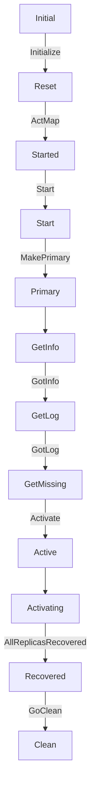

# 04 PG 状态机：从 peering 到 active

| 编写人 | 编写内容 | 编写时间 |
| --- | --- | --- |
| growdu | 初稿：PG 状态机的载体与状态树、state 与状态位的区别、peering 三步（GetInfo/GetLog/GetMissing）、acting set 的选择、恢复与 backfill 的推进、degraded 的统计口径，以及 PG log 在重启后怎么恢复。 | 2026-11-26 |

> 上一章讲了集群状态怎么产生和分发。这一章往下钻一层：**OSD 收到一份 OSDMap
> 之后，它怎么决定「这个 PG 该由我当主」以及「我要从别的副本补哪些数据」**。
>
> 这是 Ceph 里最绕的一块，也是老文章错得最多的地方 —— 因为
> **v22 把 PG 的 peering 逻辑整体搬走了**。
>
> 读完你应该能回答：
> 1. `ceph osd dump` 里那个 `active+clean` 是谁算出来的？
> 2. PG 从 `peered` 到 `active` 中间，primary 和副本各交换了哪些消息？
> 3. 一个副本掉了，PG 变成 `degraded`，数据是怎么补回来的？

本文所有行号基于 `/work/cwork/ceph`（`main` 分支，
`v22.0.0-975-g4c8da9d1553`）。

## 4.1 先说一个结构性变化

**老文章里 PG 的状态机逻辑大多写在 `PrimaryLogPG` 里**
（`do_peer`、`queue_all_peers`、`peer_reset`、`probe_update`、
`calc_recovery_toofull`、`start_primary_recovery`……）。

**在这棵树上，这些函数一个都不存在。**

```bash
cd /work/cwork/ceph/src
grep -rn "do_peer\b\|queue_all_peers\|peer_reset\|calc_recovery_toofull" osd/
# 无输出
```

取而代之的是：

| 文件 | 行数 | 是什么 |
| --- | ---: | --- |
| `src/osd/PeeringState.h` | 2,935 | 状态机**本体**：状态、事件、迁移关系（boost::statechart） |
| `src/osd/PeeringState.cc` | 9,615 | 状态机**实现**：每个状态干什么、事件怎么响应 |
| `src/osd/PGPeeringEvent.h` | — | 外部消息（`MOSDPGInfo2`、`MOSDPGLog`……）包装成事件 |
| `src/osd/PrimaryLogPG.cc` | 18,583 | 只剩**后端与对象 IO**：写、复制、恢复、backfill 的数据面 |

分工变得非常清楚：

```text
PeeringState.{h,cc}  ← 「现在处于什么状态、收到这个事件该怎么办」（控制面）
PrimaryLogPG.cc      ← 「真的去把数据搬过去」（数据面）
```

读 PG 的状态机，**从 `PeeringState.h` 开始，不要从 `PrimaryLogPG.cc` 开始**。

## 4.2 状态机的骨架

| 元素 | 位置 |
| --- | --- |
| `class PeeringState : public MissingLoc::MappingInfo` | `src/osd/PeeringState.h:295` |
| `class PeeringMachine : public boost::statechart::state_machine<PeeringMachine, Initial>` | `src/osd/PeeringState.h:648` |
| `struct PeeringListener`（PG 侧的回调接口） | `src/osd/PeeringState.h:297` |
| 状态树注释（**权威拓扑图**） | `src/osd/PeeringState.h:708-748` |
| `PeeringState::handle_event(const event_base&, PeeringCtx*)` | `src/osd/PeeringState.h:2129` |

事件进状态机的唯一入口：

```cpp
// src/osd/PeeringState.h:2129
  void handle_event(const boost::statechart::event_base &evt,
		    PeeringCtx *rctx) {
      start_handle(rctx);
      machine.last_event_desc = ceph_demangle(typeid(evt).name());
      machine.last_exited_state = get_current_state();
      machine.process_event(evt);
      end_handle();
  }
```

PG 侧投事件的两个函数：

| 函数 | 位置 |
| --- | --- |
| `PG::queue_peering_event(PGPeeringEventRef)` | `src/osd/PG.cc:2181` |
| `PG::do_peering_event(PGPeeringEventRef, PeeringCtx&)` | `src/osd/PG.cc:2160` |

## 4.3 状态树：一张图看懂

`src/osd/PeeringState.h:708-748` 里有一段注释，画的是**状态树**（不是流程图）——
父状态是子状态的容器：

```text
Initial
Reset
Started
  Start
  Primary
    WaitActingChange
    Peering
      GetInfo
      GetLog
      GetMissing
      WaitUpThru
      Incomplete
    Active
      Activating
      Clean
      Recovered
      Backfilling
      WaitRemoteBackfillReserved
      WaitLocalBackfillReserved
      NotBackfilling
      NotRecovering
      Recovering
      WaitRemoteRecoveryReserved
      WaitLocalRecoveryReserved
      WaitRemotePoolMigrationReserved
      WaitLocalPoolMigrationReserved
      MigratingSource
      MigratingTarget
      NotMigrating
  ReplicaActive
    RepNotRecovering
    RepRecovering
    RepWaitBackfillReserved
    RepWaitRecoveryReserved
    RepWaitPoolMigrationReserved
  Stray
  ToDelete
    WaitDeleteReserved
    Deleting
Crashed
```

**读这张树的方法**：`Active` 有 15 个子状态，但 `Active` 本身**只有一个**
初始子状态 `Activating`（`src/osd/PeeringState.h:915`：

```cpp
  struct Active : boost::statechart::state< Active, Primary, Activating >, NamedState {
```

也就是说：`Active` 不是「一个状态」，而是**一组状态的容器**。
`Active` 下面既有「一切正常」的 `Clean`，也有「正在恢复」的 `Recovering`、
「正在补数据」的 `Backfilling`。

## 4.4 别把「状态」和「状态位」搞混

这是读 Ceph PG 状态最容易踩的坑。

| 你听到的名字 | 在 v22 里到底是什么 | 位置 |
| --- | --- | --- |
| `active` | **既是**状态 `Active`（`PeeringState.h:915`），**也是**状态位 `PG_STATE_ACTIVE` | `src/osd/osd_types.h:1007` |
| `peered` | **不是状态**，是状态位 `PG_STATE_PEERED` | `src/osd/osd_types.h:1030` |
| `degraded` | **不是状态**，是状态位 `PG_STATE_DEGRADED` | `src/osd/osd_types.h:1015` |
| `backfill_toofull` | **不是状态**，是状态位 `PG_STATE_BACKFILL_TOOFULL` | `src/osd/osd_types.h:1026` |
| `recovering` | 状态 `Recovering`（`PeeringState.h:1440`）+ 状态位 `PG_STATE_RECOVERING` | `osd_types.h:1019` |
| `backfilling` | 状态 `Backfilling`（`PeeringState.h:1074`）+ 状态位 | `osd_types.h:1025` |
| `incomplete` | 状态 `Incomplete`（`PeeringState.h:1656`）+ 状态位 | `osd_types.h:1021` |
| `stopping` | **不存在**。语义上是 `Crashed`（`:750`）与 `ToDelete/Deleting`（`:1515`/`:1546`） | — |
| `inactive` | **不存在**。「非 active」= 没有 `PG_STATE_ACTIVE` 位 | `PeeringState.h:2709` |
| `probing` | **不存在同名状态**。「probe」只是 `Peering::prior_set.probe` 这个 peer 集合 | `PeeringState.h:895` |
| `repairing` | **不存在同名状态**。修复走 `RequestScrub` 事件 + `scrub_type_t::do_repair` | `PeeringState.h:568-574` |

**两套东西的分工**：

- **状态（statechart state）** 决定「**现在能做什么**」——
  比如 `Clean` 状态下不会去请求恢复，`Recovering` 状态下会去发预留消息。
- **状态位（`PG_STATE_*`）** 是**对外报告的摘要**——
  `ceph osd dump`、`ceph -s` 里看到的那一串 `active+clean+degraded`，
  是这些位拼出来的字符串。

## 4.5 从 Initial 到 Active：完整路径

把上面所有东西串起来，primary 的 PG 走的是这条路：



对应的迁移声明全在 `src/osd/PeeringState.h`：

| 行号 | 源状态 | 事件 | 目标状态 |
| ---: | --- | --- | --- |
| 761 | `Initial` | `Initialize` | `Reset` |
| 839 | `Start` | `MakePrimary` | `Primary` |
| 840 | `Start` | `MakeStray` | `Stray` |
| 904 | **`Peering`** | **`Activate`** | **`Active`** |
| 1570 | `GetInfo` | `GotInfo` | `GetLog` |
| 1597 | `GetLog` | `NeedActingChange` | `WaitActingChange` |
| 1598 | `GetLog` | `IsIncomplete` | `Incomplete` |
| 1599 | `GetLog` | `RepeatGetLog` | `GetLog` |
| 1620 | `GetMissing` | `NeedUpThru` | `WaitUpThru` |
| 1483 | `Activating` | `AllReplicasRecovered` | `Recovered` |
| 1484 | `Activating` | `DoRecovery` | `WaitLocalRecoveryReserved` |
| 1485 | `Activating` | `RequestBackfill` | `WaitLocalBackfillReserved` |
| 1055 | `Recovered` | `GoClean` | `Clean` |
| 1486 | `Activating` | `DoPoolMigration` | `WaitLocalPoolMigrationReserved` |

**`Peering --Activate--> Active` 是进入 Active 的唯一一条路**（`:904`）。

另外三处迁移是运行时 `transit<>` 调的，不在 mpl 反应表里：

| 位置 | 迁移 |
| --- | --- |
| `src/osd/PeeringState.cc:5937` | `Reset::react(ActMap)` → `Started` |
| `src/osd/PeeringState.cc:8556` | `Stray::react(MLogRec)` → `ReplicaActive` |
| `src/osd/PeeringState.cc:6314` | `Backfilling::react(Backfilled)` → `Recovered` |
| `src/osd/PeeringState.cc:7622` | `Recovering::react(AllReplicasRecovered)` → `Recovered` |

## 4.6 Peering 三步：GetInfo → GetLog → GetMissing

primary 要决定 acting set，得先搞清楚每个 peer 手上有什么。这一步分三段。

### 4.6.1 GetInfo：要各 peer 的「家底」

`PeeringState::GetInfo::get_infos`（`src/osd/PeeringState.cc:8782`）
向所有 peer 发 INFO 查询：

```cpp
// src/osd/PeeringState.cc:8810
      context< PeeringMachine >().send_query(
	peer.osd,
	pg_query_t(pg_query_t::INFO,
		   it->shard, ps->pg_whoami.shard,
		   ps->info.history,
		   ps->get_osdmap_epoch()));
      peer_info_requested.insert(peer);
      ps->blocked_by.insert(peer.osd);
```

peer 回 `MOSDPGInfo2` → 变成事件 `MNotifyRec` → `GetInfo::react(MNotifyRec)`
（`src/osd/PeeringState.cc:8823`）→ 收齐后 `post_event(GotInfo())`（`:8867`）。

### 4.6.2 GetLog：要主日志

primary 手里有权威的 PG log，副本只有片段。primary 要把 log 发给副本，
让它们知道自己缺什么。

`PeeringState::fulfill_log`（`src/osd/PeeringState.cc:4027`）：

```cpp
// src/osd/PeeringState.cc:4034
  auto mlog = TOPNSPC::make_message<MOSDPGLog>(
    from.shard, pg_whoami.shard,
    get_osdmap_epoch(),
    info, query_epoch);
  mlog->missing = pg_log.get_missing();

  // primary -> other, when building master log
  if (query.type == pg_query_t::LOG) {
    ...
    mlog->log.copy_after(cct, pg_log.get_log(), query.since);
  }
  else if (query.type == pg_query_t::FULLLOG) {
    mlog->log = pg_log.get_log();
  }
  pl->send_cluster_message(from.osd, std::move(mlog), get_osdmap_epoch(), true);
```

**注意 `mlog->missing = pg_log.get_missing();`** ——
主副本把自己的 missing 集合一起带过去了。副本据此知道自己缺哪些对象。

副本收下之后合并 log（`PeeringState::merge_log`，`src/osd/PeeringState.cc:3642`），
然后回 `GotLog`。

### 4.6.3 GetMissing：算自己缺什么

`PeeringState::GetMissing::GetMissing`（`src/osd/PeeringState.cc:9288`）
根据合并后的 log 和 missing，算出「我缺哪些对象」，并向别处去找。

`PeeringState::search_for_missing`（`src/osd/PeeringState.cc:3119`）和
`discover_all_missing`（`:3160`）是干这个的。

## 4.7 acting set 怎么选

**`PeeringState::choose_acting`**（`src/osd/PeeringState.cc:2837`）是这一段的主角。
它的核心是找两个 shard：

```cpp
// src/osd/PeeringState.cc:2854
  auto auth_log_shard = find_best_info(all_info, restrict_to_up_acting,
				       true, history_les_bound);
  auto get_log_shard = find_best_info(all_info, restrict_to_up_acting,
				    false, history_les_bound);
```

| shard | 作用 |
| --- | --- |
| `auth_log_shard` | 谁的 log 权威（用它做权威 log 的来源） |
| `get_log_shard` | 从谁那里补齐 log |

找不到就退化成 up set：

```cpp
// src/osd/PeeringState.cc:2854-2866（节选）
  if ((auth_log_shard == all_info.end()) ||
      (get_log_shard == all_info.end())) {
    if (up != acting) {
      psdout(10) << "no suitable info found (incomplete backfills?),"
		 << " reverting to up" << dendl;
      want_acting = up;
      ...
      pl->queue_want_pg_temp(empty);
    } else {
      ...
    }
    return false;
  }
```

相关的计算函数：

| 函数 | 位置 | 干什么 |
| --- | --- | --- |
| `PeeringState::select_replicated_primary(...)` | `src/osd/PeeringState.cc:2174` | 复制池选主 |
| `PeeringState::calc_replicated_acting(...)` | `src/osd/PeeringState.cc:2246` | 复制池算 acting |
| `PeeringState::calc_replicated_acting_stretch(...)` | `src/osd/PeeringState.cc:2472` | 允许跨故障域拉伸 |
| `PeeringState::calc_ec_acting(...)` | `src/osd/PeeringState.cc:1849` | EC 池算 acting |
| `PeeringState::calc_ec_acting_stretch(...)` | `src/osd/PeeringState.cc:1939` | EC 拉伸版 |
| `PeeringState::calculate_maxles_and_minlua(...)` | `src/osd/PeeringState.cc:1708` | 算 last_epoch_clean 的上下界 |

**改 acting 靠 `pg_temp`**：

```text
PeeringState::queue_want_pg_temp(want)   src/osd/PeeringState.cc:3023
  └─ PG::queue_want_pg_temp               src/osd/PG.cc:1365
       └─ OSDService::queue_want_pg_temp  src/osd/OSD.cc:1220
            └─ OSDService::send_pg_temp   src/osd/OSD.cc:1274   → 发 MOSDPGTemp
```

> **`PG::check_pg_temp` / `OSD::check_pg_temp` 不存在**。
> pg_temp 现在是 OSDService 层的 `pg_temp_wanted` / `pg_temp_pending` 映射。

## 4.8 恢复：Recovering 与「预留」

PG 发现有副本缺失或落后，就要恢复。恢复在 Ceph 里是**两阶段**的：

```text
WaitLocalRecoveryReserved   ← 在本 OSD 上预留 IO 配额（本地）
        ↓ LocalRecoveryReserved
WaitRemoteRecoveryReserved   ← 向远端发 MRecoveryReserve（远端）
        ↓ AllRemotesReserved
Recovering                   ← 真正开始搬数据
        ↓ AllReplicasRecovered
Recovered
```

### 4.8.1 空间检查：TooFull

进入恢复前先看盘满没满（这就是老文章里的 `calc_recovery_toofull`）：

```cpp
// src/osd/PeeringState.cc:7470
  // Make sure all nodes that part of the recovery aren't full
  if (!ps->cct->_conf->osd_debug_skip_full_check_in_recovery &&
      ps->get_osdmap()->check_full(ps->acting_recovery_backfill)) {
    post_event(RecoveryTooFull());
    return;
  }
  ps->state_clear(PG_STATE_RECOVERY_TOOFULL);
  ps->state_set(PG_STATE_RECOVERY_WAIT);
```

满了就退回来等一会再试：

```cpp
// src/osd/PeeringState.cc:7492
boost::statechart::result
PeeringState::WaitLocalRecoveryReserved::react(const RecoveryTooFull &evt)
{
  DECLARE_LOCALS;
  ps->state_set(PG_STATE_RECOVERY_TOOFULL);
  pl->schedule_event_after(
    std::make_shared<PGPeeringEvent>(
      ps->get_osdmap_epoch(),
      ps->get_osdmap_epoch(),
      DoRecovery()),
    ps->cct->_conf->osd_recovery_retry_interval);
  return transit<NotRecovering>();
}
```

### 4.8.2 数据面：PrimaryLogPG 怎么搬数据

状态机只管「什么时候搬」，**怎么搬在 `PrimaryLogPG.cc`**：

| 函数 | 位置 | 干什么 |
| --- | --- | --- |
| `PrimaryLogPG::start_recovery_ops(max, handle, ops_started)` | `src/osd/PrimaryLogPG.cc:14475` | 启动一批恢复操作 |
| `PrimaryLogPG::recover_primary(max, handle)` | `src/osd/PrimaryLogPG.cc:14665` | 主副本侧：按 missing 列表拉对象 |
| `PrimaryLogPG::recover_backfill(max, handle, work_started)` | `src/osd/PrimaryLogPG.cc:15105` | 往落后的副本补数据 |
| `ReplicatedBackend::recover_object(...)` | `src/osd/ReplicatedBackend.cc:173` | 单个对象的恢复 |
| `PG::try_reserve_recovery_space(...)` | `src/osd/PG.cc:1711` | 预留空间 |

`recover_primary` 的主循环（从 missing 集合里取对象）：

```cpp
// src/osd/PrimaryLogPG.cc:14665
uint64_t PrimaryLogPG::recover_primary(uint64_t max, ThreadPool::TPHandle &handle)
{
  ceph_assert(is_primary());
  const auto &missing = recovery_state.get_pg_log().get_missing();
  ...
  PGBackend::RecoveryHandle *h = pgbackend->open_recovery_op();
  auto p = missing.get_rmissing().lower_bound(
      eversion_t(0, recovery_state.get_pg_log().get_log().last_requested));
  while (p != missing.get_rmissing().end()) {
    ...
```

### 4.8.3 恢复用哪些消息

| 消息 | 文件 | 用在哪 |
| --- | --- | --- |
| `MOSDPGPull` | `src/messages/MOSDPGPull.h` | 主副本向副本**拉**对象 |
| `MOSDPGPush` | `src/messages/MOSDPGPush.h` | 主副本向副本**推**对象 |
| `MOSDPGPushReply` | `src/messages/MOSDPGPushReply.h` | 推的回复 |
| `MRecoveryReserve` | `src/messages/MRecoveryReserve.h` | 恢复预留 |
| `MBackfillReserve` | `src/messages/MBackfillReserve.h` | backfill 预留 |
| `MOSDPGBackfill` | `src/messages/MOSDPGBackfill.h` | backfill 进度/完成 |
| `MOSDPGLog` | `src/messages/MOSDPGLog.h` | peering 时主副本发 log+missing |
| `MOSDPGInfo` / `MOSDPGInfo2` | `src/messages/MOSDPGInfo.h` / `MOSDPGInfo2.h` | peering 时要家底 |
| `MOSDPGNotify` / `MOSDPGNotify2` | `src/messages/MOSDPGNotify.h` / `MOSDPGNotify2.h` | 状态通知 |
| `MOSDPGRecoveryDelete` | `src/messages/MOSDPGRecoveryDelete.h` | 恢复时删对象 |

> **`MOSDRecovery` 这个消息类不存在**。
> `ls src/messages/ | grep -i recovery` 只有
> `MOSDForceRecovery.h`、`MOSDPGRecoveryDelete.h`、
> `MOSDPGRecoveryDeleteReply.h`、`MRecoveryReserve.h`。

## 4.9 Backfill

backfill 是「往一个落后的副本上补历史数据」，跟恢复是两回事：
恢复是**双向**的（副本向别人要数据），backfill 是**单向**的（别人往它推）。

状态机路径：

```text
NotBackfilling --RequestBackfill--> WaitLocalBackfillReserved
  --LocalBackfillReserved--> WaitRemoteBackfillReserved
  --AllBackfillsReserved--> Backfilling
  --Backfilled--> Recovered
```

| 位置 | 内容 |
| --- | --- |
| `src/osd/PeeringState.cc:6560` | `NotBackfilling` 构造 |
| `src/osd/PeeringState.cc:6510` | `WaitLocalBackfillReserved`（本地预留） |
| `src/osd/PeeringState.cc:6409` | `WaitRemoteBackfillReserved`（向远端发 `MBackfillReserve`） |
| `src/osd/PeeringState.cc:6421` | 收到 `RemoteBackfillReserved` |
| `src/osd/PeeringState.cc:6270` | `Backfilling` 构造，置 `PG_STATE_BACKFILLING` |
| `src/osd/PeeringState.cc:6311` | `Backfilling::react(Backfilled)` → `transit<Recovered>()` |

进入 `Backfilling` 时做的事：

```cpp
// src/osd/PeeringState.cc:6276
  ps->backfill_reserved = true;
  ps->state_clear(PG_STATE_BACKFILL_TOOFULL);
  ps->state_clear(PG_STATE_BACKFILL_WAIT);
  ps->state_set(PG_STATE_BACKFILLING);
  pl->on_backfill_reserved();
  ps->arm_rebuild_span();
  pl->publish_stats_to_osd();
```

数据面：

| 函数 | 位置 |
| --- | --- |
| `PrimaryLogPG::recover_backfill(max, handle, work_started)` | `src/osd/PrimaryLogPG.cc:15105` |
| `PrimaryLogPG::prep_backfill_object_push(...)` | `src/osd/PrimaryLogPG.cc:15488` |
| `PrimaryLogPG::do_backfill(OpRequestRef)`（处理 `MOSDPGBackfill`） | `src/osd/PrimaryLogPG.cc:4969` |

**限流配置**：

| 配置 | 含义 | 出处 |
| --- | --- | --- |
| `osd_max_backfills` | **并发 backfill 数**（默认 1） | `src/common/options/osd.yaml.in:51` |
| `osd_recovery_max_active_ssd` / `_hdd` | 恢复字节配额 | `src/common/options/osd.yaml.in:1431` 附近 |

> **`backfill_max` 这个配置项不存在**（`grep -rn "backfill_max" src/` 无输出）。
> 老文章说的那个数字，实际配置项叫 `osd_max_backfills`。

## 4.10 degraded 是怎么算出来的

`degraded` 不是状态，是统计位。计算入口是
`PeeringState::update_calc_stats()`（`src/osd/PeeringState.cc:4476`）：

```cpp
// src/osd/PeeringState.cc:4523
  if ((is_remapped() || is_undersized() || !is_clean()) &&
      (is_peered()|| is_activating())) {
    ...
    ceph_assert(!acting_recovery_backfill.empty());
```

**条件拆开看**：

1. `is_remapped()` —— 有副本不在 acting set 里（被换掉了）；
2. `is_undersized()` —— acting set 副本数不够；
3. `!is_clean()` —— PG 还不是 clean（有 missing）；
4. **而且** PG 已经 peered 或 activating。

也就是说：**PG 还没配好的时候不算 degraded，配好了但缺东西才算**。

统计结果落在 `info.stats.stats.sum.num_objects_degraded`，
对外发布时翻成状态位：

```cpp
// src/osd/PeeringState.cc:4809
  update_calc_stats();
  if (info.stats.stats.sum.num_objects_degraded) {
    state_set(PG_STATE_DEGRADED);
  } else {
    state_clear(PG_STATE_DEGRADED);
  }
  update_blocked_by();
```

而 `PG_STATE_ACTIVE` 是在 `Active::react(const AllReplicasActivated &evt)` 里置的：

```cpp
// src/osd/PeeringState.cc:8172
  bool merge_target;
  if (ps->pool.info.is_pending_merge(pgid, &merge_target)) {
    ps->state_set(PG_STATE_PEERED);
    ps->state_set(PG_STATE_PREMERGE);
    ...
  } else if (!ps->acting_set_writeable()) {
    ps->state_set(PG_STATE_PEERED);
  } else {
    ps->state_set(PG_STATE_ACTIVE);
  }
```

`AllReplicasActivated` 由 `all_activated_and_committed()` 投递
（`src/osd/PeeringState.cc:8263-8290`）：

```cpp
// src/osd/PeeringState.cc:8281
  // Degraded?
  ps->update_calc_stats();
  if (ps->info.stats.stats.sum.num_objects_degraded) {
    ps->state_set(PG_STATE_DEGRADED);
  } else {
    ps->state_clear(PG_STATE_DEGRADED);
  }
  post_event(PeeringState::AllReplicasActivated());
```

**所以 `active` 和 `degraded` 是可以同时成立的** ——
这正是「PG 能服务，但副本不全」的语义。

## 4.11 PG log 与 missing：重启后怎么知道哪些 op 做了

这是老文章里第二大的一片雷区。

### 4.11.1 OSD 已经不用 Journaler 了

**`src/osdc/Journaler.{h,cc}` 还在，但 OSD 已经完全不用它了**：

```bash
grep -rn "Journaler" src/osd/     # 无输出
grep -rln "Journaler" src/         # 只有 src/journal/、src/librbd/、src/mds/PurgeQueue.h
```

也就是说：**Journaler 现在只服务 librbd 和 MDS 的 PurgeQueue**。

而且 `Journaler::replay` / `_replay` / `replay_thread` 都没了，
换成了 `Journaler::recover`（`src/osdc/Journaler.cc:183`）。

### 4.11.2 PG log 就是一个 omap 对象

v22 的做法：**PG log 和 op 在同一个 `ObjectStore::Transaction` 里落盘**。
log 本身是 collection 里的一个 omap 对象，key 是 eversion 的字符串。

写侧：

```cpp
// src/osd/PGLog.cc:926
  if (touch_log)
    t.touch(coll, log_oid);
  if (dirty_to != eversion_t()) {
    t.omap_rmkeyrange(
      coll, log_oid,
      eversion_t().get_key_name(), dirty_to.get_key_name());
    clear_up_to(log_keys_debug, dirty_to.get_key_name());
  }
  ...
  for (auto p = log.log.begin();
       p != log.log.end() && p->version <= dirty_to;
       ++p) {
    bufferlist bl(sizeof(*p) * 2);
    p->encode_with_checksum(bl);
    (*km)[p->get_key_name()] = std::move(bl);
  }
```

**没有「回放 journal」这一步** —— 重启时把 log 对象读回来就行了：

```text
OSD 启动，load_pgs()                  src/osd/OSD.cc:5408
  └─ PG::read_state(store)            src/osd/PG.cc:1110
       ├─ PG::read_info(...)          src/osd/PG.cc:1071
       └─ recovery_state.init_from_disk_state(...)   src/osd/PG.cc:1129
            └─ pglog.read_log_and_missing(store, ...)  src/osd/PG.cc:1133-1143
                 └─ PGLog::read_log_and_missing(...)    src/osd/PGLog.h:1603-1898
```

### 4.11.3 missing 集合住在哪

**`src/osd/MissingSet.h` 不存在**。现在是：

| 东西 | 位置 |
| --- | --- |
| `struct pg_missing_item` | `src/osd/osd_types.h:4882` |
| `class pg_missing_set<TrackChanges>` | `src/osd/osd_types.h:4994` |
| `using pg_missing_t = pg_missing_set<false>` | `src/osd/osd_types.h:5377` |
| `using pg_missing_tracker_t = pg_missing_set<true>` | `src/osd/osd_types.h:5378` |
| `PGLog::missing` 成员 | `src/osd/PGLog.h:722` |
| `PGLog::get_missing()` | `src/osd/PGLog.h:845` |
| `PGLog::missing_add(...)` | `src/osd/PGLog.h:847` |
| `class MissingLoc`（**位置信息**，不是 missing set） | `src/osd/MissingLoc.h:15` |

`src/osd/PGLogEntryTracker.h` 也不存在 ——
替代物是 `PGLog::LogEntryHandler`（`src/osd/PGLog.h:143`），
PG 侧的实现是 `PG::PGLogEntryHandler`（`src/osd/PG.h:1129`）。

### 4.11.4 「做了没做」的两个判据

- `pg_info_t` 里的 `last_complete` / `last_update` / `last_backfill`；
- `PGLog` 的 head/tail 加上 `missing` 集合。

`PeeringState::activate()`（`src/osd/PeeringState.cc:3256`）里做 `last_complete` 推进：

```cpp
// src/osd/PeeringState.cc:3323
  if (missing.num_missing() == 0) {
    psdout(10) << "activate - no missing, moving last_complete " << info.last_complete
	     << " -> " << info.last_update << dendl;
    info.last_complete = info.last_update;
    info.stats.stats.sum.num_objects_missing = 0;
    pg_log.reset_recovery_pointers();
  } else {
    psdout(10) << "activate - not complete, " << missing << dendl;
    info.stats.stats.sum.num_objects_missing = missing.num_missing();
    pg_log.activate_not_complete(info, pool.info.allows_ecoptimizations());
  }
```

## 4.12 状态怎么传出去

```text
PG::publish_stats_to_osd()              src/osd/PG.cc:799
  → PeeringState::update_stats_wo_resched()   src/osd/PeeringState.cc:5125
  → PeeringState::prepare_stats_for_publish() src/osd/PeeringState.cc:4777
OSD::collect_pg_stats()                 src/osd/OSD.cc:7982
  → PG::with_pg_stats(...)              src/osd/PG.cc:2490
  → 填进 MPGStats::pg_stat
```

`OSD::collect_pg_stats()` 里**只上报自己是 primary 的 PG**：

```cpp
// src/osd/OSD.cc:7982
MPGStats* OSD::collect_pg_stats()
{
  ...
  auto m = new MPGStats(monc->get_fsid(), get_osdmap_epoch());
  m->osd_stat = cur_stat;
  ...
  for (auto& pg : pgs) {
    auto pool = pg->pg_id.pgid.pool();
    pool_set.emplace((int64_t)pool);
    if (!pg->is_primary()) {
      continue;                      // 只报 primary 的
    }
    pg->with_pg_stats(now_is, [&](const pg_stat_t& s, epoch_t lec) {
	m->pg_stat[pg->pg_id.pgid] = s;
	min_last_epoch_clean = std::min(min_last_epoch_clean, lec);
	min_last_epoch_clean_pgs.push_back(pg->pg_id.pgid);
      });
  }
```

这份统计接着走 mgr（03 章 §3.10 讲过），**不过 MON**。

想直接查某个 PG 的状态：

```bash
ceph pg query <pgid>       # 走 PG::handle_query_state → PeeringState::QueryState
ceph pg dump               # 全量 PG 状态
ceph osd dump              # 每个 PG 的 up/acting/state
```

## 4.13 动手：看一个 PG 走完 peering

```bash
cd /work/cwork/ceph/build
MON=1 OSD=3 MDS=0 MGR=1 ../src/vstart.sh -n -d
```

建一个池，然后盯着一个 PG：

```bash
ceph osd pool create test 8      # 8 个 PG，3 个 OSD
ceph pg dump pgs                 # 看看状态
```

**关键实验：杀掉一个 OSD，看 PG 怎么变。**

```bash
# 另一个终端
ceph osd crush move osd.1 100    # 或者直接停掉一个 OSD
pkill -f "ceph-osd.*osd2"
```

然后观察：

```bash
watch -n1 "ceph osd dump | grep -A3 'pg 1.'"
```

你会看到 PG 从 `active+clean` 变成 `active+degraded`，
primary 开始做 backfill（`osd_max_backfills` 默认 1，所以会很慢）。

**看代码的话，断点打在这几个地方**：

| 断点 | 看什么 |
| --- | --- |
| `PeeringState::handle_event` | 所有事件的总入口，先在这里 `bt` 看是谁投的 |
| `PeeringState::choose_acting` | acting set 怎么选出来的 |
| `PeeringState::activate` | 进 Active 前的最后一步 |
| `PrimaryLogPG::recover_primary` | 恢复时拉对象 |
| `PrimaryLogPG::recover_backfill` | backfill 推对象 |

GDB 里打印状态：

```text
(gdb) b PeeringState::handle_event
(gdb) c
(gdb) p machine.last_event_desc     # 事件名
(gdb) p machine.last_exited_state    # 之前在哪个状态
```

## 4.14 小结

- **PG 的 peering 逻辑在 `src/osd/PeeringState.{h,cc}`**，
  是个 boost::statechart；`PrimaryLogPG.cc` 只剩数据面。
  老文章里的 `do_peer`、`queue_all_peers`、`peer_reset` 之类**都不存在了**。
- **状态 ≠ 状态位**。`Active`/`Peering`/`Recovering`/`Incomplete` 是状态；
  `peered`/`degraded`/`backfill_toofull` 只是 `pg_stat_t.state` 里的位。
- 完整路径：`Initial → Reset → Started → Start → Primary → Peering
  → (GetInfo → GetLog → GetMissing) → Active → Activating → Recovered → Clean`。
- **acting set 由 `PeeringState::choose_acting` 选**，
  改它靠 `pg_temp`（`OSDService::queue_want_pg_temp`）。
- 恢复是**两阶段预留**：本地 IO 配额 → 远端 `MRecoveryReserve` → `Recovering`；
  backfill 是往落后副本单向推。
- **OSD 已经不用 Journaler 了**。PG log 是 collection 里的 omap 对象，
  和 op 在同一个事务里落盘，重启读回来即可，没有「回放」这一步。
- `degraded` 的口径是「已 peered 且（remapped / undersized / not clean）」。

下一篇：[05 CRUSH：数据怎么落到这些盘上](./05-CRUSH数据放置.md)

## 4.15 v22 对照表

| 老文章里通常这么写 | v22（本树）实际是 |
| --- | --- |
| `PrimaryLogPG::do_peer` | **不存在**。拆成 `PeeringState::proc_master_log` / `proc_replica_log` / `proc_primary_info`（`PeeringState.cc:3734`/`:3955`/`:3663`） |
| `PG::queue_all_peers` | `PeeringState::GetInfo::get_infos`（`PeeringState.cc:8782`） |
| `PG::peer_reset` | `PeeringState::set_last_peering_reset`（`:640`）+ `start_peering_interval`（`:717`） |
| `PG::probe_update` / `handle_update` | `PeeringState::proc_replica_notify`（`:464`）+ `update_peer_info`（`:393`） |
| `PG::calc_recovery_toofull` | `WaitLocalRecoveryReserved::react(RecoveryTooFull)`（`:7492`） |
| `PG::start_primary_recovery` | **不存在**（crimson 里才有 `start_primary_recovery_ops`） |
| `PG::requeue_finish` / `PG::get_candidate_pg_states` | **不存在** |
| `PG::get_acting_recovery` | `PeeringState::get_acting_recovery_backfill()`（`PeeringState.h:2645`） |
| `PrimaryLogPG::update_states` / `recalc_pg_stats` | `PeeringState::update_calc_stats()`（`:4476`）+ `prepare_stats_for_publish()`（`:4777`） |
| `PG::recovery_state` 是 `PGRecoveryState` 类 | **不是类**，是 `PeeringState` 的实例 |
| `src/osd/MissingSet.h` | **不存在**。改成 `src/osd/MissingLoc.h` + `osd_types.h` 里的 `pg_missing_set` |
| `src/osd/PGLogEntryTracker.h` | **不存在**。改成 `PGLog::LogEntryHandler`（`src/osd/PGLog.h:143`） |
| `src/osd/PGRecovery.{h,cc}` | **不存在**。只在 `src/crimson/osd/pg_recovery.{h,cc}` |
| `src/osd/PGStateMachine.h` | **不存在**。状态机是 `src/osd/PeeringState.h` 里的 boost::statechart |
| OSD 用 `Journaler` 存 PG log、重启回放 | **不再如此**。PG log 是 omap 对象，和 op 同事务落盘 |
| `Journaler::replay` / `replay_thread` | **不存在**。改成 `Journaler::recover`（`src/osdc/Journaler.cc:183`） |
| `MOSDRecovery` 消息类 | **不存在**。用 `MOSDPGPull` / `MOSDPGPush` / `MRecoveryReserve` 等 |
| `backfill_max` 配置项 | **不存在**。真实的是 `osd_max_backfills`（`src/common/options/osd.yaml.in:51`） |
| `PG::check_pg_temp` / `OSD::check_pg_temp` | **不存在**。pg_temp 是 OSDService 层的 `pg_temp_wanted` 映射 |
| `PG::initiate_recovery` | **不存在**。是 `PG::handle_initialize`（`src/osd/PG.cc:2263`） |
| 状态名 `peered` / `degraded` / `stopping` / `inactive` / `probing` / `repairing` | **不是 statechart 状态**，见 §4.4 |
