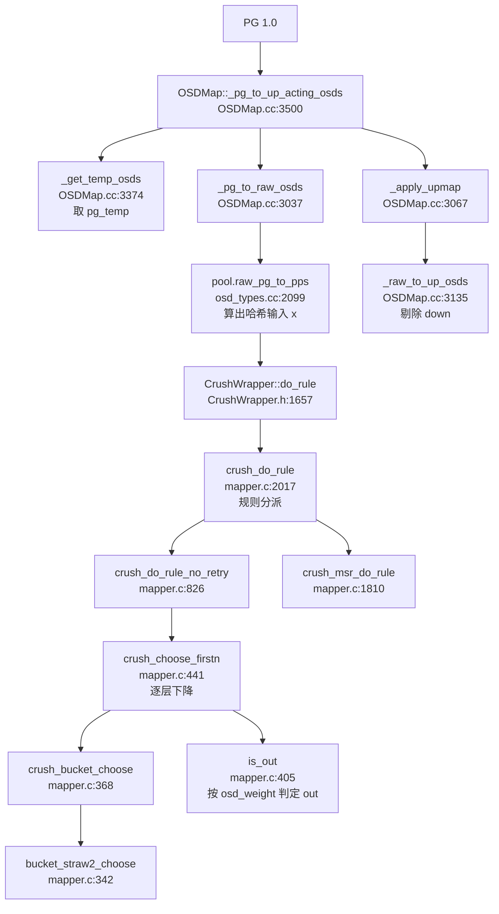

# 05 CRUSH：数据怎么落到这些盘上

| 编写人 | 编写内容 | 编写时间 |
| --- | --- | --- |
| growdu | 初稿：CRUSH 源码的真实位置与分层、一次 CRUSH 计算的完整调用链、哈希输入为什么不是 pgid、规则与 opcode、逐层下降的三层循环、五种 bucket 算法、权重在 is_out 里的「参与概率」语义、故障域就是 type、up 到 acting 的三步后处理、mon 改 crush map 的链路与 crush_location，以及 crushtool 的用法。 | 2026-11-26 |

> 上一章讲了 PG 怎么 peering 起来。这一章往回退一步，讲**在 peering 之前，
> 「这个 PG 该放在哪几块盘上」这个问题是怎么被回答的**。
>
> CRUSH 是 Ceph 最有名的设计，但也是老文章里**函数名编造成分最高**的一块。
> 读完之后你应该能回答：
> 1. `ceph osd tree` 里那棵树，代码在哪个文件？算法在哪个文件？
> 2. 为什么同一个 PG 在不同 pool 里会落到不同的盘上？
> 3. `osd_weight` 到底是「容量」还是「概率」？`up` 和 `acting` 差在哪？
> 4. 我改了 crush map，是谁把它算成新的 OSD 映射的？

本文所有行号基于 `/work/cwork/ceph`（`main` 分支，
`v22.0.0-975-g4c8da9d1553`）。

## 5.1 先纠正三个「结构性错误」

在读算法之前，先把老文章里最常见的三处结构性错误订正掉。这三条都能用一条
`grep` 证伪。

### 5.1.1 CRUSH 不在 `src/osd/` 下

```bash
cd /work/cwork/ceph
git log --all --diff-filter=A -- 'src/osd/CRUSHWrapper.h'   # 零命中
grep -rn "CRUSHWrapper" src/                               # 零命中
```

CRUSH 有一个**独立目录** `src/crush/`，从 2007 年的重组 commit
`c1865445c5b` 起就在那儿，从来没搬进过 `src/osd/`。

### 5.1.2 算法不在 `src/crush/crush.c` 里

`src/crush/crush.c` 一共 **137 行**，里面只有析构函数和两个杂项：

| 函数 | 位置 |
| --- | --- |
| `crush_bucket_alg_name()` | `src/crush/crush.c:9` |
| `crush_get_bucket_item_weight()` | `src/crush/crush.c:26` |
| `crush_destroy_bucket()` / `crush_destroy()` / `crush_destroy_rule()` | `src/crush/crush.c:82` / `:107` / `:134` |

**真正的算法在 `src/crush/mapper.c`（2,053 行）**。

### 5.1.3 有一半函数名在这棵树里根本不存在

下面这些名字在 v10～v20 六个 tag 和当前 main 上都是**零命中**：

`crush_hash`（真身是 `crush_hash32` 系列）、`crush_hash_position_1`、
`crush_uniform_bucket_hash`、`crush_bucket_choose_position`、
`crush_choose_leaf`、`crush_get_item`、`crush_weight_item`、
`in_bucket_weight`。

其中 `crush_weight_item` / `in_bucket_weight` 来自 2017 年那个**从未合入上游**
的 CRUSH C++ 重写分支（ceph PR #16851 系列），不是 Ceph 主线。

`crush_do_rule` 倒是一直存在，没改名，只是**从老 `src/crush/crush.c` 搬到了
`src/crush/mapper.c:2017`**，而且现在它是个分派器。

## 5.2 `src/crush/` 地图

先把这 8 个源文件认全，后面就不容易迷路：

| 文件 | 行数 | 干什么 |
| --- | ---: | --- |
| `src/crush/mapper.c` | 2,053 | **★ 算法内核**：规则解释器、逐层下降、五种 bucket 的选择 |
| `src/crush/mapper.h` | 105 | `crush_do_rule` 的公开声明 + 语义说明 |
| `src/crush/crush.h` | 556 | **★ 全部 C 数据结构**：`crush_map`、`crush_bucket`、`crush_rule` |
| `src/crush/crush.c` | 137 | 析构 + 杂项（没有算法） |
| `src/crush/hash.c` | 151 | **★ 哈希**：Jenkins 32 位混合 |
| `src/crush/builder.c` | 1,530 | 构造/编辑 crush map（加 bucket、加 rule、改 item） |
| `src/crush/CrushWrapper.h` | 1,728 | **★ C++ 门面** `class CrushWrapper` |
| `src/crush/CrushWrapper.cc` | 4,766 | 门面的实现（encode/decode、reweight、move） |
| `src/crush/CrushCompiler.cc` | 1,352 | 文本 crush map → 二进制 crush map |
| `src/crush/CrushTester.cc` | 787 | 映射质量测试框架（`CrushTester::test`） |
| `src/crush/CrushLocation.cc` | 149 | **本机在 CRUSH 层级里的位置** |
| `src/crush/grammar.h` | 215 | crush map 文本格式的 boost::spirit 语法 |

`src/crush/CMakeLists.txt` 里编的就是这 8 个 `.c/.cc`：

```cmake
set(crush_srcs
  builder.c
  mapper.c
  crush.c
  hash.c
  CrushWrapper.cc
  CrushCompiler.cc
  CrushTester.cc
  CrushLocation.cc)
```

**分层结构**：

```text
    OSDMap / OSDMonitor / Objecter          ← C++ 业务层
                  │
        CrushWrapper  (src/crush/CrushWrapper.{h,cc})   ← C++ 门面
                  │  持有 struct crush_map *crush
      ┌───────────┴───────────┐
      │                       │
 crush.h 数据结构        mapper.c 算法内核（C）
 builder.c 构造/编辑      hash.c   哈希
```

**读法建议**：`CrushWrapper.h` 知道有哪些 API → `crush.h` 看数据结构 →
`mapper.c` 看算法。别一上来就啃 `CrushWrapper.cc`（4,766 行，大部分是
encode/decode 和各种 weight 调整）。

## 5.3 一次 CRUSH 计算的完整调用链

这是本章最重要的一张图。**从「一个 PG」到「一组 OSD」，一共经过下面这些函数**：



### 5.3.1 入口：`OSDMap::_pg_to_up_acting_osds`

`src/osd/OSDMap.cc:3500`（声明 `src/osd/OSDMap.h:1165`）。
**这就是老文章里 `OSDMap::calc_pg_acting` 的真身**：

```cpp
// src/osd/OSDMap.cc:3500
void OSDMap::_pg_to_up_acting_osds(
  const pg_t& pg, vector<int> *up, int *up_primary,
  vector<int> *acting, int *acting_primary,
  bool raw_pg_to_pg) const
{
  const pg_pool_t *pool = get_pg_pool(pg.pool());
  ...
  vector<int> raw, _up, _acting;
  int _up_primary, _acting_primary;
  ps_t pps;
  _get_temp_osds(*pool, pg, &_acting, &_acting_primary);   // ① acting 来自 pg_temp
  if (_acting.empty() || up || up_primary) {
    _pg_to_raw_osds(*pool, pg, &raw, &pps);                // ② CRUSH 计算
    _apply_upmap(*pool, pg, &raw);                        // ③ upmap 覆盖
    _raw_to_up_osds(*pool, raw, &_up);                    // ④ 剔除 down → up
    _up_primary = _pick_primary(_up);
    _apply_primary_affinity(pps, *pool, &_up, &_up_primary);
    if (_acting.empty()) {                                // ⑤ 没有 pg_temp 时 acting = up
      _acting = _up;
      if (_acting_primary == -1) _acting_primary = _up_primary;
    }
    ...
  }
  ...
}
```

**五步的顺序就是这个章���的主线**，后面 §5.10 会逐条展开。

### 5.3.2 全树唯一一处 `crush->do_rule(...)`

```cpp
// src/osd/OSDMap.cc:3037
void OSDMap::_pg_to_raw_osds(
  const pg_pool_t& pool, pg_t pg, vector<int> *osds, ps_t *ppps) const
{
  // map to osds[]
  ps_t pps = pool.raw_pg_to_pps(pg);  // placement ps
  unsigned size = pool.get_size();

  // what crush rule?
  int ruleno = pool.get_crush_rule();
  if (ruleno >= 0)
    crush->do_rule(ruleno, pps, *osds, size, osd_weight, pg.pool());

  _remove_nonexistent_osds(pool, *osds);
  if (ppps) *ppps = pps;
}
```

```bash
grep -rn "crush->do_rule" src/     # 只有 OSDMap.cc:3049 这一处
```

**所以「谁在算 CRUSH」的答案是：MON 和 OSD 各自算自己那一份 OSDMap 上的映射，
用的是同一份 C 代码。** 客户端不算 CRUSH，它只用 OSDMap 里现成的
`pg_to_up_acting`（见 03 章 §3.9）。

### 5.3.3 `CrushWrapper::do_rule`：C++ 到 C 的桥

```cpp
// src/crush/CrushWrapper.h:1657
  template<typename WeightVector>
  void do_rule(int rule, int x, std::vector<int>& out, int maxout,
	       const WeightVector& weight,
	       uint64_t choose_args_index) const {
    std::vector<int> rawout(maxout);
    std::vector<char> work(crush_work_size(crush, maxout));
    crush_init_workspace(crush, std::data(work));
    crush_choose_arg_map arg_map = choose_args_get_with_fallback(
      choose_args_index);
    int numrep = crush_do_rule(crush, rule, x, std::data(rawout), maxout,
			       std::data(weight), std::size(weight),
			       std::data(work), arg_map.args);
    if (numrep < 0) numrep = 0;
    out.resize(numrep);
    for (int i=0; i<numrep; i++) out[i] = rawout[i];
  }
```

三个要点：

- `x` 是**哈希输入**（下面 §5.4 讲它到底是什么）；
- `weight` 传的是 `OSDMap::osd_weight`（16.16 定点，§5.8 讲语义）；
- `choose_args_index` 传的是 `pg.pool()` —— v19+ 的 **weight_set** 机制，
  每个 pool 可以配一套「不同副本位置用不同权重」的规则。

`choose_args_get_with_fallback`（`src/crush/CrushWrapper.h:1527`）在找不到
对应 pool 的配置时兜底到 `DEFAULT_CHOOSE_ARGS`。

### 5.3.4 `crush_do_rule`：分派器

```c
/* src/crush/mapper.c:2017 */
int crush_do_rule(const struct crush_map *map,
		  int ruleno, int x, int *result, int result_max,
		  const __u32 *weight, int weight_max,
		  void *cwin, const struct crush_choose_arg *choose_args)
{
	const struct crush_rule *rule;

	if ((__u32)ruleno >= map->max_rules) {
		dprintk(" bad ruleno %d\n", ruleno);
		return 0;
	}

	rule = map->rules[ruleno];
	if (rule_type_is_msr(rule->type)) {
		return crush_msr_do_rule(map, ruleno, x, result, result_max,
					 weight, weight_max, cwin, choose_args);
	} else {
		return crush_do_rule_no_retry(map, ruleno, x, result, result_max,
					      weight, weight_max, cwin, choose_args);
	}
}
```

两条分支：

| 分支 | 规则类型 | 用途 |
| --- | --- | --- |
| `crush_do_rule_no_retry`（`mapper.c:826`） | replicated / erasure | 传统的 `take → choose → emit` 三段式 |
| `crush_msr_do_rule`（`mapper.c:1810`） | `msr_firstn` / `msr_indep` | v22 新增的 MSR 规则，**每一步都可以重试** |

MSR 是 v22 相对老文章最大的算法变化。设计意图写在 `src/crush/mapper.c:1724-1808`
的大段注释里：

> "msr_firstn and msr_indep rules are intended to address a limitation of
> conventional crush rules in that they do not retry steps outside of a
> CHOOSELEAF step."

配套函数：

| 函数 | 位置 |
| --- | --- |
| `crush_msr_choose` | `src/crush/mapper.c:1507` |
| `crush_msr_descend` | `src/crush/mapper.c:1274` |
| `crush_msr_valid_candidate` | `src/crush/mapper.c:1331` |
| `crush_msr_push_used` / `crush_msr_pop_used` | `src/crush/mapper.c:1388` / `:1425` |
| `rule_type_is_msr` | `src/crush/mapper.c:1937` |

设计文档在 `doc/dev/crush-msr.rst`。

## 5.4 哈希输入不是 pgid

这是「为什么同一个 PG 在不同 pool 里落到不同的盘」的答案。

```cpp
/* src/osd/osd_types.cc:2099 */
ps_t pg_pool_t::raw_pg_to_pps(pg_t pg) const
{
  if (flags & FLAG_HASHPSPOOL) {
    // Hash the pool id so that pool PGs do not overlap.
    return
      crush_hash32_2(CRUSH_HASH_RJENKINS1,
		     ceph_stable_mod(pg.ps(), pgp_num, pgp_num_mask),
		     pg.pool());
  } else {
    // Legacy behavior; add ps and pool together.  This is not a great
    // idea because the PGs from each pool will essentially overlap on
    // top of each other: 0.5 == 1.4 == 2.3 == ...
    return
      ceph_stable_mod(pg.ps(), pgp_num, pgp_num_mask) +
      pg.pool();
  }
}
```

两个要点：

1. **哈希输入是 `pps`（placement seed），不是 `pgid`。** 它是 `pg.ps()`
   （PG 在池内的序号）经 `ceph_stable_mod` 映射到 `pgp_num` 之后，
   **再和 pool id 混起来**。
2. 老行为（`FLAG_HASHPSPOOL` 没开）是**直接相加**，源码注释自己就吐槽了：
   「PGs from each pool will essentially overlap on top of each other:
   0.5 == 1.4 == 2.3」。开了 `FLAG_HASHPSPOOL` 之后用
   `crush_hash32_2` 把 pool id 混进哈希，不同 pool 的 PG 就不会撞在同一个位置。

注意 `pgp_num` 和 `pg_num` 的区别：`pg_num` 是「PG 总数」，
`pgp_num` 是「哈希用的空间大小」，两者可能不同 —— 这就是为什么
`ceph osd pool set <pool> pgp_num` 会让**所有 PG 重新映射**。

哈希本身只有一种实现，Robert Jenkins 的 32 位 one-at-a-time 变体：

| 符号 | 位置 |
| --- | --- |
| `crush_hashmix`（宏） | `src/crush/hash.c:14` |
| 种子 `crush_hash_seed 1315423911` | `src/crush/hash.c:24` |
| `crush_hash32_rjenkins1` | `src/crush/hash.c:26` |
| `crush_hash32` | `src/crush/hash.c:93` |
| `crush_hash32_2` / `_3` / `_4` / `_5` | `src/crush/hash.c:103` / `:113` / `:123` / `:133` |
| `crush_hash_name` | `src/crush/hash.c:143` |
| `CRUSH_HASH_RJENKINS1` / `CRUSH_HASH_DEFAULT` | `src/crush/hash.h:10` / `:12` |

## 5.5 规则：rule 与 step

### 5.5.1 数据结构

```c
/* src/crush/crush.h:43 */
struct crush_rule_step {
	__u32 op;
	__s32 arg1;
	__s32 arg2;
};

/* src/crush/crush.h:84 */
struct crush_rule {
	__u32 len;
	__u8 __unused_was_rule_mask_ruleset;   /* ← 名字里就写着 unused */
	__u8 type;
	__u8 deprecated_min_size;
	__u8 deprecated_max_size;
	struct crush_rule_step steps[0];
};
```

> **老文章说「rule 里有个 mask 数组」是远古说法。**
> 那个字段现在叫 `__unused_was_rule_mask_ruleset` —— 名字里明写 unused，
> 是 Ceph 0.6 之前 `rule_mask` 的化石。

opcode 表（`enum crush_opcodes`，`src/crush/crush.h:51-75`）：

| op | 名字 | arg1 | arg2 |
| ---: | --- | --- | --- |
| 0 | `NOOP` | — | — |
| 1 | `TAKE` | bucket id | — |
| 2 | `CHOOSE_FIRSTN` | N | type id |
| 3 | `CHOOSE_INDEP` | N | type id |
| 4 | `EMIT` | — | — |
| 6 | `CHOOSELEAF_FIRSTN` | N | type id |
| 7 | `CHOOSELEAF_INDEP` | N | type id |
| 8 | `SET_CHOOSE_TRIES` | tries | — |
| 9 | `SET_CHOOSELEAF_TRIES` | tries | — |
| 10 | `SET_CHOOSE_LOCAL_TRIES` | retries | — |
| 11 | `SET_CHOOSE_LOCAL_FALLBACK_TRIES` | retries | — |
| 12 | `SET_CHOOSELEAF_VARY_R` | 0/1 | — |
| 13 | `SET_CHOOSELEAF_STABLE` | 0/1 | — |
| 14 | `SET_MSR_DESCENTS` | n | — |
| 15 | `SET_MSR_COLLISION_TRIES` | n | — |
| 16 | `CHOOSE_MSR` | — | — |

规则类型（`enum crush_rule_type`，`src/crush/crush.h:96-101`）：
`REPLICATED = 1`、`ERASURE = 3`、`MSR_FIRSTN = 4`、`MSR_INDEP = 5`
（**2 是空洞**，历史上留给过别的东西）。

### 5.5.2 默认规则长什么样

`replicated_rule` 由 `OSDMap::build_simple_crush_rules`
（`src/osd/OSDMap.cc:5524`）生成，规则本体在
`CrushWrapper::add_simple_rule_at`（`src/crush/CrushWrapper.cc:2475`）：

```c
  int steps = 3;
  if (mode == "indep") steps = 5;
  crush_rule *rule = crush_make_rule(steps, rule_type);
  int step = 0;
  if (mode == "indep") {
    crush_rule_set_step(rule, step++, CRUSH_RULE_SET_CHOOSELEAF_TRIES, kIndepChooseleafTries, 0);
    crush_rule_set_step(rule, step++, CRUSH_RULE_SET_CHOOSE_TRIES, kIndepChooseTries, 0);
  }
  crush_rule_set_step(rule, step++, CRUSH_RULE_TAKE, root, 0);
  if (type)
    crush_rule_set_step(rule, step++,
      mode == "firstn" ? CRUSH_RULE_CHOOSELEAF_FIRSTN : CRUSH_RULE_CHOOSELEAF_INDEP,
      num_failure_domains <= 0 ? CRUSH_CHOOSE_N : num_failure_domains, type);
  else
    crush_rule_set_step(rule, step++,
      mode == "firstn" ? CRUSH_RULE_CHOOSE_FIRSTN : CRUSH_RULE_CHOOSE_INDEP,
      num_failure_domains <= 0 ? CRUSH_CHOOSE_N : num_failure_domains, 0);
  crush_rule_set_step(rule, step++, CRUSH_RULE_EMIT, 0, 0);
```

也就是最常见的**三步规则**：

```text
take default
chooseleaf firstn 0 type host     ← 0 = CRUSH_CHOOSE_N，表示「要几个给几个」
emit
```

`CRUSH_CHOOSE_N`（`src/crush/crush.h:81`）= 0，含义是
「N 取 `result_max`」，也就是**池的副本数**。`CRUSH_CHOOSE_N_MINUS(x)`（`:82`）
则是 `result_max - x`。

> **`erasure_rule` 没有硬编码模板**，它由 EC 插件的 `create_rule()` 生成。
> `src/mon/OSDMonitor.cc:8336`（`add_erasure_rule`）和
> `src/osd/OSDMap.cc:5524`（`build_simple_crush_rules`）里都只是**调用点**。

### 5.5.3 规则存在哪

```text
OSDMap::crush (std::shared_ptr<CrushWrapper>)   src/osd/OSDMap.h:615
   └── CrushWrapper::crush (struct crush_map *)  src/crush/CrushWrapper.h:73
         └── crush_map::rules (struct crush_rule **)  src/crush/crush.h:367
```

> **`OSDMap::crush_rules` 这个成员不存在。**
> 常用访问器：`CrushWrapper::get_rule`（`h:1099`）、
> `get_max_rules`（`h:1113`）、`rule_exists`（`h:1117`）、
> `add_rule`（`h:1194`）、`set_rule_step`（`h:1203`）。

## 5.6 逐层下降：`crush_choose_firstn`

`src/crush/mapper.c:441`。这是 CRUSH 的心脏。

函数签名里的关键参数（注释在 `src/crush/mapper.c:425-439`）：

| 参数 | 含义 |
| --- | --- |
| `numrep` | 要几个（副本数） |
| `type` | 期望的**类型**，比如 host |
| `recurse_to_leaf` | true 就是「一路下降到叶子」的语义 |
| `tries` | 整体重试次数 |
| `recurse_tries` | 下降过程中换 bucket 的重试次数 |
| `local_retries` | 同层内换 bucket 的重试次数 |
| `local_fallback_retries` | 同层内**穷举**的重试次数 |
| `vary_r` / `stable` | 位置相关性与稳定性开关 |

主循环（`src/crush/mapper.c:476` 起）：

```c
	for (rep = stable ? 0 : outpos; rep < numrep && count > 0 ; rep++) {
		ftotal = 0; skip_rep = 0;
		do {
			retry_descent = 0;
			in = bucket;              /* initial bucket */
			flocal = 0;
			do {
				collide = 0; retry_bucket = 0;
				r = rep + parent_r;
				r += ftotal;                 /* r' = r + f_total */
				...
					item = crush_bucket_choose(in, work->work[-1-in->id],
								  x, r, ...);
					/* desired type? */
					if (item < 0)
						itemtype = map->buckets[-1-item]->type;
					else
						itemtype = 0;
					if (itemtype != type) {   /* 类型不对 → 下沉一层 */
						in = map->buckets[-1-item];
						retry_bucket = 1;
						continue;
					}
					/* collision? */
					for (i = 0; i < outpos; i++)
						if (out[i] == item) { collide = 1; break; }
					...
					if (!reject && !collide) {
						if (itemtype == 0)
							reject = is_out(map, weight, weight_max, item, x);
					}
reject:
					if (reject || collide) {
						ftotal++; flocal++;
						if (collide && flocal <= local_retries)
							retry_bucket = 1;              /* 本层内重试 */
						else if (local_fallback_retries > 0 &&
							 flocal <= in->size + local_fallback_retries)
							retry_bucket = 1;              /* 穷举本层 */
						else if (ftotal < tries)
							retry_descent = 1;            /* 重新下降 */
						else
							skip_rep = 1;                  /* 放弃这一副本 */
					}
			} while (retry_bucket);
		} while (retry_descent);
```

**三层循环，就是 CRUSH 的全部**：

| 层 | 循环 | 干什么 |
| --- | --- | --- |
| 外层 | `for (rep ...)` | 要第几个副本（0..numrep-1） |
| 中层 | `do { retry_descent } while` | 整体失败后从头重新下降（换 r） |
| 内层 | `do { retry_bucket } while` | 在同一层里换一个 bucket 再试 |

**关键一行是 `if (itemtype != type)`** —— 选中的东西类型不对（比如要 host
却选到了 root），就**下沉一层**继续。这就是「逐层下降」的字面含义。

**`recurse_to_leaf=true`（也就是 `chooseleaf` 语义）的递归**在
`src/crush/mapper.c:551-566`：选中的 bucket 类型还是不匹配，就递归调用自己
再下沉一层，叶子结果写在 `out2`：

```c
				if (crush_choose_firstn(
					    map, work,
					    map->buckets[-1-item],
					    weight, weight_max,
					    x, stable ? 1 : outpos+1, 0,
					    out2, outpos, count,
					    recurse_tries, 0, ...,
					    0, vary_r, stable, NULL,
					    sub_r, choose_args) <= outpos)
					/* didn't get leaf */
					reject = 1;
```

> **没有独立的 `crush_choose_leaf` 函数。**
> `chooseleaf` 是 `crush_choose_firstn` 的一个布尔参数。

## 5.7 bucket 算法：这一层「选谁」

bucket 算法只负责一件事：**在当前这一层的候选里，挑一个出来**。
入口是 `crush_bucket_choose`（`src/crush/mapper.c:368`）：

```c
	switch (in->alg) {
	case CRUSH_BUCKET_UNIFORM:
		return bucket_uniform_choose(...);
	case CRUSH_BUCKET_LIST:
		return bucket_list_choose(...);
	case CRUSH_BUCKET_TREE:
		return bucket_tree_choose(...);
	case CRUSH_BUCKET_STRAW:
		return bucket_straw_choose(...);
	case CRUSH_BUCKET_STRAW2:
		return bucket_straw2_choose(...);
	}
```

| 算法 | 枚举值 | 实现 | 位置 | 特点 |
| --- | ---: | --- | --- | --- |
| uniform | 1 | `bucket_uniform_choose` | `mapper.c:115` | 哈希取模，增删设备时全体重排 |
| list | 2 | `bucket_list_choose` | `mapper.c:122` | 权重求和扫描，O(n) |
| tree | 3 | `bucket_tree_choose` | `mapper.c:176` | 二叉堆，定位第 r 个叶子 |
| straw | 4 | `bucket_straw_choose` | `mapper.c:208` | 老的加权随机，已 deprecated |
| **straw2** | **5** | **`bucket_straw2_choose`** | **`mapper.c:342`** | **现在的默认选择** |

源码里那张对比表在 `src/crush/crush.h:113` 附近，并且明确推荐：

> "If you are unsure of which bucket type to use, we recommend using
> ::CRUSH_BUCKET_STRAW2."

### 5.7.1 straw2 为什么这么设计

注释在 `src/crush/mapper.c:275-288`：

> "Suppose we have two osds: osd.0 and osd.1, with weight 8 and 4 respectively,
> It means:
>   a). For osd.0, the time interval between each io request apply to
>       exponential distribution with lamba equals 8
>   b). For osd.1, ... lamba equals 4
>   c). If we apply to each osd's exponential random variable, then the total
>       pgs on each osd is proportional to its weight."

**用指数分布的「最小值」性质做加权随机**。配套：

| 符号 | 位置 | 作用 |
| --- | --- | --- |
| `crush_ln` | `src/crush/mapper.c:229` | 算 `2^44 * log2(input+1)` |
| `crush_ln_table.h` | `src/crush/crush_ln_table.h` | log2 查表（164 行） |
| `generate_exponential_distribution` | `src/crush/mapper.c:315` | 生成指数分布随机数 |
| `get_choose_arg_weights` | `src/crush/mapper.c:290` | **weight_set** 机制：不同副本位置用不同权重 |
| `get_choose_arg_ids` | `src/crush/mapper.c:301` | 同上，取对应的 item id 集合 |

### 5.7.2 为什么映射结果「稳定」

`bucket_perm_choose`（`src/crush/mapper.c:54`）是 uniform 的底层实现，
注释里写清了它的来历：

> "We used to use some prime number arithmetic to do this, but it wasn't very
> random, and had some other bad behaviors. Instead, we calculate an actual
> random permutation of the bucket members. Since this is expensive, we
> optimize for the r=0 case, which captures the vast majority of calls."

r=0 走快路径：

```c
	/* optimize common r=0 case */
	if (pr == 0) {
		s = crush_hash32_3(bucket->hash, x, bucket->id, 0) %
			bucket->size;
		work->perm[0] = s;
		work->perm_n = 0xffff;   /* magic value */
		goto out;
	}
```

其余情况生成**真实随机置换**：

```c
	while (work->perm_n <= pr) {
		unsigned int p = work->perm_n;
		if (p < bucket->size - 1) {
			i = crush_hash32_3(bucket->hash, x, bucket->id, p) %
				(bucket->size - p);
			if (i) {
				unsigned int t = work->perm[p + i];
				work->perm[p + i] = work->perm[p];
				work->perm[p] = t;
			}
		}
		work->perm_n++;
	}
```

置换表存在 per-bucket 的工作区 `struct crush_work_bucket`
（`src/crush/crush.h:546-550`：`perm_x` / `perm_n` / `perm`）。
**同一个 x 复用同一个置换**——这就是「同一个 PG 每次算出来都一样」、
「加一块盘不会让所有 PG 重排」的来源。

## 5.8 权重：不是容量，是「参与概率」

这是全章最容易被写错的一处。

### 5.8.1 精度：16.16 定点，不是 1/1000

| 位置 | 原文 |
| --- | --- |
| `src/crush/crush.h:237` | `__u32 weight; /*!< 16.16 fixed point cumulated children weight */` |
| `src/crush/crush.h:344` | `__u32 *item_weights; /*!< 16.16 fixed point weight for each item */` |
| `src/crush/crush.h:250` | `__u32 *weights; /*!< 16.16 fixed point weights ... */` |
| `src/osd/OSDMap.h:534` | `mempool::osdmap::vector<__u32> osd_weight;   // 16.16 fixed point, 0x10000 = "in", 0 = "out"` |

上限：`CRUSH_MAX_DEVICE_WEIGHT (100u * 0x10000u)` /
`CRUSH_MAX_BUCKET_WEIGHT (65535u * 0x10000u)`（`src/crush/crush.h:29-30`）。

浮点转定点：`CrushWrapper::adjust_item_weightf`
（`src/crush/CrushWrapper.h:1043`）里是 `(int)(weight * (float)0x10000)`；
反向 `get_item_weightf`（`h:1024`）是 `(float)get_item_weight(id) / 0x10000`。

> **「CRUSH 权重是 1/1000 精度」在源码里找不到任何依据。**
> 源码中不存在把权重量化到 1/1000 的逻辑。crush map 文本里常见的
> `weight 0.909` 只是书写习惯。

### 5.8.2 语义：`is_out`

真正决定「这个 OSD 参不参与」的函数是 `is_out`（`src/crush/mapper.c:405`）：

```c
static int is_out(const struct crush_map *map,
		  const __u32 *weight, int weight_max,
		  int item, int x)
{
	if (item >= weight_max)
		return 1;
	if (weight[item] >= 0x10000)
		return 0;
	if (weight[item] == 0)
		return 1;
	if ((crush_hash32_2(CRUSH_HASH_RJENKINS1, x, item) & 0xffff)
	    < weight[item])
		return 0;
	return 1;
}
```

**看这段代码，权重是「参与概率」，不是一个标志位**：

- `weight >= 0x10000`（即 ≥ 1.0）→ 永远 in；
- `weight == 0` → 永远 out；
- 中间值（比如 `0x8000` = 0.5）→ 用
  `crush_hash32_2(RJENKINS1, x, item) & 0xffff`（16 位均匀分布）跟它比，
  **小于它就 in**。

也就是说：**同一个 PG 在不同 x 下，某个权重 0.5 的 OSD 可能参与、可能不参与**，
参与概率正好是 `weight / 0x10000`。
这正是 CRUSH 实现「渐进式数据迁移」和「按比例降载」的手法。

中间值不是理论上的，`ceph osd reweight` 就能造出来
（`src/mon/OSDMonitor.cc:15738`）：

```c
    long ww = (int)((double)CEPH_OSD_IN*w);   // CEPH_OSD_IN = 0x10000
    ...
    pending_inc.new_weight[id] = ww;
```

`ceph osd reweight 1 0.5` → `new_weight[1] = 0x8000` →
`OSDMap::set_weight`（`src/osd/OSDMap.h:751`）→ `osd_weight[1] = 0x8000`
→ 这个 OSD 只在**一半的 PG** 里出现。

### 5.8.3 三种「权重」，别搞混

Ceph 里至少有三个不同的「权重」，它们互不相干：

| 名字 | 存在哪 | 改它的命令 | 作用 |
| --- | --- | --- | --- |
| **crush map 里的 item weight** | `crush_bucket.item_weights` / `crush_bucket.weight`（`src/crush/crush.h:237`/`:344`） | `osd crush reweight` / `osd crush reweight-subtree` | bucket 内部**抽签**的相对权重（straw2 的 λ）。父 bucket 的累计权重会跟着改 |
| **`OSDMap::osd_weight`** | `src/osd/OSDMap.h:534` | `ceph osd reweight` | 传给 `is_out` 的**参与概率**数组；0 = out。同时也用于 `ceph osd df` 的利用率口径（`get_weightf`，`OSDMap.h:761`） |
| **crush map 里的 bucket weight** | `crush_bucket.weight` | `osd crush reweight-subtree` | 一个 bucket 下所有子项的**总权重**，用来做父层的加权抽签 |

最容易搞混的是前两个：

```c
/* src/mon/OSDMonitor.cc:15753 —— ceph osd reweight */
    long ww = (int)((double)CEPH_OSD_IN*w);
    pending_inc.new_weight[id] = ww;
```

```c
/* src/mon/OSDMonitor.cc:14007 —— osd crush reweight */
    err = newcrush.adjust_item_weightf(cct, id, w,
				       g_conf()->osd_crush_update_weight_set);
    ...
    newcrush.encode(pending_inc.crush, mon.get_quorum_con_features());
```

**`osd crush reweight` 改的是 crush map，`ceph osd reweight` 改的是 OSDMap 的
`osd_weight`。** 两个都叫「weight」，改的东西不一样。

命令的实现位置：

| 命令 | 位置 |
| --- | --- |
| `osd crush reweight` | `src/mon/OSDMonitor.cc:13981` |
| `osd crush reweight-all` | `src/mon/OSDMonitor.cc:13970` |
| `osd crush reweight-subtree` | `src/mon/OSDMonitor.cc:14019` |
| `osd crush weight-set reweight` | `src/mon/OSDMonitor.cc:13589` |

## 5.9 故障域就是 type

### 5.9.1 type 表

默认的 type 表在 **`OSDMap::_build_crush_types`（`src/osd/OSDMap.cc:5406`）**：

```c
int OSDMap::_build_crush_types(CrushWrapper& crush)
{
  crush.set_type_name(0, "osd");
  crush.set_type_name(1, "host");
  crush.set_type_name(2, "chassis");
  crush.set_type_name(3, "rack");
  crush.set_type_name(4, "row");
  crush.set_type_name(5, "pdu");
  crush.set_type_name(6, "pod");
  crush.set_type_name(7, "room");
  crush.set_type_name(8, "datacenter");
  crush.set_type_name(9, "zone");
  crush.set_type_name(10, "region");
  crush.set_type_name(11, "root");
  return 11;
}
```

**v22 支持的 type id 精确列表（12 个）**：
0 osd / 1 host / 2 chassis / 3 rack / 4 row / 5 pdu / 6 pod / 7 room /
8 datacenter / 9 zone / 10 region / 11 root。

> 两个常见误解：
> - **`disk` 不是 type。**
> - **`pdu`(5) 和 `pod`(6) 是两个不同的 type。**
> - `osd` 是 0 号（叶子），`root` 是 11 号（顶层）。

> **`crush_default_bucket_types` 这个符号不存在**
> （`grep -rn "default_bucket_types" src/` 无命中）。

用户可以在 crush map 文本里自定义 type，语法在 `src/crush/grammar.h:139`：

```
	      bucket_type = str_p("type") >> posint >> name;
```

即 `type <id> <name>`。`set_type_name` 只是把默认的那 12 个写进去而已。

### 5.9.2 type 在规则里怎么用

回到 §5.5.2 那条规则：

```text
chooseleaf firstn 0 type host
```

- `firstn` = 选法；
- `0` = `CRUSH_CHOOSE_N`（要几个给几个）；
- **`host` = type id 1**。

规则解释器在 `src/crush/mapper.c:922-938` 把 `arg2` 传给
`crush_choose_firstn` 的 `type` 参数，然后 §5.6 那段
`if (itemtype != type)` 就会在「选到 rack 但要 host」时继续下沉。

**所以「故障域」在 CRUSH 里没有任何特殊代码，它就是 type。**
「副本要分散在不同 rack 上」= 规则里写 `type rack`。

对应的配置项：

```yaml
# src/common/options/global.yaml.in:2604
- name: osd_crush_chooseleaf_type
  type: int
  level: dev
  desc: default chooseleaf type for osdmaptool --create
  fmt_desc: The bucket type to use for ``chooseleaf`` in a CRUSH rule. Uses
    ordinal rank rather than name.
  default: 1
  flags:
  - cluster_create
```

默认 `1` = host。

### 5.9.3 `firstn` 与 `indep`

| 模式 | 函数 | 语义 |
| --- | --- | --- |
| `firstn` | `crush_choose_firstn`（`mapper.c:441`） | 依次选，第 n 个副本避开前面已选的（`r = rep + ftotal`） |
| `indep` | `crush_choose_indep`（`mapper.c:636`） | 每个副本位置**独立**下降，互不影响 |

`indep` 的注释（`src/crush/mapper.c:698-703`）值得一读：

> "note: we base the choice on the position even in the nested call. that means
> that if the first layer chooses the same bucket in a different position, we
> will tend to choose a different item in that bucket. this will involve more
> devices in data movement and tend to distribute the load."

`indep` 会让**更多设备参与数据迁移**，但负载分布更均匀。
`replicated_rule` 默认用 `firstn`。

## 5.10 从 raw 到 up 再到 acting

回到 §5.3.1 那五步，把后处理讲清楚。

### 5.10.1 ① pg_temp：`OSDMap::_get_temp_osds`

`src/osd/OSDMap.cc:3374`。从 `pg_temp`（`src/osd/OSDMap.h:537`，
`std::shared_ptr<PGTempMap>`）取临时映射，primary 从 `primary_temp`
（`h:538`）取。

**`ceph osd pg-temp` 设的就是它**：临时把某个 PG 挪到别的 OSD 上，
用于「我要把这台机器上的数据迁走，先别让它接新写」这类场景。

### 5.10.2 ③ upmap：`OSDMap::_apply_upmap`

`src/osd/OSDMap.cc:3067`。用 `pg_upmap`（`src/osd/OSDMap.h:542`）/
`pg_upmap_items`（`:543`）/ `pg_upmap_primaries`（`:544`）
**覆盖 CRUSH 的结果**——这是 `ceph osd pg-upmap` 的落点。

```cpp
void OSDMap::_apply_upmap(const pg_pool_t& pi, pg_t raw_pg, vector<int>*raw) const
{
  pg_t pg = pi.raw_pg_to_pg(raw_pg);
  auto p = pg_upmap.find(pg);
  if (p != pg_upmap.end()) {
    // make sure targets aren't marked out
    for (auto osd : p->second) {
      if (osd != CRUSH_ITEM_NONE && osd < max_osd && osd >= 0 &&
          osd_weight[osd] == 0) {
	// reject/ignore the explicit mapping
	return;
      }
    }
    *raw = vector<int>(p->second.begin(), p->second.end());
```

**upmap 只改 up，不改 acting。**

### 5.10.3 ④ 剔除 down：`OSDMap::_raw_to_up_osds`

`src/osd/OSDMap.cc:3135`：

```c
void OSDMap::_raw_to_up_osds(const pg_pool_t& pool, const vector<int>& raw,
                             vector<int> *up) const
{
  if (pool.can_shift_osds()) {
    // shift left：把 down 的直接挤掉，保持长度
    up->clear();
    for (unsigned i=0; i<raw.size(); i++) {
      if (!exists(raw[i]) || is_down(raw[i])) continue;
      up->push_back(raw[i]);
    }
  } else {
    // set down/dne devices to NONE：保留位置，置 CRUSH_ITEM_NONE
    up->resize(raw.size());
    for (int i = raw.size() - 1; i >= 0; --i) {
      if (!exists(raw[i]) || is_down(raw[i]))
	(*up)[i] = CRUSH_ITEM_NONE;
      else
	(*up)[i] = raw[i];
    }
  }
}
```

两种模式：**能左移就左移**（`can_shift_osds()`，即「失败域能补就补」），
**不能左移就置 `CRUSH_ITEM_NONE`**（保留位置，让上层知道「这里缺一个」）。

### 5.10.4 up 和 acting 的区别

| 集合 | 是什么 | 由谁产生 |
| --- | --- | --- |
| **up** | CRUSH 算出来 + upmap 覆盖 + 剔除 down 之后的「**应该**由谁存」 | `_raw_to_up_osds`（`OSDMap.cc:3135`） |
| **acting** | **数据当前实际所在** | `pg_temp`；没有 pg_temp 时 **acting = up**（`OSDMap.cc:3531`） |

**教科书说的「acting ⊆ up」只在没有 pg_temp、且 CRUSH 结果没变时成立。**
严格说：

- 有 `pg_temp` 时，acting 由 pg_temp 决定，**可以和 up 不一致**；
- `pg_upmap` 也只改 up；
- **OSD down 时**：up 里那个位置被置 `CRUSH_ITEM_NONE`（或整体左移），
  而 acting 里那个 OSD **还在列表里** —— 数据还没迁走。
  这正是「acting ⊄ up」的正常状态，也是 PG 变成 `degraded` 的原因。

为什么要分两个：**区分目标状态和实际状态**。
up = 理想输出，acting = 现实。两者不等时，PG 处在
`degraded`/`peering`/`remapped`，需要做 backfill 把数据从旧 acting 拷到新 up，
**拷完之后 acting 才被更新为 up**。这个切换点在 OSD 的 peering 逻辑里
（04 章），不在 CRUSH 层。

### 5.10.5 v22 的一个结构性变化：up/acting 不再常驻

> **老文章常说「`pg_stat_t` 里存 `pg_up` / `pg_acting` 的
> `vector<pg_osd_item_t>`」——v22 不是这样。**

- `OSDMap` 里**没有** `pg_up` / `pg_acting` 成员，也没有 `pg_osd_item_t`
  这个结构（全树 `grep -rn "pg_osd_item_t" src/` 零命中）。
- v22 的 up/acting 是**按需计算**的（`_pg_to_up_acting_osds`），不是常驻表。
- 常驻的只有 `pg_temp`（`OSDMap.h:537`）、`primary_temp`（`:538`）、
  `pg_upmap` / `pg_upmap_items` / `pg_upmap_primaries`（`:542`/`:543`/`:544`）。
- 聚合统计里的 up/acting **计数**在 mon 侧 `src/mon/PGMap.h:67-97`，
  结构叫 `pg_count`：

```c
  struct pg_count {
    int32_t acting = 0;
    int32_t up_not_acting = 0;
    int32_t primary = 0;
    ...
  };
  mempool::pgmap::unordered_map<int32_t,pg_count> num_pg_by_osd;
```

注意字段叫 **`up_not_acting`** 而不是 `up` —— 正好说明 up 和 acting
是**两套计数**。

## 5.11 改 crush map：完整链路

### 5.11.1 mon 命令 → Paxos → OSDMap 增量

所有 crush 类命令都在 **`OSDMonitor::prepare_command_impl`
（`src/mon/OSDMonitor.cc:12978`）** 里（v22 没有 `handle_command` 这个名字）。
模式都一样：

```c
	      CrushWrapper newcrush = _get_pending_crush();     // 基于当前 pending 增量
	      ... 修改 newcrush ...
	      pending_inc.crush.clear();
	      newcrush.encode(pending_inc.crush, mon.get_quorum_con_features());
	      getline(ss, rs);
	      wait_for_commit(op, new Monitor::C_Command(mon, op, 0, rs, get_last_committed() + 1));
	      return true;
```

**CRUSH map 的修改以「整份 crush map 的 blob」形式塞进 `OSDMap::Incremental`**：

```c
  ceph::buffer::list crush;   // full (rare)     src/osd/OSDMap.h:340
```

编码在 `src/osd/OSDMap.cc:659`/`:735`/`:849`，解码在 `:1021`/`:1141`。

`_get_pending_crush`（`src/mon/OSDMonitor.cc:666`）的逻辑：

```c
CrushWrapper OSDMonitor::_get_pending_crush()
{
  bufferlist bl;
  if (pending_inc.crush.length())
    bl = pending_inc.crush;
  else
    osdmap.crush->encode(bl, CEPH_FEATURES_SUPPORTED_DEFAULT);
  CrushWrapper crush;
  crush.decode(p);
  return crush;
}
```

**注意这个模式**：crush map 是**整份替换**，不是增量。
所以「crush map 很少变」这件事本身就是一种优化。

### 5.11.2 `osd crush move` 的本质

`src/mon/OSDMonitor.cc:13765`：

```c
  } else if (prefix == "osd crush move") {
    // osd crush move <name> <loc1> [<loc2> ...]
    ...
    CrushWrapper::parse_loc_map(argvec, &loc);
    CrushWrapper newcrush = _get_pending_crush();
    int id = newcrush.get_item_id(name);
    if (!newcrush.check_item_loc(cct, id, loc, (int *)NULL)) {
      if (id >= 0) {
	err = newcrush.create_or_move_item(
	  cct, id, 0, name, loc, g_conf()->osd_crush_update_weight_set);
      } else {
	err = newcrush.move_bucket(cct, id, loc);
      }
```

**「move」的本质**：把 item 从旧 location 的 bucket 里摘掉（detach），
再挂到新 location 的 bucket 下。
`CrushWrapper::move_bucket`（`src/crush/CrushWrapper.cc:1387`）里就是
`detach_bucket`（`:1401`）→ `insert_item`（`:1404`）。

### 5.11.3 crush_location：OSD 自己上报物理位置

**MON 并不天然知道集群的物理拓扑**。OSD 挂到哪个 host / rack 下，
得靠 OSD 自己上报。

`ceph::crush::CrushLocation`（`src/crush/CrushLocation.h:21`，
实现 `src/crush/CrushLocation.cc`）持有
`std::multimap<std::string,std::string> loc`，三个来源：

| 来源 | 函数 | 位置 |
| --- | --- | --- |
| 配置文件 `crush_location` | `update_from_conf()` | `src/crush/CrushLocation.cc:22` |
| hook 脚本 `crush_location_hook` | `update_from_hook()` | `src/crush/CrushLocation.cc:47` |
| 默认：hostname + `root=default` | `init_on_startup()` | `src/crush/CrushLocation.cc:101-127` |

```c
  loc.insert(std::make_pair<std::string,std::string>("host", hostname));
  loc.insert(std::make_pair<std::string,std::string>("root", "default"));
```

配置项在 `src/common/options/global.yaml.in:2475`/`:2479`/`:2483`。

上报路径：`OSD::update_crush_location()`（`src/osd/OSD.cc:4912`）：

```cpp
  string cmd =
    string("{\"prefix\": \"osd crush create-or-move\", ") +
    string("\"id\": ") + stringify(whoami) + ", " +
    string("\"weight\":") + weight + ", " +
    string("\"args\": [") + stringify(cct->crush_location) + "]}";
  return mon_cmd_maybe_osd_create(std::move(cmd));
```

→ mon 的 `"osd crush create-or-move"`（`src/mon/MonCommands.h:730`）
→ `CrushWrapper::create_or_move_item`（`src/crush/CrushWrapper.cc:1535`）。

> **别把两个「location」搞混**：
> - `CrushLocation` = **本机（单个 OSD 进程）**的位置，来自 config/hook；
> - `CrushWrapper::get_full_location(int id)`（`src/crush/CrushWrapper.h:769`）
>   = **从 crush map 里查某个 item 的路径**。

## 5.12 动手：把 CRUSH 看得见

### 5.12.1 从集群侧

```bash
ceph osd tree                      # 那棵树（实现在 src/mon/OSDMonitor.cc:6088）
ceph osd crush dump                # 规则 + 权重（:7416）
ceph osd crush tree                # 同上另一种格式（:7438）
ceph osd find osd.1                # 某个 OSD 的完整 location（:6212）
```

`ceph osd find` 的实现里有一段很能说明问题：

```cpp
    // crush is helpful too
    f->open_object_section("crush_location");
    map<string,string> loc = osdmap.crush->get_full_location(osd);
    for (map<string,string>::iterator p = loc.begin(); p != loc.end(); ++p)
      f->dump_string(p->first.c_str(), p->second);
```

它就是把 item 在 crush 树里的**祖先路径**打印出来。

### 5.12.2 从工具侧：`crushtool`

**路径是 `src/tools/crushtool.cc`（1,353 行）**，不是 `src/crushtool/` 目录
（那个目录从来没存在过；2013-09-07 从 `src/crushtool.cc` 移过来）。

常用参数（`usage()` 在 `src/tools/crushtool.cc:122-262`）：

| 参数 | 行号 | 干什么 |
| --- | --- | --- |
| `-d` / `--decompile` | `:476` | 二进制 map → 文本 |
| `-c` / `--compile` | `:550` | 文本 → 二进制 map |
| `-t` / `--test` | `:555` | 对一段输入区间做映射测试 |
| `-s` / `--simulate` | `:558` | 用随机数代替 CRUSH 算法做模拟放置 |
| `--dump` | `:527` | dump map |
| `--tree` / `--bucket-tree` | `:519` / `:521` | 打印树 |
| `--check [max_id]` | `:553` | 检查悬空引用 |
| `--build --num_osds N layer...` | — | 从零造一张 map |
| `--show-utilization` | `:529` | OSD 使用率 |
| `--show-statistics` | `:535` | chi² 统计 |
| `--show-mappings` / `--show-bad-mappings` | `:537` / `:541` | 映射 / 坏映射 |

**最值得玩的是 `--test` 和 `--simulate` 的对比**：

```bash
# 用真正的 CRUSH 算法跑一段 pgid 区间
crushtool -t --build --num_osds 8 --layer 2 --layer 3 \
    --loc-len 3 --weight 0.5

# 用随机数模拟（等价于「如果 CRUSH 是瞎选的会怎样」）
crushtool -s --build --num_osds 8 --layer 2 --layer 3 \
    --loc-len 3 --weight 0.5
```

两个输出的分布差异，就是 CRUSH 分布质量好坏的直观证据。

> `crushtool` **不接受** `--debug-crush` 之类的通用参数，
> 要通过环境变量 `CEPH_ARGS` 传。

### 5.12.3 单测：crush_test 在哪

**`src/crush/crush.c` 里没有 `crush_test`**（那个文件只有 137 行，全是析构）。
实际有四处：

| 位置 | 是什么 |
| --- | --- |
| `CrushTester::test(CephContext *cct)`（`src/crush/CrushTester.cc:440`） | 框架入口，`min_x/max_x` 默认 `[0,1023]` |
| `src/test/crush/crush.cc` | gtest `unittest_crush`，含 `TEST_F(CRUSHTest, straw2_stddev)`（`:960`） |
| `src/test/crush/CrushWrapper.cc` | gtest `unittest_crush_wrapper` |
| `src/test/cli/crushtool/` | shell 级测试 |

### 5.12.4 断点打在哪

| 断点 | 看什么 |
| --- | --- |
| `OSDMap::_pg_to_raw_osds` | 哈希输入 x、规则号、传进去的 weight 数组 |
| `CrushWrapper::do_rule` | C++ 到 C 的桥，看 `choose_args_index` |
| `crush_do_rule` | 分派到哪条分支 |
| `crush_choose_firstn` | 三层循环，`rep` / `ftotal` / `flocal` |
| `crush_bucket_choose` | 当前层的 bucket 类型和选中的 item |
| `is_out` | 这个 OSD 是不是被判成 out，为什么 |
| `OSDMap::_raw_to_up_osds` | 哪些位置被置 `CRUSH_ITEM_NONE` |

GDB 里：

```text
(gdb) b OSDMap::_pg_to_raw_osds
(gdb) c
(gdb) p pps            # 哈希输入
(gdb) p ruleno         # 规则号
(gdb) p osd_weight[0]  # 16.16 定点
```

## 5.13 小结

- **CRUSH 在 `src/crush/`，不在 `src/osd/`**；算法在 `src/crush/mapper.c`
  （2,053 行），不在 `src/crush/crush.c`（137 行，只有析构）。
- **一次 CRUSH 计算的链路**：
  `_pg_to_up_acting_osds`（`OSDMap.cc:3500`）→ `_pg_to_raw_osds`（`:3037`）
  → `CrushWrapper::do_rule`（`CrushWrapper.h:1657`）→ `crush_do_rule`
  （`mapper.c:2017`）→ `crush_do_rule_no_retry`（`:826`）/ `crush_msr_do_rule`
  （`:1810`）→ `crush_choose_firstn`（`:441`）→ `crush_bucket_choose`（`:368`）。
- **哈希输入不是 pgid**，是 `pool.raw_pg_to_pps(pg)`（`osd_types.cc:2099`）——
  它把 pool id 混进去，所以同一个 PG 在不同 pool 落不同的盘。
- **规则 = step 数组**，opcode 见 `src/crush/crush.h:51-75`。
  默认的 `replicated_rule` 是三步：`take default` → `chooseleaf firstn 0 type host`
  → `emit`。
- **逐层下降的核心是 `if (itemtype != type)`**（`mapper.c:526`）——
  类型不匹配就下沉一层。外层循环选第几个副本，中层重下降，内层同层换 bucket。
- **bucket 算法五种**，现在推荐 straw2（`mapper.c:342`）；
  `bucket_perm_choose`（`:54`）为每个 (x, bucket) 缓存一个置换，
  这就是映射稳定性的来源。
- **权重是 16.16 定点的「参与概率」，不是容量**。
  `is_out`（`mapper.c:405`）用 `crush_hash32_2(x, item) & 0xffff` 跟它比，
  小于权重就 in；`ceph osd reweight 1 0.5` 出来的就是 0.5 的参与概率。
- **故障域就是 type**。默认 12 个 type 在 `OSDMap::_build_crush_types`
  （`OSDMap.cc:5406`）；没有 `disk`，`pdu`(5) 和 `pod`(6) 是两个。
- **up 是目标，acting 是现实**。up = CRUSH + upmap + 剔 down；
  acting 由 `pg_temp` 决定，没有 pg_temp 时等于 up。
  v22 里 up/acting **按需计算**，不再常驻在 `pg_stat_t` 里。
- **改 crush map 是整份 blob 进 `OSDMap::Incremental`**，
  走 mon 的 Paxos（03 章）；OSD 的物理位置靠 `CrushLocation` 自己上报。

下一篇：[06 BlueStore：对象怎么变成 extent](./06-BlueStore对象与extent.md)

## 5.14 v22 对照表

| 老文章里通常这么写 | v22（本树）实际是 |
| --- | --- |
| CRUSH 在 `src/osd/` 下 | **不在**。独立目录 `src/crush/`，从 2007 年重组起就在那 |
| `src/osd/CRUSHWrapper.{h,cc}` | **不存在**（大小写也错）。真实路径 `src/crush/CrushWrapper.{h,cc}` |
| CRUSH 实现在 `src/crush/crush.c` | **半错**。`crush.c` 只有 137 行析构；算法在 `src/crush/mapper.c`（2,053 行） |
| 有 `src/crush/crush_hash.c` | **不存在**。哈希在 `src/crush/hash.c`（151 行） |
| 有 `crush_location.c` / `crush_bucket.c` / `crush_choose.c` | **全不存在**。分别是 `CrushLocation.cc`、算法在 `mapper.c`、选择也在 `mapper.c` |
| `crush_hash` / `crush_hash_position_1` / `crush_uniform_bucket_hash` / `crush_bucket_choose_position` / `crush_choose_leaf` / `crush_get_item` | **全不存在**。真身见 §5.7 / §5.8 / §5.4 |
| `crush_weight_item` / `in_bucket_weight` | **不存在**。来自 2017 年未合入上游的 CRUSH C++ 重写分支 |
| `crush_do_rule` 已改名 | **没改名**，只是搬到 `src/crush/mapper.c:2017`，且现在是个分派器 |
| `struct crush_rule` 有 mask 数组 | **错**。字段叫 `__unused_was_rule_mask_ruleset`（`crush.h:84-91`） |
| `OSDMap::crush_rules` | **不存在**。规则在 `CrushWrapper` → `crush_map.rules`（`crush.h:367`） |
| `OSDMap::calc_pg_acting` / `build_pg_mapping` / `_raw_osd_map` | **全不存在**。真身是 `_pg_to_up_acting_osds`（`OSDMap.cc:3500`）、（无）、`_pg_to_raw_osds`（`:3037`） |
| `OSDMap` 里有 `pg_up` / `pg_acting`（`vector<pg_osd_item_t>`） | **不存在**。`pg_osd_item_t` 全树零命中；v22 按需计算，常驻的只有 `pg_temp` / `pg_upmap` |
| `CRUSHWrapper::get_item` / `get_max_weight` | **不存在**。对应 `get_item_id`（`h:438`）、`get_item_weight`（`h:1023`）、`get_bucket_weight`（`h:1381`） |
| `src/crushtool/` 目录 | **从未作为目录存在**。真实路径 `src/tools/crushtool.cc` |
| `src/crush/crush.c` 里有 `crush_test` | **没有**。在 `src/crush/CrushTester.cc:440` 和 `src/test/crush/crush.cc` |
| type 表在 `crush_default_bucket_types` | **该符号不存在**。在 `src/osd/OSDMap.cc:5406`（`_build_crush_types`） |
| type 里有 `disk`；`pdu` 和 `pod` 是一个 | **都错**。12 个 type 里没有 `disk`；`pdu`(5) 与 `pod`(6) 是两个 |
| 权重是 1/1000 精度 | **错**。内部一律 **16.16 定点**（`0x10000` = 1.0，1/65536） |
| `osd_weight` 是「容量」或「是否 out」的标志位 | **都不是**。它是 16.16 定点的**参与概率**：`is_out` 用 `hash & 0xffff < weight` 判定，中间值表示按比例参与 |
| `osd crush reweight` 同时会改 OSDMap 的 `osd_weight` | **不会**。它只改 crush map；`ceph osd reweight`（`OSDMonitor.cc:15738`）才改 `osd_weight` |
| `erasure_rule` 定义在 `OSDMonitor.cc` / `OSDMap.cc` | **不准确**。那里只有调用点；规则本体由 EC 插件 `create_rule()` 生成 |
| mon 处理 crush 命令的函数叫 `handle_command` | **不存在**。是 `OSDMonitor::prepare_command_impl`（`OSDMonitor.cc:12978`） |
| `crush_location` 是 `src/crush/crush_location.c` | **不存在**。是 C++ 类 `ceph::crush::CrushLocation`（`src/crush/CrushLocation.{h,cc}`） |
| CRUSH 只有一个 `crush_do_rule` | **v22 有两条分支**：`crush_do_rule_no_retry`（老规则）+ `crush_msr_do_rule`（v22 新增 MSR 规则） |
