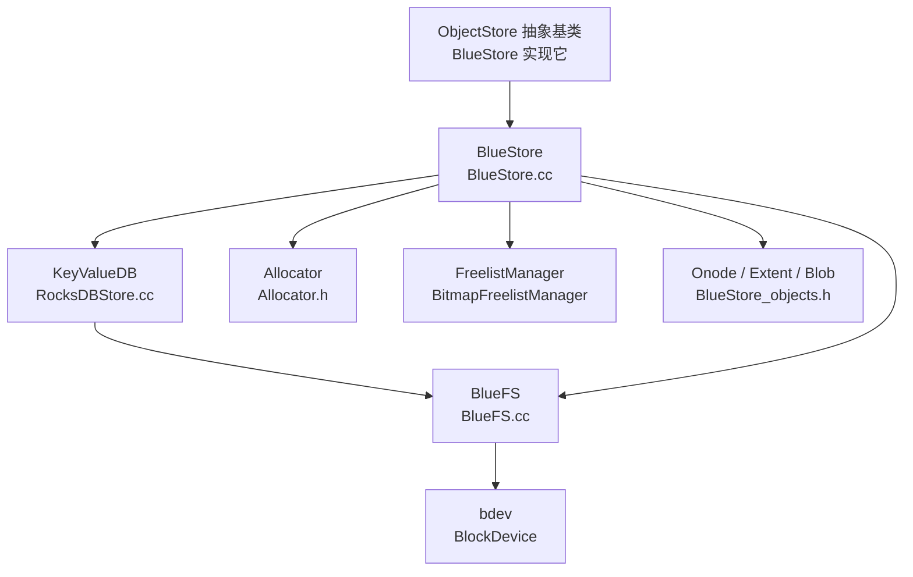
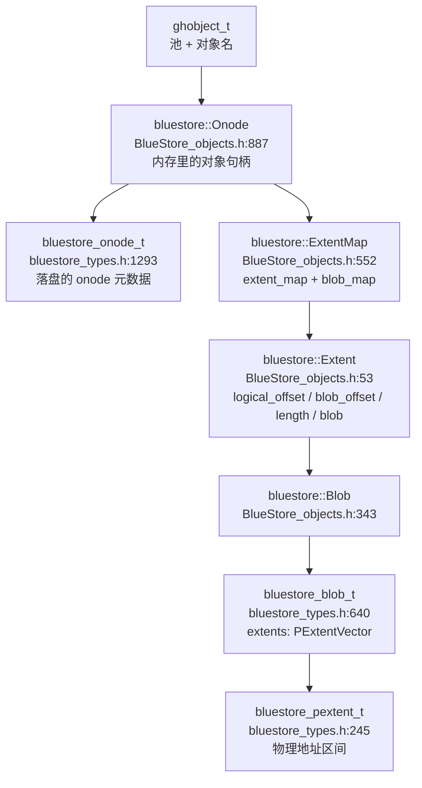
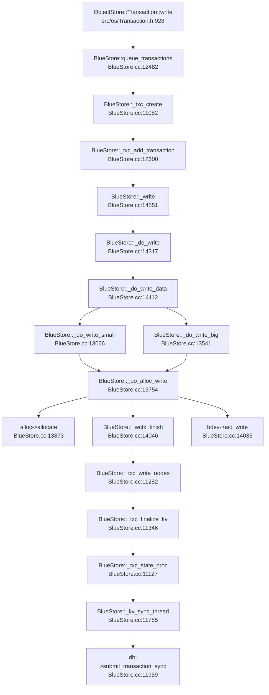
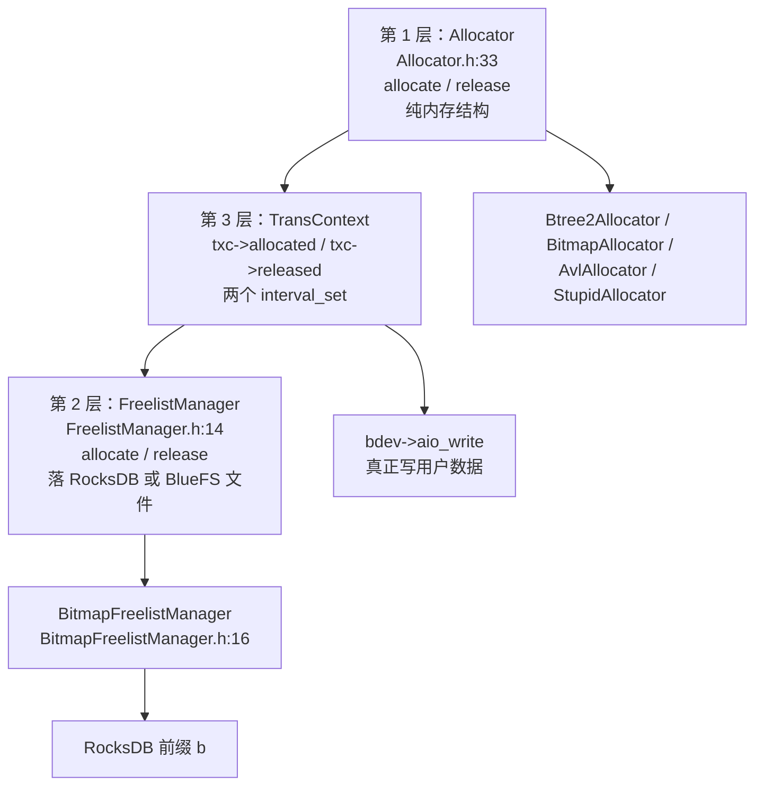
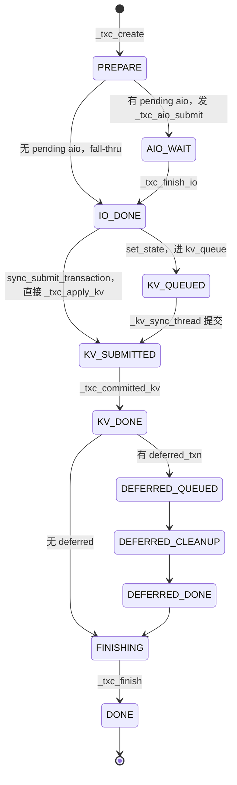

# 06 BlueStore：对象怎么变成 extent

| 编写人 | 编写内容 | 编写时间 |
| --- | --- | --- |
| growdu | 初稿：BlueStore 没有 journal 这个反直觉的设计、src/os/bluestore/ 目录地图、Onode→Extent→Blob 三层对象模型、一次写的完整调用链、v22 可插拔 allocator 家族与三层空闲记账、TransContext 事务状态机与「落盘」的准确定义、RocksDB 与 BlueFS 的分工、admin socket 动手项，以及一份 v22 对照表。 | 2026-11-26 |

> 上一章把 PG 映射到了 OSD。但 OSD 上还有一层：**RADOS 的对象到了 BlueStore
> 手里，变成了盘上的什么东西？** 这一章就跟着一个对象走一遍。
>
> BlueStore 是 Ceph 里被讲错得最厉害的一层。老文章里最常见的四个错误是：
> 1. 「BlueStore 有 journal，写先进 journal 再写盘」；
> 2. 「数据存在 RocksDB 里」；
> 3. 「有个 `BlueStore::Object` / `ObjectHandle` 类」；
> 4. 「allocator 有个 `alloc()` 和 `free()` 方法」。
>
> 读完你应该能回答：
> 1. BlueStore 到底有没有 journal？没有的话靠什么保证原子性？
> 2. 一个对象在盘上由哪几个结构拼出来？「extent」到底指哪一层的 extent？
> 3. 空间是怎么被分配出去的？allocator 和 freelist manager 是一回事吗？
> 4. `ceph osd write` 返回成功的那一刻，数据在哪儿？

本文所有行号基于 `/work/cwork/ceph`（`main` 分支，
`v22.0.0-975-g4c8da9d1553`）。

## 6.1 先纠正四个「结构性错误」

### 6.1.1 BlueStore 没有 journal

这是最贵的一个误解。BlueStore 一开始确实有 journal（一个独立的、小的、
顺序写的分区），后来整个删掉了。证据在 `src/os/bluestore/BlueStore.h:1652-1654`：

```cpp
  bool needs_journal() override { return false; };
  bool wants_journal() override { return false; };
  bool allows_journal() override { return false; };
```

三个函数**全部返回 false**。这三个函数是 `ObjectStore` 基类的接口——上游
FileStore / memstore 用它们回答「我要不要给你建 journal」。BlueStore 全说不要。

那原子性靠什么？靠 **RocksDB 的 WAL**。RocksDB 的 write-ahead log 本身
就是 RocksDB 的事务日志，元数据（对象布局、freelist 记账）先写 WAL 再写
SST，崩了可以从 WAL 重放。而用户数据根本不进 RocksDB，直接写 block device。

顺带说一句，RocksDB 的 WAL 也不是直接写在数据盘上，它写进 **BlueFS**，
而 BlueFS 自己在设备上预留了一块 **ino=1 的 metadata log**（见 §6.9）。
所以最终链路是：

```text
用户数据  → bdev（裸设备）
元数据    → RocksDB WAL → BlueFS → bdev
```

老文章里「BlueStore 的 WAL」这个说法本身没错，错的是把它说成
「BlueStore 自己的 journal 分区」——那东西在 v14 就被 RocksDB WAL 取代了。

### 6.1.2 数据不在 RocksDB 里

RocksDB 里只有**元数据**：对象的 extent map、blob 的物理位置、freelist 的
空闲位图、statfs、omap key-value。

用户数据走的是另一条路：BlueStore 直接对 block device 发
`bdev->aio_write()`。在 `src/os/bluestore/BlueStore.cc:14035-14040`：

```cpp
    bdev->aio_write(offset, t, &txc->ioc, false);
```

这一行在 `map_bl` 回调里——也就是**分配完空间之后，真正把用户字节写出去**的地方。

所以「RocksDB 存 BlueStore 的数据」是错的；「RocksDB 存 BlueStore 的元数据」
才对。搞混这个区别，就会搞不懂为什么 BlueStore 写一个小文件也要付出
「RocksDB 事务 + fsync」的成本。

### 6.1.3 老类名已经改名或消失

| 老文章里的名字 | v22 实际 |
| --- | --- |
| `BlueStore::Object` | **不存在**。现在是 `bluestore::Onode`（`BlueStore_objects.h:887`） |
| `ObjectHandle` | **几乎不存在**。v22 的 `ObjectStore` 不再用 `ObjectHandle` 抽象，事务直接按 `coll_t` + `ghobject_t` 定位（`src/os/Transaction.h:928`）；BlueStore 侧是 `bluestore::OnodeRef` |
| `BlueStore::onode_t` | **不存在**。是 `bluestore_onode_t`（`bluestore_types.h:1293`） |
| `bluestore::prefix_t` / `P_*` | **不存在**。改成裸 `char` 常量 `PREFIX_OBJ` 等（`BlueStore.cc:134-146`） |
| `BlueStore::submit_transactions` | **不存在**。改成 `_txc_create`（`:11052`）+ `_kv_sync_thread`（`:11785`） |
| `BlueStore::_open_meta` | **不存在**。是 `_open_fm`（`:3553`）/ `_create_alloc`（`:3670`）/ `_init_alloc`（`:3697`）/ `_open_db`（`:4544`） |
| `SharedAlloc.cc` | **不存在**。共享 blob 走 `bluestore::SharedBlob`（`BlueStore_objects.h:288`） |
| `FastBitmapAllocator` | **不存在**。类名是 `BitmapAllocator`（`BitmapAllocator.h:16`），但文件头 guard 还留着旧名 `CEPH_OS_BLUESTORE_BITMAPFASTALLOCATOR_H` |

### 6.1.4 allocator 的接口不叫 `alloc` / `free`

`class Allocator`（`src/os/bluestore/Allocator.h:33`）的接口是：

| 常见误写 | 实际 | 行号 |
| --- | --- | --- |
| `alloc()` | `allocate(want_size, block_size, max_alloc_size, hint, extents)` | `Allocator.h:54` |
| `free()` | `release(const release_set_t&)` | `Allocator.h:65` |
| `get_stats()` | **不存在**，相近的是 `get_free()` | `Allocator.h:140` |
| `get_map()` | **不存在**，相近的是 `get_free_extents()` | `Allocator.h:118` |
| `start_prepare()` / `finish_prepare()` | **不存在**。历史对应物是 `commit_start()` / `commit_finish()`，2016 年被 commit `5522dee8348` 删除 | — |
| `BlueStore::Allocator` | **不存在**。`Allocator` 是全局命名空间下的类，`BlueStore.h:73` 只有前向声明 | — |

`release_set_t` 定义在 `Allocator.h:25`：

```cpp
typedef interval_set<uint64_t> release_set_t;
```

注意这里的 `interval_set` 指的是**物理地址区间**（已用字节区间），不是
逻辑 extent。v22 里 `interval_set` 只在这个 typedef 和
`txc->allocated` / `txc->released` 上出现，别把它和 `Extent` 混起来。

## 6.2 `src/os/bluestore/` 目录地图

先看清楚哪些文件是「核心」，哪些是「边角」：

| 文件 | 行数 | 角色 |
| --- | --- | --- |
| `BlueStore.cc` | 18,266 | **绝对核心**。写路径、事务状态机、GC、恢复全在这 |
| `BlueFS.cc` | 6,006 | BlueFS：RocksDB 的存储后端 |
| `BlueStore_objects.cc` | 3,480 | Onode / Extent / Blob 的编码解码 |
| `BlueStore.h` | 2,870 | BlueStore 类声明 |
| `bluestore_types.h` | 1,801 | 落盘的元数据结构（`bluestore_onode_t` / `bluestore_blob_t` …） |
| `bluestore_types.cc` | 1,697 | 上述结构的 encode/decode |
| `BlueFS.h` | 1,493 | BlueFS 类声明 |
| `bluestore_tool.cc` | 1,452 | `ceph-bluestore-tool` 离线工具 |
| `Writer.cc` | 1,440 | 旧写路径的 `BlueStore::Writer`（write_v2 用） |
| `BlueStore_objects.h` | 1,096 | `Onode` / `Extent` / `Blob` / `ExtentMap` 定义 |
| `fastbmap_allocator_impl.h` | 1,044 | 位图分配器的 L0/L1/L2 三层实现 |
| `Btree2Allocator.cc` | 713 | btree2 分配器 |
| `BitmapFreelistManager.cc` | 638 | 空闲位图记账（落 RocksDB） |
| `BlueStore_components.h` | 598 | `TransContext` 状态机定义、`OpSequencer` |
| `BlueRocksEnv.cc` | 592 | RocksDB 的 file system 接口实现（落到 BlueFS） |
| `AvlAllocator.cc` | 575 | avl 分配器 |
| `BlueAdmin.cc` | 445 | admin socket 命令 |
| `StupidAllocator.cc` | 409 | 最笨的分配器（只用于测试） |

分层关系大致是这样：



注意最后两层：**BlueStore 直接持有 bdev**（用户数据走这条），
**RocksDB 也最终落到 BlueFS → bdev**（元数据走这条）。两条路共用同一个盘，
但不是同一套机制。

## 6.3 对象模型：Onode → Extent → Blob

这是本章的核心。RADOS 的一个对象（`ghobject_t`）在 BlueStore 里被拆成
**三层**。搞清楚这三层，「extent」这个词的两种含义也就清楚了。



### 6.3.1 第一层：`Onode` —— 「这个对象是谁」

`bluestore::Onode`（`BlueStore_objects.h:887`）是内存里的对象句柄，
挂在 collection 的 cache 上。它自己不描述布局，只做三件事：

- 记住**自己是谁**：`ghobject_t oid` 和 RocksDB 里的 key（`PREFIX_OBJ` + oid）；
- 挂一个 `ExtentMap extent_map`（`:906`）——真正的布局在这；
- 挂一个 `BlueStore::BufferSpace bc`（`:907`）——buffer cache。

它同时内嵌一个 `bluestore_onode_t onode`（`:900`），那是**要落盘的那份元数据**。
`bluestore_onode_t`（`bluestore_types.h:1293`）的内容很朴素：

| 字段 | 含义 |
| --- | --- |
| `nid` | 本地唯一的数值 id（`nid_max` 用它） |
| `size` | 对象大小 |
| `attrs` | 对象的 xattr |
| `extent_map_shards` | extent map 的分片信息（每片多少字节、从哪开始） |
| `expected_object_size` / `expected_write_size` | 写路径的预判，用来选小写还是大写 |
| `flags` | `FLAG_OMAP` / `FLAG_PERPG_OMAP` / `FLAG_PERPOOL_OMAP` 等 |

**注意 `bluestore_onode_t` 里没有 extent 列表**。布局是单独编码的，
按 shard 切开放在 `PREFIX_OBJ` 下。

### 6.3.2 第二层：`Extent` —— 「逻辑偏移落在哪个 blob 的哪一段」

`bluestore::Extent`（`BlueStore_objects.h:53`）只有四个字段：

```cpp
  struct Extent : public ExtentBase {
    uint32_t logical_offset = 0;      ///< logical offset
    uint32_t blob_offset = 0;         ///< blob offset
    uint32_t length = 0;              ///< length
    BlobRef  blob;                    ///< the blob with our data
```

翻译成人话：

> 对象的**逻辑偏移 `logical_offset`** 处的那 `length` 字节，
> 存在 **blob `blob`** 的 **`blob_offset`** 处。

这三个偏移的关系是 `blob_offset` **可以小于** `logical_offset`。差值就是
`blob_start() = logical_offset - blob_offset`（`:100`）。这正是 BlueStore
「拷贝时写新 blob、不改逻辑偏移」的实现方式：blob 可以被**共享**或
**部分覆盖**，逻辑地址不变。

排序规则只按逻辑偏移（`:88-90`）：

```cpp
    friend bool operator<(const Extent& a, const Extent& b) {
      return a.logical_offset < b.logical_offset;
    }
```

ExtentMap 里装它们的地方（`BlueStore_objects.h:119`）：

```cpp
  typedef boost::intrusive::set<Extent> extent_map_t;
```

**是 `boost::intrusive::set`，不是 `interval_set`**。这是 v22 的一处变化，
老文章写 `interval_set` 的要改。理由也很直白：extent 之间可以重叠
（同一个逻辑区间被两个 blob 覆盖，新的是旧的副本），interval_set 不允许。

`ExtentMap`（`:552`）里有两个 map：

```cpp
    extent_map_t extent_map;        ///< map of Extents to Blobs
    blob_map_t spanning_blob_map;   ///< blobs that span shards
```

`spanning_blob_map` 装的是**跨 shard 的大 blob**——一个 blob 的物理位置
跨越了多个 shard 边界时，它的 extent map 没法按片独立编码，只能单独放。

### 6.3.3 第三层：`Blob` —— 「物理上到底占了哪几段盘」

`bluestore::Blob`（`BlueStore_objects.h:343`）在内存里是个引用计数对象，
但真正落盘的是它内嵌的 `bluestore_blob_t blob`（`:361`）。
`bluestore_blob_t`（`bluestore_types.h:640`）的关键字段：

```cpp
  PExtentVector extents;              ///< raw data position on device
  uint32_t logical_length = 0;        ///< original length of data stored in the blob
  uint32_t compressed_length = 0;     ///< compressed length if any
  ...
  uint8_t csum_type = Checksummer::CSUM_NONE;
  ceph::buffer::ptr csum_data;
```

`extents` 是 `PExtentVector`（`bluestore_types.h:264`）：

```cpp
typedef mempool::bluestore_cache_other::vector<bluestore_pextent_t> PExtentVector;
```

`bluestore_pextent_t`（`:245`）继承自 `bluestore_interval_t<uint64_t, uint32_t>`，
就是一段**物理设备上的 [start, start+length) 区间**。

**这一层才是「extent」的物理含义**。所以「extent」这个词在 BlueStore 里有两义：

| 层 | 类型 | 说的是什么 |
| --- | --- | --- |
| 逻辑层 | `bluestore::Extent` | 对象的逻辑区间 → 某个 blob 的某一段 |
| 物理层 | `bluestore_pextent_t` | blob 的物理区间 → 设备上的字节范围 |

问「这个对象占了盘上哪些地方」，答案在 `bluestore_blob_t::extents`；
问「对象的第 4096 字节在哪儿」，答案在 `ExtentMap::extent_map`。

### 6.3.4 三层怎么拼起来

一个完整例子。假设对象 `obj1` 大小 100 KB，被写了两次：

```text
写第一次（100 KB）：
  Onode.size = 102400
  ExtentMap:
    Extent{logical_offset=0,  blob_offset=0, length=102400, blob=B1}
  Blob B1:
    bluestore_blob_t{ extents = [PExtent{off=0x100000, len=102400}] }
                         ↑ 设备上偏移 1MB 处的那 1MB

写第二次（覆盖前 10 KB，CoW）：
  ExtentMap:
    Extent{logical_offset=0,      blob_offset=0, length=10240,  blob=B2}  ← 新
    Extent{logical_offset=10240,  blob_offset=10240, length=92160, blob=B1} ← 旧 blob 保留
  Blob B2:
    bluestore_blob_t{ extents = [PExtent{off=0x900000, len=10240}] }
```

读 `obj1` 的第 5000 字节 → 在 `extent_map` 里找 `logical_offset` 落在
`[0, 10240)` 的那个 Extent → 是 B2 → 找 B2 的 `extents[0]` →
设备偏移 `0x900000 + (5000 - 0)`。

旧 blob B1 不会立刻释放——它可能还被快照引用。这个回收由 **GC**
（`_do_gc`，`BlueStore.cc:14262`）负责，不在写路径上。

## 6.4 一次写请求的完整链路

从 OSD 交下一个 `Transaction` 到数据落到设备，调用链是：



注意顺序：**事务先建，写在后**。`queue_transactions`（`:12482`）一进来
就 `_txc_create`（`:12500`）把事务建好，然后才逐个 op 执行
（`_txc_add_transaction`，`:12505`）——**数据就是在这中间写出去的**。
写完之后才轮到元数据：

```cpp
  _txc_write_nodes(txc, txc->t);      // :12509  onode / extent map 编码进 RocksDB 事务
  ...
  _txc_finalize_kv(txc, txc->t);      // :12521  freelist 记账进同一个事务
  ...
  _txc_state_proc(txc);               // :12562  启动状态机
```

分成三段看最清楚。

### 6.4.1 第一段：决定怎么写（`_write` → `_do_write` → `_do_write_data`）

最外层是 `BlueStore::_write`（`:14551`），它先给对象分配一个 nid
（`_assign_nid`），然后**二选一**：

```cpp
    _assign_nid(txc, o);
    if (use_write_v2) {
      r = _do_write_v2(txc, c, o, offset, length, bl, fadvise_flags);
    } else {
      r = _do_write(txc, c, o, offset, length, bl, fadvise_flags);
    }
```

| 分支 | 函数 | 说明 |
| --- | --- | --- |
| 普通写 | `_do_write`（`:14317`） | 老路径的主干 |
| write_v2 | `_do_write_v2`（`:14412`） | 新路径，用 `BlueStore::Writer`（`Writer.cc`） |
| 压缩写 | `_do_write_v2_compressed`（`:14484`） | write_v2 + 压缩 |

`bluestore_write_v2` 默认是 **false**（`src/common/options/global.yaml.in:5536-5544`），
注释写得很清楚：老路径是「随时间增量叠加功能」堆出来的，层层叠 inefficiencies；
重写是为了清掉这些层。

`_do_write`（`:14317`）本身很短，三步：

```cpp
  _do_write_data(txc, c, o, offset, length, bl, &wctx);   // :14355
  r = _do_alloc_write(txc, c, o, &wctx);                   // :14357
  ...
  _wctx_finish(txc, c, o, &wctx);                          // :14376
```

（`_do_alloc_write` 还有第二个调用点 `:14306`，在 `_do_gc`（`:14262`）里——
GC 搬数据也要分配空间。）

### 6.4.2 第二段：小写 / 大写 + 分配（`_do_write_small` / `_do_write_big` → `_do_alloc_write`）

`_do_write_data` 里会判断这次写的**长度**：

- 短（小于 `min_alloc_size` 一类的阈值）→ `_do_write_small`（`:13066`）
- 长 → `_do_write_big`（`:13541`）

两者都**不直接碰 allocator**，只登记：

```cpp
        wctx->write(offset, b, alloc_len, b_off0, bl, b_off, length, ...);   // :13111
```

登记完的写请求攒在 `wctx->writes` 里。真正的分配发生在
`_do_alloc_write`（`:13754`），这是**经典路径唯一的分配调用点**：

```cpp
    PExtentVector prealloc;                                       // :13869
    prealloc.reserve(2 * wctx->writes.size());                    // :13870
    int64_t prealloc_left = 0;                                    // :13871
    auto start = mono_clock::now();                               // :13872
    prealloc_left = alloc->allocate(                             // :13873  ← 唯一分配点
      need, min_alloc_size, need,
      use_last_allocator_lookup_position ? -1 : 0,
      &prealloc);
    log_latency("allocator@_do_alloc_write", l_bluestore_allocator_lat, ...);  // :13877
    if (prealloc_left < 0 || prealloc_left < (int64_t)need) {     // :13881
      derr << __func__ << " failed to allocate 0x" << std::hex << need ...;
      if (prealloc.size()) { alloc->release(prealloc); }          // :13888  ← 失败回滚
      return -ENOSPC;
    }
```

几个值得注意的点：

- **一次分配，所有写共享**。所有 write 需要的字节加起来一次问 allocator 要，
  拿到一段 `prealloc` 再切给各个 blob。切分在 `:13960-13982`。
- **分配粒度是 `min_alloc_size`**。`bluestore_min_alloc_size` 这个配置项
  默认是 **0**，意思是「按设备的 rotational 属性自己挑」——
  `BlueStore::_get_default_min_alloc_size`（`BlueStore.cc:8900`）会看
  `_use_rotational_settings()` 决定用 `bluestore_min_alloc_size_hdd`
  还是 `bluestore_min_alloc_size_ssd`（**两个默认都是 4_K**，
  `global.yaml.in:4914` / `:4932`）。而且这个值是 **mkfs 时烤进 OSD 的**
  （配置项标了 `flags: create`），改配置要重建 OSD 才生效。
  比 `min_alloc_size` 更小的写也要占一整个 `min_alloc_size`。
- **失败要回滚**。`alloc->release(prealloc)`（`:13888`）把刚要到的空间退回去。
- **记账在这一刻**：

```cpp
      for (auto& p : extents) {
        txc->allocated.insert(p.offset, p.length);                // :13980
      }
      dblob.allocated(p2align(b_off, min_alloc_size), final_length, extents);  // :13982
```

`txc->allocated` / `txc->released` 是两个 `interval_set<uint64_t>`，
它们是**这次事务占了/放了什么**的账（见 §6.6）。

write_v2 路径的分配点在 `BlueStore::Writer::_defer_or_allocate`
（`Writer.cc:1207`），实际调用在 `Writer.cc:1225`：

```cpp
    bstore->alloc->allocate(need_size, au_size, 0, 0, &allocated);
```

### 6.4.3 第三段：写数据 + 提交元数据

分配完之后，逻辑 extent 和物理 pextent 就都知道了，
`map_bl` 回调里把**用户字节**发出去（`BlueStore.cc:14035-14040`）：

```cpp
    bdev->aio_write(offset, t, &txc->ioc, false);
```

然后 `_wctx_finish`（`:14046`）收尾，把要释放的旧空间记进
`txc->released`（`:14096`）。

到这里**数据已经写进设备、元数据已经算好**，但事务还没提交。回看
`queue_transactions`（`:12482`）的完整顺序：

| 步骤 | 行号 | 干什么 |
| --- | --- | --- |
| 1 | `:12500` | `_txc_create` —— 建事务，开 RocksDB 事务，挂到 sequencer |
| 2 | `:12505` | `_txc_add_transaction` —— 逐个 op 执行（写数据） |
| 3 | `:12507` | `_txc_calc_cost` —— 算 throttling 成本 |
| 4 | `:12509` | `_txc_write_nodes` —— onode / extent map 编码进 RocksDB 事务 |
| 5 | `:12521` | `_txc_finalize_kv` —— freelist 记账进**同一个**事务 |
| 6 | `:12562` | `_txc_state_proc` —— 启动状态机 |

`_txc_create`（`:11052`）做的事很少：new 一个 `TransContext`、
`db->get_transaction()` 开一个 RocksDB 事务、`osr->queue_new(txc)` 挂到
sequencer 上。真正的状态机在 `_txc_state_proc`（`:11127`）。

## 6.5 分配器：v22 的可插拔家族

v22 把分配器改成了**接口 + 工厂**的结构，这是本章变化最大的地方。

### 6.5.1 工厂与六种类型

`Allocator::create`（`src/os/bluestore/Allocator.cc:38`）：

```cpp
  if (type == "stupid") {                                 // :46
    alloc = new StupidAllocator(cct, size, block_size, name);
  } else if (type == "bitmap") {                          // :48
    alloc = new BitmapAllocator(cct, size, block_size, name);
  } else if (type == "avl") {                             // :50
    return new AvlAllocator(cct, size, block_size, name);
  } else if (type == "btree") {                           // :52
    return new BtreeAllocator(cct, size, block_size, name);
  } else if (type == "hybrid") {                          // :54
    return new HybridAvlAllocator(cct, size, block_size, ...);
  }  else if (type == "hybrid_btree2") {                   // :58
    return new HybridBtree2Allocator(cct, size, block_size, ...);
  }
  if (alloc == nullptr) {                                  // :64
    lderr(cct) << "Allocator::" << __func__ << " unknown alloc type " << type << dendl;
  }
```

允许的类型由配置项 `bluestore_allocator`
（`src/common/options/global.yaml.in:5559-5571`）定义，**默认 `hybrid`**：

| type | 类 | `get_type()` 返回 | 文件 |
| --- | --- | --- | --- |
| `stupid` | `StupidAllocator` | `"stupid"` | `StupidAllocator.h:17` |
| `bitmap` | `BitmapAllocator` | `"bitmap"` | `BitmapAllocator.h:16` |
| `avl` | `AvlAllocator` | `"avl"` | `AvlAllocator.h:53` |
| `btree` | `BtreeAllocator` | — | `BtreeAllocator.h:14` |
| `hybrid` | `HybridAvlAllocator` | `"hybrid"` | `HybridAllocator.h:134` |
| `hybrid_btree2` | `HybridBtree2Allocator` | `"hybrid_btree2"` | `HybridAllocator.h:146` |

**两个坑**：

1. **没有 `fastbitmap` 这个 type**（全树零命中）。那个「快速位图分配器」
   现在的类名是 `BitmapAllocator`，`bitmap` 就是它。
2. **没有独立的 `btree2` 配置项**。`Btree2Allocator` 只能通过
   `hybrid_btree2` 走到，而它自己报的 `get_type()` 是 `"btree_v2"`
   （`Btree2Allocator.h:92`）——跟配置项名字对不上，别当成 bug。

### 6.5.2 `AllocatorBase` 提供什么

`class AllocatorBase : public Allocator`（`AllocatorBase.h:33`）**不实现**
`allocate` / `release` / `get_free` 中任何一个——那三个仍是 `Allocator` 的纯虚。
它提供的是共享基础设施：

| 内容 | 行号 | 作用 |
| --- | --- | --- |
| `LenPartitionedSetTraits` | `:42` | 按长度分桶的 traits 基类 |
| `LenPartitionedSetTraitsLinear` | `:73` | 线性分桶（`_get_bucket` 在 `:82`） |
| `LenPartitionedSetTraitsPow2` | `:108` | 指数分桶（`_get_bucket` 在 `:117`） |
| `LocklessOpportunisticStack` | `:149` | 无锁栈 |
| `OpportunisticExtentCache` | `:189` | 16 桶 × 16 条的无锁 extent 缓存 |
| `FreeStateHistogram` | `:279` | 空闲 extent 直方图（`record_extent` 在 `:298`） |
| `SocketHook` | `:304` | admin socket 命令（实现在 `AllocatorBase.cc:25`） |

admin socket 上能用的命令（注册在 `AllocatorBase.cc:39-62`，分发在 `:81-145`）：

```text
bluestore allocator dump
bluestore allocator score
bluestore allocator fragmentation
bluestore allocator fragmentation histogram
```

### 6.5.3 `Btree2Allocator`：空闲段的两棵树

`class Btree2Allocator`（`Btree2Allocator.h:23`）内部不用 `range` / `range_item`
（那两个名字全树零命中），而是：

| 元素 | 行号 | 说明 |
| --- | --- | --- |
| `struct range_seg_t { uint64_t start; uint64_t end; }` | `:31` | 空闲段，`end` 是**开区间**；`length()` 在 `:64` |
| `range_seg_t::before_t` | `:37` | 按 offset 排序：`lhs.end <= rhs.start` |
| `range_seg_t::shorter_t` | `:45` | 按 size 排序 |
| `range_tree_t` = `btree::btree_map<uint64_t, uint64_t, ...>` | `:143-148` | 主树：offset → end，实例在 `:150` |
| `range_size_tree_t` = `btree::btree_set<range_seg_t, ...>` | `:158-162` | 辅助树：按大小排序 |
| `range_size_set`（`vector<range_size_tree_t>`） | `:163` | 按大小分桶的树集合 |
| `num_free`（atomic uint64） | `:165` | 总空闲字节 |
| `RANGE_SIZE_BUCKET_COUNT = 14` | `:25` | 大小桶数量 |
| `cache` / `lock` | `:138-139` | 无锁快路径 + 主锁 |

`allocate` 的开头是无锁快路径（`Btree2Allocator.cc:90-104`）：

```cpp
    if (cache && cache->try_get(&cached_chunk_offs, want)) {   // :90
      num_free -= want;
      extents->emplace_back(cached_chunk_offs, want);
      ...
      return want;
    }
    std::lock_guard l(lock);                                    // :100
    auto ret = _allocate(want, unit, max_alloc_size, hint, extents);  // :104
```

`_allocate`（`:274`）按大小桶选树（`:293` 调 `myTraits._get_bucket(want_now)`），
再 `_pick_block`（`:507`）挑段：桶太宽松就退到更小的桶（取最大的），
太紧就退到更大的桶（取最小的），正好就 best-fit `lower_bound`。

释放则是 `release`（`:116`）→ 合并相邻空闲段 `_add_to_tree`（`:342`）。

### 6.5.4 `BitmapAllocator`：L0/L1/L2 三层位图

`class BitmapAllocator : public AllocatorBase,
public AllocatorLevel02<AllocatorLevel01Loose>`（`BitmapAllocator.h:16`）。

位图本体在 `fastbmap_allocator_impl.h`（1,044 行头文件 + 808 行实现）：

| 层 | 类 | 行号 | 作用 |
| --- | --- | --- | --- |
| 基类 | `AllocatorLevel` | `:147` | perf 计数器（`:155-160`） |
| L0/L1 | `AllocatorLevel01` | `:170` | 位图本体：`slot_vector_t l0`（`:173`）、`l1`（`:174`）、粒度（`:175-176`） |
| L1 变体 | `AllocatorLevel01Loose` | `:209` | L1 entry 编码 `FULL/PARTIAL/NOT_USED/FREE`（`:212-217`） |
| L1 变体 | `AllocatorLevel01Compact` | `:637` | 紧凑变体（当前**未被** BitmapAllocator 使用） |
| L2 | `AllocatorLevel02<L1>` | `:652` | 第二层：`l2`（`:782`）、`available`（`:784`）、`_allocate_l2`（`:880`） |

L0 用 `uint64_t` 做 slot（`slot_t`，`:21`），一个 slot 64 bit。
`find_next_set_bit()`（`:60`）是最底层的位扫描原语。

**位图本身不落盘**：`BitmapAllocator.h` / `.cc` 里没有任何 encode/decode 逻辑。
持久化靠 §6.6 说的 freelist manager。

## 6.6 空闲空间的三层记账

这是 v22 里最容易搞混的地方。**allocator 和 freelist manager 不是一回事**：

> **allocator 管「给我一段空间」；
> freelist manager 管「这块空间的账记在哪」。**

再加上 txc 自己的记账，一共三层。



### 6.6.1 第 2 层：`FreelistManager`

`class FreelistManager`（`FreelistManager.h:14`）是抽象基类，工厂在
`FreelistManager.cc:7`，只支持两种 type：

```cpp
    return new BitmapFreelistManager(cct, "B", "b");   // :18  type == "bitmap"
  if (type == "null") {
    // use BitmapFreelistManager with the null option to stop allocations from going to RocksDB
    auto *fm = new BitmapFreelistManager(cct, "B", "b");
    fm->set_null_manager();                              // :23
```

注意「null」**不是另一个类**，而是 `BitmapFreelistManager` 置了个 null 标志。

`BitmapFreelistManager` 的记账语义很有意思：**分配和释放是同一个操作**。
位图上 1 = 已占用，`allocate` 和 `release` 都走 `_xor()`（`:517`）翻转同一批 bit：

```cpp
void BitmapFreelistManager::allocate(uint64_t offset, uint64_t length,
                                     KeyValueDB::Transaction txn)
{
  dout(10) << __func__ << " 0x" << std::hex << offset << "~" << length << std::dec << dendl;
  if (!is_null_manager()) { _xor(offset, length, txn); }        // :501-503
}
```

配合 `struct XorMergeOperator`（`:32`，`name() == "bitwise_xor"`，`:50`），
用 `txn->merge(bitmap_prefix, k, bl)`（`:545` / `:563` / `:574` / `:592`）累积。
所以同一个 key 可以被反复翻转，RocksDB 的 merge operator 负责把翻转叠起来。

`get_meta()`（`:606`）产出 `bfm_blocks` / `bfm_size` /
`bfm_bytes_per_block` / `bfm_blocks_per_key`（`:611-621`），
写到 bdev label 的 `block` 文件里。

### 6.6.2 freelist 怎么进 RocksDB

在 `_txc_finalize_kv`（`BlueStore.cc:11346`）里：

```cpp
      fm->allocate(p.get_start(), p.get_len(), t)     // :11384
      fm->release(...)                                 // :11391
```

**这两个调用用的是 txc 的 RocksDB 事务 `t`**。也就是说空闲账本和元数据
**在同一个事务里 commit**——不需要额外持久化机制，天然一起落盘。

### 6.6.3 启动时怎么把账本灌回 allocator

`BlueStore::_init_alloc`（`:3697`）：

```cpp
      fm->enumerate_reset();                                  // :3711
      uint64_t offset, length;
      while (fm->enumerate_next(db, &offset, &length)) {
        alloc->init_add_free(offset, length);                 // :3714
        ++num; bytes += length;
      }
```

另一条分支（`freelist_type == "null"` 时）是本分支特有的 **allocation file** 路径：
分配映射写进 BlueFS 里的一个**平铺文件**（`ALLOCATOR_NCB_DIR` / `ALLOCATOR_NCB_FILE`，
常量在 `BlueStore.cc:16641-16642`）。写用 `BlueStore::store_allocator`（`:16938`），
读用 `BlueStore::restore_allocator`（`:17255`）。

崩溃恢复的兜底是 `SimpleBitmap`（`simple_bitmap.h:33`，**不是**分配器，
是个恢复工具）：从 onode 反推哪些块被占了（`read_allocation_from_onodes`，`:17467`），
重建分配映射（`reconstruct_allocations`，`:17606`）。

### 6.6.4 第 3 层：txc 的记账与「按序归还」

`txc->allocated` / `txc->released` 是两个 `interval_set<uint64_t>`，
分别在 `_do_alloc_write`（`:13980`）和 `_wctx_finish`（`:14096`）里填。

真正把空间还给 allocator 是 `_txc_release_alloc`（`:11566`）：

```cpp
void BlueStore::_txc_release_alloc(TransContext *txc)
{
    ...
    discard_queued = bdev->try_discard(txc->released);              // :11575
    // if async discard succeeded, will do alloc->release when discard callback
    // else we should release here
    if (!discard_queued) {
      ...
      alloc->release(txc->released);                                // :11581
    }
```

**归还必须严格按事务顺序**，否则后提交的事务释放的空间可能被先提交的
事务复用，而先提交的那个事务还在等 IO 落地——写穿。源码里的注释
（`BlueStore.cc:11538-11540`）说得很直白：

```cpp
    while (!releasing_txc.empty()) {
      // release to allocator only after all preceding txc's have also      // :11538
      // finished any deferred writes that potentially land in these        // :11539
      // blocks                                                              // :11540
      auto txc = &releasing_txc.front();                                  // :11541
      _txc_release_alloc(txc);                                            // :11542
      releasing_txc.pop_front();                                          // :11543
```

顺序是怎么保证的？`releasing_txc` 的填充逻辑在 `_txc_finish`（`:11484`）
的前半段（`:11504-11522`）：只有 `STATE_DONE` 的 txc 才被移进去，
而 `osr->q` 是 FIFO，前面有未完成的 txc 就 `break`。所以 `releasing_txc`
天然保持提交顺序，再从 `front()` 取，就是严格 FIFO 归还。

> 顺带一提：`_txc_release_alloc` 里 `:11569` 那条注释提到
> `lazy_release_lock`，但**这个锁在本树里已经不存在了**，
> `grep -rn "lazy_release_lock" src/os/bluestore/` 只命中这条注释本身。
> 那是遗留注释，别引用那个锁。

## 6.7 事务状态机：一次写什么时候算「落盘」

`TransContext` 的状态枚举定义在 `BlueStore_components.h:133-145`，
一共 **11 个状态**：

```cpp
  enum state_t {
    STATE_PREPARE,
    STATE_AIO_WAIT,
    STATE_IO_DONE,
    STATE_KV_QUEUED,
    STATE_KV_SUBMITTED,
    STATE_KV_DONE,
    STATE_DEFERRED_QUEUED,
    STATE_DEFERRED_CLEANUP,
    STATE_DEFERRED_DONE,
    STATE_FINISHING,
    STATE_DONE,
  };
```

状态机跑在 `BlueStore::_txc_state_proc`（`BlueStore.cc:11127`）里：



### 6.7.1 关键分叉：`bluestore_sync_submit_transaction`

在 `STATE_IO_DONE`（`:11127` 起的 switch 里）有一个重要分支：

```cpp
      if (cct->_conf->bluestore_sync_submit_transaction) {
        ... 一堆前置条件检查 ...
        } else {
          _txc_apply_kv(txc, true);     // 直接在本线程提交
        }
      }
      {
        std::lock_guard l(kv_lock);
        kv_queue.push_back(txc);        // 或者丢给 kv_sync_thread
```

两条路：

- **默认（`bluestore_sync_submit_transaction = false`）**：txc 进 `kv_queue`，
  由专门的 `_kv_sync_thread`（`:11785`）批量提交。这样多个事务可以合并成
  一个 RocksDB 事务，吞吐更高。
- **开启**：在本线程直接 `_txc_apply_kv(txc, true)` 提交。

不管哪条，最终都要走到 `submit_transaction_sync`。

### 6.7.2 「落盘」的准确定义

这是本章最该带走的一句话。

`_kv_sync_thread` 里（元数据提交部分，`BlueStore.cc:11957-11960`）：

```cpp
      // submit synct synchronously (block and wait for it to commit)
      int r = cct->_conf->bluestore_debug_omit_kv_commit ?
	0 : db->submit_transaction_sync(synct);
      ceph_assert(r == 0);
```

所以「元数据落盘」= **RocksDB 事务被同步提交**。往下走：

```text
db->submit_transaction_sync(synct)          RocksDBStore.cc:1641
  → RocksDB WAL 写入并 fsync
  → WAL 落在 BlueFS 的文件里
  → BlueFS::_fsync                       BlueFS.cc:4522
  → BlueFS::_flush_and_sync_log_core     BlueFS.cc:3808
  → bdev flush
  → ::fdatasync                          src/blk/kernel/KernelDevice.cc:552
```

而**用户数据**的落盘是另一条线：`_do_alloc_write` 里的
`bdev->aio_write()`（`:14035`）+ `bdev->flush()`。

**两条线的关系**：

| | 用户数据 | 元数据 |
| --- | --- | --- |
| 写到哪 | bdev（裸设备） | RocksDB WAL → BlueFS → bdev |
| 谁保证顺序 | txc 顺序 + `_txc_release_alloc` 的 FIFO | RocksDB 事务 |
| 「落盘」判据 | `bdev->flush()` 完成 | `submit_transaction_sync` 返回 |

**回答「`ceph osd write` 返回成功时数据在哪儿」**：
在 `STATE_DONE` 之前，元数据已经 `submit_transaction_sync` 过了；
用户数据的 aio 也已经完成（`STATE_AIO_WAIT` → `STATE_IO_DONE`）。
但**设备上的缓存可能还没落盘**——那要等 BlueFS 的 `_fsync` 或
bdev 的 flush。BlueStore 用 `bdev` 的 write-back 模式，所以严格意义上
「返回成功」= 「已提交给设备，不保证已在介质上」。

### 6.7.3 deferred 事务

`STATE_DEFERRED_*` 三个状态是给 **deferred write** 用的：
写还没真的落盘，事务先提交，IO 完成后再补一笔（`_deferred_queue`）。
`PREFIX_DEFERRED`（`"L"`）就是它的 key 前缀。

这也是 §6.6.4 那段注释提到的「deferred writes that potentially land in these
blocks」的来源。

## 6.8 读路径

读比写简单：拿到逻辑区间 → 查 extent map → 查 blob 的 pextent →
读 bdev。

| 函数 | 位置 | 作用 |
| --- | --- | --- |
| `BlueStore::_read_cache` | `:9285` | 先查 buffer cache |
| `BlueStore::_do_read` | `:9593` | 真正发起读 |
| `BlueStore::_do_readv` | `:10032` | 散读（vectored） |

读路径**不分配空间**，也不改元数据，所以没有 txc 状态机那一套。
这也是为什么 Ceph 的读延迟通常远低于写。

## 6.9 BlueFS 与 RocksDB 的分工

很多人以为 RocksDB 是个纯粹的库，跟 BlueStore 平行。实际关系是：

> **BlueFS 是 RocksDB 的存储后端。**

`BlueRocksEnv`（`BlueRocksEnv.cc`）实现 RocksDB 的 `Env` 接口，
把 RocksDB 的 SST / WAL / MANIFEST 都落到 BlueFS 上。

BlueFS 自己在设备上的布局（`BlueFS.h:276-281`）：

```cpp
  static constexpr unsigned MAX_BDEV = 5;
  static constexpr unsigned BDEV_WAL = 0;
  static constexpr unsigned BDEV_DB = 1;
  static constexpr unsigned BDEV_SLOW = 2;
  static constexpr unsigned BDEV_NEWWAL = 3;
  static constexpr unsigned BDEV_NEWDB = 4;
```

- `BDEV_DB`（1）= RocksDB 的 SST 文件，也就是 `db/` 目录
- `BDEV_WAL`（0）= RocksDB 的 WAL，也就是 `db.wal/`
- `BDEV_SLOW`（2）= RocksDB 的 SST 临时文件，也就是 `db.slow/`

（`BDEV_NEWWAL` / `BDEV_NEWDB` 是 BlueFS 换盘时用的新设备。）

BlueFS 里所有文件的 inode 都是 `ino=1` 的 **metadata log**——一个顺序写的、
带 CRC 的元数据日志。文件本身的元数据（大小、mtime、blob 位置）记在里面，
这取代了老 BlueStore 的 journal。

老文章里说「BlueFS 用 journal 记录元数据」在概念上没错，
但在 v22 里它的正式名字是 **metadata log**，代码在 `BlueFS.cc:3808`
（`_flush_and_sync_log_core`）和 `BlueFS.cc:4522`（`_fsync`）。

## 6.10 动手

### 6.10.1 admin socket

OSD 的 admin socket 里能直接问 BlueStore：

```bash
# 进 OSD 的 admin socket
ceph daemon osd.0 admin-socket
> help
```

BlueStore 侧注册的命令（`src/os/bluestore/BlueAdmin.cc:115-190`）：

| 命令 | 干什么 |
| --- | --- |
| `bluestore collections` | 列出所有 collection |
| `bluestore list name=collection` | 列某个 collection 里的对象 |
| `bluestore onode metadata name=object_name` | **打印对象的内部结构**（onode / extent map / blob） |
| `bluestore cache stats` | buffer cache 命中统计 |
| `bluestore compression stats` | 压缩统计（按 collection） |
| `bluestore runtime frag score` / `bluestore static frag score` | 运行时 / 静态碎片评分 |
| `bluestore clear runtime frag` / `bluestore clear static frag` | 清掉上面两个的累计值 |
| `bluestore show sharding` | 看 RocksDB 分片 |
| `bluestore bluefs device info` | BlueFS 各 bdev 的信息 |
| `bluestore bluefs-bdev-expand` | 盘扩了容量后让 BlueFS 用上新增空间 |

BlueFS 侧（`src/os/bluestore/BlueFS.cc`）：

| 命令 | 干什么 |
| --- | --- |
| `bluefs files list` | 列 BlueFS 里的文件 |
| `bluefs stats` / `bluefs stats reset` | BlueFS 统计 |
| `bluefs spillover cleaner stats` | spillover 清理器统计 |
| `bluefs debug_inject_read_zeros` | 故障注入 |

分配器侧（`src/os/bluestore/AllocatorBase.cc:39-62`）的命令带一个
**分配器名后缀**（默认是 `block`）：

| 命令 | 干什么 |
| --- | --- |
| `bluestore allocator dump block` | dump 空闲段 |
| `bluestore allocator score block` | 碎片评分（0 = 无碎片，1 = 绝对碎片） |
| `bluestore allocator fragmentation block` | 碎片率 |
| `bluestore allocator fragmentation histogram block` | 空闲段直方图 |

**注意：没有 `bluestore dump` 这个命令**。老文章里说的
`bluestore dump` 在 v22 里不存在；要看对象的内部结构，用
`bluestore onode metadata`。

### 6.10.2 断点表

按 §6.4 的调用链下断点：

| 断点 | 文件:行 | 看什么 |
| --- | --- | --- |
| `_do_alloc_write` | `BlueStore.cc:13754` | 这次写要多少字节、预分配多少 |
| `alloc->allocate` | `BlueStore.cc:13873` | 分配器返回的物理区间 |
| `bdev->aio_write` | `BlueStore.cc:14035` | 用户数据真正写出去 |
| `_wctx_finish` | `BlueStore.cc:14046` | `txc->released` 里有什么 |
| `_txc_create` | `BlueStore.cc:11052` | 事务起点 |
| `_txc_state_proc` | `BlueStore.cc:11127` | 状态跳转 |
| `_txc_finalize_kv` | `BlueStore.cc:11346` | freelist 记账进同一个事务 |
| `submit_transaction_sync` | `BlueStore.cc:11959` | 元数据真正 commit |
| `_txc_release_alloc` | `BlueStore.cc:11566` | 空间归还 |

### 6.10.3 单测

Ceph 的单测都在 `src/test/` 下。BlueStore 这一摊在 **`src/test/objectstore/`**：

```text
src/test/objectstore/
  Allocator_test.cc             分配器通用测试
  fastbmap_allocator_test.cc    位图分配器
  hybrid_allocator_test.cc      hybrid 分配器
  allocator_replay_test.cc      分配器操作序列回放
  Allocator_aging_fragmentation.cc
  Allocator_bench.cc
  store_test.cc / store_test_fixture.cc   BlueStore 主体
  test_bluefs.cc / test_bluefs_ex.cc      BlueFS
  test_bluerocksenv.cc          RocksDB Env 接口
  test_deferred.cc              deferred 事务
  test_transaction.cc           事务状态机
  test_kv.cc                    KV 层
  allocsim/                     分配器模拟器
```

分配器那几个尤其值得读——它们用同一串操作序列去跑不同的分配器，
断言结果一致，能直接看出各分配器的取舍。

### 6.10.4 离线工具

`ceph-bluestore-tool`（`src/os/bluestore/bluestore_tool.cc`，1,452 行）能
离线读一个 OSD 目录。常用的几个 action（`:494-660` 是 action 分发表）：

```bash
# 看 bdev label（超块）
ceph-bluestore-tool show-label --path /var/lib/ceph/osd/ceph-0

# 看 BlueFS 的 super 和 metadata log
ceph-bluestore-tool bluefs-super-dump --path /var/lib/ceph/osd/ceph-0
ceph-bluestore-tool bluefs-log-dump --path /var/lib/ceph/osd/ceph-0

# 看空闲区
ceph-bluestore-tool free-dump --path /var/lib/ceph/osd/ceph-0
ceph-bluestore-tool free-score --path /var/lib/ceph/osd/ceph-0

# 一致性检查与修复
ceph-bluestore-tool fsck --path /var/lib/ceph/osd/ceph-0
ceph-bluestore-tool repair --path /var/lib/ceph/osd/ceph-0
```

**没有 `ceph-bluestore-tool dump` 这个 action**——老文章里写的那个不存在。
整个 action 列表里跟 BlueFS 相关的还有 `bluefs-export` / `bluefs-import`
（把 BlueFS 导出来看）、`bluefs-bdev-sizes` / `bluefs-bdev-expand`、
`allocmap`、`zap-device` 等。

调试元数据问题时比起在跑着的 OSD 上方便得多。

## 6.11 小结

- **BlueStore 没有 journal**。`needs_journal()` / `wants_journal()` /
  `allows_journal()` 全返回 false（`BlueStore.h:1652-1654`）。
  元数据的原子性靠 RocksDB 的 WAL；用户数据根本不进 RocksDB。
- **数据走 bdev，元数据走 RocksDB**。用户字节由
  `bdev->aio_write()`（`BlueStore.cc:14035`）直接写设备；
  元数据由 `submit_transaction_sync()`（`:11959`）提交。
- **对象模型是三层**：`Onode`（谁）→ `Extent`（逻辑区间 → blob）
  → `bluestore_blob_t::extents`（物理区间）。
  中间那层用 `boost::intrusive::set<Extent>`（`BlueStore_objects.h:119`），
  不是 `interval_set`。
- **「extent」有两义**：`bluestore::Extent` 是逻辑映射，
  `bluestore_pextent_t` 是物理区间。
- **分配器是可插拔的**。`Allocator::create`（`Allocator.cc:38`）六种 type，
  默认 `hybrid`。没有 `fastbitmap`；`btree2` 只能通过 `hybrid_btree2` 走到。
- **分配调用点只有一个**：经典路径的 `_do_alloc_write`（`:13754`），
  `alloc->allocate` 在 `:13873`。write_v2 的在 `Writer.cc:1225`。
- **空闲记账分三层**：allocator（给空间）、freelist manager（记在哪，
  落 RocksDB）、txc（本次占/放，随事务一起持久化）。
- **空间归还严格按事务顺序**，靠 `_txc_finish` 的 FIFO 队列 +
  `BlueStore.cc:11538-11540` 的注释。
- **「落盘」的判据**是 `submit_transaction_sync` 返回（元数据）
  加 aio 完成（数据），不是「设备缓存已刷」。

下一篇：[07 事务与 journal：一次写什么时候算「落盘」](./07-事务与journal写什么时候算落盘.md)

## 6.12 v22 对照表

| 老文章里通常这么写 | v22（本树）实际是 |
| --- | --- |
| BlueStore 有 journal（独立分区） | **没有**。`BlueStore.h:1652-1654` 三个接口全返回 false |
| BlueStore 的 WAL 落在数据盘上一个独立分区 | **不存在**。元数据走 RocksDB WAL → BlueFS 的 metadata log（ino=1） |
| 数据存在 RocksDB 里 | **错**。RocksDB 只存元数据；用户数据由 `bdev->aio_write` 直接写设备 |
| `BlueStore::Object` | **不存在**。是 `bluestore::Onode`（`BlueStore_objects.h:887`） |
| `ObjectHandle` | **不存在**。BlueStore 侧是 `bluestore::OnodeRef` |
| `BlueStore::onode_t` | **不存在**。是 `bluestore_onode_t`（`bluestore_types.h:1293`） |
| `bluestore::prefix_t` / `P_OBJECT` 等枚举 | **不存在**。是裸 char 常量 `PREFIX_OBJ`（`BlueStore.cc:134-146`） |
| `BlueStore::submit_transactions` | **不存在**。是 `_txc_create`（`:11052`）+ `_kv_sync_thread`（`:11785`） |
| `BlueStore::_open_meta` | **不存在**。是 `_open_fm` / `_create_alloc` / `_init_alloc` / `_open_db` |
| `SharedAlloc.cc` | **不存在**。共享 blob 是 `bluestore::SharedBlob`（`BlueStore_objects.h:288`） |
| `FastBitmapAllocator` | **不存在**。类名是 `BitmapAllocator`（`BitmapAllocator.h:16`），文件头 guard 还留旧名 |
| `bluestore_allocator = fastbitmap` | **没有这个 type**（全树零命中）。`bitmap` 才是它 |
| `bluestore_allocator = btree2` | **没有这个配置项**。btree2 只能通过 `hybrid_btree2` 走到，它报的 type 是 `"btree_v2"` |
| allocator 接口是 `alloc()` / `free()` | **是 `allocate()` / `release()`**（`Allocator.h:54` / `:65`） |
| allocator 有 `get_stats()` / `get_map()` | **不存在**。相近的是 `get_free()`（`:140`）/ `get_free_extents()`（`:118`） |
| allocator 有 `start_prepare()` / `finish_prepare()` | **不存在**。历史对应物 `commit_start()` / `commit_finish()` 2016 年已删 |
| `BlueStore::Allocator` | **不存在**。`Allocator` 是全局命名空间的类，`BlueStore.h:73` 只有前向声明 |
| `BlueStore::_do_alloc()` | **不存在**。是 `_do_alloc_write()`（`:13754`） |
| `_do_write_small` / `_do_write_big` 里调 allocator | **不调**。它们只登记 `wctx->write`；分配在 `_do_alloc_write`（`:13873`） |
| 写路径是 `BlueStore::Writer` | **默认不是**。默认是 `_do_write_data`（`:14112`）；`Writer` 走 write_v2（默认关） |
| `bluestore_write_v2` 默认开 | **默认 false**（`global.yaml.in:5536-5544`） |
| extent map 用 `interval_set` | **是 `boost::intrusive::set<Extent>`**（`BlueStore_objects.h:119`） |
| `bluestore_blob_t` 里存的是 extent 列表 | **存的是 `PExtentVector`**（物理区间，`bluestore_types.h:642`） |
| allocator 自己把空闲区持久化 | **不持久化**。由 `BitmapFreelistManager` 落 RocksDB（`txn->merge` + XOR merge operator） |
| 分配和释放是两套代码 | **同一个操作**。都走 `_xor()`（`BitmapFreelistManager.cc:517`）翻转同一批 bit |
| 释放空间可以乱序 | **严格按 txc 序**。`BlueStore.cc:11538-11540` 注释 + `:11504-11522` 的 FIFO 抽取 |
| `_txc_release_alloc` 由 `lazy_release_lock` 保护 | **该锁已不存在**。`:11569` 那条注释是遗留注释 |
| BlueStore 的元数据由 journal 保证原子 | **由 RocksDB 事务保证**。freelist 记账和元数据在同一个 txc 里 commit（`:11384` / `:11391`） |
| 事务状态机有 6 个状态 | **11 个**（`BlueStore_components.h:133-145`） |
| 「落盘」= fsync 返回 | **是 `submit_transaction_sync` 返回**（`:11959`）+ aio 完成；设备缓存未必已刷 |
| BlueFS 用 journal 存元数据 | **叫 metadata log**（ino=1）。`BlueFS.cc:3808` / `:4522` |
| RocksDB 是 BlueStore 的兄弟组件 | **BlueFS 是 RocksDB 的存储后端**。`BlueRocksEnv.cc` 实现 RocksDB 的 Env 接口 |
| `Btree2Allocator` 内部用 `range` / `range_item` | **用 `range_seg_t` + `range_tree` + `range_size_set`**（`Btree2Allocator.h:31` / `:143` / `:158`） |
| `Btree2Allocator` 有 `_pending_free` / `_pending_garbage` | **不存在**。释放即刻写回 `range_tree`，或先进无锁 `cache` |
| `fastbmap_allocator_impl.cc` 只有 10 行 | **808 行**。`fastbmap_allocator_impl.h` 1,044 行 + `.cc` 808 行 |
