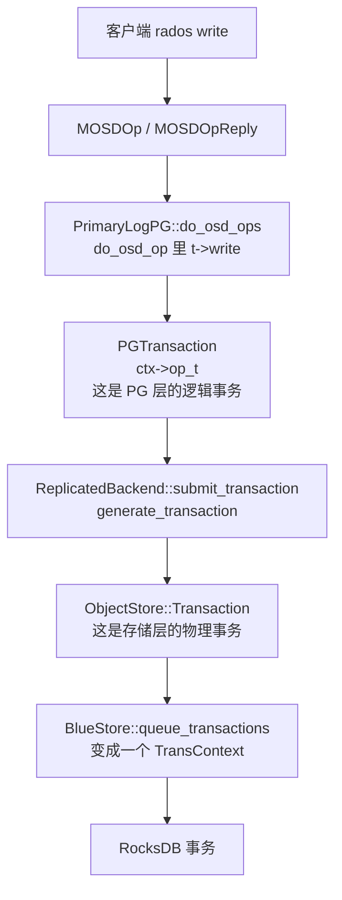
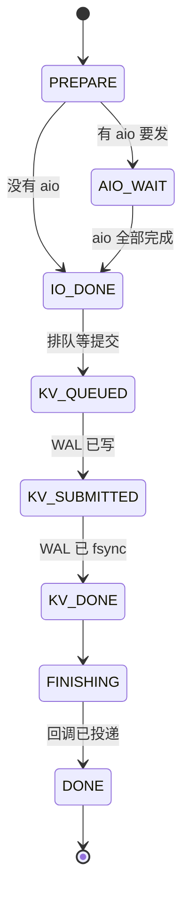
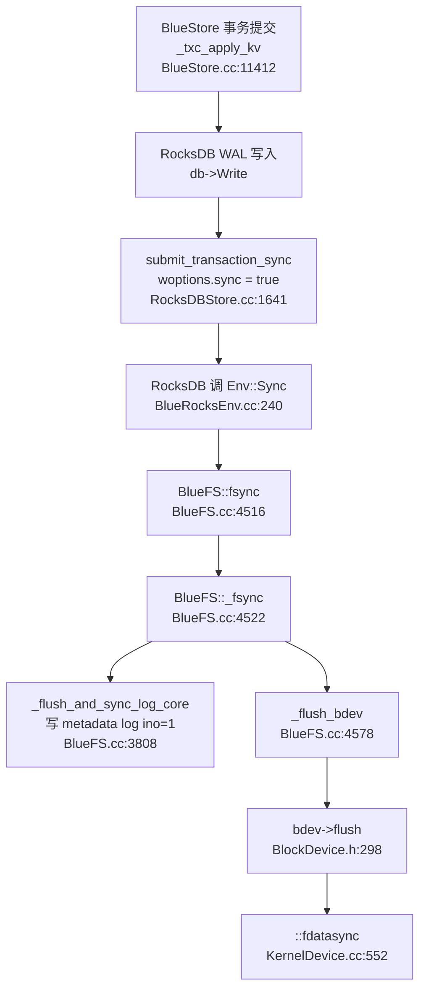
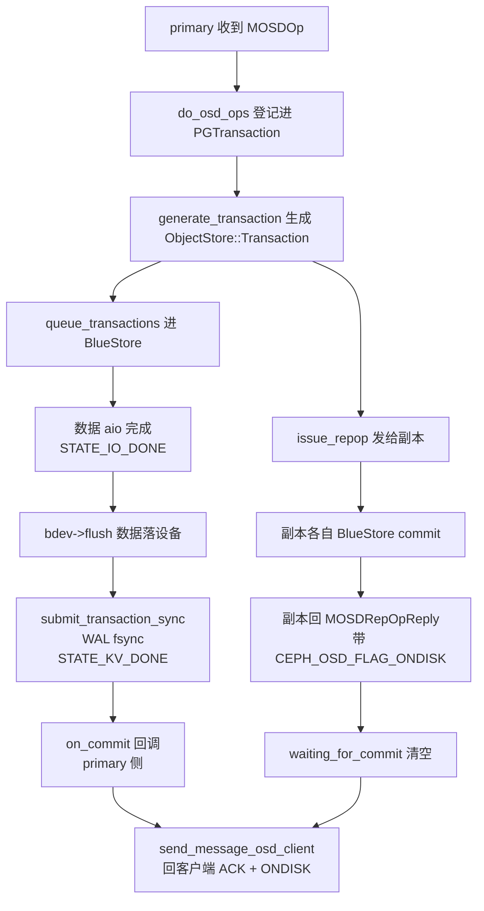

# 07 事务与 journal：一次写什么时候算「落盘」

| 编写人 | 编写内容 | 编写时间 |
| --- | --- | --- |
| growdu | 初稿：「journal」这个词在 v22 的四层含义与 FileStore 的彻底退场、ObjectStore 事务的三个回调及其触发时机、OSD 写请求到 ObjectStore::Transaction 的转换链、BlueStore 事务状态机与提交的两条通道、`submit_transaction_sync` 往下到 `fdatasync` 的完整落盘链路、数据先于元数据的顺序约束、deferred write 的例外与恢复、客户端 ack 的确切时刻，以及一份 v22 对照表。 | 2026-11-26 |

> 上一章说 BlueStore 没有 journal。读者自然会追问：
> **那 journal 到底去哪了？「ceph osd write 返回成功」那一刻，数据在哪儿？**
>
> 这是 Ceph 里第二个被讲错得最厉害的地方。老文章里常见的几个说法：
> 1. 「OSD 有个 journal 盘，op 先写 journal 再写 data」；
> 2. 「write 返回成功 = fsync 完成 = 数据在盘上」；
> 3. 「BlueStore 的事务提交就是往 journal 里写一条记录」。
>
> 读完你应该能回答：
> 1. v22 里还有 journal 吗？分四层看，答案分别是什么？
> 2. `on_applied_sync` / `on_applied` / `on_commit` 三个回调分别在哪一刻触发？
> 3. BlueStore 的一个事务从 prepare 到 commit 走了哪几个状态？提交有哪两条通道？
> 4. 「落盘」到底以什么为准？为什么不能简单说「fsync 完成」？
> 5. 用户数据和元数据谁先落盘？为什么这个顺序不能反？
> 6. deferred write 是什么？它凭什么能打破上一条的顺序？
> 7. 客户端收到写成功，是 BlueStore 说的，还是 OSD 说的？

本文所有行号基于 `/work/cwork/ceph`（`main` 分支，
`v22.0.0-975-g4c8da9d1553`）。

## 7.1 「journal」这个词，在 v22 有四层含义

老文章说「Ceph 的 journal」时，指的可能是下面**四个完全不同的东西**。
它们在 v22 的命运不一样，所以先把话说清楚。

| 层 | 是什么 | v22 状态 | 证据 |
| --- | --- | --- | --- |
| OSD 的 op journal | FileStore 时代那块独立的 journal 设备，OSD op 先写它 | **整个没了** | `src/os/ObjectStore.cc:51-53` |
| ObjectStore 的 journal 接口 | 基类上的 `needs_journal()` 等接口 | **接口还在，BlueStore 全答「不要」** | `src/os/bluestore/BlueStore.h:1652-1654` |
| RocksDB 的 WAL | RocksDB 自己的 redo log，元数据的原子性靠它 | **在，而且是唯一的元数据原子性来源** | `src/kv/RocksDBStore.cc:1641-1646` |
| BlueFS 的 metadata log | BlueFS 自己的元数据日志，ino=1 | **在** | `src/os/bluestore/BlueFS.cc:3808` |

### 7.1.1 FileStore 已经被整个删掉

这是 v22 里最干脆的一处变化。`src/os/` 目录下现在只有：

```text
src/os/
├── bluestore/
├── fs/            # 设备探测：FS / XFS / ZFS
├── memstore/      # 内存实现，单元测试用
├── FuseStore.cc/.h
├── kv.h
├── ObjectStore.cc/.h
├── SequencerPosition.h
└── Transaction.cc/.h
```

`FileStore.cc` / `FileStore.h` **不在了**。而 `ObjectStore::create` 里还留着
一句给老配置看的提示（`src/os/ObjectStore.cc:44-56`）：

```cpp
std::unique_ptr<ObjectStore> ObjectStore::create(
  CephContext *cct,
  const string& type,
  const string& data,
  const string& journal,
  osflagbits_t flags)
{
  if (type == "filestore") {
    lgeneric_derr(cct) << __func__ << ": FileStore has been deprecated and is no longer supported" << dendl;
    return nullptr;
  }
  return create(cct, type, data);
}
```

注意 `journal` 这个形参还在（`ObjectStore` 基类的接口没动），
但 `type == "filestore"` 直接返回 `nullptr`。**在 v22 上把
`osd_objectstore = filestore` 写进配置，OSD 起不来。**

### 7.1.2 接口还在，但 BlueStore 全说「不要」

`src/os/bluestore/BlueStore.h:1652-1654`：

```cpp
  bool needs_journal() override { return false; };
  bool wants_journal() override { return false; };
  bool allows_journal() override { return false; };
```

所以「给 BlueStore 配一个 journal 设备」这件事在 v22 没有任何效果——
`bluestore_block_wal_path` 是 **BlueFS 的 WAL 设备**（放 RocksDB 的 WAL 和
BlueFS 的 metadata log），不是 FileStore 意义上的 journal 盘。

### 7.1.3 `flush_journal` 这个命令还在，但它是空转

OSD 的 admin socket 里还注册着 `flush_journal`（`src/osd/OSD.cc:4111-4114`），
处理函数在 `src/osd/OSD.cc:2874-2875`：

```cpp
  } else if (prefix == "flush_journal") {
    store->flush_journal();
```

但 `ObjectStore::flush_journal()` 的默认实现是
`src/os/ObjectStore.h:787`：

```cpp
  virtual int flush_journal() { return -EOPNOTSUPP; }
```

**BlueStore 没有覆盖它**（全树零命中），而且 OSD 的处理函数**连返回值都没看**。
所以：

```bash
$ ceph daemon osd.0 flush_journal
ok
```

命令返回 ok，但什么也没发生。这是「接口留着、实现没了」的典型残留，
也是判断一篇文章是不是在讲老 Ceph 的一个很好的试纸。

### 7.1.4 那两个真的在的日志

**RocksDB 的 WAL**：`RocksDBStore::submit_transaction_sync`
（`src/kv/RocksDBStore.cc:1641-1646`）：

```cpp
int RocksDBStore::submit_transaction_sync(KeyValueDB::Transaction t)
{
  utime_t start = ceph_clock_now();
  rocksdb::WriteOptions woptions;
  // if disableWAL, sync can't set
  woptions.sync = !disableWAL;

  int result = submit_common(woptions, t);
```

`sync = true` 的意思是「写完 WAL 之后要 fsync 一下才返回」。

**BlueFS 的 metadata log**：BlueFS 自己要记录「文件 A 的第 3 块分配到了
设备 1 的偏移 X」这类元数据变化，它用一块 ino=1 的文件当日志，
写在 `src/os/bluestore/BlueFS.cc:3808` 的 `_flush_and_sync_log_core()` 里。

于是完整的元数据落盘链路是**三级**的：

```text
BlueStore 事务
   ↓  RocksDB WAL（db.wal）
BlueFS 文件 + metadata log（ino=1）
   ↓  BlueFS log 落到设备
块设备
```

§7.6 会一层一层拆开。

## 7.2 ObjectStore 事务的三个回调

`src/os/Transaction.h` 的文件头注释（`:26-59`）把这个契约写得很清楚，
值得原文引用：

```cpp
 * Three events in the life of a Transaction result in
 * callbacks. Any Transaction can contain any number of callback
 * objects (Context) for any combination of the three classes of
 * callbacks:
 *
 *    on_applied_sync, on_applied, and on_commit.
 *
 * The "on_applied" and "on_applied_sync" callbacks are invoked when
 * the modifications requested by the Transaction are visible to
 * subsequent ObjectStore operations, i.e., the results are
 * readable. The only conceptual difference between on_applied and
 * on_applied_sync is the specific thread and locking environment in
 * which the callbacks operate.  "on_applied_sync" is called
 * directly by an ObjectStore execution thread. ...
 *
 * The "on_commit" callback is also called from the Finisher thread
 * and indicates that all of the mutations have been durably
 * committed to stable storage (i.e., are now software/hardware
 * crashproof).
```

翻译成一句话：

| 回调 | 含义 | 触发线程 | BlueStore 里的位置 |
| --- | --- | --- | --- |
| `on_applied_sync` | 改动**可读**了 | ObjectStore 执行线程（调用方的线程） | `BlueStore.cc:12565-12567`，提交后**立刻** |
| `on_applied` | 同上，但可以抢锁 | Finisher 线程 | `BlueStore.cc:12568-12574` |
| `on_commit` | 改动**已持久化** | Finisher 线程 | `BlueStore.cc:11452-11456` |

注册接口在 `src/os/Transaction.h:311-322`：

```cpp
  void register_on_applied(Context *c) {
    if (!c) return;
    on_applied.push_back(c);
  }
  void register_on_commit(Context *c) {
    if (!c) return;
    on_commit.push_back(c);
  }
  void register_on_applied_sync(Context *c) {
    if (!c) return;
    on_applied_sync.push_back(c);
  }
```

注意 `on_applied` 和 `on_commit` 的区别不是「早一点晚一点」，而是
**持久性**：前者只保证读得到，后者保证崩了也不丢。

BlueStore 的 `on_applied_sync` 特别值得一提——`BlueStore.cc:12564-12567`：

```cpp
  // we're immediately readable (unlike FileStore)
  for (auto c : on_applied_sync) {
    c->complete(0);
  }
```

**BlueStore 提交后立刻就「可读」**，因为它的元数据改动是在内存里的
`Onode` / `ExtentMap` 上做的，数据也已经进了 BlueStore 的 cache。
这也是为什么 BlueStore 敢不要 journal：它不需要等落盘就能服务读。

Finisher 是一个独立的工作线程（`src/common/Finisher.h:45`），
BlueStore 里那个叫 `commit_finisher` / 线程名 `cfin`
（`src/os/bluestore/BlueStore.cc:1951`）：

```cpp
  finisher(cct, "commit_finisher", "cfin"),
```

## 7.3 一次 OSD 写是怎么变成 ObjectStore::Transaction 的

从客户端到 BlueStore，中间有三种「事务」类型，别搞混：



各段的关键位置：

| 步骤 | 位置 |
| --- | --- |
| PG 层把写登记进逻辑事务 | `src/osd/PrimaryLogPG.cc:7386`（`t-&gt;write(soid, op.extent.offset, op.extent.length, osd_op.indata, op.flags)`） |
| 逻辑事务展开成物理事务 | `src/osd/ReplicatedBackend.cc:662`（`generate_transaction(...)`） |
| 物理事务对象诞生 | `src/osd/ReplicatedBackend.cc:651`（`ObjectStore::Transaction op_t{...}`） |
| 挂上 commit 回调 | `src/osd/ReplicatedBackend.cc:721-722` |
| 交给 ObjectStore | `src/osd/ReplicatedBackend.cc:726`（`parent-&gt;queue_transactions(tls, op.op)`） |
| 转手给 store | `src/osd/PrimaryLogPG.h:389-392`（`osd-&gt;store-&gt;queue_transactions(ch, tls, op, NULL)`） |

注意 `src/osd/PrimaryLogPG.cc:7386` 那个 `t` 是 `PGTransaction*`
（`ctx-&gt;op_t.get()`，见 `src/osd/PrimaryLogPG.cc:6519`），
**不是** `ObjectStore::Transaction`。`PGTransaction` 是 PG 层的中间表示，
它甚至不认识 `ObjectStore::Transaction`；两者之间的转换由
`PGBackend::generate_transaction()` 完成。

而 BlueStore 这一侧，入口是 `src/os/bluestore/BlueStore.cc:12482`
的 `queue_transactions()`，它把一串 `Transaction` 合成**一个**
`TransContext`：

```cpp
  // prepare
  TransContext *txc = _txc_create(static_cast<Collection*>(ch.get()), osr,
				  &on_commit, op);

  for (vector<Transaction>::iterator p = tls.begin(); p != tls.end(); ++p) {
    txc->bytes += (*p).get_num_bytes();
    _txc_add_transaction(txc, &(*p));
  }
  _txc_calc_cost(txc);

  _txc_write_nodes(txc, txc->t);
```

（`BlueStore.cc:12499-12509`）

**一次 `queue_transactions` = 一个 BlueStore 事务 = 一个 RocksDB 事务。**
这是理解后面所有事情的前提。

## 7.4 BlueStore 事务的 11 个状态

状态定义在 `src/os/bluestore/BlueStore_components.h:133-146`：

```cpp
    typedef enum {
      STATE_PREPARE,
      STATE_AIO_WAIT,
      STATE_IO_DONE,
      STATE_KV_QUEUED,     // queued for kv_sync_thread submission
      STATE_KV_SUBMITTED,  // submitted to kv; not yet synced
      STATE_KV_DONE,
      STATE_DEFERRED_QUEUED,    // in deferred_queue (pending or running)
      STATE_DEFERRED_CLEANUP,   // remove deferred kv record
      STATE_DEFERRED_DONE,
      STATE_FINISHING,
      STATE_DONE,
    } state_t;
```

驱动它的是 `_txc_state_proc()`（`src/os/bluestore/BlueStore.cc:11127`）。
只关心持久化的话，主干是这六步：



每一跳的代码：

| 跳 | 代码位置 | 说明 |
| --- | --- | --- |
| PREPARE → AIO_WAIT | `BlueStore.cc:11136-11145` | `txc->ioc.has_pending_aios()` 为真就发 aio |
| AIO_WAIT → IO_DONE | `BlueStore.cc:11161` | `_txc_finish_io(txc)` |
| IO_DONE → KV_QUEUED | `BlueStore.cc:11170` | |
| KV_QUEUED → KV_SUBMITTED | `BlueStore.cc:11412-11414` | `db->submit_transaction(txc->t)` |
| KV_SUBMITTED → KV_DONE | `BlueStore.cc:11213-11214` | `_txc_committed_kv(txc)` |
| KV_DONE → FINISHING → DONE | `BlueStore.cc:11224` / `:11502` | |

**这里有一个关键点：`_txc_committed_kv()` 是在 `STATE_KV_SUBMITTED`
之后才被调用的，而 `STATE_KV_SUBMITTED` 只表示「WAL 写了」，不表示
「WAL fsync 了」。**

那 fsync 在哪儿？答案在下一节。

## 7.5 提交的两条通道

`STATE_IO_DONE` 这个状态里有一个岔路口（`BlueStore.cc:11171-11195`）：

```cpp
      txc->set_state(TransContext::STATE_KV_QUEUED);
      if (cct->_conf->bluestore_sync_submit_transaction) {
	if (txc->last_nid >= nid_max ||
	    txc->last_blobid >= blobid_max) {
	  ...
	} else if (txc->osr->kv_committing_serially) {
	  ...
	} else if (txc->osr->txc_with_unstable_io) {
	  ...
	} else {
	  _txc_apply_kv(txc, true);
	}
      }
```

于是有两条路：

**通道 A（inline，默认走这条）**：`_txc_apply_kv(txc, true)` 在
**调用方线程**（也就是 OSD 那个 op 线程）里直接把 RocksDB 事务提交掉：

```cpp
    int r = cct->_conf->bluestore_debug_omit_kv_commit ? 0 : db->submit_transaction(txc->t);
    ceph_assert(r == 0);
    txc->set_state(TransContext::STATE_KV_SUBMITTED);
```

（`BlueStore.cc:11412-11414`）

这条路的开关是 `bluestore_sync_submit_transaction`，默认 **false**
（`src/common/options/global.yaml.in:5785-5790`）：

```yaml
- name: bluestore_sync_submit_transaction
  type: bool
  level: dev
  desc: Try to submit metadata transaction to RocksDB in queuing thread context
  default: false
```

注意 `desc` 里的 "sync" 指的是「同步地（inline）提交」，**不是**
「同步落盘」。这个命名很容易让人误解成后者，实际上开了它只是把
WAL 写的时机提前，fsync 还在原地。

**通道 B（`_kv_sync_thread`）**：默认路径。事务先进 `kv_queue`，
由专门的 `_kv_sync_thread()`（`BlueStore.cc:11785`）统一提交：

```cpp
      for (auto txc : kv_committing) {
	throttle.log_state_latency(*txc, logger, l_bluestore_state_kv_queued_lat);
	if (txc->get_state() == TransContext::STATE_KV_QUEUED) {
	  ++kv_submitted;
	  _txc_apply_kv(txc, false);
	  --txc->osr->kv_committing_serially;
	} else {
	  ceph_assert(txc->get_state() == TransContext::STATE_KV_SUBMITTED);
	}
```

（`BlueStore.cc:11921-11933`）

**两条通道的差别只有「WAL 什么时候被写」。fsync 都在同一个地方**——
`_kv_sync_thread` 里的 `submit_transaction_sync`。这是下面这节的重点。

## 7.6 落盘的那一下：从 `submit_transaction_sync` 到 `fdatasync`

### 7.6.1 一个「空事务」负责逼出 fsync

`_kv_sync_thread` 里有一个看起来很奇怪的东西（`BlueStore.cc:11894-11895`）：

```cpp
      // we will use one final transaction to force a sync
      KeyValueDB::Transaction synct = db->get_transaction();
```

这个 `synct` 通常是空的（最多带上 `nid_max` / `blobid_max` 的更新，
见 `BlueStore.cc:11901-11919`）。它的唯一作用是**逼一次 fsync**：

```cpp
      // submit synct synchronously (block and wait for it to commit)
      int r = cct->_conf->bluestore_debug_omit_kv_commit ?
	0 : db->submit_transaction_sync(synct);
      ceph_assert(r == 0);
```

（`BlueStore.cc:11957-11960`）

这是整条链路的关键一步，要理解它得知道 RocksDB 的 WAL 是什么：
**同一批 RocksDB 事务共用同一个 WAL 文件**。前面那些 txc 的 WAL 记录
已经被写进这个文件了（只是没 fsync），这次带 `sync=true` 的写入会把
WAL 刷出去并 fsync，于是**前面所有记录的持久性一起被兑现**。

所以「N 个 BlueStore 事务 = N 次 fsync」是错的：
默认是**一批事务共用一次 fsync**。

### 7.6.2 RocksDB → BlueFS

`RocksDBStore::submit_transaction_sync`（`src/kv/RocksDBStore.cc:1641`）
把 `woptions.sync` 设成 `!disableWAL`，然后走 `submit_common`
（`:1580`）里的 `db->Write(woptions, &_t->bat)`。

RocksDB 写完之后要 fsync 它的 WAL 文件。它的 WAL 文件是由 **BlueFS**
提供的——BlueRocksEnv 实现了 RocksDB 的 `Env` 接口。`Sync()` 在
`src/os/bluestore/BlueRocksEnv.cc:240-243`：

```cpp
  rocksdb::Status Sync() override { // sync data
    fs->fsync(h);
    return rocksdb::Status::OK();
  }
```

`fs` 是 `BlueFS*`。于是落到 `BlueFS::fsync`（`BlueFS.cc:4516`）
→ `_fsync`（`BlueFS.cc:4522`）：

```cpp
int BlueFS::_fsync(FileWriter *h, bool force_dirty)
{
  ...
    int r = _flush_F(h, true);
    if (r < 0)
      return r;
    _flush_bdev(h);
    if (h->file->is_dirty || force_dirty) {
      _signal_dirty_to_log_D(h);
      h->file->is_dirty = false;
    }
    ...
  if (old_dirty_seq) {
    _flush_and_sync_log_LD(old_dirty_seq);
  }
```

（`BlueFS.cc:4522-4553`）

`_flush_and_sync_log_LD` 最终走到 `_flush_and_sync_log_core`
（`BlueFS.cc:3808`），把 BlueFS 的 metadata log（ino=1）追加写出去：

```cpp
  log.writer->append(bl);
```

（`BlueFS.cc:3832`）

### 7.6.3 BlueFS → 块设备

写完 log 还要把数据刷到设备上。`_flush_bdev`（`BlueFS.cc:4556`）
先等 aio 完成，然后：

```cpp
void BlueFS::_flush_bdev(std::array<bool, MAX_BDEV>& dirty_bdevs)
{
  // NOTE: this is safe to call without a lock.
  dout(20) << __func__ << dendl;
  for (unsigned i = 0; i < MAX_BDEV; i++) {
    if (dirty_bdevs[i])
      bdev[i]->flush();
  }
}
```

（`BlueFS.cc:4578-4586`）

`BlockDevice::flush()` 是个纯虚函数（`src/blk/BlockDevice.h:298`），
内核后端的实现在 `src/blk/kernel/KernelDevice.cc:521-562`：

```cpp
  utime_t start = ceph_clock_now();
  int r = ::fdatasync(fd_directs[WRITE_LIFE_NOT_SET]);
  utime_t end = ceph_clock_now();
```

（`KernelDevice.cc:552`）

### 7.6.4 整条链路



**一句话版本**：BlueStore 的元数据要落盘，要穿过
**RocksDB WAL → BlueFS 文件 → BlueFS metadata log → 块设备 fdatasync**
四道关口。

## 7.7 数据先，元数据后

上一章说过：用户数据不进 RocksDB，它由 `bdev->aio_write()`
（`BlueStore.cc:14035`）直接写设备。那**数据写**和**元数据提交**
谁先谁后？

答案是：**数据先**。

### 7.7.1 状态机强制了这个顺序

`STATE_PREPARE` 里，只要还有 aio 要发，就先进 `STATE_AIO_WAIT`
（`BlueStore.cc:11136-11145`）：

```cpp
    case TransContext::STATE_PREPARE:
      throttle.log_state_latency(*txc, logger, l_bluestore_state_prepare_lat);
      if (txc->ioc.has_pending_aios()) {
	txc->set_state(TransContext::STATE_AIO_WAIT);
	...
	txc->had_ios = true;
	_txc_aio_submit(txc);
	return;
      }
      // ** fall-thru **
```

`_txc_aio_submit` 把所有攒着的 aio 一次性发出去
（`BlueStore.cc:12593-12597`）：

```cpp
void BlueStore::_txc_aio_submit(TransContext *txc)
{
  dout(20) << __func__ << " txc " << txc << dendl;
  bdev->aio_submit(&txc->ioc);
}
```

**所有 aio 都完成之后**（`_txc_finish_io`，`BlueStore.cc:11246`）
才会进 `STATE_IO_DONE`，进而进 `STATE_KV_QUEUED` 去提交元数据。

也就是说：**元数据提交一定发生在数据 aio 完成之后**。

### 7.7.2 设备上再 flush 一次

aio 完成只说明「数据交给了设备」。设备自己可能还有易失缓存。
所以在提交元数据之前，BlueStore 还会对**数据盘**做一次 flush：

```cpp
      if (force_flush) {
	dout(20) << __func__ << " num_aios=" << aios
		 << " force_flush=" << (int)force_flush
		 << ", flushing, deferred done->stable" << dendl;
	// flush/barrier on block device
	bdev->flush();
```

（`BlueStore.cc:11876-11881`）

注意这是 `BlueStore::bdev`（数据设备，`BlueStore.h:904`），
**不是** BlueFS 的设备。BlueFS 的设备在 §7.6.3 里已经各自 flush 过了。

### 7.7.3 为什么这个顺序不能反

元数据里存的是「对象第 0～4 KB 在物理块 X」这样的映射。

- **元数据先耐久、数据后写**：崩了以后元数据说「去 X 读」，
  但 X 里还是老数据或者零。读出来是**脏数据**——而且 BlueStore 有 checksum，
  会被判成 corruption。
- **数据先写、元数据后耐久**：崩了以后元数据没提交，那几块新数据
  就是**孤儿**——没人引用它们，但也不会被读。空间浪费一点，
  GC 慢慢回收就行，**不损坏任何东西**。

所以 BlueStore 宁可浪费空间，也不肯让元数据先跑在数据前面。
这一条是理解 BlueStore 全部持久性设计的钥匙。

## 7.8 deferred write：唯一打破顺序的机制

上面那条「数据先于元数据」的规则有一个例外：**deferred write**。

### 7.8.1 什么情况下会 deferred

小写入会被「推迟」，先不写设备。`_do_write_small` 里
（`BlueStore.cc:13225-13237`）：

```cpp
      if (!g_conf()->bluestore_debug_omit_block_device_write) {
        if (b_len < prefer_deferred_size) {
	  dout(20) << __func__ << " deferring small 0x" << std::hex
		   << l->length()  << " write via deferred, pds=0x"
                  << prefer_deferred_size_snapshot
                  << std::dec<< dendl;
	  bluestore_deferred_op_t *op = _get_deferred_op(txc, bl.length());
	  op->op = bluestore_deferred_op_t::OP_WRITE;
```

`_do_write_data` 里对大对象也有同样的判断
（`BlueStore.cc:14016-14030`）。

### 7.8.2 deferred 记录本身要落盘

推迟的这笔写，会被记进一个 `bluestore_deferred_transaction_t`，
编码后写进 RocksDB 的 `PREFIX_DEFERRED`（`L` 前缀，
`BlueStore.cc:143`）：

```cpp
  // journal deferred items
  if (txc->deferred_txn) {
    txc->deferred_txn->seq = ++deferred_seq;
    bufferlist bl;
    encode(*txc->deferred_txn, bl);
    string key;
    get_deferred_key(txc->deferred_txn->seq, &key);
    txc->t->set(PREFIX_DEFERRED, key, bl);
  }
```

（`BlueStore.cc:12511-12519`）

**注意这个记录是跟着同一个 txc 一起提交的**——也就是说，
deferred 写的事务会**先**提交元数据，数据**后**写。
这正是 §7.7.3 里说的「危险顺序」，BlueStore 为它准备了专门的恢复流程。

### 7.8.3 状态机上的三个 deferred 状态

```text
STATE_KV_DONE
   → STATE_DEFERRED_QUEUED    （进 deferred_queue）
   → STATE_DEFERRED_DONE      （数据写完了）
   → STATE_DEFERRED_CLEANUP   （删掉 deferred 记录）
   → STATE_FINISHING
```

`_deferred_queue`（`BlueStore.cc:12141`）把 txc 挂到 osr 的 pending 队列；
`deferred_try_submit`（`BlueStore.cc:12186`）在攒够或者超时后
统一把数据写出去（`_deferred_submit_unlock`，`BlueStore.cc:12222`）。

### 7.8.4 "done" 和 "stable" 的区别

`_kv_sync_thread` 里有一段很容易看漏的逻辑
（`BlueStore.cc:11883-11890`）：

```cpp
        // if we flush then deferred done are now deferred stable
        if (deferred_stable.empty()) {
          deferred_stable.swap(deferred_done);
        } else {
          deferred_stable.insert(deferred_stable.end(), deferred_done.begin(),
                                  deferred_done.end());
          deferred_done.clear();
        }
```

**「deferred done」只是说数据写完了（aio 完成）；
「deferred stable」才说数据真的在设备上了（设备 flush 过）。**

只有 stable 的 deferred 记录才能被删除（`BlueStore.cc:11944-11952`）：

```cpp
      // cleanup sync deferred keys
      for (auto b : deferred_stable) {
	for (auto& txc : b->txcs) {
	  bluestore_deferred_transaction_t& wt = *txc.deferred_txn;
	  ceph_assert(wt.released.empty()); // only kraken did this
	  string key;
	  get_deferred_key(wt.seq, &key);
	  synct->rm_single_key(PREFIX_DEFERRED, key);
	}
      }
```

崩溃恢复时，`PREFIX_DEFERRED` 里还剩下的记录会被重放，把数据补写下去。
这就是为什么 deferred 的数据可以「后写」——有日志兜底。

### 7.8.5 相关配置

| 配置 | 默认 | 含义 |
| --- | --- | --- |
| `bluestore_prefer_deferred_size` | 0 | 小于这个大小的写走 deferred。**默认 0 = 不 deferred** |
| `bluestore_prefer_deferred_size_hdd` | 64_K | HDD 上的默认值（`global.yaml.in:4984-4988`） |
| `bluestore_prefer_deferred_size_ssd` | 0 | SSD 上的默认值（`global.yaml.in:4994-4998`） |
| `bluestore_max_deferred_txc` | 32 | 攒够多少个 txc 强制提交 deferred（`global.yaml.in:5589-5595`） |
| `bluestore_max_defer_interval` | 3 | 最多推迟多少秒（`global.yaml.in:5596-5601`） |
| `bluestore_deferred_batch_ops` | 按介质定 | 一批合并多少个 deferred op |

注意 `prefer_deferred_size` 这一组**默认是关的**（主配置项默认 0，
SSD 默认 0，只有 HDD 的 64_K 是预置值但仍要看
`is_rotational()` 判定）。所以在纯 SSD 集群上，
deferred 这条路径平时根本不走——它主要是为机械盘准备的。

## 7.9 客户端的 ack 到底什么时候发

到这里我们已经把存储层的持久性讲完了。但「`ceph osd write` 返回成功」
是 OSD 说的，不是 BlueStore 说的。中间还有一层。

### 7.9.1 回包挂在 `on_commit` 上

`src/osd/PrimaryLogPG.cc:4768-4779`：

```cpp
  ctx->register_on_commit(
    [m, ctx, this](){
      if (ctx->op)
	log_op_stats(*ctx->op, ctx->bytes_written, ctx->bytes_read);

      if (m && !ctx->sent_reply) {
	MOSDOpReply *reply = ctx->reply;
	ctx->reply = nullptr;
	reply->add_flags(CEPH_OSD_FLAG_ACK | CEPH_OSD_FLAG_ONDISK);
	dout(10) << " sending reply on " << *m << " " << reply << dendl;
	osd->send_message_osd_client(reply, m->get_connection());
	ctx->sent_reply = true;
	ctx->op->mark_commit_sent();
      }
    });
```

**回包挂在 `on_commit` 上**，不是挂在 `on_applied` 上。
也就是说：客户端收到写成功，等价于「这个 OSD 的 BlueStore 事务
已经 commit（持久化）了」。

### 7.9.2 还要等所有副本

但客户端连的是 primary，primary 还得等其他副本也持久化了。
这个等待在 `ReplicatedBackend` 里。

提交时把所有 acting 副本都塞进等待集合
（`src/osd/ReplicatedBackend.cc:685-687`）：

```cpp
  op.waiting_for_commit.insert(
    parent->get_acting_recovery_backfill_shards().begin(),
    parent->get_acting_recovery_backfill_shards().end());
```

副本回执里带 `CEPH_OSD_FLAG_ONDISK` 表示「我这边也持久化了」
（`src/osd/ReplicatedBackend.cc:789-795`）：

```cpp
    if (r->ack_type & CEPH_OSD_FLAG_ONDISK) {
      ceph_assert(ip_op.waiting_for_commit.count(from));
      ip_op.waiting_for_commit.erase(from);
```

primary 自己那一份，是在 `op_commit` 里从等待集合里删掉的
（`src/osd/ReplicatedBackend.cc:747-751`）：

```cpp
  op->waiting_for_commit.erase(get_parent()->whoami_shard());

  if (op->waiting_for_commit.empty()) {
    op->on_commit->complete(0);
```

**集合空了才 `complete(0)`** —— 也就是所有副本都 ONDISK 了，
才触发 `ctx->register_on_commit` 里那个 lambda，给客户端回包。

### 7.9.3 完整时序



所以「写成功」的严格定义是：

> **所有副本的元数据都 fsync 完了，且 primary 自己的元数据也 fsync 完了，
> 客户端才收到 ACK。**

用户数据在那之前就已经写完并 flush 了（§7.7）。

### 7.9.4 三个「落盘」不要混

| 说法 | 严格判据 | 位置 |
| --- | --- | --- |
| 客户端看到写成功 | 全部副本 ONDISK + primary 本机 txc commit | `PrimaryLogPG.cc:4776` |
| BlueStore 说 commit 了 | WAL 的 fsync 完成了 | `BlueStore.cc:11959` 返回 |
| 元数据真在盘上 | BlueFS log 落盘 + `fdatasync` | `KernelDevice.cc:552` |
| 数据真在盘上 | aio 完成 + `bdev->flush()` | `BlueStore.cc:11881` |

老文章里最常见的错法，是把第一行当成第四行——**客户端拿到 ACK 的那一刻，
数据可能还在设备的易失缓存里**（虽然 BlueStore 已经 `bdev->flush()` 过一次，
但那是对 BlueStore 的主设备；而且如果 BlueFS 与数据盘是同一块盘，
一次 flush 同时覆盖两者）。

严格意义上的「掉电不丢」需要设备自己有掉电保护（BBU/超级电容），
或者依赖 `fdatasync` 已经把数据推到了盘片。

## 7.10 动手

### 7.10.1 看提交延迟

```bash
ceph daemon osd.0 perf dump | grep bluestore
```

跟这一章有关的计数器（名字前缀 `bluestore.`，
`BlueStore.cc:2474` 的 `PerfCountersBuilder b(cct, "bluestore", ...)`）：

| 计数器 | 类型 | 含义 | 定义处 |
| --- | --- | --- | --- |
| `bluestore.txc_count` | 计数 | 提交的事务数 | `BlueStore.cc:2553` |
| `bluestore.txc_submit_lat` | 平均 | 从进 `queue_transactions` 到 `_txc_state_proc` 的时间 | `BlueStore.cc:2547` |
| `bluestore.txc_commit_lat` | 平均 | 从事务创建到 commit 完成（**含 fsync**） | `BlueStore.cc:2550` |
| `bluestore.kv_flush_lat` | 平均 | kv_sync 线程里设备 flush 的耗时 | `BlueStore.cc:2579` |
| `bluestore.kv_commit_lat` | 平均 | 设备 flush 到提交完成之间的时间 | `BlueStore.cc:2582` |
| `bluestore.kv_sync_lat` | 平均 | 整个 kv_sync 周期 | `BlueStore.cc:2585` |
| `bluestore.kv_final_lat` | 平均 | finalize 线程处理一批的耗时 | `BlueStore.cc:2588` |
| `bluestore.state_kv_commiting_lat` | 平均 | 事务停在 KV 阶段的时间 | `BlueStore.cc:2519` |

排查「写慢」的时候，`kv_sync_lat` 大而 `kv_commit_lat` 小，
说明瓶颈在设备 flush；反过来则是 RocksDB 侧慢。

另外 `bluestore.slow_committed_kv_count`
（`BlueStore.cc:2867`）是「commit 慢到需要告警」的次数，
`bluestore_log_op_age`（默认 5 秒，`global.yaml.in:6137-6141`）
是触发这个告警的阈值。

### 7.10.2 admin socket

```bash
# RocksDB 的统计（BlueStore 的元数据库）
ceph daemon osd.0 dump_objectstore_kv_stats

# RocksDB 的 key 分布直方图
ceph daemon osd.0 calc_objectstore_db_histogram

# 刷掉 BlueStore / BlueFS 的内部 cache
ceph daemon osd.0 flush_store_cache

# 这条在 v22 上是空转（见 §7.1.3）
ceph daemon osd.0 flush_journal
```

### 7.10.3 想验证「数据先于元数据」

有一个专门为此设计的开关，`bluestore_debug_omit_block_device_write`
（`global.yaml.in:5966-5970`，默认 false）：

```bash
[osd]
bluestore_debug_omit_block_device_write = true
```

打开之后，BlueStore 根本不往设备写用户数据，但元数据照写。
重启后这些对象的元数据在、内容是零——**这正好演示了 §7.7.3 里
「元数据先于数据」有多危险**。

配套的还有 `bluestore_debug_omit_kv_commit`
（`global.yaml.in:5976-5980`）：跳过 RocksDB 提交，
用来演示「元数据没提交会怎样」。

两个开关都是 `level: dev`，只在测试环境用。

### 7.10.4 断点表

| 想看什么 | 断点 |
| --- | --- |
| 事务怎么建起来的 | `BlueStore::_txc_create`（`BlueStore.cc:11052`） |
| 一个 op 怎么变成写 | `BlueStore::_write`（`BlueStore.cc:14551`） |
| aio 发了没 | `BlueStore::_txc_aio_submit`（`BlueStore.cc:12593`） |
| 状态机走到哪了 | `BlueStore::_txc_state_proc`（`BlueStore.cc:11127`） |
| WAL 写在哪 | `BlueStore::_txc_apply_kv`（`BlueStore.cc:11398`） |
| fsync 在哪 | `BlueStore::_kv_sync_thread`（`BlueStore.cc:11785`，看 `:11959`） |
| RocksDB 侧 | `RocksDBStore::submit_transaction_sync`（`RocksDBStore.cc:1641`） |
| BlueFS 侧 | `BlueFS::_fsync`（`BlueFS.cc:4522`）、`BlueFS::_flush_and_sync_log_core`（`BlueFS.cc:3808`） |
| 真正落盘 | `KernelDevice::flush`（`KernelDevice.cc:521`） |
| 客户端回包 | `PrimaryLogPG.cc:4768` 的 lambda |

### 7.10.5 源码里的测试

```bash
ls src/test/objectstore/
```

跟这一章最相关的几个：

| 文件 | 干什么 |
| --- | --- |
| `store_test.cc` | 主测试，反复做 write → sync → 校验的循环 |
| `test_deferred.cc` | **专门测 deferred write**，本章 §7.8 的行为验证从这里读起 |
| `test_bluefs.cc` / `test_bluerocksenv.cc` | BlueFS 和 RocksDB Env 的行为 |
| `allocator_replay_test.cc` | 重放 allocator 的 dump 日志（见 `allocator_replay_test.cc:383` 的注释） |
| `run_test_deferred.sh` | deferred 的测试脚本 |

另外 `src/test/objectstore/store_test.cc:6885` 有一句注释提到
「FileStore 可能在两个活跃 iterator 之间死锁」——这是树里仅剩的
两处 FileStore 提及之一，可以当成「这东西已经没人维护了」的旁证。

## 7.11 小结

- **v22 里「journal」有四层含义，命运不同**：
  FileStore 的 op journal 随 FileStore 一起删干净了
  （`ObjectStore.cc:51-53`）；ObjectStore 的 journal 接口还在，
  BlueStore 三个方法全返回 false（`BlueStore.h:1652-1654`）；
  RocksDB WAL 在（`RocksDBStore.cc:1641-1646`）；
  BlueFS metadata log 在（`BlueFS.cc:3808`）。
- **`flush_journal` 这个 admin 命令还在，但是空转**
  （`ObjectStore.h:787`，BlueStore 未覆盖，OSD 还不看返回值）。
- **ObjectStore 事务有三个回调**：`on_applied_sync`（可读，立即）、
  `on_applied`（可读，Finisher 线程）、`on_commit`（已持久化）。
  契约写在 `src/os/Transaction.h:26-59`。
- **一次 `queue_transactions` = 一个 BlueStore 事务 = 一个 RocksDB 事务**
  （`BlueStore.cc:12499-12509`）。
- **状态机 11 态**（`BlueStore_components.h:133-146`），
  持久化相关的主干是 PREPARE → AIO_WAIT → IO_DONE → KV_QUEUED
  → KV_SUBMITTED → KV_DONE → FINISHING → DONE。
- **提交有两条通道**（inline `_txc_apply_kv(txc, true)` vs
  `_kv_sync_thread`），但 **fsync 只有一处**：
  `submit_transaction_sync`（`BlueStore.cc:11959`）。
- **落盘链路是三级**：RocksDB WAL → BlueFS 文件 + metadata log
  → 块设备 `fdatasync`（`KernelDevice.cc:552`）。
- **数据先、元数据后**：aio 全部完成才进 KV 提交（`BlueStore.cc:11136-11161`），
  提交前还要 `bdev->flush()`（`:11881`）。顺序反了会读出脏数据。
- **deferred write 是唯一的例外**，靠 `PREFIX_DEFERRED` 记录兜底恢复；
  「done」和「stable」是两回事（`BlueStore.cc:11883-11890`）。
- **客户端的 ACK 挂在 `on_commit` 上**（`PrimaryLogPG.cc:4768-4779`），
  且要等**所有副本**都回 `CEPH_OSD_FLAG_ONDISK`
  （`ReplicatedBackend.cc:789-815`）。

下一章（[08 RADOS 对象语义：omap、快照、xattr、watch/notify](./08-RADOS对象语义.md)）
会讲 RADOS 的对象语义：omap、快照、xattr、watch/notify
分别由谁实现、落在哪一层。

## 7.12 v22 对照表

| 老文章里通常这么写 | v22（本树）实际是 |
| --- | --- |
| Ceph 有 journal 盘，`osd_journal` 指定路径 | **没有这个配置项**。FileStore 已删（`ObjectStore.cc:51-53`） |
| `osd_objectstore = filestore` 可用 | **起不来**。`ObjectStore::create` 直接返回 `nullptr` |
| BlueStore 有自己的 journal 分区 | **没有**。`BlueStore.h:1652-1654` 三个接口全 false |
| `bluestore_block_wal_path` 是 BlueStore 的 journal 盘 | **是 BlueFS 的 WAL 设备**（RocksDB WAL + BlueFS metadata log 落这儿） |
| `ceph daemon osd.N flush_journal` 能强制刷盘 | **命令还在，但是空转**（`ObjectStore.h:787`，BlueStore 未覆盖） |
| `ceph daemon osd.N dump_journal` 能看 journal 内容 | **接口在（`ObjectStore.h:789`），但没人调用它** |
| 写顺序是「先写 journal，再写 data」 | **反了**。BlueStore 是**数据先、元数据后**（`BlueStore.cc:11136-11161`） |
| 数据写完要 fsync 才算提交 | **元数据提交靠 WAL fsync**；数据靠 aio + `bdev->flush()`（`:11881`） |
| `on_commit` = 数据可读 | **`on_commit` = 已持久化**。可读是 `on_applied` / `on_applied_sync` |
| 每个事务一次 fsync | **一批事务共用一次 fsync**（`synct` 逼出来的，`BlueStore.cc:11895` / `:11959`） |
| `BlueStore::_txc_apply_kv` 里就 fsync 了 | **不在**。它在 `:11412` 只写 WAL，fsync 在 `_kv_sync_thread` |
| `bluestore_sync_submit_transaction` 让提交变同步 | **只是把 WAL 写提前到调用方线程**，fsync 位置不变 |
| `bluestore_sync_submit_transaction` 默认开 | **默认 false**（`global.yaml.in:5785-5790`） |
| BlueStore 有 `journal` 相关的 admin socket 子命令 | **没有**。BlueStore 不注册 admin socket，命令都在 OSD 侧 |
| `BlueStore::flush_journal()` 有实现 | **不存在**。基类默认 `-EOPNOTSUPP`（`ObjectStore.h:787`） |
| OSD 的 op 先落 op journal 才能回 ACK | **op journal 没了**。回 ACK 挂在 BlueStore 的 `on_commit`（`PrimaryLogPG.cc:4768`） |
| 副本回了 ACK 就算数 | **要 `CEPH_OSD_FLAG_ONDISK`**，表示副本自己也持久化了（`ReplicatedBackend.cc:789`） |
| 客户端 ACK = 数据已掉电安全 | **不等价**。ACK 只保证元数据 fsync；数据在设备易失缓存里仍可能丢 |
| `PGTransaction` 就是 `ObjectStore::Transaction` | **两个类**。转换在 `PGBackend::generate_transaction()`（`ReplicatedBackend.cc:662`） |
| `ObjectStore::Transaction::write` 直接写设备 | **它只是登记一条 op**（`Transaction.h:928`），真正写发生在 BlueStore 的 `_write`（`:14551`） |
| deferred write 是「缓存起来以后再写」 | **是**，而且它会**打破「数据先于元数据」**，靠 `PREFIX_DEFERRED` 记录恢复 |
| deferred 的数据写完就能删记录 | **不行**。要等「stable」（设备 flush 过），见 `BlueStore.cc:11883-11890` |
| `bluestore_debug_omit_kv_commit` 会让数据也丢 | **只跳过 RocksDB 提交**。数据照写，只是元数据没了 |
| `bluestore_bdev_fsync` 控制要不要 fsync | **这个配置项 v22 没有了**。`bdev-&gt;flush()` 是无条件调用的 |
| BlueStore 的元数据落盘 = 写 BlueFS 的 metadata log | **还要先过 RocksDB WAL**。metadata log 是第三级，不是第一级 |
