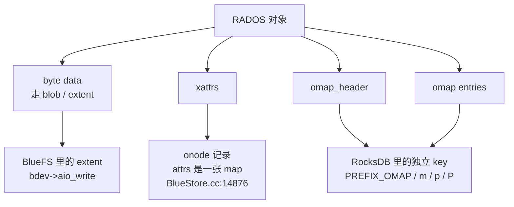
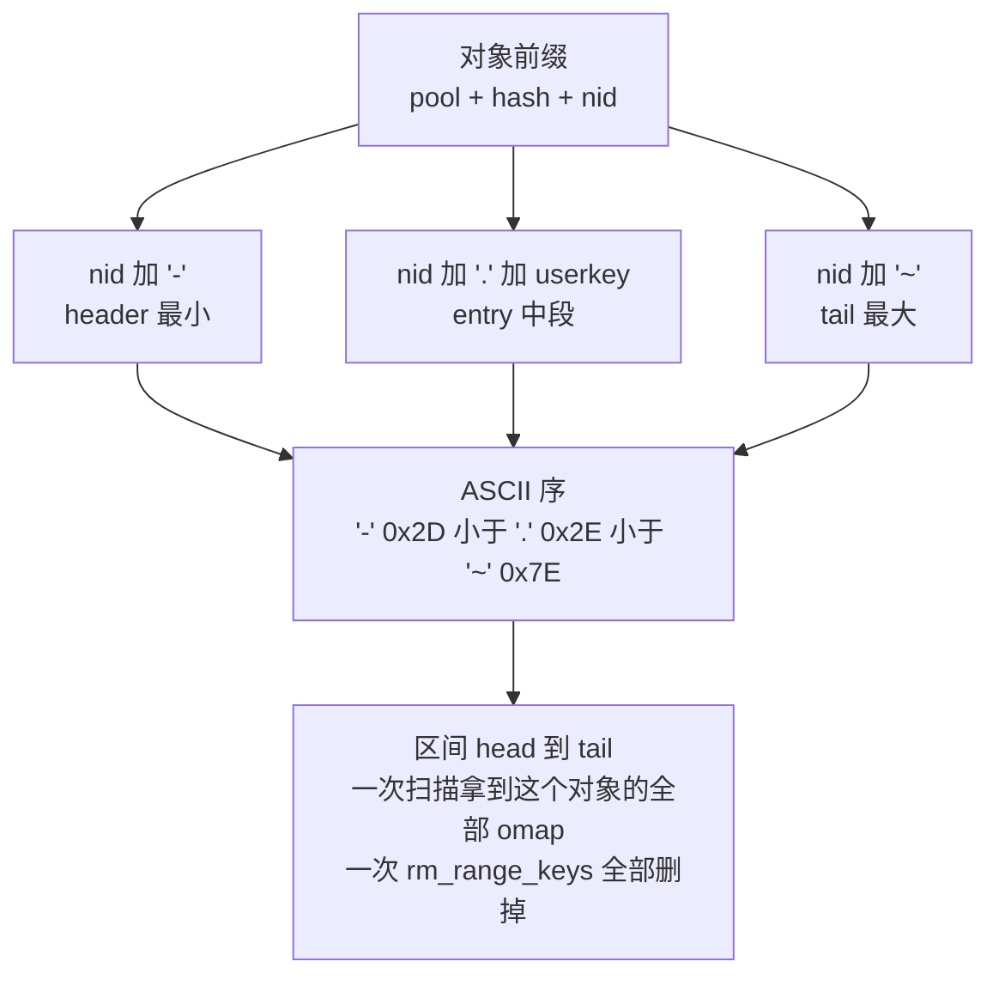
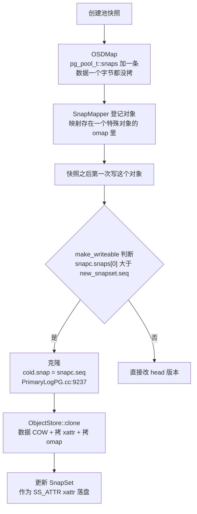
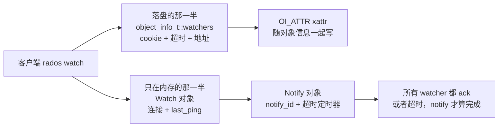

# 08 RADOS 对象语义：omap、快照、xattr、watch/notify

| 编写人 | 编写内容 | 编写时间 |
| --- | --- | --- |
| growdu | 初稿：RADOS 对象的四个部分与各自落点、xattr 存在 onode 的哪、用户 xattr 的 `_` 前缀与 Ceph 内部 xattr、omap 的四套 KV 前缀与 key 布局（header/entry/tail 三段式）、快照为什么和存储层无关（snap 重映射 + 懒克隆）、watch 的注册信息落盘而连接态只在内存、四种语义的层次总表，以及一份 v22 对照表。 | 2026-11-26 |

> 前七章讲的都是「一次写」：请求怎么进 OSD、怎么变成 ObjectStore 事务、
> 怎么落盘、什么时候回 ACK。这一章换一个问题：
> **RADOS 承诺给客户端的「对象」，到底是什么形状的东西？**
>
> 这个问题的答案比想象的分散。RADOS 对外说「一个对象有数据、有 xattr、
> 有 omap」，可这四部分在 BlueStore 里落在**完全不同**的地方：
> 数据在 blob，xattr 在 onode 记录里，omap 是**一串独立的 KV key**。
> 快照和 watch/notify 又是另外两套东西，一个几乎不落存储层，
> 一个根本只在内存里。
>
> 读完你应该能回答：
> 1. 一个对象的四个部分，在 v22 里各自落在哪？
> 2. xattr 改一个字节，为什么会重写整条 onode 记录？
> 3. omap 的 key 长什么样？为什么要有 header 和 tail 两个哨兵？
> 4. 快照为什么不等于存储层快照？创建快照拷了多少数据？
> 5. `SnapMapper` 的映射存在哪儿？（提示：不是单独的 KV 前缀）
> 6. watch 重启 OSD 之后还在吗？哪部分在，哪部分不在？
> 7. 这四种语义，分别是谁实现的？

本文所有行号基于 `/work/cwork/ceph`（`main` 分支，
`v22.0.0-975-g4c8da9d1553`）。

## 8.1 一个 RADOS 对象有四个部分

### 8.1.1 契约原文

`src/os/ObjectStore.h` 开头那段注释，是整个 RADOS 对象模型的定义处
（`src/os/ObjectStore.h:186-217`）：

> Each object has four distinct parts: byte data, xattrs, omap_header
> and omap entries.
>
> The data portion of an object is conceptually equivalent to a
> file in a file system. Random and Partial access for both read
> and write operations is required. ...
>
> Xattrs are equivalent to the extended attributes of file
> systems. Xattrs are a std::set of key/value pairs. ... At the
> implementation level, xattrs are used exclusively internal to Ceph
> and the implementer can expect the total size of all of the xattrs
> on an object to be relatively small, i.e., less than 64KB.
>
> omap_header is a single blob of data. It can be read or written
> in total.
>
> Omap entries are conceptually the same as xattrs
> but in a different address space. In other words, you can have
> the same key as an xattr and an omap entry and they have distinct
> values. ... the value portion of an omap entry can be quite large
> (MBs). More importantly, the interface must support efficient range
> queries on omap entries even when there are a large numbers of
> entries.

三句话提炼：

1. **四部分**：byte data、xattrs、omap_header、omap entries。
2. **xattr 和 omap 是两个地址空间**：同名 key 互不干扰；xattr 总共 < 64KB，
   omap 的 value 可以是 MB 级，而且必须支持**范围查询**。
3. **omap 的存储布局必须是为范围查询设计的**——这一条直接决定了
   BlueStore 把它做成独立 KV key 而不塞进 onode 记录。

### 8.1.2 四个部分在 v22 里落在哪

| 部分 | BlueStore 里的落点 | 是不是独立的 KV 记录 | 代码 |
| --- | --- | --- | --- |
| byte data | blob / extent，走 `bdev->aio_write` | 否（在数据区） | `BlueStore.cc:14551`（`_write`） |
| xattrs | onode 记录里的 `attrs` map | **否，和 onode 同一条记录** | `BlueStore.cc:14865`（`_setattr`） |
| omap_header | omap 前缀下的一个特殊 key | **是** | `BlueStore.cc:15055`（`_omap_setheader`） |
| omap entries | omap 前缀下的 N 个普通 key | **是，一条一个 key** | `BlueStore.cc:15001`（`_omap_setkeys`） |

这张表就是本章的全部内容。**xattr 是「对象的属性」，omap 是「对象的键值表」，
两者在存储层是两种完全不同的东西**——尽管它们在 API 上长得像。



注意左半边和右半边的**代价差**：xattr 挂在 onode 上，
改一个字节就是重写整条 onode 记录；omap 每条 entry 是一次独立的 `set`，
写多少条就是多少条 key。

`ObjectStore::Transaction::remove` 的注释把这点讲得更直白
（`src/os/Transaction.h:996`）：

```cpp
/// Remove an object. All four parts of the object are removed.
```

删除对象时四部分一起没——但它们是**分别被删的**：数据靠释放 extent，
xattr 随 onode 记录一起消失，omap 靠一次范围删除
（`BlueStore.cc:14720-14723`）：

```cpp
if (o->onode.has_omap()) {
  o->flush();
  _do_omap_clear(txc, o);
}
```

`_do_omap_clear`（`BlueStore.cc:14968-14980`）用 header key 和 tail key
夹出一个区间，整段 `rm_range_keys`：

```cpp
const string& omap_prefix = o->get_omap_prefix();
string prefix, tail;
o->get_omap_header(&prefix);
o->get_omap_tail(&tail);
txc->t->rm_range_keys(omap_prefix, prefix, tail);
txc->t->rmkey(omap_prefix, tail);
o->onode.clear_omap_flag();
```

### 8.1.3 一次 clone 复制全部四部分

这四个部分在**读**的时候是分开的，在**克隆**的时候又必须一起搬过去。
`ObjectStore::Transaction::clone` 的契约（`src/os/Transaction.h:1067-1086`）：

> Low-cost (e.g., O(1)) cloning (if supported) is best, but
> fallback to an O(n) copy is allowed. All four parts of the
> object are cloned (data, xattrs, omap header, omap
> entries).

BlueStore 的实现（`BlueStore.cc:15187-15270`）逐条对应：

```cpp
// clone data
oldo->flush();
_do_truncate(txc, c, newo, 0);
if (cct->_conf->bluestore_clone_cow) {
  _do_clone_range(txc, c, oldo, newo, 0, oldo->onode.size, 0);
} else {
  ... _do_read(...); _do_write(...);
}

// clone attrs
newo->onode.attrs = oldo->onode.attrs;      // :15219

// clone omap
if (newo->onode.has_omap()) { ... _do_omap_clear(txc, newo); }
if (oldo->onode.has_omap()) {
  ...
  KeyValueDB::Iterator it = db->get_iterator(prefix, 0, ...{head, tail});
  it->lower_bound(head);
  while (it->valid()) {
    ...
    newo->rewrite_omap_key(it->key(), &key);   // :15251
    txc->t->set(prefix, key, it->value());     // :15252
    it->next();
  }
}
```

三件事值得记：

- **attrs 是整体赋值**（`:15219`），因为它们本来就在一条记录里。
- **omap 是逐条重写 key**（`:15251-15252`），因为 key 里嵌了对象 id，
  换对象就得换 key。`rewrite_omap_key`（`BlueStore_objects.cc:1425-1437`）
  干的就是「换掉 key 的前缀，保留用户 key」。
- **数据默认走 COW**（`bluestore_clone_cow` 默认 true，
  `global.yaml.in:5906-5911`），所以 clone 不拷数据，只改元数据指向。

## 8.2 xattr：onode 里的一张表

### 8.2.1 存储位置

BlueStore 的 xattr 实现短得让人吃惊（`BlueStore.cc:14865-14893`）：

```cpp
int BlueStore::_setattr(TransContext *txc, CollectionRef& c, OnodeRef& o,
    const string& name, bufferlist& val)
{
  ...
  auto& b = o->onode.attrs[name.c_str()];
  ...
  b.reassign_to_mempool(mempool::mempool_bluestore_cache_meta);

  txc->write_onode(o);
  ...
}
```

就三件事：往 `o->onode.attrs` 里塞一个键值对，然后 `txc->write_onode(o)`。

`o->onode.attrs` 的类型在 `src/os/bluestore/bluestore_types.h:1297`：

```cpp
/// onode: per-object metadata
struct bluestore_onode_t {
  uint64_t nid = 0;                    ///< numeric id (locally unique)
  uint64_t size = 0;                   ///< object size
  std::map<mempool::bluestore_cache_meta::string, ceph::buffer::ptr> attrs;
  ...
```

**结论**：xattr 就在 onode 的元数据记录里，和 `size`、`extent_map_shards`、
`flags` 是邻居。

由此得出一条实践上很要命的推论：

> **改一个字节的 xattr，等于重写整条 onode 记录。**
>
> onode 记录里还有 extent map、size、flags。对象越大、分段越多，
> 这条记录越大，重写代价越高。`bluestore_change_attr_lat` 这个延迟计数器
> 量的就是这件事（`BlueStore.cc:14888`）。

所以 xattr 的定位是「小而少的元数据」——`ObjectStore.h:196-204` 那段注释说
得很明确：xattr 全部加起来 < 64KB，而且「Many of Ceph assumes that accessing
xattrs on temporally adjacent object accesses is inexpensive」
（相邻时刻访问同一个对象的 xattr 要便宜）。

注意「temporally adjacent」这个前提：onode 有缓存，
刚写完再读 xattr 不需要重新解 KV 记录。

### 8.2.2 用户 xattr 的 `_` 前缀

用户通过 `rados_setxattr` 写的 xattr，到 OSD 层会被加一个 `_` 前缀
（`src/osd/PrimaryLogPG.cc:8088`）：

```cpp
string name = "_" + aname;
bufferlist bl;
bp.copy(op.xattr.value_len, bl);
t->setattr(soid, name, bl);
```

读的时候对称地剥掉（`PrimaryLogPG.cc:6913`、`:8107`、`:6952`）：

```cpp
string name = "_" + aname;
int r = getattr_maybe_cache(ctx->obc, name, &(osd_op.outdata));
```

为什么要加前缀？因为 Ceph 自己要在同一个对象上挂内部 xattr，
得有个办法区分。内部 xattr 的名字见下。

### 8.2.3 Ceph 内部 xattr：`OI_ATTR` 和 `SS_ATTR`

`src/osd/osd_types.h:5802-5803` 只有两行：

```cpp
#define OI_ATTR "_"
#define SS_ATTR "snapset"
```

| 名字 | 内容 | 谁写 |
| --- | --- | --- |
| `_`（`OI_ATTR`） | `object_info_t` 编码后的字节 | 所有改对象元数据的路径 |
| `snapset`（`SS_ATTR`） | `SnapSet` 编码后的字节 | 有 clone 产生时 |

注意 `_` 这个名字**只有一个下划线**，而用户 xattr 会被加上 `_` 变成
`__foo`。两者靠「一个下划线 vs 两个下划线」区分开——有点脆，但确实如此。

写这两个 xattr 的地方很典型，`PrimaryLogPG.cc:5382-5391`：

```cpp
map <string, bufferlist, less<>> attrs;
bl.clear();
encode(snapset, bl);
attrs[SS_ATTR] = std::move(bl);

bl.clear();
encode(head_obc->obs.oi, bl,
       get_osdmap()->get_features(CEPH_ENTITY_TYPE_OSD, nullptr));
attrs[OI_ATTR] = std::move(bl);
t->setattrs(head_oid, attrs);
```

一次 `setattrs` 写两个 xattr，最终落到 BlueStore 的 `_setattrs`
（`BlueStore.cc:14895-14922`），也就是**一次重写 onode 记录**。

`object_info_t` 里还塞着别的东西——包括 watch 名单（见 8.5）。

### 8.2.4 集合级 xattr：文档还在，实现已经没了

`ObjectStore.h:221-228` 有一段：

> A collection is simply a grouping of objects. Collections have
> names (coll_t) and can be enumerated in order.  Like an
> individual object, a collection also has a std::set of xattrs.

**但 v22 里没有任何集合级 xattr 的接口了。**

- `ObjectStore.h` 里没有 `collection_set_attrs` / `collection_get_attrs`；
- `ObjectStore::Transaction` 里没有对应的 builder 方法
  （`Transaction.h:1130-1185` 只有 `collection_hint`、`collection_move`、
  `collection_set_bits`）；
- 枚举里倒是还留着两个 op 编号：
  `OP_COLL_SETATTR = 24`、`OP_COLL_RMATTR = 25`（`Transaction.h:130-131`）；
- BlueStore 处理这两个 op 的时候直接报错（`BlueStore.cc:12702-12708`）：

```cpp
case Transaction::OP_COLL_SETATTR:
  r = -EOPNOTSUPP;
  break;

case Transaction::OP_COLL_RMATTR:
  r = -EOPNOTSUPP;
  break;
```

所以：**`ObjectStore.h` 的这段注释是过时的**，v22 里集合没有 xattr。
这算这一层的一个「文档漂移」，读老文章时容易被带偏。

### 8.2.5 尺寸限制

限制在 OSD 层，不在 BlueStore 层：

| 配置 | 默认 | 作用 | 位置 |
| --- | --- | --- | --- |
| `osd_max_attr_size` | **0**（不限制） | 单个 xattr 的 value 上限 | `global.yaml.in:4022-4026` |
| `osd_max_attr_name_len` | **100** | xattr 名字长度上限 | `global.yaml.in:4017-4021` |
| `BlueStore::get_max_attr_name_length()` | **256** | 存储层自己的上限 | `BlueStore.h:1737-1739` |

OSD 取两者的较小值（`PrimaryLogPG.cc:8077-8083`）：

```cpp
unsigned max_name_len =
  std::min<uint64_t>(osd->store->get_max_attr_name_length(),
                     cct->_conf->osd_max_attr_name_len);
if (op.xattr.name_len > max_name_len) {
  result = -ENAMETOOLONG;
  break;
}
```

所以名字实际上最长 **100** 字节（`256` 和 `100` 取小）。
BlueStore 那个 256 的注释写得很实在：`// arbitrary; there is no real limit internally`。

value 大小则完全不限制（`osd_max_attr_size = 0` 时跳过检查，
`PrimaryLogPG.cc:8071-8076`）。这跟 `ObjectStore.h` 里那句「xattr 总共 < 64KB」
不是一回事——**那是实现约定，不是强制限制**。

## 8.3 omap：一串独立的 KV key

### 8.3.1 key 的构造

omap 的每一条 entry 都是一条**独立的 RocksDB key**。key 的构造在
`src/os/bluestore/BlueStore_objects.cc:1289-1305`：

```cpp
void bluestore::Onode::calc_omap_key(uint8_t flags,
				    const Onode* o,
				    const std::string& key,
				    std::string* out)
{
  if (!bluestore_onode_t::is_pgmeta_omap(flags)) {
    if (bluestore_onode_t::is_perpg_omap(flags)) {
      _key_encode_u64(o->c->pool(), out);
      _key_encode_u32(o->oid.hobj.get_bitwise_key_u32(), out);
    } else if (bluestore_onode_t::is_perpool_omap(flags)) {
      _key_encode_u64(o->c->pool(), out);
    }
  }
  _key_encode_u64(o->onode.nid, out);
  out->push_back('.');
  out->append(key);
}
```

也就是：

```text
[pool u64][hash u32]? + nid u64 + '.' + 用户 key
```

其中 `nid` 是对象的本地数字 id（`bluestore_types.h:1294`，
「numeric id (locally unique)」），`?` 表示只在 per-pg / per-pool 模式下才有。

**用户 key 前面的那段是「对象身份」，后面的 `.` 之后才是用户的 key。**
这一层区分很重要——它是 omap 能做范围查询的原因。

### 8.3.2 header 和 tail：两个哨兵

同一个对象的所有 omap key 共享同一个「对象身份」前缀，但它们要能
（a）被整体定位，（b）被整体删除，（c）被有序遍历。所以 BlueStore 在
这段前缀后面塞了三个不同的分隔符：

| key | 构造 | 位置 | 内容 |
| --- | --- | --- | --- |
| header | `calc_omap_header` | `BlueStore_objects.cc:1272-1287` | omap_header 的值 |
| entry | `calc_omap_key` | `BlueStore_objects.cc:1289-1305` | 用户 key → value |
| tail | `calc_omap_tail` | `BlueStore_objects.cc:1307-1322` | 空 |

三个构造函数的差别只在最后一个字符：

```cpp
// header
_key_encode_u64(o->onode.nid, out);
out->push_back('-');

// entry
_key_encode_u64(o->onode.nid, out);
out->push_back('.');
out->append(key);

// tail
_key_encode_u64(o->onode.nid, out);
out->push_back('~');
```

源码里那行注释是理解这一切的钥匙（`BlueStore_objects.cc:1271`）：

```cpp
// '-' < '.' < '~'
```

**ASCII 序：`'-'`(0x2D) < `'.'`(0x2E) < `'~'`(0x7E)。**

于是同一个 nid 下的所有 key 在字典序里自然分成三段：

```text
<nid>-            ← header，最小
<nid>.<userkey>   ← entry，中段
<nid>~            ← tail，最大
```

于是「这个对象的全部 omap」正好是一个**连续区间** `[head, tail)`。



读的时候直接用区间扫描（`BlueStore.cc:10541`）：

```cpp
KeyValueDB::Iterator it = db->get_iterator(prefix, 0, KeyValueDB::IteratorBounds{head, tail});
it->lower_bound(head);
while (it->valid()) {
  if (it->key() == head) {
    *header = it->value();
  } else if (it->key() >= tail) {
    break;
  } else {
    string user_key;
    o->decode_omap_key(it->key(), &user_key);
    (*out)[user_key] = it->value();
  }
  it->next();
}
```

删的时候一次 `rm_range_keys(prefix, head, tail)` 搞定
（`BlueStore.cc:14974`）。**这就是 `ObjectStore.h:216-217` 要求的
「efficient range queries」的具体实现。**

`decode_omap_key` 反过来把用户 key 从整条 key 里切出来
（`BlueStore_objects.cc:1452-1455`）：

```cpp
void bluestore::Onode::decode_omap_key(const string& key, string *user_key)
{
  *user_key = key.substr(calc_userkey_offset_in_omap_key());
}
```

偏移量由 `calc_userkey_offset_in_omap_key()` 算（`BlueStore_objects.cc:1439-1450`），
取决于当前是哪种布局。

### 8.3.3 四套前缀，三种模式

BlueStore 的 KV 前缀定义在 `src/os/bluestore/BlueStore.cc:135-146`：

```cpp
// kv store prefixes
const std::string PREFIX_SUPER = "S";       // field -> value
const std::string PREFIX_STAT = "T";        // field -> value(int64 array)
const std::string PREFIX_COLL = "C";        // collection name -> cnode_t
const std::string PREFIX_OBJ = "O";         // object name -> onode_t
const std::string PREFIX_OMAP = "M";        // u64 + keyname -> value
const std::string PREFIX_PGMETA_OMAP = "P"; // u64 + keyname -> value(for meta coll)
const std::string PREFIX_PERPOOL_OMAP = "m"; // s64 + u64 + keyname -> value
const std::string PREFIX_PERPG_OMAP = "p";   // u64(pool) + u32(hash) + u64(id) + keyname -> value
const std::string PREFIX_DEFERRED = "L";    // id -> deferred_transaction_t
const std::string PREFIX_ALLOC = "B";       // u64 offset -> u64 length (freelist)
const std::string PREFIX_ALLOC_BITMAP = "b";// (see BitmapFreelistManager)
const std::string PREFIX_SHARED_BLOB = "X"; // u64 SB id -> shared_blob_t
```

omap 相关的有四个前缀：`M`、`P`、`m`、`p`。
每个对象用哪一个，由 onode 的 `flags` 决定
（`src/os/bluestore/bluestore_types.h:1320-1325`）：

```cpp
enum {
  FLAG_OMAP = 1,         ///< object may have omap data
  FLAG_PGMETA_OMAP = 2,  ///< omap data is in meta omap prefix
  FLAG_PERPOOL_OMAP = 4, ///< omap data is in per-pool prefix; per-pool keys
  FLAG_PERPG_OMAP = 8,   ///< omap data is in per-pg prefix; per-pg keys
};
```

选择逻辑在 `BlueStore_objects.cc:1257-1269`：

```cpp
const std::string& bluestore::Onode::calc_omap_prefix(uint8_t flags)
{
  if (bluestore_onode_t::is_pgmeta_omap(flags)) {
    return PREFIX_PGMETA_OMAP;
  }
  if (bluestore_onode_t::is_perpg_omap(flags)) {
    return PREFIX_PERPG_OMAP;
  }
  if (bluestore_onode_t::is_perpool_omap(flags)) {
    return PREFIX_PERPOOL_OMAP;
  }
  return PREFIX_OMAP;
}
```

| 前缀 | 布局 | 谁用 |
| --- | --- | --- |
| `M`（`PREFIX_OMAP`） | `nid + keyname` | 传统布局，一个池的所有 omap 混在一起 |
| `m`（`PREFIX_PERPOOL_OMAP`） | `pool + nid + keyname` | 同一个池的对象相邻 |
| `p`（`PREFIX_PERPG_OMAP`） | `pool + hash + nid + keyname` | 同一个 PG 的对象相邻 |
| `P`（`PREFIX_PGMETA_OMAP`） | `nid + keyname` | meta collection（OSD 内部对象） |

**为什么要 per-pool / per-pg？** 因为 `M` 布局下，删掉一个池或者一个 PG，
得逐个对象去删它们的 omap key（因为没法用一个范围覆盖住「这个池的所有
omap」——nid 是打散的）。改成 per-pool 之后，同一个池的 key 连续，
就能一把 `rm_range_keys` 干完。

BlueStore 启动时从超级块读这个设置（`BlueStore.cc:4775-4794`）：

```cpp
void BlueStore::_set_per_pool_omap()
{
  per_pool_omap = OMAP_BULK;
  bufferlist bl;
  db->get(PREFIX_SUPER, "per_pool_omap", &bl);
  if (bl.length()) {
    auto s = bl.to_str();
    if (s == stringify(OMAP_PER_POOL)) {
      per_pool_omap = OMAP_PER_POOL;
    } else if (s == stringify(OMAP_PER_PG)) {
      per_pool_omap = OMAP_PER_PG;
    } else {
      ceph_assert(s == stringify(OMAP_BULK));
    }
    ...
  }
  _check_no_per_pg_or_pool_omap_alert();
}
```

三种模式定义在 `src/os/bluestore/BlueStore.h:1061-1064`：

```cpp
enum {
  OMAP_BULK = 0,
  OMAP_PER_POOL = 1,
  OMAP_PER_PG = 2,
} per_pool_omap = OMAP_BULK;
```

**新对象用哪种布局？** 看 `per_pool_omap` 是不是 BULK
（`BlueStore.cc:15015`）：

```cpp
o->onode.set_omap_flags(per_pool_omap == OMAP_BULK);
```

`set_omap_flags`（`bluestore_types.h:1379-1381`）：

```cpp
void set_omap_flags(bool legacy) {
  set_flag(FLAG_OMAP | (legacy ? 0 : (FLAG_PERPOOL_OMAP | FLAG_PERPG_OMAP)));
}
```

也就是说：**非 BULK 模式的新对象同时带 `PERPOOL` 和 `PERPG` 两个 flag，
但实际落在哪个前缀由 `calc_omap_prefix` 的判断顺序决定——
`PERPG` 优先**（`BlueStore_objects.cc:1262` 在 `:1265` 前面）。

老对象（legacy BULK 布局）不会被自动迁移。BlueStore 会发健康告警
（`BlueStore.cc:8865-8883`）：

```cpp
per_pg = "legacy (not per-pg) omap detected, "
  "suggest to run store repair to benefit from faster PG removal";
per_pool = "legacy (not per-pool) omap detected, "
  "suggest to run store repair to benefit from per-pool omap usage statistics";
```

对应配置（`global.yaml.in:6083-6105`）：

| 配置 | 默认 | 作用 |
| --- | --- | --- |
| `bluestore_warn_on_no_per_pool_omap` | **true** | 提示跑 store repair |
| `bluestore_warn_on_no_per_pg_omap` | **false** | 同上，per-pg 版 |
| `bluestore_fsck_error_on_no_per_pool_omap` | false | fsck 时算 error 而不是 warning |
| `bluestore_fsck_error_on_no_per_pg_omap` | false | 同上 |

fsck 的检查逻辑在 `BlueStore.cc:6895-6952`，还支持**自动修复**
（`BlueStore.cc:6953-6990`）：把老对象逐条搬到新前缀，并把 flag 改成
`FLAG_PERPOOL_OMAP | FLAG_PERPG_OMAP`。

### 8.3.4 写路径

写一条 omap entry，`_omap_setkeys` 干的事（`BlueStore.cc:15001-15053`）：

```cpp
if (!o->onode.has_omap()) {
  if (o->oid.is_pgmeta()) {
    o->onode.set_omap_flags_pgmeta();
  } else {
    o->onode.set_omap_flags(per_pool_omap == OMAP_BULK);
  }
  txc->write_onode(o);              // ← 第一次写 omap 要重写 onode

  const string& prefix = o->get_omap_prefix();
  string key_tail;
  bufferlist tail;
  o->get_omap_tail(&key_tail);
  txc->t->set(prefix, key_tail, tail);   // ← 先把 tail 写上
}
...
const string& prefix = o->get_omap_prefix();
string final_key;
o->get_omap_key(string(), &final_key);
size_t base_key_len = final_key.size();
decode(num, p);
while (num--) {
  string key;
  bufferlist value;
  decode(key, p);
  decode(value, p);
  final_key.resize(base_key_len); // keep prefix
  final_key += key;
  txc->t->set(prefix, final_key, value);
}
```

要点：

1. **第一次写 omap 会顺手把 `FLAG_OMAP` 打进 onode**，所以要
   `txc->write_onode(o)`——一次额外的 onode 重写。
2. **tail 要先写**。因为 tail 是区间的右边界，得先存在，
   后面的 `rm_range_keys` 和区间扫描才有完整的边界。
3. **一次 `omap_setkeys` 写 N 条 key**，不是一个。
4. 所有这些 `txc->t->set(...)` 都在**同一个 ObjectStore 事务**里，
   也就是第 07 章说的同一个 RocksDB 事务——所以 omap 和 onode
   的更新是原子的。

`omap_setheader`（`BlueStore.cc:15055-15089`）写的是 header key：

```cpp
const string& prefix = o->get_omap_prefix();
o->get_omap_header(&key);
txc->t->set(prefix, key, bl);
```

### 8.3.5 读路径与迭代

除了 `omap_get`（一次全取）和 `omap_get_values`（按 key 取，
`BlueStore.cc:10602-10651`），BlueStore 还提供 `omap_iterate`
（`BlueStore.cc:10702`），签名在 `ObjectStore.h:779-785`：

```cpp
virtual int omap_iterate(
  CollectionHandle &c,
  const ghobject_t &oid,
  omap_iter_seek_t start_from,
  std::function<omap_iter_ret_t(std::string_view, std::string_view)> visitor
) = 0;
```

`omap_iter_seek_t` 有两种 seek 方式（`ObjectStore.h:742-751`）：

```cpp
struct omap_iter_seek_t {
  std::string seek_position;
  enum {
    // start with provided key (seek_position), if it exists
    LOWER_BOUND,
    // skip provided key (seek_position) even if it exists
    UPPER_BOUND
  } seek_type = LOWER_BOUND;
  ...
};
```

这个区分很重要，后面 8.4.5 的 SnapMapper 就靠它。

`ObjectStore.h:756-761` 还有一条警告：

> Warning!  The callable is executed under lock on bluestore
> operations in c.  Do not use bluestore methods on c while
> iterating.

### 8.3.6 请求级上限

omap 的读取在 OSD 层被限量（`PrimaryLogPG.cc:8245-8246`、`:8300-8301`）：

| 配置 | 默认 | 含义 |
| --- | --- | --- |
| `osd_max_omap_entries_per_request` | **1_K** | 单次请求最多返回多少条 |
| `osd_max_omap_bytes_per_request` | **1_G** | 单次请求最多返回多少字节 |

`osd_max_omap_entries_per_request` 默认只有 1024 条——所以遍历一个大 omap
必须分页，客户端那侧对应 `rados_omap_get_next`（`librados.h:1769`）。

### 8.3.7 omap 和 xattr 的实际差别

把 8.1.2 那张表和这一节的结论合起来：

| | xattr | omap |
| --- | --- | --- |
| 存储 | onode 记录里的一个 map | 独立的 KV key，一条 entry 一个 |
| 改一个 entry 的代价 | **重写整条 onode 记录** | 写一条 key（append-only） |
| 值大小 | 小（约定 < 64KB 总量） | 可以是 MB 级 |
| 范围查询 | 不支持 | **支持**，靠 `head/tail` 区间 |
| 删除一个 entry | 重写整条 onode 记录 | 删一条 key |
| 名字空间 | 和 omap **互不干扰** | 和 xattr 互不干扰 |
| 数量级 | 几个到几十个 | 几千到几百万 |

所以：**要存「对象的属性」用 xattr，要存「对象的键值表」用 omap。**
把大量小条目塞进 xattr，会把 onode 记录撑大，每次改动都变成全量重写。

## 8.4 快照：RADOS 的 snap 和存储层没关系

### 8.4.1 `ObjectStore::snapshot()` 是死的

先排除一个误解：**ObjectStore 层没有可用的快照接口**。

`ObjectStore.h:791`：

```cpp
virtual int snapshot(const std::string& name) { return -EOPNOTSUPP; }
```

我在 v22 整棵树里搜过：**没有任何 ObjectStore 实现覆盖它**
（只有 `src/os/fs/ZFS.h:30` 有个同名的 `snapshot(const char *, bool)`，
那是 ZFS 设备探测用的，不是对象快照）。

也就是说，RADOS 快照**完全不在 ObjectStore 这一层实现**。

### 8.4.2 snap id 进了对象 key

RADOS 快照在存储层的体现，只有一件事：**对象的 key 里多了一个 snap id**。

`src/os/bluestore/BlueStore.cc:446-483` 的 `_get_object_key`：

```cpp
_key_encode_prefix(oid, key);

append_escaped(oid.hobj.nspace, key);

if (oid.hobj.get_key().length()) {
  ...
} else {
  // no key
  append_escaped(oid.hobj.oid.name, key);
  key->append("=");
}

_key_encode_u64(oid.hobj.snap, key);      // ← :479
_key_encode_u64(oid.generation, key);     // ← :480

key->push_back(ONODE_KEY_SUFFIX);
```

`snap` 是 key 的一部分。`snapid_t` 的定义在 `src/include/object.h:98-105`：

```cpp
struct snapid_t {
  uint64_t val;
  constexpr snapid_t(uint64_t v=0) : val(v) {}
  ...
};
```

几个保留值（`src/include/rados.h:38-40`）：

```c
#define CEPH_SNAPDIR ((__u64)(-1))  /* reserved for hidden .snap dir */
#define CEPH_NOSNAP  ((__u64)(-2))  /* "head", "live" revision */
#define CEPH_MAXSNAP ((__u64)(-3))  /* largest valid snapid */
```

`CEPH_NOSNAP` 就是「head」，也就是对象的当前版本。

**所以 BlueStore 完全不知道 RADOS 快照的存在。**它只看到
「这个对象的 key 里的 snap 字段不等于 NOSNAP」。

### 8.4.3 池级快照清单在 OSDMap 里

快照「存不存在」这件事，权威在 MON 和 OSDMap。`pg_pool_t`
（`src/osd/osd_types.h:1224`）里有：

```cpp
snapid_t snap_seq = 0;        ///< seq for per-pool snapshot          (:1500)
epoch_t snap_epoch = 0;       ///< osdmap epoch of last snap         (:1501)

/**
 * Pool snaps (global to this pool).  These define a SnapContext for
 * ...                                                           (:1508)
 */
std::map<snapid_t, pool_snap_info_t> snaps;                        (:1512)

/**
 * Alternatively, if we are defining non-pool snaps (e.g. via the
 * Ceph MDS), we must track @removed_snaps (since @snaps is not
 * used). ...
 */
interval_set<snapid_t> removed_snaps;                              (:1519)
```

`pool_snap_info_t` 在 `src/osd/osd_types.h:1056`：

```cpp
struct pool_snap_info_t {
  snapid_t snapid;
  ...
```

两种模式的区别很重要：

| 模式 | 快照清单在哪 | 谁在用 |
| --- | --- | --- |
| **池级快照**（pool snaps） | `pg_pool_t::snaps` | `ceph osd pool mksnap`、librados 的 `rados_ioctx_snap_create` |
| **自管快照**（self-managed snaps） | `pg_pool_t::removed_snaps` | CephFS（MDS 自己管快照目录） |

`FLAG_POOL_SNAPS` / `FLAG_SELFMANAGED_SNAPS` 是区分它们的池标志
（`src/osd/osd_types.h:1261-1262`）。

### 8.4.4 SnapMapper：两个方向的映射

PG 层的 `SnapMapper`（`src/osd/SnapMapper.h:133`）维护**两张映射表**
（`SnapMapper.h:111-132` 的注释）：

> We accomplish this using two sets of keys:
>  1) OBJECT_PREFIX + obj.str() -> encoding of object_snaps
>  2) MAPPING_PREFIX + poolid + snapid_t + obj.str() -> encoding of std::pair<snapid_t, obj>
>
> The object -> {snapid} mapping is primarily included so that the
> SnapMapper state can be verified against the external PG state during
> scrub etc.
>
> The 2) mapping is arranged such that all objects in a particular
> snap will sort together, and so that all objects in a pg for a
> particular snap will group under up to 8 prefixes.

| 方向 | key | value | 用途 |
| --- | --- | --- | --- |
| 对象 → 它在哪些快照里 | `OBJ_...` | `object_snaps { oid, set<snapid_t> }` | 校验、清理 |
| 快照 → 它有哪些对象 | `SNA_<pool>_<snap>_...` | `Mapping { snap, hoid }` | 按快照枚举对象（trim 用） |

key 的完整格式，源码里写得很清楚（`src/osd/SnapMapper.cc:48-94`）：

```text
"SNA_" + ("%lld" % poolid) + "_" + ("%016x" % snapid) + "_"
        + (".%x" % shard_id) + "_"        // shard_id 为 NO_SHARD 时省略
        + hobject_t::to_str()
  -> SnapMapping::Mapping { snap, hoid }

"OBJ_" + (".%x" % shard_id) + "_" + hobject_t::to_str()
  -> SnapMapper::object_snaps { oid, set<snapid_t> }
```

拼接逻辑在 `SnapMapper.cc:274-296`：

```cpp
string SnapMapper::get_prefix(int64_t pool, snapid_t snap)
{
  static_assert(sizeof(pool) == 8, "assumed by the formatting code");
  ceph_assert(snap != CEPH_NOSNAP && snap != CEPH_SNAPDIR);
  return fmt::format("{}{}_{:016X}_", MAPPING_PREFIX, pool, static_cast<uint64_t>(snap));
}

string SnapMapper::to_raw_key(const pair<snapid_t, hobject_t> &in) const
{
  return get_prefix(in.second.pool, in.first) + shard_prefix + in.second.to_str();
}
```

`MAPPING_PREFIX = "SNA_"`、`OBJECT_PREFIX = "OBJ_"`（`SnapMapper.cc:44-45`）。
`is_mapping` 就是判断 key 是不是以 `SNA_` 开头（`SnapMapper.cc:327-330`）。

### 8.4.5 映射存哪儿？——存在 omap 里

这是这一节最容易被跳过、但很关键的一点：

**SnapMapper 的映射不是存在独立的 KV 前缀里，而是存在一个特殊对象的
omap 里。**

看 `src/osd/SnapMapper.h:38-109` 的 `OSDriver`：

```cpp
class OSDriver : public MapCacher::StoreDriver<std::string, ceph::buffer::list> {
  CollectionHandleT ch;
  ghobject_t hoid;
  ...
  class OSTransaction : public MapCacher::Transaction<std::string, ceph::buffer::list> {
    ...
    void set_keys(
      const std::map<std::string, ceph::buffer::list> &to_set) override {
      t->omap_setkeys(cid, hoid, to_set);        // ← :66
    }
    void remove_keys(
      const std::set<std::string> &to_remove) override {
      t->omap_rmkeys(cid, hoid, to_remove);      // ← :70
    }
```

那个 `hoid` 是谁？`OSD::make_snapmapper_oid()`（`src/osd/osd_types.h:622-624`）：

```cpp
ghobject_t make_snapmapper_oid() const {
  return ghobject_t::make_snapmapper(pgid.pool(), pgid.ps(), shard);
}
```

是个放在 **meta collection** 里的隐藏对象。OSD 启动时会确保它存在
（`src/osd/OSD.cc:3873-3876`）：

```cpp
if (!store->exists(service.meta_ch, OSD::make_snapmapper_oid())) {
  ...
  t.touch(coll_t::meta(), OSD::make_snapmapper_oid());
}
```

读取路径同样是走 omap（`SnapMapper.cc:200-231`）：

```cpp
int OSDriver::get_keys(
  const std::set<std::string> &keys,
  std::map<std::string, ceph::buffer::list> *out)
{
  return os->omap_get_values(ch, hoid, keys, out);
}

int OSDriver::get_next(const std::string &seek_key, ...)
{
  using omap_iter_seek_t = ObjectStore::omap_iter_seek_t;
  const auto result = os->omap_iterate(
    ch, hoid,
    omap_iter_seek_t{
      .seek_position = seek_key,
      .seek_type = omap_iter_seek_t::UPPER_BOUND
    },
    [next] (std::string_view key, std::string_view value) mutable {
      next->first = key;
      ...
      return ObjectStore::omap_iter_ret_t::STOP;
    });
  ...
}
```

**这就把本章的两条线接上了**：RADOS 快照的映射，用的是 omap 这种
「一条一个 KV key、能范围扫描」的存储形态——因为它需要按快照枚举对象，
而按快照枚举正好是 omap 的强项。

（顺带一提：Ceph 内部还用一个 `PREFIX_PGMETA_OMAP` = `"P"` 的前缀，
给 meta collection 的对象用，key 里不带 pool 前缀，
见 `BlueStore_objects.cc:1259-1261`。）

### 8.4.6 懒克隆：快照的数据什么时候才被复制

到这里还差最后一块：**创建快照的时候，数据的副本在哪？**

答案是：**当时不复制。** RADOS 的池级快照是**惰性写时复制**。

快照创建时，只是往 `pg_pool_t::snaps` 里加一条记录，
并把相关对象登记进 SnapMapper。真正的数据复制，发生在
**快照之后的第一次写入**时。

代码在 `PrimaryLogPG::make_writeable`（`src/osd/PrimaryLogPG.cc:9181`），
判断条件在 `:9231-9234`：

```cpp
if ((ctx->obs->exists && !ctx->obs->oi.is_whiteout()) && // head exist(ed)
    snapc.snaps.size() &&                 // there are snaps
    !ctx->cache_operation &&
    snapc.snaps[0] > ctx->new_snapset.seq) {  // existing object is old
  // clone
```

四个条件同时成立才克隆：

1. head 版本存在；
2. **上下文里有快照**（`snapc.snaps` 非空）；
3. 不是 cache tier 的驱逐操作；
4. **快照比当前 seq 新**（`snapc.snaps[0] > ctx->new_snapset.seq`）——
   意思是这个对象在快照之后被改过。

然后（`:9236-9237`）：

```cpp
hobject_t coid = soid;
coid.snap = snapc.seq;
```

**克隆出来的对象，`snap` 字段被设成了快照 id**——也就是它成了
「只属于这个快照的那个版本」。原来的 head 对象继续被改。

接着调 `_make_clone`（`PrimaryLogPG.cc:9166-9179`）：

```cpp
void PrimaryLogPG::_make_clone(
  OpContext *ctx, PGTransaction* t,
  ObjectContextRef clone_obc,
  const hobject_t& head, const hobject_t& coid,
  object_info_t *poi)
{
  bufferlist bv;
  encode(*poi, bv, get_osdmap()->get_features(CEPH_ENTITY_TYPE_OSD, nullptr));

  t->clone(coid, head);
  setattr_maybe_cache(clone_obc, t, OI_ATTR, bv);
  rmattr_maybe_cache(clone_obc, t, SS_ATTR);
}
```

`ObjectStore::Transaction::clone` 就是我们 8.1.3 讲的那个
「复制全部四部分」的操作。

然后更新 snapset（`:9301-9310`）：

```cpp
ctx->new_snapset.clones.push_back(coid.snap);
ctx->new_snapset.clone_size[coid.snap] = ctx->obs->oi.size;
ctx->new_snapset.clone_snaps[coid.snap] = snaps;

// clone_overlap should contain an entry for each clone
// (an empty interval_set if there is no overlap)
ctx->new_snapset.clone_overlap[coid.snap];
if (ctx->obs->oi.size) {
  ctx->new_snapset.clone_overlap[coid.snap].insert(0, ctx->obs->oi.size);
}
```

`SnapSet`（`src/osd/osd_types.h:5768-5773`）：

```cpp
struct SnapSet {
  snapid_t seq;
  std::vector<snapid_t> clones;   // ascending
  std::map<snapid_t, interval_set<uint64_t> > clone_overlap;  // overlap w/ next newest
  std::map<snapid_t, uint64_t> clone_size;
  std::map<snapid_t, std::vector<snapid_t>> clone_snaps; // descending
```

它作为 **`SS_ATTR` xattr** 存在对象上（`"snapset"`），
记着「这个对象有哪些 clone、每个 clone 和下一个新的 clone 重叠多少字节」。

所以完整的快照流程是：

```text
创建快照
  └─ OSDMap: pg_pool_t::snaps 加一条
  └─ SnapMapper: 把受影响的对象登记成 (对象 → {snapid})
  └─ 数据：一个字节都没拷

快照之后第一次写某个对象
  └─ make_writeable 发现 snapc.snaps[0] > new_snapset.seq
  └─ 克隆：coid.snap = snapc.seq
  └─ ObjectStore::clone：数据 COW + 拷 xattr + 拷 omap
  └─ SnapSet 更新，作为 SS_ATTR xattr 落盘
```



**代价**：一个从未被改过的对象，快照的边际成本是 O(1)；
一个被改过的对象，成本是 O(对象大小)（但走 COW，只拷元数据不拷数据，
`BlueStore.cc:15206-15207`）。

**收益**：因为 `coid.snap` 落在对象 key 里，克隆出来的对象在 BlueStore
看来就是一个**普通的新对象**，没有任何特殊处理。这就是「RADOS 快照和
存储层无关」的具体含义。

### 8.4.7 删快照 = trim

删除快照要做的事，是把只属于这个快照的 clone 对象删掉。
PG 有一套专门的状态：

```cpp
#define PG_STATE_SNAPTRIM           (1ULL << 26) // trimming snaps
#define PG_STATE_SNAPTRIM_WAIT      (1ULL << 27) // queued to trim snaps
#define PG_STATE_SNAPTRIM_ERROR     (1ULL << 29) // error stopped trimming snaps
```

（`src/osd/osd_types.h:1031-1034`）

trim 的入口是 `SnapMapper::get_next_objects_to_trim`
（`src/osd/SnapMapper.h:360-363`）——**按快照枚举对象**，
这正是 8.4.5 里那个 `SNA_` 前缀 + omap 范围扫描的用武之地。

PG 层面的映射维护在 `src/osd/PG.cc`：

| 函数 | 位置 | 作用 |
| --- | --- | --- |
| `PG::remove_snap_mapped_object` | `PG.cc:312` | 对象没了，撤映射 |
| `PG::clear_object_snap_mapping` | `PG.cc:321` | 清掉映射 |
| `PG::update_object_snap_mapping` | `PG.cc:336` | 对象在哪些快照里，更新 |
| `PG::update_snap_map` | `PG.cc:1179` | 从 pg log 回放映射 |

`update_object_snap_mapping`（`PG.cc:336-355`）：

```cpp
void PG::update_object_snap_mapping(
  ObjectStore::Transaction *t, const hobject_t &soid, const set<snapid_t> &snaps)
{
  ...
  ceph_assert(soid.snap < CEPH_MAXSNAP);
  int r = snap_mapper.remove_oid(...);
  ...
  snap_mapper.add_oid(
    ...,
    snaps,
    ...);
```

## 8.5 watch/notify：OSD 内存里的会话

### 8.5.1 两个数据结构

```cpp
struct watch_info_t {                    // src/osd/osd_types.h:5805
  uint64_t cookie;
  uint32_t timeout_seconds;
  entity_addr_t addr;
  ...
};

struct notify_info_t {                   // src/osd/osd_types.h:5828
  uint64_t cookie;
  uint64_t notify_id;
  uint32_t timeout;
  ceph::buffer::list bl;
};
```

`watch_info_t` 是「谁在 watch 这个对象」，
`notify_info_t` 是「一条通知」。

### 8.5.2 注册信息落盘，连接态不落盘

这是 watch 最容易搞混的地方。watch 有**两半**：

| 部分 | 在哪儿 | 重启后 |
| --- | --- | --- |
| **watch 名单**（cookie、超时、地址） | `object_info_t::watchers`，随 `OI_ATTR` xattr 落盘 | **还在** |
| **连接态**（这条 TCP 连接活着吗、last_ping） | OSD 内存里的 `Watch` 对象 | **没了** |



左边那半会随对象信息落盘，所以 OSD 重启后**名单还在**；
右边那半纯内存，重启后**连接全断**，客户端得发
`CEPH_OSD_WATCH_OP_RECONNECT` 重新挂上。

`object_info_t::watchers` 在 `src/osd/osd_types.h:6124`：

```cpp
std::map<std::pair<uint64_t, entity_name_t>, watch_info_t> watchers;
```

注册 watch 的时候，代码会显式把对象元数据标脏
（`PrimaryLogPG.cc:7564-7572`）：

```cpp
if (op.watch.op == CEPH_OSD_WATCH_OP_WATCH ||
    op.watch.op == CEPH_OSD_WATCH_OP_LEGACY_WATCH) {
  if (oi.watchers.count(make_pair(cookie, entity))) {
    dout(10) << " found existing watch " << w << " by " << entity << dendl;
  } else {
    dout(10) << " registered new watch " << w << " by " << entity << dendl;
    oi.watchers[make_pair(cookie, entity)] = w;
    t->nop(soid);  // make sure update the object_info on disk!
  }
```

那行注释 `// make sure update the object_info on disk!` 说得很清楚：
**watch 名单是要落盘的。**

而连接态在 `src/osd/Watch.h:143` 起的 `Watch` 类里，纯内存：

```cpp
/**
 * Watch is a mapping between a Connection and an ObjectContext
 * ...
 */
class Watch {
  ...
  bool will_ping;    ///< is client new enough to ping the watch
  utime_t last_ping; ///< last client ping
  ...
};
```

`Watch` 挂在 `ObjectContext` 上（`ctx->obc->watchers`），
OG `PrimaryLogPG::do_osd_op_effects`（`PrimaryLogPG.cc:9429-9453`）里创建。

**所以**：OSD 重启后，watch 名单还在磁盘上，但连接全断了。
客户端必须**重连 watch**——这就是 `CEPH_OSD_WATCH_OP_RECONNECT` 存在的理由
（`PrimaryLogPG.cc:7575-7581`）。

### 8.5.3 五种 WATCH 子操作

`CEPH_OSD_OP_WATCH` 一个 op 里带五种子操作
（`PrimaryLogPG.cc:7535-7616`）：

| 子操作 | 行为 | 位置 |
| --- | --- | --- |
| `WATCH` | 注册 watch（幂等） | `:7564-7574` |
| `LEGACY_WATCH` | 同上，老协议 | `:7565` |
| `RECONNECT` | 断线后重连，watch 不在则 `-ENOTCONN` | `:7575-7581` |
| `PING` | 探活，不在则 `-ENOTCONN`；不在 `obc->watchers` 或未连上则 `-ETIMEDOUT` | `:7582-7600` |
| `UNWATCH` | 注销 watch | `:7601-7613` |

超时时间（`:7557-7560`）：

```cpp
uint32_t timeout = cct->_conf->osd_client_watch_timeout;
if (op.watch.timeout != 0) {
  timeout = op.watch.timeout;
}
```

`osd_client_watch_timeout` 默认 **30** 秒
（`src/common/options/mds-client.yaml.in:138-144`，
注意它在 `mds-client` 这个 option group 里，不是 `global`）。

`PING` 那段还有个注释说明了 watch 的一个副作用（`:7583-7585`）：

```cpp
/* Note: WATCH with PING doesn't cause may_write() to return true,
 * so if there is nothing else in the transaction, this is going
 * to run do_osd_op_effects, but not write out a log entry */
```

——**纯 PING 不写 pg log**。

### 8.5.4 NOTIFY 的派发与完成

`CEPH_OSD_OP_NOTIFY`（`PrimaryLogPG.cc:7166-7194`）：

```cpp
uint32_t timeout;
bufferlist bl;
try {
  uint32_t ver; // obsolete
  decode(ver, bp);
  decode(timeout, bp);
  decode(bl, bp);
} catch (const ceph::buffer::error &e) {
  timeout = 0;
}
if (!timeout)
  timeout = cct->_conf->osd_default_notify_timeout;

notify_info_t n;
n.timeout = timeout;
n.notify_id = osd->get_next_id(get_osdmap_epoch());
n.cookie = op.notify.cookie;
n.bl = bl;
ctx->notifies.push_back(n);

// return our unique notify id to the client
encode(n.notify_id, osd_op.outdata);
```

`osd_default_notify_timeout` 默认 **30** 秒
（`src/common/options/global.yaml.in:3268-3275`）。

**notify 是先入队、后派发**的：`ctx->notifies` 先攒着，
等事务提交后在 `do_osd_op_effects` 里才真正发给各个 watcher
（`PrimaryLogPG.cc:9455-9477`）：

```cpp
for (list<notify_info_t>::iterator p = ctx->notifies.begin();
     p != ctx->notifies.end();
     ++p) {
  NotifyRef notif(
    Notify::makeNotifyRef(
      conn,
      ctx->reqid.name.num(),
      p->bl,
      p->timeout,
      p->cookie,
      p->notify_id,
      ctx->obc->obs.oi.user_version,
      osd));
  for (map<pair<uint64_t, entity_name_t>, WatchRef>::iterator i =
       ctx->obc->watchers.begin();
     i != ctx->obc->watchers.end();
     ++i) {
    i->second->start_notify(notif);
  }
  notif->init();
}
```

一条 notify 广播给**所有** watcher。`notif->init()`
（`src/osd/Watch.cc:232-237`）起一个超时定时器：

```cpp
void Notify::init()
{
  std::lock_guard l(lock);
  register_cb();
  maybe_complete_notify();
}
```

只有**所有 watcher 都 ack 了**，或者**超时了**，notify 才算完成
（`src/osd/Watch.cc:189-222`）：

```cpp
void Notify::maybe_complete_notify()
{
  if (watchers.empty() || timed_out) {
    // prepare reply
    bufferlist bl;
    encode(notify_replies, bl);
    vector<pair<uint64_t,uint64_t>> missed;
    ...
    auto* const reply = new MWatchNotify(
      cookie, version, notify_id,
      CEPH_WATCH_EVENT_NOTIFY_COMPLETE,
      empty, client_gid);
    reply->set_data(bl);
    if (timed_out)
      reply->return_code = -ETIMEDOUT;
    client->send_message(reply);
    ...
```

回给客户端的包里带着「谁 ack 了、谁没 ack（missed）」。

ack 走 `CEPH_OSD_OP_NOTIFY_ACK`（`PrimaryLogPG.cc:7196-7220`），
收集到 `ctx->notify_acks`，同样在 `do_osd_op_effects` 里分发。

有个历史包袱值得一提（`PrimaryLogPG.cc:7213-7216`）：

```cpp
OpContext::NotifyAck ack(
  // op.watch.cookie is actually the notify_id for historical reasons
  op.watch.cookie
  );
```

老协议的 notify_id 藏在 `watch.cookie` 里。

### 8.5.5 watch 是会话，不是对象状态

把 8.5.2-8.5.4 串起来，watch/notify 的定位是：

- **它是 OSD 和客户端之间的一条长连接会话**，不是对象的属性；
- 会话状态（连接、ping、超时定时器）在 OSD 内存里；
- 「谁订阅了这个对象」这条**元信息**碰巧随对象信息落盘，
  所以 OSD 重启后还在——但没有连接了，要靠 RECONNECT 恢复；
- notify 的语义是「我改了，你去看看」，**不携带数据**；
  客户端收到通知后要自己去读。

## 8.6 一张总表：四种语义落在哪一层

| 语义 | 客户端 API | OSD 层 | ObjectStore 层 | BlueStore 落点 | 持久化？ |
| --- | --- | --- | --- | --- | --- |
| **xattr** | `rados_setxattr` (`librados.h:1694`)<br>`rados_getxattr` (`:1681`)<br>`rados_getxattrs` (`:1719`) | `CEPH_OSD_OP_SETXATTR`<br>`PrimaryLogPG.cc:8067` | `Transaction::setattr`<br>`Transaction.h:1004` | onode 的 `attrs` map<br>`BlueStore.cc:14876` | 是（随 onode 记录） |
| **omap** | `rados_write_op_omap_set` (`librados.h:3092`)<br>`rados_read_op_omap_get_vals` (`:3507`)<br>`rados_read_op_omap_get_keys` (`:3548`) | `CEPH_OSD_OP_OMAPSET*`<br>`PrimaryLogPG.cc:8242-8330` | `Transaction::omap_setkeys`<br>`Transaction.h:1196` | `PREFIX_OMAP`/`m`/`p`/`P`<br>下的独立 KV key | 是（一条一个 key） |
| **快照** | `rados_ioctx_snap_create` (`librados.h:1315`)<br>`rados_ioctx_snap_list` (`:1442`) | `pg_pool_t::snaps`<br>`SnapMapper`<br>`make_writeable` 懒克隆<br>`PrimaryLogPG.cc:9231` | `Transaction::clone`<br>`Transaction.h:1078` | 就是一个普通对象<br>（key 里 snap 字段不同） | 是（数据、元数据、映射都是） |
| **watch/notify** | `rados_watch` (`librados.h:2440`)<br>`rados_notify` (`:2622`)<br>`rados_notify_ack` (`:2723`) | `PrimaryLogPG::do_osd_op_effects`<br>`PrimaryLogPG.cc:9417`<br>`src/osd/Watch.cc` | **不存在** | **不存在** | 名单是（随 OI_ATTR），连接态不是 |

最后一行是这张表最值得看的地方：**watch/notify 在 ObjectStore 层根本
不存在**。它比 xattr 高得多，比 omap 也高——它连数据面都不碰，
纯粹是 OSD 和客户端之间的一层会话协议。

再往下一层看，`PGTransaction` 和 `ObjectStore::Transaction` 的转换点
在 `PGBackend::generate_transaction()`（`src/osd/ReplicatedBackend.cc:662`），
omap 相关的 op 在那里被翻译成 ObjectStore 事务
（`ReplicatedBackend.cc:493-507`）：

```cpp
if (op.clear_omap)
  t->omap_clear(coll, goid);
if (op.omap_header)
  t->omap_setheader(coll, goid, *(op.omap_header));

for (auto &&up: op.omap_updates) {
  ...
  t->omap_rmkeys(coll, goid, up.second);
  ...
  t->omap_setkeys(coll, goid, up.second);
  ...
  t->omap_rmkeyrange(coll, goid, up.second);
}
```

## 8.7 动手

### 8.7.1 客户端侧

```bash
# xattr
rados --pool rbd setxattr obj1 foo bar
rados --pool rbd getxattr obj1 foo
rados --pool rbd getxattrs obj1
rados --pool rbd rm xattr obj1 foo

# omap
rados --pool rbd setomapval obj1 k1 v1
rados --pool rbd getomapval obj1 k1
rados --pool rbd getomapvals obj1
rados --pool rbd rmomapkey obj1 k1
rados --pool rbd writeomapheader obj1
rados --pool rbd readomapheader obj1

# 快照
rados --pool rbd mksnap snap1
rados --pool rbd ls -l        # 带 snap 列
rados --pool rbd snaps
rados --pool rbd rm snap1

# watch / notify
rados --pool rbd watch obj1
rados --pool rbd notify obj1
```

`rados` 命令行的完整选项在 `src/librados/librados.cc`，
C API 声明在 `src/include/rados/librados.h`。

### 8.7.2 OSD 侧

```bash
# 看一个对象的 onode（含 attrs、flags、nid）
ceph daemon osd.0 bluestore onode metadata <object-name>

# 看对象列表
ceph daemon osd.0 bluestore list <collection>

# 看 omap 相关的 perf counter
ceph daemon osd.0 perf dump | grep omap

# 看 watch 相关的
ceph daemon osd.0 dump_mempools | head
ceph osd dump | grep -i watch
```

「bluestore onode metadata」这个命令走的是
`BlueStore::dump_onode`（`BlueStore.cc:10177-10211`），
它会调 `Onode::dump` 把 onode 记录整个倒出来——
包括 `attrs` 和 `flags`（flags 字符串里会有 `omap`、`+per_pool_omap`
之类，见 `bluestore_types.h:1327-1342`）。

**这是验证本章所有结论最快的办法**：写一个 xattr、一个 omap，
然后 dump onode，你会看到 attrs 里有值、flags 里有 `omap`，
而 omap 的内容一条都不在 onode 里。

### 8.7.3 断点表

| 想看什么 | 断在哪 | 期望看到 |
| --- | --- | --- |
| 用户 xattr 加上 `_` 前缀 | `PrimaryLogPG.cc:8088` | `name = "_" + aname` |
| xattr 落到 onode | `BlueStore.cc:14876` | `o->onode.attrs[name.c_str()]` |
| omap 的 key 怎么拼 | `BlueStore_objects.cc:1302-1304` | `nid + '.' + userkey` |
| omap 前缀的选择 | `BlueStore_objects.cc:1257-1269` | 四个 `PREFIX_*` |
| omap 的区间扫描 | `BlueStore.cc:10541` | `IteratorBounds{head, tail}` |
| omap 的区间删除 | `BlueStore.cc:14974` | `rm_range_keys` |
| 快照触发克隆 | `PrimaryLogPG.cc:9231-9237` | `coid.snap = snapc.seq` |
| clone 拷贝四部分 | `BlueStore.cc:15203-15260` | data / attrs / omap 三段 |
| 快照映射写入 | `SnapMapper.cc:643-654` | `backend.set_keys(to_add, t)` |
| 快照映射读出 | `SnapMapper.cc:200-205` | `os->omap_get_values` |
| watch 注册 | `PrimaryLogPG.cc:7564-7572` | `oi.watchers[...] = w` |
| notify 派发 | `PrimaryLogPG.cc:9455-9477` | `start_notify(notif)` |
| notify 完成 | `Watch.cc:194` | `watchers.empty() \|\| timed_out` |

### 8.7.4 源码阅读顺序

想搞懂 omap 的存储布局，按这个顺序读最省力：

1. `src/os/ObjectStore.h:186-217`——契约（10 分钟）
2. `src/os/bluestore/BlueStore_objects.cc:1257-1322`——三个 key 构造函数（10 分钟）
3. `src/os/bluestore/BlueStore.cc:15001-15053`——`_omap_setkeys`（10 分钟）
4. `src/os/bluestore/BlueStore.cc:10522-10562`——`_onode_omap_get`（10 分钟）
5. `src/os/bluestore/BlueStore.cc:14968-14980`——`_do_omap_clear`（5 分钟）

想搞懂快照：

1. `src/os/ObjectStore.h:791`——先看它是个死接口（1 分钟）
2. `src/os/bluestore/BlueStore.cc:446-483`——对象 key 里的 snap 字段（10 分钟）
3. `src/osd/PrimaryLogPG.cc:9181-9320`——`make_writeable` 的克隆分支（20 分钟）
4. `src/osd/SnapMapper.h:111-132`——映射设计（10 分钟）
5. `src/osd/SnapMapper.cc:44-94`——key 格式（10 分钟）
6. `src/osd/SnapMapper.h:53-76`——映射存在 omap 里（5 分钟）

### 8.7.5 相关的测试文件

| 文件 | 覆盖什么 |
| --- | --- |
| `src/test/objectstore/store_test.cc` | ObjectStore 接口的通用测试，含 omap / xattr / clone |
| `src/test/objectstore/test_deferred.cc` | deferred write（第 07 章） |
| `src/test/objectstore/allocator_replay_test.cc` | allocator 重放 |
| `src/test/osd/` 下的 snap mapper 测试 | `SnapMapper` 的单元测试 |
| `src/test/objectstore/ObjectStoreImitator.cc` | 用一个「假 ObjectStore」验证事务 op 的语义 |

`ObjectStoreImitator.cc` 特别值得看：它把 `Transaction` 的每个 op
都实现了一遍（`OP_COLL_SETATTR` 在 `:409`），可以当成一份
「ObjectStore 事务 op 语义的可执行说明书」。

## 8.8 小结

- **一个对象有四个部分**：data、xattrs、omap_header、omap entries
  （`ObjectStore.h:186-187`）。
- **xattr 在 onode 记录里**（`BlueStore.cc:14876`），改一个字节就是
  重写整条记录；总量约定 < 64KB。
- **用户 xattr 在 OSD 层加 `_` 前缀**（`PrimaryLogPG.cc:8088`）；
  Ceph 内部 xattr 是 `_`（object_info）和 `snapset`（SnapSet）。
- **集合级 xattr 在 v22 已经没了**：接口文档还在（`ObjectStore.h:227`），
  但 BlueStore 直接 `-EOPNOTSUPP`（`BlueStore.cc:12702-12708`）。
- **omap 是独立的 KV key**，一条 entry 一个 key；key 布局是
  `[pool][hash]? + nid + '.' + 用户 key`。
- **header 用 `'-'`、entry 用 `'.'`、tail 用 `'~'`**，
  三者 ASCII 序递增，于是「这个对象的全部 omap」是一个连续区间
  `[head, tail)`——范围查询和范围删除都靠它。
- **omap 有四套前缀**（`M`/`m`/`p`/`P`），对应
  BULK / PER_POOL / PER_PG 三种布局；新对象用哪种由超级块里的
  `per_pool_omap` 决定（`BlueStore.cc:4775-4794`）。
- **RADOS 快照和存储层无关**：`ObjectStore::snapshot()` 是
  `-EOPNOTSUPP` 的死接口；快照在存储层只体现为「对象 key 里的 snap 字段」。
- **创建快照不拷数据**，是 O(1) 的映射变更；
  **第一次写之后才懒克隆**（`PrimaryLogPG.cc:9231-9237`），
  克隆出来的对象 `snap` 字段被设成快照 id。
- **快照映射存在 omap 里**——不是独立的 KV 前缀
  （`SnapMapper.h:64-71`），因为按快照枚举对象正好是 omap 的强项。
- **watch 的名单落盘**（在 `object_info_t::watchers` 里，随 `OI_ATTR` xattr），
  **连接态不落盘**（在 `src/osd/Watch.h` 的 `Watch` 对象里）；
  OSD 重启后要靠 `RECONNECT` 恢复。
- **watch/notify 在 ObjectStore 层完全不存在**，它比 omap 高一层。

下一章（09）会讲 Messenger：Ceph 自己写的消息中间件，一条消息从
`send` 到对端 handler 经过哪些层。

## 8.9 v22 对照表

| 老文章里通常这么写 | v22（本树）实际是 |
| --- | --- |
| ObjectStore 对象 = 一个文件 + 一个 map | **四部分**：data / xattrs / omap_header / omap entries（`ObjectStore.h:186-187`） |
| xattr 和 omap 是一回事，只是容量不同 | **两个地址空间**，同名 key 互不干扰（`ObjectStore.h:209-212`） |
| xattr 是独立存储的键值表 | **在 onode 记录里**（`BlueStore.cc:14876`），改一个字节 = 重写整条 onode |
| xattr 可以随便大 | **OSD 层不限制 value**（`osd_max_attr_size` 默认 0），但名字最长 100 字节 |
| xattr 名字最长 256 字节 | **实际最长 100**（`osd_max_attr_name_len` 默认 100，与 BlueStore 的 256 取小，`PrimaryLogPG.cc:8077-8083`） |
| 集合也有 xattr | **v22 没有这个接口**。BlueStore 回 `-EOPNOTSUPP`（`BlueStore.cc:12702`）；`ObjectStore.h:227` 那段注释已过时 |
| omap 存在对象的元数据里 | **独立的 KV key**，一条 entry 一个（`BlueStore.cc:15043`） |
| omap 是一次性读出来的 | **支持范围查询**，靠 `head/tail` 区间（`BlueStore.cc:10541`） |
| omap 只有一个前缀 | **四个**：`M` / `m` / `p` / `P`（`BlueStore.cc:139-142`） |
| omap 布局只有一种 | **三种**：`OMAP_BULK` / `OMAP_PER_POOL` / `OMAP_PER_PG`（`BlueStore.h:1061-1064`） |
| 新对象一定用 per-pool omap | **取决于超级块里的 `per_pool_omap`**（`BlueStore.cc:4775-4794`） |
| per-pool omap 是可选的优化 | **有健康告警**：`bluestore_warn_on_no_per_pool_omap` 默认 true |
| 存储层支持快照（`ObjectStore::snapshot()`） | **死接口，永远 `-EOPNOTSUPP`**，没有任何实现覆盖它（`ObjectStore.h:791`） |
| RADOS 快照 = 拷一份数据 | **不拷**。创建快照只改映射，第一次写才懒克隆 |
| 快照会立刻占一份空间 | **不会**。没被改过的对象，快照的边际成本是 O(1) |
| 快照对象和普通对象在存储层不一样 | **完全一样**。只是对象 key 里的 snap 字段不同（`BlueStore.cc:479`） |
| 克隆 = 拷数据 | **默认 COW**（`bluestore_clone_cow` 默认 true），只改元数据指向 |
| 克隆只拷数据部分 | **拷四部分**：data / attrs / omap header / omap entries（`BlueStore.cc:15203-15260`） |
| 快照映射存在单独的 KV 前缀里 | **存在 omap 里**（`SnapMapper.h:64-71`） |
| watch 是纯内存状态 | **一半落盘**：名单在 `object_info_t::watchers` 里，随 `OI_ATTR` xattr 落盘 |
| OSD 重启后 watch 全没了 | **名单还在**，连接没了，客户端要 `RECONNECT` |
| notify 立刻发给 watcher | **先入队**（`ctx->notifies`），事务提交后才在 `do_osd_op_effects` 里派发 |
| notify 发出就算完成 | **要所有 watcher ack，或者超时**（`Watch.cc:194`） |
| watch 有专门的后端存储 | **没有**。`ObjectStore` 层完全不知道 watch 的存在 |
| `osd_client_watch_timeout` 在 global 配置里 | **在 `mds-client` group 里**（`mds-client.yaml.in:138-144`），默认 30 |
| `osd_max_omap_entries_per_request` 默认很大 | **默认 1_K**（`global.yaml.in:4027-4031`），大 omap 必须分页 |
| `rados_set_omap_val` 之类的 C API | **在 `librados.hpp`**，C API 是 `rados_omap_get_next` 迭代器那套 |
