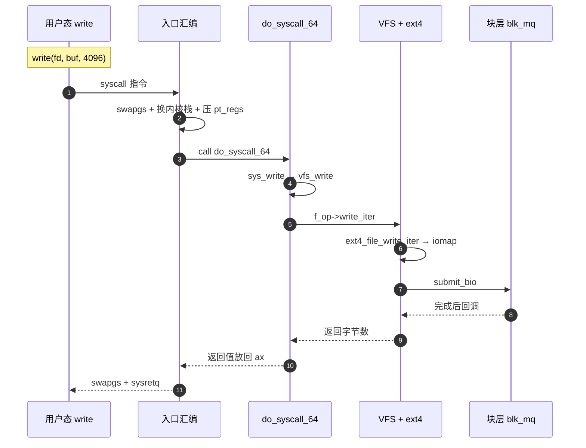

# 01 整体架构与一次系统调用的完整链路

| 编写人 | 编写内容 | 编写时间 |
| --- | --- | --- |
| growdu | 初稿：一次 write 的完整链路（用户态 → 入口汇编 → VFS → ext4 → 块层 → 回写 → 盘 → 回来），附进程/调度/内存三条主线和 v7.4 结构变化对照。 | 2026-11-25 |

> 目标：把一次 `write()` 从头到尾拆开，**每一段都给出这棵树里真实存在的函数名和文件行号**。
> 读完你应该能回答：这次 `write` 在内核里换了几个「上下文」？数据什么时候才真的落到盘上？
> `write` 返回 0 的时候，字节还在内存里吗？

本文所有行号基于 `/work/cwork/linux`（`v7.4.0-rc3`，即 `v7.4-rc3-149-g666539eecdf4`）。
**这棵树跟网上流传的 5.x / 6.x 文章差别很大** —— 调度器、页缓存、ext4 写路径都做过重构，
每段末尾都有「注意」提示哪些老说法在这棵树里已经不成立。

## 1.1 先看全景

一次 `write()` 要跨过三道门：

- **用户态 → 内核态**：`syscall` 指令触发硬件的「陷阱」，CPU 自动切到内核态，
  内核把现场压成 `struct pt_regs`。
- **内核态内部**：VFS 把「写一个文件」翻译成「写这个文件系统的哪块区域」，
  具体文件系统（ext4）再翻译成「往磁盘的哪些扇区写」，
  块层最后翻译成「哪个设备的哪个队列」。
- **异步回写**：真正落盘可能发生在 `write` 返回**之后** —— 由回写线程把脏页刷下去。



> 图里没画回写线程：**脏页刷盘是另一条独立的异步链路**，
> 由 `wb_workfn` 驱动 —— 1.7 节展开。

**这张图里有三个关键点**：

1. **一次系统调用只有一次「换栈」**。入口汇编把 `pt_regs` 压在内核栈上，
   之后整条链路都在同一个内核栈上跑，返回时一次 `swapgs` + `sysretq` 就回去了。
2. **`write` 返回不代表数据落盘**。`write` 只是把数据拷进**页缓存**，
   真正的 IO 由回写线程发起。你 `sync` 或者掉电，行为完全不同。
3. **内核里没有「一个 write 对应一个 IO」的保证**。ext4 走 iomap，
   一次 `write` 可能被切成好几个 bio，也可能和别的进程的写合并。

## 1.2 内核的分层地图

先把代码摆在哪搞清楚，否则后面每一步都不知道该去哪个目录找。

| 层 | 目录 | 干什么 |
| --- | --- | --- |
| 架构相关 | `arch/x86/` | 入口汇编、中断/异常表、x86 的页表与 TLB |
| 内核通用 | `kernel/` | 调度、进程、信号、锁、timekeeping |
| 内存管理 | `mm/` | 虚拟内存、页分配器、页缓存、回写 |
| 文件系统 | `fs/` | VFS、各具体文件系统（ext4、xfs…）、回写框架 |
| 块层 | `block/` | bio → request、设备队列、调度器 |
| 网络 | `net/` | 协议栈 |
| 头文件 | `include/linux/` | 几乎所有结构体定义（`fs.h`、`mm_types.h`、`sched.h`…） |
| 驱动 | `drivers/` | 具体的设备驱动 |

三个必须先记住的结构体位置：

- `struct file` —— `include/linux/fs.h:1258`，里面的 `f_op`（`:1261`）
  指向该文件的操作函数表；`struct file_operations` 在 `include/linux/fs.h:1923`，
  写路径对应 `write_iter`（`:1930`）。
- `struct task_struct` —— `include/linux/sched.h:836`。
  **注意**：老文章爱写的 `include/linux/sched/task.h` 这棵树里**还有这个文件**
  （`include/linux/sched/` 下现在有一堆按主题拆开的小头文件），
  但 `struct task_struct` 本体**搬走了** —— 别再往那个文件里找。
- `struct bio` —— `include/linux/blk_types.h:210`。块层的通用请求描述符。

## 1.3 `syscall` 指令与 `struct pt_regs`

用户态执行 `syscall` 时，硬件把下面几样东西「顺手」塞进了 CPU 的内部寄存器：

- `rax` —— **系统调用号**（x86_64 约定：号放 `rax`）。
- `rdi` / `rsi` / `rdx` / `r10` / `r8` / `r9` —— 前 6 个参数。
- `rcx` —— **用户态的返回地址**（被 `syscall` 硬件改写成下一条指令）。
- `r11` —— **用户态的 `rflags`**。

内核入口要把这些寄存器保存下来，保存成一个 `struct pt_regs`：

```c
/* arch/x86/include/asm/ptrace.h:103 */
struct pt_regs {
	unsigned long r15;
	unsigned long r14;
	unsigned long r13;
	unsigned long r12;
	unsigned long bp;
	unsigned long bx;

	/* These regs are callee-clobbered. Always saved on kernel entry. */
	unsigned long r11;
	unsigned long r10;
	unsigned long r9;
	unsigned long r8;
	unsigned long ax;
	unsigned long cx;
	unsigned long dx;
	unsigned long si;
	unsigned long di;

	/*
	 * orig_ax is used on entry for:
	 * - the syscall number (syscall, sysenter, int80)
	 * ...
	 */
	unsigned long orig_ax;
	/* ... 接着是 ss / cs / sp / ip 等返回用户态要用的字段 ... */
};
```

两个要分清的字段：

- **`ax`** —— 系统调用号（进来时），后来被**改写成返回值**。
  「内核怎么把返回值交还给用户态」靠的就是改 `ax`。
- **`orig_ax`** —— 原始系统调用号，**永不被改**。
  断点调试时你会看到 `orig_ax` 和 `ax` 不一样，那是因为 `ax` 已经是返回值了。

> **注意**：`struct pt_regs` 有 32 位和 64 位两套定义，
> x86_64 的在 `arch/x86/include/asm/ptrace.h:103`，32 位那份在 `:12`。

## 1.4 `entry_SYSCALL_64`：入口汇编做的五件事

x86_64 的系统调用入口在 `arch/x86/entry/entry_64.S:87`：

```asm
SYM_CODE_START(entry_SYSCALL_64)
	UNWIND_HINT_ENTRY
	ENDBR

	swapgs
	/* tss.sp2 is scratch space. */
	movq	%rsp, PER_CPU_VAR(cpu_tss_rw + TSS_sp2)
	SWITCH_TO_KERNEL_CR3 scratch_reg=%rsp
	movq	PER_CPU_VAR(cpu_current_top_of_stack), %rsp

SYM_INNER_LABEL(entry_SYSCALL_64_safe_stack, SYM_L_GLOBAL)
	/* Construct struct pt_regs on stack */
	pushq	$__USER_DS				/* pt_regs->ss */
	pushq	PER_CPU_VAR(cpu_tss_rw + TSS_sp2)	/* pt_regs->sp */
	pushq	%r11					/* pt_regs->flags */
	pushq	$__USER_CS				/* pt_regs->cs */
	pushq	%rcx					/* pt_regs->ip */
	pushq	%rax					/* pt_regs->orig_ax */

	PUSH_AND_CLEAR_REGS rax=$-ENOSYS

	/* IRQs are off. */
	movq	%rsp, %rdi
	movslq	%eax, %rsi
	...
	call	do_syscall_64		/* returns with IRQs disabled */
```

拆开看，它就做了五件事：

1. **`swapgs`** —— 换 GS 基址，拿到 per-CPU 数据。
   返回用户态时还要 `swapgs` 回去。
2. **换内核栈** —— `movq PER_CPU_VAR(cpu_current_top_of_stack), %rsp`。
   注意：**每个 CPU 有自己的一摞内核栈**，不是线程栈。
   老文章说的「切换到内核栈」在 x86_64 上就是这一句。
3. **压 `struct pt_regs`** —— 六个 `pushq` 把用户态的 ss/sp/flags/cs/ip/orig_ax 压到内核栈上，
   剩下的通用寄存器由 `PUSH_AND_CLEAR_REGS` 压。
   **栈上 `pt_regs` 的布局顺序和结构体字段顺序是反的**（栈从高地址往低地址长）。
4. **把系统调用号搬个家** —— `movq %rsp, %rdi`（`pt_regs` 指针进 `rdi`），
   `movslq %eax, %rsi`（号进 `rsi`）。
   **`rdi`/`rsi` 是 C 语言的第 1、2 个参数**，这就是为什么参数是 `regs`、`nr`。
5. **`call do_syscall_64`** —— 交给 C 代码。

> **注意**：这棵树里 **没有** `entry_common` 这个函数了。
> `arch/x86/entry/common.c` 一共才 61 行，只放 KVM 用的 `x86_entry_from_kvm`。
> 老文章说的「`entry_common` 是所有异常的公共入口」在这棵树上不成立 ——
> 异常/中断入口是**宏生成**的：
> `idtentry` 宏在 `arch/x86/entry/entry_64.S:329`，
> 展开用的头文件是 `arch/x86/include/asm/idtentry.h`，
> 比如缺页那个 `DEFINE_IDTENTRY_RAW_ERRORCODE(exc_page_fault)`
> 写在 `arch/x86/mm/fault.c:1492`。
> 取代它的通用逻辑搬到了 `kernel/entry/common.c`：`irqentry_enter`（`:109`）、
> `irqentry_exit`（`:149`）、`exit_to_user_mode_loop`（`:97`）。
>
> 另外这棵树还有一条**并行**的入口路径：**FRED**（`CONFIG_X86_FRED`，
> `arch/x86/entry/entry_fred.c` + `entry_64_fred.S`），
> 它把中断/异常交付从 IDT 换成了另一种机制，和经典的 `idtentry` 宏路径并存。
> 读入口代码时先确认自己看的哪一条。

## 1.5 系统调用表是生成出来的

`do_syscall_64` 在 `arch/x86/entry/syscall_64.c:84`：

```c
/* Returns true to return using SYSRET, or false to use IRET */
__visible noinstr bool do_syscall_64(struct pt_regs *regs, long nr)
{
	if (likely(syscall_enter_from_user_mode_randomize_stack(regs, &nr))) {
		instrumentation_begin();

		if (unlikely(!do_syscall_x64(regs, nr))) {
			if (!do_syscall_x32(regs, nr) && nr != -1L)
				regs->ax = -ENOSYS;
		}

		instrumentation_end();
	}
	syscall_exit_to_user_mode(regs);
	...
}
```

而 `do_syscall_x64`（`arch/x86/entry/syscall_64.c:57`）把号变成一个函数指针调用：

```c
static __always_inline bool do_syscall_x64(struct pt_regs *regs, unsigned long nr)
{
	if (likely(nr < NR_syscalls)) {
		nr = array_index_nospec(nr, NR_syscalls);
		regs->ax = x64_sys_call(regs, (unsigned int)nr);
		return true;
	}
	return false;
}
```

`x64_sys_call` 是个大 `switch`，但那个 switch **不是你手写的**。
它来自 `arch/x86/entry/syscalls/syscall_64.tbl`：

```text
1	common	write	sys_write
```

生成的 C 代码在 `arch/x86/include/generated/asm/syscalls_64.h`
（**构建产物**，干净的源码树里没有这个文件，得先 `make` 过）。
生成它的脚本是 `scripts/syscalltbl.sh` 和 `scripts/syscallhdr.sh`，
驱动它们的 Makefile 是 `arch/x86/entry/syscalls/Makefile`。

所以：

- **加一个系统调用** = 在 `.tbl` 里加一行 + 在 `kernel/` 里写实现，
  剩下的（头文件、汇编、tracepoint）构建脚本给你生成。
- `write` 号是 **1**。
- 真正的分发是 `x64_sys_call`（`arch/x86/entry/syscall_64.c:37`）那个
  `switch (nr)` —— **按号跳转，不是查表**。
  生成的 `__x64_sys_write` 本身也是**宏**（`arch/x86/include/asm/syscall_wrapper.h:110`），
  源码里搜不到这个符号。

> **注意**：`sys_call_table` 这个符号**还在**
> （`arch/x86/entry/syscall_64.c:29`，声明在 `arch/x86/include/asm/syscall.h:21`），
> 但**已经不管系统调用分发**了 —— 源码注释写得很直白：
> 「The `sys_call_table[]` is no longer used for system calls,
> but `kernel/trace/trace_syscalls.c` still wants to know the system call address」。
> 也就是说：**老文章里「改 `sys_call_table` 指针来改系统调用」那套玩法已经失效**，
> 现在唯一的引用点是 `kernel/trace/trace_syscalls.c:1346`。
> 想跟系统调用，只能用 `strace` 或者 `perf probe`。

系统调用号本身是从 `orig_ax` 里取的（`arch/x86/include/asm/syscall.h:28` 的
`syscall_get_nr`），但取号这件事发生在**通用代码**里
（`include/linux/entry-common.h:151`），不是 x86 专属的 `do_syscall_64` 自己读 ——
`do_syscall_64` 现在是把 `nr` 当参数收进来的。

`MSR_LSTAR` 在 `arch/x86/kernel/cpu/common.c:2272` 被写成 `entry_SYSCALL_64` 的地址：

```c
	wrmsrq(MSR_LSTAR, (unsigned long)entry_SYSCALL_64);
```

这就是「`syscall` 指令怎么知道该跳哪去」的全部秘密。

## 1.6 VFS：`vfs_write` 到 `write_iter`

系统调用号解析出 `sys_write`（`fs/read_write.c:727`），
它转手给 `ksys_write`（`fs/read_write.c:708`）——
后者负责把 **fd 解析成 `struct file`**（`CLASS(fd_pos, f)(fd)`），
再调 `vfs_write`（`fs/read_write.c:647`）：

```c
ssize_t vfs_write(struct file *file, const char __user *buf, size_t count, loff_t *pos)
{
	ssize_t ret;

	if (!(file->f_mode & FMODE_WRITE))
		return -EBADF;
	if (!(file->f_mode & FMODE_CAN_WRITE))
		return -EINVAL;
	if (unlikely(!access_ok(buf, count)))
		return -EFAULT;

	ret = rw_verify_area(WRITE, file, pos, count);
	if (ret)
		return ret;
	if (count > MAX_RW_COUNT)
		count =  MAX_RW_COUNT;
	file_start_write(file);
	if (file->f_op->write)
		ret = file->f_op->write(file, buf, count, pos);
	else if (file->f_op->write_iter)
		ret = new_sync_write(file, buf, count, pos);
	else
		ret = -EINVAL;
	if (ret > 0) {
		fsnotify_modify(file);
		add_wchar(current, ret);
	}
	inc_syscw(current);
	file_end_write(file);
	return ret;
}
```

注意这三点：

1. **`access_ok(buf, count)`** —— 用户态指针的合法性检查。
   这一行挡掉了一大批「野指针」攻击。
2. **`file->f_op`** —— 文件系统自己的实现挂在 `struct file_operations` 上。
   **VFS 不认识 ext4**，它只认识这张函数表。
3. **两条分支**：`->write`（老接口）和 `->write_iter`（新接口，带 `iov_iter`）。
   走 `->write_iter` 的话，VFS 先包一层 `new_sync_write`（`fs/read_write.c:565`）：

```c
static ssize_t new_sync_write(struct file *filp, const char __user *buf, size_t len, loff_t *ppos)
{
	struct kiocb kiocb;
	struct iov_iter iter;
	ssize_t ret;

	init_sync_kiocb(&kiocb, filp);
	kiocb.ki_pos = (ppos ? *ppos : 0);
	iov_iter_ubuf(&iter, ITER_SOURCE, (void __user *)buf, len);

	ret = filp->f_op->write_iter(&kiocb, &iter);
	BUG_ON(ret == -EIOCBQUEUED);
	...
}
```

`kiocb` 是「这次 IO 的上下文」（哪个文件、什么位置），
`iov_iter` 是「这次要搬的字节从哪来、到哪去」。

> **注意**：`vfs_iter_write`（`fs/read_write.c:940`）**不在 `write()` 这条路上**。
> 它只服务 `writev()` 那一类「自带迭代器」的路径
> （`vfs_iter_write` → `do_iter_readv_writev`，`fs/read_write.c:793`）。
> 老文章常把 `vfs_write` 和 `vfs_iter_write` 画成同一条链上的两站 —— 不是。

ext4 的实现挂在 `fs/ext4/file.c:785`：

```c
static ssize_t
ext4_file_write_iter(struct kiocb *iocb, struct iov_iter *from)
```

> **注意**：老文章说「ext4 的写走 `->write` 接口」或者「`ext4_write_iter` 里手工拼 bio」——
> **都不对**。这棵树里 ext4 走的是 **iomap** 这条通用路径。

ext4 的 buffered 写最终落到 `fs/ext4/file.c:333` 的 `ext4_iomap_buffered_write`，
再交给通用的 `iomap_file_buffered_write`（`fs/iomap/buffered-io.c:1295`）
→ `iomap_write_iter`（`fs/iomap/buffered-io.c:1189`）→ `submit_bio`。

`iomap` 是「把文件偏移映射成磁盘区间」的通用抽象层，
xfs、ext4、btrfs 现在共用这一套。

> **注意**：`ext4_write_iter` 这个符号在这棵树里**不存在**，
> 也没有 `generic_file_write_iter` 在 `fs/read_write.c` 里 ——
> `generic_file_write_iter` 现在在 `mm/filemap.c:4526`，
> `generic_perform_write` 在 `mm/filemap.c:4364`（都搬去 `mm/` 了）。

## 1.7 页缓存与回写：数据什么时候真的落盘

上面那条链路的终点是 `submit_bio`（`block/blk-core.c:960`）——
**它只是把 bio 交给块层**，不保证盘上已经有数据。

ext4 buffered 写的真实过程是：

1. 用户缓冲区 → **页缓存**（page cache）。
2. 页面被标脏（`folio_mark_dirty`，`mm/page-writeback.c:2774`）。
3. **回写线程**把脏页刷到块层。

回写线程的驱动是 `wb_workfn`（`fs/fs-writeback.c:2501`）：

```c
void wb_workfn(struct work_struct *work)
{
	struct bdi_writeback *wb = container_of(to_delayed_work(work),
						struct bdi_writeback, dwork);
	long pages_written;
	...
		do {
			pages_written = wb_do_writeback(wb);
			trace_writeback_pages_written(pages_written);
		} while (!list_empty(&wb->work_list));
```

往下是：

| 层 | 函数 | 位置 |
| --- | --- | --- |
| 1 | `wb_do_writeback` | `fs/fs-writeback.c:2465` |
| 2 | `wb_writeback` | `fs/fs-writeback.c:2248` |
| 3 | `writeback_sb_inodes` | `fs/fs-writeback.c:2021` |
| 4 | `writeback_single_inode` | `fs/fs-writeback.c:1906` |
| 5 | `__writeback_single_inode` | `fs/fs-writeback.c:1798` |
| 6 | `do_writepages` | `mm/page-writeback.c:2551` |
| 7 | `ext4_writepages` | `fs/ext4/inode.c:3149` |
| 8 | `ext4_do_writepages` | `fs/ext4/inode.c:2891` |
| 9 | `mpage_submit_folio` | `fs/ext4/inode.c:2190` |
| 10 | `ext4_bio_write_folio` | `fs/ext4/page-io.c:465` |
| 11 | `ext4_io_submit` | `fs/ext4/page-io.c:392` |
| 12 | `submit_bio` | `block/blk-core.c:960` |

**这里有个容易搞错的地方**：`ext4_writepages` 这个名字听起来是「写页」，
但它其实在 `fs/ext4/inode.c` 里，是**回写路径**（writeback），
不是 buffered write 的入口 —— buffered write 的入口是 `ext4_file_write_iter`。

两条路在 `submit_bio` 会合。

> **注意**：整个 writeback 框架已经从 `fs/writeback.c` 搬到了 **`fs/fs-writeback.c`**。
> 还有 `writeback_sb` 这个函数也不叫这个了，现在是 `writeback_sb_inodes`。

所以「`write` 返回 0，数据在哪儿」的答案是：

- **在页缓存里**（大概率还没到盘）。
- 什么时候到盘：由回写线程的节奏决定，几十毫秒到几秒；
  也可能被更高优先级的 IO 拖延。
- 要**保证**落盘：`fsync(fd)` 或者 `sync()`。

> **注意**：这棵树里 **`page_mkclean` 这个函数已经没了**。
> `page_mkwrite` 还在，但形态完全变了：它不是个独立函数，
> 而是 `address_space_operations` 里的一个**回调**
> （`include/linux/mm.h:833`），实现在 `mm/filemap.c:4024` 的 `filemap_page_mkwrite`，
> 签名也从老的 `page_mkwrite(page, write)` 换成了
> `vm_fault_t (*page_mkwrite)(struct vm_fault *vmf)`。
> 加上 folio（`struct folio`）取代 `struct page`，
> 老文章里「拿到 page 指针再手工调 page_mkwrite」那套写法对不上了。

## 1.8 块层：`submit_bio` 到 `blk_mq`

块层的入口：

| 函数 | 位置 |
| --- | --- |
| `submit_bio` | `block/blk-core.c:960` |
| `submit_bio_noacct` | `block/blk-core.c:818` |
| `__submit_bio` | `block/blk-core.c:671` |
| `blk_mq_submit_bio` | `block/blk-mq.c:3115` |
| `blk_mq_bio_to_request` | `block/blk-mq.c:2678` |
| `blk_mq_dispatch_rq_list` | `block/blk-mq.c:2109` |
| `q->mq_ops->queue_rq` | `block/blk-mq.c:2141` |

一句话概括：**bio 是「页 + 偏移 + 多少字节」的页级描述，
request 是「扇区 + 多少字节」的设备级描述**，
`blk_mq_bio_to_request` 就是这两者之间的翻译。

`blk_mq` 是「多队列」块层：一个设备有 N 个 CPU 队列，
每个 CPU 有自己的软队列，硬件有 N 个硬件队列，
中间由 `blk_mq_dispatch_rq_list` 分发。

> **注意**：这棵树里 **没有** `blk_mq_rq_dispatch` 和 `blk_mq_sched_dispatch` 这两个符号 ——
> 现在的入口是 `blk_mq_dispatch_rq_list`，
> 调度器那一层的入口是 `blk_mq_sched_dispatch_requests`（`block/blk-mq.c:2380`）。
> 「blk-mq 调度器」这个概念在这棵树上也被重写了：
> 调度器不再是一个单独的模块，而是并进了 `kernel/sched/fair.c` 那套
> 「按 `sched_group` 分组」的框架（见 1.10 节）。

设备驱动那一侧，最终落在驱动的 `queue_rq` 回调里。

## 1.9 回到用户态

返回路径在 `entry_64.S` 里，紧跟 `call do_syscall_64` 之后：

```asm
	ALTERNATIVE "testb %al, %al; jz swapgs_restore_regs_and_return_to_usermode", \
		"jmp swapgs_restore_regs_and_return_to_usermode", X86_FEATURE_XENPV

syscall_return_via_sysret:
	IBRS_EXIT
	POP_REGS pop_rdi=0
	...
```

有两条路：

- **快路 `syscall_return_via_sysret`** —— 用户态上下文「完全干净」时用 `sysretq`，
  一条指令就回到用户态。
- **慢路 `swapgs_restore_regs_and_return_to_usermode`**（`entry_64.S:560`）——
  上下文不干净（比如刚处理过中断、需要恢复状态）时走 `iret`。
  Xen PV 环境下强制走慢路。

慢路上会做 `swapgs`、恢复用户态的段寄存器和 `pt_regs` 里的
`ip`/`sp`/`cs`/`ss`/`flags`。

返回值从哪来？—— **`do_syscall_64` 把返回值写进 `regs->ax`**，
`sysretq` 顺带把 `rax` 带回用户态。所以用户态 `write()` 的返回值就是 `ax`。

> **注意**：返回路径上还有个 `syscall_exit_to_user_mode(regs)`（`do_syscall_64` 里调用），
> 那里处理「退出内核态前的收尾」：跑 RCU 读侧临界区的退出、
> 处理 `TIF_NOTIFY_*` 之类。**信号就是在这一段投递的** ——
> 不是在系统调用里打断你。

## 1.10 进程、调度、内存三条主线

写路径之外，内核还有三条同样重要的主线。它们跟写路径的交汇点很明确：

### 进程：fork / exec

| 函数 | 位置 |
| --- | --- |
| `SYSCALL_DEFINE0(fork)` | `kernel/fork.c:2879` |
| `SYSCALL_DEFINE1(clone3)` | `kernel/fork.c:3080` |
| `kernel_clone` | `kernel/fork.c:2744` |
| `copy_process` | `kernel/fork.c:2029` |
| `dup_task_struct` | `kernel/fork.c:916` |
| `copy_mm` | `kernel/fork.c:1575` |
| `copy_files` | `kernel/fork.c:1676` |
| `copy_fs` | `kernel/fork.c:1634` |
| `copy_sighand` | `kernel/fork.c:1707` |
| `copy_signal` | `kernel/fork.c:1756` |
| `copy_thread`（x86） | `arch/x86/kernel/process.c:170` |

exec 那条路：

| 函数 | 位置 |
| --- | --- |
| `do_execveat_common` | `fs/exec.c:1895` |
| `bprm_execve` | `fs/exec.c:1841` |
| `exec_binprm` | `fs/exec.c:1792` |
| `search_binary_handler` | `fs/exec.c:1758` |
| `load_elf_binary` | `fs/binfmt_elf.c:829` |
| `begin_new_exec` | `fs/exec.c:1125` |

### 调度

| 函数 | 位置 |
| --- | --- |
| `schedule` | `kernel/sched/core.c:7468` |
| `__schedule_loop` | `kernel/sched/core.c:7459` |
| `__schedule` | `kernel/sched/core.c:7211` |
| `pick_next_task` | `kernel/sched/core.c:6296` |
| `__pick_next_task` | `kernel/sched/core.c:6204` |
| `context_switch` | `kernel/sched/core.c:5525` |
| `schedule_tail` | `kernel/sched/core.c:5494` |
| `sched_balance_trigger` | `kernel/sched/fair.c:15047` |
| `sched_balance_domains` | `kernel/sched/fair.c:14261` |
| `migrate_task_rq_fair` | `kernel/sched/fair.c:9994` |
| `__migrate_task` | `kernel/sched/core.c:2639` |
| `struct sched_group` | `kernel/sched/sched.h:2309` |

> **注意**：**负载均衡被整个重写了**。
> 老文章里的 `load_balance` / `find_busiest_cgroup` / `migrate_tasks`
> 在这棵树里**都不存在**，`kernel/sched/balance.c` 这个文件也没了。
> 现在的模型是「**每个 CPU 一个 `sched_domain`**，
> 域里再按 `sched_group` 分组，按 `sched_group` 而不是按进程做迁移」。
> 读调度代码前先搞清楚这套新模型，否则会一路找错文件。

定时器（时间片从哪来）：

| 函数 | 位置 |
| --- | --- |
| `tick_periodic` | `kernel/time/tick-common.c:86` |
| `tick_handle_periodic` | `kernel/time/tick-common.c:108` |
| `tick_sched_handle` | `kernel/time/tick-sched.c:275` |
| `update_process_times` | `kernel/time/timer.c:2469` |
| `do_timer` | `kernel/time/timekeeping.c:2841` |
| `local_apic_timer_interrupt` | `arch/x86/kernel/apic/apic.c:1023` |

### 内存

| 函数 / 结构 | 位置 |
| --- | --- |
| `struct mm_struct` | `include/linux/mm_types.h:1214` |
| `mm_mt`（maple tree） | `include/linux/mm_types.h:1231` |
| `task_size` | `include/linux/mm_types.h:1240` |
| `mm_users` | `include/linux/mm_types.h:1262` |
| `map_count` | `include/linux/mm_types.h:1272` |
| `do_user_addr_fault` | `arch/x86/mm/fault.c:1216` |
| `handle_mm_fault` | `mm/memory.c:6949` |
| `__handle_mm_fault` | `mm/memory.c:6714` |
| `do_fault` | `mm/memory.c:6216` |
| `__do_fault` | `mm/memory.c:5650` |
| `do_anonymous_page` | `mm/memory.c:5539` |
| `do_read_fault` | `mm/memory.c:6092` |
| `filemap_fault` | `mm/filemap.c:3572` |
| `alloc_pages`（宏） | `include/linux/gfp.h:298` |
| `__alloc_pages_noprof` | `mm/page_alloc.c:5527` |
| `__rmqueue_smallest` | `mm/page_alloc.c:1890` |
| `free_pages` | `mm/page_alloc.c:5650` |
| `do_mmap` | `mm/mmap.c:338` |
| `mmap_region` | `mm/vma.c:3147` |
| `__mmap_region` | `mm/vma.c:3048` |
| `vm_area_alloc` | `mm/vma_init.c:32` |
| `struct vm_area_struct` | `include/linux/mm_types.h:961` |
| `SYSCALL_DEFINE6(mmap_pgoff)` | `mm/mmap.c:626` |
| `pcpu_populate_chunk` | `mm/percpu.c:1565` |

> **注意**：三个老符号在这棵树里**已经消失**：
> - `mm->map`（红黑树）没有了 —— 换成了 **maple tree**（`mm_mt`，
>   `include/linux/maple_tree.h:261`）。
> - `vma_new` / `vma_alloc` 没有了 —— 现在是 `vm_area_alloc`（`mm/vma_init.c:32`）。
> - `mm_struct.pgtables` 字段没有了。

## 1.11 完整调用链速查表

一次 buffered `write` 的完整路径，左边是环节，右边是这棵树里的位置：

| # | 环节 | 位置 |
| --- | --- | --- |
| 1 | 用户态 `write()` → `syscall` 指令 | libc（glibc） |
| 2 | CPU 陷阱，切内核态 | 硬件 |
| 3 | 入口汇编 | `arch/x86/entry/entry_64.S:87` `entry_SYSCALL_64` |
| 4 | 压 `struct pt_regs` | `arch/x86/include/asm/ptrace.h:103` |
| 5 | 分发系统调用 | `arch/x86/entry/syscall_64.c:84` `do_syscall_64` |
| 6 | 系统调用表 | `arch/x86/entry/syscalls/syscall_64.tbl:13`（`1 common write sys_write`） |
| 7 | `sys_write` | `fs/read_write.c:727` |
| 8 | `ksys_write`（fd → `struct file`） | `fs/read_write.c:708` |
| 9 | `vfs_write` | `fs/read_write.c:647` |
| 10 | `new_sync_write` → `write_iter` | `fs/read_write.c:565` |
| 11 | `ext4_file_write_iter` | `fs/ext4/file.c:785` |
| 12 | `ext4_iomap_buffered_write` | `fs/ext4/file.c:333` |
| 13 | `iomap_file_buffered_write` | `fs/iomap/buffered-io.c:1295` |
| 14 | `iomap_write_iter` | `fs/iomap/buffered-io.c:1189` |
| 15 | 拷进页缓存 + 标脏 | `mm/page-writeback.c:2774` `folio_mark_dirty` |
| 16 | `submit_bio` | `block/blk-core.c:960` |
| 17 | `blk_mq_submit_bio` | `block/blk-mq.c:3115` |
| 18 | `blk_mq_bio_to_request` | `block/blk-mq.c:2678` |
| 19 | `blk_mq_dispatch_rq_list` | `block/blk-mq.c:2109` |
| 20 | 驱动的 `queue_rq` | `drivers/` |
| 21 | 回写线程（异步） | `fs/fs-writeback.c:2501` `wb_workfn` |
| 22 | 回写 → `do_writepages` | `mm/page-writeback.c:2551` |
| 23 | `ext4_writepages` | `fs/ext4/inode.c:3149` |
| 24 | `ext4_bio_write_folio` | `fs/ext4/page-io.c:465` |
| 25 | 回写再次 `submit_bio` | `block/blk-core.c:960` |
| 26 | 返回：`regs->ax` 写回 | `arch/x86/entry/syscall_64.c:84` |
| 27 | `swapgs` + `sysretq` | `arch/x86/entry/entry_64.S:559-560` |

**注意第 15/16 步和第 21-25 步的关系**：
第 16 步的 `submit_bio` 在 buffered 写里是**由 iomap 路径触发的写回提交**，
第 21-25 步是**回写线程**触发的同一条路 —— 两条路在 `submit_bio` 合流。

## 1.12 用 GDB 跟一次 `write`

内核调试的基本姿势（QEMU + gdbserver）：

```bash
# 1. 编译带调试信息的内核（内核没有 make gdb 目标，调试信息是配出来的）
make ARCH=x86_64 defconfig
./scripts/config --enable DEBUG_INFO
./scripts/config --enable DEBUG_KERNEL
./scripts/config --enable KALLSYMS_ALL
make ARCH=x86_64 -j"$(nproc)"

# 2. 起 QEMU（内核源码树根目录下的 arch/x86/boot/bzImage）
qemu-system-x86_64 -kernel arch/x86/boot/bzImage \
  -initrd /tmp/rootfs.cpio.gz \
  -append "console=ttyS0 root=/dev/ram0 rdinit=/bin/sh" \
  -s -S &

# 3. gdb 连上去
gdb vmlinux
(gdb) target remote :1234
(gdb) break do_syscall_64
(gdb) continue
```

设几个断点，依次打下去：

| 断点 | 想看什么 |
| --- | --- |
| `entry_SYSCALL_64` | `rax` 是几号系统调用 |
| `do_syscall_64` | `regs->orig_ax`（号）、`regs->ax`（即将变成返回值） |
| `vfs_write` | `count`、`pos` |
| `ext4_file_write_iter` | `iocb->ki_pos`、`iov_iter` 的长度 |
| `submit_bio` | `bio->bi_iter.bi_sector`（写到哪个扇区） |
| `blk_mq_bio_to_request` | bio → request 的翻译结果 |

**看 `orig_ax` 和 `ax` 的差别**，是理解「内核怎么返回结果」最快的办法：

```gdb
(gdb) p regs->orig_ax    # $1 = 1   ← 系统调用号 write
(gdb) p regs->ax         # $2 = 4096 ← 已经被改成返回值了
```

命令式速查：

```gdb
(gdb) disassemble do_syscall_64     # 反汇编，看它到底 call 谁
(gdb) print *regs                    # 整个 pt_regs
(gdb) x/10i $pc                     # 看当前汇编
```

**用 `strace` 先确定「进内核前」的状态**，再用 gdb 看「进内核后」：

```bash
strace -e trace=write -T ./your_program
```

`strace` 的 `-T` 会给出每个系统调用花的时间，`-tt` 给时间戳。
两者配合 gdb，能把「慢在哪」定位到具体函数。

> **提示**：内核里断点会「什么都不打印」，
> 因为没法 `printf`。用 `dprintf`（pr_info 的调试版）或
> `gdb` 的 `commands` 块自动打印寄存器。

## 1.13 小结

这一章的核心就三句话：

1. **一次系统调用 = 一次硬件陷阱 + 一次 `pt_regs` 压栈 + 一次函数指针分发 + 一次 `swapgs` 回来。**
   入口汇编只有 20 来行，其余全是 C 代码。
2. **`write` 不等于落盘。** 它把数据搬进页缓存就返回了；
   真正刷盘的是回写线程（`wb_workfn`），走的是另一条异步链路。
   想确定落盘要 `fsync`。
3. **内核靠「结构体 + 函数指针表」解耦。**
   `struct file_operations` 让 VFS 不需要认识 ext4，
   `struct bio` 让文件系统不认识具体设备。
   读内核代码时，**先找那张函数表**，比顺着调用栈往下读快得多。

## 1.14 v7.4 变化对照表

网上流传的 Linux 内核文章大多基于 5.x / 6.x。
这棵树是 **v7.4.0-rc3**，下面这些老说法**已经不成立**：

| 老文章里的说法 | 这棵树里的实际情况 |
| --- | --- |
| `sys_call_table` 数组存在，改指针就能改系统调用 | 符号**还在**（`arch/x86/entry/syscall_64.c:29`），但**不再用于分发**，只剩 trace 的一处引用；分发改成 `x64_sys_call` 的 `switch` |
| `entry_common` 是所有异常的公共入口 | **没有这个函数**。`arch/x86/entry/common.c` 只有 61 行（KVM 用） |
| `do_syscall_64` 在 `arch/x86/entry/common.c` | 在 **`arch/x86/entry/syscall_64.c:84`** |
| `page_mkclean` / `page_mkwrite` 是函数 | `page_mkclean` **没了**；`page_mkwrite` 变成 `address_space_operations` 的回调（`include/linux/mm.h:833`），签名换成 `vm_fault_t (*)(struct vm_fault *)` |
| `ext4_write_iter` 手工拼 bio | 走 **iomap**：`ext4_file_write_iter` → `iomap_write_iter` |
| `generic_file_write_iter` 在 `fs/read_write.c` | 在 **`mm/filemap.c:4526`** |
| writeback 框架在 `fs/writeback.c` | 在 **`fs/fs-writeback.c`** |
| `writeback_sb()` 是回写入口 | 是 **`writeback_sb_inodes()`**（`fs/fs-writeback.c:2021`） |
| `load_balance` / `find_busiest_cgroup` / `migrate_tasks` | **都没有了**，改成 `sched_group` 模型 |
| `kernel/sched/balance.c`、`switch.c`、`time.c`、`pick_next_task.c` | **这四个文件都没了** |
| `mm->map` 是红黑树 | 是 **maple tree**（`mm_mt`） |
| `vma_new` / `vma_alloc` | 是 **`vm_area_alloc`**（`mm/vma_init.c:32`） |
| `mm_struct.pgtables` 字段 | **没了** |
| `struct task_struct` 在 `include/linux/sched/task.h` | 在 **`include/linux/sched.h:836`** |
| `do_fork` / `do_signal`（x86） | 是 **`kernel_clone`** / **`get_signal`** |
| `__send_signal` / `send_signal` | 是 **`send_signal_locked`**（`kernel/signal.c:1207`） |
| `blk_mq_rq_dispatch` / `blk_mq_sched_dispatch` | 是 **`blk_mq_dispatch_rq_list`** |
| `__alloc_pages` / `___alloc_pages` / `pcpu_populate` | 是 **`__alloc_pages_noprof`** / **`pcpu_populate_chunk`** |
| `__tick` / `tick_sched_handle_tick` | 是 **`tick_periodic`** / **`tick_sched_handle`** |
| `do_mmap_pgo` | 是 **`mmap_pgoff`**（`mm/mmap.c:626`） |
| `pcpu_populate` 在 `mm/percpu.c` | 确实在 `mm/percpu.c`，但函数名是 `pcpu_populate_chunk` |

**读老文章的心法**：老文章讲的是**思路**（分层、解耦、异步）这部分还有效，
但**具体到函数名和文件位置**的部分要按这棵树重新对一遍。
先在本文的速查表里定位环节，再去源码里确认行号。
