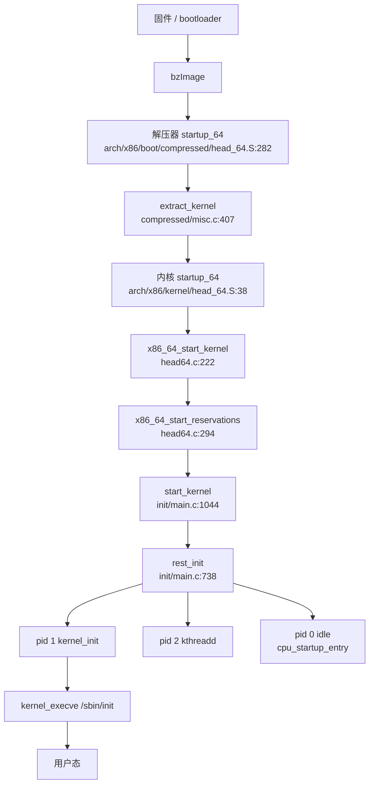

# 02 编译与启动：从 `start_kernel` 到第一个用户态进程

| 编写人 | 编写内容 | 编写时间 |
| --- | --- | --- |
| growdu | 初稿：构建流水线（Kconfig/Kbuild/vmlinux/bzImage/System.map）、x86 启动链（boot protocol、自解压、startup_64、start_kernel、rest_init、kernel_init）、initcall 分级、initramfs 与 rootfs、pid 1 的 execve，附 GDB 跟启动与起不来时的排查表。 | 2026-11-26 |

> 目标：把「内核是怎么被编出来的、又是怎么跑起来的」拆成可验证的步骤。
> 读完你应该能回答：`bzImage` 里到底装了什么？`start_kernel` 之前还有谁跑过？
> 为什么 `init` 这个进程能同时是「内核线程」和「用户态进程」？`/sbin/init` 起不来时内核为什么直接 panic？
>
> 本文所有行号基于 `/work/cwork/linux`（`v7.4.0-rc3`，即 `v7.4-rc3-149-g666539eecdf4`）。
> 上一章讲的是「已经跑起来之后，一次系统调用怎么走」；这一章讲「内核怎么走到能跑系统调用的那一天」。

## 2.1 全景：启动分成五段

先给一张图，后面每一节展开其中一段。



这五段分别是：

| # | 阶段 | 跑在什么环境里 | 这段结束时 |
| --- | --- | --- | --- |
| 1 | 构建 | 你的开发机 | 得到 `vmlinux`、`System.map`、`bzImage` |
| 2 | bootloader + 自解压 | 实模式 / 保护模式，解压器的临时环境 | 内核被解压到最终位置 |
| 3 | 架构入口 | 内核自己的地址空间，但还没有内存管理 | 进入 `start_kernel` |
| 4 | `start_kernel` 单核初始化 | 单核、中断时开时关 | 调度器能跑，但还没有用户态 |
| 5 | `rest_init` → pid 1 | 多核开始上线，init 线程执行 `execve` | 系统里出现第一个用户态进程 |

注意这张图的顺序里**没有「内核线程先跑起来」这件事**。pid 1 是 `start_kernel` 的**最后一步** `rest_init`（`init/main.c:738`）克隆出来的，
它自己也是个内核线程，然后自己调用 `execve()` 变成 `/sbin/init`。所以「内核线程变用户态进程」不是黑魔法，是 `execve` 的返回值。

## 2.2 先把内核编出来

启动这件事从编译开始，先把「内核是怎么从源码变成一个可引导镜像的」讲清楚，
否则后面所有的断点、所有的符号名你都不知道在哪。

### 2.2.1 Kconfig → .config → Kbuild

内核构建有两套互不相干的「配置」：

- **Kconfig** 是**菜单树**：`arch/x86/Kconfig`、`init/Kconfig`、`drivers/*/Kconfig`……层层 `source` 进去。
  它只描述「有哪些选项、依赖什么、默认值是什么」，不决定编译什么。
- **Kbuild** 是**构建规则**：每个目录的 `Makefile` 用 `obj-$(CONFIG_XXX)` 决定编哪个文件。
  它消费 Kconfig 的结果。

中间隔着一个 `.config`：

```bash
cd /work/cwork/linux

# 生成一份最小可用配置（x86_64）
make ARCH=x86_64 defconfig

# 打开读源码必须的三样（上一章也用过）
./scripts/config --enable DEBUG_INFO --enable DEBUG_KERNEL --enable KALLSYMS_ALL
make ARCH=x86_64 olddefconfig

# 编译本体
make ARCH=x86_64 -j"$(nproc)"
```

`make defconfig` 在 x86_64 上读的是 `arch/x86/configs/x86_64_defconfig`，
由 `scripts/kconfig/conf` 展开成完整的 `.config`。

**`.config` 不是被代码直接读的文件。** 构建时会跑一次 `syncconfig`，把它翻译两个方向：

| 产物 | 给谁读 | 入口 |
| --- | --- | --- |
| `include/config/auto.conf` | **Makefile**（`CONFIG_XXX=y` 变成 `obj-y`） | `Makefile:816` |
| `include/generated/autoconf.h` | **C 代码**（`#define CONFIG_XXX 1`） | `Makefile:910` |

注意这两条路径是**分开的**：`autoconf.h` 里有没有某个宏决定 C 代码里 `#ifdef CONFIG_XXX` 是否成立；
`auto.conf` 里有没有 `CONFIG_XXX=y` 决定 `Makefile` 里 `obj-$(CONFIG_XXX)` 是否编进 vmlinux。
**这两边必须一致，否则会出现「代码编进去了但没被 #include，或者代码没编进但 Makefile 以为编了」这种诡异现象。**

> **注意**：`include/generated/` 整个目录是构建产物，**干净的源码树里没有**。
> 所以你在源码树里搜 `CONFIG_EXT4_FS` 的定义，只能搜到 Kconfig 里的定义和 C 代码里的 `#ifdef`，
> 搜不到「它到底开没开」—— 那个答案在 `include/generated/autoconf.h`，得先 `make` 过。
> 同理 `arch/x86/include/generated/asm/syscalls_64.h`（上一章 1.5 节讲过）也是这么来的。

### 2.2.2 vmlinux 与 System.map

编译的终点是 `vmlinux` —— 一个**带完整符号的 ELF 文件**，就是 GDB 要连的那个东西。

它不是一步编出来的，中间有几层归档：

| 目标 | 位置 | 干什么 |
| --- | --- | --- |
| `vmlinux_a` | `Makefile:1352` | 把所有 `KBUILD_VMLINUX_OBJS` 打包成一个大归档（`scripts/Makefile.vmlinux_a`） |
| `vmlinux_o` | `Makefile:1359` | 加上 `KBUILD_VMLINUX_LIBS` 里的库 |
| `vmlinux` | `Makefile:1376-1378` | 交给 `scripts/link-vmlinux.sh` 链接 |

链接脚本最后一步会顺手生成符号表：

```bash
scripts/link-vmlinux.sh:307
mksysmap "${VMLINUX}" System.map
```

`System.map` 是 `地址 符号 类型` 的纯文本表。它不是给 GDB 用的（GDB 直接读 vmlinux 的 DWARF），
而是给**没有符号信息的运行环境**用的 —— 比如 `/proc/kallsyms` 的数据来源、oops 消息里那串十六进制地址怎么翻译成函数名。

> **注意**：`System.map` 是构建时快照。如果你编译完了又改了源码重新编，
> 而运行的是**旧镜像**，那么 oops 里的地址按新 `System.map` 翻译会**全部错位**。
> 所以排查线上问题第一步是 `uname -v` 和 `/proc/kallsyms` 对一下，别拿错的表。

### 2.2.3 bzImage：可引导的那一个

`vmlinux` 不能直接从磁盘引导 —— 它是个 ELF，里面全是元数据，
而且解压前的内核可能是压缩的。x86_64 的可引导镜像是 `bzImage`：

```bash
arch/x86/Makefile:302-303
# KBUILD_IMAGE specify target image being built
KBUILD_IMAGE := $(boot)/bzImage
```

`bzImage` 由两部分拼成（`arch/x86/boot/Makefile:64`）：

```makefile
$(obj)/bzImage: $(obj)/setup.bin $(obj)/vmlinux.bin FORCE
```

| 部分 | 位置 | 是什么 |
| --- | --- | --- |
| `setup.bin` | `arch/x86/boot/Makefile:91-92` | 引导协议的实现 + 头信息（`arch/x86/boot/header.S` 编出来的实模式代码） |
| `vmlinux.bin` | `arch/x86/boot/Makefile:68-69` | **压缩后的**内核本体（`objcopy -O binary` + gzip） |

压缩后的那一步在 `arch/x86/boot/compressed/Makefile`：

```makefile
117: 	$(call if_changed,ld)          # 编出解压器 vmlinux
121: 	$(call if_changed,objcopy)     # 剥成纯二进制
136: 	$(call if_changed,gzip)        # 再压缩一层
```

完整产物清单：

| 产物 | 是什么 | 你什么时候会碰它 |
| --- | --- | --- |
| `vmlinux` | 带 DWARF 的 ELF | **GDB 连它** |
| `System.map` | 地址 → 符号 | 翻译 oops |
| `arch/x86/boot/bzImage` | 可引导镜像 | QEMU 的 `-kernel` |
| `.config` | 你的选择 | 改配置 |
| `include/generated/*` | 构建中间产物 | 排查「CONFIG 怎么没生效」 |
| `*.ko` | 模块 | `insmod` |
| `vmlinux.o` | 未链接的目标文件 | 看编译产物 |

> **注意**：老文章会说「内核没有 make gdb 目标，所以得自己编调试信息」。
> 这句话本身没错（`make help` 里确实没有 `gdb`），但**真正的意思是**：
> 调试信息（`DEBUG_INFO`）是**配置出来的能力**，不是 `make` 的某个参数。
> 配置里不带 `DEBUG_INFO`，编出来的 `vmlinux` 就没有 DWARF，GDB 断点的效果会退化成
> 「只能断在已知函数地址」。
>
> 另一个常见误区：`make` 默认只编内核本体，**不编模块**。要模块得 `make modules`。

## 2.3 boot protocol：bootloader 交给内核的是什么

`bzImage` 的第一部分 `setup.bin` 实现了一份**约定好的协议**（boot protocol）。
bootloader 和内核之间没有任何运行时协商 —— 协议是写死在 `arch/x86/boot/header.S` 里的。

两个关键位置：

```asm
arch/x86/boot/header.S:241
boot_flag:	.word 0xAA55          ; 「我是 bzImage，按约定读我」

arch/x86/boot/header.S:547
start_of_setup:                    ; 实模式入口
```

`header.S` 里还有 `xloadflags`（`:342`），告诉内核「bootloader 能以哪种方式把控制权交给我」：

```asm
#define XLF_KERNEL_64               /* 64-bit kernel */
#define XLF_EFI_HANDOVER_32/64      /* EFI handover 入口 */
```

这决定了三种进入方式：

| 方式 | 谁用 | 特点 |
| --- | --- | --- |
| 16 位实模式 | 老式 bootloader | 走 setup.bin 的代码，先切到 32 位保护模式再切 64 位 |
| 32 位保护模式 | 部分现代 bootloader | 跳过实模式 |
| 64 位直接跳转 | 现代 EFI/UEFI loader | 直接跳到 64 位代码，最省事 |

不管哪种方式，**bootloader 都会把 `boot_params` 的地址放进 `%rsi`**（这一点在解压器入口的注释里写得很清楚）。

> **注意**：网上有大量文章从「16 位实模式 setup 代码」开始讲，但那一段在现代机器上**基本已经不跑了** ——
> UEFI 下的 bootloader 通常走 64 位直接跳转（`XLF_KERNEL_64` / EFI handover）。
> 读老文章时别在这上面花太多时间，重点是它最后**跳到哪**：跳的是解压器，不是内核本体。

## 2.4 自解压：两个同名的 `startup_64`

这是最容易跟错的一段。代码树里有**两个**叫 `startup_64` 的函数：

| 位置 | 是什么 | 干什么 |
| --- | --- | --- |
| `arch/x86/boot/compressed/head_64.S:282` | **解压器**的入口 | 解 `vmlinux.bin.gz`，跳去真内核 |
| `arch/x86/kernel/head_64.S:38` | **内核**的入口 | 建页表、清 bss、跳 C 代码 |

控制流先经过第一个，解完压之后跳到第二个。两者同名，文件不同，功能完全无关。

```asm
arch/x86/boot/compressed/head_64.S:282
SYM_CODE_START(startup_64)
	/* ... */
	/* %RSI holds the physical address of the boot_params structure */
	mov	%rsi, %r15
```

解压器最后调 `extract_kernel`：

```asm
arch/x86/boot/compressed/head_64.S:473
	call	extract_kernel		/* returns kernel entry point in %rax */
```

```c
// arch/x86/boot/compressed/misc.c:407
asmlinkage __visible void *extract_kernel(void *rmode, unsigned char *output)
```

`extract_kernel` 干两件事：解压（gzip/lz4/lzma 等），然后把**解压后的内核入口地址**通过 `%rax` 返回。
那个入口地址就是真内核 `startup_64` 的链接地址。

真内核入口在 `arch/x86/kernel/head_64.S`，`initial_code` 这个符号记着它的地址：

```asm
arch/x86/kernel/head_64.S:479
SYM_DATA(initial_code,	.quad x86_64_start_kernel)
```

> **注意**：解压器是**位置无关**的临时代码，它没有链接地址的概念，跑在 bootloader 给的临时内存里；
> 而真内核 `startup_64` 是**链接地址**的，它假设自己已经在最终内存布局里跑。
> 所以解压器必须先把内核**放到它编译时的目标地址**，再跳过去 —— 这一步叫「decompress and relocate」，
> 老文章里的 `startup_64` + `early_top_pgt` 那套说的就是这个阶段。
> 想跟这一段的，GDB 断在解压器时要用 `add-symbol-file` 把解压器自己的 vmlinux 加进去（2.12 节）。

## 2.5 内核真正的入口

解压器跳过来之后，跑的是 `arch/x86/kernel/head_64.S` 里的 `startup_64`（`:38`）。
它做的是一件事：**在没有内存管理的情况下，把 CPU 切到内核的虚拟地址空间**。

关键动作（按代码顺序）：

| 动作 | 位置 | 为什么 |
| --- | --- | --- |
| 清身份映射 trampoline | `head64.c` 里 `x86_64_start_kernel` 调 `reset_early_page_tables()` | 早期临时页表可以扔了 |
| 设页表基址 | `startup_64` | 让 CPU 走内核的虚拟地址 |
| `clear_bss()` | `head64.c` | C 代码依赖 bss 为 0 |
| 清 `init_top_pgt` | `head64.c` | 为 KPTI（内核页表隔离）准备 |
| 调 C 函数 | `head64.c:310` 的 `start_kernel()` | 进入 C 世界 |

C 入口是 `arch/x86/kernel/head64.c`：

```c
// arch/x86/kernel/head64.c:222
asmlinkage __visible void __init __noreturn x86_64_start_kernel(char * real_mode_data)
{
	/* ... */
	reset_early_page_tables();
	/* ... */
	clear_bss();
	clear_page(init_top_pgt);
	/* ... */
}

// arch/x86/kernel/head64.c:294
void __init __noreturn x86_64_start_reservations(char *real_mode_data)
{
	/* ... */
	start_kernel();           /* :310 */
}
```

注意这里**有两层 C 入口**：`x86_64_start_kernel` 先做完架构相关的收尾，
再调 `x86_64_start_reservations`（处理 SME 等怪癖），后者才调 `start_kernel`。

> **注意**：老文章里 `start_kernel` 的签名长这样：
> `asmlinkage void __init start_kernel(void)`。
> 在这棵树里（`init/main.c:1044`）它变成了 **`void start_kernel(void)`**：
> **`asmlinkage` 和 `__init` 都没了**。原因是它被汇编直接调用，参数走约定好的寄存器，
> 不需要 `asmlinkage`；而它跑到一半会长时间驻留，不能被 `__init` 段的回收机制干掉。
> 你在老文章里看到的 `asmlinkage` 别照抄，这棵树里搜不到。

## 2.6 start_kernel：单核上的顺序初始化

`start_kernel`（`init/main.c:1044`）是内核里**最长的函数**，200 多行，
把「一个只有 CPU 和内存的东西」变成「有调度器、有 VFS、能跑中断的东西」。

它的代码顺序不是随意的，而是**依赖关系决定**的：谁需要谁，谁就在后面。

| 阶段 | 关键调用 | 位置 | 为什么排在这里 |
| --- | --- | --- | --- |
| 早期 CPU | `boot_cpu_init()` | `start_kernel` 内 | 每个 CPU 的数据结构 |
| 架构收尾 | `setup_arch(&command_line)` | `init/main.c:1066` | 解析 cmdline、内存布局、设备树 |
| 早期内存 | `mm_core_init_early()` | `init/main.c:1067` | 页分配器需要的早期结构 |
| 通用内存 | `mm_core_init()` | `init/main.c:1106` | 完整的页分配器 |
| 调度器 | `sched_init()` | `init/main.c:1119` | 之后才允许起中断、跑 kthread |
| 中断 | `init_IRQ()` | `init/main.c:1151` | 中断向量表 |
| 时间 | `time_init()` | `init/main.c:1160` | 时钟源 |
| 开中断 | `local_irq_enable()` | `init/main.c:1175` | **从这里开始允许异步** |
| 控制台 | `console_init()` | `init/main.c:1184` | 之后才有 printk 输出 |
| 进程 | `fork_init()` | `init/main.c:1221` | 要 fork 就得先有进程缓存 |
| 文件系统 | `vfs_caches_init()` | `init/main.c:1229` | 要 mount rootfs 就得先有缓存 |
| 交棒 | `rest_init()` | `init/main.c:1247` | 内核初始化的最后一步 |

几个容易踩的点：

- **`local_irq_enable()` 之前，系统是「完全同步」的**。中断是异步的，调度器依赖时钟中断，
  所以在 `sched_init()` 之后、`local_irq_enable()` 之前这段，系统只能顺序跑，谁也不能被抢占。
- **控制台是「先凑合能用，后真正能用」**。`start_kernel` 早期就有 `pr_notice("%s", linux_banner)`，
  但那时 console 可能还没注册（`console_init` 还没跑），所以早期输出靠的是 **earlycon / earlyprintk**
  这类「串口直接写」的临时通道，不是 `printk`。
- **`setup_arch` 是架构相关的**。x86 上它干一大堆事：解析 e820 内存图、建立早期页表、初始化 ACPI……
  别的架构（ARM64、RISC-V）的 `setup_arch` 内容完全不同。所以「`setup_arch` 做了什么」这个问题，
  答案是「看架构」。

> **注意**：这一章和上一章有个很好的对照：上一章 1.5 节讲 `do_syscall_64` 是 x86 专属的、
> 而 `syscall_get_nr` 是通用代码（`include/linux/entry-common.h`）。同样的分裂在这里也成立：
> `setup_arch` 是 x86 专属的，`mm_core_init` / `sched_init` / `vfs_caches_init` 是通用代码。
> **读内核代码时，先判断你在读「架构层」还是「通用层」**，这两层的可移植性完全不同。

## 2.7 rest_init：一个任务劈成两个

`start_kernel` 的最后一步是 `rest_init()`（`init/main.c:738`），
它做了一件听起来矛盾的事：**把自己「拆」成两个任务，然后自己去当空闲进程。**

```c
static noinline void __ref __noreturn rest_init(void)
{
	struct kernel_clone_args init_args = {
		.flags		= (CLONE_VM | CLONE_UNTRACED),
		.fn		= kernel_init,
		.fn_arg		= NULL,
	};
	/* ... */
	pid = kernel_clone(&init_args);         /* :754 —— pid 1 */
	/* ... */
	pid = kernel_thread(kthreadd, NULL, NULL, CLONE_FS | CLONE_FILES);  /* :767 —— pid 2 */
	/* ... */
	system_state = SYSTEM_SCHEDULING;       /* :779 */
	complete(&kthreadd_done);
	/* ... */
	schedule_preempt_disabled();            /* :787 */
	cpu_startup_entry(CPUHP_ONLINE);        /* :789 */
}
```

| pid | 是谁 | 怎么来的 | 干什么 |
| --- | --- | --- | --- |
| 0 | `init_task`（swapper/idle） | 不是 clone 出来的，是编译期静态定义（`init/init_task.c:105`） | 没有活干时跑 `cpu_idle` |
| 1 | `kernel_init` | `kernel_clone(&init_args)`（`:754`） | 完成剩下的初始化，然后 `execve` 成 `/sbin/init` |
| 2 | `kthreadd` | `kernel_thread(kthreadd, ...)`（`:767`） | 所有内核线程的「线程工厂」 |

注意 **pid 1 不是 `kernel_thread` 创建的，而是 `kernel_clone`**。
这个区别在下一节会救命：它决定了 `init` 能不能 `execve`。

`rest_init` 的最后两行：

```c
schedule_preempt_disabled();            /* :787 */
cpu_startup_entry(CPUHP_ONLINE);        /* :789 */
```

`cpu_startup_entry` 在 `kernel/sched/idle.c:452`，它进 `do_idle`（`:278`）——
**boot CPU 从此开始「没活就睡觉」**，这就是空闲进程。注意 boot CPU 是**主动**进来的，
而不是被调度器换下去的。

> **注意**：老文章里有个经典错误说法：「`init_task` 是 pid 1，它负责创建 init 和 kthreadd」。
> 在这棵树里 `init_task`（`init/init_task.c:105`）是 **pid 0**，它是**编译期就存在的静态结构体**，
> 不经过任何 clone。真正创建 pid 1 / pid 2 的是 `rest_init` 里的两次 `kernel_clone` / `kernel_thread`。
> `init_task` 扮演的角色是「调度器启动前的临时任务」，它自己从不 `execve`，也从不真正「运行」。
>
> 另一个细节：`kernel_clone`（`kernel/fork.c:2744`）和 `kernel_thread`（`kernel/fork.c:2847`）
> 是**同一个底层机制**的两种包装。`kernel_thread` 是 `kernel_clone` + `.kthread = 1`。
> 这个 `.kthread` 标记决定了进程创建时会不会被设上 `PF_KTHREAD` 标志（`kernel/fork.c:2161-2163`）。

## 2.8 kernel_init：从内核线程到用户态 init

pid 1 是 `kernel_init` 函数（`init/main.c:1611`）。它是个内核线程，
跑完之后会变成用户态的 `/sbin/init` —— 这就是「内核线程变用户态进程」的全部真相。

它的完整路径：

```c
static int __ref kernel_init(void *unused)
{
	init_userspace_fs();                    /* :1615 */
	wait_for_completion(&kthreadd_done);    /* :1620 —— 等 pid 2 就绪 */
	kernel_init_freeable();                 /* :1622 —— 干剩下的所有初始化 */
	async_synchronize_full();
	system_state = SYSTEM_FREEING_INITMEM;
	kprobe_free_init_mem();
	/* ... */
	free_initmem();                         /* :1631 */
	mark_readonly();                        /* :1632 */
	pti_finalize();
	system_state = SYSTEM_RUNNING;
	/* ... */
	do_sysctl_args();
	/* ... */
	if (ramdisk_execute_command) {          /* :1647 */
		ret = run_init_process(ramdisk_execute_command);
		/* ... */
	}
	/* ... 然后一路试 execute_command / CONFIG_DEFAULT_INIT / /sbin/init ... */
}
```

### 2.8.1 kernel_init_freeable：剩下的重活

`kernel_init_freeable`（`init/main.c:1703`）才是「把系统真正跑起来」的地方。
顺序同样有依赖关系：

| 调用 | 位置 | 为什么必须在这 |
| --- | --- | --- |
| `smp_prepare_cpus()` | `init/main.c:1715` | 要起多核就得先准备好所有 CPU |
| `workqueue_init()` | `init/main.c:1717` | 要起 kthread 就得先有 worker 池 |
| `init_mm_internals()` | `init/main.c:1719` | 内存管理的内部收尾 |
| `do_pre_smp_initcalls()` | `init/main.c:1721` | 早于 SMP 的 initcall |
| `smp_init()` | `init/main.c:1724` | 把剩下的 CPU 拉起来 |
| `sched_init_smp()` | `init/main.c:1725` | 调度的 SMP 收尾 |
| `async_init()` | `init/main.c:1728` | 异步任务框架 |
| `page_alloc_init_late()` | `init/main.c:1730` | 页分配器收尾 |
| `do_basic_setup()` | `init/main.c:1732` | **initcall 的主战场** |
| `wait_for_initramfs()` | `init/main.c:1736` | 等 initramfs 解完 |
| `console_on_rootfs()` | `init/main.c:1737` | 打开 `/dev/console` |
| `init_eaccess()` + `prepare_namespace()` | `init/main.c:1744` / `:1750` | 挂载真正的 root |

### 2.8.2 释放 init 内存：为什么 `free_initmem` 存在

`kernel_init` 在 `SYSTEM_FREEING_INITMEM` 状态下做的两件事值得单独说：

```c
free_initmem();      /* :1631 —— 释放所有 __init 段 */
mark_readonly();     /* :1632 —— 把内核映射改成只读 */
```

- `free_initmem` 是**弱符号**（`init/main.c:1606`），默认实现是 `free_initmem_default(POISON_FREE_INITMEM)`
  （`include/linux/mm.h:4256`）。各架构可以覆盖它。
- `mark_readonly`（`init/main.c:1583`）把内核的代码段、数据段映射改成只读 ——
  这是缓解内核被写坏的最后一道防线。
- `pti_finalize`（`arch/x86/mm/pti.c:679`）在开了 PTI 的内核上，把用户态页表切到最终形态。

**这些代码运行完，`__init` 段的内存就被物理释放了** —— 这就是为什么内核镜像里 `__init` 段那么大
却不用白占内存。上一章 1.3 节讲的 `struct pt_regs` 在栈上，和这个没关系，但「内核哪些代码会消失」
是读启动代码必须建立的观念。

### 2.8.3 找 init：一条降级链

`kernel_init` 找第一个用户态进程的方式是一条**逐级降级的链**（`init/main.c:1647-1681`）：

| 优先级 | 候选 | 位置 |
| --- | --- | --- |
| 1 | `ramdisk_execute_command`（默认 `/init`） | `init/main.c:168`（定义）、`:1647`（调用） |
| 2 | `execute_command`（`init=` 启动参数） | `:1662` |
| 3 | `CONFIG_DEFAULT_INIT` | `:1670` |
| 4 | `/sbin/init` | `:1678` |
| 5 | `/etc/init` | `:1679` |
| 6 | `/bin/init` | `:1680` |
| 7 | `/bin/sh`（最后挣扎） | `:1681` |
| 8 | **panic** | `:1684` |

`ramdisk_execute_command` 默认是 `/init`（`init/main.c:168`），
这也是为什么 initramfs 必须有个 `/init` 可执行文件。

> **注意**：老文章里这一段叫 `init_post`，**在这棵树里不存在**。
> 交棒逻辑全部收进了 `kernel_init` 函数体里，由 `run_init_process`（`:1529`）逐个尝试。
> 所以你想改「内核起来之后跑什么」，改 `kernel_init` 或者 `rdinit=` 启动参数，别去找 `init_post`。

## 2.9 initcall：内核自己的「插件化」初始化

内核里有几千个子系统要做自己的初始化：驱动要 probe、文件系统要注册、网络栈要建队列。
**它们不可能都被 `start_kernel` 一个个点名** —— 那样 `start_kernel` 会膨胀到几千行，
而且加一个驱动就要改 `init/main.c`，这在工程上不可接受。

解法是 **initcall 机制**：每个子系统把自己的初始化函数用宏「登记」到链接器的特定段里，
`start_kernel` 的某一步统一把那一整段跑一遍。

### 2.9.1 等级

登记宏定义在 `include/linux/init.h`：

| 宏 | 等级 | `include/linux/init.h` | 什么时候跑 |
| --- | --- | --- | --- |
| `early_initcall` | early | `:284` | `do_pre_smp_initcalls`（SMP 之前） |
| `pure_initcall` | 0 | `:293` | `do_initcalls` level 0 |
| `core_initcall` | 1 | `:295` | level 1 |
| `postcore_initcall` | 2 | `:297` | level 2 |
| `arch_initcall` | 3 | `:299` | level 3 |
| `subsys_initcall` | 4 | `:301` | level 4 |
| `fs_initcall` | 5 | `:303` | level 5 |
| `rootfs_initcall` | rootfs | `:305` | **特殊段**，见 2.10 |
| `device_initcall` | 6 | `:306` | level 6（大多数驱动） |
| `late_initcall` | 7 | `:308` | level 7（最后） |

等级数组定义在 `init/main.c:1439`：

```c
static initcall_entry_t *initcall_levels[] __initdata = {
	__initcall0_start,
	__initcall1_start,
	__initcall2_start,
	__initcall3_start,
	__initcall4_start,
	__initcall5_start,
	__initcall6_start,
	__initcall7_start,
	__initcall_end,
};

static const char *initcall_level_names[] __initdata = {
	"pure", "core", "postcore", "arch", "subsys", "fs", "device", "late",
};
```

注意 **等级名字里没有 `early`**。early 等级走的是另一条路：`do_pre_smp_initcalls`（`init/main.c:1520`）
直接遍历 `__initcall_start` 到 `__initcall0_start` 之间那一段。

跑这些的循环是 `do_initcalls`（`init/main.c:1484`）：

```c
static void __init do_initcalls(void)
{
	int level;
	/* ... */
	for (level = 0; level < ARRAY_SIZE(initcall_levels) - 1; level++) {
		/* ... */
		do_initcall_level(level, command_line);
	}
}
```

而 `do_basic_setup`（`init/main.c:1510`）是它的调用者：

```c
static void __init do_basic_setup(void)
{
	cpuset_init_smp();
	ksysfs_init();
	driver_init();
	init_irq_proc();
	do_ctors();
	do_initcalls();
}
```

### 2.9.2 initcall_debug

想知道「哪个 initcall 卡住了、跑了多久」，加启动参数 `initcall_debug`：

```bash
qemu-system-x86_64 ... -append "console=ttyS0 initcall_debug"
```

它会给每个 initcall 打一行 `calling  <level>  <fn> @ <addr>` 和 `initcall <fn> returned 0 after <ms> msecs`。

> **注意**：**同一个等级内的执行顺序是链接顺序，不是字母序，也不是调用顺序**。
> 两个 `device_initcall` 谁先跑，取决于它们的目标文件在 `vmlinux.a` 里的排列。
> 这个排列由 `Makefile` 的 `obj-y` 顺序和链接脚本决定，和你在源码里看到的顺序没关系。
>
> 另外：模块的 `module_init` 在语义上等价于 `device_initcall`，
> 但**模块是 `insmod` 时才跑的，不是启动时跑的** —— 所以同一个 `module_init` 函数，
> 编进 vmlinux 是「启动时跑」，编成 `.ko` 是「加载时跑」。**读代码前先确认它是 built-in 还是 module**。

## 2.10 initramfs 与 rootfs：第一个文件系统从哪来

系统起来之后要 `mount /` 才能跑用户态程序。但**磁盘驱动还没加载、文件系统模块还没注册**，
怎么读 `/dev/sda`？答案是：**不读磁盘，先用内存里的文件系统。**

rootfs 就是一个 **ramfs/tmpfs**（`init/do_mounts.c:520` `init_rootfs`），
initramfs 是一个 **cpio 归档**，内核在启动早期把它解包进 rootfs，于是 `/init` 就出现了。

解包的入口是 `populate_rootfs`，用 `rootfs_initcall` 登记：

```c
// init/initramfs.c:790
static int __init populate_rootfs(void)
{
	initramfs_cookie = async_schedule_domain(do_populate_rootfs, NULL,
						 &initramfs_domain);
	usermodehelper_enable();
	if (!initramfs_async)
		wait_for_initramfs();
	return 0;
}
rootfs_initcall(populate_rootfs);          /* :799 */
```

注意它用的是 `async_schedule_domain` —— **initramfs 解包是异步的**，
在别的 CPU 上并行跑，`kernel_init` 通过 `wait_for_initramfs()`（`init/initramfs.c:774`）等它。

解包的核心函数是 `unpack_to_rootfs`（`init/initramfs.c:521`），
它被两处调用：

| 调用点 | 是什么 |
| --- | --- |
| `unpack_initramfs`（`init/initramfs.c:721`） | 解 **built-in** 的 initramfs（编进内核的 `CONFIG_INITRAMFS_SOURCE`）+ 外部 initramfs |
| `unpack_to_rootfs` 直接调用 | built-in 的那部分 |

> **注意**：这里有两个很容易混的概念：
>
> - **initramfs** = 一个 **cpio 归档**，可以是 built-in（编进内核镜像），也可以外部（bootloader 放内存里）。
>   解包进 rootfs（内存文件系统）。
> - **initrd** = 一个**块设备镜像**，内核把它当成一个磁盘分区来 mount。老式的做法，
>   现在基本被 initramfs 取代。
>
> 老文章常把这两个混着讲。判断方法：解包代码里搜 `unpack_to_rootfs`（cpio）还是 `mount_root` 的
> 块设备路径。在这棵树里，`init/initramfs.c` 负责 cpio 解包，`init/do_mounts.c` 的 `prepare_namespace`
> 才负责挂载真正的块设备 root。

### 2.10.1 两条路：有 init 就不用再 mount root

`kernel_init_freeable` 末尾（`init/main.c:1744-1750`）有个分支：

```c
ramdisk_command_access = init_eaccess(ramdisk_execute_command);
if (ramdisk_command_access != 0) {
	/* /init 不存在，说明 initramfs 没解出 /init，去挂真正的 root */
	ramdisk_command_access = 0;
	prepare_namespace();
}
```

| 情况 | 走哪条 | 结果 |
| --- | --- | --- |
| initramfs 里有 `/init` | 不走 `prepare_namespace` | 直接 `run_init_process("/init")`，rootfs 就是 root |
| initramfs 里没有 `/init`（或 initramfs 本身没提供） | `prepare_namespace()`（`init/do_mounts.c:457`） | 挂 `root=` 指定的块设备，pivot_root，再跑 `/sbin/init` |

`prepare_namespace` 里最后一步是 `pivot_root`：

```c
if (init_pivot_root(".", ".")) {
	pr_err("VFS: Failed to pivot into new rootfs\n");
	return;
}
init_umount(".", MNT_DETACH);
```

> **注意**：`devtmpfs_mount()`（`init/do_mounts.c:484`）在 `prepare_namespace` 里被调用，
> 它把 `/dev` 挂成 devtmpfs —— 这是「内核自动创建设备节点」的机制，
> 不依赖 udev 在早期跑起来。所以 `/dev/console`（`console_on_rootfs`）能打开，
> 是因为 devtmpfs 先挂好了。

## 2.11 交棒：execve 之后 pid 1 就是用户态进程

这是整章的高潮：**内核里的 `kernel_init` 怎么变成一个跑 `/sbin/init` 的用户态进程。**

答案是一条明确的调用链：

| 环节 | 位置 |
| --- | --- |
| `run_init_process` | `init/main.c:1529` |
| `kernel_execve` | `fs/exec.c:1966` |
| `do_execveat_common` | `fs/exec.c:1895` |
| `bprm_execve` | `fs/exec.c:1841` |
| `exec_binprm` | `fs/exec.c:1792` |
| `search_binary_handler` | `fs/exec.c:1758` |
| `load_elf_binary` | `fs/binfmt_elf.c:829` |
| `begin_new_exec` | `fs/exec.c:1125` |
| `start_thread` | `arch/x86/kernel/process_64.c:582` |

### 2.11.1 关键：为什么 `init` 能 execve，kthreadd 不能

`kernel_execve` 开头有一道检查：

```c
// fs/exec.c:1966
int kernel_execve(const char *kernel_filename,
		  const char __user *const *argv, const char __user *const *envp)
{
	int retval;

	/* It is non-sense for kernel threads to call execve */
	if (WARN_ON_ONCE(current->flags & PF_KTHREAD))
		return -EINVAL;
	/* ... */
}
```

**`PF_KTHREAD` 的进程不能 `execve`**。这就解释了 2.7 节那个细节：

- `kthreadd` 是 `kernel_thread(kthreadd, ...)` 创建的 → `.kthread = 1` → 设上 `PF_KTHREAD`
  → **永远不能 execve**，它就是内核线程。
- `init`（pid 1）是 `kernel_clone(&init_args)` 创建的，`init_args` 里**没有 `.kthread = 1`**
  → 不设 `PF_KTHREAD` → **可以 execve**。

所以「内核线程变用户态」不是特例，而是 **`PF_KTHREAD` 没设上**。
这个区分在 2.7 节的 `struct kernel_clone_args` 里一目了然：

```c
struct kernel_clone_args init_args = {
	.flags		= (CLONE_VM | CLONE_UNTRACED),
	.fn		= kernel_init,       /* ← 有 .fn */
	.fn_arg		= NULL,
	/* 注意：没有 .kthread = 1 */
};
```

### 2.11.2 控制权怎么真的回到用户态

`execve` 成功之后，`load_elf_binary` 已经把 ELF 的 `e_entry` 写进了 `pt_regs`，
并调 `start_thread`（`arch/x86/kernel/process_64.c:582` → `start_thread_common:530`）设好用户态的 CS/SS/RIP/RSP。

然后 `kernel_execve` 返回 0，`kernel_init` 也 return 0，
回到 `ret_from_fork`（`arch/x86/kernel/process.c:151`）—— 这是**所有 fork 出来的任务的共同返回点**：

```c
__visible void ret_from_fork(struct task_struct *prev, struct pt_regs *regs,
			     int (*fn)(void *), void *fn_arg)
{
	schedule_tail(prev);

	/* Is this a kernel thread? */
	if (unlikely(fn)) {
		fn(fn_arg);
		/*
		 * A kernel thread is allowed to return here after successfully
		 * calling kernel_execve().  Exit to userspace to complete the
		 * execve() syscall.
		 */
		regs->ax = 0;
	}

	syscall_exit_to_user_mode(regs);
}
```

对 `init` 来说，`fn = kernel_init`，`fn(fn_arg)` 就是跑完整个初始化 + execve，
然后 `regs->ax = 0`（把 execve 的返回值写成 0），最后 `syscall_exit_to_user_mode(regs)` ——
**CPU 就这样跳进 `/sbin/init` 的入口**，完成了从内核态到用户态的切换。

`ret_from_fork` 是 `copy_thread`（`arch/x86/kernel/process.c:170`）在 fork 时写进任务栈的返回地址：

```c
frame->ret_addr = (unsigned long) ret_from_fork_asm;
```

而 `ret_from_fork_asm`（`arch/x86/entry/entry_64.S:228`）最后调 C 的 `ret_from_fork`，
然后 `jmp swapgs_restore_regs_and_return_to_usermode` —— 和上一章 1.9 节讲的返回用户态是**同一条路**。

> **注意**：`ret_from_fork` 里那句注释「A kernel thread is allowed to return here after successfully
> calling kernel_execve()」说的就是 `init` 这个特例。普通 kthread 不会 `execve`，
> 它们的 `fn` 返回后任务就结束了；只有 `init` 的 `fn`（`kernel_init`）会**用 `execve` 改写自己**，
> 然后以「用户态进程」的身份重新出场。

## 2.12 用 GDB 跟一次启动

启动阶段的调试和「跟一次 write」不同：你要在**内核还没跑起来、连 GDB 都得靠 QEMU 的 `-s`** 的时候下手。

```bash
qemu-system-x86_64 \
  -kernel /work/cwork/linux/arch/x86/boot/bzImage \
  -initrd /tmp/rootfs.cpio.gz \
  -append "console=ttyS0 init=/bin/sh" \
  -nographic -s -S
```

```bash
gdb /work/cwork/linux/vmlinux
(gdb) target remote :1234
```

断点表（按启动顺序）：

| 断点 | 位置 | 看什么 |
| --- | --- | --- |
| `startup_64` | `arch/x86/kernel/head_64.S:38` | 内核入口，看 `%rsi`（boot_params 地址） |
| `x86_64_start_kernel` | `arch/x86/kernel/head64.c:222` | 架构收尾，看 `clear_bss` 前后内存 |
| `start_kernel` | `init/main.c:1044` | 内核 C 世界开始 |
| `rest_init` | `init/main.c:738` | 看 pid 0/1/2 的分配 |
| `kernel_init` | `init/main.c:1611` | pid 1 的初始化 |
| `do_basic_setup` | `init/main.c:1510` | initcall 主战场 |
| `run_init_process` | `init/main.c:1529` | 看每个候选 init 路径 |
| `kernel_execve` | `fs/exec.c:1966` | 看 pid 1 的 `PF_KTHREAD` 是否设上 |
| `load_elf_binary` | `fs/binfmt_elf.c:829` | 看 ELF 入口地址 |

几个常用检查：

```gdb
(gdb) p init_task                    # pid 0 的 task_struct
(gdb) p system_state                 # 当前系统状态（枚举值）
(gdb) p init_task->comm              # "swapper/0"
(gdb) p current->pid                 # 当前是谁在跑
(gdb) bt                             # 当前调用栈
(gdb) info registers rip rsp         # 看当前在哪
```

跟 `start_kernel` 时可以单步看它按 2.6 节的顺序走：

```gdb
(gdb) break start_kernel
(gdb) c
(gdb) next                           # 逐行，看 setup_arch / mm_core_init / sched_init 的先后
(gdb) print saved_command_line       # 启动参数
```

**想断在解压器里**，得先把它的符号加进去 —— 解压器是独立编译的：

```gdb
(gdb) add-symbol-file arch/x86/boot/compressed/vmlinux
(gdb) break startup_64
```

> **提示**：`-S` 让 QEMU 停在第一条指令等 GDB。不带 `-S` 的话，内核会一路跑到 `start_kernel`
> 之前你就连不上，断点也来不及下。`init=/bin/sh` 可以跳过 init 系统直接进 shell，
> 适合「只想看内核能不能起来」的快速验证。

## 2.13 起不来：先看哪

启动问题的排查比「跟一次 write」更有套路。按「卡在哪一步」分类：

| 症状 | 大概率原因 | 先做什么 |
| --- | --- | --- |
| 串口**没有任何输出** | console 没配对 / earlycon 没开 | 加 `earlycon` 或 `earlyprintk=serial,ttyS0,115200`；确认 `console=ttyS0` |
| 有内核 logo，然后卡住 | 驱动 initcall 卡住 | 加 `initcall_debug`，看最后一个 `calling` 是哪个 |
| `initramfs unpack failed` | cpio 格式错 / 解压算法不支持 | 看 `dmesg` 里具体的解压错误；确认 cpio 是 newc 格式 |
| `No working init found` | `/sbin/init` 不存在或不可执行 | 看 initramfs 里有没有 `/init`；动态链接的 init 缺库要带静态 busybox |
| `Failed to execute /init` | `/init` 不可执行（权限/格式） | 检查 `/init` 的 x 位；确认是 ELF 而不是脚本 |
| `Requested init %s failed` | `init=` 指定的路径不存在 | 改用 `init=/bin/sh` 或修 initramfs |
| oops 地址看不懂 | 用错了 `System.map` | `uname -v` 对 `/proc/kallsyms`，确认是同一编译 |
| initcall 跑了很久 | 某个 initcall 阻塞 | `initcall_debug` 定位，看它的耗时 |

两个高频坑：

1. **动态链接的 init 缺库**。initramfs 里如果放的是动态链接的 `/sbin/init`，
   而库没一起打包，会报 `Failed to execute`。最省事的办法是 initramfs 里放**静态链接的 busybox**。
2. **initramfs 没编进去 / 没加载**。看 `dmesg` 里有没有 `Unpacking initramfs` 这行。
   没有的话，要么 `CONFIG_INITRAMFS_SOURCE` 没设，要么 bootloader 没把 initrd 传进来。

## 2.14 小结

这一章的核心就三句话：

1. **内核是先编译成 `vmlinux`，再拼成 `bzImage` 的。** `.config` → `Kbuild` → `vmlinux_a` → `vmlinux` →
   `System.map` + `bzImage`。启动之前，你已经有一套带符号的 ELF 和一张地址表。
2. **启动是一条单行道，每一步都把上一步的内存丢掉。** bootloader → 自解压（临时地址）→
   `startup_64`（临时页表）→ `x86_64_start_kernel`（清 bss、换页表）→ `start_kernel`（建调度器）→
   `rest_init`（拆出 pid 1/2）→ `kernel_init`（execve）→ `/sbin/init`。
   **没有回头路**，所以 `free_initmem` / `mark_readonly` 敢把 `__init` 段直接释放。
3. **「内核线程变用户态」靠的是 `execve` + 没设 `PF_KTHREAD`。** `init` 不是黑魔法，
   它只是 `kernel_clone` 出来的一个没被标记成 kthread 的任务，`kernel_init` 跑完后自己 `execve`，
   `ret_from_fork` 把它送进用户态。

## 2.15 v7.4 变化对照表

网上大量讲内核启动的文章基于 4.x / 5.x。这棵树是 **v7.4.0-rc3**，
下面这些老说法已经不成立：

| 老文章里的说法 | 这棵树里的实际情况 |
| --- | --- |
| `asmlinkage void __init start_kernel(void)` | **`void start_kernel(void)`**（`init/main.c:1044`），`asmlinkage` 和 `__init` 都没了 |
| `init/main.c` 里有个 `init_post()` 函数负责起 init | **没有这个函数**。交棒逻辑全在 `kernel_init`（`init/main.c:1611`）里，由 `run_init_process`（`:1529`）逐个尝试 |
| `kernel_init` 由 `kernel_thread()` 创建 | 由 **`kernel_clone(&init_args)`**（`init/main.c:754`）创建，`init_args` 里**不设 `.kthread = 1`**，所以不是 `PF_KTHREAD`，才能 execve |
| `kernel_thread(fn, arg, flags)` 三参数 | 四参数，多了 `name`：`kernel_thread(fn, arg, name, flags)`（`kernel/fork.c:2847`） |
| `rest_init` 是 `__init` 函数 | 是 **`__ref` 且 `noinline`**（`init/main.c:738`） |
| `do_basic_setup` 里调 `init_IRQ()` | `init_IRQ()` 在 `start_kernel` 里就调了（`init/main.c:1151`）；`do_basic_setup`（`:1510`）只做 cpuset/ksysfs/driver/init_irq_proc/ctors/initcalls |
| `initcall_level_names` 数组里有 `"early"` | **没有**。数组从 `"pure"` 起（`init/main.c:1452`）；early 走 `do_pre_smp_initcalls`（`:1520`），直接遍历 `__initcall_start` 到 `__initcall0_start` |
| `free_initmem` 是架构相关的函数 | **弱符号**（`init/main.c:1606`），默认实现 `free_initmem_default`（`include/linux/mm.h:4256`）；各架构可覆盖 |
| `mark_readonly()` 在 `mm/` 里 | 是 **`init/main.c:1583`** 的 static 函数 |
| `mm_init()` / `init_mm()` 在 `init/main.c` | 没有了。`mm_core_init_early()`（`mm/mm_init.c:2681`）+ `mm_core_init()`（`:2698`）；`init_mm_internals()` 在 **`mm/vmstat.c:2291`** |
| `kernel_execve` 在 `init/main.c` | 在 **`fs/exec.c:1966`**，开头有 `WARN_ON_ONCE(current->flags & PF_KTHREAD)` |
| `kernel_init` 同步跑完 initcall | `populate_rootfs` 是**异步**的（`init/initramfs.c:790`，`async_schedule_domain`），`kernel_init_freeable` 里用 `wait_for_initramfs()`（`:774`）等 |
| `ramdisk_execute_command` 在 `init/do_mounts.c` | 定义在 **`init/main.c:168`**，默认 `"/init"`；`prepare_namespace` 在 `init/do_mounts.c:457` |
| `struct task_struct init_task` 是 pid 1 | **`init_task`（`init/init_task.c:105`）是 pid 0**（swapper/idle）；pid 1 是 `rest_init` 里 `kernel_clone` 出来的 `kernel_init` |

**读老文章的心法**：启动流程的**阶段划分**（bootloader → 自解压 → 架构入口 → 核心初始化 → 交棒）
还有效，这部分思路通用；但**具体到函数签名、文件名、参数个数**的部分要按这棵树重新对一遍。
尤其小心 `kernel_thread` 的参数个数、`start_kernel` 的签名、`init_post` 的消失 ——
这三处是老文章里最常「照着敲但敲不通」的地方。

## 2.16 下一章

[03 进程与线程：fork、clone、exec 到底做了什么](../../L3-process-memory/learning-path/03-进程与线程-fork-clone-exec到底做了什么.md)

上一章讲「一次系统调用怎么走」，这一章讲「内核怎么跑起来」；
下一章顺着 `rest_init` 里那个 `kernel_clone` 往下挖：**一个 `fork` 到底复制了什么**。
