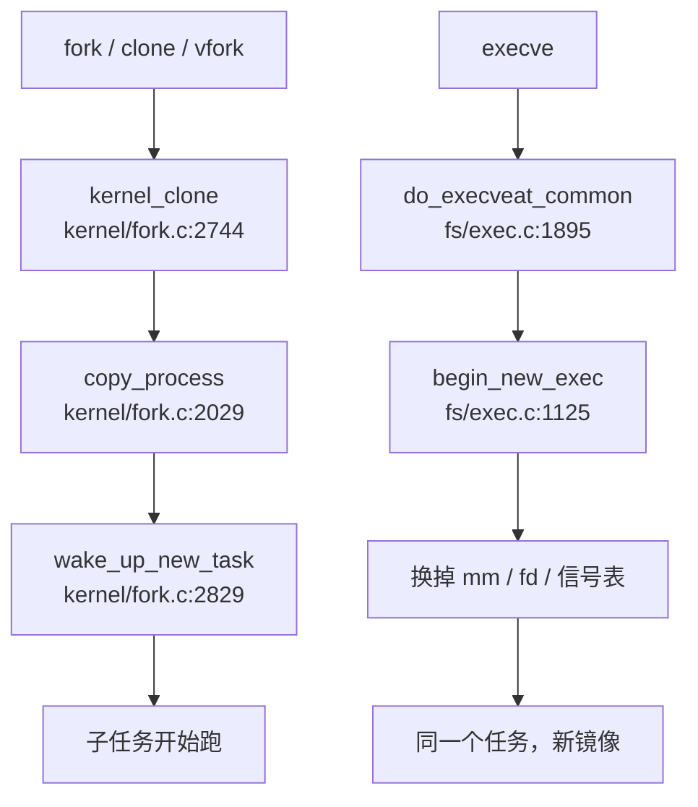

# 03 进程与线程：fork、clone、exec 到底做了什么

| 编写人 | 编写内容 | 编写时间 |
| --- | --- | --- |
| growdu | 初稿：内核里没有「线程」这个事实、fork/clone/clone3/vfork 的调用链、copy_process 的复制顺序、dup_task_struct 复制了什么、copy_mm 与 COW、copy_files/fs/sighand 的共享规则、copy_thread 怎么把子进程送回用户态、execve 怎么在原地替换进程镜像。 | 2026-11-26 |

> 目标：把「`fork` 到底复制了什么」「`execve` 为什么能换掉整个进程」这两件事，
> 拆到内核函数和结构体字段这一层。读完你应该能回答：
> 一个线程和一个进程的差别，在内核里到底体现在哪个 `clone_flags` 上？
> `fork` 之后物理页被复制了吗？`execve` 成功了，任务的 `pid` 变了吗？
>
> 本文所有行号基于 `/work/cwork/linux`（`v7.4.0-rc3`，即 `v7.4-rc3-149-g666539eecdf4`）。
> 上一章讲内核怎么启动；这一章从 `rest_init` 里那个 `kernel_clone` 往下挖。

## 3.1 两个 syscall，两种语义

先说结论：**创建进程靠「复制」，启动程序靠「替换」。** 这是两件完全不同的事。

| syscall | 语义 | 内核里发生什么 |
| --- | --- | --- |
| `fork()` | **复制**：造一个几乎一样的新任务 | 复制 `task_struct`、内核栈、地址空间（COW）、文件表（引用或复制）…… |
| `clone()` / `clone3()` | **可配置地复制**：你指定哪些东西共享 | `fork` 的超集，用 `clone_flags` 决定「复制还是共享」 |
| `vfork()` | **借壳**：父子共享地址空间，父进程挂起 | `clone` + `CLONE_VFORK \| CLONE_VM` |
| `execve()` | **替换**：把当前任务的代码、数据、栈整个换掉 | 不创建任务，只换内存镜像 |



**「创建」和「替换」是两条独立的路径**，用户态的 `system()`、`posix_spawn()` 都是把它们拼起来用。
读内核代码时先分清你在看哪一条：`fork` 系在 `kernel/fork.c`，`execve` 系在 `fs/exec.c`。

## 3.2 内核里没有「线程」

这是读内核代码必须先立住的事实：**整个内核只有一个 `struct task_struct`，
「进程」和「线程」不是两个不同的东西，而是 `task_struct` 的两种共享方式。**

```text
进程 A（tgid=100）               进程 B（tgid=200）
┌──────────────────┐           ┌──────────────────┐
│ task (pid=100)   │           │ task (pid=200)   │ ← 领线程，tgid == pid
│  ├─ 自己的 mm     │           │  └─ 自己的 mm     │
│  └─ 自己的 files  │           └──────────────────┘
└──────────────────┘
线程组（tgid=100）的另一种画法
┌──────────────────┐
│ task (pid=100)   │ ──┐
│ task (pid=101)   │   ├─ 共享 mm / files / fs / sighand
│ task (pid=102)   │ ──┘
└──────────────────┘
```

区别只在**共享了什么**，由 `clone_flags` 决定：

| flag | 共享什么 | 少了它 = 复制什么 |
| --- | --- | --- |
| `CLONE_VM` | 地址空间（`mm_struct`） | 独立地址空间 |
| `CLONE_FS` | 文件系统信息（cwd、root、umask） | 独立 fs |
| `CLONE_FILES` | 文件描述符表（`files_struct`） | 独立 fd 表 |
| `CLONE_SIGHAND` | 信号处理方式 | 独立信号表 |
| `CLONE_THREAD` | 进同一个线程组（`thread_group`） | 独立线程组 |
| `CLONE_VFORK` | 父进程等子进程 `execve`/退出 | 不等 |

所以：

- `fork()` ≈ 什么都不共享 —— 新任务有独立的 mm、files、fs、sighand。**这就是「进程」**。
- `pthread_create` 最终走 `clone(CLONE_VM | CLONE_FS | CLONE_FILES | CLONE_SIGHAND | CLONE_THREAD | ...)`
  —— 把上面这些全共享了。**这就是「线程」**，在内核眼里它只是「一个和别人共享了一堆东西的 task」。
- `CLONE_SIGHAND` 蕴含 `CLONE_VM`（`kernel/fork.c:2064` 有检查），`CLONE_THREAD` 蕴含 `CLONE_SIGHAND` ——
  所以「共享信号处理方式但不共享地址空间」这种组合是**不合法**的，代码直接拒绝。

> **注意**：`struct task_struct` 本体在 `include/linux/sched.h:836`（上一章 1.2 节说过，
> 它从 `include/linux/sched/task.h` 搬走了）。而 `getpid()` 返回的是 **tgid**（线程组 id），
> `gettid()` 返回的才是 **pid**（任务自己的 id）—— 这就是「线程组内所有线程 getpid 相同」的原因。

## 3.3 fork 的完整调用链

`fork` 的入口是个系统调用定义（`kernel/fork.c:2879`）：

```c
// kernel/fork.c:2879
SYSCALL_DEFINE0(fork)
{
#ifdef CONFIG_MMU
	struct kernel_clone_args args = {
		.exit_signal = SIGCHLD,
	};

	return kernel_clone(&args);
#else
	return -EINVAL;
#endif
}
```

注意 `fork` **没有设置任何共享 flag** —— 所以它造出来的是个「独立地址空间的任务」。

往下是三个关键函数：

| 环节 | 位置 | 干什么 |
| --- | --- | --- |
| `kernel_clone` | `kernel/fork.c:2744` | 参数校验 + 调 `copy_process` + `wake_up_new_task` |
| `copy_process` | `kernel/fork.c:2029` | **真正的复制工作**：逐个复制 task 的各部分 |
| `wake_up_new_task` | `kernel/fork.c:2829`（定义在 `kernel/sched/core.c:5015`） | 把新任务交给调度器，让它有机会上 CPU |
| `sched_fork` | `kernel/sched/core.c:4877` | 给新任务分配调度类（默认 CFS 的 `p->sched_class`） |
| `alloc_pid` | `kernel/fork.c:2344` | 分配 pid 编号 |
| `trace_sched_process_fork` | `kernel/fork.c:2808` | tracepoint，给 ftrace/perf 用 |

`kernel_clone` 的骨架（`kernel/fork.c:2744` 起）：

```c
	p = copy_process(NULL, trace, NUMA_NO_NODE, args);   /* :2798 */
	add_latent_entropy();

	if (IS_ERR(p))
		return PTR_ERR(p);

	trace_sched_process_fork(current, p);               /* :2808 */

	pid = get_task_pid(p, PIDTYPE_PID);
	nr = pid_vnr(pid);

	if (clone_flags & CLONE_VFORK) {
		p->vfork_done = &vfork;                        /* :2817 */
		init_completion(&vfork);
		get_task_struct(p);
	}
	/* ... */
	wake_up_new_task(p);                                /* :2829 */
```

**`wake_up_new_task` 之后 `fork` 就返回了** —— 子任务什么时候真正跑、在哪个 CPU 上跑，
是调度器的事，和 `fork` 的调用者无关。这解释了 `vfork` 为什么需要额外机制：
父进程必须等子任务 `wake_up_new_task` 跑完（`execve` 或退出）才能继续，
否则父进程的 `CLONE_VM` 地址空间可能被同时改两遍。

## 3.4 copy_process：复制的顺序即依赖

`copy_process`（`kernel/fork.c:2029`）是 `fork` 的主体，200 多行。它按**严格顺序**复制一个任务，
顺序本身就是设计：前面的东西出问题，后面的清理路径直接回滚。

| 顺序 | 步骤 | 位置 |
| --- | --- | --- |
| 1 | 参数合法性检查（`CLONE_SIGHAND` ⇒ `CLONE_VM` 等） | `kernel/fork.c:2040` 附近 |
| 2 | `dup_task_struct` —— 复制 `task_struct` + 内核栈 | 见 3.5 节 |
| 3 | `copy_creds` —— 凭证（uid/gid 等） | `kernel/fork.c:2188` |
| 4 | `sched_fork` —— 调度类、`se`（调度实体）初始化 | `kernel/sched/core.c:4877` |
| 5 | `copy_files` —— 文件描述符表 | `kernel/fork.c:1676` |
| 6 | `copy_fs` —— 文件系统信息 | `kernel/fork.c:1634` |
| 7 | `copy_sighand` —— 信号处理方式 | `kernel/fork.c:1707` |
| 8 | `copy_signal` —— 信号队列、统计计数 | `kernel/fork.c:1756` |
| 9 | `copy_mm` —— 地址空间 | `kernel/fork.c:1575` |
| 10 | `copy_namespaces` —— 命名空间 | `kernel/fork.c:2331` |
| 11 | `copy_io` —— io_uring 上下文 | `kernel/fork.c:2334` |
| 12 | `copy_thread` —— 内核栈上的返回路径（x86） | `arch/x86/kernel/process.c:170` |
| 13 | `alloc_pid` —— pid 编号 | `kernel/fork.c:2344` |

**顺序不是随便排的**：

- `sched_fork` 必须在 `copy_mm` 之前，因为调度实体 `se` 里有些字段和内存管理有交互。
- `copy_thread` 必须在 `copy_mm` 之后，因为它要操作 `task_pt_regs(p)`（内核栈顶的 `pt_regs`），
  而内核栈是 `dup_task_struct` 分配的。
- `alloc_pid` 放在最后附近，是因为 pid 分配失败要回滚前面所有已复制的东西。

> **注意**：这个顺序在老文章里经常是「`copy_process` 里调了 40 个 `copy_xxx`，看都看不过来」。
> 其实你只要记住**三类东西**：
> ① 复制结构（`dup_task_struct`）、② 按 flag 决定共享还是复制（`copy_files`/`copy_mm`/...）、
> ③ 架构相关的收尾（`copy_thread`）。
> 剩下的 `copy_creds`、`copy_signal` 这些要么是细节，要么出错概率低。

## 3.5 dup_task_struct：新任务的「壳」从哪来

`dup_task_struct`（`kernel/fork.c:916`）干的事：

```c
// kernel/fork.c:916
static struct task_struct *dup_task_struct(struct task_struct *orig, int node)
{
	struct task_struct *tsk;
	int err;

	tsk = alloc_task_struct_node(node);        /* 分配 task_struct 本体 */
	err = arch_dup_task_struct(tsk, orig);     /* 复制 task_struct 字段（arch 相关部分） */
	err = alloc_thread_stack_node(tsk, node);  /* 分配新的内核栈 */
	/* ... */
	setup_thread_stack(tsk, orig);             /* 把新 task 挂到 thread_stack 链表 */
	set_task_stack_end_magic(tsk);             /* 栈底的哨兵，用于爆栈检测 */
	/* ... */
}
```

要点：

| 东西 | 复制还是新建 | 位置 |
| --- | --- | --- |
| `struct task_struct` 本体 | **复制**（`arch_dup_task_struct` 在 x86 是 `arch/x86/kernel/process.c:105`） | `kernel/fork.c:919` |
| **内核栈** | **新建**（`alloc_thread_stack_node`，默认 16KB） | `kernel/fork.c:921` |
| `thread_info` | 在 `THREAD_INFO_IN_TASK` 配置下，**在 task_struct 里**（不单独分配） | — |
| `pid` | 后面 `alloc_pid` 分配，不在这里 | `kernel/fork.c:2344` |
| `stack_end_magic` | 写入栈底，用于检测爆栈 | `kernel/fork.c:947` |

所以新任务和父任务的**内核栈是两回事** —— 这解释了为什么上一章 1.3 节说「系统调用的现场压在内核栈上」：
每个任务有自己的内核栈，`fork` 之后父子各用各的。

> **注意**：`arch_dup_task_struct` 是**架构相关**的。x86 的版本在 `arch/x86/kernel/process.c:105`，
> 它复制 `thread_struct`（保存的寄存器、FS/GS base、io_bitmap 等）和 x86 特有的字段。
> 别的架构有自己的版本。读代码时先确认你在看哪个架构的实现。

## 3.6 copy_mm 与 COW：fork 不复制物理页

`copy_mm`（`kernel/fork.c:1575`）是 `fork` 里最容易被高估成本的一步：

```c
// kernel/fork.c:1598
	if (clone_flags & CLONE_VM) {
		mmget(oldmm);
		mm = oldmm;
	} else {
		mm = dup_mm(tsk, current->mm);
	}
```

- **`CLONE_VM`**（线程）→ `mmget` 加引用计数，**父子共享同一个 `mm_struct`**，物理页一个字节都不复制。
- **没有 `CLONE_VM`**（`fork`）→ `dup_mm` → `dup_mmap`（`mm/mmap.c:1708`）→ `copy_page_range`（`mm/memory.c:1550`），
  复制的是**虚拟地址空间（VMA 树）**，**不是物理页**。

物理页怎么处理？答案是 **COW（Copy-On-Write）**：

1. `copy_page_range` 把父进程的页表项复制给子进程，但把**读写权限改成只读**（`_PAGE_RW` 去掉），
   并把页的引用计数 `++`。
2. 父子进程**共享同一批物理页**。
3. 任何一方**尝试写**某个共享页 → CPU 触发缺页异常 → `do_wp_page`（`mm/memory.c:4458`）：
   - 分配新页；
   - 把旧页内容复制过去（`wp_page_copy`，`mm/memory.c:4058`）；
   - 修改当前进程的页表项指向新页、恢复写权限；
   - 旧页引用计数 `--`。

所以 **`fork` 之后，只有被写过的页才会被复制**。一个典型的 shell 里，`bash` fork 出子进程，
子进程立刻 `execve`（换掉整个地址空间）—— 这中间**一次物理页都没复制过**。

> **注意**：COW 的「写保护」是在 **PTE 层面**做的，不是 VMA 层面。
> 所以 `fork` 的开销和进程占用的**虚拟地址空间大小**成正比（VMA 数量、页表条目数），
> 和它实际用了多少物理内存关系不大 —— 但也不是零：一个几百万 VMA 的大进程 fork 会很慢，
> 这就是 PostgreSQL 等大进程会禁用 `fork`（用 `posix_spawn` 或 `clone` 变体）的原因。

## 3.7 copy_files / copy_fs / copy_sighand：共享还是复制

每个 `copy_xxx` 都遵循同一个模式：**看 `clone_flags`，共享就加引用计数，不共享就新建并复制内容**。

| 函数 | 位置 | 不共享时复制什么 | 共享 flag |
| --- | --- | --- | --- |
| `copy_files` | `kernel/fork.c:1676` | `files_struct` 表（fd → `file*` 的数组，每个 `file` 引用计数 `++`） | `CLONE_FILES` |
| `copy_fs` | `kernel/fork.c:1634` | `fs_struct`（cwd、root、umask、`in_exec`） | `CLONE_FS` |
| `copy_sighand` | `kernel/fork.c:1707` | 信号处理函数表（`action[]` 数组） | `CLONE_SIGHAND` |
| `copy_signal` | `kernel/fork.c:1756` | `signal_struct`（信号队列、统计、rlimit 等） | `CLONE_THREAD` |
| `copy_namespaces` | `kernel/fork.c:2331` | 命名空间引用 | `CLONE_NEWNS` 等 |
| `copy_io` | `kernel/fork.c:2334` | io_uring 上下文 | `CLONE_IO` |
| `copy_creds` | `kernel/fork.c:2188` | 凭证（uid/gid/capabilities/…） | 一般复制 |

以 `copy_files` 为例，规则很直白：

```c
// 伪代码，kernel/fork.c:1676
static int copy_files(u64 clone_flags, struct task_struct *tsk, int no_files)
{
	struct files_struct *oldf, *newf;

	oldf = current->files;
	if (clone_flags & CLONE_FILES) {
		atomic_inc(&oldf->count);        /* 共享：引用计数 ++ */
		tsk->files = oldf;
		return 0;
	}
	newf = dup_fd(oldf, ...);           /* 不共享：复制 fd 表 */
	tsk->files = newf;
	return 0;
}
```

这解释了两个日常现象：

1. **为什么 `fork` 之后子进程关掉 fd 不影响父进程** —— fd 表是复制的（`fork` 不带 `CLONE_FILES`）。
2. **为什么线程之间 `close()` 一个 fd 别人不受影响、但 `open()` 同一个文件可能拿到同一个 fd 号**
   —— fd 表共享（`CLONE_FILES`），但每个 fd 号指向的 `file` 是同一个，引用计数管理生命周期。

> **注意**：`copy_files` 复制的是 `files_struct`（fd 表），不是每个 `struct file`。
> `struct file` 是共享引用计数的 —— 复制 fd 表时只是 `get_file()` 每个 `file`。
> 所以两个进程可以各有一个 fd 指向同一个 `file`，`f_count` 是 2。

## 3.8 copy_thread：子进程的第一行代码在哪

`fork` 的最后一步 `copy_thread`（x86 在 `arch/x86/kernel/process.c:170`）决定了**子任务被调度器选中时，从哪开始执行**。

```c
// arch/x86/kernel/process.c:170
int copy_thread(struct task_struct *p, const struct kernel_clone_args *args)
{
	/* ... */
	childregs = task_pt_regs(p);          /* 内核栈顶的 pt_regs */
	fork_frame = container_of(childregs, struct fork_frame, regs);
	frame = &fork_frame->frame;

	frame->bp = encode_frame_pointer(childregs);
	frame->ret_addr = (unsigned long) ret_from_fork_asm;   /* :186 ← 关键 */
	p->thread.sp = (unsigned long) fork_frame;
	/* ... */
}
```

`frame->ret_addr = ret_from_fork_asm` 这一行是全部魔法所在：**子任务的内核栈上，返回地址指向 `ret_from_fork_asm`**。

于是子任务被 `wake_up_new_task` 选中、第一次上 CPU 时：

```text
ret_from_fork_asm          arch/x86/entry/entry_64.S:228
  └─ call ret_from_fork
       └─ schedule_tail(prev)          恢复父任务（这里是「第一个任务」）
       └─ if (fn) { fn(fn_arg); regs->ax = 0; }   调 fork 时传的函数
       └─ syscall_exit_to_user_mode(regs)          回到用户态
```

对 `fork()` 来说，`fn` 是用户态的入口地址（由 libc 放在 `args` 里），
所以子进程「第一件事」就是跳进用户态、从 `main` 之后的位置继续 —— 返回值 0（`regs->ax = 0`）。
而父进程那边，`fork` 返回子进程的 pid。

**这就是为什么子进程里 `fork() == 0` 而父进程里 `fork() == pid`：**
内核用同一个返回地址把子任务送进用户态，靠 `regs->ax` 区分父子。

> **注意**：`ret_from_fork` 在 `arch/x86/kernel/process.c:151`，
> 它对**所有**从 `fork` 出来的任务生效，包括内核线程（`kthreadd`、工作队列那些）。
> 内核线程的 `fn` 是内核函数，`fn(fn_arg)` 在内核态跑；跑完之后 `regs->ax = 0`，
> 然后 `syscall_exit_to_user_mode` —— 对内核线程来说这行基本不会真正执行到用户态，
> 因为它们的 `fn` 不返回（除非是上一章 2.11 节那个特例：`init` 用 `kernel_execve` 把自己变成用户态）。

## 3.9 fork / vfork / clone / clone3：四个入口的差别

| 入口 | 位置 | 共享了什么 | 典型用途 |
| --- | --- | --- | --- |
| `fork` | `kernel/fork.c:2879` | 什么都不共享 | 通用进程创建 |
| `vfork` | `kernel/fork.c:2896` | `CLONE_VFORK \| CLONE_VM` —— 共享地址空间 + 父进程挂起 | 创建后立刻 `execve` 的子进程 |
| `clone` | `kernel/fork.c:2908`+（多份 `SYSCALL_DEFINE5` 按架构） | 调用者指定 | pthread 底层 |
| `clone3` | `kernel/fork.c:3080` | 用 `struct clone_args` 结构体传参，可扩展 | 新代码推荐用这个 |

`vfork` 的细节（`kernel/fork.c:2896`）：

```c
SYSCALL_DEFINE0(vfork)
{
	struct kernel_clone_args args = {
		.flags = CLONE_VFORK | CLONE_VM,      /* 共享地址空间 + 等子进程 */
		.exit_signal = SIGCHLD,
	};
	return kernel_clone(&args);
}
```

`CLONE_VFORK` 让父进程在 `kernel_clone` 里 `init_completion(&vfork)`（`kernel/fork.c:2817`），
子进程 `execve` 或退出时 `complete(&vfork_done)`（`fs/exec.c` 的 `exec_mmap` 路径里），
父进程才从 `kernel_clone` 返回。这期间父进程**卡在 `kernel_clone` 里出不去**。

`clone3`（`kernel/fork.c:3080`）相比 `clone` 的改进是**参数可扩展**：

```c
// struct clone_args 在用户态定义，内核按 size 解析
SYSCALL_DEFINE2(clone3, struct clone_args __user *, uargs, size_t, size)
```

老 `clone` 的参数是固定个数（`clone(flags, stack, ...)`），加参数要加系统调用号；
`clone3` 用一个结构体，内核按 `size` 判断字段存不存在 —— 加字段**不破坏 ABI**。
glibc 2.34 起 `pthread_create` 底层就是 `clone3`。

> **注意**：`clone` 在源码里有多份 `SYSCALL_DEFINE5`（`kernel/fork.c:2908` 起），
> 那是按架构 ABI 差异生成的（`CONFIG_CLONE_BACKWARDS`、`CLONE_BACKWARDS2`、`CLONE_BACKWARDS3`），
> 不是四个不同的函数。**它们的实现体是同一个 `kernel_clone`**，参数顺序不同而已。
> 别在源码里找「`clone` 的定义」找到好几份就懵了。

## 3.10 execve：不创建任务，是「原地换壳」

`execve` 和 `fork` 是**完全相反**的操作：`fork` 造新任务，`execve` 在**同一个任务**上把内存镜像整个换掉。

调用链：

| 环节 | 位置 |
| --- | --- |
| `do_execveat_common` | `fs/exec.c:1895` |
| `bprm_execve` | `fs/exec.c:1841` |
| `exec_binprm` | `fs/exec.c:1792` |
| `search_binary_handler` | `fs/exec.c:1758` |
| `load_elf_binary` | `fs/binfmt_elf.c:829` |
| `begin_new_exec` | `fs/exec.c:1125` |
| `exec_mmap`（换掉 mm） | `fs/exec.c:843` |
| `start_thread`（设用户态入口） | `arch/x86/kernel/process_64.c:582` |

`begin_new_exec`（`fs/exec.c:1125`）是「换壳」的主战场，它按固定顺序做这些事：

| 顺序 | 步骤 | 位置 | 干什么 |
| --- | --- | --- | --- |
| 1 | `bprm_creds_from_file` | `fs/exec.c:1134` | 计算新镜像的 uid/gid/capabilities |
| 2 | `point_of_no_return = true` | `fs/exec.c:1146` | **从这行开始，任何错误都不再回滚**（旧进程已经被破坏） |
| 3 | `io_uring_task_cancel` | `fs/exec.c:1155` | 取消 io_uring 上下文 |
| 4 | `de_thread` | `fs/exec.c:1161`（定义 `:923`） | **把线程组砍成只剩自己**（杀掉其他线程，自己是最后一个就变普通任务） |
| 5 | `unshare_fd(CLONE_FILES)` | `fs/exec.c:1178` | fd 表不共享时复制一份（`CLOEXEC` 在下一步生效） |
| 6 | `close_cloexec_files` | `fs/exec.c:1196` | 关掉带 `CLOEXEC` 的 fd |
| 7 | `set_mm_exe_file` | `fs/exec.c:1203` | 记录新的 exe 文件（`/proc/self/exe` 的来源） |
| 8 | `exec_mmap(bprm)` | `fs/exec.c:1216`（定义 `:843`） | **换掉 `mm_struct`**：旧 mm 的引用计数 `--`，新 mm 挂上 |
| 9 | `exec_task_namespaces` | `fs/exec.c:1222` | 命名空间处理 |
| 10 | `unshare_sighand` | `fs/exec.c:1229`（定义 `:1065`） | 信号处理表不共享时复制 |
| 11 | `flush_thread` | `fs/exec.c:1235` | 清掉 FPU/SIMD/FSGS 状态 |

**`execve` 成功的三件事**：

1. **mm 被换掉**（`exec_mmap`）—— 代码段、数据段、堆、栈全是新的。
2. **线程组被砍成自己**（`de_thread`）—— 如果原来是多线程，其他线程全被杀掉。
3. **pid 不变** —— 还是同一个 `task_struct`。

所以 `execve` 之后 `getpid()` 返回值不变、`task_struct` 指针不变，
但 `mm`、代码、数据、堆、栈全换了。这也是为什么 `execve` 失败时旧进程还在（`point_of_no_return` 之前还能回滚）。

> **注意**：`execve` **不复制任何东西**，也不创建任务。
> 老文章里「`execve` 会 `fork` 一个子进程」的说法**是错的** —— `fork` 和 `execve` 是两个独立系统调用，
> 用户态要「创建并运行新程序」必须两个都调（`system()`、`posix_spawn()` 在用户态把它们拼起来）。
> 内核里没有「创建进程并 execve」的单一入口（除了 `usermodehelper` 那种特殊情况）。

## 3.11 fork+exec 的代价：为什么有 posix_spawn / vfork / 线程

理解了 COW，就能算一笔账：

| 操作 | 复制了什么 | 不复制什么 | 适合场景 |
| --- | --- | --- | --- |
| `fork()` + `execve()` | VMA 树、页表、fd 表、fs、sighand | **物理页**（COW 保护着，但页表项要复制一遍） | 通用，但大进程 fork 慢 |
| `vfork()` + `execve()` | 几乎不复制（共享 mm，父进程挂起） | mm、页表 | 子进程立刻 execve |
| `posix_spawn()`（glibc 实现） | 用 `clone(CLONE_VM\|CLONE_VFORK)` + `execve` | 同 vfork | 新 API，语义同 vfork 但更安全 |
| 线程（`clone(CLONE_VM\|...)`） | 几乎不复制 | mm、files、fs、sighand | 并发任务 |

`posix_spawn` 是用户态库函数，glibc 的实现就是**在用户态做一次 `clone` + `execve`**，
没有「posix_spawn 系统调用」。内核只看到 `clone` 和 `execve` 两次调用。

**为什么大进程要避开 `fork`**：

- 一个 VMA 几百万的进程（PostgreSQL、Chromium 的渲染进程），`fork` 要复制几百万个 VMA 和对应页表项 ——
  即使有 COW，**虚拟内存结构本身的复制也很慢**。
- 这些进程改用 `posix_spawn`（vfork 语义）或者干脆用线程（`CLONE_VM`）来绕开。

## 3.12 用 GDB 跟一次 fork 和 execve

```bash
gdb /path/to/your_program
(gdb) set follow-fork-mode child     # fork 之后跟子进程（跟父进程用 parent）
(gdb) set detach-on-fork on          # fork 时另一个进程自动 detach
(gdb) break fork
(gdb) break execve
(gdb) continue
```

| 断点 | 位置 | 看什么 |
| --- | --- | --- |
| `fork` | 用户态（libc） | 系统调用入口 |
| `kernel_clone` | `kernel/fork.c:2744` | `args->flags` 里有哪些 `CLONE_*` |
| `copy_process` | `kernel/fork.c:2029` | 新 `task_struct` 的地址 |
| `dup_task_struct` | `kernel/fork.c:916` | 新内核栈地址 |
| `copy_mm` | `kernel/fork.c:1575` | 有没有 `CLONE_VM` |
| `wake_up_new_task` | `kernel/fork.c:2829` | 子任务交给调度器 |
| `do_execveat_common` | `fs/exec.c:1895` | `filename` 是什么 |
| `begin_new_exec` | `fs/exec.c:1125` | `point_of_no_return` 之前还能回滚 |
| `exec_mmap` | `fs/exec.c:843` | mm 被换掉的瞬间 |

```gdb
(gdb) break kernel_clone
(gdb) c
(gdb) p args->flags          # 看 CLONE_* 位
(gdb) p/x args->flags
(gdb) bt                     # 看是谁调的（用户态 libc 的 fork/clone）
```

内核里下断点不会自动打印任何东西（没有 printf），用 `commands` 块：

```gdb
(gdb) break copy_mm
(gdb) commands
> silent
> printf "copy_mm: clone_flags=%llx, CLONE_VM=%d\n", clone_flags, (clone_flags & 0x100) != 0
> bt 3
> continue
> end
```

## 3.13 小结

这一章的核心就三句话：

1. **「进程」和「线程」在内核里是同一个东西，区别只在 `clone_flags`。**
   `fork()` 什么都不共享（独立进程），`pthread_create` 共享 mm/files/fs/sighand（线程）。
   `CLONE_VM` 是「线程」和「进程」的分界线。
2. **`fork` 复制的是虚拟结构，不是物理内存。** COW 让父子共享物理页，
   谁先写谁触发缺页、复制那一页。所以 `fork` 的开销和 VMA 数量成正比，和实际内存用量关系不大 ——
   但也不是零，几百万 VMA 的大进程 `fork` 会明显变慢。
3. **`execve` 不创建任务，是「原地换壳」。** 它把同一个 `task_struct` 的 mm、fd 表、信号表换掉，
   但 `pid` 不变、`task_struct` 指针不变。`fork` + `execve` 才是用户态眼里的「运行新程序」。

## 3.14 v7.4 变化对照表

网上讲 `fork` 的文章大多基于 4.x / 5.x。这棵树是 **v7.4.0-rc3**，
下面这些老说法**已经不成立**：

| 老文章里的说法 | 这棵树里的实际情况 |
| --- | --- |
| `do_fork()` 是创建进程的入口 | **已删除**。入口是 `kernel_clone`（`kernel/fork.c:2744`），`fork` 系统调用是 `SYSCALL_DEFINE0(fork)`（`:2879`），`clone`/`clone3` 都走 `kernel_clone` |
| `copy_process` 在 `kernel/fork.c` 的某个固定位置 | 在 `kernel/fork.c:2029`，但**内部步骤的行号和顺序和 5.x 差别很大**：`sched_fork` 挪去了 `kernel/sched/core.c:4877`，`copy_thread` 挪去了 `arch/x86/kernel/process.c:170` |
| `copy_thread` 在 `arch/x86/kernel/process_64.c` | 在 **`arch/x86/kernel/process.c:170`**（`process_64.c` 还在，但 `copy_thread` 搬走了） |
| `ret_from_fork` 在 `kernel/fork.c` | 在 **`arch/x86/kernel/process.c:151`** |
| `flush_old_exec()` 是 `execve` 的一个步骤 | **没有这个函数了**。它的职责并进了 `begin_new_exec`（`fs/exec.c:1125`） |
| `start_thread` 在 `arch/x86/kernel/process_64.c:582` | 还在原处（`:582`），但它的实现 `start_thread_common` 在 `:530` |
| `kernel_execve` 在 `init/main.c` | 在 **`fs/exec.c:1966`** |
| `copy_thread` 里 `task_pt_regs(p)` 拿的是用户态寄存器 | 对，但它是**内核栈顶**的 `pt_regs` —— 每个任务有自己的内核栈（上一章 2.7 节） |
| `vfork` 会复制页表 | **不复制**。`vfork` 是 `CLONE_VM`，父子共享地址空间 |

**读老文章的心法**：`fork`/`execve` 的**思路**（复制结构、COW、换镜像）还有效，
但**具体到函数名和文件位置**要按这棵树重新对一遍。
尤其小心 `do_fork` 的消失、`flush_old_exec` 的消失、`sched_fork` 的搬家 ——
这三处是老文章里最常「照着敲但敲不通」的地方。

## 3.15 下一章

[04 内存管理：地址空间、缺页、页分配器](./04-内存管理-地址空间缺页页分配器.md)

下一章顺着这一章的 `copy_mm` 和 COW 往下挖：地址空间是怎么组织的（VMA 树、maple tree）、
缺页怎么处理（`do_anonymous_page`、`filemap_fault`）、物理页怎么分配（伙伴系统、slab）。
读完你就能回答「为什么 `fork` 之后一个字节物理内存都没复制，但内存用量会涨」这类问题。