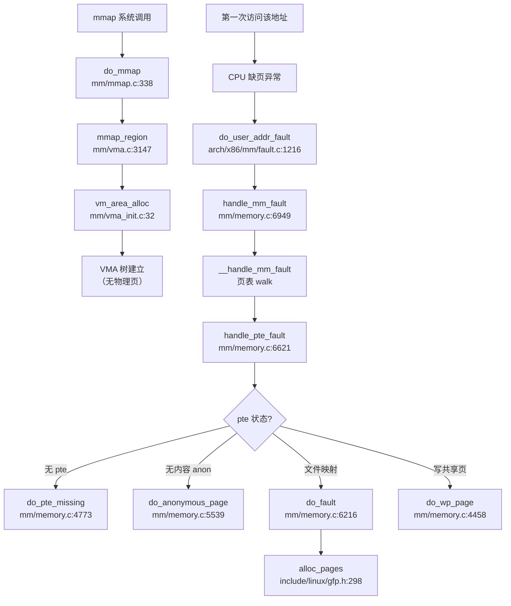

# 04 内存管理：地址空间、缺页、页分配器

| 编写人 | 编写内容 | 编写时间 |
| --- | --- | --- |
| growdu | 初稿：三个核心结构体（mm_struct / vm_area_struct / struct page）、mmap 的调用链、maple tree 取代红黑树、页表 walk、缺页处理全链路、COW 的触发、伙伴系统与页分配器的初始化，附 GDB 跟一次缺页。 | 2026-11-26 |

> 目标：把「一个进程为什么能看见一整块 4TB 地址空间」「`malloc` 的内存什么时候真的分配」「`fork` 之后写一次页到底发生了什么」拆到内核函数和结构体这一层。
> 读完你应该能回答：`mmap` 之后物理页就有了吗？缺页异常是谁处理的、怎么分派的？伙伴系统是干嘛的？
>
> 本文所有行号基于 `/work/cwork/linux`（`v7.4.0-rc3`，即 `v7.4-rc3-149-g666539eecdf4`）。
> 上一章讲 `fork`/`execve`；这一章顺着 `copy_mm` 和 COW 往下挖内存这一层。

## 4.1 全景：三层结构

用户态看到的「4TB 地址空间」在内核里是三层结构：

```text
地址空间（mm_struct）
  └─ VMA 树（vm_area_struct，maple tree）    ← 一段段有相同权限的区间
       └─ 页表（PGD → P4D → PUD → PMD → PTE）  ← 虚拟地址 → 物理页的翻译
            └─ 物理页（struct page / folio）   ← 真正的内存
```

- **`mm_struct`** 是一个进程的地址空间本体。
- **`vm_area_struct`（VMA）** 是「一段有相同权限的虚拟区间」——比如代码段、堆、栈、某个 `mmap` 出来的文件映射。
- **页表** 是虚拟地址到物理页的翻译表，CPU 靠它做地址翻译。
- **`struct page`** 描述一个物理页（4KB），是物理内存的最小管理单位。

`malloc(100)` 在 `mmap` 路径上**只建 VMA，不分配物理页**；物理页要等真正访问时通过**缺页异常**才分配。这是理解内存管理的关键。



## 4.2 三个核心结构体

### 4.2.1 struct mm_struct：地址空间的本体

`struct mm_struct` 在 `include/linux/mm_types.h:1214`。几个关键字段：

| 字段 | 位置 | 是什么 |
| --- | --- | --- |
| `mm_mt` | `include/linux/mm_types.h:1231` | **maple tree** —— 存 VMA 的根 |
| `task_size` | `include/linux/mm_types.h:1240` | 用户态地址空间上界 |
| `mm_users` | `include/linux/mm_types.h:1262` | 有多少个用户（线程）在用这个 mm |
| `map_count` | `include/linux/mm_types.h:1272` | 有多少个 VMA |

`mm_users` 解释了一个现象：**多个线程共享一个 `mm_struct`**（上一章 3.2 节 `CLONE_VM`），
`mm_users` 就是引用计数，减到 0 才真正销毁地址空间。

### 4.2.2 struct vm_area_struct：一段有相同权限的区间

`struct vm_area_struct` 在 `include/linux/mm_types.h:961`。它描述一段虚拟区间：

| 字段 | 是什么 |
| --- | --- |
| `vm_start` / `vm_end` | 区间起止地址 |
| `vm_flags` | 权限（可读/可写/可执行/私有/共享/匿名…） |
| `vm_file` | 映射的文件（文件映射时有，匿名映射为 NULL） |
| `vm_ops` | 这个 VMA 的操作函数表（`fault`、`open`、`close`…） |
| `vm_pgoff` | 文件内偏移（以页为单位） |

`vm_ops->fault` 就是文件映射缺页时的回调 —— 4.8 节会看到它被 `do_fault` 调用。

### 4.2.3 struct page：一个物理页

`struct page` 描述一个物理页（默认 4KB）。整个系统的物理页用 `mem_map` 数组组织，
**一个 `struct page` 对应一个物理页帧**。内核里到处传的 `struct page *` 就是「某个物理页」。

> **注意**：`struct page` 是**物理页**的描述，不是虚拟地址。一个物理页可以被多个虚拟地址映射
> （共享库、`fork` 后的 COW 页都是这样）。`struct page` 上的引用计数 `_refcount` 就是管这个的 ——
> 减到 0 才真正释放回页分配器。

## 4.3 mmap：建一个 VMA，但不分配物理页

`mmap` 系统调用的入口是 `SYSCALL_DEFINE6(mmap_pgoff)`（`mm/mmap.c:626`）：

```c
// mm/mmap.c:626
SYSCALL_DEFINE6(mmap_pgoff, unsigned long, addr, unsigned long, len,
		unsigned long, prot, unsigned long, flags,
		unsigned long, fd, unsigned long, pgoff)
{
	return ksys_mmap_pgoff(addr, len, prot, flags, fd, pgoff);
}
```

往下是 `do_mmap`（`mm/mmap.c:338`）→ `mmap_region`（`mm/vma.c:3147`）→ `__mmap_region`（`mm/vma.c:3048`）→
`vm_area_alloc`（`mm/vma_init.c:32`）。

| 环节 | 位置 | 干什么 |
| --- | --- | --- |
| `ksys_mmap_pgoff` | `mm/mmap.c:581` | 解析 fd → `struct file`，调 `vm_mmap_pgoff` |
| `do_mmap` | `mm/mmap.c:338` | 选地址、定权限、调 `mmap_region` |
| `mmap_region` | `mm/vma.c:3147` | 建 VMA、挂进 maple tree |
| `__mmap_region` | `mm/vma.c:3048` | 真正插入 VMA 树的实现 |
| `vm_area_alloc` | `mm/vma_init.c:32` | 分配 `vm_area_struct` 本体 |

`do_mmap` 做三件事：

1. **选地址**：没指定 `addr` 时，在 mmap_base 往下找一段空闲的。
2. **定权限**：`prot`（`PROT_READ`/`PROT_WRITE`/`PROT_EXEC`）→ `vm_flags`。
3. **建 VMA**：调 `mmap_region` 把区间挂进 `mm->mm_mt`。

**关键：这一步不碰物理页**。`mmap` 只是「登记」——「这个地址区间将来要映射这个文件」。
物理页什么时候分？**第一次访问的时候**，靠缺页异常（4.6 节）。

> **注意**：老文章说「`mmap` 分配内存」，这话在**虚拟内存**意义上对（建了 VMA），
> 但在**物理内存**意义上错 —— `mmap` 时一个物理页都没分。
> `malloc` 的大块分配走 `mmap`（`M_MMAP_THRESHOLD` 默认 128KB），小块走 brk 堆。
> 它们都是「先建 VMA，访问时才缺页」。

## 4.4 VMA 树：maple tree 取代了红黑树

VMA 存在 `mm->mm_mt`（`include/linux/mm_types.h:1231`）里，是一棵 **maple tree**。

> **注意**：老文章里 VMA 树是**红黑树**（`mm->mm_rb`，`struct rb_root`）。
> 在这棵树里（v7.4）**红黑树没了**，换成了 **maple tree**（`include/linux/maple_tree.h:261`）。
> 原因：红黑树的查询是 O(log n) 但要多次指针追逐，maple tree 是数组化的基数树，
> 缓存局部性好得多 —— 进程地址空间动辄几十万个 VMA，这个差异很可观。
>
> 所以你在老文章里搜 `mm_rb`、`rb_erase`、`vma_rb` 那套，在这棵树里搜不到。
> 读 VMA 代码时认 `mm_mt`、`mas_*`（maple tree state）这套 API。

## 4.5 页表 walk：从虚拟地址到物理页

CPU 做地址翻译要逐级查页表：`PGD → P4D → PUD → PMD → PTE`。
内核处理缺页时也要走同一条路，代码在 `__handle_mm_fault`（`mm/memory.c:6714`）：

```c
// mm/memory.c:6714（简化）
static vm_fault_t __handle_mm_fault(struct vm_area_struct *vma,
		unsigned long address, unsigned int flags)
{
	struct vm_fault vmf = { .vma = vma, .address = address & PAGE_MASK, /* ... */ };
	pgd_t *pgd;
	p4d_t *p4d;
	/* ... */
	pgd = pgd_offset(vma->vm_mm, address);      /* 第 1 级 */
	p4d = p4d_offset(pgd, address);            /* 第 2 级 */
	/* ... pud → pmd → pte ... */
}
```

x86_64 是 4 级页表（开了 5-level PTE 是 5 级），每一级都是一次内存访问。
`__handle_mm_fault` 的职责就是**把这一路的表项建出来**（缺哪级补哪级），
然后把最终交给 `handle_pte_fault` 处理 PTE 这一级。

| 级 | 函数 | 说明 |
| --- | --- | --- |
| PGD | `pgd_offset(mm, addr)` | 页全局目录 |
| P4D | `p4d_offset(pgd, addr)` | 页四级目录（4 级页表里这级是透明的） |
| PUD | `pud_offset(p4d, addr)` | 页上级目录 |
| PMD | `pmd_offset(pud, addr)` | 页中级目录 |
| PTE | `pte_offset_map_lock(...)` | 页表项 —— 最终物理页号在这 |

## 4.6 缺页处理：从异常到分派

用户态访问一个**没有有效映射**的虚拟地址 → CPU 触发缺页异常 → 内核的 `do_user_addr_fault`
（`arch/x86/mm/fault.c:1216`）→ `handle_mm_fault`（`mm/memory.c:6949`）→ `__handle_mm_fault`（`mm/memory.c:6714`）→
`handle_pte_fault`（`mm/memory.c:6621`）。

`handle_pte_fault` 是**分派中心**，它看 PTE 的当前状态决定调谁：

```c
// mm/memory.c:6621（简化）
static vm_fault_t handle_pte_fault(struct vm_fault *vmf)
{
	/* ... */
	if (!vmf->pte)
		return do_pte_missing(vmf);          /* :4773 —— PTE 还没建 */

	if (!pte_present(vmf->orig_pte))
		return do_swap_page(vmf);           /* 被换出到 swap */

	if (pte_protnone(vmf->orig_pte) && vma_is_accessible(vmf->vma)) {
		/* RWP / NUMA hinting 页 */
		if (userfaultfd_pte_rwp(vmf->vma, vmf->orig_pte)) {
			if (!(vmf->flags & FAULT_FLAG_UNSHARE))
				return do_uffd_rwp(vmf);
		} else {
			return do_numa_page(vmf);
		}
	}

	/* ... */
	if (vmf->flags & (FAULT_FLAG_WRITE|FAULT_FLAG_UNSHARE)) {
		if (!pte_write(entry))
			return do_wp_page(vmf);          /* :4458 —— COW */
		/* ... */
	}
	/* ... */
}
```

| PTE 状态 | 调谁 | 位置 | 干什么 |
| --- | --- | --- | --- |
| PTE 不存在（匿名页首次访问） | `do_pte_missing` | `mm/memory.c:4773` | 建 PTE + 分配零页 |
| PTE 不存在（`vm_ops->fault` 有） | `do_fault` | `mm/memory.c:6216` | 文件映射，调 `filemap_fault` |
| 写 + PTE 只读（COW） | `do_wp_page` | `mm/memory.c:4458` | 复制页（4.9 节） |
| 被换出 | `do_swap_page` | — | 从 swap 读回来 |
| protnone（NUMA/uffd） | `do_numa_page` / `do_uffd_rwp` | — | NUMA 提示 / userfaultfd |

## 4.7 do_anonymous_page：匿名页第一次被访问

匿名页（栈、堆、`mmap` 匿名映射）第一次被写时，`do_pte_missing`（`mm/memory.c:4773`）→ `do_anonymous_page`
（`mm/memory.c:5539`）：

```c
// mm/memory.c:5539（简化）
static vm_fault_t do_anonymous_page(struct vm_fault *vmf)
{
	struct folio *folio;
	/* ... */
	if (pte_alloc(vma->vm_mm, vmf->pmd))     /* 建 PTE */
		return VM_FAULT_OOM;

	/* 读访问：用共享的零页（zero page），不分配 */
	if (vmf->pte && !(vmf->flags & FAULT_FLAG_WRITE)) {
		/* 映射到 zero page */
		/* ... */
	}
	/* 写访问：分配新页 */
	folio = alloc_folio_vma(GFP_HIGHUSER_MOVABLE, vmf->vma, vmf->address);
	/* ... */
}
```

关键点：

- **读访问**：映射到**全局零页**（所有读零页的进程共享同一个物理页，只读）。不分配新页。
- **写访问**：`alloc_folio_vma` 分配一个新页（走页分配器，4.10 节），清零，PTE 指向它。

所以「`malloc(100)` 之后 `memset` 一次」才会真正占物理页 —— `memset` 的写触发缺页，缺页里分配物理页。

## 4.8 do_fault：文件映射的分派

文件映射（`mmap` 一个文件）缺页时走 `do_fault`（`mm/memory.c:6216`）。它按「读/写、私有/共享」分派：

```c
// mm/memory.c:6216（简化）
static vm_fault_t do_fault(struct vm_fault *vmf)
{
	struct vm_area_struct *vma = vmf->vma;

	if (!vma->vm_ops->fault) {
		/* 没有 fault 回调：检查是不是临时清除，是则 SIGBUS/NOPAGE */
		/* ... */
	} else if (!(vmf->flags & FAULT_FLAG_WRITE))
		ret = do_read_fault(vmf);            /* :6092 —— 读 */
	else if (!(vma->vm_flags & VM_SHARED))
		ret = do_cow_fault(vmf);            /* :6124 —— 写 + 私有（COW） */
	else
		ret = do_shared_fault(vmf);        /* :6166 —— 写 + 共享 */
	/* ... */
}
```

| 情况 | 调谁 | 位置 | 干什么 |
| --- | --- | --- | --- |
| 读文件映射 | `do_read_fault` | `mm/memory.c:6092` | 调 `vma->vm_ops->fault` 读文件页 |
| 写 + 私有映射 | `do_cow_fault` | `mm/memory.c:6124` | 复制文件页（COW） |
| 写 + 共享映射 | `do_shared_fault` | `mm/memory.c:6166` | 写回文件 |

`do_read_fault` 最终调 `vma->vm_ops->fault`，对文件映射来说就是 `filemap_fault`
（`mm/filemap.c:3572`）—— 它从页缓存（page cache）里把文件页拿进来，
没有就读磁盘。这就把「文件映射」和「页缓存」「回写」串起来了（上一章 1.7 节）。

> **注意**：`do_fault` 里那个 `!vma->vm_ops->fault` 分支处理的是「VMA 没有 fault 回调」的情况
> （比如特殊映射）。它检查 PTE 是不是被临时清掉的（`pte_none` + 持锁再查），
> 是则返回 `VM_FAULT_SIGBUS`（段错误）或 `VM_FAULT_NOPAGE`。这段是防御性代码，读的时候别跳过。

## 4.9 COW：写一次共享页，复制一页

上一章 3.6 节说 `fork` 用 COW 让父子共享物理页。COW 的「触发点」就在这里：
`handle_pte_fault` 发现**写访问 + PTE 只读** → `do_wp_page`（`mm/memory.c:4458`）。

```c
// mm/memory.c:4458（简化）
static vm_fault_t do_wp_page(struct vm_fault *vmf)
{
	/* 如果是匿名页 + 只有一对映射（没有共享），可以直接复用，不复制 */
	if (wp_page_shared(vmf))               /* 有多个映射者共享 */
		return wp_page_copy(vmf);          /* :4058 —— 复制 */
	/* 否则复用现有页（unshare 场景） */
	/* ... */
}
```

`wp_page_copy`（`mm/memory.c:4058`）做真正的复制：

1. `alloc_page` 分配新页（页分配器）。
2. `__wp_page_copy_user`（`mm/memory.c:3753`）把旧页内容复制到新页。
3. 修改当前进程 PTE 指向新页、恢复写权限。
4. 旧页引用计数 `--`。

**这就是「写时复制」的全部**：谁先写，谁触发缺页，谁拿到自己的副本；没写的进程继续共享旧页。
`fork` 一个 10 进程的父进程，如果子进程立刻 `execve`（换掉整个地址空间），
那 10 个进程的页一个都不会被复制 —— 这正是 `fork`+`execve` 组合高效的原因。

## 4.10 页分配器：把物理页分出去

缺页里 `alloc_folio_vma` / `alloc_page` 最终落到页分配器。入口是 `alloc_pages`（`include/linux/gfp.h:298` 宏）→
`__alloc_pages_noprof`（`mm/page_alloc.c:5527`）：

```c
// mm/page_alloc.c:5527（简化）
struct page *__alloc_pages_noprof(gfp_t gfp, unsigned int order,
		struct zonelist *zonelist, ...)
{
	/* 1. 根据 gfp mask 选 zone（DMA / NORMAL / HIGHMEM...） */
	/* 2. 按 order 找连续物理页 */
	/* 3. 找不到 → 触发回收 / 压缩，再试 */
	/* 4. 还找不到 → OOM */
}
```

页分配器是**伙伴系统**（buddy system）：把物理页按 2 的幂（order 0/1/2/…）分箱。
分配 order N 就从对应箱里取 2^N 个连续页；释放时和「伙伴」合并成大块。

| 函数 | 位置 | 干什么 |
| --- | --- | --- |
| `alloc_pages` | `include/linux/gfp.h:298`（宏） | 入口 |
| `__alloc_pages_noprof` | `mm/page_alloc.c:5527` | 核心分配逻辑 |
| `__rmqueue_smallest` | `mm/page_alloc.c:1890` | 在 zone 里找最小的合适块 |
| `free_pages` | `mm/page_alloc.c:5650` | 释放 |
| `__free_pages` | `mm/page_alloc.c:5626` | 释放核心 |

`__rmqueue_smallest`（`mm/page_alloc.c:1890`）是伙伴系统的核心：
它从指定 order 的 free_area 链表里取一个块；如果链表空，就向更大的 order 借一个、
劈成两半（伙伴），一半用、一半放回链表 —— 这就是「伙伴」名字的由来。

> **注意**：`alloc_pages` 的 `gfp` 参数（`GFP_KERNEL`、`GFP_HIGHUSER_MOVABLE`…）决定
> 「从哪个 zone 分配、能不能阻塞、要不要 NUMA 优先」。老文章常不提这个，但它是页分配器的主要输入。
> `GFP_HIGHUSER_MOVABLE` 意思是「用户态用、可迁移」—— 内核迁移机制靠它把可迁移的页集中在一起，
> 好凑出连续大块。这是 THP（透明大页）和内存压缩能工作的前提。

## 4.11 页分配器的初始化

页分配器不是开机就有物理页的，它经历几个阶段（`kernel_init_freeable` 里调，上一章 2.8.1）：

| 函数 | 位置 | 干什么 |
| --- | --- | --- |
| `memmap_init` | `mm/mm_init.c:996` | 给每个物理页建 `struct page`（`mem_map` 数组） |
| `page_alloc_init_late` | `mm/mm_init.c:2295` | 页分配器收尾 |
| `page_alloc_init_cpuhp` | `mm/page_alloc.c:6558` | 每个 CPU 热插拔时的页分配器初始化 |
| `setup_per_cpu_pageset` | `mm/page_alloc.c:6429` | 建每 CPU 的页块缓存（per-cpu pageset） |

`memmap_init` 是第一步：它遍历所有物理内存，给每个 4KB 页帧建一个 `struct page`，
填进 `mem_map` 数组。**从此每个物理页都有了一个 `struct page` 描述它** ——
页分配器管理的是 `mem_map` 里的 `struct page`，不是物理地址本身。

`setup_per_cpu_pageset` 建每 CPU 的页块缓存：每个 CPU 留一小块自己用的页，
分配高频路径不用锁（无锁分配）。这是页分配器快的关键之一。

> **注意**：老文章说 `mem_map_init`，在这棵树里是 **`memmap_init`**（`mm/mm_init.c:996`）。
> 还有 `page_alloc_init` 拆成了 `page_alloc_init_late`（`mm/mm_init.c:2295`）和
> `page_alloc_init_cpuhp`（`mm/page_alloc.c:6558`）—— 一个在启动时调，一个在每个 CPU 上线时调。
> 别再找单独的 `page_alloc_init` 了。

## 4.12 用 GDB 跟一次缺页

```bash
gdb /path/to/program
(gdb) break do_anonymous_page
(gdb) run
```

| 断点 | 位置 | 看什么 |
| --- | --- | --- |
| `do_user_addr_fault` | `arch/x86/mm/fault.c:1216` | `error_code`（读/写/用户态）、`address`（哪个虚拟地址） |
| `handle_mm_fault` | `mm/memory.c:6949` | `vma`（哪个 VMA）、`address`、`flags`（写?） |
| `__handle_mm_fault` | `mm/memory.c:6714` | 页表 walk 过程 |
| `handle_pte_fault` | `mm/memory.c:6621` | PTE 状态，决定分派到哪 |
| `do_anonymous_page` | `mm/memory.c:5539` | 匿名页分配 |
| `do_fault` | `mm/memory.c:6216` | 文件映射分派 |
| `do_wp_page` | `mm/memory.c:4458` | COW 触发 |
| `alloc_pages` | `include/linux/gfp.h:298`（宏，断 `__alloc_pages_noprof`） | `gfp`、`order` |

```gdb
(gdb) break handle_pte_fault
(gdb) c
(gdb) p vmf->address          # 缺页地址
(gdb) p/x vmf->flags          # FAULT_FLAG_WRITE 等
(gdb) p *vmf->vma             # 哪个 VMA
```

> **提示**：缺页在内核里发生得非常快，断点要下在**具体分派函数**上（`do_anonymous_page` 等），
> 不要只断 `handle_mm_fault` —— 它会断很多次（文件映射的页缓存命中也会走这里）。

## 4.13 小结

这一章的核心就三句话：

1. **`mmap` 不分配物理页。** 它只建 VMA（`vm_area_struct`）挂进 maple tree（`mm_mt`）。
   物理页要等第一次访问触发缺页（`do_user_addr_fault`）才分配。
2. **缺页是一个分派器。** `handle_pte_fault` 看 PTE 状态决定调 `do_pte_missing`（匿名）、
   `do_fault`（文件）、`do_wp_page`（COW）、`do_swap_page`（换出）里的哪一个。
   读零页不分配，写才分配。
3. **页分配器是伙伴系统。** `alloc_pages` → `__alloc_pages_noprof` → `__rmqueue_smallest`，
   按 2 的幂分箱，分配时向大箱借、释放时合并。COW 的复制、文件映射的读页，最终都落到这里。

## 4.14 v7.4 变化对照表

网上讲内存管理的文章大多基于 5.x / 6.x。这棵树是 **v7.4.0-rc3**，
下面这些老说法**已经不成立**：

| 老文章里的说法 | 这棵树里的实际情况 |
| --- | --- |
| VMA 树是红黑树（`mm->mm_rb`） | 是 **maple tree**（`mm_mt`，`include/linux/mm_types.h:1231`；`include/linux/maple_tree.h:261`） |
| `mmap` 分配内存 | 只建 VMA，不分配物理页；物理页等缺页 |
| `do_anonymous_page` 一把梭分配 | 读访问映射到**零页**（不分配），写访问才 `alloc_folio_vma`（`mm/memory.c:5539`） |
| `handle_mm_fault` 直接调 `do_anonymous_page` | 中间隔了 `__handle_mm_fault`（`:6714`）和 `handle_pte_fault`（`:6621`），由 `handle_pte_fault` 分派 |
| `mem_map_init()` | 是 **`memmap_init`**（`mm/mm_init.c:996`） |
| `page_alloc_init()` 是一个函数 | 拆成 **`page_alloc_init_late`**（`mm/mm_init.c:2295`）+ **`page_alloc_init_cpuhp`**（`mm/page_alloc.c:6558`） |
| `setup_per_cpu_pages` | 是 **`setup_per_cpu_pageset`**（`mm/page_alloc.c:6429`） |
| `__alloc_pages` / `___alloc_pages` | 是 **`__alloc_pages_noprof`**（`mm/page_alloc.c:5527`） |
| COW 在 `fork` 里复制页 | COW 在**缺页**里复制：`do_wp_page`（`mm/memory.c:4458`）→ `wp_page_copy`（`:4058`）；`fork` 只把 PTE 改成只读 |

**读老文章的心法**：内存管理的**三层结构**（VMA → 页表 → 物理页）和**缺页分派**的思路还有效，
但**具体到函数名和文件位置**要按这棵树重新对一遍。
尤其小心 `mm_rb` 的消失（maple tree）、`handle_pte_fault` 这个分派中心的出现 ——
这两处是读老代码最容易「找不到」的地方。

## 4.15 下一章

[05 调度器：EEVDF、负载均衡与上下文切换](./05-调度器-EEVDF负载均衡与上下文切换.md)

下一章离开内存，进入调度：任务怎么被排进 CPU 的队列、EEVDF 怎么算「下一个该跑谁」、
负载均衡在什么时机发生。读完你就能回答「为什么我开了 4 个线程，4 个核不是都跑满」这类问题。
