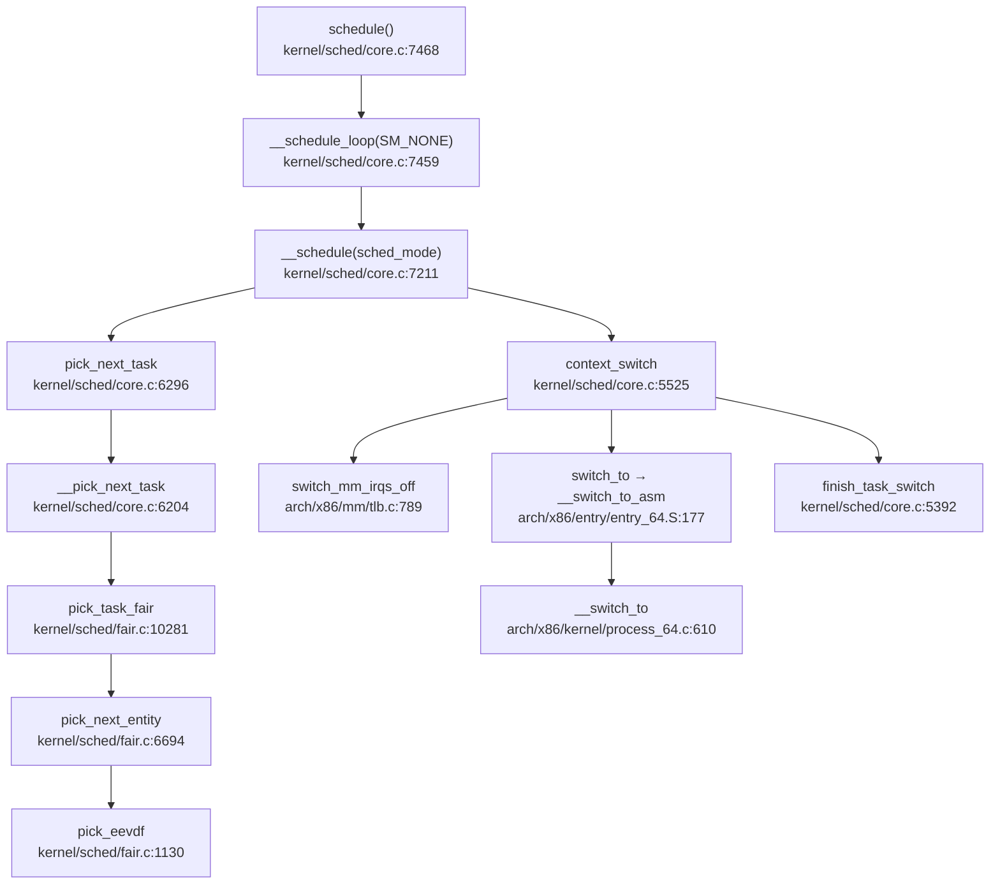

# 05 调度器：EEVDF、负载均衡与上下文切换

| 编写人 | 编写内容 | 编写时间 |
| --- | --- | --- |
| growdu | 初稿：五个调度类与优先级权重、`rq` 与 `cfs_rq` 的关系、EEVDF 取代 CFS 后的字段与挑选逻辑（vruntime / slice / deadline / lag）、`schedule()` → `__schedule` → `context_switch` 的完整过程、`switch_to` 在 x86 上的汇编、唤醒路径、负载均衡的触发与搬任务流程，附 GDB 跟一次切换。 | 2026-11-26 |

> 目标：把「CPU 上到底该跑谁」「两个任务之间切换时内核换掉了什么」「负载均衡在什么时候把任务搬到别的核」
> 这三件事拆到内核函数和结构体字段这一层。读完你应该能回答：
> 一个任务被唤醒后为什么不一定立刻抢到 CPU？上下文切换到底换了哪些寄存器和页表？
> 为什么我开了 4 个线程，4 个核不一定都跑满？
>
> 本文所有行号基于 `/work/cwork/linux`（`v7.4.0-rc3`，即 `v7.4-rc3-149-g666539eecdf4`）。
> 上一章讲内存；这一章回到 `struct task_struct`，看它怎么在 CPU 之间流转。

## 5.1 全景：调度器在哪个位置

调度器的入口只有很少几个，但被调用的地方非常多。**最核心的入口是 `schedule()`**
（`kernel/sched/core.c:7468`），它最终落到 `__schedule`（`kernel/sched/core.c:7211`），
由后者挑出下一个任务、再交给 `context_switch`（`kernel/sched/core.c:5525`）完成真正的切换。



`schedule()` 的调用点可以归纳成三类：

| 谁调 | 例子 | 语义 |
| --- | --- | --- |
| 自己主动让出 | 等锁、等 I/O、`nanosleep` | 任务把状态改成 `TASK_INTERRUPTIBLE` 之类，然后 `schedule()` 睡下去 |
| 内核抢占 | 中断返回、系统调用返回前发现 `TIF_NEED_RESCHED` | 别人把你标成「该让了」，你在返回时让 |
| 被动节流 | 时间片用完（EEVDF 里是 slice 用完） | `task_tick` 里设 `TIF_NEED_RESCHED` |

> **注意**：`schedule()` 本身不挑任务，它只是把 `__schedule` 包在一个「循环到不再需要调度」的壳里
> （`__schedule_loop`，`kernel/sched/core.c:7459`）。真正干活的是 `__schedule`。
> 你在 GDB 里想抓「一次切换」，断 `__schedule` 比断 `schedule` 更准 —— 因为后者会被内联展开。

## 5.2 五个调度类，从高到低

内核里不是只有一个「公平调度器」，而是**一串按优先级排好的调度类（sched_class）**。
`__pick_next_task` 从高到低问一遍，谁有可跑的任务就交给谁：

```text
stop_sched_class      最高：迁移线程、停机线程（stopper）
dl_sched_class        deadline：EDF 实时保证
rt_sched_class        实时：SCHED_FIFO / SCHED_RR
fair_sched_class      普通：SCHED_NORMAL / SCHED_BATCH（EEVDF）
ext_sched_class       sched_ext：BPF 自定义调度器（可选）
idle_sched_class      最低：没别的可跑时跑 idle
```

这张顺序表在 `kernel/sched/sched.h:2902`–`2906` 有一组 `extern` 声明，实际的「谁高谁低」由链接段
`__sched_class_highest`/`__sched_class_lowest`（`include/asm-generic/vmlinux.lds.h:155`）排定。
`kernel/sched/core.c:8927` 的 `BUG_ON` 钉死了顺序：`fair` 必须在 `ext` 之上，`ext` 必须在 `idle` 之上。

普通进程（你在 shell 里敲出来的几乎所有东西）都在 `fair_sched_class` 里。
它的优先级不是「数字越大越优先」，而是 **nice 值 → 权重**：

| nice | 权重（`sched_prio_to_weight`） |
| --- | --- |
| -20 | 88761 |
| -10 | 9548 |
| 0 | **1024**（基准） |
| 10 | 110 |
| 19 | 15 |

这张表在 `kernel/sched/core.c:10608`。nice 每降一级，权重大约涨 1.25 倍（相邻两项比值约 1.25）——
这就是「nice 值差 1，CPU 份额差约 25%」的由来。nice 的合法范围是 `-20..19`
（`include/linux/sched/prio.h:5`），`SCHED_NORMAL` 的编号是 0（`include/uapi/linux/sched.h:124`）。

`calc_delta_fair`（`kernel/sched/fair.c:303`）把「实际跑了多久」换算成「虚拟时间跑了多久」：
权重越大，同样的实际时间换算出的虚拟时间越小 —— 于是高权重任务在同一个「虚拟时间」刻度上跑得更多。
这是所有公平类调度器（CFS、EEVDF）的共同基石。

> **注意**：`sched_class` 是一张函数指针表（`kernel/sched/sched.h:2693`），核心钩子是
> `pick_task`、`enqueue_task`、`dequeue_task`、`task_tick`、`wakeup_preempt`、`balance`。
> 老文章里的 `pick_next_task` **不是** sched_class 的钩子 —— 现在的钩子叫 `pick_task`
> （`kernel/sched/sched.h:2743` 附近），`pick_next_task`（`kernel/sched/core.c:6296`）是 core 层的分派壳。

## 5.3 运行队列：rq 和 cfs_rq

每个 CPU 有一个 `struct rq`（`kernel/sched/sched.h:1179`），这是那个 CPU 的「待跑任务集合」。
它里面按调度类分了子队列：`rt_rq`、`dl_rq`、`cfs_rq`。普通任务在 `struct cfs_rq`（`kernel/sched/sched.h:681`）里。

`struct rq` 里最该记住的几个字段：

| 字段 | 位置 | 是什么 |
| --- | --- | --- |
| `nr_running` | `kernel/sched/sched.h:1188` | 这个 CPU 上可跑的任务数 |
| `curr` | `kernel/sched/sched.h:1197` | 当前正在跑的任务 |
| `donor` | `kernel/sched/sched.h:1196` | 调度上下文（开了 `CONFIG_SCHED_PROXY_EXEC` 时与 `curr` 分离） |
| `nr_switches` | `kernel/sched/sched.h:1211` | 这个 CPU 累计切换次数 |
| `idle` | `kernel/sched/sched.h:1204` | 空闲任务（每 CPU 一个） |

`struct cfs_rq` 里则是 EEVDF 的账本：

| 字段 | 位置 | 是什么 |
| --- | --- | --- |
| `h_nr_queued` | `kernel/sched/sched.h:684` | 队列里的层级任务数 |
| `sum_w_vruntime` | `kernel/sched/sched.h:688` | 加权虚拟时间总和（算「合格线」用） |
| `zero_vruntime` | `kernel/sched/sched.h:690` | 「零滞后」虚拟时间基准 |
| `tasks_timeline` | `kernel/sched/sched.h:698` | 按 deadline 排的红黑树 |
| `curr` | `kernel/sched/sched.h:704` | 当前选中的调度实体 |
| `h_curr` | `kernel/sched/sched.h:710` | 层级当前实体（`update_curr` 用的是它） |

每个任务通过 `task_struct->se`（`include/linux/sched.h:892`）挂进 `cfs_rq`。
`struct sched_entity`（`include/linux/sched.h:573`）就是你上一章见过的那个「调度实体」，
EEVDF 关心的字段有：

```c
// include/linux/sched.h:573（节选）
struct sched_entity {
	struct load_weight	load;      /* 权重 = nice 换算来的 */
	struct rb_node		run_node;  /* 挂进 cfs_rq->tasks_timeline */
	u64			deadline;  /* :578 虚拟截止时间 —— EEVDF 按它挑人 */
	u64			min_vruntime;
	...
	u64			vruntime;  /* 累计虚拟运行时间 */
	s64			vlag;      /* :595 虚拟滞后，可为负 */
	u64			vprot;
	u64			slice;     /* :598 本次请求的时间片 */
	...
};
```

> **注意**：「实体（entity）」这个概念是为**组调度**准备的：开了 `CONFIG_FAIR_GROUP_SCHED` 之后，
> 一个 cgroup 也是一个 entity，它内部还有自己的 `cfs_rq`。所以你会看到 `for_each_sched_entity(se)`
> 自底向上遍历一层层的 entity。普通任务就是最底层的叶子 entity，`task_of(se)` 把它换回 `task_struct`。

## 5.4 EEVDF：CFS 的后继

这是这一章最需要更新的认知：**这棵树里的公平调度器不是 CFS，是 EEVDF**
（Earliest Eligible Virtual Deadline First，`kernel/sched/fair.c:1112` 有一段专门的设计注释）。

历史脉络：EEVDF 在 6.6 合并进主线，逐步取代 CFS 的挑选逻辑；到你这棵树（v7.4-rc3），
`cfs_rq` 里**已经没有 `min_vruntime` 这个挑选基准了**（`struct cfs_rq` 里搜不到，只有
`sum_w_vruntime`、`zero_vruntime`），挑选函数也不再是「选 vruntime 最小的」。

EEVDF 的两条准则（`kernel/sched/fair.c:1115`）：

1. **合格（eligible）**：任务的虚拟滞后不为负 —— 它「被欠了服务」。
2. **在合格的任务里，选虚拟截止时间（deadline）最早的那个。**

`pick_eevdf`（`kernel/sched/fair.c:1130`）就是干这个的：

```c
// kernel/sched/fair.c:1130（简化）
static struct sched_entity *pick_eevdf(struct cfs_rq *cfs_rq, bool protect)
{
	...
	/* 只有一个人排队：不用算，就是它 */
	if (cfs_rq->h_nr_queued == 1)
		return curr && curr->on_rq ? curr : se;

	/* ->next 是唤醒时提名的「下一个」，合格就直接用它（保延迟） */
	if (sched_feat(PICK_BUDDY) && protect &&
	    cfs_rq->next && entity_eligible(cfs_rq, cfs_rq->next))
		return cfs_rq->next;

	if (curr && (!curr->on_rq || !entity_eligible(cfs_rq, curr)))
		curr = NULL;
	if (curr && protect && protect_slice(curr))
		return curr;

	/* 最左的 entity 合格就用它 */
	if (se && entity_eligible(cfs_rq, se))
		goto found;

	/* 沿红黑树做堆式剪枝，找 deadline 最早的合格者 */
	while (node) { ... }
}
```

「合格」的判定在 `entity_eligible`（`kernel/sched/fair.c:961`）→ `vruntime_eligible`
（`kernel/sched/fair.c:916`）：把实体的 vruntime 和队列的加权平均虚拟时间（`sum_w_vruntime` / `sum_weight`）比，
不低于平均线就算合格。树按 deadline 排序（`tasks_timeline`），同时在每个节点上维护 `min_vruntime` 做剪枝，
所以挑选是 O(log n)。EEVDF 的注释里把这一点写得很清楚（`kernel/sched/fair.c:1112` 那段）。

三个量之间的关系是这样的（`update_deadline`，`kernel/sched/fair.c:1232`）：

```c
// kernel/sched/fair.c:1232（简化）
static bool update_deadline(struct cfs_rq *cfs_rq, struct sched_entity *se)
{
	if (vruntime_cmp(se->vruntime, "<", se->deadline))
		return false;

	/* 没自定义 slice 就用默认的 base slice */
	if (!se->custom_slice)
		se->slice = sysctl_sched_base_slice;

	/* EEVDF: vd_i = ve_i + r_i / w_i  ← 截止时间 = 当前虚拟时间 + 片长/权重 */
	se->deadline = se->vruntime + calc_delta_fair(se->slice, se);   /* :1248 */
	avg_vruntime(cfs_rq);
	return true;   /* 这一片用完了，该重新调度 */
}
```

而 vruntime 的累加在 `update_curr`（`kernel/sched/fair.c:2172`）：

```c
// kernel/sched/fair.c:2199
curr->vruntime += calc_delta_fair(delta_exec, curr);
resched = update_deadline(cfs_rq, curr);
```

默认片长 `sysctl_sched_base_slice` = **700000** 纳秒（0.7ms，`kernel/sched/fair.c:85`）。

> **注意**：这是老文章最容易踩空的地方。老文章讲「CFS 选 `vruntime` 最小的任务」「`cfs_rq->min_vruntime`
> 单调递增」「`sched_slice()` 算时间片」—— 这三句在这棵树里**都不成立了**：
> `cfs_rq` 没有 `min_vruntime`，也没有 `sched_slice()` 这个函数（全树搜不到），
> 挑选看的是 **deadline 和 eligibility**，片长来自 `se->slice` / `sysctl_sched_base_slice`。
> 只记「按 nice 加权累计 vruntime」还行，但「最小 vruntime 先跑」已经不是这里的规则了。

## 5.5 schedule() → __schedule：一次切换的全过程

`__schedule`（`kernel/sched/core.c:7211`）是切换的主体。它的骨架（简化）：

```c
// kernel/sched/core.c:7211（简化）
static void __sched notrace __schedule(int sched_mode)
{
	struct task_struct *prev, *next;
	struct rq *rq = cpu_rq(smp_processor_id());

	prev = rq->curr;
	...
	rq_lock(rq, &rf);                 /* 锁住这个 CPU 的运行队列 */
	update_rq_clock(rq);

	/* 1) 处理自己：如果是「阻塞让出」，把自己从队列摘下来 */
	if (!preempt && prev_state)
		try_to_block_task(rq, prev, &prev_state, ...);  /* :7291，内部 deactivate_task */

pick_again:
	/* 2) 从高到低问每个调度类，挑出 next */
	next = pick_next_task(rq, &rf);          /* :7298 */
	...
	rq->nr_switches++;                       /* :7348 */
	RCU_INIT_POINTER(rq->curr, next);        /* :7353 */
	...
	/* 3) 真正切换，返回新的 rq */
	rq = context_switch(rq, prev, next, &rf); /* :7386 */
}
```

三件事按顺序发生：**摘掉 prev（如果它睡了）→ 挑 next → 切换**。

挑任务的分派在 `pick_next_task`（`kernel/sched/core.c:6296`）。它有一个快速路径：
如果当前任务的调度类不高于 fair，且 `nr_running == cfs.h_nr_queued`（也就是所有可跑任务都在 fair 队列里），
就直接调 `pick_task_fair`，跳过逐类遍历（`__pick_next_task`，`kernel/sched/core.c:6204` 起）。
否则才 `for_each_active_class` 一类一类问下去。

`__schedule` 返回后，`__schedule_loop` 会再查一次 `need_resched()`，直到不需要调度为止：

```c
// kernel/sched/core.c:7459
static __always_inline void __schedule_loop(int sched_mode)
{
	do {
		preempt_disable();
		__schedule(sched_mode);
		sched_preempt_enable_no_resched();
	} while (need_resched());
}
```

之所以要循环，是因为你刚切到 `next`，它可能立刻又被标成「该让」——
比如它一上来就抢锁失败，或者被更高优先级的任务抢占。

> **注意**：`prev_state` 只读一次（`prev->__state`），因为它是易变的。`__schedule` 里有一段长注释
> （`kernel/sched/core.c:7240` 附近）解释为什么要在 `rq->lock` 上加 `smp_mb__after_spinlock()`：
> 保证 `signal_pending_state()` 的检查和调用方 `set_current_state()` 之间的顺序，
> 否则会出现「信号来了但任务还是睡下去」的丢唤醒。
> 这类内存屏障是读调度器代码时最容易忽略、又最不能删的东西。

## 5.6 context_switch：换栈、换页表、换寄存器

`context_switch`（`kernel/sched/core.c:5525`）是「把 CPU 从一个任务交给另一个任务」的执行者。
它做的事情可以按顺序拆成四步：

```c
// kernel/sched/core.c:5525（简化）
context_switch(struct rq *rq, struct task_struct *prev,
               struct task_struct *next, struct rq_flags *rf)
{
        prepare_task_switch(rq, prev, next);        /* :5529 记账、perf/kprobe 通知、prepare_task */
        arch_start_context_switch(prev);            /* :5536 架构钩子（paravirt） */

        if (!next->mm) {                            /* 切到内核线程 */
                enter_lazy_tlb(prev->active_mm, next);
                next->active_mm = prev->active_mm;
                ...
        } else {                                    /* 切到用户任务 */
                switch_mm_irqs_off(prev->active_mm, next->mm, next);  /* :5563 换页表 */
                ...
        }

        prepare_lock_switch(rq, next, rf);          /* :5581 准备释放 rq->lock */
        switch_to(prev, next, prev);                /* :5584 换栈 → 汇编 */
        barrier();
        return finish_task_switch(prev);            /* :5587 收尾 */
}
```

重点是 **`switch_mm_irqs_off`** 和 **`switch_to`** 这两步：

- **`switch_mm_irqs_off`**（`arch/x86/mm/tlb.c:789`）把 CPU 的 CR3 换成新任务的页表 ——
  这就是上一章说的「每个进程有自己的地址空间」在硬件上的落点。如果切到内核线程（`next->mm == NULL`），
  它借用上一个任务的 `active_mm`（这叫 lazy TLB，省一次 CR3 写）。
- **`switch_to`** 是一个宏（`arch/x86/include/asm/switch_to.h:49`），展开后只做一件事：
  `(last) = __switch_to_asm((prev), (next))`。

`__switch_to_asm`（`arch/x86/entry/entry_64.S:177`）是真正的寄存器与栈切换：

```asm
# arch/x86/entry/entry_64.S:177（节选）
SYM_FUNC_START(__switch_to_asm)
        pushq   %rbp
        pushq   %rbx
        pushq   %r12
        pushq   %r13
        pushq   %r14
        pushq   %r15
        /* 把当前 rsp 存进 prev->thread.sp，再加载 next->thread.sp */
        movq    %rsp, TASK_threadsp(%rdi)
        movq    TASK_threadsp(%rsi), %rsp
        ...
        popq    %r15
        popq    %r14
        popq    %r13
        popq    %r12
        popq    %rbx
        popq    %rbp
        jmp     __switch_to
SYM_FUNC_END(__switch_to_asm)
```

注意几件事：

1. **只保存 callee-saved 寄存器**（rbp、rbx、r12–r15）。调用者保存的寄存器（rax、rcx、rdx……）
   在调用 `schedule()` 时早就压在当前任务的内核栈上了，不用在这里再存 —— **换栈就等于把它们全换了**。
2. **换栈的方式是换 `rsp`**：把 `prev` 的栈指针存进 `prev->thread.sp`，把 `next->thread.sp` 装进 `rsp`。
   从此往下执行的 `pop`、`ret` 取的都是 `next` 的栈。
3. 最后 `jmp __switch_to`（`arch/x86/kernel/process_64.c:610`）—— 尾部跳转，处理 FS/GS base、
   FPU 状态、TSS 里的 `rsp0` 这些 x86 特有的东西，然后返回。
4. 那个 `last` 出参是给「谁被换走了」用的：一个任务被重新调度上 CPU 时，它看到的 `last`
   是**这个 CPU 上一个跑的任务**，不一定是它当初切走的那个（中间可能已经过了好几个任务）。

`finish_task_switch`（`kernel/sched/core.c:5392`）做收尾：`mmdrop` 掉上一个任务的 `active_mm`、
完成 `prev` 的 `put_task_struct`（任务退出时最后一步）、统计切换耗时。**这行代码是在 `next` 的栈上跑的**。

> **注意**：`switch_to` 的调用形式 `switch_to(prev, next, prev)` 里第三个参数既是入参又当出参，
> 老文章常写成 `switch_to(prev, next, last)` 并解释为什么不直接用 `prev`。
> 在这棵树的 x86 实现里，`__switch_to_asm` 返回的就是 `prev`，所以这里传 `prev` 没问题。
> 但**别把 `switch_to` 当普通函数**：它一次调用会「进去的是 A、出来的是 B」，
> GDB 单步跟它会跟丢，正确做法是断 `__switch_to_asm`。

## 5.7 唤醒：任务被叫醒之后

一个任务被唤醒（`wake_up_process`、`complete`、信号、I/O 完成……）都会走到 `try_to_wake_up`
（`kernel/sched/core.c:4330`）。它的大致流程：

```text
try_to_wake_up
  └─ 选 CPU：select_task_rq_fair（kernel/sched/fair.c:9920）
  └─ ttwu_queue（kernel/sched/core.c:4146）
       └─ ttwu_do_activate（:3888）
            └─ activate_task（:2232）→ enqueue_task_fair → place_entity（fair.c:6335）
                 └─ wakeup_preempt（:2303）→ wakeup_preempt_fair（fair.c:10137）
                      └─ resched_curr（:1244）→ 置 TIF_NEED_RESCHED
```

几个关键点：

- **唤醒 ≠ 立刻运行。** `try_to_wake_up` 只是把任务塞进某个 CPU 的 `rq`，
  并给那个 CPU 打一个 `TIF_NEED_RESCHED` 标记。真正切过去要等那个 CPU 下一次 `__schedule`
  （返回用户态、中断返回、或显式抢占点）。
- **选哪个 CPU** 在 `select_task_rq_fair` 里：优先 `prev_cpu`（缓存热），
  再看 `wake_affine`（唤醒者和被唤醒者是否共享缓存）、`find_energy_efficient_cpu`（EAS）、
  `select_idle_sibling`（`kernel/sched/fair.c:9156`，找一个空闲兄弟核）。
  `wake_wide`（`kernel/sched/fair.c:8510`）用来判断「唤醒者是不是在唤醒一大堆任务」——
  是的话就别再粘在同一个核上，主动散开。
- **是不是要抢当前任务** 在 `wakeup_preempt_fair`（`kernel/sched/fair.c:10137`）里判断：
  被唤醒的任务如果 deadline 更早、或当前任务已经用完 slice，就把当前任务标成该让。
- **`place_entity`**（`kernel/sched/fair.c:6335`）决定新任务入队时的初始 vruntime / 滞后：
  睡太久的任务不该攒出巨额「欠账」一次性爆发，所以要把它的 vruntime 拉回到基准附近。

`fork` 出来的新任务走的是另一条：`wake_up_new_task`（`kernel/sched/core.c:5015`）。
它先把 `p->__state` 设成 `TASK_RUNNING`，用 `select_task_rq` 选核，再 `activate_task`，
最后 `wakeup_preempt` —— 也就是「放到队列里，看要不要抢占」。

> **注意**：`TIF_NEED_RESCHED` 的检查点很关键。用户态返回前会查（`exit_to_user_mode`），
> 内核态抢占则看内核是不是可抢占配置（`CONFIG_PREEMPT_*`）。所以「高优先级任务被唤醒后多久真的跑起来」
> 取决于**当前任务是不是在可抢占点**——这也是为什么实时性调优里 `PREEMPT_RT` 那一套值钱。
> 这棵树里还有个 `resched_curr_lazy`（`kernel/sched/core.c` 里 `resched_curr` 之后），
> 用 `TIF_NEED_RESCHED_LAZY` 做「不急的让出」，把抢占推迟到合适时机。

## 5.8 负载均衡：谁在什么时候搬任务

调度器分两层：**每个 CPU 自己挑本核队列里最优的任务**（5.4–5.6），
以及**把任务在 CPU 之间搬来搬去让负载均衡**（本节）。后者才是「4 个线程能不能跑满 4 个核」的答案。

触发点有两个：

1. **周期性的 tick**：每次时钟中断 → `sched_tick`（`kernel/sched/core.c:5830`）→
   末尾调 `sched_balance_trigger`（`kernel/sched/core.c:5880`）。
2. **CPU 要变空闲**：`pick_task_fair` 找不到可跑任务时调 `sched_balance_newidle`
   （`kernel/sched/fair.c:14874`），试图从别的核「偷」一个任务过来。

`sched_balance_trigger`（`kernel/sched/fair.c:15047`）干的事很朴素：

```c
// kernel/sched/fair.c:15047
void sched_balance_trigger(struct rq *rq)
{
        if (unlikely(on_null_domain(rq) || !cpu_active(cpu_of(rq))))
                return;

        if (time_after_eq(jiffies, rq->next_balance))
                raise_softirq(SCHED_SOFTIRQ);      /* :15057 到点了，起软中断 */

        nohz_balancer_kick(rq);
}
```

注意它是 **`raise_softirq`，不是当场搬** —— 负载均衡被推迟到软中断里做，因为搬任务要抢多个 rq 的锁、
还要发 IPI，太重，不能占着中断上下文干。软中断的处理函数在
`open_softirq(SCHED_SOFTIRQ, sched_balance_softirq)`（`kernel/sched/fair.c:15979`）注册，
实体是 `sched_balance_softirq`（`kernel/sched/fair.c:15024`）：

```text
sched_balance_softirq（fair.c:15024）
  ├─ nohz_idle_balance            ← 替 tick 停掉的空闲核做平衡
  ├─ sched_balance_update_blocked_averages
  └─ sched_balance_domains（fair.c:14261）
       └─ for_each_domain(cpu, sd)          ← 从 L1 缓存域一路到 NUMA 域
            └─ sched_balance_rq（fair.c:13752）   ← 单个域内搬任务
                 ├─ should_we_balance（fair.c:13643）
                 ├─ sched_balance_find_src_group（fair.c:13240）  ← 找最忙的组
                 ├─ sched_balance_find_src_rq（fair.c:13379）     ← 组里最忙的核
                 ├─ detach_tasks（fair.c:11321）                 ← 摘任务
                 └─ attach_tasks（fair.c:11464）                 ← 挂到目标核
```

几个设计要点：

- **调度域（sched_domain）是分层的**：L1（同核超线程）→ L2（同 LLC）→ NUMA 域。
  每一层的「平衡间隔」不同（`get_sd_balance_interval`，`kernel/sched/fair.c:14050`），
  越往外越慢 —— 跨 NUMA 搬任务代价大，不值得频繁搬。
- **`should_we_balance`** 保证「同一个域同一时刻只有一个 CPU 在做平衡」，避免几个核同时抢同一个任务。
- **`detach_tasks` / `attach_tasks`** 一次最多搬 `SCHED_NR_MIGRATE_BREAK` 个
  （`kernel/sched/sched.h:3228`，默认 8 或 32），避免一次搬太多把锁占太久。
- **主动平衡（active balance）**：如果最忙的核上有个任务被 pin 住了、挪不动，就走
  `need_active_balance`（`kernel/sched/fair.c:13594`）→ `stop_one_cpu_nowait`（`kernel/sched/fair.c:13986`）
  → `active_load_balance_cpu_stop`（`kernel/sched/fair.c:14170`）。这条路径用 stopper 线程把目标核「停下来」
  再搬，属于慢路径。

> **注意**：这棵树的负载均衡函数名全换了前缀 —— `load_balance` 改叫 `sched_balance_rq`，
> `rebalance_domains` 改叫 `sched_balance_domains`，`find_busiest_group` 改叫 `sched_balance_find_src_group`，
> `trigger_load_balance` 改叫 `sched_balance_trigger`，`run_rebalance_domains` 改叫 `sched_balance_softirq`，
> `newidle_balance` 改叫 `sched_balance_newidle`。**`migrate_tasks` 已经没有了**。
> 你在老文章里搜 `load_balance`、`find_busiest_group`、`migrate_tasks`，在这棵树里要么搜不到，
> 要么只剩 `active_load_balance_*` 这类残留名字。

## 5.9 为什么 4 个线程不一定跑满 4 个核

这是最常被问到的问题，答案分散在前面几节里，这里收拢一下：

| 原因 | 机制 | 代码位置 |
| --- | --- | --- |
| 只在一个核上被创建 | `fork` 之后 `select_task_rq` 倾向 `prev_cpu`（缓存热） | `kernel/sched/fair.c:9920` |
| 负载均衡是「周期性」的，不是实时的 | 要等 tick 且过了 `next_balance` 才起软中断 | `kernel/sched/fair.c:15047` |
| 迁移有代价，间隔有下限 | `sysctl_sched_migration_cost`（默认 500us） | `kernel/sched/fair.c:88` |
| 拥有缓存亲和性 | `wake_affine` / `select_idle_sibling` 优先留在同 LLC | `kernel/sched/fair.c:9156` |
| 绑了 CPU | `cpus_ptr` 限制能去哪 | `select_task_rq_fair` |
| 在等锁 / 等 I/O | 阻塞的任务不在 `rq` 上，不占 CPU | `deactivate_task`（`kernel/sched/core.c:2243`） |
| cgroup CPU 配额 | `cpu.max` 限流，超了就被 throttle | CFS bandwidth |
| 落在「非首选 CPU」上 | 新机制：tick 时把当前任务从非首选核推走 | `kernel/sched/core.c:11345` |

前四条合起来的意思是：**负载均衡是个「慢慢纠正」的过程，不是「一有任务就平均分」**。
一个进程 `fork` 出 4 个 CPU 密集线程时，它们通常先挤在创建者的那个核上，
然后靠 tick 的负载均衡一个核一个核地被「搬」出去 —— 如果每个线程跑的时间很短（比如几毫秒就跑完），
很可能还没搬完就结束了，于是你看到的是一个核忙、三个核闲。

> **注意**：想验证这一点，用 `perf sched` 看迁移事件，或者读 `/proc/<pid>/schedstat`
> 里的 `nr_migrations`。另外这棵树新加了 **preferred CPU** 概念（`CONFIG_PREFERRED_CPU`，
> `include/linux/cpumask.h:1292` 的 `cpu_preferred`）：负载均衡不会往「非首选 CPU」拉任务
> （`kernel/sched/fair.c:13775`、`:14901`），而且 tick 发现当前任务跑在非首选核上时，
> 会用 stopper 把它推走（`sched_push_current_non_preferred_cpu`，`kernel/sched/core.c:11345`）。
> 这是 v7.x 的新东西，老文章里没有。

## 5.10 用 GDB 跟一次切换

```bash
gdb /work/cwork/linux/vmlinux
(gdb) target remote :1234
(gdb) break __schedule
(gdb) continue
```

| 断点 | 位置 | 看什么 |
| --- | --- | --- |
| `__schedule` | `kernel/sched/core.c:7211` | `prev`、`prev_state`、`sched_mode` |
| `pick_next_task` | `kernel/sched/core.c:6296` | 走的是快速路径还是逐类遍历 |
| `pick_eevdf` | `kernel/sched/fair.c:1130` | `cfs_rq->h_nr_queued`、选中的 `se` |
| `update_curr` | `kernel/sched/fair.c:2172` | `delta_exec`、累加后的 `vruntime` |
| `update_deadline` | `kernel/sched/fair.c:1232` | 新 `slice` 与 `deadline` |
| `context_switch` | `kernel/sched/core.c:5525` | `prev->mm` / `next->mm` 是否为空（内核线程） |
| `__switch_to_asm` | `arch/x86/entry/entry_64.S:177` | 寄存器与 `rsp` 的切换 |
| `finish_task_switch` | `kernel/sched/core.c:5392` | 收尾、`mmdrop` |
| `sched_balance_rq` | `kernel/sched/fair.c:13752` | 哪个域在搬、搬了几个 |
| `wakeup_preempt_fair` | `kernel/sched/fair.c:10137` | 唤醒是否触发抢占 |

```gdb
(gdb) break context_switch
(gdb) commands
> silent
> printf "switch: %s -> %s (prev_mm=%p next_mm=%p)\n", prev->comm, next->comm, prev->mm, next->mm
> continue
> end
```

> **提示**：`switch_to` 是宏，断不了；`__schedule` 会断得非常频繁（每个 CPU 每秒几百上千次），
> 建议先用 `condition` 限定进程名，或者改用 tracepoint：
> `trace_sched_switch`（`kernel/sched/core.c:7383`）就是现成的——
> `perf sched record` / `perf sched latency` 底层就是它。
> 另外 `/proc/<pid>/status` 里的 `voluntary_ctxt_switches` / `nonvoluntary_ctxt_switches`
> （`fs/proc/array.c:400`–`401`）能直接看出一个进程是被主动让出还是被抢占。

## 5.11 小结

这一章的核心就三句话：

1. **调度分两层。** 每个 CPU 用 EEVDF 在自己队列里挑「合格且 deadline 最早」的任务
   （`pick_eevdf`，`kernel/sched/fair.c:1130`）；跨核的负载均衡是另一套东西，
   由 tick 触发、在软中断里（`sched_balance_softirq`）按调度域逐层搬任务。
2. **上下文切换 = 换栈 + 换页表 + 换寄存器。** `context_switch` 里
   `switch_mm_irqs_off` 换 CR3，`switch_to` → `__switch_to_asm` 换 `rsp` 并保存/恢复 callee-saved 寄存器，
   最后 `finish_task_switch` 在新任务的栈上收尾。
3. **这棵树里的公平调度器是 EEVDF，不是 CFS。** 挑选看 deadline 和 eligibility，
   `cfs_rq` 里没有 `min_vruntime`，也没有 `sched_slice()` —— 片长来自 `se->slice`
   和 `sysctl_sched_base_slice`（700us）。

## 5.12 v7.4 变化对照表

网上讲调度的文章绝大多数基于 CFS 时代（4.x / 5.x / 6.x 早期）。
这棵树是 **v7.4.0-rc3**，下面这些老说法**已经不成立**：

| 老文章里的说法 | 这棵树里的实际情况 |
| --- | --- |
| CFS 选 `vruntime` 最小的任务 | **EEVDF**：在「合格」的任务里选 `deadline` 最早的（`kernel/sched/fair.c:1130`） |
| `cfs_rq->min_vruntime` 作挑选基准 | `struct cfs_rq` 里**没有** `min_vruntime`；只有 `sum_w_vruntime` / `zero_vruntime`（`kernel/sched/sched.h:688`、`:690`） |
| `sched_slice()` 算时间片 | 函数**不存在**；片长来自 `se->slice`，默认 `sysctl_sched_base_slice`=700000ns（`kernel/sched/fair.c:85`） |
| `pick_next_task_fair()` | 改名 `pick_task_fair`（`kernel/sched/fair.c:10281`）；`sched_class` 钩子叫 `pick_task`（`kernel/sched/sched.h:2743`） |
| `check_preempt_wakeup_fair()` | 改名 `wakeup_preempt_fair`（`kernel/sched/fair.c:10137`） |
| `load_balance()` | 改名 `sched_balance_rq`（`kernel/sched/fair.c:13752`） |
| `find_busiest_group()` | 改名 `sched_balance_find_src_group`（`kernel/sched/fair.c:13240`） |
| `find_busiest_queue()` | 改名 `sched_balance_find_src_rq`（`kernel/sched/fair.c:13379`） |
| `rebalance_domains()` | 改名 `sched_balance_domains`（`kernel/sched/fair.c:14261`） |
| `trigger_load_balance()` | 改名 `sched_balance_trigger`（`kernel/sched/fair.c:15047`） |
| `run_rebalance_domains()`（软中断） | 改名 `sched_balance_softirq`（`kernel/sched/fair.c:15024`） |
| `newidle_balance()` | 改名 `sched_balance_newidle`（`kernel/sched/fair.c:14874`） |
| `migrate_tasks()` 搬任务 | **没有了**；主动平衡走 `active_load_balance_cpu_stop`（`kernel/sched/fair.c:14170`）+ `stop_one_cpu_nowait`（`:13986`） |
| 只有 stop / dl / rt / fair / idle 五个类 | 多了 **ext**（sched_ext，`kernel/sched/ext/ext.c:5899`），BPF 可自定义调度器 |
| `rq->curr` 就是正在跑的任务 | 开了 `CONFIG_SCHED_PROXY_EXEC` 时 `donor` 与 `curr` **分离**（`kernel/sched/sched.h:1196`–`1197`） |
| `kernel/sched/switch.c` 里的 `__switch_to` | x86 的 `__switch_to` 在 `arch/x86/kernel/process_64.c:610`，`context_switch` 在 `kernel/sched/core.c:5525` |
| 任务只会被搬向忙的核 | v7.x 新增 **preferred CPU**：不往非首选核拉，还会把任务推走（`kernel/sched/core.c:11345`） |

**读老文章的心法**：调度的**大框架**（rq / cfs_rq / sched_class / 负载均衡）还有效，
但 **CFS → EEVDF 这一步是算法级的替换**，函数名和字段都跟着变了。
读这棵树时认三样东西：`se->deadline`、`se->slice`、`entity_eligible`；
看到 `min_vruntime` 或 `sched_slice` 就当是老文章。

## 5.13 下一章

下一章是 **06 VFS：一次 `open` 的完整链路与 inode/dentry**（尚未写完）。
先回 [学习路线](../../getting-started/linux源码学习之路.md) 看全貌。

下一章离开调度，进入文件系统：`open` 怎么把路径字符串变成 `struct file`、
dentry 缓存为什么能让第二次 `open` 快得多、mount 与 superblock 又是在哪一步接上的。
读完你就能回答「`open` 到底在磁盘上做了几次 I/O」这类问题。
