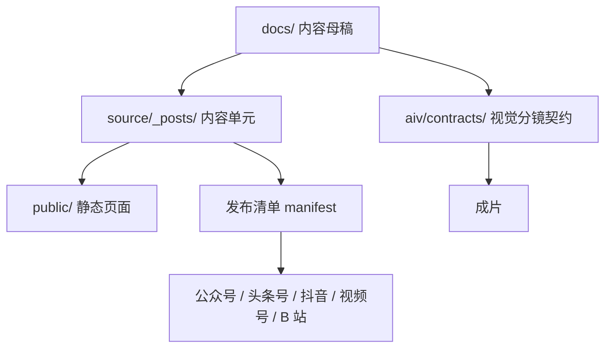

# 一个仓库，三条产线

| 编写人 | 编写时间 | 适用版本 |
| --- | --- | --- |
| growdu | 2026-11-17 | 契约层 5 份规格 · 视频线 6 期成片 · 3 条产线 |

大多数人的博客就是一个博客：写文章、传图片、扔进静态站点生成器、推上线。

这个站不是。它表面上是一个博客，底下是一个**内容工厂**——
文章写完之后，同样的内容还要变成一条视频、一篇公众号推文、一条头条稿、
一份 B 站投稿包。如果每条产线各写一遍内容，
五百多篇文章乘以五个平台就是将近三千份稿件，改一次标题要改五处。
这套东西活不过第三个月。

所以这篇先讲整体：有哪些部件、部件之间怎么连、
以及**为什么不是用现成方案拼出来的**。

---

## 一、先说清楚要解决的问题

有三件事同时成立，系统才必须长成这个样子：

1. **同一份内容，要出现在多个形态上。** 网站上是一篇文章，
   公众号上是一篇图文（标题 64 字、摘要 120 字），
   头条上是另一套排版规则（标题 30 字、正文图最多三张），
   抖音上是一条竖版短视频（标题 30 字、描述 500 字、竖封面 3:4），
   视频号上标题只有 16 字，B 站上是一条带字幕的视频投稿包。
2. **内容会持续增加。** 不是写五篇就完事，是写到第六百篇还在写。
   任何靠「记得手动同步」维持的机制，规模化之后必然崩。
3. **平台的规则会变，而且不是你想让它变的时候变。** 接口权限、
   审核策略、限额数字，一年能变好几次。

第 1 条要求「一份真相，多处派生」；第 2 条要求「派生过程可重复执行」；
第 3 条要求「易变的东西不能埋在代码里」。

这三条决定了后面所有的取舍。

---

## 二、共同底座：`docs/` 是唯一真相

三条产线不共享代码，但共享**同一个真相**。

- **技术站点**：`docs/` 里的 markdown → 一个编译脚本生成 Hexo 的源 →
  Hexo 渲染成静态页面 → CI 部署。整条线全自动，一次 push 端到端十几分钟上线。
- **品牌视频**：一期视频的**画面上写什么**（标题、副标题、标签、数字、枚举）
  全部写在一份视觉分镜契约里 → 渲染引擎按契约逐帧绘制 → 拼成成片。
- **多平台分发**：内容单元 × 平台能力声明 → 一份发布清单 →
  各平台的适配器按清单出包或调接口。

三条线共享的不是代码，是**同一个真相的形态**：

| 产线 | 谁说了算 | 形式 |
| --- | --- | --- |
| 站点 | 作者 | `docs/` 下的 markdown |
| 视频 | 作者 | 视觉分镜契约（JSON） |
| 分发 | 机器（按数据） | 平台能力声明（TOML） |

**母稿唯一**这条不变量就是从这里来的：任何平台上的东西，
都能从一个内容标识完整重建出来；平台侧的内容永远不是真相。
你在公众号上看到的那篇推文，是从 `docs/` 里那份 markdown 派生出来的，
删掉重发一次，结果还是它。

---

## 三、分层：依赖是单向的

| 层 | 位置 | 职责 | 允许依赖 |
| --- | --- | --- | --- |
| 内容层 | `docs/` | 母稿、图片、分类元数据 | 无 |
| 内容编译层 | `tools/`、`scripts/` | 编译、校验、主题补丁 | 只读 `docs/`，只写 `source/` |
| 展示层 | `themes/matery/` | 模板、样式、静态资源 | Hexo 运行时 |
| 视频生产层 | `aiv/` | 契约 → 时间轴 → 片段 → 成片 | 只读自己的契约与素材 |
| 发布契约层 | `publish/publishkit/` | 内容契约、能力模型、清单、调度 | **不认识任何平台** |
| 平台适配层 | `weixin/`、`toutiao/`、`douyin/`、`channels/`、`bilibili/` | 切片、渲染、出包、发布 | 只认能力声明与发布清单 |

规矩只有一条：**依赖是单向的**。平台层不引用契约层，契约层不引用平台层。

为什么这条规矩值钱？因为**平台规则变得比代码快**。
公众号标题 64 字，头条 30 字，抖音描述 500 字，封面比例，图片体积，能不能自动发——
这些一年要变好几次。如果每个平台的规则都写在各自的 Python 文件里，
那么「平台规则变了」就意味着「改四个代码库」。

所以规则被抽成了数据：**一个平台一份声明文件**，里面写限额、
写自动化能停在哪一步、写要不要等平台审核。代码只负责读它。

反过来，契约层绝不能去 import 某个平台——一旦 import 了，
契约层就被那个平台绑住了：加第五个平台时，你会忍不住在契约层里写个 `if`。

**接缝只有一处**：契约层与平台层都只认同一份能力声明和同一份发布清单 JSON。

平台之间更彻底：**不是共用，是复制。** 一个平台适配器目录是从另一个
派生出来的独立副本，复制完就各走各的，不抽公共模块、不做同步修复、
不把一边的修改回流到另一边。理由很实际——各平台是并行开发的，
共用代码就是并发冲突源；而且平台规则本来就不同，
强行共用只会把差异藏进 if 里，让差异越来越难找。

唯一被几个平台一起读的是**视频线的期号元数据**：视频号、抖音、B 站
三个适配器都要知道「这是第几期、钩子是什么」。共享的是视频线的产出，
不是平台之间的实现——依赖的方向仍然是单向的。

---

## 四、三条不变量

### 1. 母稿唯一

任何平台产物都能从内容标识重建；真相只在 `docs/`。

### 2. 可重放 vs 有状态

切片与渲染是**纯函数**，随便重跑多少次结果都一样；
只有「发布」这一步是有状态的，它的幂等键单独落盘。
把这两类东西分开，是为了让「重跑一遍」永远安全。

### 3. 不静默成功

**平台的「成功」必须是被显式确认过的成功**，不能是「没报错就算成功」。

这一条最反直觉，也最值钱。在发布场景里，**发重了比发慢了糟糕得多**：
读者看到同一篇文章出现两次，而这个 bug 可能几个月都发现不了。
所以这套系统的默认答案偏保守——拿不准的时候，停下来，让人看一眼。

具体到实际效果：公众号线的自动化边界停在**草稿箱**，
最后点一下「发表」由人完成。这不是没做完，这是答案——
草稿箱天然就是一个审批闸门。

---

## 五、为什么不用现成方案

这一节单独写，因为「为什么不 X」往往比「为什么是 Y」更能说明取舍。

**为什么不用 WordPress / Notion 这类 CMS？**
它们解决的是「一个人写文章」，不是「一份内容派生五个平台」。
它们的字段可以声明，但它们的**导出**是给人看的，不是给机器的契约；
平台差异最后还是要落在每条流程里写一遍。

**为什么不用 n8n / Zapier 这种工作流引擎？**
它们把「流程」画出来、节点之间传数据。但这个系统里最容易变的
不是流程，是**平台规则**——限额、审核、接口权限。
用工作流引擎编排，等于把会变的规则藏进一个不会改的流程图里，
等半年后规则变了，你得去工作流里翻。

**为什么不用现成的多平台分发 SaaS？**
它们按「账号 + 模板」计费，按「每条内容 × 每个平台」抽成。
对一个每周发几篇的个人号来说，这个成本结构和它要解决的问题都不匹配；
更要命的是，规则掌握在别人手里，改不动。

**为什么不用视频生成模型直接出片？**
早期方案确实是整片交给模型生成。算完账就放弃了：
技术讲解片的主体恰恰是技术图示——数据流、线程拓扑、核数对比。
这些东西用规则描述最准确，用模型生成最容易出错；
而文字和数字一旦生成错，**没法撤回**，改一句话要按秒重算。
于是改成「技术图示全代码绘制，模型只出静态底板」——
视频生成消耗归零，改一处只重渲一个场景。

**为什么不用现成的静态站点模板？**
这条线确实就是用了现成的：Hexo 加一个开源主题。
但**主题不能直接改**——升级会覆盖。所以所有定制都走
「按标记注入」的补丁方式，主题升级后重新注入即可。
这比 fork 一份主题自己维护便宜得多。

**为什么不用一条大流水线把所有环节串起来？**
因为「发布」是有状态的，其余环节都是纯函数。
把它们串在一起，就得到一条「跑一半失败之后不知道能不能重跑」的流水线。
分成可重放的部分和有状态的部分之后，
重跑永远安全，状态永远可查。

---

## 六、诚实的现状

| 模块 | 状态 |
| --- | --- |
| 站点构建 | 成熟，CI 全自动 |
| 内容契约 | 闸门已进 CI，内容单元零违规 |
| 公众号 | 代码做到草稿箱为止、实测能建草稿，但**批量发布还没跑过** |
| 头条号 | 547 篇草稿已进后台草稿箱，另有 2 篇已发表；补图与发表由人做 |
| 抖音 | 5 期已出包、1 期已发布；开放平台发布能力要企业主体，上传由人做 |
| 视频号 | 4 期草稿已存、1 期已出包、1 期已发布 |
| B 站 | 5 期已出包、1 期已发布；ARC_BASE 权限未开通，上传由人做 |
| 视频生产线 | 六期成片，契约化流程稳定 |
| 发布调度 | 契约层与命令行入口已落地，但**调度器从未真正跑过** |

还有一件事值得单说：状态快照里 567 条记录，**每一条的自动化档位都写着 `manual`**。
档位描述的是「开放平台的 API 权限开到哪一档」，
不是「这篇最终有没有发出去」——
草稿已经躺在平台后台的草稿箱里，人没点发表，它就还是 `drafted`。

还有两处明确没就绪：一是**调度器只装好了骨架没上跑**——
调度状态文件到现在还是一个空对象；二是**站内不托管成片**——
视频文件不放站点，站点只托管旁白音频，想看成片得去发布平台看。

写出来不是为了显得完整，是因为一个系统最容易被误解的地方，
恰恰是「它到底能干什么」。

---

## 七、相关阅读

- [内容单元与内容契约](../content-model/content-unit-and-contract.md) —
  三条产线之间传递的到底是什么数据，一份母稿的前置元数据能写什么
- [从母稿到页面](../build-pipeline/docs-to-public-pipeline.md) —
  站点这条线的完整链路：一次 push 之后发生了什么

---

这一系列讲的都是**这个博客本身**。写技术文章讲的是「PostgreSQL 怎么工作」，
这一系列讲的是「这些东西怎么被组织、被编译、被分发出去」——
后者更琐碎，但它决定了你能不能持续写下去。
