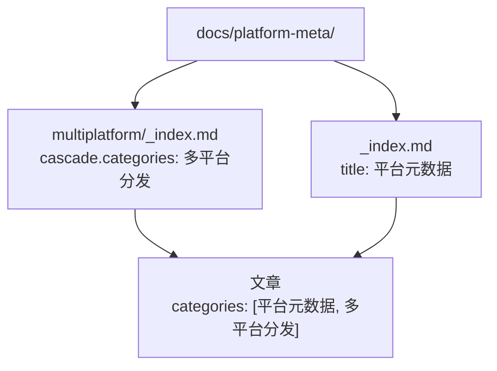
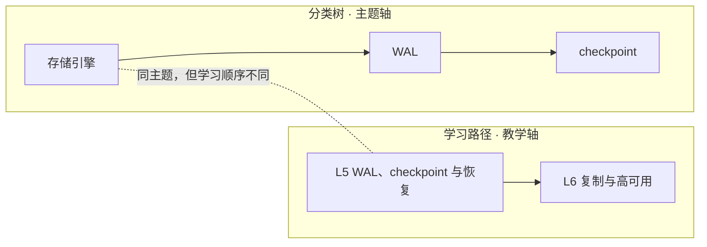

# 分类不是导航，学习路径才是

| 编写人 | 编写时间 | 适用版本 |
| --- | --- | --- |
| growdu | 2026-11-17 | docs/ 631 篇 · 8 条学习赛道 · PostgreSQL 试点已落地 |

一个站有两百篇文章的时候，「分类」就不再是导航了，它只是一个检索框。

这篇讲三件事：**分类树怎么重建**、**学习路径为什么不能跟它合并**、
以及**站点作为「IP 骨架」要补上哪一层**。

---

## 一、开工时的样子

2026-11-17 开工那天，`docs/` 顶层有 39 个目录，每一个都带自己的 `_index.md`，
每一个都会在站点上生成一个中文分类页。算上子目录的级联分类，
站内实际出现过的分类名一共 46 个。

问题不在数量，在体量分布。一级分类里文章最多的三个是
「数据库深入」96 篇、「集群」61 篇、「数据库」60 篇。
点进「数据库深入」，得到的是一堵墙。墙不是不能爬——
爬的人得先知道要爬哪一块。

更麻烦的是这个切法本身。39 个目录是按**学科和工具**切的：
PostgreSQL、Linux、Docker、VPP、DPDK、Go Web、Vue、ChatGPT……
每读一篇，读者都得自己在脑子里重建「这几篇之间是什么关系」。
分类回答了「这篇属于哪一类」，但没回答「接下来读哪一篇」。

这一节是**开工时的快照**，不是现在的样子：方案定下来之后，
第一阶段（PostgreSQL 一条线）已经搬完，现在是 37 个顶层目录、
59 个分类名——见 §八。

---

## 二、为什么改成赛道

2026-11-17 定下的目标结构是**五条赛道加一条副线**：
源码主线（PostgreSQL / Linux / DPDK）、分布式与架构、工程与实践、
人生与思考、平台元数据；「手记」是副线，不算赛道。

决定性理由一句话：**主线是「一个项目一条完整生产线」，
读者跟着项目往下走，学科只作为项目内部的系列存在。**

这里同时有四条明确的「不选」：

- 不按主题领域切——那是学科轴，和读者「跟着一个项目走」的习惯相反；
- 不做双轴（主线 + 存量领域并存）——两套都全，两套都不全；
- 不另发明一张分类策展表——分类是硬要另立一份真相；
- 不靠 front matter 补字段来表示层级——字段表达不了目录结构。

---

## 三、物理目录重排，以及旧方案为什么反对

上一版方案（2026-11-13）写的是：主题与系列只走 front matter，
**绝不动 `docs/` 目录结构**。理由很硬——URL 段直接来自目录结构，
任何以「重整目录」为手段的分类合并都会改 URL，砸掉自然搜索流量。

新方案反其道而行，选了**物理目录重排**。理由是：
URL 自带层级，仓库里一眼看得出结构。

代价由三样东西接住：

1. **重定向表**：旧路径 → 新路径，构建期自动生成；
2. **日期覆写表**：按新路径固化每篇的原日期。这条不是保险，是必需品——
   实测（2026-11-17）当时 620 篇里有 314 篇（50%）的 git 日期与裸 `git log` 不一致，
   它们是批量导入的；不固化的话，按原配方重跑会把一半文章
   重新定到批量导入那一天；
3. **分类转发表**：旧分类 → 新分类，一对一。

这三样在第一阶段都真的用上了：208 条重定向、572 条日期覆写，
旧分类一对一收敛到「源码主线」。

代价也要说清楚：学习路径规则里那些路径前缀匹配，
搬完目录后**全部失效**，必须按新目录重写。这是迁移工作量的大头，
不是复用。

---

## 四、中文分类名怎么长出来

URL 段用英文 slug，显示名用中文。决定性理由很简单：
**URL 里不能有 percent-encoding**。

机制是三步级联：

1. 一级目录的 `_index.md` 写 `title:`，给出这一级的中文名；
2. 祖先目录的 `cascade.categories` 给出子级的名字；
3. 从最近的祖先往上逐级拼链、去重，一级名永远排第一。

Hexo 拿到的是一个列表，它把列表当**层级链**处理：
第 i 个是第 i-1 个的子节点。

最容易踩的坑：新目录只写 `title:` 不写 `cascade.categories`——
二三级分类**静默消失**，文章全挂到一级赛道下，
**没有一个测试会报错**。所以验收不能断言 `_index.md` 里有 `title:`，
要断言那个三级路径页**真的存在**。

---

## 五、分类是检索用的，学习路径才是导航用的

这是本系列真正的分界。

分类树回答「这篇属于哪一类」，读者搜索时用。
学习路径回答「我该按什么顺序读」，读者逛的时候用。
这是两套独立的数据：学习路径有 8 条赛道、37 个阶段、
581 篇语料（575 篇母稿加 6 个视频内容单元）。

匹配有优先级，写反了会出事：

- **先定赛道**：按顺序遍历规则，第一条命中就是它；
  赛道之间互斥，一篇只进一条。
- **再分阶段**：赛道内按顺序贪心分配，先命中先占位。
- 都没中 → 落进兜底阶段。

「先判赛道再判阶段」不是随手写的。反过来先判阶段，
赛道里的兜底会把后面所有赛道的文章全吞掉——这个坑踩过一次，
当时 574 篇全落进了第一条赛道。

「兜底」只是防崩溃，不防偷懒。落进兜底的含义是
「这篇文章没有专属规则」。所以守卫测试钉死兜底吸收 0 篇。

一共四道机制强制「每篇文章都有规则」：兜底必须吸收 0 篇；
未归类即红；渲染层对拍（分类器说这篇在 L7、渲染出的页面没列它，
一样红）；构建期非零退出，直接把整条构建链掐断。

**为什么这两套不能合并。** 赛道是**教学轴**——阶段按「掌握顺序」排；
分类树的三级目录是**主题轴**——按「内容归类」排。
一个「存储引擎」主题合集里，合理的阅读顺序可能是
先看 WAL 再看 checkpoint 再看复制，跟目录的字母序完全不是一回事。

物理顺序 ≠ 学习顺序。合并，就等于逼其中一边扭曲：
要么把主题合集按字母排（教学顺序乱掉），
要么把阶段按主题拆（分类树不再是树）。

顺带一个推论：搬目录时能复用的是
「哪些文件属于哪个教学单元」这层语义，不是 L1–L8 这些编号本身。

---

## 六、给这套结构加一个落地页

分类解决「站内怎么找」，但读者多半不是从站内找来的——
他从搜索引擎落在一篇文章上。这时候站点要回答的是另一组问题：
这是哪一期、还有哪些期、怎么订阅。

2026-11-14 的实测暴露了三个断点：

- 六期里五期的落地链接指向一个不存在的路径，
  而服务器对未知路径返回 HTTP 200 加首页。读者看到的是首页，不是 404。
- 六篇母稿全部上线，0 篇嵌入视频、0 篇提到期号。
  母稿和成片彼此不认识。
- 站点没有订阅入口：feed 里 20 条 entry、0 个 `<enclosure>`。

契约七给了五块东西：期号页；落地 URL 必须派生、不可手写，
并有守卫确保链接真的打得开；证据密度（只检查期号页，不查全站）；
系列页和四处站点入口；播客 feed（enclosure 必须是自己域名下的稳定直链）。

一条容易被忽略的取舍：期号列表只有一个地址 `/videos/`，
不新开 `/podcast/`——**同一份内容不得有两个 URL**。
双 URL 会让搜索引擎把权重劈成两半，也让订阅者不知道该订阅哪个。

还有一个量级：六期母稿合计 266,768 字，口播合计 1,488 字。
被扔掉的 99.4% 再没以任何形式回到观众面前。
这就是为什么站点要做成「IP 骨架」而不只是文章仓库——
文章是原料，观众要的是那个已经被嚼过的结论。

---

## 七、几条不做的事

- **不换渲染框架**——主题补丁脚本已经三千多行，
  换框架等于重写全部定制。
- **不删除任何历史 URL**——靠重定向表接住。
- **不新增阅读时长字段**——主题里已有一个 helper 按字数实时算，
  多一个字段就有两个真相。
- **不新开主题 layout**——一切经主题补丁脚本按标记幂等注入。
- **迁移脚本不进 CI**——迁移是一次性的，CI 每次都是全新检出。

---

## 八、现在的进度

第一阶段已经搬完：`source-tracks/postgresql/` 下 8 个系列、
208 篇发布数（旧 `db/` 94 + `database/` 60 + `pgsql/` 54）搬到了新树上。
旧 URL 由 208 条重定向接住，日期按搬运前的日期固化。

三级路径 `/categories/源码主线/PostgreSQL/存储引擎/` 真的存在——
八个系列都生成了，不是只在 `_index.md` 里写了个 `title:`。

搬家最贵的一课不是重定向，是**站内相对链接**：它是唯一一类
「旧工具查不出来」的断裂。为此新写了一个全站内链检查器，
母稿侧断链从 62 降到 5（剩下 5 条是迁移前就在的误报，逐条核对过），
产物侧 132457 条站内 href 零死链。

分类树现在是 37 个顶层目录、59 个分类名，体量最大的三个一级分类是
「源码主线」216 篇、「集群」62 篇、「人生」42 篇。
学习路径那边，8 个阶段共 214 篇全量落在新树上。

`platform-meta/` 这条赛道是**新增内容**，不参与搬家：
6 个系列的目录骨架与 6 篇成稿都已就位，这篇是信息架构系列的第一篇。

文里的数字都带测量日期。`docs/` 全树 631 篇
（572 篇母稿 + 59 个目录页，另有 3 篇 HTML）、
学习路径语料 581 篇、顶层目录 37 个——这些每天都可能变，
引用时要标日期。

> **2026-11-19 后续**：上面说的分类树（含三级路径 `/categories/源码主线/
> PostgreSQL/存储引擎/`）**整套退休**了 —— 总览页、子页面、文章页上的
> 分类 chip 全删，旧地址跳 `/all/`。分类树不再有页面，只剩**检索维度**：
> 分类链照旧在构建期算出来，学习路径的归类规则与搜索索引照旧读它。
> 上面这段进度记录讲的是 2026-11-17 那天的状态。

---

## 相关阅读

- [一个仓库，三条产线](../L1-platform-overview/one-repo-three-pipelines.md) —
  整体架构与三条不变量
- [从母稿到页面](../L3-build-pipeline/docs-to-public-pipeline.md) —
  分类名是在构建期算出来的
- [内容单元与内容契约](../L2-content-model/content-unit-and-contract.md) —
  字段白名单与推导字段
