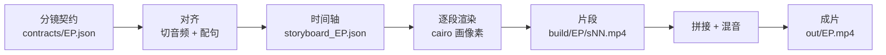

# 画面上写什么，谁说了算

| 编写人 | 编写时间 | 适用版本 |
| --- | --- | --- |
| growdu | 2026-11-17 | 六期成片 · 26 个手写场景模块 · 长视频三档设计待实施 |

文章写完之后，同一份内容还想变成一条视频。

这条线要解决的是：**怎么让「做出一条片子」变成
「半年后换台机器还能再做出一条一样的片子」。**

后者要求每个中间产物要么入库、要么能被精确重建，
而且重建的方式必须写在仓库里，不能靠某个人脑子里的记忆。

---

## 一、先说结论

这条线有三个产物：**分镜契约**、**时间轴**、**成片**。
中间还夹着**片段**。它们的关系是单向的：

契约**入库**（它是这一期的事实）；时间轴**不入库**（能从契约和音频精确重建）；
片段和成片**不入库**（同理）。

入库的是事实，不入库的是产物。

---

## 二、画面上写什么：分镜契约

一期的画面被切成若干**视觉段**，每段对应一组旁白句子和一张画。
契约文件就是这些段的清单。

它只有四个顶层字段：版本号（恒为 1）、期号标识、
**画面标题**、以及视觉段数组。

每个视觉段四个字段：

- `id`：段号，不许重复；
- `renderer`：用哪个 Python 模块画；
- `sentences`：这几句旁白配这张图，**0 起算的下标数组**，不能为空；
- `params`：画面上要写的字和数字，**必须是个对象**。

`params` 里装的东西很具体：标题、副标题、角标；
左右两栏的标签和注解；核数、线程数、倍数这类数字；
还有结构化枚举——四种锁模式的兼容矩阵、位域的名字。

有一处容易搞混：契约里的 `title` 是**画面标题**，不是母版标题。
画面上写「两个事务改同一行，谁先谁后」，母版标题是另一个东西。
这两个值恰好同名但来源不同。

契约里**没有**时间轴。时间是渲染时算的。

---

## 三、参数缺失，当场报错

这是整条线最硬的一条规矩：**参数缺了，当场报错，不许退回硬编码。**

渲染之前会先检查每个场景需要的参数齐不齐。缺了就抛错，
消息里带着是第几个场景，**而且一次性把所有缺项都报出来**——
不是修一个跑一次、报一个。

为什么不能商量？因为**硬编码是一条看不见的路**。

假设某个数字当初写死在场景代码里，后来有人把契约里的这个参数删了
（或者契约换了格式、字段改了名）。如果渲染代码里有一份旧文案的兜底，
画面会**照常渲染出来**——用的是那句旧文案。
没有人收到任何提示，片子能出，字幕也能烧上，文件大小正常。

而技术讲解片里，一句写错的数字比一段空白的画面糟糕得多。
观众看到「32 核」被渲染成「32 概」，他不知道你写错了，
只知道这个博客不可靠。

更糟的是它会**静默地稳定下来**：兜底文案永远在，
每次渲染都用它，每次都「成功」。
要等到有人把那条兜底代码找出来删掉，问题才暴露。

当场报错的意思是：**这件事要么一次做对，要么立刻停**，
没有第三条路。

---

## 四、文案不许回流到代码

这条规矩跟上一条是一对。

规矩是：契约里的文案，**不许以字符串字面量的形式出现在场景代码里**。
有一份测试会解析场景源码，只要发现契约里的文案还留在代码里，测试就红。

为什么？因为一旦文案在代码里也有一份，它就有了**两个真相**。
改文案的人只改了契约，忘了改代码，代码里那份就成了下一个版本的真相。
更隐蔽的是有人为了「省事」直接改代码里的字——那期契约从此和画面对不上，
而画面是给观众看的，契约是给下一期作者看的。

还有一条元测试守着这条守卫本身：确保这个测试**真的能抓到泄漏**。
不然一个永远通过的安全网比没有安全网更危险。

分工原则就这么定了：

| | 放哪 | 谁定 |
| --- | --- | --- |
| 文案、数字、标签、枚举 | 契约 | **每一期**的作者 |
| 位置、尺寸、配色、动效 | 场景代码 | 模板 |

改文案不许动代码，改版式不许塞文案。

---

## 五、契约怎么变成时间轴

时间轴是**算出来的**，不是画出来的。

对齐这一步要做四件事：

1. **读契约**，拿到这一期有几个段、每段配哪几句。
2. **读口播稿和字幕表**——两者分别在一篇文档的两个小节里。
3. **三方句数必须严格相等**：口播的句数、字幕的行数、契约里的句数。
   任一不等立刻报错——差一句，画面和声音就对不上。
4. **切音频**：用静音检测找出有声片段的边界，再把片段和句子配对。
   段数正好等于句数就一一配；不等就走动态规划，
   以「这段文字念出来大概多久」为目标时长，在所有连续分组里挑误差最小的。

然后切视觉段的边界：第一段从 0 开始，其余每段从本段第一句的起点开始，
最后一段一直到音频结束。

时间轴本身有一组校验：第一个场景必须从 0 开始、相邻场景必须严丝合缝、
最后一个场景的终点必须等于音频总时长、画布尺寸必须在调色板允许的范围里、
帧率必须是 24。还有一条最容易被忽略的：**字幕单行视觉宽度不得超过 14**。
中文按 1 算，半角按 0.5 算——字幕是烧进画面的，
一行太长就是字太小，或者出画。

---

## 六、片段：代码画出来的画面

一个视觉段渲染出来是一段**无声的视频**。
片段目录按期分开——各期的段号都从 `s01` 起步，共用会互相覆盖。

画面的画法值得说明：**它既不是视频生成模型，也不是视频渲染引擎，
是代码一笔一笔画出来的。**

流程是：开一块画布 → 逐帧调用场景模块的绘制函数 → 把原始像素喂给编码器。
帧数按场景时长算。

场景模块的形状是一个纯函数：给它画布、当前进度、时间点，
它把这一帧画出来。没有全局状态，所以**可单测、可重放、可并发**——
同一帧永远画出同样的像素。

字幕是**在这一步直接烧进画面**的，不是后期贴上去的。
原因很实际：本机的编码器没编字幕支持库，贴不了。
同时另出一份字幕文件作副产物。

还有一条：调色板里的字体常量在启动时要校验能不能加载，
**加载不了就直接报错退出，不静默降级**。
静默降级在这里等于「画面上的字悄悄变成方框」。

增量渲染靠一组依赖模块的修改时间取最大值：片段比它新就能复用。
这里有个陷阱：**新增一个依赖模块却忘了登记**，
后果是「改了它画面没变」，而且**没有任何报错**——
片段被判定为可复用，跳过重渲。

---

## 七、成片：拼接与混音

成片这一步做三件事：把片段按顺序拼成无声整片；
把旁白、品牌片音轨和背景音乐在同一个滤镜图里对齐混音；
再编码。

品牌片音轨比旁白长，要延后对齐再混；
背景音乐在旁白出现的地方要**闪避**（压低），
不然人声会被盖住。混完统一成 48 kHz 立体声，
并加「前置索引」标记——不这么做，手机端要等整片下完才起播。

编码参数里有一个数字是被平台逼出来的：
**关键帧间隔定死 10 秒**。B 站的接口文档要求关键帧至少 10 秒一个，
而分段渲染会让段边界拉长间隔——实测有一期的最大间隔是 10.417 秒，超标。
所以不是「挑一个好看的编码参数」，是**照着平台的门槛定参数**。

成片出三个文件：带品牌的正片、横版无品牌版、竖版 1080×1920 版。

---

## 八、为什么不用视频生成模型

这条线最早的做法，是**整片交给视频生成模型**。

算完账就放弃了。按 2K 画质实测，生成大约 120 积分/秒，
一条 35 秒的片子就是 4200 积分。而技术讲解片的主体恰恰是技术图示——
数据流、线程拓扑、核数对比。

三条否决理由：

1. **用规则描述最准确，用模型生成最容易出错。**
2. **文字和数字一旦生成错，没法撤回。** 视频模型不给你回滚粒度。
3. **改一句话要重生成整段，成本按秒计。**

于是改成「技术图示全代码绘制，模型只出静态底板」：

| | 整片交给模型 | 现在的做法 |
| --- | --- | --- |
| 画面里的文字数字 | 模型生成 | 代码绘制，零模型生成 |
| 改一处文案 | 重生成整段 | 只重渲一个场景 |
| 返修粒度 | 整片 | 单个场景文件 |

连三秒的品牌片头也不用视频生成——那个模型最短只能出 4 秒。
所以品牌片改成「模型出静态背景底板 + 代码合成角色与文字」。

---

## 九、下一站：长视频的三档

现在的六期全是 35 秒左右的**精简版**。长视频的设计已经定了，
但**还没实施**——骨架目录、解析器、生成器都不存在。

三档的阈值是这样定的。语速取 **7.19 字/秒**（六期实测均值）：

| 档位 | 时长 | 口播字数 | 母稿散文覆盖 | 压缩比上限 |
| --- | --- | --- | --- | --- |
| 精简版 | ≤ 60 秒 | ≤ 431 | 一个反直觉结论 + 一个数字 | ≤ 100:1 |
| 进阶版 | 300 ~ 600 秒 | 2,157 ~ 4,314 | 主线机制链路 | ≤ 12:1 |
| 完整版 | ≥ 600 秒 | ≥ 4,314 | 散文全读 | ≤ 1.5:1 |

压缩比这一列有个细节：分子用的是**母稿散文**，不是母稿全文。
代码和表格在成片里是**画面**，不是被念出来的字——
把它们算进「被扔掉的比例」是错的。

母稿先被机器解析成骨架，再按每个段落的角色裁剪成三档。
角色只有五种：钩子、机制、证据、结论、旁白。
精简版是钩子加结论，进阶版加上机制和证据，完整版全要。

其中一条设计要特别提：**不做自动裁剪。**
裁剪结果落不进字数区间，守卫就报红，由人改角色标记。
因为自动裁剪和「不静默截断」直接冲突——
自动裁出来的稿子读起来会莫名其妙地断在半句话上，
而没人知道为什么。宁可报红让人看一眼。

验收标准定得很死：迁移前后同一期的分镜文件必须**逐字节一致**。

---

## 十、现在的进度

六期成片全部完成，混音验收全合格。视频侧的状态快照有 18 份，其中 3 份已发布。

有个口径要提醒：口播「字数」有两个算法——
规格用的是去掉空白的字符数（六期 241~256），
各期口播稿自己写的那行数字是另一个口径（260~275）。
引用时要说清是哪个。

---

## 相关阅读

- [一个仓库，三条产线](../L1-platform-overview/one-repo-three-pipelines.md) —
  视频线在整体架构里的位置
- [多平台分发](../L5-multiplatform/capability-model-and-publishing-pipeline.md) —
  视频成品怎么变成各平台的投稿包
- [信息架构](../L4-info-architecture/category-restructure-and-learning-path.md) —
  母稿和成片怎么在站点上绑成一期
