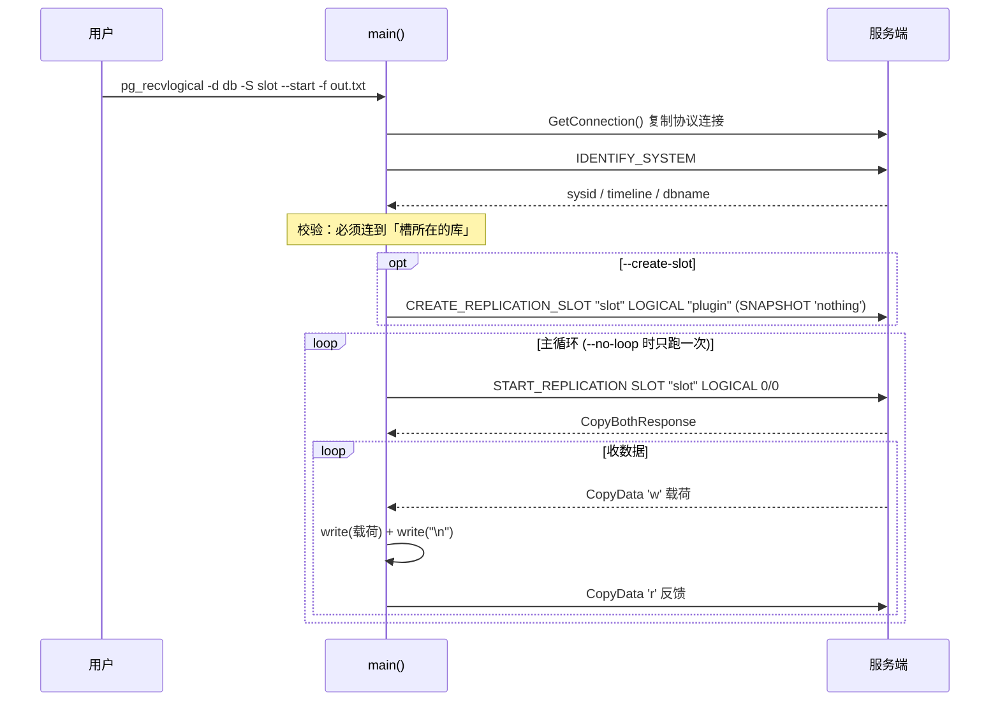
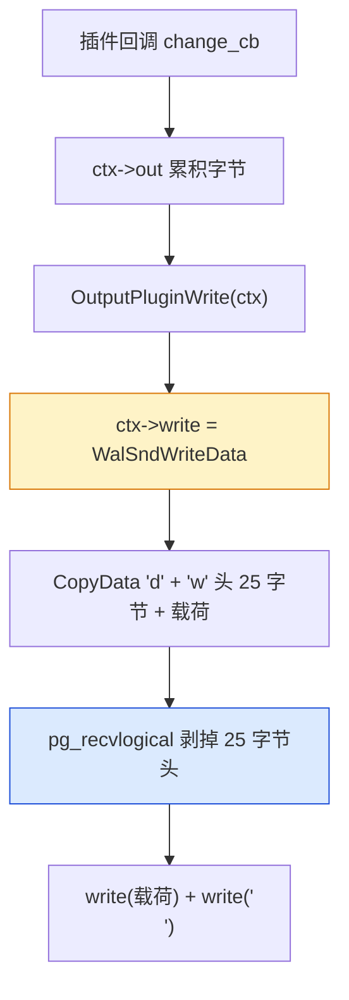
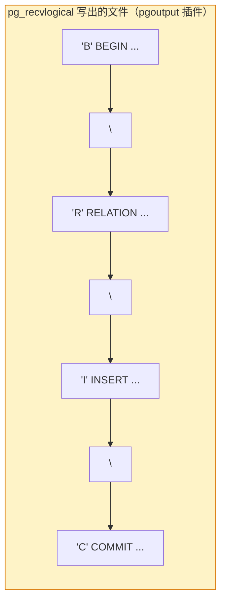
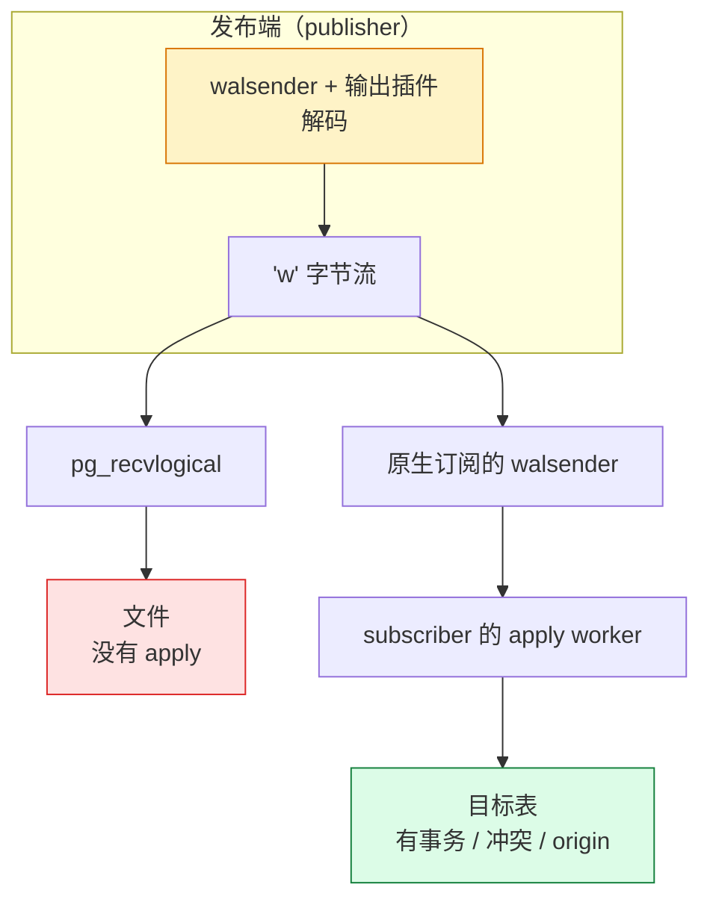

# pg_recvlogical 源码解析：逻辑解码的「只读消费者」

| 编写人 | 编写内容 | 编写时间 |
| --- | --- | --- |
| growdu | 把 `pg_recvlogical.c` 1069 行拆成「参数 → 建槽 → START_REPLICATION → 收 'w' → 落文件 → 回 'r' → 重连」七段，每段对上服务端 `walsender.c` 的对应函数与复制槽状态字段；最后回答一个最容易被问倒的问题：**它和完整的逻辑复制到底差在哪？** | 2026-11-26 |

本文要回答的问题只有一个：**`pg_recvlogical` 到底在做什么，它凭什么能拿到逻辑解码的字节流，以及它和 `CREATE SUBSCRIPTION` 那套「完整逻辑复制」差在哪里？**

> 源码版本：PostgreSQL **17.4**（`/work/cwork/postgresql`，`git describe` = `REL_17_4-116-g5c5cae52697`）。
>
> ⚠️ **这棵树不是原版 17.4**：它在 `REL_17_4` 之上多了 116 个本地提交，加入了「并行逻辑解码」特性（新增 `src/backend/replication/logical/parallel_decode*.c`，并把上游 `StartLogicalReplication()` 拆成 `StartSerialLogicalReplication()` / `StartParallelLogicalReplication()`）。本文行号均以**这棵树**为准；关键符号在**原版 REL_17_4** 里的行号对照见第九节末尾的表。`proto.c`、`src/include/replication/logical.h` 的 writer API 以及 `bin/pg_basebackup/pg_recvlogical.c` 则是**逐字节等同上游**的（`logical.h` 的 `LogicalDecodingContext` 结构体除外——fork 往里加了并行解码用的字段）。
>
> 同系列前文：
>
> - [PostgreSQL 逻辑复制全链路：以一个真实事务为例，从 `INSERT` 到 `apply` 的源码级旅程](../postgresql-logical-replication-end-to-end-flow/index.html)
> - [PostgreSQL 逻辑复制的 ReorderBuffer 与事务机制](../postgresql-logical-replication-reorderbuffer-transaction/index.html)
> - [PostgreSQL 逻辑复制的 Worker 模型：一个 apply worker 撑全场](../postgresql-logical-replication-worker-model/index.html)

## 阅读指南

本文分四段，难度递增：

1. **只看结论**：第一节的定位 + 第十节的对照表 + 第十一节的「三种取数方式怎么选」，10 分钟能建立正确的心智模型。
2. **读客户端**：`pg_recvlogical.c` 的七段拆解（第三、四节）。
3. **读服务端**：`walsender.c` 那一侧发生了什么（第五节）。
4. **读差异**：第六节把「完整逻辑复制」该有的东西逐条对照出来，缺哪一条、为什么缺、缺了会怎样。

---

## 一、定位：它是逻辑解码的「只读消费者」

一句话：**`pg_recvlogical` 把发布端逻辑解码出来的字节流，原封不动地写成本地文件——它解码，但从不落库。**

这句话里有三个关键词，缺一不可：

- **解码**：WAL → 逻辑变更这件事发生在**发布端的 walsender** 里，不是客户端做的。客户端只是接收。
- **字节流**：它拿到的是**输出插件（output plugin）产生的原始字节**，不做任何语义解析。插件是 `test_decoding` 就得到人读的文本，插件是 `pgoutput` 就得到二进制的复制协议。
- **不落库**：它没有 apply worker，不会执行任何 SQL，不会维护目标表，不会处理冲突。文件写完就完事。


它和另外两个「取逻辑变更」的方式并列，构成 PostgreSQL 的三种取数姿势：

| 方式 | 客户端 | 拿到什么 | 谁来 apply |
| --- | --- | --- | --- |
| `pg_recvlogical` | 本工具 | 输出插件的原始字节 → 文件 | **没人**，你自己 |
| `pg_logical_slot_get_changes()` | SQL 函数 | `(lsn, xid, data)` 三列的结果集 | **没人**，你自己 |
| `CREATE SUBSCRIPTION` | PostgreSQL 自己 | pgoutput 协议 | subscriber 的 apply worker |

第三行才是「完整逻辑复制」——**多出来的那个 apply worker，就是 `pg_recvlogical` 缺的那一整块**。

### 1.1 前史：它是从 pglogical 项目里「掉队」的那个客户端

`git log --follow src/bin/pg_basebackup/pg_recvlogical.c` 的最后一条是：

```text
8bdd12bbf09 Add pg_recvlogical, a tool to receive data logical decoding data.
```

提交者是 **Robert Haas**（时任 2ndQuadrant），时间是 **2014 年 3 月**。这个工具原本是 **pglogical** 扩展项目的配套客户端——pglogical 想做「逻辑复制中间件」，需要能把逻辑解码流抽出来喂给别的系统，于是先做了这个工具。

**PG 9.4** 就把它作为 `src/bin/pg_basebackup/` 下的一个独立程序收进核心（和 `pg_basebackup`、`pg_receivewal` 同一个目录），pglogical 本身则留在扩展里。

这个出身解释了很多事：

- 它的默认插件是 `test_decoding`（`pg_recvlogical.c:61`），而不是 `pgoutput`——因为它诞生时 `pgoutput` 还没进核心（PG10 才加）。
- 它**从来就不打算 apply**——apply 是 pglogical 的活儿。
- 它只有 `--start`，没有订阅、没有建表同步、没有冲突处理。

> 顺带一提：`pg_recvlogical` 属于 core 里的「contrib 之外的用户可见程序」，但**不在 `src/contrib/` 里**——它在 `src/bin/pg_basebackup/`，编译产物和 `pg_basebackup` 放一起（`/work/cwork/postgresql/build/src/bin/pg_basebackup/pg_recvlogical`）。PG 19 的 master 树（`/work/cwork/postgresql_2`，19.0）里位置未变。

---

## 二、程序骨架：一个只有两个动作的小工具

`pg_recvlogical` 的命令行只有一个真动作：**`--start`**（拉流），另外两个是槽管理（`--create-slot` / `--drop-slot`）。

### 2.1 参数全景

全部选项定义在 `pg_recvlogical.c:694-723`，语义分四组：

| 组 | 选项 | 默认 | 源码位置 |
| --- | --- | --- | --- |
| 动作 | `--create-slot` / `--drop-slot` / `--start` | 无（**必须至少给一个**） | `:838-849` |
| 动作 | `--if-not-exists` | false | `:848` |
| 取数 | `--plugin=PLUGIN` | **`test_decoding`** | `:61`, `:824` |
| 取数 | `--option=NAME[=VALUE]` | 无，可重复 | `:804-822` |
| 取数 | `--startpos` / `--endpos` | `0/0`（= Invalid） | `:794-803` |
| 取数 | `--two-phase` | false（**只能配 `--create-slot`**） | `:768`, `:921-926` |
| 落盘 | `--file=FILE`（`-` 表示 stdout） | **必填**（配 `--start` 时） | `:755`, `:879-884` |
| 落盘 | `--fsync-interval=SECS` | 10 秒 | `:758-763` |
| 保活 | `--status-interval=SECS` | 10 秒 | `:827-832` |
| 行为 | `--no-loop` | false（断线后重连） | `:765` |
| 行为 | `--verbose` | false | `:771` |

几条重要的**参数互斥与前置校验**（`pg_recvlogical.c:869-926`）。PG 17 里这些校验用的是 `pg_log_error()` + `exit(1)`，错误正文之外还跟一句 `pg_log_error_hint()` 的 `--help` 提示（`pg_fatal()` 在 PG 17 仍是现行 API，本文件后面也还在用它）：

```c
	if (replication_slot == NULL)
	{
		pg_log_error("no slot specified");
		pg_log_error_hint("Try \"%s --help\" for more information.", progname);
		exit(1);
	}

	if (do_start_slot && outfile == NULL)
	{
		pg_log_error("no target file specified");
		...
		exit(1);
	}

	if (!do_drop_slot && !do_create_slot && !do_start_slot)
	{
		pg_log_error("at least one action needs to be specified");
		...
		exit(1);
	}

	if (do_drop_slot && (do_create_slot || do_start_slot))
	{
		pg_log_error("cannot use --create-slot or --start together with --drop-slot");
		...
		exit(1);
	}

	if (startpos != InvalidXLogRecPtr && (do_create_slot || do_drop_slot))
	{
		pg_log_error("cannot use --create-slot or --drop-slot together with --startpos");
		...
		exit(1);
	}

	if (endpos != InvalidXLogRecPtr && !do_start_slot)
	{
		pg_log_error("--endpos may only be specified with --start");
		...
		exit(1);
	}

	if (two_phase && !do_create_slot)
	{
		pg_log_error("--two-phase may only be specified with --create-slot");
		...
		exit(1);
	}
```

其中 `--two-phase` 的限制值得注意：**两阶段提交是槽的属性，不是连接的属性**。所以你只能在建槽那一刻决定「这个槽要不要解码 PREPARED TRANSACTION」，事后没法改（除非 `ALTER_REPLICATION_SLOT`）。

### 2.2 启动序列

`main()` 的骨架（`pg_recvlogical.c:691-1015`）：



三个细节：

1. **必须用复制协议连接**：`GetConnection()`（`streamutil.c:63`）连的是 `replication=database` 的库级连接。`RunIdentifySystem()`（`pg_recvlogical.c:952`）之后有一句硬校验——`db_name == NULL` 就 `pg_fatal("could not establish database-specific replication connection")`。因为**逻辑槽是库级的**，连错库服务端会直接拒绝。
2. **`--create-slot` 之后不会自动 `--start`**：`pg_recvlogical.c:987` 建完槽把 `startpos` 重置成 Invalid，`:990` 判断 `if (!do_start_slot) exit(0);`——所以 `--create-slot` 和 `--start` 要么分两次跑，要么写在同一条命令里（`--create-slot --start` 是合法的）。
3. **`--drop-slot` 不需要连库**：`pg_recvlogical.c:886` 的校验是 `if (!do_drop_slot && dbname == NULL)`，删槽不需要指定库。

### 2.3 建槽：SNAPSHOT 'nothing' 是有意为之

建槽走的是 `streamutil.c:655` 的 `CreateReplicationSlot()`，拼出来的是：

```sql
CREATE_REPLICATION_SLOT "slot" LOGICAL "test_decoding" (SNAPSHOT 'nothing')
```

`SNAPSHOT 'nothing'` 这一行在 `streamutil.c:696-703`，注释写得很直白：

```c
			/* pg_recvlogical doesn't use an exported snapshot, so suppress */
```

翻译过来：**`pg_recvlogical` 不提供导出快照（exported snapshot）给客户端**。

这条限制有实际后果。逻辑解码建快照要回答的问题是「我发给你的这些变更，对应的是哪个时刻的表结构」。`pg_recvlogical` 不要这个快照，所以它拿到的字节流里**只有变更本身，没有「变更发生时的 schema 快照」**。

- `test_decoding` 会把列名、列类型都打出来（`table public.t: INSERT: id[integer]:4 data[text]:'4'`），消费者自己看得懂，不依赖快照。
- `pgoutput` 协议里有一条 `R`（RELATION）消息描述列布局——但那是**增量**下发的：某个表第一次出现在流里时才发一次，不是全量 schema 快照。
- 真正需要「完整初始快照」的消费者（比如要把整个库灌进 Kafka / 数据湖），`pg_recvlogical` **给不了**，得自己另外做一次全量导出（`pg_dump`、或者用 `pg_logical_slot_peek_changes` 之外的手段）。

而原生逻辑复制里，**subscriber 的 tablesync worker 会自动做这件事**——它用 COPY 协议把每张表的全量数据同步过去，schema 由 DDL 自己保证。这是「完整逻辑复制」相对 `pg_recvlogical` 最大的功能缺口之一（详见第六节）。

### 2.4 拉流：START_REPLICATION SLOT ... LOGICAL

`StreamLogicalLog()`（`pg_recvlogical.c:213`）拼出的第一条命令是（`:245`）：

```sql
START_REPLICATION SLOT "my_slot" LOGICAL 0/0
```

后面如果给了 `--option`，会追加成 `("opt1", 'val1', "opt2")`（`:249-267`），这些就是传给输出插件的启动选项。

服务端在 `walsender.c:1472` 的 `StartLogicalReplication()` 里处理这条命令，**这棵树（fork）**会在里面分叉——原版 REL_17_4 的 `StartLogicalReplication()` 没有这段：

```c
	/*
	 * The decision between the two decoding paths.
	 *
	 * Parallel decoding and streaming are bound together: the parallel path
	 * ships the changes of a transaction as stream segments, and only a
	 * subscriber that applies them in parallel is served that way.  A
	 * subscriber that asked for streaming='on', or that did not ask for
	 * streaming at all, takes the serial path.
	 */
	if (ParallelDecodeEnabled() &&
		ParallelDecodeSubscriberAppliesInParallel(cmd->options))
	{
		StartParallelLogicalReplication(cmd);
	}
	else
	{
		StartSerialLogicalReplication(cmd);
	}
```

`pg_recvlogical` 不传 `streaming` 选项、也不是并行 apply 的订阅者，所以**永远走 serial 路径**（`walsender.c:1548`）：

```c
	logical_decoding_ctx =
		CreateDecodingContext(cmd->startpoint, cmd->options, false,
							  XL_ROUTINE(...),
							  WalSndPrepareWrite, WalSndWriteData,
							  WalSndUpdateProgress);
	xlogreader = logical_decoding_ctx->reader;

	WalSndSetState(WALSNDSTATE_CATCHUP);

	/* Send a CopyBothResponse message, and start streaming */
	SendCopyBothResponse();

	/* Start reading WAL from the oldest required WAL. */
	XLogBeginRead(logical_decoding_ctx->reader,
				  MyReplicationSlot->data.restart_lsn);

	/* Main loop of walsender */
	RunLogicalReplicationSession(XLogSendLogical);
```

这里有三个点值得记：

- **`cmd->startpoint` 就是客户端给的 LSN**（`0/0` = Invalid）。它的实际作用见 5.2 节——**基本上是被服务端忽略的**。
- **读 WAL 的起点是 `restart_lsn`，不是客户端要的 LSN**。`restart_lsn` 是槽必须保留的最老 WAL 位置。
- **walsender 是个「发送框架」**：真正的解码循环是 `RunLogicalReplicationSession(XLogSendLogical)`，`XLogSendLogical` 才是逐条读 WAL、喂给解码器、再调插件写出的那个函数。

### 2.5 收数据：只认两种消息头

主循环在 `pg_recvlogical.c:283` 的 `while (!time_to_abort)`。每轮先干三件事，再去读 socket：

1. **到期就 fsync**（`:304-310`）：`feTimestampDifferenceExceeds(output_last_fsync, now, fsync_interval)` 成立就 `OutputFsync()`。
2. **到期就发反馈**（`:312-321`）：`standby_message_timeout`（默认 10 秒）到点就 `sendFeedback(conn, now, true, false)`。这个 `force=true` 是必须的——否则 `wal_sender_timeout` 会因为收不到客户端反馈而把 walsender 干掉。
3. **处理 SIGHUP 轮转**（`:324-332`）：收到 SIGHUP 就 fsync + close，文件句柄置 -1，下一轮重新 open。

然后 `PQgetCopyData(conn, &copybuf, 1)`。返回 0 表示暂时没数据，走 `select()` 超时等待（`:359-440`）；返回 -1 表示流结束，退出循环。

拿到数据后，**只认两种首字节**：

```c
		/* Check the message type. */
		if (copybuf[0] == 'k')
		{
			/* keepalive：解析 walEnd、sendTime、replyRequested */
			...
		}
		else if (copybuf[0] != 'w')
		{
			pg_log_error("unrecognized streaming header: \"%c\"", copybuf[0]);
			goto error;
		}
```

- **`k`（Keepalive）**：8 字节 walEnd + 8 字节 sendTime + 1 字节 replyRequested。客户端只关心两件事：把 `walEnd` 记进 `output_written_lsn`（`:469`），以及在服务端要求回复时回一个反馈（`:494-499`）。
- **`w`（XLogData）**：25 字节头 + 载荷。

  ```c
		hdr_len = 1;			/* msgtype 'w' */
		hdr_len += 8;			/* dataStart */
		hdr_len += 8;			/* walEnd */
		hdr_len += 8;			/* sendTime */
		...
		/* Extract WAL location for this block */
		cur_record_lsn = fe_recvint64(&copybuf[1]);
  ```

  `dataStart` 是**这段载荷对应的 WAL 位置**，客户端把它记进 `output_written_lsn`（`:548`），它是后面反馈和 `--endpos` 判断的依据。

**这里有个重要的事实**：`pg_recvlogical` 认识的流复制层消息只有 `k` 和 `w`。逻辑复制协议里那些 `B`/`C`/`I`/`U`/`D`/`R`… **不是流复制层的消息头，而是 `w` 载荷里的第一个字节**（下一节展开）。所以「`pg_recvlogical` 不支持 pgoutput」是个误解——它支持，只是它把载荷当黑盒字节流处理。

### 2.6 落盘：载荷 + 一个换行

写文件的代码非常朴素（`pg_recvlogical.c:556-581`）：

```c
		while (bytes_left)
		{
			ret = write(outfd, copybuf + hdr_len + bytes_written, bytes_left);
			...
		}

		if (write(outfd, "\n", 1) != 1)
		{
			pg_log_error("could not write %d bytes to log file \"%s\": %m", 1, outfile);
			goto error;
		}
```

**每个 `w` 载荷后面补一个 `\n`**。这一行代码决定了后面所有格式相关的结论：

| 插件 | 一个 `w` 载荷的内容 | 文件里的样子 |
| --- | --- | --- |
| `test_decoding` | 一行文本（`BEGIN 693` / `table public.t: INSERT: ...` / `COMMIT 693`） | **正好一行一段**，人直接读 |
| `pgoutput` | 一条逻辑复制协议消息（`B` / `O` / `Y` / `R` / `I` / `U` / `D` / `T` / `C` …） | **二进制消息之间插了一个 `\n`**——不是合法协议流，需要自己剥掉 |

**关键机制**：`OutputPluginPrepareWrite()` + `OutputPluginWrite()` 这一对调用，**恰好产生一个 `w` 消息**。看 `logical.c:774-795`：

```c
void
OutputPluginPrepareWrite(struct LogicalDecodingContext *ctx, bool last_write)
{
	if (!ctx->accept_writes)
		elog(ERROR, "writes are only accepted in commit, begin and change callbacks");

	ctx->prepare_write(ctx, ctx->write_location, ctx->write_xid, last_write);
	ctx->prepared_write = true;
}

void
OutputPluginWrite(struct LogicalDecodingContext *ctx, bool last_write)
{
	if (!ctx->prepared_write)
		elog(ERROR, "OutputPluginPrepareWrite needs to be called before OutputPluginWrite");

	ctx->write(ctx, ctx->write_location, ctx->write_xid, last_write);
	ctx->prepared_write = false;
}
```

而 `prepare_write` 回调（walsender 侧的 `PDPrepareWrite`，`walsender.c:1719`）会**重置** `ctx->out` 并写入 25 字节的 `'w'` 头：

```c
	resetStringInfo(ctx->out);

	pq_sendbyte(ctx->out, 'w');
	pq_sendint64(ctx->out, lsn);	/* dataStart */
	pq_sendint64(ctx->out, lsn);	/* walEnd */
	pq_sendint64(ctx->out, 0);	/* sendtime (filled later) */
```

所以「一次 Prepare+Write = 一个 `w` 消息 = 文件里的一行」这条链是通用的，插件之间没有区别：

- `test_decoding`：`pg_decode_begin_txn`（`test_decoding.c:287`）、`pg_decode_change`（`:600`）、`pg_decode_commit_txn`（`:319`）各自 Prepare+Write 一次 → 文件里 BEGIN 一行、每条变更一行、COMMIT 一行。
- `pgoutput`：`pgoutput_send_begin`（`pgoutput.c:589`）、`pgoutput_change`（`:1449`）、`pgoutput_commit_txn`（`:611`）同样各自 Prepare+Write 一次 → **每条逻辑复制协议消息各占一行**。

所以：

- 用 `test_decoding` 时，文件里的**事务边界是显式的**（`BEGIN <xid>` / `COMMIT <xid>` 两行），消费者可以自己判断事务完整性。
- 用 `pgoutput` 时，文件里是**一条条二进制协议消息**，每条后面跟一个 `\n`。消费者要自己按消息类型（`B`/`C`/`I`…）重新对齐，把 `\n` 当噪声跳过——**这个 `\n` 不属于协议**。

> 顺带一提：`pg_recvlogical` 写 stdout 时（`-f -`）**不会** fsync（`pg_recvlogical.c:200` 的 `if (!output_isfile) return true;`），因为管道/tty 上 fsync 没有意义。这是 2015 年 commit `5c0de384d2c` 修的。

### 2.7 反馈：把「文件落盘」和「槽推进」绑在一起

这是整个工具**最关键**的一段机制，在 `pg_recvlogical.c:126-175` 的 `sendFeedback()`：

```c
	replybuf[len] = 'r';
	len += 1;
	fe_sendint64(output_written_lsn, &replybuf[len]);	/* write */
	len += 8;
	fe_sendint64(output_fsync_lsn, &replybuf[len]); /* flush */
	len += 8;
	fe_sendint64(InvalidXLogRecPtr, &replybuf[len]);	/* apply */
	len += 8;
	fe_sendint64(now, &replybuf[len]);	/* sendTime */
	len += 8;
	replybuf[len] = replyRequested ? 1 : 0; /* replyRequested */
	len += 1;

	startpos = output_written_lsn;
```

三个要点：

**（1）`apply` 恒为 `InvalidXLogRecPtr`。** 物理复制的备库有「重放位置」这个概念，逻辑复制没有——`pg_recvlogical` 从不重放任何东西。

**（2）`flush` 报的是 `output_fsync_lsn`，不是 `output_written_lsn`。** 二者的关系在 `OutputFsync()`（`:184-207`）里：

```c
static bool
OutputFsync(TimestampTz now)
{
	output_last_fsync = now;
	output_fsync_lsn = output_written_lsn;   /* ← fsync 到哪，flush 就报哪 */
	...
	if (fsync(outfd) != 0)
		pg_fatal("could not fsync file \"%s\": %m", outfile);
	return true;
}
```

也就是说：**只有文件真正 fsync 到盘了，客户端才告诉服务端「我这块数据安全了」**。这是端到端持久性保证的锚点。

**（3）服务端拿这个 flush 位置推进复制槽。** `walsender.c:2680-2687`：

```c
	/*
	 * Advance our local xmin horizon when the client confirmed a flush.
	 */
	if (MyReplicationSlot && flushPtr != InvalidXLogRecPtr)
	{
		if (SlotIsLogical(MyReplicationSlot))
			LogicalConfirmReceivedLocation(flushPtr);
		else
			PhysicalConfirmReceivedLocation(flushPtr);
	}
```

`LogicalConfirmReceivedLocation()`（`logical.c:1902`）做三件事：

1. `MyReplicationSlot->data.confirmed_flush = lsn;` —— **槽的「已确认消费位置」**。
2. 如果 `candidate_xmin_lsn <= lsn`，把候选的 catalog_xmin 落盘（`ReplicationSlotMarkDirty` + `ReplicationSlotSave`），并推进全局 xmin 地平线。
3. 如果 `candidate_restart_valid <= lsn`，把候选的 restart_lsn 落盘。

`confirmed_flush` 和 `restart_lsn` 这两个字段决定了：

- **WAL 什么时候可以被回收/删除**——`restart_lsn` 之前的 WAL 不用再留。
- **槽可以什么时候被安全删除**——`confirmed_flush` 之后的变更你已经拿到了。

所以 `pg_recvlogical` 的持久性链条是：


**这条链反过来也解释了 `--fsync-interval` 的意义**：它是「WAL 最多被多留多久」的旋钮。默认 10 秒意味着客户端最多滞后 10 秒才确认，槽的 `restart_lsn` 最多滞后 10 秒前进 → **磁盘上最多多留 10 秒的 WAL**。

如果你的 WAL 写得快（比如 1GB/s），10 秒就是 10GB 的额外占用。调小它能省 WAL，代价是 fsync 更频繁。

### 2.8 断线重连

主循环（`pg_recvlogical.c:994-1014`）：

```c
	while (true)
	{
		StreamLogicalLog();
		if (time_to_abort)
			exit(0);          /* Ctrl-C / 到达 --endpos：正常退出 */
		else if (noloop)
			pg_fatal("disconnected");
		else
		{
			pg_log_info("disconnected; waiting %d seconds to try again", RECONNECT_SLEEP_TIME);
			pg_usleep(RECONNECT_SLEEP_TIME * 1000000);
		}
	}
```

`RECONNECT_SLEEP_TIME` 是 5 秒（`:33`）。重连时会用 `startpos = output_written_lsn`（在 `sendFeedback` 里赋的，`:163`）重新发 `START_REPLICATION`。

**这里有个容易看漏的细节**：服务端并不会因为你报了更高的 LSN 就从那儿开始发。`CreateDecodingContext()`（`logical.c`）里对 `start_lsn` 的处理是：

```c
	if (start_lsn == InvalidXLogRecPtr)
	{
		/* continue from last position */
		start_lsn = slot->data.confirmed_flush;
	}
	else if (start_lsn < slot->data.confirmed_flush)
	{
		elog(LOG, "%X/%X has been already streamed, forwarding to %X/%X", ...);
		start_lsn = slot->data.confirmed_flush;
	}
```

- `0/0`（Invalid）→ 用 `confirmed_flush` 续传。
- 比 `confirmed_flush` 小 → 打一条 LOG，然后**向上跳到** `confirmed_flush`。
- 比 `confirmed_flush` **大** → 原样使用。

所以重连时 `startpos = output_written_lsn`（≥ confirmed_flush）意味着：**服务端从这个位置之后开始流**。而 `output_written_lsn` 之后的数据客户端已经落盘了，所以不会重复也不会丢——**前提是文件里的数据在断线时是完整的**。

> ⚠️ 但这里有个真实的坑：客户端把数据 `write()` 到页缓存就算「已写」，`output_written_lsn` 立刻前进；而 `confirmed_flush` 要等 fsync。如果客户端进程在这中间被 `kill -9`，文件里可能有还没落盘的数据，而**槽的 `confirmed_flush` 停在那之前**——重连后服务端从 `confirmed_flush` 之后开始发，中间这一段在文件里是残缺的。消费端必须能处理「文件末尾有半截事务」这种情况。

### 2.9 `--endpos`：跑完就停

`--endpos` 让工具在指定 LSN 处优雅退出（`:535-546`、`:583-591`）。判定有两种：

- 收到 `w` 消息且 `cur_record_lsn > endpos` → 停（`STREAM_STOP_END_OF_WAL`）。
- 收到 `k` keepalive 且 `walEnd >= endpos` → 停（`STREAM_STOP_KEEPALIVE`）。

停之前会 `flushAndSendFeedback()`（fsync + 反馈），然后 `prepareToTerminate()` 发 `CopyDone` 告诉服务端「我收够了」（`:1042-1069`）。这是把一个槽**抽干**（drain）再退出的正确姿势，也是 `t/030_pg_recvlogical.pl` 里测试的用法。

---

## 三、服务端一侧：walsender 到底干了什么

客户端看得见的是文件，看不见的是解码。补上服务端这一半，才能理解「槽」在整套机制里的角色。

### 3.1 输出插件 API：解码结果怎么变成字节

解码上下文 `LogicalDecodingContext`（`src/include/replication/logical.h:33`）里有三组东西：

```c
	/* User specified options */
	List	   *output_plugin_options;

	/*
	 * User-Provided callback for writing/streaming out data.
	 */
	LogicalOutputPluginWriterPrepareWrite prepare_write;
	LogicalOutputPluginWriterWrite write;
	LogicalOutputPluginWriterUpdateProgress update_progress;

	/* Output buffer. */
	StringInfo	out;
```

而 `OutputPluginCallbacks`（`src/include/replication/output_plugin.h:216`）是插件要实现的回调表：

| 回调 | 什么时候被调 | 典型实现 |
| --- | --- | --- |
| `startup_cb` | 解码开始时一次，可以改 `options`（如 `output_type`） | pgoutput 解析 `publication_names` |
| `begin_cb` | 每个事务开始 | 输出 `BEGIN` |
| `change_cb` | 每条 INSERT/UPDATE/DELETE | 输出变更 |
| `truncate_cb` | TRUNCATE | 输出 `T` 消息 |
| `commit_cb` | 每个事务提交 | 输出 `COMMIT` |
| `message_cb` | `pg_logical_emit_message` | 输出 `M` 消息 |
| `filter_by_origin_cb` | 按复制来源过滤 | pgoutput 用它防回环 |
| `stream_*_cb` | streaming 模式（PG14+） | 流式传输进行中的事务 |
| `*_prepare_cb` 等 | 两阶段提交 | `PREPARE` / `COMMIT PREPARED` |

插件的入口是固定符号 `_PG_output_plugin_init`，`LoadOutputPlugin()` 按**槽里记的插件名**去加载（`logical.c` 的 `StartupDecodingContext`）：

```c
	/*
	 * (re-)load output plugins, so we detect a bad (removed) output plugin
	 * now.
	 */
	if (!fast_forward)
		LoadOutputPlugin(&ctx->callbacks, NameStr(slot->data.plugin));
```

**插件名存在槽里**——这就是文档里那句「The stream format is determined by the output plugin specified when the slot was created」的实现。

建槽时 `CREATE_REPLICATION_SLOT ... LOGICAL "pgoutput"` 把插件名写进 `pg_replication_slots.plugin`，之后 `pg_recvlogical --start` 用什么插件都不重要了。

### 3.2 三个 writer 回调：解码结果怎么变成 'w' 消息

插件不直接碰 socket。它把字节写进 `ctx->out`（一个 `StringInfo`），然后调 `OutputPluginPrepareWrite()` / `OutputPluginWrite()`。

这两个函数在 `logical.c` 里，最终落到 `ctx->write` 回调——walsender 传进来的正是 `WalSndPrepareWrite` / `WalSndWriteData`（`walsender.c:1562-1563`）。

`WalSndWriteData`（`walsender.c:1760`）干的事：

```c
	resetStringInfo(&tmpbuf);
	now = GetCurrentTimestamp();
	pq_sendint64(&tmpbuf, now);
	memcpy(&ctx->out->data[1 + sizeof(int64) + sizeof(int64)],
		   tmpbuf.data, sizeof(int64));

	/* output previously gathered data in a CopyData packet */
	PDTraceWrite(ctx->out->data, ctx->out->len);
	pq_putmessage_noblock('d', ctx->out->data, ctx->out->len);
```

`ctx->out` 的布局是 `'w'` + `dataStart`(8) + `walEnd`(8) + `sendTime`(8) + 载荷 —— 正好 25 字节头，和客户端 `hdr_len = 1 + 8 + 8 + 8` 对得上。`'d'` 是 CopyData 消息类型。

于是整条链路是：



### 3.3 槽状态：restart_lsn / confirmed_flush / xmin 三条线

逻辑复制槽里有三个 LSN/xmin 字段在动，它们各自的职责完全不同：

| 字段 | 含义 | 谁推进 | 推进的后果 |
| --- | --- | --- | --- |
| `restart_lsn` | 必须保留的最老 WAL 位置 | `LogicalIncreaseRestartDecodingForSlot()`，**且要等客户端确认后才生效** | 之前的 WAL 可以回收 |
| `confirmed_flush` | 客户端已经确认消费到的位置 | `LogicalConfirmReceivedLocation()` | 槽可以安全删除的前提 |
| `catalog_xmin` | 快照需要的 catalog 可见性 | `LogicalIncreaseXminForSlot()` + 确认 | 旧版本的系统表元组可以被 vacuum 掉 |

「候选 + 确认」的两段式是这里最精妙的设计。看 `LogicalIncreaseRestartDecodingForSlot()`（`logical.c:1826`）：

```c
	/* don't overwrite if have a newer restart lsn */
	if (restart_lsn <= slot->data.restart_lsn) { ... }

	/*
	 * We might have already flushed far enough to directly accept this lsn,
	 * in this case there is no need to check for existing candidate LSNs
	 */
	else if (current_lsn <= slot->data.confirmed_flush)
	{
		slot->candidate_restart_valid = current_lsn;
		slot->candidate_restart_lsn = restart_lsn;
		...
		updated_lsn = true;
	}
	else if (slot->candidate_restart_valid == InvalidXLogRecPtr)
	{
		slot->candidate_restart_valid = current_lsn;
		slot->candidate_restart_lsn = restart_lsn;
		...
	}
```

**服务端先记「候选」，等客户端确认到那个位置，候选才转正。** 为什么要这么绕？因为服务端算出来的 restart_lsn 是「我这边认为可以不用了」，但**客户端可能还没收到那段数据**。只有客户端的 flush 位置越过了候选的生效点，才能确认「它确实拿到了」。

对 `pg_recvlogical` 来说，这意味着：**你的 `--fsync-interval` 直接决定了槽能推进多快，也就决定了 WAL 能回收多快。**

---

## 四、文件里到底是什么：三种插件三种形态

### 4.1 test_decoding：给人看的

`test_decoding` 是内核自带的参考插件（`contrib/test_decoding/test_decoding.c`），输出纯文本。官方文档给的例子（`doc/src/sgml/logicaldecoding.sgml:160`）：

```console
$ pg_recvlogical -d postgres --slot=test --create-slot
$ pg_recvlogical -d postgres --slot=test --start -f -
^Z
$ psql -d postgres -c "INSERT INTO data(data) VALUES('4');"
^Z
$ fg
BEGIN 693
table public.data: INSERT: id[integer]:4 data[text]:'4'
COMMIT 693
```

注意 `BEGIN 693` / `COMMIT 693` 里的数字是 **xid**——`test_decoding` 会打出事务号（`include-xids` 选项控制，默认开）。

> 严谨一点：`test_decoding` 的 `pg_decode_change` 是**每条变更**写一次（`:625` 附近），`pg_decode_begin` / `pg_decode_commit` 各写一次。所以文件里 `BEGIN` 和 `COMMIT` 之间是若干条变更行。**但**这意味着**文件本身不保证事务的原子性**——如果客户端在事务中间挂掉，文件里会有「有 BEGIN 没有 COMMIT」的半截事务。消费端必须自己按 xid 配对。

### 4.2 pgoutput：给订阅者看的二进制协议

`pgoutput` 是原生逻辑复制专用的插件（`src/backend/replication/pgoutput/pgoutput.c`）。它的输出是**二进制协议**，消息类型定义在 `src/include/replication/logicalproto.h:59`：

| 字节 | 宏 | 含义 |
| --- | --- | --- |
| `B` | `LOGICAL_REP_MSG_BEGIN` | 事务开始（带 final_lsn、commit_time、xid） |
| `C` | `LOGICAL_REP_MSG_COMMIT` | 事务提交（带 commit_lsn、end_lsn、commit_time） |
| `R` | `LOGICAL_REP_MSG_RELATION` | 某张表的列布局（首次出现时下发一次） |
| `Y` | `LOGICAL_REP_MSG_TYPE` | 某个 OID 的类型名 |
| `I` | `LOGICAL_REP_MSG_INSERT` | 插入 |
| `U` | `LOGICAL_REP_MSG_UPDATE` | 更新（可带旧元组） |
| `D` | `LOGICAL_REP_MSG_DELETE` | 删除 |
| `T` | `LOGICAL_REP_MSG_TRUNCATE` | 截断 |
| `O` | `LOGICAL_REP_MSG_ORIGIN` | 复制来源（防回环用） |
| `M` | `LOGICAL_REP_MSG_MESSAGE` | `pg_logical_emit_message` 的消息 |
| `b`/`P`/`K`/`r` | `BEGIN_PREPARE`/`PREPARE`/`COMMIT_PREPARED`/`ROLLBACK_PREPARED` | 两阶段提交 |
| `S`/`E`/`c`/`A`/`p` | `STREAM_START`/`STREAM_STOP`/`STREAM_COMMIT`/`STREAM_ABORT`/`STREAM_PREPARE` | streaming 模式（PG14+） |

编码函数在 `src/backend/replication/logical/proto.c`（这个后端文件自 PG 10 引入起就叫 `proto.c`；带 `logicalproto` 的是它对应的头文件 `src/include/replication/logicalproto.h`），例如：

```c
void
logicalrep_write_begin(StringInfo out, ReorderBufferTXN *txn)
{
	pq_sendbyte(out, LOGICAL_REP_MSG_BEGIN);
	pq_sendint64(out, txn->final_lsn);
	pq_sendint64(out, txn->xact_time.commit_time);
	pq_sendint32(out, txn->xid);
}
```

**关键差别**：`pgoutput` 是**逐条消息**写出的，不是「攒一整个事务再发」。看 `pgoutput.c` 的三处：

```c
/* pgoutput.c:589 pgoutput_send_begin */
	OutputPluginPrepareWrite(ctx, !send_replication_origin);
	logicalrep_write_begin(ctx->out, txn);
	...
	OutputPluginWrite(ctx, true);

/* pgoutput.c:1449 pgoutput_change（下面的 Prepare/Write 在 1573-1594） */
	OutputPluginPrepareWrite(ctx, true);
	switch (action)
	{
		case REORDER_BUFFER_CHANGE_INSERT:
			logicalrep_write_insert(ctx->out, xid, targetrel, new_slot, ...);
			break;
		...
	}
	OutputPluginWrite(ctx, true);

/* pgoutput.c:611 pgoutput_commit_txn */
	OutputPluginPrepareWrite(ctx, true);
	logicalrep_write_commit(ctx->out, txn, commit_lsn);
	OutputPluginWrite(ctx, true);
```

所以在 `pg_recvlogical` 写出的文件里：

- **一行 = 一条逻辑复制协议消息**。`B`（BEGIN）、可能的 `O`（ORIGIN）、`Y`（TYPE）、`R`（RELATION）、每条 `I`/`U`/`D`、`T`（TRUNCATE）、`C`（COMMIT）各占一行。
- 行与行之间那个 `\n` **不是协议的一部分**，是 `pg_recvlogical` 自己加的。解析时必须容忍（跳过它，或者干脆按消息类型重新对齐）。



对二进制协议来说，稳妥的解析方式是**按消息类型字节重新对齐**，而不是靠 `\n` 切块——因为 `B` 消息的固定头是 21 字节（1 字节类型 + 8 字节 `final_lsn` + 8 字节 `commit_time` + 4 字节 `xid`），能据此算出下一条消息的起点；`I`/`U`/`D` 则要先读 `R` 消息才知道列布局。

> 另一个细节：`pgoutput` 的 BEGIN 是**懒发送**的。`pgoutput_change` 里有一段注释：
>
> ```c
> 	/*
> 	 * Send BEGIN if we haven't yet.
> 	 *
> 	 * We send the BEGIN message after ensuring that we will actually send the
> 	 * change. This avoids sending a pair of BEGIN/COMMIT messages for empty
> 	 * transactions.
> 	 */
> 	if (txndata && !txndata->sent_begin_txn)
> 		pgoutput_send_begin(ctx, txn);
> ```
>
> 也就是说**空事务在 pgoutput 的流里是不出现的**。而 `test_decoding` 有 `skip-empty-xacts` 选项，默认**不**跳过——两条流的这个行为不一样，做 CDC 的时候要留意。

### 4.3 wal2json：第三方插件

社区最常见的第三方插件是 **wal2json**（`eulerto/wal2json`），输出 JSON。它的 README 里明确推荐用 `pg_recvlogical` 来消费：

```bash
pg_recvlogical -d dbname -S slotname --plugin=wal2json -f -
```

因为它是 `output_type = OUTPUT_PLUGIN_TEXTUAL_OUTPUT`，一行一个 JSON 对象，正好和 `pg_recvlogical` 的「载荷 + `\n`」模型契合。

### 4.4 选插件的判据

| 想要什么 | 用哪个插件 |
| --- | --- |
| 人读、排查问题 | `test_decoding`（内核自带） |
| 自己写消费者、要结构化数据 | `wal2json`（JSON）或自己写插件 |
| 要和原生订阅完全一致的语义 | `pgoutput`（但要处理二进制 + `\n` 分隔） |

---

## 五、和「完整逻辑复制」的差别：逐条对照

现在到了本文的核心问题。

**先给结论**：解码那一半，两者是**同一套代码**；差别全在 apply 那一半。

原生逻辑复制的 subscriber 侧，PG 17 里有四类进程：

| 进程 | 源码入口 | 干什么 |
| --- | --- | --- |
| launcher | `logical/launcher.c` | 每个订阅一个，负责调度 tablesync / apply |
| apply worker | `logical/worker.c:4720` `ApplyWorkerMain()` | 订阅主干：解析 pgoutput 协议，把变更落到本地表 |
| tablesync worker | `logical/tablesync.c:1711` `TablesyncWorkerMain()` | 每张待同步的表一个：COPY 全量数据 |
| parallel apply worker | `logical/applyparallelworker.c:868` `ParallelApplyWorkerMain()` | PG16+：把一个事务里的多个子事务并行 apply |

外加三份 subscriber 侧的系统目录：`pg_subscription`（订阅本身）、`pg_subscription_rel`（**每张表的状态机**）、`pg_replication_origin`（apply 到哪了）。

`pg_recvlogical` 这四类进程、三份目录**一个都没有**。

### 5.1 总对照表

| 维度 | `pg_recvlogical` | 原生逻辑复制（`CREATE SUBSCRIPTION`） |
| --- | --- | --- |
| **解码在哪** | 发布端 walsender | 发布端 walsender（**同一套**） |
| **用哪个插件** | 建槽时指定（默认 `test_decoding`） | 固定 `pgoutput` |
| **初始全量同步** | ❌ 无 | ✅ tablesync worker 用 COPY 逐表同步 |
| **schema 快照** | ❌ `SNAPSHOT 'nothing'` | ✅ 全量同步 + `R` 消息增量维护 |
| **谁 apply** | ❌ 没人，只写文件 | ✅ subscriber 的 apply worker 执行 SQL |
| **变更落地形态** | 文件里的字节 | 目标表里的行 |
| **事务原子性** | ❌ 文件只是字节流，半截事务是常态 | ✅ 目标端一个事务里原子提交 |
| **冲突处理** | ❌ 无 | ✅ 冲突报错 / `disable_on_error` / 跳过逻辑 |
| **回环防护（origin）** | ❌ 无 | ✅ `pgoutput` 的 `filter_by_origin_cb` |
| **DDL 同步** | ❌ 无（插件不产 DDL） | ❌ 无（截至 PG 19 的 master 树，核心都不复制 DDL） |
| **回放/重做** | ❌ | ❌ |
| **槽的归属** | 一个槽一个消费者 | 一个订阅一个槽（`pg_subscription` 绑定） |
| **消费延迟** | 端到端一次网络往返 | 端到端一次网络往返 + apply 时间 |
| **典型用途** | CDC 到 MQ / 数据湖 / 自研管道 | PG → PG 的数据同步、灾备、零停机迁移 |

### 5.2 差别一：**没有 apply，就没有事务语义**

这是最本质的一条。

在 subscriber 上，apply worker 的主循环是 `apply_dispatch()`（`logical/worker.c:3283`）——按消息类型分派：

| 消息 | 处理函数 | 动作 |
| --- | --- | --- |
| `B` BEGIN | `apply_handle_begin()`（`worker.c:991`） | `StartTransactionCommand()` 开本地事务 |
| `R` RELATION | `apply_handle_relation()`（`worker.c:2301`） | 记录远端列布局，**按名字**（不是 OID）解析本地表 |
| `Y` TYPE | `apply_handle_type()`（`worker.c:2324`） | 读完就丢——假定两端类型兼容 |
| `I` INSERT | `apply_handle_insert()`（`worker.c:2371`） | `ExecSimpleRelationInsert()`（`worker.c:2475`） |
| `U` UPDATE | `apply_handle_update()`（`worker.c:2524`） | 按 `REPLICA IDENTITY` 找老行，再 `ExecUpdate` |
| `D` DELETE | `apply_handle_delete()`（`worker.c:2708`） | 同上，`ExecDelete` |
| `T` TRUNCATE | `apply_handle_truncate()`（`worker.c:3155`） | 截断 |
| `O` ORIGIN | `apply_handle_origin()`（`worker.c:1408`） | **只校验消息顺序**，内容不存 |
| `C` COMMIT | `apply_handle_commit()`（`worker.c:1016`） | `CommitTransactionCommand()` + `store_flush_position()` |

> **一个反直觉的点**：apply worker **不拼 SQL 文本**，也不走 `exec_simple_query`。它直接驱动执行器——把远端传来的元组塞进 `TupleTableSlot`，然后调 `ExecSimpleRelationInsert` / `ExecUpdate` / `ExecDelete`（`worker.c:2462` 的 `apply_handle_insert_internal`）。这是逻辑复制比「把 SQL 发过去执行」快得多的根本原因。
>
> 另外注意 `apply_handle_relation()`（`worker.c:2301`）——本地表是**按名字**找的（`logical/relation.c:327` 的 `logicalrep_rel_open()` 用 `RangeVarGetRelid`），不是按 OID。所以两端的 OID 不一致也不影响，这是逻辑复制能跨实例工作的前提之一。

一句话：**一个事务的变更在目标端要么全落地、要么全不落地**。

`pg_recvlogical` 没有这一层。文件里就是一堆字节：

```text
BEGIN 693
table public.data: INSERT: id[integer]:4 data[text]:'4'
COMMIT 693
```

这三条是**三次独立的 `write()` 系统调用**（因为插件分三次调 `OutputPluginWrite`）。进程在第一条写完、第二条没写的时候被 `kill -9`，文件里就只剩一个孤零零的 `BEGIN 693`。

**后果**：

- 消费端必须自己做事务边界管理（按 xid 配对 `BEGIN`/`COMMIT`），并处理「有头无尾」的半截事务。
- 语义是 **at-least-once**：客户端重连可能重发，也可能因为 `confirmed_flush` 的滞后而**跳过一段**（见 2.8 节的坑）。消费端必须幂等。
- 原生逻辑复制这边，subscriber 侧是**恰好一次**的——apply worker 用目标端的 WAL 记录 apply 位置，崩溃重启后从那里继续，不会重复也不会丢（代价是目标端要写 WAL）。

### 5.3 差别二：**没有初始全量同步**

原生逻辑复制建订阅时：

```sql
CREATE SUBSCRIPTION sub1
    CONNECTION 'host=... dbname=...'
    PUBLICATION pub1
    WITH (copy_data = true);
```

`copy_data = true` 会让 subscriber 为每张发布的表起一个 **tablesync worker**（`src/backend/replication/logical/tablesync.c:1711` `TablesyncWorkerMain()`），用 COPY 协议把全量数据灌过去，同时把表的 schema（列、类型、默认值）同步过去。灌完再切到增量流。

这套流程由 `pg_subscription_rel.srsubstate` 这个**每表状态机**驱动（常量在 `src/include/catalog/pg_subscription_rel.h:62-74`，流程注释在 `tablesync.c:28-60`）：

```text
INIT → DATASYNC → FINISHEDCOPY → SYNCWAIT → CATCHUP → SYNCDONE → READY
```

其中 `SYNCWAIT` / `CATCHUP` 只存在于共享内存，不落 catalog；其余四个状态落在 `pg_subscription_rel` 里——**这就是订阅为什么能从崩溃中恢复**：重启后 launcher 读 catalog 就知道每张表同步到哪了。

还有一条容易被忽略的机制：**tablesync worker 会在发布端额外建一个「临时逻辑槽」**（`tablesync.c:1267` 的 `ReplicationSlotNameForTablesync`）专门跑这次 COPY。

用完就删（`tablesync.c:295` 的 `process_syncing_tables_for_sync()` 里 `ReplicationSlotDropAtPubNode()`）。

所以订阅期间，发布端上可能有 **1 + N 个逻辑槽**（1 个主槽 + 每张正在同步的表一个）。

`pg_recvlogical` **完全没有这个阶段**。你拿到的是「从建槽那一刻起的增量流」。要做一次完整的数据同步，你得自己：

1. 先做一次全量导出（`pg_dump` / 逻辑解码的 snapshot / 业务自己的 ETL）。
2. 再用 `pg_recvlogical` 拉增量。
3. 自己保证全量与增量的**衔接点**不重不漏（通常靠一个水位线：全量快照时记下 LSN，增量从那儿开始）。

`pg_recvlogical` 的 `SNAPSHOT 'nothing'` 就是明证：它连「快照时刻的 LSN」都不给你。

### 5.4 差别三：**没有冲突处理、没有回环防护**

原生逻辑复制的 subscriber 端，apply worker 遇到主键冲突会**报错**并中断。有两条出路：

- 报错停下来等人处理（默认）。
- 配 `disable_on_error = on`：apply worker 走 `DisableSubscriptionAndExit()`（`worker.c:4740`）——把订阅置为 disabled、记下错误上下文（`apply_error_callback()`，`worker.c:4928`），然后退出。**注意它不是「跳过这条继续跑」，而是「整个订阅停掉」**。

另外，UPDATE / DELETE 要在本地找到老行，靠的是 `REPLICA IDENTITY`：`FindReplTupleInLocalRel()`（`worker.c:2859`）按 replica identity 列（默认是主键，没有主键就要显式配 `REPLICA IDENTITY FULL`）匹配。

找不到就报 `replica identity for table "x" does not exist` 之类的错误。

`pg_recvlogical` 这两样都没有——**冲突是消费端自己的事**。

回环防护靠的是 **replication origin**：publisher 上标记「这些变更是我自己产生的」，subscriber 收到时用 `filter_by_origin_cb` 过滤掉，避免 A→B→A 的无限循环。

- `pgoutput` 实现了这个回调（`pgoutput.c` 的 `pgoutput_origin_filter`）。
- `test_decoding` **也实现了**（`test_decoding.c:135` → `pg_decode_filter`，`:460`），但只在开了 `only-local` 选项时才过滤非本地 origin。
- `wal2json` 有类似的 `include-origin` 选项。

`pg_recvlogical` 作为「文件消费者」，**origin 信息只是载荷里的一个字节**（`O` 消息），它自己不做任何过滤。要防回环，得消费端自己处理。

### 5.5 差别四：**DDL**

原生逻辑复制**也不支持 DDL**——PG 19 的 master 树里官方文档仍写着 “The database schema and DDL commands are not replicated”（`doc/src/sgml/logical-replication.sgml`）。社区方案（`pglogical`、openGauss 的 DDL 同步）都是补丁级的。

但两者的 DDL 缺口性质不同：

- 原生逻辑复制：schema 靠 tablesync 同步 + 双方手工保持 DDL 一致（社区常用「先在两边执行 DDL，再建订阅」的做法）。
- `pg_recvlogical`：插件根本不产 DDL，文件里永远没有 `CREATE TABLE`。想要 DDL，得用 `pgoutput` 之外的方案，或者自己在变更前后比对 catalog。

### 5.6 差别五：**槽的语义与运维**

| | `pg_recvlogical` | 原生逻辑复制 |
| --- | --- | --- |
| 槽由谁建 | `pg_recvlogical --create-slot` 或 `pg_create_logical_replication_slot()` | `CREATE SUBSCRIPTION` 自动建 |
| 发布端槽的数量 | 1 个 | 1 个主槽 + 每张正在同步的表 1 个临时槽 |
| 槽和消费者的绑定 | 手工绑定 | `pg_subscription` 记录绑定关系 |
| 消费者掉线 | 槽保留 WAL，等重连 | 同上（但有 `pg_stat_subscription` 监控） |
| 消费位置记在哪 | 发布端槽的 `confirmed_flush` | 发布端槽 + subscriber 端的 `pg_replication_origin`（`pg_<suboid>` 行） |
| 槽被删 | 数据源消失，**已写文件不受影响** | 订阅失效 |
| 监控视图 | `pg_replication_slots` / `pg_stat_replication` | 同上 + `pg_stat_subscription` |

subscriber 端那份 `pg_replication_origin`（名字形如 `pg_<订阅oid>`，tablesync 另有 `pg_<订阅oid>_<relid>`）记的是**「apply 到哪了」**——apply worker 用 `store_flush_position()`（`worker.c:3447`）写它，崩溃重启后从那里继续。

这是「恰好一次」的落地处，也是 `pg_recvlogical` 完全不需要的东西。

还有一个实际差异：**原生订阅的槽支持 `ALTER SUBSCRIPTION ... REFRESH PUBLICATION` 增量补表**（`tablesync.c` 会为新加入 publication 的表补一次全量），`pg_recvlogical` 这条路走不通——它的槽只认建槽时定下的插件，不认 publication。

### 5.7 一张图看清分水岭



**分水岭就在 `S1` 之后**：往左是「解码即交付」，往右是「解码 + 应用」。

---

## 六、三种取数方式怎么选

| 需求 | 选谁 |
| --- | --- |
| 把变更灌到 Kafka / 数据湖 / ES | `pg_recvlogical` + `wal2json`（或自己写插件） |
| 排查「这条数据是怎么变过来的」 | `pg_recvlogical` + `test_decoding` |
| 一次性把槽里积压的变更掏空看看 | `pg_logical_slot_get_changes()` |
| 反复 peek 但不想消费掉 | `pg_logical_slot_peek_changes()` |
| PG → PG 同步 / 迁移 / 灾备 | `CREATE SUBSCRIPTION` |
| 需要初始全量 + DDL 一致 | `CREATE SUBSCRIPTION`（`copy_data = true`） |
| 需要目标端的事务原子性 | `CREATE SUBSCRIPTION` |

`pg_logical_slot_get_changes()` 与 `pg_recvlogical` 的差别，值得单独说（文档 `doc/src/sgml/ref/pg_recvlogical.sgml:42-48` 也点明了）：

> `pg_recvlogical` has no equivalent to the logical decoding SQL interface's peek and get modes.

- **SQL 接口是「一次性」的**：调用一次返回一批，调用结束就释放槽锁（`logicalfuncs.c:200` 的 `ReplicationSlotAcquire` / 之后的 release）。它**不是流式的**——你不可能拿着它做一个常驻消费者。
- **SQL 接口会消费掉数据**：`pg_logical_slot_get_changes` 推进 `confirmed_flush`，`pg_logical_slot_peek_changes` 不推进。
- **SQL 接口拿的是 `(lsn, xid, data)` 三列**，其中 `data` 就是插件输出的那一行文本（一个 `w` 载荷）。它的实现（`logicalfuncs.c:99` 的 `pg_logical_slot_get_changes_guts`）本质上就是「把流式的解码过程跑在一个事务里，把每一行输出攒成结果集」。
- **pg_recvlogical 是「流式的」**：常驻进程，服务端推一条它写一条，延迟低（毫秒级），而且**能用 `confirmed_flush` 精确控制 WAL 回收**。

一句话：**SQL 接口是用来「捞」的，`pg_recvlogical` 是用来「订阅」的。**

---

## 七、实战手册

### 7.1 最小可用流程

```bash
# 0. 发布端前提
psql -c "SHOW wal_level"        # 必须是 logical
psql -c "SHOW max_replication_slots"   # 至少留出余量

# 1. 建槽（插件决定流的内容与格式）
pg_recvlogical -d postgres -S my_slot --create-slot --plugin=wal2json

# 2. 拉流（前台看效果）
pg_recvlogical -d postgres -S my_slot --start -f - --plugin=wal2json
#   ^ 注意：--plugin 只在建槽时生效，这里给不给都无所谓

# 3. 正式跑（后台 + 日志轮转友好）
pg_recvlogical -d postgres -S my_slot --start -f /data/cdc/changes.jsonl \
    --status-interval=5 --fsync-interval=5 -v

# 4. 收工（先停客户端，再删槽）
pg_recvlogical -d postgres -S my_slot --drop-slot
```

### 7.2 日志轮转：SIGHUP

`pg_recvlogical` 内置了日志轮转支持（`pg_recvlogical.c:324-332` + `:684-687`）：

```c
static void
sighup_handler(SIGNAL_ARGS)
{
	output_reopen = true;
}
```

主循环检测到 `output_reopen` 就 fsync + close 文件，下次迭代重新 `open()`。因为打开时用的是 `O_APPEND`（`:342`），**新文件会接着写**。

所以标准的 logrotate 配置是：

```text
/data/cdc/changes.jsonl {
    postrotate
        /bin/kill -HUP $(cat /run/pg_recvlogical.pid)
    endscript
}
```

### 7.3 监控：别让槽把磁盘吃光

逻辑槽最大的运维风险是**消费端跟不上 → WAL 无限堆积 → 磁盘写满 → 主库挂掉**。必须盯这三个：

```sql
-- 槽落后多少 WAL
SELECT slot_name,
       pg_size_pretty(
         pg_wal_lsn_diff(pg_current_wal_lsn(), restart_lsn)) AS retained_wal,
       active,
       confirmed_flush_lsn
FROM pg_replication_slots
WHERE slot_type = 'logical';

-- 客户端连接状态（pg_recvlogical 走的是流复制连接）
SELECT application_name, state, sent_lsn, write_lsn, flush_lsn,
       sync_state, write_lag, flush_lag
FROM pg_stat_replication;
```

`pg_stat_replication` 里能看到 `pg_recvlogical` 的连接，`application_name` 显示为 **`pg_recvlogical`**。

这是 `streamutil.c:133-134` 的 `GetConnection()` 里一句 `fallback_application_name = progname` 的功劳（libpq 的 `fallback_application_name` 在客户端没显式指定 `application_name` 时生效）。

`flush_lag` 就是「客户端落盘的滞后」。

配合 PG 13+ 的 `max_slot_wal_keep_size` 可以给槽设一个硬上限，超了槽会被置为 `invalidated`（`logical.c` 的 `CreateDecodingContext` 里会明确报错 `can no longer get changes from replication slot ...`）——**这是一种保护，不是正常状态**。

### 7.4 两阶段提交

```bash
# 建槽时就要带上
pg_recvlogical -d postgres -S my_slot --create-slot --two-phase
```

前提是发布端 `max_prepared_transactions > 0`。之后流里会出现：

```text
BEGIN 694
table public.data: INSERT: id[integer]:5 data[text]:'5'
PREPARE TRANSACTION 'test', txid 694
```text

`COMMIT PREPARED` 之后：

```text
COMMIT PREPARED 'test', txid 694
```

（`PREPARE TRANSACTION` 的格式来自 `test_decoding.c:381-393`，`COMMIT PREPARED` 的来自 `:403-415`。）

注意**两阶段的事务在 `PREPARE` 之后是"悬空"的**——消费端如果只按 `BEGIN`/`COMMIT` 配对，遇到 `PREPARE TRANSACTION` 就必须另做处理。

### 7.5 用 pgoutput 做自研消费者

如果消费端是自己写的程序，**建议不要用 `pg_recvlogical` 落文件再读文件**——多一次磁盘往返，还要自己再写一个「读文件 + 拆协议」的解析器。

真正的问题是：**`pg_recvlogical` 在载荷之间插了 `\n`**。二进制协议流里插 `\n` 会破坏按字节切分的解析（虽然事务边界本身还在——`B` 和 `C` 仍然是各自独立的消息）。

所以更常见的做法是：**自己写一个 libpq 程序，直接连复制协议读 `w` 载荷**（Debezium 的 PostgreSQL connector 就是这么干的），把 `pg_recvlogical` 当成：

- **协议参考实现**（它把流复制协议怎么用讲得最清楚，1069 行，没有抽象层）
- **快速验证工具**（用 `test_decoding` 看看流里到底有什么）

---

## 八、坑清单

| # | 坑 | 现象 | 对策 |
| --- | --- | --- | --- |
| 1 | 客户端进程被 `kill -9` | 文件末尾有半截事务，槽的 `confirmed_flush` 停在半截之前 | 消费端容忍半截事务；重启后从 `confirmed_flush` 续传 |
| 2 | 重连时 `startpos` 高于 `confirmed_flush` | 中间一段数据被跳过 | 见 2.8 节；理解服务端只从 `confirmed_flush` 之后发 |
| 3 | 二进制插件 + `\n` | 解析器对不上 | 忽略 `\n`，按 `B` 消息重新对齐 |
| 4 | `--two-phase` 建槽后想改 | 改不了 | 删槽重建 |
| 5 | `--startpos` 配 `--create-slot` | 直接报错 | 分两步 |
| 6 | `--endpos` 配非 `--start` | 直接报错 | 只在 `--start` 时用 |
| 7 | 槽长期不消费 | WAL 堆积、磁盘写满 | 监控 `pg_replication_slots.restart_lsn`；配 `max_slot_wal_keep_size` |
| 8 | 建槽时插件名写错 | 启动时报 "could not load output plugin" | 插件必须在 `shared_preload_libraries` 或 `$libdir` 里可见 |
| 9 | 连错库 | `replication slot "x" was not created in this database` | `IDENTIFY_SYSTEM` 返回的 dbname 要对上 |
| 10 | 忘了 `--file` | `no target file specified` | `--start` 必须配 `-f` |
| 11 | stdout 管道上想 fsync | 无效 | 管道不支持 fsync，`pg_recvlogical` 也不做（`:200`） |
| 12 | 以为 `pg_recvlogical` 能同步 DDL | 文件里永远没有 DDL | 另行处理 |

---

## 九、源码索引

| 关注点 | 文件:行 | 说明 |
| --- | --- | --- |
| 程序入口、参数、校验 | `src/bin/pg_basebackup/pg_recvlogical.c:691-1015` | `main()` |
| 流式主循环 | `src/bin/pg_basebackup/pg_recvlogical.c:213-662` | `StreamLogicalLog()` |
| 反馈消息构造 | `src/bin/pg_basebackup/pg_recvlogical.c:126-175` | `sendFeedback()` |
| fsync 与 flush 位置 | `src/bin/pg_basebackup/pg_recvlogical.c:184-207` | `OutputFsync()` |
| 干净退出 | `src/bin/pg_basebackup/pg_recvlogical.c:1042-1069` | `prepareToTerminate()` |
| SIGHUP 轮转 | `src/bin/pg_basebackup/pg_recvlogical.c:684-687` | `sighup_handler()` |
| 建槽（逻辑 + SNAPSHOT nothing） | `src/bin/pg_basebackup/streamutil.c:654-756` | `CreateReplicationSlot()` |
| 服务端：START_REPLICATION LOGICAL | `src/backend/replication/walsender.c:1472-1538` | `StartLogicalReplication()` |
| 服务端：serial 解码路径 | `src/backend/replication/walsender.c:1548-1577` | `StartSerialLogicalReplication()` |
| 服务端：写出 'w' 消息 | `src/backend/replication/walsender.c:1760-1796` | `WalSndWriteData()` |
| 服务端：处理客户端反馈 | `src/backend/replication/walsender.c:2680-2687` | `ProcessStandbyReplyMessage()` 尾部 |
| 解码上下文创建、start_lsn 处理 | `src/backend/replication/logical/logical.c`（`CreateDecodingContext`） | `start_lsn` 与 `confirmed_flush` 的关系 |
| 插件加载与回调包装 | `src/backend/replication/logical/logical.c`（`StartupDecodingContext`） | `LoadOutputPlugin` / `ctx->streaming` 判定 |
| 槽的确认位置推进 | `src/backend/replication/logical/logical.c:1902-1983` | `LogicalConfirmReceivedLocation()` |
| restart_lsn 候选机制 | `src/backend/replication/logical/logical.c:1825-1896` | `LogicalIncreaseRestartDecodingForSlot()` |
| 输出插件 API | `src/include/replication/output_plugin.h:216-243` | `OutputPluginCallbacks` |
| 解码上下文结构 | `src/include/replication/logical.h:33-176` | `LogicalDecodingContext` |
| 逻辑复制协议消息码 | `src/include/replication/logicalproto.h:59-77` | `LOGICAL_REP_MSG_*` |
| 协议编码 | `src/backend/replication/logical/proto.c` | `logicalrep_write_*` |
| pgoutput 插件 | `src/backend/replication/pgoutput/pgoutput.c` | 逐条消息写出的二进制协议 |
| test_decoding 插件 | `contrib/test_decoding/test_decoding.c` | 逐条写出的文本格式 |
| SQL 接口实现 | `src/backend/replication/logical/logicalfuncs.c:99-325` | `pg_logical_slot_get_changes_guts()` |
| subscriber：apply worker | `src/backend/replication/logical/worker.c:4720` | `ApplyWorkerMain()` |
| subscriber：消息分派 | `src/backend/replication/logical/worker.c:3283` | `apply_dispatch()` |
| subscriber：INSERT 落地 | `src/backend/replication/logical/worker.c:2371` / `:2462` | `apply_handle_insert()` / `apply_handle_insert_internal()` |
| subscriber：按名字解析本地表 | `src/backend/replication/logical/relation.c:327` | `logicalrep_rel_open()` |
| subscriber：tablesync worker | `src/backend/replication/logical/tablesync.c:1711` | `TablesyncWorkerMain()` |
| subscriber：每表状态机 | `src/include/catalog/pg_subscription_rel.h:62-74` | `SUBREL_STATE_*` |
| subscriber：并行 apply | `src/backend/replication/logical/applyparallelworker.c:868` | `ParallelApplyWorkerMain()` |
| 官方示例 | `doc/src/sgml/logicaldecoding.sgml:157-186` | 两阶段提交示例 |
| 官方文档 | `doc/src/sgml/ref/pg_recvlogical.sgml` | 参数与行为 |
| 回归测试 | `src/bin/pg_basebackup/t/030_pg_recvlogical.pl` | 建槽 / endpos / two-phase |

### 9.1 原版 REL_17_4 的行号对照

本文的行号以本仓库那棵 **fork 树**为准。关键符号在原版 `REL_17_4` 里的位置：

| 符号 | 本文（fork 树） | 原版 REL_17_4 |
| --- | --- | --- |
| `walsender.c: StartLogicalReplication` | 1472 | 1452 |
| `walsender.c: CreateDecodingContext` 调用（serial） | 1558-1563 | 1484-1489 |
| `walsender.c: WalSndWriteData` | 1760 | 1572 |
| `walsender.c: ProcessStandbyReplyMessage` | 2587 | 2387 |
| `walsender.c: XLogSendLogical` | 3916 | 3376 |
| `walsender.c: WalSndKeepalive` | 4687 | 4034 |
| `logical.c: StartupDecodingContext` | 151 | 150 |
| `logical.c: CreateDecodingContext` | 504 | 496 |
| `logical.c: OutputPluginPrepareWrite / Write` | 774 / 787 | 709 / 722 |
| `logical.c: LogicalConfirmReceivedLocation` | 1902 | 1837 |
| `logical.c: LogicalIncreaseRestartDecodingForSlot` | 1826 | 1761 |
| `proto.c` 全部函数 | — | **完全一致** |
| `logical.h` 的 writer typedef | — | **完全一致** |
| `logical.h` 的 `LogicalDecodingContext` 结构 | 33-176 | 33-115（fork 新增 4 个并行解码字段） |
| `logical/tablesync.c`、`origin.c`、`slotsync.c`、`decode.c`、`relation.c` | — | **完全一致** |
| `logical/worker.c` | — | **有小差异**：fork 把索引开关的 `ExecOpenIndices`/`ExecCloseIndices` 挪了位置（+23/-12） |
| `bin/pg_basebackup/pg_recvlogical.c` | — | **完全一致** |

> 原版没有 `StartSerialLogicalReplication()` / `StartParallelLogicalReplication()` 这对函数——那是被拆出来的。**读原版时**，上面 `StartLogicalReplication` 的函数体就是 serial 路径的全部。

---

## 十、一句话总结

`pg_recvlogical` 是逻辑解码的**纯读取端**：解码在服务端，它只负责把字节流可靠地写进文件，并用 fsync 位置驱动复制槽的 `confirmed_flush` 前进。

它和完整逻辑复制的差别，不在解码，而在于**少了 apply 那一半**：没有初始全量同步（tablesync）、没有目标端事务原子性、没有冲突处理、没有 origin 回环防护、没有 DDL。

**所以定位很清楚**：

- 要「PG → PG」的同步、迁移、灾备 → 用 `CREATE SUBSCRIPTION`。
- 要「PG → 别的系统」的变更流 → 用 `pg_recvlogical`（配 `wal2json` 或自研插件），并且**自己承担事务边界、幂等和全量衔接这三件事**。
