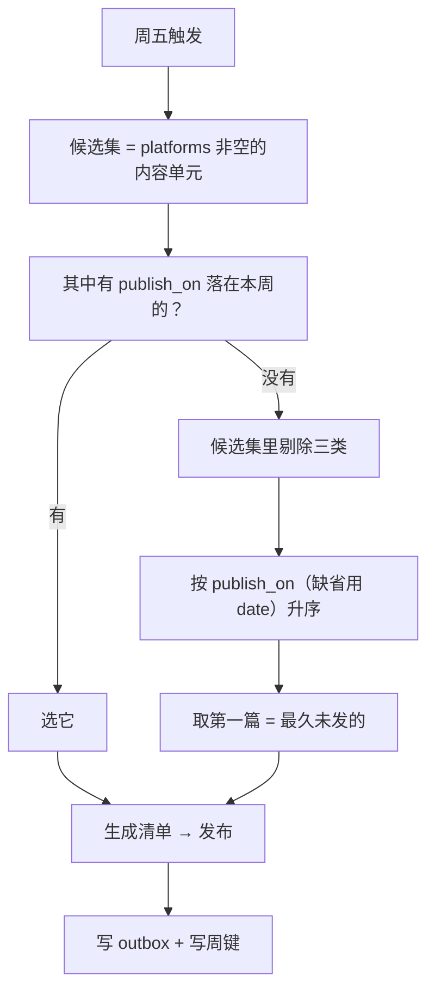
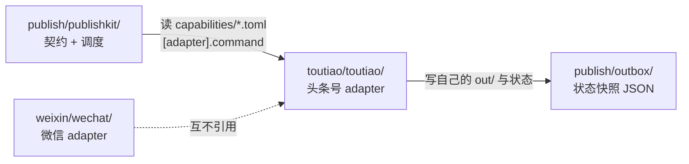

# 契约五：发布计划与调度

> **状态**：已实施（2026-11-12）。实现落在 `publish/publishkit/schedule.py`（候选集、
> 选题规则、周键、调度状态）与 `publish/publishkit/cli.py`（CLI 入口）。
>
> **前置阅读**：[00-架构设计.md](00-架构设计.md) —— 四份基础契约与展示层扩展点。
> 本文只讲第五份契约：**什么时候发、发什么、由谁触发**。
>
> 另见 [《数据库技术自媒体运营手册》](../../docs/life/shehui/media-account/index.md) ——
> §2.2 是「一条深潜视频的五平台版本表」（头条号图文 3K 的出处），
> §2.3 是各平台「最后 10%」的规则（头条的标题与首段写法）。
>
> **已确认的四个决定**（2026-11-11）：
> 1. **头条号**：走**双轨**——轨道 A 半自动出包（本周就能发）+ 轨道 B 职业认证（并行解锁 API 权限）（§6.2）。
> 2. **执行位置**：先在本机测试，后续再迁到 `growdu.cn` 服务器（§5）。
> 3. **每周选题**：`publish_on` 显式指定优先；没指定则自动发「最久未发」的一篇（§3）。
> 4. **认证路径**：走**职业认证**（官方口径**无粉丝门槛**），不走兴趣认证（§6.1.2）。

---

## 一、需求与它落在架构的哪一层

需求是两条发布路径：

| 路径 | 触发 | 选内容 |
| --- | --- | --- |
| **定时发布** | 每周五，例行 | 规则自动选（§3） |
| **主动发布** | 随时，人指定 | 人指定 `content_id` |

**核心设计判断：调度器只是触发器，发布流水线不变。**

```
                 ┌──────────────── 触发器 ─────────────────┐
                 │                                        │
        cron / launchd / CI schedule              人（命令行）
                 │                                        │
                 └──────────────┬─────────────────────────┘
                                ▼
                    选内容（规则 / 指定）
                                ▼
              切片：内容单元 + 能力模型 → 发布清单 manifest
                                ▼
                    发布：平台 adapter 调 API / 产出发布包
                                ▼
              写 publish/outbox/<content_id>__<platform>.json
```

两条路径走的是**同一条流水线**，只是「选内容」这一步的输入不同。
所以「主动发布」不需要任何新机制——它就是调度器的一个参数化入口。

---

## 二、调度层与已有契约的关系

契约层已有四份契约，调度层是**第五份**，并且只复用、不重写它们：

| 已有契约 | 调度层怎么用 |
| --- | --- |
| 内容契约 | 读 `publish_on` / `date` 与 `platforms`，决定候选集与时间 |
| 平台能力模型 | 读 `automation` 决定停在哪一步，读 `limits` 判定能不能发 |
| 发布清单 | 调度器不生成 manifest，是**调用**切片器生成 |
| 幂等状态 | 复用三层键；调度层**另加**一层「周键」幂等（§4） |

---

## 三、发布计划：发什么

### 3.1 内容契约新增两个字段

| 字段 | 类型 | 约束 | 含义 |
| --- | --- | --- | --- |
| `platforms` | list[str] | 平台 id 列表 | 这篇要发到哪些平台。**非空即进入发布候选集** |
| `publish_on` | str | `YYYY-MM-DD` | 指定发布日期。**可选** |

两者都是扁平标量/单层列表，符合内容契约 §4.2 的格式规则。

### 3.2 候选集

候选集 = **所有 `platforms` 非空的内容单元**。

一篇内容单元可以属于多个平台的候选集，但**一次发布只针对一个平台的清单**——
「内容单元 × 平台 = 一个 manifest」这条不变量不变。

### 3.3 选题规则



**为什么是「最久未发」而不是「最新」。** 站上已有 564 个内容单元，
但被标了 `platforms` 的是少数。按「最新」会永远发新文章，
积压的老文章永远轮不到；按「最久未发」则形成一个稳定的轮转队列，
存量内容能被持续消化。

**为什么 `publish_on` 优先。** 内容质量是内容判断，作者该有最终控制权——
这一篇是不是这周五该发的、是不是该配封面，作者说了算。
系统只在作者没说话时兜底。

**剔除三类，不止一类。** 「已发过」只是其中一类：

| 剔除对象 | 出处 | 为什么不能再选它 |
| --- | --- | --- |
| 已发过的（发布层幂等键命中） | §4.1 | 再发一遍就是重复发布 |
| 结果未知（超时） | §7.1 第三条 | 重试可能发两遍，必须先核对 |
| 转人工（不合格 / 审核不通过） | §7.1 | 重试无意义——内容本身有问题 |

后两类如果不剔除，它们会一直霸占「最久未发」的位置，那一篇就永远排不到，
等于整条队列卡死。

**一周发一篇。** 选题选出的是**一篇**内容单元，不是一堆。
那一篇发到它 `platforms` 里、且是**文档类**（能力声明里 `kind = "document"`）
的那些平台——视频平台（`channels` / `bilibili`）吃的是期号而不是内容单元，
生命周期也不同（出包 → 人工发 → 回填链接），不进这条队列。

### 3.4 一次发布发几个平台

`platforms: [wechat, toutiao]` 表示这篇要发到两个平台，
调度器为**每个平台各生成一个 manifest**，各走各的发布流程。

**某个平台失败不阻塞其他平台**——这是平台差异的必然结果：
公众号能进草稿箱，头条号可能因权限不足只能出发布包。
一个平台的失败不该让另一个平台也发不出去。

---

## 四、幂等：调度层自己的那层键

### 4.1 两层幂等，各管各的

| 层 | 键 | 防的是什么 | 存在哪 |
| --- | --- | --- | --- |
| **调度层** | `week_key`（如 `2026-W47`） | 同一周被调度两次 → 发两篇 | `publish/schedule.json` |
| **发布层** | `(content_id, platform)` 三层键 | 同一篇在同一平台发两遍 | `publish/outbox/*.json` |

**调度层的周键是必需的。** 常见的翻车场景：
cron 在周五 09:00 跑了一次，同一天手动又跑一次 → 没有周键就会发两篇。
而发布层的键**拦不住这个**——因为两篇是不同的 content_id。

### 4.2 周键的语义

```json
{
  "2026-W46": {
    "content_id": "db/postgresql/postgresql-logical-replication-add-guc",
    "platforms": ["wechat"],
    "scheduled_at": "2026-11-13 09:00:03",
    "trigger": "weekly",
    "done": true
  }
}
```

规则：

1. 定时触发时先查 `week_key` 是否已存在且 `done = true` → **存在则跳过**，记一条日志。
2. 存在但 `done = false`（上次跑了没跑完）→ **继续跑**并覆盖该周的记录（失败重试是安全的，因为发布层有幂等键）。
3. **主动发布不写周键**。理由：主动发了一篇，那篇就会出现在 outbox 里，
   下次定时选题时它会被「已发过」规则剔除（§3.3），自然让位给下一篇。
   如果主动发布也占周键，就会出现「手动发了一篇，周五什么都不发」的空窗。
4. 未完成的周被重试时，**重发记录里那一篇**，不重新选题。
   重发时已成功的平台按发布层的幂等键跳过（§4.1）——所以重试不会重发已成的部分。

### 4.3 周键怎么算

ISO-8601 周编号：`2026-W46`。用 `datetime.date.isocalendar()` 算，不要自己写周数算法
（**ISO 周年和日历年不是同一年**：2019-12-30 那天是星期一，却属于 2020-W01；
2026-12-31 属于 2026-W53，要到 2027-01-04 那个星期一才进 2027-W01）。

---

## 五、触发器：跑在哪、怎么跑

### 5.1 触发方式与调度器解耦

调度器只暴露一个 CLI 入口，**触发方式由外部决定**：

```bash
python3 -m publishkit.cli schedule weekly          # 定时路径
python3 -m publishkit.cli publish <content_id> --platform wechat   # 主动路径
```

这样「先本机、后续迁到服务器」就不需要改任何代码——只换触发配置。

| 触发方式 | 配置文件 | 适用 |
| --- | --- | --- |
| macOS launchd | `publish/deploy/launchd.plist.template` | 本机先跑（**当前阶段**） |
| Linux cron | `publish/deploy/crontab.template` | 迁到 `growdu.cn` 服务器时（**后续阶段**） |
| GitHub Actions | `publish/deploy/github-action.yml.template` | 不推荐——见下 |

### 5.2 为什么 CI schedule 不行

公众号接口要求**调用方出口 IP 在后台白名单**里。
GitHub 托管 runner 的出口 IP 是动态的，每次可能不同 → 所有接口调用会被挡（`40164` / `61004`）。

这台服务器的固定 IP 方案是唯一可行的 CI 之外路径。
（这也是为什么 weixin 的边界写的是「发布在本地执行」。）

### 5.3 launchd vs cron

两者都提供模板，但语义不同：

| | launchd（本机） | cron（服务器） |
| --- | --- | --- |
| 机器睡眠错过任务 | **会补跑**（`StartCalendarInterval` 的行为） | 不会 |
| 配置位置 | `~/Library/LaunchAgents/` | `crontab` |
| 日志 | `~/Library/Logs/` | 需自己重定向 |

**本机是 Mac，会合盖休眠** → 用 launchd，避免「周五合盖、周一才补发」。
服务器是常开的 CentOS → 用 cron 就够。

### 5.4 执行环境可配置

本机与服务器的差异不能写死在代码里。三个可配项：

| 配置项 | 本机 | 服务器 | 来源 |
| --- | --- | --- | --- |
| 仓库路径 | `/Users/growduduan/code/blog` | `/var/www/blog/app`（待定） | 环境变量 `PUBLISH_REPO` |
| 凭据路径 | `weixin/secrets.json` | 同 | 环境变量 `PUBLISH_SECRETS` |
| 状态目录 | `publish/`（仓库内，入库） | 同 | 环境变量 `PUBLISH_STATE_DIR` |

凭据**永远不入库**（`weixin/.gitignore` 已经挡了 `secrets.json`）。

**调度状态（`publish/schedule.json`）要入库。** 它是周键幂等的唯一凭据——
不跟着仓库走，换台机器就没有「这周发过了」的记录，周五会重发一遍。
它不在 `.gitignore` 里，第一次真正跑 `schedule weekly` 之后要 `git add` 进来。

**命令行选项覆盖环境变量**（命令行优先）。状态目录一改，
`schedule.json` 与 `outbox/` **都跟着走**——它们是同一个状态目录下的两样东西，
分开走就会出现「状态记在 A 目录、快照记在 B 目录」的分叉。

---

## 六、头条号：双轨路线与实测清单

### 6.1 平台事实（官方口径）

#### 6.1.1 开放平台 API 权限

**接口存在。** 头条号后台 → 设置 → 开放平台 → API 权限管理，
手动开启「文章发布」「图片上传」两项，OAuth2.0 绑定账号。
开通后有第三方工具（讯飞绘文等）在用这条通路。

> ⚠️ **2026-11-12 实测：入口的正式名字是「开放平台」，不是「开发平台」；
> 且未达门槛的账号，这个入口整个不渲染。**
> 用户登录后台在「设置」里找不到入口，是**账号条件没到**，不是路径走错。
> 排查清单见 [toutiao/docs/02-试点记录.md](../../toutiao/docs/02-试点记录.md) §R1。
> **所以这一步属于阶段二，不属于阶段一**（§6.3 已按此重排）。

**门槛是三层，不是一层。** 之前笼统记成「需认证」，实际要拆开看：

| 层 | 要求 | 当前状态 |
| --- | --- | --- |
| ① 账号主体 | 企业认证号 / 媒体认证号 / **个人认证号** | ❌ 未认证 |
| ② 粉丝量 | 个人认证号需 **粉丝 ≥ 1000**（头条 + 西瓜视频粉丝总数） | ❌ 当前 < 1000 |
| ③ 账号状态 | 未认证号即使完成 OAuth2 登录，发布时也返回「权限不足」 | ❌ 被挡在这层 |

**这三层能不能靠一次认证同时满足，是本次要实测的核心问题**（§6.3）。

#### 6.1.2 认证的两条路（官方条件）

| | **职业认证**（本次选定） | **兴趣认证**（黄V·兴趣领域） |
| --- | --- | --- |
| 粉丝门槛 | **无** | 头条 + 西瓜视频粉丝总数 **≥ 1000** |
| 信用分 | 100 分 | 100 分 |
| 账号类型 | 不可为：国家机构、新闻媒体、企业、其他组织（即**个人号**可申请） | 个人、企业 |
| 发文量 | 近 30 天发文总数 **≥ 5** | 近 30 天发文总数 **≥ 10** |
| 阅读量 | 无要求 | 近 30 天总阅读（播放）量 **≥ 5 万** |
| 垂直度 / 原创性 | 无硬性指标 | 审核标准 **≥ 70%**（见下方口径说明） |
| 证明材料 | 职业证明材料（工牌 / 在职证明 / 劳动合同等） | 无（靠发文数据自证） |
| 单位信息 | **可隐藏**（部分职位如医院院长、银行行长不支持隐藏） | 不适用 |

> **口径说明**：垂直度 / 原创性门槛在头条官方不同页面上有 **60%** 与 **70%** 两种写法
> （2024-11-08 治理公告与西瓜创作百科写 60%，头条百科「认证相关常见问题」写 70%）。
> **以申请页实时提示为准**，本文不替平台定这个数。

**为什么选职业认证。** 当前账号 < 1000 粉，兴趣认证的三个硬门槛
（1000 粉 / 10 篇 / 5 万阅读）**全部无法在短期内满足**；
职业认证**没有粉丝门槛**，只要求身份校验 + 信用分 100 + 近 30 天 5 篇 + 职业材料。
数据库内核开发是明确的职业，可选范围里有对口的条目。

**职业认证的持续义务**（认证不是一劳永逸）：内容持续优质、垂直、人设与实名一致；
信用分跌破 60 分会被取消认证；**离职后须及时更新或取消认证**。
《运营手册》§1.4「不蹭雇主的品牌」与这条是一致的——认证信息里可以勾选隐藏单位。

#### 6.1.3 适配规则

**来源：第三方工具的对接说明转述，⚠️ 需实测确认。**

| 项 | 规则 |
| --- | --- |
| 标题 | 强制 ≤ 30 字 |
| 摘要 | 首段自动提取，不可为空 |
| 正文图片 | 统一转 webp，压缩至 ≤ 5MB |
| 封面图 | 单张竖图，比例 3:4，尺寸 ≥ 600×800 |
| 禁止内容 | 微信公众号二维码、外链跳转代码 |

> **「外链跳转代码」这条的影响比看上去大。**
> 内容契约的「站外链接降级为文末参考链接」策略在头条上**不适用**——
> 可点击的站外 URL 属于头条的**独立创作者权益**（需单独开通），
> 未开通时正文里的 URL 不会变成链接，还有被判违规的风险。
> 头条版的处理办法见 §6.6。

**另一条容易踩的账号规范**：头条号**简介里不得包含网站链接、邮箱或其他联系方式**。
所以博客地址不能放简介，只能放正文（§6.6）。

### 6.2 路线决定：双轨并行

2026-11-11 拍板：

| 轨道 | 内容 | 产出 | 阻塞关系 |
| --- | --- | --- | --- |
| **A. 半自动出包** | 头条号发布包自动生成：精简正文 + 图片 + 封面 + 标题摘要 | `publish/outbox/<content_id>__toutiao/` + 通知 | **不依赖任何认证**，本周就能发 |
| **B. 职业认证** | 走职业认证申请（材料 + 近 30 天 5 篇） | 黄V | 与 A 并行，互不阻塞 |

**两条轨道的关系不是「A 等 B」。** 轨道 A 让内容今天就能开始分发，
轨道 B 是把自动化程度往上抬一档的尝试。
**B 失败不阻塞 A，B 成功也不必然让 A 失效**——因为「认证号 + 1000 粉」这两个条件
是否被职业认证一次性满足，尚未实测（§6.3）。

**成功判据是「实测能否开通 API 权限」，不是「认证通过」。**
拿到黄V 只是必要条件之一。

### 6.3 Phase 0 实测清单

对齐 `weixin/docs/03-试点记录.md` 的做法。**每一步都要把 errcode 记下来**，
不要照抄任何教程（包括本文）。分两个阶段：阶段一现在就能做，不依赖认证。

```text
── 阶段一：轨道 A（半自动出包）· 现在就能做 ──────────────────────
[ ] 1. 确认账号当前状态
      记录：账号类型（个人/企业）、认证状态、粉丝数、近 30 天发文数
[ ] 2. 手工发一篇测试文章，走完「上传图片 → 排版 → 发表」全流程
      记录：图片是否必须本地重新上传、外链 URL 是否被拦、
            粘贴 HTML 保留了多少排版、封面尺寸与比例的实测值
[ ] 3. 把阶段一的实测值回填到 publish/capabilities/toutiao.toml 的 limits
[ ] 4. 确认轨道 A 的出包形态可用：跑一次出包，人工照 README 上传一篇

── 阶段二：轨道 B（职业认证）· 认证通过后再做 ─────────────────────
[ ] 5. 满足职业认证前置：身份校验 + 绑定手机号 + 信用分 100
      + 用户名/简介/头像合规非默认 + 近 30 天发文 ≥ 5
[ ] 6. 今日头条 App → 我的 → 申请认证 → 个人认证 → 职业认证
      选对口职业 → 填单位/职位 → 上传职业证明材料
      勾选「隐藏单位/组织信息」（部分职位不支持，见 §6.1.2）
[ ] 7. 认证结果落定后，回后台找「设置 → 开放平台 → API 权限管理」
      记录：认证后「文章发布」「图片上传」是否可勾选
      ⚠️ 2026-11-12 实测：未达标账号该入口整个不渲染，找不到不是路径错
      （排查清单见 toutiao/docs/02-试点记录.md §R1）
[ ] 8. 若可勾选 → 走 OAuth2.0 绑定，记录 client_id / client_secret / 回调地址
[ ] 9. 调一次「图片上传」接口，传一张图，记录返回的 URL 域名与是否 webp
[ ] 10. 调一次「文章发布」接口，发一篇测试文章，记录 errcode
[ ] 11. 若报「权限不足」→ 记下是「粉丝」还是「认证」那一层被挡
      （认证已过仍被挡 = 粉丝条件独立于认证，兴趣认证的 1000 粉仍需单独解决）
[ ] 12. 把结论回填到 publish/capabilities/toutiao.toml 的 verified 字段
      与 automation 取值
```

**步骤 2 是最值钱的一步。** 认证要等审核，编辑器的真实行为今天就能测出来：
外链图片能不能用、粘贴 HTML 掉不掉格式、封面的实际裁切规则——
这些直接决定 §6.6 的头条版内容规则怎么写。

### 6.4 三档 automation

能力模型的 `automation` 字段是数据，三档正好覆盖头条号的三种现实状态：

| 档 | 前提 | 定时任务的行为 | outbox 记 |
| --- | --- | --- | --- |
| `manual` | 未认证（**当前状态**） | 产出发布包（HTML + 图片 + 封面 + 标题摘要），放进待发布目录 + 通知，人工上传 | `status = packaged` |
| `api_draft` | API 权限开通，但无「直接发表」权限 | 调 API 建草稿，人工在后台点发表 | `status = drafted` |
| `api_publish` | API 权限开通且可直接发表 | 调 API 发布，轮询审核状态 | `status = published` / `reviewing` |

**这不是三套代码。** 换档是**改一行 TOML**：

```toml
# publish/capabilities/toutiao.toml
id = "toutiao"
name = "头条号"
kind = "document"
automation = "manual"          # ← 实测通过后改这一行：api_draft 或 api_publish
review = "platform"
requires_certification = true
requires_min_followers = 1000
# verified 可选：Phase 0 实测后填日期与结论，实测前留空

[limits]
title_chars = 30
body_chars = 3000              # 3K 精简稿（《运营手册》§2.2）
digest_chars = 120
image_bytes = 5242880          # 5MB
image_formats = ["webp"]
cover_ratio = "3:4"
cover_min_pixels = [600, 800]
max_body_images = 3

[adapter]
package = "toutiao"            # adapter 的 Python 包名
command = ["python3", "-m", "toutiao.cli"]
```

`[adapter]` 段是契约层与平台实现之间的**唯一接缝**：调度器按 `package` 找到
`toutiao/` 这个独立目录里的包，按 `command` 调它的 CLI。
契约层不 import 任何平台内部模块，平台也不 import 契约层——
两边只认这份 TOML 和一份 manifest JSON。

**升级路径是改一行 TOML，不是改代码。这是能力模型存在的全部意义。**

### 6.5 半自动形态的产物

`manual` 档下，定时任务为头条号产出发布包。**放在 `toutiao/` 自己的目录下**，
不进 `publish/outbox/`——outbox 是跨平台统一的**状态快照**目录，
塞进平台私有的产物目录会污染它的格式（§6.9）。

```
toutiao/out/<content_id>/
├── article.html        # 已按头条规则渲染（标题 ≤30 字、正文图最多 3 张、无外链）
├── article.txt         # 纯文本备份（编辑器吃掉 HTML 时的兜底）
├── images/
│   └── 01.webp         # 正文图（已转 webp，≤5MB）
├── cover.webp          # 封面（3:4，≥600×800；取正文第一张图，没有正文图就不生成）
├── title.txt           # 标题（≤30 字）与摘要
└── README.md           # 人工上传步骤清单（对着打勾）
```

同时写一份跨平台状态快照：

```
publish/outbox/<content_id>__toutiao.json
```

```json
{
  "content_id": "db/postgresql/...",
  "platform": "toutiao",
  "status": "packaged",
  "automation": "manual",
  "title": "逻辑复制大事务同步要 30 分钟？",
  "published_url": null,
  "package_dir": "toutiao/out/db-postgresql-...",
  "updated_at": "2026-11-13T09:00:03+08:00",
  "reason": "未认证账号无开放平台 API 权限，已出包待人工上传"
}
```

**`status = packaged` 不是「已发布」。** 站点索引要能区分这两种状态，
否则读者点进去发现没有这篇，等于把「发重了」的风险换成了「发虚了」。
通知里也必须写「待上传」，不能写「已发布」（§6.7）。

> **文件名用压平后的 content_id。** 内容单元的 slug 含 `/`（如
> `db/postgresql/demo`），直接拼进文件名会散出一层目录。
> 文件名用 `db-postgresql-demo__toutiao.json`，文件里的 `content_id` 字段
> 保留原始 slug —— 站点索引按这个字段建映射。

### 6.6 头条版的内容规则

头条版**不是母稿的搬运，是重新裁的一版**。规则来自三处：
《运营手册》§2.2（一稿五发的版本表）、§6.1.3 的平台限额、以及 Phase 0 步骤 2 的实测。

| 项 | 规则 | 依据 |
| --- | --- | --- |
| 篇幅 | **3K 左右**（3000 字上下），不是全文搬运 | 《运营手册》§2.2「头条号图文 3K」 |
| 标题 | **≤ 30 字**，且带数字或反常识 | 平台限额 + 《运营手册》§2.3 |
| 开头 | **第一段就抛结论**——头条是信息流，读者不读第二段 | 《运营手册》§2.3 |
| 小标题 | 段落之间加小标题，手机屏阅读靠小标题续命 | 《运营手册》§2.3 |
| 正文图 | **最多 3 张**（0 张也行），已转 webp、≤5MB | 平台限额（webp ≤5MB）+《运营手册》§2.3（张数建议） |
| 封面 | 单张竖图，3:4，≥600×800；**来源 = 正文第一张图**，没有正文图就不生成封面 | 平台限额（上传封面时） |
| 站外链接 | **正文里不放可点击 URL**，只留纯文本「完整版见 growdu.cn」 | 见下 |

**为什么图要少。** 头条**不能用外链图片**——正文里的 ``
不生效，图必须在编辑器里重新上传。这意味着每张图都是一道**人工工序**。
图越少，这道工序越省。3K 精简稿本来就不需要几张图，
所以「图少」和「稿短」是同一条规则的两面。

**「最多 3 张」不是平台限额。** 平台真正的硬约束只有两条：正文图 webp、≤5MB
（有图时），封面 3:4、≥600×800（上传封面时）。头条允许**零图发布**，
所以「1~3 张」是《运营手册》给的**写作建议**。切片只管「最多 3 张」，
不给没有图的母稿硬造图；没有正文图就不生成封面，出包清单那一行明写
「这篇没有正文图：按头条的『无图』模式发布；若后台强制要封面，需人工另配」。

**为什么链接要降级成纯文本。** 三重约束叠加：

1. 平台明令禁止「外链跳转代码」；
2. 正文插入外链属于头条的**独立创作者权益**，要单独开通，未开通时 URL 不会变成链接；
3. 头条号**简介里不得包含网站链接、邮箱或其他联系方式**——所以也不能挂在简介上。

因此头条版的链接策略是：

- **正文末尾**：纯文本提一句「完整版见 growdu.cn」（不带协议、不做超链接）
- **反方向由站点承担**：文章页的跨平台索引区块显示「已发布到头条号」+ 头条链接，
  读者从头条点进来、站点把读者引回去——这条链路每一步都在自己控制之下

> **这一条是公众号教训的同构复现。** 公众号实测「正文里的外链图片会被静默删除」，
> 读者看到的是一段突然断掉的正文。头条的「外链不生效」是同一个坑的另一个形状。
> **凡是把内容交给外部平台，就要逐条确认哪些元素会被吃掉，别假设。**

**切片归属。** 上面这些规则属于**头条 adapter 的实现**，不是契约层的能力模型。
契约层只提供 `limits`（标题 30 字、3K、图片大小格式、封面比例）；
「怎么从母稿裁出这 3K」是 adapter 的活——它需要懂母稿的结构、
懂《运营手册》§2.3 说的「第一段抛结论」，这些都写死在 adapter 里。

### 6.7 通知渠道

| 渠道 | 依赖 | 适用 |
| --- | --- | --- |
| 日志 | 无 | 必做，永远写 |
| 企微 / 飞书机器人 webhook | 一个 HTTP POST + 一个密钥 | 推荐，最省事 |
| 邮件（SMTP） | 要配服务器 | 备选 |
| 站点 | 零依赖——`publish/outbox/` 本来就是站点索引的数据源 | 兜底：至少能在博客上看到「本周已发到公众号，待发表」 |

**通知措辞必须区分三种状态**，这是最容易出错的地方：

| 平台 | 实际状态 | 通知该写什么 |
| --- | --- | --- |
| 公众号 | 草稿已在草稿箱 | 「草稿已在草稿箱，**待你点发表**」（`freepublish/submit` 实测 48001） |
| 头条号（`manual`） | 发布包已生成 | 「发布包已生成，**待你上传**」 |
| 头条号（`api_publish`） | 真的发出去了 | 「已发布」 |

含糊地说「已发布」是发布场景里最贵的一种 bug——**用户以为发出去了，实际没有。**

### 6.8 已排除的路线

| 路线 | 为什么排除 |
| --- | --- |
| **Cookie 浏览器自动化** | 协议不是公开契约，随时可能变；登录态与风控要长期维护；比出包只省下 8 分钟的人工上传，却引入一条随时会断的脆弱链路 |
| **第三方聚合平台**（代发服务） | 内容外流（素材与账号经手第三方）、多为付费、且拿不到发布结果 |
| **等 API 权限开通才发头条** | 认证要等审核，周五的发布计划不能被审核进度绑架。轨道 A 就是为了让内容今天就能分发 |

### 6.9 头条号 adapter 的目录位置

**头条号与微信是平级的两个独立目录，互不引用。**

```
blog/
├── publish/                   # 契约层（平台无关）
│   ├── publishkit/            #   共享 Python 包
│   ├── capabilities/          #   能力模型 TOML（每个平台一份）
│   ├── outbox/                #   跨平台状态快照（纯 JSON）
│   └── schedule.json          #   调度状态
│
├── weixin/                    # 微信 adapter（已存在，并行开发中）
│   └── wechat/                #   Python 包
│
└── toutiao/                   # 头条号 adapter（新建，与 weixin 同级同形）
    ├── toutiao/               #   Python 包
    ├── docs/                  #   设计与实测记录
    ├── tests/                 #   单元 + 集成测试
    ├── out/                   #   发布包等本地产物（gitignore）
    ├── secrets.json           #   凭据（gitignore，永不入库）
    └── .gitignore
```

**依赖方向是单向的，而且只有一处接缝。**



- 契约层**不 import** 任何平台内部模块——它只知道 TOML 里写的 `command`，
  以及一份 manifest JSON 的格式
- 平台 adapter **不 import** 契约层——它只认 manifest JSON 的格式和自己的 TOML 限额
- `weixin/` 与 `toutiao/` **互不 import**

**为什么不做成「一个包，多个平台模块」。** 因为 `weixin/` 正在被另一个会话并行开发，
而头条号是独立的新工作。把它们放进同一个包，等于让两个执行者改同一个目录——
这是最典型的并发冲突源。分成两个顶层目录后，两个执行者的文件集合完全不重叠，
各自可以独立提交、独立回滚、独立跑测试。

**包名与目录名的对应关系**（避免 import 时的路径困惑）：

| 平台 | 顶层目录 | Python 包 | import 路径 |
| --- | --- | --- | --- |
| 微信 | `weixin/` | `wechat/` | `wechat.*` |
| 头条号 | `toutiao/` | `toutiao/` | `toutiao.*` |
| YouTube（后续） | `youtube/` | `youtube/` | `youtube.*` |
| B站（后续） | `bilibili/` | `bilibili/` | `bilibili.*` |

顶层目录**不是** Python 包（`weixin/` 就不是），里面的同名子目录才是。
`import toutiao.*` 需要把 `REPO_ROOT/toutiao` 插进 `sys.path`——
写法照抄 `weixin/tests/conftest.py:6-8` 的现成做法，本文不发明新机制。

---

## 七、失败与重试

### 7.1 三种失败，三种处理

| 失败 | 表现 | 处理 |
| --- | --- | --- |
| 平台接口报错 | `errcode != 0` | 记入 outbox（`status = failed` + reason + `retryable`），**不吞异常**，继续其他平台 |
| 平台审核不通过 | `publish_status = 4` 类 | **不自动重试**，转人工（内容有问题，重试无意义） |
| 网络超时（结果未知） | 没拿到响应 | **不当作失败**：记 `status = unknown` + `retryable = false`，**不自动重发**，转人工核对 |

**第三条是发布场景最容易翻车的地方**：超时不代表没发出去。
若直接重试，可能发两遍。

**「先查后发」这一步落在人身上，不在调度器身上。** 规格原先写的是
「下次跑先按 `object_id` 查一次状态再决定」，但 adapter 的 CLI 契约只有
`publish <content_id>` 一个入口，没有查状态的子命令，`object_id` 也只活在
adapter 内部。调度层拿不到它，就**不能假装自己查了**——所以它的做法是：
超时记成 `unknown` 而不是 `failed`（`failed` 会被当成「可重试」，
下一次跑就又发一遍），并且把这一篇**从候选集里剔除**（§3.3），
同时在 `schedule status` 里单列「结果未知，待核对」。
人核对完确认没发出去，才把它从队列里放出来。

### 7.2 重试时机

- 定时任务下次跑时，对 outbox 里 `status = failed` 且**可重试**的记录重试一次
- `review = platform` 且审核不通过的记录**永不自动重试**
- 重试次数记在 outbox 里，超过上限（比如 3 次）转人工

### 7.3 周五失败怎么办

周键记 `done = false`，下次跑（下一周五，或手动触发）会重跑本周。
发布层的幂等键保证重跑不会重发已成功的部分。

**但要注意**：「下周再跑」时 `week_key` 已经变了，会选新内容。
所以周键必须记录 `done = false` 的状态，并在下一次运行时**优先重试未完成的周**，
而不是直接选新的一篇。

### 7.4 哪类失败进 outbox

outbox 是发布层的**幂等键**，不是处理日志。判据一句话：

> **发生过发布尝试的失败进 outbox，但必须带 `retryable` 标出它还能不能自动重试。**

- **进了 outbox** 的记录会被「已发布就别再发」那条规则读到——所以它必须
  真的发生过发布尝试（平台接口报错、审核不通过、超时）。
- **`retryable = false` 的记录不算「已发布」。** 它确实进 outbox（因为发生过
  发布尝试），但「已发过」那条剔除规则读的是**成功态**，不是「有记录」。
  这一点必须分清：把「不可重试的失败」也算成「已发布」，那一篇就永远轮不到；
  把「没发生发布尝试的失败」写进 outbox 又会被读成「发过了」，同样永远轮不到。
  两头都要错，所以失败记录进 outbox 时**一律带 `retryable`**：
  - `status = "failed"` + `retryable = true` → 接口报错，可重试（§7.2）
  - `status = "failed"` + `retryable = false` → 审核不通过 / 该篇不合格，转人工
  - `status = "unknown"` + `retryable = false` → 超时，结果未知，转人工核对
- **没进 outbox** 的是那些**连平台版都没做出来**的失败：切片阶段就掉了
  （正文没有可保留的内容）、发布包根本没成形。这类失败不是发布尝试，
  写进 outbox 会被读成「已经发过了」，于是**永远被跳过**。

这类文章要有自己的去处（标记为「本平台切不出来」），别让它去霸占
「最久未发」的队列——具体形态是调度层的事，但**判据必须写在这里**：
只看 adapter 的模块 docstring，下一个实现的人会绕开它。

---

## 八、CLI 契约

```bash
# 定时路径：跑一次例行发布
python3 -m publishkit.cli schedule weekly [--dry-run]

# 主动路径：发指定内容到指定平台
python3 -m publishkit.cli publish <content_id> --platform wechat [--publish]

# 查看状态：本周发了什么、哪些待重试、哪些待人工
python3 -m publishkit.cli schedule status

# 列出候选集（选题前先看看有什么可发）
python3 -m publishkit.cli schedule candidates
```

**运行位置**：`publish/` 本身不是 Python 包，`publishkit` 是挂在它下面的包，
所以命令要么 `cd publish` 再跑，要么给 `PYTHONPATH=publish`：

```bash
cd publish && python3 -m publishkit.cli schedule weekly
```

`--dry-run` 只打印将要做什么，不写 outbox、不调接口——
**第一次跑必须带 `--dry-run`**。

**调度器怎么调平台 adapter。** 走能力声明的 `[adapter]` 段：
按 `command` 起子进程，**cwd 是 `<仓库>/<adapter 包名>`**（adapter 的包目录是
`repo/toutiao/toutiao/`，`-m toutiao.cli` 要靠 cwd 在 `sys.path` 里找到它），
命令行是 `<command> publish <content_id>`。退出码沿用 adapter 的约定：
`0` 成功 / `1` 参数或配置错误 / `2` 该篇不合格 / `3` 接口或写盘错误。

**三档 `automation` 的分支在 adapter 内部**，调度器不替它分支：
adapter 自己按自己的 `automation` 决定是出包还是调接口，调度器只读它
写进 outbox 快照的结果。所以「换档」改的是 adapter 那一侧的 TOML，
调度层不动。

### 8.1 与 `wechat.cli` 的关系

`weixin/wechat/cli.py` 已有 `scan` / `audit` / `convert` / `publish` / `status`。
新 CLI 的 `publish` 是**调度层的入口**（选内容 + 走发布流水线），
`wechat.cli publish` 是**公众号 adapter 的入口**（指定 slug 发公众号）。

两者可以并存：
- `publishkit.cli publish` 是**跨平台**的调度入口
- `wechat.cli publish` 是**只针对公众号**的 adapter 入口

它们最终调用同一套 manifest 与幂等状态，不冲突。

---

## 九、测试策略

| 层次 | 覆盖 |
| --- | --- |
| 单元 | 周键计算（跨年边界）、候选集筛选、`publish_on` 优先、最久未发排序 |
| 单元 | 周键幂等：同周第二次触发被跳过；`done = false` 时重跑 |
| 单元 | 主动发布不写周键 |
| 单元 | 三类剔除：已发过的、结果未知的、转人工的，都不会被再次自动选中 |
| 单元 | 状态文件原子写：写一半崩了不留半个 JSON |
| 单元 | outbox 快照的命名约定与仓库里现存的快照文件一致 |
| 集成 | **假 adapter 子进程**：临时目录里的 Python 脚本 + 临时能力声明 TOML，跑完整定时流程，断言 outbox 写入正确、重复触发不重复发 |
| 集成 | adapter 退出码 1 / 2 / 3 **分别**怎么处理 |
| 集成 | 超时不当失败：记成 `unknown` 而不是 `failed`，不自动重发，也不再被自动选中 |

**测试不依赖网络**。集成测试用的是**假 adapter 子进程**而不是假平台 HTTP server——
adapter 的契约已经是「起一个子进程、传一个 content_id、读它写下的快照」，
再叠一层 HTTP 只会多测 HTTP 栈，少测这条契约本身。假 adapter 住在临时目录里，
按预设模式决定退出码、要不要写快照，日志落在临时文件里。

---

## 十、对既有契约的影响

调度层**不修改**已有四份契约的行为，只在两处扩展：

| 扩展点 | 内容 |
| --- | --- |
| 内容契约 | 新增 `publish_on` 字段（`platforms` 已在 §4.1 定义） |
| 平台能力模型 | `toutiao.toml` 补 `limits` 与 `requires_min_followers`；新增 `manual` 自动化档；新增 `[adapter]` 段声明 adapter 的包名与命令（§6.4） |

`publish/outbox/` 的写入方从「只有发布器」变成「发布器 + 调度器」，
但**格式不变**——调度器写的是同一份公开快照。

**新增第三类产物目录。** `toutiao/out/` 是头条号 adapter 的私有产物目录
（发布包、渲染中间物），与 `publish/outbox/` 的跨平台状态快照分开。
原因是：outbox 的格式必须跨平台统一，混进平台私有的多文件目录会破坏它（§6.5）。

---

## 十一、待验证项

1. **头条号 API 权限** —— §6.3 阶段二的清单，**未实测**。这是决定头条号最终落在
   `manual` / `api_draft` / `api_publish` 哪一档的唯一依据。
   2026-11-12 已确认：未达门槛的账号**连入口都不渲染**，所以这一步只能等认证之后。
2. **职业认证能否解锁 API 权限** —— §6.1.1 的三层门槛里，「个人认证号」与「粉丝 ≥1000」
   是不是同一个条件，官方没写清楚。**认证通过 ≠ API 权限开通**（§6.2）。
3. **头条号的图片与封面规格** —— §6.1.3 的规则来自第三方对接说明转述，需 Phase 0 步骤 2 实测确认。
4. **头条编辑器的真实行为** —— 外链图片是否可用、粘贴 HTML 保留多少排版，需实测（§6.6 的规则依赖它）。
5. **本机 launchd 的补跑行为** —— 需在真实休眠场景验证。
6. **服务器上的仓库路径与凭据落点** —— 迁到 `growdu.cn` 时确定；服务器的出口 IP 需加进公众号白名单。
7. **通知渠道** —— 企微/飞书 webhook 还是邮件，需要选一个并配置。
