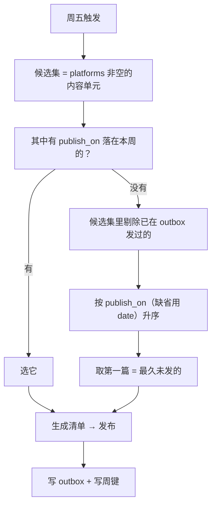

# 契约五：发布计划与调度

> **状态**：设计已确认（2026-11-11），待实施。
>
> **前置阅读**：[00-架构设计.md](00-架构设计.md) —— 四份基础契约与展示层扩展点。
> 本文只讲第五份契约：**什么时候发、发什么、由谁触发**。
>
> **已确认的三个决定**（2026-11-11）：
> 1. **头条号**：先实测账号能否开通开放平台 API 权限，再决定做到哪一步（§6）。
> 2. **执行位置**：先在本机测试，后续再迁到 `growdu.cn` 服务器（§5）。
> 3. **每周选题**：`publish_on` 显式指定优先；没指定则自动发「最久未发」的一篇（§3）。

---

## 一、需求与它落在架构的哪一层

需求是两条发布路径：

| 路径 | 触发 | 选内容 |
| --- | --- | --- |
| **定时发布** | 每周五，例行 | 规则自动选（§3） |
| **主动发布** | 随时，人指定 | 人指定 `content_id` |

**核心设计判断：调度器只是触发器，发布流水线不变。**

```
                 ┌──────────────── 触发器 ─────────────────┐
                 │                                        │
        cron / launchd / CI schedule              人（命令行）
                 │                                        │
                 └──────────────┬─────────────────────────┘
                                ▼
                    选内容（规则 / 指定）
                                ▼
              切片：内容单元 + 能力模型 → 发布清单 manifest
                                ▼
                    发布：平台 adapter 调 API / 产出发布包
                                ▼
              写 publish/outbox/<content_id>__<platform>.json
```

两条路径走的是**同一条流水线**，只是「选内容」这一步的输入不同。
所以「主动发布」不需要任何新机制——它就是调度器的一个参数化入口。

---

## 二、调度层与已有契约的关系

契约层已有四份契约，调度层是**第五份**，并且只复用、不重写它们：

| 已有契约 | 调度层怎么用 |
| --- | --- |
| 内容契约 | 读 `publish_on` 与 `platforms` 两个字段，决定候选集与时间 |
| 平台能力模型 | 读 `automation` 决定停在哪一步，读 `limits` 判定能不能发 |
| 发布清单 | 调度器不生成 manifest，是**调用**切片器生成 |
| 幂等状态 | 复用三层键；调度层**另加**一层「周键」幂等（§4） |

---

## 三、发布计划：发什么

### 3.1 内容契约新增两个字段

| 字段 | 类型 | 约束 | 含义 |
| --- | --- | --- | --- |
| `platforms` | list[str] | 平台 id 列表 | 这篇要发到哪些平台。**非空即进入发布候选集** |
| `publish_on` | str | `YYYY-MM-DD` | 指定发布日期。**可选** |

两者都是扁平标量/单层列表，符合内容契约 §4.2 的格式规则。

### 3.2 候选集

候选集 = **所有 `platforms` 非空的内容单元**。

一篇内容单元可以属于多个平台的候选集，但**一次发布只针对一个平台的清单**——
「内容单元 × 平台 = 一个 manifest」这条不变量不变。

### 3.3 选题规则



**为什么是「最久未发」而不是「最新」。** 站上已有 564 个内容单元，
但被标了 `platforms` 的是少数。按「最新」会永远发新文章，
积压的老文章永远轮不到；按「最久未发」则形成一个稳定的轮转队列，
存量内容能被持续消化。

**为什么 `publish_on` 优先。** 内容质量是内容判断，作者该有最终控制权——
这一篇是不是这周五该发的、是不是该配封面，作者说了算。
系统只在作者没说话时兜底。

### 3.4 一次发布发几个平台

`platforms: [wechat, toutiao]` 表示这篇要发到两个平台，
调度器为**每个平台各生成一个 manifest**，各走各的发布流程。

**某个平台失败不阻塞其他平台**——这是平台差异的必然结果：
公众号能进草稿箱，头条号可能因权限不足只能出发布包。
一个平台的失败不该让另一个平台也发不出去。

---

## 四、幂等：调度层自己的那层键

### 4.1 两层幂等，各管各的

| 层 | 键 | 防的是什么 | 存在哪 |
| --- | --- | --- | --- |
| **调度层** | `week_key`（如 `2026-W47`） | 同一周被调度两次 → 发两篇 | `publish/schedule.json` |
| **发布层** | `(content_id, platform)` 三层键 | 同一篇在同一平台发两遍 | `publish/outbox/*.json` |

**调度层的周键是必需的。** 常见的翻车场景：
cron 在周五 09:00 跑了一次，同一天手动又跑一次 → 没有周键就会发两篇。
而发布层的键**拦不住这个**——因为两篇是不同的 content_id。

### 4.2 周键的语义

```json
{
  "2026-W47": {
    "content_id": "db/postgresql/postgresql-logical-replication-add-guc",
    "platforms": ["wechat"],
    "scheduled_at": "2026-11-13 09:00:03",
    "trigger": "weekly",
    "done": true
  }
}
```

规则：

1. 定时触发时先查 `week_key` 是否已存在且 `done = true` → **存在则跳过**，记一条日志。
2. 存在但 `done = false`（上次跑了没跑完）→ **继续跑**并覆盖该周的记录（失败重试是安全的，因为发布层有幂等键）。
3. **主动发布不写周键**。理由：主动发了一篇，那篇就会出现在 outbox 里，
   下次定时选题时它会被「已发过」规则剔除（§3.3），自然让位给下一篇。
   如果主动发布也占周键，就会出现「手动发了一篇，周五什么都不发」的空窗。

### 4.3 周键怎么算

ISO-8601 周编号：`2026-W47`。用 `datetime.date.isocalendar()` 算，不要自己写周数算法
（跨年那周容易错：2026-12-31 属于 2027-W01）。

---

## 五、触发器：跑在哪、怎么跑

### 5.1 触发方式与调度器解耦

调度器只暴露一个 CLI 入口，**触发方式由外部决定**：

```bash
python3 -m publishkit.cli schedule weekly          # 定时路径
python3 -m publishkit.cli publish <content_id> --platform wechat   # 主动路径
```

这样「先本机、后续迁到服务器」就不需要改任何代码——只换触发配置。

| 触发方式 | 配置文件 | 适用 |
| --- | --- | --- |
| macOS launchd | `publish/deploy/launchd.plist.template` | 本机先跑（**当前阶段**） |
| Linux cron | `publish/deploy/crontab.template` | 迁到 `growdu.cn` 服务器时（**后续阶段**） |
| GitHub Actions | `publish/deploy/github-action.yml.template` | 不推荐——见下 |

### 5.2 为什么 CI schedule 不行

公众号接口要求**调用方出口 IP 在后台白名单**里。
GitHub 托管 runner 的出口 IP 是动态的，每次可能不同 → 所有接口调用会被挡（`40164` / `61004`）。

这台服务器的固定 IP 方案是唯一可行的 CI 之外路径。
（这也是为什么 weixin 的边界写的是「发布在本地执行」。）

### 5.3 launchd vs cron

两者都提供模板，但语义不同：

| | launchd（本机） | cron（服务器） |
| --- | --- | --- |
| 机器睡眠错过任务 | **会补跑**（`StartCalendarInterval` 的行为） | 不会 |
| 配置位置 | `~/Library/LaunchAgents/` | `crontab` |
| 日志 | `~/Library/Logs/` | 需自己重定向 |

**本机是 Mac，会合盖休眠** → 用 launchd，避免「周五合盖、周一才补发」。
服务器是常开的 CentOS → 用 cron 就够。

### 5.4 执行环境可配置

本机与服务器的差异不能写死在代码里。三个可配项：

| 配置项 | 本机 | 服务器 | 来源 |
| --- | --- | --- | --- |
| 仓库路径 | `/Users/growduduan/code/blog` | `/var/www/blog/app`（待定） | 环境变量 `PUBLISH_REPO` |
| 凭据路径 | `weixin/secrets.json` | 同 | 环境变量 `PUBLISH_SECRETS` |
| 状态目录 | `publish/`（仓库内，入库） | 同 | 默认值，可用环境变量覆盖 |

凭据**永远不入库**（`weixin/.gitignore` 已经挡了 `secrets.json`）。

---

## 六、头条号：先实测权限，再定形态

### 6.1 已确认的事实

**接口存在。** 头条号后台 → 设置 → 开放平台 → API 权限管理，
手动开启「文章发布」「图片上传」两项，OAuth2.0 绑定账号。
开通后有第三方工具（讯飞绘文等）在用这条通路。

**门槛明确。** 仅以下三类号可开通：

| 账号类型 | 能否开通 |
| --- | --- |
| 企业认证号 | ✅ |
| 媒体认证号 | ✅ |
| 个人认证号（**粉丝 ≥ 1000**） | ✅ |
| 普通未认证号 | ❌ 即使完成 OAuth2 登录，发布时也返回「权限不足」 |

**适配规则**（来源：第三方工具的对接说明转述，**需实测确认**）：

| 项 | 规则 |
| --- | --- |
| 标题 | 强制 ≤ 30 字 |
| 摘要 | 首段自动提取，不可为空 |
| 正文图片 | 统一转 webp，压缩至 ≤ 5MB |
| 封面图 | 单张竖图，比例 3:4，尺寸 ≥ 600×800 |
| 禁止内容 | 微信公众号二维码、外链跳转代码 |

> **注意最后一条对契约的影响。** 内容契约的「站外链接降级为文末参考链接」策略在头条上要调整——
> 头条禁止外链跳转代码，文末的「参考链接」区块里的可点击链接可能触发审核。
> 这属于切片器（adapter）的适配职责，由能力模型的 `limits` 与 adapter 共同决定，
> 契约层不预设具体降级方式。

### 6.2 Phase 0 实测清单

对齐 `weixin/docs/03-试点记录.md` 的做法。**每一步都要把 errcode 记下来**，
不要照抄任何教程（包括本文）。

```text
[ ] 1. 登录头条号后台 → 设置 → 开放平台 → API 权限管理
      记录：当前是否已开启「文章发布」「图片上传」
[ ] 2. 确认账号认证状态与粉丝数
      记录：账号类型（企业/媒体/个人认证/未认证）、粉丝数
      判定：个人认证号需 ≥1000 粉丝
[ ] 3. 若可开通 → 走 OAuth2.0 绑定，记录 client_id / client_secret / 回调地址
[ ] 4. 调一次「图片上传」接口，传一张图，记录返回的 URL 域名与是否 webp
[ ] 5. 调一次「文章发布」接口，发一篇测试文章，记录 errcode
[ ] 6. 若报「权限不足」→ 记下账号类型与粉丝数缺口，转 §6.4 的半自动路径
[ ] 7. 把结论回填到 publish/capabilities/toutiao.toml 的 verified 字段
```

### 6.3 两种形态

| 形态 | 前提 | 定时任务的行为 |
| --- | --- | --- |
| **全自动** | Phase 0 通过 | 直接调 API 发布，outbox 记 `published` |
| **半自动** | Phase 0 不通过 | 产出发布包（HTML + 图片 + 标题），放进待发布目录 + 通知，人工上传 |

**这不是两套代码。** 能力模型里 `automation` 字段是数据：

```toml
# publish/capabilities/toutiao.toml
id = "toutiao"
name = "头条号"
kind = "document"
automation = "manual"          # ← 实测通过后改成 "api_publish"，只改这一行
review = "platform"
requires_certification = true
requires_min_followers = 1000
verified = "2026-11-XX"        # Phase 0 的实测日期与结论

[limits]
title_chars = 30
digest_chars = 120
image_bytes = 5242880          # 5MB
image_formats = ["webp"]
cover_ratio = "3:4"
cover_min_pixels = [600, 800]
```

升级路径是**改一行 TOML**，不是改代码。这是能力模型存在的全部意义。

### 6.4 半自动形态的产物

若 Phase 0 不通过，定时任务为头条号产出：

```
publish/outbox/<content_id>__toutiao/
├── article.html        # 已按头条规则渲染（标题 ≤30 字、图片 webp、无外链跳转）
├── cover.webp          # 封面（3:4，≥600×800）
├── title.txt           # 标题与摘要
└── README.md           # 人工上传步骤清单（对着打勾）
```

外加一条通知。**通知是半自动形态的必需品**——否则草稿躺在目录里没人知道。

### 6.5 通知渠道

| 渠道 | 依赖 | 适用 |
| --- | --- | --- |
| 日志 | 无 | 必做，永远写 |
| 企微 / 飞书机器人 webhook | 一个 HTTP POST + 一个密钥 | 推荐，最省事 |
| 邮件（SMTP） | 要配服务器 | 备选 |
| 站点 | 零依赖——`publish/outbox/` 本来就是站点索引的数据源 | 兜底：至少能在博客上看到「本周已发到公众号，待发表」 |

**注意公众号的情况**：定时任务发公众号只能到草稿箱（`freepublish/submit` 实测 48001），
所以每周五之后仍然需要人工点一次「发表」。**通知要明确写出「草稿已在草稿箱，待你点发表」**，
而不是含糊地说「已发布」。

---

## 七、失败与重试

### 7.1 三种失败，三种处理

| 失败 | 表现 | 处理 |
| --- | --- | --- |
| 平台接口报错 | `errcode != 0` | 记入 outbox（`status = failed` + reason），**不吞异常**，继续其他平台 |
| 平台审核不通过 | `publish_status = 4` 类 | **不自动重试**，转人工（内容有问题，重试无意义） |
| 网络超时（结果未知） | 没拿到响应 | **不当作失败**，下次跑先按 `object_id` 查一次状态再决定 |

**第三条是发布场景最容易翻车的地方**：超时不代表没发出去。
若直接重试，可能发两遍。必须先查后发。

### 7.2 重试时机

- 定时任务下次跑时，对 outbox 里 `status = failed` 且**可重试**的记录重试一次
- `review = platform` 且审核不通过的记录**永不自动重试**
- 重试次数记在 outbox 里，超过上限（比如 3 次）转人工

### 7.3 周五失败怎么办

周键记 `done = false`，下次跑（下一周五，或手动触发）会重跑本周。
发布层的幂等键保证重跑不会重发已成功的部分。

**但要注意**：「下周再跑」时 `week_key` 已经变了，会选新内容。
所以周键必须记录 `done = false` 的状态，并在下一次运行时**优先重试未完成的周**，
而不是直接选新的一篇。

---

## 八、CLI 契约

```bash
# 定时路径：跑一次例行发布
python3 -m publishkit.cli schedule weekly [--dry-run]

# 主动路径：发指定内容到指定平台
python3 -m publishkit.cli publish <content_id> --platform wechat [--publish]

# 查看状态：本周发了什么、哪些待重试、哪些待人工
python3 -m publishkit.cli schedule status

# 列出候选集（选题前先看看有什么可发）
python3 -m publishkit.cli schedule candidates
```

`--dry-run` 只打印将要做什么，不写 outbox、不调接口——
**第一次跑必须带 `--dry-run`**。

### 8.1 与 `wechat.cli` 的关系

`weixin/wechat/cli.py` 已有 `scan` / `audit` / `convert` / `publish` / `status`。
新 CLI 的 `publish` 是**调度层的入口**（选内容 + 走发布流水线），
`wechat.cli publish` 是**公众号 adapter 的入口**（指定 slug 发公众号）。

两者可以并存：
- `publishkit.cli publish` 是**跨平台**的调度入口
- `wechat.cli publish` 是**只针对公众号**的 adapter 入口

它们最终调用同一套 manifest 与幂等状态，不冲突。

---

## 九、测试策略

| 层次 | 覆盖 |
| --- | --- |
| 单元 | 周键计算（跨年边界）、候选集筛选、`publish_on` 优先、最久未发排序 |
| 单元 | 周键幂等：同周第二次触发被跳过；`done = false` 时重跑 |
| 单元 | 主动发布不写周键 |
| 单元 | 能力模型 `automation` 决定发布路径（api_draft / api_publish / manual 三条分支） |
| 集成 | 假平台 HTTP server：跑完整定时流程，断言 outbox 写入正确、重复触发不重复发 |
| 集成 | 超时后重试：先查状态再决定，不重复发 |

**测试不依赖网络**（沿用 `weixin/tests/test_publish.py` 的假 server 手法）。

---

## 十、对既有契约的影响

调度层**不修改**已有四份契约的行为，只在两处扩展：

| 扩展点 | 内容 |
| --- | --- |
| 内容契约 | 新增 `publish_on` 字段（`platforms` 已在 §4.1 定义） |
| 平台能力模型 | `toutiao.toml` 补 `limits` 与 `requires_min_followers`；新增 `manual` 自动化档 |

`publish/outbox/` 的写入方从「只有发布器」变成「发布器 + 调度器」，
但**格式不变**——调度器写的是同一份公开快照。

---

## 十一、待验证项

1. **头条号 API 权限** —— §6.2 的 Phase 0 清单，未实测。
2. **头条号的图片与封面规格** —— §6.1 的规则来自第三方对接说明转述，需实测确认。
3. **本机 launchd 的补跑行为** —— 需在真实休眠场景验证。
4. **服务器上的仓库路径与凭据落点** —— 迁到 `growdu.cn` 时确定；服务器的出口 IP 需加进公众号白名单。
5. **通知渠道** —— 企微/飞书 webhook 还是邮件，需要选一个并配置。
