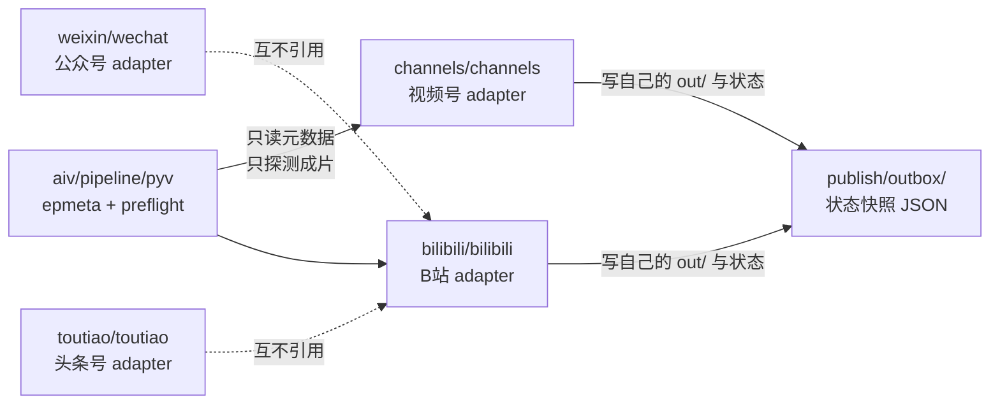

# 契约六：视频发布（视频号 · B站）

> **状态**：设计已确认（2026-11-12），待实施。
>
> **前置阅读**：
> - [00-架构设计.md](00-架构设计.md) —— 四份基础契约与展示层扩展点。
> - [06-发布计划与调度.md](06-发布计划与调度.md) —— 契约五：何时发、发什么、由谁触发。
> - [AIV 视频生产线](../../aiv/index.md) —— 成片是怎么产出来的。
>
> **本文只讲一件事**：成片出片之后，怎么发到**视频号**和**B站**。
>
> **已确认的四个决定**（2026-11-12）：
> 1. **画幅**：本期用现有 **16:9（1920×1080）** 成片直接发两平台，**不做竖版 9:16**。
> 2. **B站**：**两档都做**——`manual` 出包先跑通，`api`（arcopen 开放平台投稿）代码同时写好，
>    权限到位即切档（§6.5）。
> 3. **账号**：视频号与 B 站账号均已有，B 站**已是正式会员**（不受单日 5 稿限制）。
> 4. **落地形态**：照 [toutiao 先例](06-发布计划与调度.md#69-头条号-adapter-的目录位置)，
>    `channels/` 与 `bilibili/` 是**平级独立目录**，互不引用，也不依赖尚未实现的 `publish/publishkit/`。

---

## 一、目标与边界

### 1.1 目标

把 AIV 产出的成片，变成**两个平台上可发布的成品包**（文案 + 封面 + 字幕 + 清单），
并且在 B 站这一侧，具备**用官方接口直接投稿**的能力。

### 1.2 非目标（本期明确不做）

| 不做 | 原因 |
| --- | --- |
| **竖版 9:16 成片** | `pyv/timeline.py:151` 硬编码画布 1920×1080；场景字号是绝对像素（`s01_intro.py` 写死 104/72/38），竖版要重排版式。这是独立工程任务（§十二） |
| **站点视频详情页 / 合集页** | 属 [00-架构设计.md](00-架构设计.md) §9 的展示层扩展点（commit 7），依赖 `publish_index`，本期不做 |
| **浏览器自动化发视频号** | 视频号**无面向普通创作者的公开发布 API**（§6.1）；与头条号同因已排除（[06](06-发布计划与调度.md) §6.8） |
| **播放数据回收** | 视频号无公开数据接口；B 站需另申请 `arcopen` 数据类 scope |
| **定时发布** | 属契约五的调度层（[06](06-发布计划与调度.md)），本期只做「把一期的包准备好」 |
| **多账号矩阵** | 风控识别行为模式，且本期只有一个号的量 |
| **改写 `weixin/` 与 `toutiao/`** | 另两个会话正在并行开发；本期的文件集合与它们**完全不重叠** |

### 1.3 一条贯穿全文的原则

> **流水线里的每一个「成功」，都必须是显式确认过的成功，不能是「没报错就算成功」。**
> 在发布场景里，发重了比发慢了糟糕得多。

（这条继承自 [00-架构设计.md](00-架构设计.md) §13，本文是它在视频侧的具体化。）

---

## 二、现状盘点（2026-11-12 实测）

### 2.1 成片

两期成片已在本机产出，参数全部实测过：

> EP01 列是 **2026-11-12 重出**后的实测值（那一期按 openGauss 归属口径整期重做：
> 标题、机制、旁白、画面全换）。EP02 列未变。

| 项 | EP01 `pg-parallel-decode` | EP02 `csn-total-ordering` | 平台门槛 |
| --- | --- | --- | --- |
| 时长 | 38.125 s | 41.000 s | B站 < 5 h；视频号个人号 ≤ 60 min |
| 分辨率 / 帧率 | 1920×1080 / 24fps | 同 | B站 ≤ 4096×4096、≤ 120fps；视频号建议 ≥ 720p |
| 视频编码 | H.264 **High** / yuv420p / level 4.0 / ≈863 kbps | ≈842 kbps | B站 yuv420p SDR 逐行扫描；峰值码率 ≤ 60 Mbps |
| 音频 | AAC LC **192 kbps / 48 kHz / 立体声** | 同 | B站 ≤ 320 kbps、≤ 48 kHz、≤ 2 声道 |
| 文件大小 | 4.83 MB | 5.09 MB | B站 ≤ 4 GB（→ 走**单文件上传**）；视频号 ≤ 2 GB |
| 封装 | `+faststart` | 同 | 视频号需 moov 前置 |
| 关键帧数 | 8 | 8 | — |
| **关键帧最大间隔** | **9.375 s** ✅ | **10.000 s** ✅ | B站「关键帧至少 10 秒一个」→ 间隔须 **≤ 10 s** |

**EP02 原先的 10.417 秒超出 B 站门槛。** 根因是成片由分段渲染后 `concat` 拼成，
每段独立编码，段内 GOP 与段边界共同决定了关键帧分布。

**EP01 重出后最大间隔从 7.167 s 变成 9.375 s**（场景边界变了：
s04 现在独占 9.375 秒）。仍然满足 ≤ 10 s，但余量小了——
这正是下面那条 `-g 240` 处置要根治的原因：**靠场景边界碰运气不保险**。

**处置（已实施）**：在 `compose` 的编码参数里加 `-g 240`（24fps × 10 s），
强制关键帧间隔 ≤ 10 s，**一次性根治**；EP01 / EP02 已按新参数重出。
实测最大间隔 EP01 9.375 s、EP02 10.000 s，两期都合规。

**画面到底受没受影响：实测过，不是想当然。** 见 §5.4——
`-g` 只改 GOP 不改量化参数，但 GOP 一变，x264 的帧类型判定与率控决策就跟着变，
所以「画面逐像素不变」这条**并不严格成立**。正确的判据是**视觉等价**。

### 2.2 两个平台的接口现状（外部核实）

| 平台 | 官方发布接口 | 本号现状 | 结论 |
| --- | --- | --- | --- |
| **微信视频号** | **无面向普通创作者的公开发布 API**。公开能力目录覆盖直播、橱窗、留资、数据罗盘，**没有普通视频发布**；后台确有上传/草稿/定时发布的内部请求，但那是私有契约，不是可依赖的公开接口 | 账号已有 | `automation = manual`：**自动出包 + 人工点发布** |
| **B站** | `member.bilibili.com/arcopen/fn/*`，Scope `ARC_BASE`，需申请权限 + 应用审核 + 用户 OAuth 授权 | 账号已有，**已是正式会员**（无单日 5 稿限制）；**`ARC_BASE` 未申请** | 两档都做：`manual` 出包先跑通，`api` 代码写好待权限（§6.5） |

### 2.3 已有资产（不用重造）

| 已有 | 在哪 | 本期怎么用 |
| --- | --- | --- |
| 成片 | `aiv/out/<EP>.mp4` | 直接作为发布包的视频源 |
| 时间轴与字幕事件 | `aiv/storyboard_<EP>.json`（本机产物，不入库） | 生成 B站 `.srt` 字幕 |
| 视觉契约 | `aiv/contracts/<EP>.json` | 校对发布元数据里的 `episode` 是否对得上 |
| 选题库 | `aiv/选题库.md` | 每期的标题与主钩子，是发布文案的默认来源 |
| 内容侧校验的既有形状 | `pyv/topics.py` / `pyv/persona.py` / `pyv/bgm.py` | 新增的 `pyv/epmeta.py` / `pyv/preflight.py` 照这个形状写 |

---

## 三、概念模型与目录

### 3.1 分层：产物的归生产者，平台的归 adapter

```
aiv/out/<EP>.mp4                      成片（产物，不入库）
   │
   │  pyv.preflight 探测技术门槛
   ▼
aiv/publish/<EP>.json                 发布元数据（入库，是事实）
   │
   │  切片：每平台一份文案
   ▼
channels/out/<EP>/                    视频号发布包（产物）
bilibili/out/<EP>/                    B站发布包（产物）
   │
   │  B站 api 档：调 arcopen
   ▼
publish/outbox/<EP>__<platform>.json  公开状态快照（入库）
```

**为什么分成三层，而不是让 adapter 自己读契约。**

| 归属 | 内容 | 理由 |
| --- | --- | --- |
| **aiv（生产者）** | 成片合不合格（技术门槛）、这一期叫什么 | 「成片是不是坏的」是**生产者**的责任，不该让每个平台各判一遍 |
| **内容侧（元数据）** | 每期在两个平台怎么自我介绍 | 是**事实**，要评审、要版本化，所以入库 |
| **adapter（平台侧）** | 平台限额怎么裁、怎么调接口、怎么出包 | 是**平台知识**，各平台互不相同 |

### 3.2 目录

```
blog/
├── aiv/                                # 成片生产线（已有）
│   ├── publish/                        # 【新】每期发布元数据（入库）
│   │   ├── pg-parallel-decode.json
│   │   └── csn-total-ordering.json
│   └── pipeline/
│       └── pyv/
│           ├── epmeta.py               # 【新】发布元数据读取与校验
│           ├── preflight.py            # 【新】成片技术门槛预检
│           └── cli.py                  # 【新】publish 子命令
│
├── channels/                           # 【新】视频号 adapter
│   ├── channels/                       #   Python 包
│   │   ├── __init__.py
│   │   ├── cli.py
│   │   ├── contract.py                 #   视频号版文案规则（标题/简介/话题）
│   │   ├── assets.py                   #   抽帧封面（横版 + 竖框版）
│   │   ├── package.py                  #   出包
│   │   ├── state.py                    #   幂等状态
│   │   └── notify.py                   #   通知
│   ├── docs/00-设计.md
│   ├── tests/                          #   单元 + 集成
│   ├── out/                            #   发布包（gitignore）
│   └── .gitignore
│
├── bilibili/                           # 【新】B站 adapter
│   ├── bilibili/
│   │   ├── __init__.py
│   │   ├── cli.py
│   │   ├── contract.py                 #   B站版文案规则（标题/简介/标签/分区）
│   │   ├── assets.py                   #   封面（≥1146×717）
│   │   ├── subtitle.py                 #   storyboard → .srt
│   │   ├── package.py                  #   出包（manual 档）
│   │   ├── sign.py                     #   签名 v2.0
│   │   ├── client.py                   #   HTTP 客户端 + 公共头
│   │   ├── upload.py                   #   上传三步
│   │   ├── publish.py                  #   投稿 + 审核状态轮询
│   │   ├── state.py                    #   幂等状态
│   │   └── notify.py
│   ├── docs/00-设计.md
│   ├── tests/
│   ├── out/                            #   gitignore
│   ├── secrets.json                    #   凭据（gitignore，永不入库）
│   └── .gitignore
│
└── publish/                            # 契约层（已有 spec/，本期待补两块）
    ├── spec/07-视频发布契约.md          #   ← 本文档
    ├── capabilities/
    │   ├── channels.toml               #   【新】
    │   └── bilibili.toml               #   【新】
    ├── outbox/                         #   【新】公开状态快照
    └── tests/                          #   【新】能力模型校验
```

### 3.3 依赖方向



| 谁 | 依赖谁 | 怎么依赖 |
| --- | --- | --- |
| `channels/` `bilibili/` | `aiv/pipeline/pyv` | 只 import `epmeta` 与 `preflight` 两个模块；插入 `aiv/pipeline` 到 `sys.path` 的写法照抄 `weixin/tests/conftest.py:6-8` |
| `channels/` | `bilibili/` | **无**。两个平台互不引用 |
| `publish/capabilities/*.toml` | — | 纯数据，被两个 adapter 各自读（**各读各的**，不共享进程） |

**为什么 adapter 之间不共用一个包。** 视频号与 B 站的限额、封面规格、发布流程完全不同，
共用的部分只有「读元数据」和「探测成片」这两件与平台无关的事——它们已经在 `pyv` 里了。
再抽一层公共包，得到的是两个只共享两行代码的包，和一个持续的耦合点。

### 3.1 能力声明的顶层键语义

`publish/capabilities/<platform>.toml` 的顶层键，两平台**完全相同**：

| 键 | 含义 | 本期取值 |
| --- | --- | --- |
| `id` / `name` / `kind` | 平台标识与类型 | `kind` 恒为 `video` |
| `auth` | adapter 要不要凭据。取值域封闭：`none`（无需凭据）/ `appid_secret`（应用密钥 + 用户授权 token） | 视频号 `none`、B站 `appid_secret` |
| `automation` | 发布档位：`manual`（出包 + 人工发布）/ `api_draft`（只建草稿）/ `api_publish`（直接投稿） | 两平台本期均 `manual` |
| `review` | 发布前审核归属：`none` / `platform`（平台审）/ `precheck`（本地预检） | 两平台 `platform` |
| `requires_certification` | **该平台的稿件是否要求账号具备特定资质才能发布**（如视频号的原创声明、认证号要求）。**与账号自身的实名认证是两件事**——B站开放平台应用本身需要实名，那由 `auth` 管 | 两平台 `false` |
| `requires_min_followers` | 发稿所需的最低粉丝数。`0` = 无门槛 | 两平台 `0` |
| `verified` | **这些平台数字最后一次对着平台文档复核过的日期**（ISO `YYYY-MM-DD`）。改数值不改这个日期，等于假装没改过 | `2026-11-12` |

> **`requires_certification` 为什么单独写清楚。** 它和 `auth = "appid_secret"` 长得像但不是一回事：
> 前者说的是「这个平台的稿件要不要账号有某种资质」，后者说的是「调用接口要不要凭据」。
> 开放平台应用本身要实名——那是 `auth` 的事，与稿件资质无关。
> 这个键被测试钉住了，语义必须先定义清楚：将来要纠正，就得连测试一起改。

---

## 四、契约一：视频内容单元与发布元数据

### 4.1 内容单元的标识

**内容单元 id = AIV 的期号 slug**（`pg-parallel-decode`、`csn-total-ordering`）。

这个 slug 已经是契约、旁白、时间轴、片段目录、成片文件名的共同主键
（`aiv/README.md` §五），所以它直接就是发布侧的 `content_id`，不需要再造一套编号。

> 选题库里的 `ep01` / `ep02` 是**选题阶段**的编号，与 slug 是两套并行编号。
> 发布侧一律用 slug——它能一路追到成片文件。

### 4.2 元数据文件

路径：`aiv/publish/<EP>.json`。**入库**（是事实，不是产物）。

```json
{
  "episode": "csn-total-ordering",
  "title": "一个 64 位计数器，决定所有事务的提交顺序",
  "url": "https://growdu.cn/2026/11/12/life/aiv/",
  "cover_at": 23.0,
  "channels": {
    "title": "64 位计数器，决定谁先提交",
    "description": "并发提交时，commit 的先后是乱的……",
    "topics": ["数据库", "openGauss", "源码"]
  },
  "bilibili": {
    "title": "一个 64 位计数器，决定所有事务的提交顺序",
    "description": "并发提交时 commit 顺序是乱的……",
    "tags": ["数据库", "PostgreSQL", "源码"],
    "tid": 231,
    "copyright": 1,
    "no_reprint": 1
  }
}
```

### 4.3 字段表

| 字段 | 类型 | 必填 | 含义与约束 |
| --- | --- | --- | --- |
| `episode` | str | ✅ | 必须与 `contracts/<EP>.json` 的 `episode` **逐字相同**，否则报错 |
| `title` | str | ✅ | 这一期的标题（母版标题）。各平台文案默认从这里派生 |
| `url` | str | — | 站点详情页地址。给了就在发布文案末尾附上 |
| `cover_at` | float | ✅ | 封面抽帧的时间点（秒）。必须落在成片时长内，否则报错 |
| `channels` | obj | ✅ | 视频号版文案。**缺整个键 = 这一期不发视频号**（记原因，不报错） |
| `channels.title` | str | ✅ | ≤ 22 字（§6.1.3） |
| `channels.description` | str | ✅ | ≤ 1000 字；**前 50 字会被折叠外直接显示**，所以钩子写前面 |
| `channels.topics` | list[str] | ✅ | 话题，≤ 5 个，每个 ≤ 15 字 |
| `bilibili` | obj | ✅ | B站版文案。**缺整个键 = 这一期不发 B站** |
| `bilibili.title` | str | ✅ | < 80 字 |
| `bilibili.description` | str | ✅ | < 250 字 |
| `bilibili.tags` | list[str] | ✅ | 英文逗号分隔后总长 < 200 字；单个标签 ≤ 20 字 |
| `bilibili.tid` | int | ✅ | 投稿分区 id（§6.4）。**不写死在这里，要实测回填** |
| `bilibili.copyright` | int | ✅ | 1 = 原创，2 = 转载（转载时另填 `source`） |
| `bilibili.no_reprint` | int | ✅ | 0 = 允许转载，1 = 不允许转载 |
| `bilibili.source` | str | 转载时必填 | 转载来源地址 |

### 4.4 校验规则

`pyv.epmeta` 负责，**缺一个必填字段就报错，绝不静默补默认值**：

1. `episode` 必须与契约一致；
2. `cover_at` 必须 `0 ≤ cover_at ≤ 成片时长`；
3. 平台段落里的字符串长度必须落在该平台的限额内（§6）；
4. 平台段落整体缺失 → 该平台**跳过**这一期，记一条「未配置该平台」的日志，**不算错误**；
5. 平台段落存在但字段缺失 → **报错**（与 4 相反：配了就必须配全）。

> **为什么「整段缺失 = 跳过」而「段内缺字段 = 报错」。**
> 前者是「这一期不发这个平台」，是合法的编辑决定；后者是「想发但没填全」，
> 是配置错误。两者混为一谈，要么逼着作者填一堆用不上的字段，要么让配置错误悄悄溜过去。

### 4.5 命令

```bash
cd aiv/pipeline
python -m pyv.cli publish check --episode csn-total-ordering
```

读元数据 + 校验 + 探测成片 + 打印两个平台的判定结果。**不发任何请求、不写任何文件。**

---

## 五、契约二：成片技术预检

### 5.1 为什么要有这一层

「成片合不合格」是**生产者**的责任。如果让 `channels/` 和 `bilibili/` 各写一套 ffprobe 判定，
门槛数字会漂，而且两边可能对同一条片子给出不同结论。

### 5.2 门槛表

`pyv.preflight` 持有一张门槛表，**每条门槛带一个来源**：

| 门槛 | 视频号 | B站 | 来源 |
| --- | --- | --- | --- |
| 分辨率 | ≥ 1280×720 | ≤ 4096×4096 | 视频号官方建议 720p 起；B站开放平台《文件上传预处理》 |
| 帧率 | ≤ 60 | ≤ 120 | B站《文件上传预处理》 |
| 视频编码 | H.264 | H.264 | 两平台通用（视频号部分安卓机不解 H.265） |
| 像素格式 | yuv420p | yuv420p | 两平台通用（ffprobe 报 `yuv420p`）；B站要求 SDR 8bit 逐行扫描 |
| 音频采样率 | ≤ 48 kHz（出片固定 48 kHz） | ≤ 48 kHz | B站《文件上传预处理》 |
| 音频声道 | ≤ 2 | ≤ 2 | B站《文件上传预处理》 |
| 音频码率 | — | ≤ 320 kbps | B站《文件上传预处理》 |
| 视频峰值码率 | — | ≤ 60 Mbps（用平均码率代理判定） | B站《文件上传预处理》 |
| 时长 | ≤ 60 min（个人号） | < 5 h（上限取 17999 s） | 两平台后台 |
| 文件大小 | ≤ 2 GB | ≤ 4 GB | 两平台后台 |
| **关键帧最大间隔** | —（建议门槛） | **≤ 10 s**（硬门槛） | B站《文件上传预处理》 |
| moov 前置 | 要求 | — | 视频号需 `+faststart` |

**这张表只管成片本身的技术门槛，不含封面几何与格式。**
封面两平台的裁法不同（视频号出**两张**：1080×608 横版 + 1080×1920 竖框版
——平台另有 6:7 / 1080×1260 的公开口径，见 §6.1.2，故两张都出、人工挑；
B站 ≥1146×717 且 jpeg/png ≤5MB），归 adapter 侧的 `assets.py`（与头条号 adapter 同源）。
能力声明（`publish/capabilities/<platform>.toml`）的 `[media]` 只放本表里的成片门槛。

**码率代理的口径与代价**：ffprobe 只能给出**平均**码率，给不出峰值。
本表把 B站的「峰值码率 ≤ 60 Mbps」按**平均码率**判（`文件大小 × 8 ÷ 时长`），
能力声明里也注明这一点。峰值必然 ≥ 平均，所以这是**偏松**的判定——
但实测两期成片的平均码率约 1.05 Mbps，与 60 Mbps 差近两个数量级，
代理判定在这个量级上够用。**如果将来出片码率量级变了，这条要重新核。**

### 5.3 判定分两档

| 档 | 含义 | 处理 |
| --- | --- | --- |
| **硬门槛** | 平台会拒绝、或文件根本传不上去 | **报错并停止**，给出修复命令。**不静默上传、不静默截断** |
| **建议门槛** | 平台接受但会降质/降权 | **告警**，继续出包，在清单里写明 |

关键帧间隔属**硬门槛**（B站明确写进规格）。视频号侧目前没有关键帧要求，列为建议门槛。

**修复命令的形态**（示例，参数以实际探测值为准）：

```bash
ffmpeg -i out/<EP>.mp4 -c:v libx264 -preset medium -crf 18 -g 240 \
       -c:a aac -b:a 192k -ar 48000 -ac 2 -movflags +faststart fixed.mp4
```

### 5.4 根治：compose 加 `-g 240`

**已实施**：`aiv/pipeline/pyv/compose.py` 的编码参数加 `-g 240`（24fps × 10 s），
强制关键帧间隔 ≤ 10 s，然后**重出 EP01 / EP02**。
两条编码路径（`concat` 与最终 mux）共用同一套参数（`pyv.compose.encode_args`），
否则「无声片」与「成片」的关键帧分布会不一样。

验收判据与**实测结果**（2026-11-12，同一批渲染片段，只换 `-g` 这一个变量）：

| # | 判据 | 实测 |
| --- | --- | --- |
| 1 | 关键帧最大间隔 ≤ 10 s | EP01 9.375 s、EP02 10.000 s ✅ |
| 2 | 画面**视觉等价**（不是逐像素相同） | concat 阶段解出的像素**逐帧完全一致**（PSNR 全 inf）；mux 阶段 EP01 915 帧全一致，EP02 798/985 帧一致、187 帧有差异，PSNR 最低 **56.89 dB**、均值 59.34 dB，无一帧低于 50 dB ✅ |
| 3 | `make mix-verify` 全绿 | 两期 duck 深度 6.98~6.99 dB、电平差 ≥ 23 dB、真峰值 ≤ −2.5 dBTP ✅ |

**判据 2 为什么不是「逐像素不变」**：`-g` 只改 GOP，不改 CRF 与量化参数，
但 GOP 结构一变，x264 的帧类型判定与率控决策就跟着变，
**编码结果不再是同一串比特**。逐帧哈希比对因此必然报出差异。
实测差异落在感知不可见的量级（PSNR ≥ 56.89 dB），
可写成「逐像素不变」会让这条判据**永远无法通过**——所以判据本身改成可测的「视觉等价」。

**为什么不用「预检时再修」**：预检发现超标就重编码，等于每次出片都要多跑一遍全片编码。
在源头设死，是把问题消掉而不是每次重新发现它。

---

## 六、契约三：两个平台的切片规则

### 6.1 视频号

#### 6.1.1 为什么是 `manual`

视频号**没有面向普通创作者的公开发布 API**（§2.2）。公开能力目录覆盖直播、橱窗、留资、
数据罗盘，**没有普通视频的「上传 / 存草稿 / 定时发布 / 查状态」**。

后台网页里确实存在上传、草稿箱、定时发布的内部请求，但它们是**私有契约**：
依赖 Cookie、内部鉴权与未承诺字段，且视频号运营规范对第三方工具接入有明确条款。
这与头条号的结论同构（[06](06-发布计划与调度.md) §6.8）。

官方自带的**定时发布**需要：账号实名 + 近 30 天发布过 ≥ 3 条原创内容；
解锁后只能选未来 7 天内的整点。它解决的是「选个时间自动发」，**不解决「谁来把视频传上去」**。

#### 6.1.2 出包形态

```
channels/out/<EP>/
├── video.mp4          # 成片（软链到 aiv/out/<EP>.mp4，不重复占空间）
├── cover-16x9.jpg     # 横版封面 1080×608
├── cover-9x16.jpg     # 竖框版 1080×1920（横屏画面嵌入竖框，主体居中）
├── title.txt          # 标题（≤22 字）
├── description.txt    # 简介
├── topics.txt         # 话题，一行一个
├── publish.md         # 人工发布清单（对着打勾）
└── meta.json          # 机器可读快照
```

**为什么出两张封面。** 公开口径对「横版视频的封面会不会被裁」互相矛盾：
一说视频号封面比例是竖版 6:7（1080×1260）与横版 16:9（1080×608），
一说朋友圈卡片、聊天窗口、主页、发现页**全部以 9:16 竖屏展示封面**，传 16:9 会被裁左右或加黑边。
既然是人工发布，两张都给、让人在真实界面上看一眼，比赌哪个口径对更省事。

#### 6.1.3 限额

| 项 | 限额 | 处理 |
| --- | --- | --- |
| 标题 | **≤ 22 字**（含标点） | 超了**报错跳过**，不静默截断 |
| 简介 | ≤ 1000 字 | 同上 |
| 话题 | ≤ 5 个，单个 ≤ 15 字 | 同上 |
| 文件 | ≤ 2 GB | 预检 |

> **标题为什么取 22 而不是 20 或 34。** 公开口径有 20 / 22 / 34 三种说法，
> 仓库既有的《从 Hexo 博客到公众号与视频号》取的是 22。本期沿用 22 作保守值，
> 并在 §十三 列为**待实测项**——以视频号助手的实测提示为准。

### 6.2 视频号的人工发布清单

`publish.md` 的内容就是「一个人照着做就能发完」的步骤清单：

```markdown
# 待发布：CSN 全序（csn-total-ordering）

| 项 | 值 |
| --- | --- |
| 视频 | `video.mp4`（41.0 s，1920×1080） |
| 标题 | 64 位计数器，决定谁先提交（18 字） |
| 话题 | #数据库 #openGauss #源码 |
| 封面 | `cover-16x9.jpg`（信息流若裁切则换 `cover-9x16.jpg`） |
| 原创声明 | 勾选 |

## 步骤

- [ ] 打开视频号助手 → 发布视频
- [ ] 上传 `video.mp4`
- [ ] 粘贴标题与简介，补上 # 话题
- [ ] 选封面（先试 `cover-16x9.jpg`，被裁就换 `cover-9x16.jpg`）
- [ ] 勾选「原创声明」
- [ ] 发布
- [ ] 回填链接：`python -m channels.cli mark published csn-total-ordering --url "<链接>"`
```

### 6.3 B站（`manual` 档）

```
bilibili/out/<EP>/
├── video.mp4          # 成片（软链）
├── cover.jpg          # 封面，≥1146×717，jpeg/png，≤5MB
├── title.txt          # 标题（<80 字）
├── description.txt    # 简介（<250 字）
├── tags.txt           # 标签，英文逗号分隔
├── subtitle.srt       # 字幕（从 storyboard 生成）
├── publish.md         # 人工发布清单
└── meta.json
```

| 项 | 限额 | 来源 |
| --- | --- | --- |
| 标题 | < 80 字，**短时间内不能相同** | B站《视频稿件提交》 |
| 简介 | < 250 字 | 同上 |
| 标签 | 总长 < 200 字，英文逗号分隔 | 同上 |
| 封面 | jpeg/png，≤ 5 MB，**建议 ≥ 1146×717，最低 ≥ 960×600** | B站《封面上传》 |
| 分区 `tid` | 必填 | 同上 |

### 6.4 B站分区 `tid`

**不硬编码猜测值。** `tid` 写进元数据，但**必须实测回填**：

1. 开通 `ARC_BASE` 后调 `GET /arcopen/fn/archive/type/list` 拿当前可用分区；
2. 内容落在**科技 → 计算机技术**（老分区号 `tid = 231`）；
   「知识 → 科学科普」（`tid = 201`）是可替代项；
3. **注意分区体系在变**：B站正在灰测新的 `tid_v2` 分区字段，与老 `tid` 不是同一套号。
   提交后稿件落到哪个分区，取决于当时的分区映射——**这一条列为待实测项**（§十三）；
4. 实测后把最终值写回 `aiv/publish/<EP>.json`，并在文档里记下查证日期。

### 6.5 B站（`api` 档）

#### 6.5.1 上传三步

| 步 | 接口 | 要点 |
| --- | --- | --- |
| 1 | `POST /arcopen/fn/archive/video/init` | body `{"name": "<EP>.mp4", "utype": "1"}`；`utype=1` = 单个小文件（≤100 MB），我们的成片 5 MB 走这条；返回 `upload_token` |
| 2 | `POST https://openupos.bilivideo.com/video/v2/upload?upload_token=...` | **裸二进制流**，`Content-Type: application/octet-stream`。**不带 `X-Bili-*` 签名头**（凭 `upload_token` 鉴权） |
| 3 | `POST /arcopen/fn/archive/cover/upload` | `multipart/form-data` 传 `file`，返回封面 URL |

> **第 2 步有一个静默损坏的坑（官方文档明确警告）。**
> 用 `multipart/form-data`（curl 的 `-F`）上传时，服务端**仍可能返回成功**，
> 但落盘的文件不是纯净视频数据，转码阶段才失败。
> 必须用 `--data-binary @file` + `Content-Type: application/octet-stream`。

投稿（`add-by-utoken`）与审核查询：

| 步 | 接口 | 要点 |
| --- | --- | --- |
| 4 | `POST /arcopen/fn/archive/add-by-utoken?upload_token=...` | body：`title` / `cover` / `tid` / `no_reprint` / `desc` / `tag` / `copyright` / `source`；返回 `data.resource_id`（BV 号） |
| 5 | `GET /arcopen/fn/archive/viewlist` | 查审核态：`addit_info.state`（**0 = 开放浏览**）、`state_desc`、`reject_reason`；`video_info.share_url` / `iframe_url` |

#### 6.5.2 签名 v2.0

**待签名字符串**：抽取所有 `x-bili-` 前缀的自定义 header，按**字典序**拼接，
每行 `key:value`，行间 `\n`，**末行不带 `\n`**：

```
x-bili-accesskeyid:<client_id>
x-bili-content-md5:<body 的 MD5，小写>
x-bili-signature-method:HMAC-SHA256
x-bili-signature-nonce:<每次请求都换的随机数>
x-bili-signature-version:2.0
x-bili-timestamp:<unix 秒>
```

**签名**：`HMAC-SHA256(app_secret, 待签名字符串)` → **小写 hex** → `Authorization` 头。

**必须记牢的三条**：

| 规则 | 说明 |
| --- | --- |
| 空 body 的 md5 是 `d41d8cd98f00b204e9800998ecf8427e` | GET 请求或 body 为空时，**不是**空字符串，是**空字符串的 MD5** |
| `x-bili-signature-version: 2.0` 时 **`access-token` 必填** | 由 OAuth2 用户授权取得 |
| 时间戳超过当前 10 分钟 → 请求被丢弃 | 本机时钟必须准 |

#### 6.5.3 两档如何共存

**同一套切片与出包代码**，切换只改一行配置：

```toml
# publish/capabilities/bilibili.toml
automation = "manual"        # ← 实测开通后改这一行：api_publish
```

| 档 | 行为 | outbox `status` |
| --- | --- | --- |
| `manual` | 出包，人工上传 | `packaged` |
| `api_publish` | 调 API 上传 + 投稿，轮询审核态 | `reviewing` → `published` / `failed` |

> **这正是能力模型存在的全部意义。**
> 换档是改一行 TOML，不是改代码——与头条号的设计（[06](06-发布计划与调度.md) §6.4）完全一致。

---

## 七、幂等与状态

### 7.1 沿用三层键

| 层 | 键 | 视频号 | B站 |
| --- | --- | --- | --- |
| **内容层** | `content_id` + **成片 sha256** | 成片换了 → 重新出包 | 同 |
| **平台对象层** | `object_id` | **无**（人工发布，没有 API 返回 id） | `resource_id`（BV 号） |
| **发布层** | `publish_id` + `status` | 人工状态 | `resource_id` + `addit_info.state` |

**为什么内容层用成片的 sha256。** 视频的「正文」就是成片本身。
成片重出（改了文案、换了旁白、重渲）→ sha256 变 → 必须重新出包。
用元数据的 sha256 不行：文案不变但成片变了的情况很常见（重混音、修关键帧）。

### 7.2 视频号没有对象 id 怎么办

视频号没有 API，人工发布拿不到平台返回的 id。
所以它多一个**显式回填命令**：

```bash
python -m channels.cli mark published <EP> --url "https://channels.weixin.qq.com/..."
```

回填后 outbox 的 `status` 从 `packaged` 变成 `published`，并记录 `published_url` 与时间。

**不回填就不算发布。** 状态停在 `packaged` 时，通知里写的是「**待你上传**」，
不是「已发布」。

### 7.3 状态机

| 状态 | 含义 | 谁推进 |
| --- | --- | --- |
| `packaged` | 发布包已生成，等人发 | 人工（视频号）/ 无人（B站 `api` 档会自动往下走） |
| `submitted` | 已投递给平台，等审核 | B站 `api` 档 |
| `published` | 平台侧已开放浏览 | B站 `addit_info.state == 0`；视频号靠 `mark published` 回填 |
| `failed` | 投递失败或审核不通过 | B站 `api` 档 |

**审核不通过不自动重试。** 内容有问题，重试无意义——转人工。

### 7.4 超时：先查后发

**网络超时不代表没发出去。** 直接重试可能发两遍。

处理：超时后**先按 `resource_id` 查一次状态**，确认没投出去才允许重投。
这与 [00-架构设计.md](00-架构设计.md) §7 的三层键是同一个道理。

### 7.5 outbox 快照

`publish/outbox/<EP>__<platform>.json`，格式照 [00-架构设计.md](00-架构设计.md) §7.1，
**只含公开信息**：

```json
{
  "content_id": "csn-total-ordering",
  "platform": "channels",
  "kind": "video",
  "status": "packaged",
  "automation": "manual",
  "title": "64 位计数器，决定谁先提交",
  "published_url": null,
  "package_dir": "channels/out/csn-total-ordering",
  "updated_at": "2026-11-12T12:00:00+08:00",
  "reason": "视频号无公开发布接口，已出包待人工上传"
}
```

**token 与 secret 永不入库。** 各 adapter 自己的私有状态留在自己的 `out/` 下。

---

## 八、通知

### 8.1 措辞必须区分状态

| 平台 | 实际状态 | 通知该写什么 |
| --- | --- | --- |
| 视频号 | 发布包已生成 | 「发布包已生成，**待你上传**」 |
| B站（`manual`） | 发布包已生成 | 「发布包已生成，**待你上传**」 |
| B站（`api`） | 已投递，审核中 | 「已投稿，**审核中**」 |
| B站（`api`） | 已开放浏览 | 「已发布」 |

**含糊地说「已发布」是发布场景里最贵的一种 bug**——用户以为发出去了，实际没有。
（这条抄自 [06](06-发布计划与调度.md) §6.7。）

### 8.2 渠道

| 渠道 | 依赖 | 适用 |
| --- | --- | --- |
| 日志 | 无 | 必做，永远写 |
| 企微 / 飞书机器人 webhook | 一个 HTTP POST + 一个密钥 | 可选，环境变量配置；本期实现，日志永远兜底 |
| 邮件 | 要配服务器 | 不做 |

---

## 九、CLI 契约

```bash
# AIV 侧：元数据 + 成片预检（不发请求、不写文件）
cd aiv/pipeline
python -m pyv.cli publish check --episode csn-total-ordering

# 视频号：出包 / 状态 / 回填
python -m channels.cli package csn-total-ordering
python -m channels.cli status csn-total-ordering
python -m channels.cli mark published csn-total-ordering --url "<链接>"

# B站：出包 / 投稿 / 查审核
python -m bilibili.cli package csn-total-ordering
python -m bilibili.cli submit csn-total-ordering          # api 档
python -m bilibili.cli status csn-total-ordering
python -m bilibili.cli types                                # 列分区（api 档）
```

**第一次跑任何写操作前必须先跑 `check` 与 `package`**——它们是纯读或本地写，
不会触达平台。

---

## 十、测试策略

**测试不依赖网络**（沿用 `weixin/tests/test_publish.py` 的假 HTTP server 手法）。

| 层次 | 覆盖 |
| --- | --- |
| 单元 | 元数据必填字段缺失报错；`episode` 与契约不符报错；`cover_at` 越界报错 |
| 单元 | 平台整段缺失 = 跳过；段内缺字段 = 报错（**两者必须分开测**） |
| 单元 | 平台限额：标题超长、简介超长、话题超 5 个、标签总长超 200 → 报错不截断 |
| 单元 | 预检：分辨率/编码/采样率/声道/关键帧间隔逐条判定；硬门槛报错、建议门槛告警 |
| 单元 | **签名 v2.0**：固定输入 → 固定签名字符串与固定 Authorization（**回归锁**） |
| 单元 | 空 body 的 md5 == `d41d8cd98f00b204e9800998ecf8427e` |
| 单元 | `storyboard` 字幕事件 → `.srt` 的时间码格式与换行 |
| 单元 | 封面裁切尺寸（B站 ≥1146×717；视频号 1080×608 与 1080×1920） |
| 集成 | 假 HTTP server 跑完整 B站 `api` 档：init → upload → cover → 投稿 → 轮询，断言**请求头与 body 正确** |
| 集成 | 假 HTTP server 断言**上传体是裸二进制**（不带 multipart 包装） |
| 集成 | 幂等：同一期跑两次 `package`，产物不重复生成；同一期跑两次 `submit`，只投一次 |
| 集成 | 超时后重试：**先查状态再决定**，不重复投稿 |
| 集成 | 出包产物结构断言：清单里每个文件都存在、封面尺寸达标、字幕可解析 |

**成片级的预检怎么测（不靠入库媒体）。** 成片在 `aiv/out/` 里，是 **gitignore 的本地产物**——
把它做成测试夹具等于把媒体塞回仓库（违反 `aiv/README.md` §四），而且**干净检出上根本跑不过**。

所以测试分两层：

| 层 | 做法 |
| --- | --- |
| **单元** | 断言 `compose` 生成的 ffmpeg 命令里**含 `-g 240`**（断言参数，不跑 ffmpeg） |
| **集成** | 用 ffmpeg **现场生成**一段 12 秒的小视频（`320×180`）：一段带 `-g 240` → 预检判定「关键帧间隔合格」；一段带 `-g 999` → 预检判定「**不合格并给出修复命令**」 |

这样既验证了预检**抓得出问题**，又不需要任何入库媒体。

**真成片的核验是人工步骤**（§5.4），不是单测：重出两期成片后跑一次预检，
确认关键帧间隔 ≤ 10 s。这一步在 commit 3 的验收清单里，不进 CI。

---

## 十一、实施顺序

遵循「每个子模块完成立即 commit、配套单元 + 集成测试、
每个 commit 在只含该 commit 内容的干净检出上独立跑通全部测试」。

| # | commit | 内容 | 测试 |
| --- | --- | --- | --- |
| 1 | `docs(publish): 视频发布契约与两个平台的能力声明` | 本文档 + `publish/capabilities/{channels,bilibili}.toml` + `publish/tests/` | TOML 可解析、必填字段齐全、限额齐全 |
| 2 | `feat(aiv): 发布元数据与成片技术预检` | `pyv/{epmeta,preflight}.py` + `pyv.cli publish` + `aiv/publish/*.json` | 元数据校验全套 + 预检逐条判定 + 两期成片实测预检 |
| 3 | `fix(aiv): 关键帧间隔卡到 10 秒以内` | `compose.py` 加 `-g 240` + 重出两期成片 | 关键帧最大间隔 ≤ 10 s；画面视觉等价（PSNR ≥ 50 dB）；`make mix-verify` 全绿 |
| 4 | `feat(channels): 视频号发布包与人工发布清单` | `channels/channels/{contract,assets,package,state,notify,cli}.py` | 限额判定 + 封面两张尺寸 + 出包产物结构 + 幂等 |
| 5 | `feat(bilibili): B站发布包与字幕` | `bilibili/bilibili/{contract,assets,subtitle,package,state,notify,cli}.py` | 限额判定 + 封面尺寸 + `.srt` 时间码 + 出包产物结构 |
| 6 | `feat(bilibili): arcopen 投稿与审核状态轮询` | `bilibili/bilibili/{sign,client,upload,publish}.py` | 签名回归锁 + 空 body md5 + 假 server 全流程 + 幂等 + 超时先查后发 |
| 7 | `feat(publish): 两个平台的 outbox 状态快照` | `publish/outbox/` + 回填命令接上 | 快照格式 + 状态迁移 + 回填后 `status` 变 `published` |

**依赖顺序严格递增**：commit 3 必须在 commit 2 之后（预检要先能判出关键帧超标），
commit 6 必须在 commit 5 之后（投稿要用出包准备好的成片与封面）。

**commit 1~2 是契约层，4~6 是平台层**，与 [00-架构设计.md](00-架构设计.md) §十二
的分工一致：平台层不 import 契约层的包，只认元数据 JSON 与 TOML。

---

## 十二、与既有契约的关系

### 12.1 不改任何既有契约的行为

本文只**新增**三样东西：

| 新增 | 位置 |
| --- | --- |
| 两份平台能力声明 | `publish/capabilities/{channels,bilibili}.toml` |
| 视频内容单元的元数据 | `aiv/publish/<EP>.json` |
| 两个平台 adapter | `channels/`、`bilibili/` |

`weixin/`、`toutiao/`、`publish/publishkit/`（尚未实现）**一个字都不改**。

### 12.2 与 [00-架构设计.md](00-架构设计.md) §5.1 的关系

那一张表里已经给 `channels.toml` 与 `bilibili.toml` 留了位，但当时只有一行摘要。
本文把它们补全，并把 `bilibili` 的 `automation` 初始值定为 **`manual`**——
因为 `ARC_BASE` 权限还没申请。拿到权限后改一行 TOML（§6.5.3）。

### 12.3 与 `aiv/` 的关系

`aiv/` 的核心纪律是**「入库的是事实，不入库的是产物」**。本文完全遵守：

| 入库 | 不入库（留本机） |
| --- | --- |
| `aiv/publish/<EP>.json` 发布元数据 | `aiv/out/<EP>.mp4` 成片 |
| `publish/capabilities/*.toml` 能力声明 | `channels/out/<EP>/` 发布包 |
| `publish/outbox/<EP>__<platform>.json` 状态快照 | `bilibili/out/<EP>/` 发布包 |
| | `aiv/storyboard_<EP>.json` 时间轴 |

### 12.4 与 [06-发布计划与调度.md](06-发布计划与调度.md) 的关系

调度层（契约五）负责「**什么时候发、发什么**」，本文负责「**发到视频平台上要准备什么**」。
两者通过 `content_id` 与 outbox 快照对接，**互不 import**。

将来调度器要把视频纳入候选集时，需要做的只是在内容契约里给视频内容单元加
`platforms: [channels, bilibili]` 字段——而那属于站点侧的内容契约工作，本期不做。

---

## 十三、风险与兜底

| 风险 | 概率 | 影响 | 兜底 |
| --- | --- | --- | --- |
| 视频号封面规格口径不一 | 高 | 低 | 出两张封面，人工在真实界面选（§6.1.2） |
| B站分区 `tid` 因分区体系变更而失效 | 中 | 中 | `type/list` 实测回填 + 出包前校验（§6.4） |
| B站 `ARC_BASE` 申请未通过 | 中 | 中 | `manual` 档不受影响，内容照发（§6.5.3） |
| B站上传体被 multipart 包装而损坏 | 中 | **高**（转码才失败，排查成本高） | 用 `--data-binary` + `application/octet-stream`；集成测试断言请求体是裸二进制 |
| 审核不通过被当成「发失败」反复重试 | 低 | 中 | `addit_info.state` 判定；审核不通过**不自动重试**，转人工（§7.3） |
| 网络超时导致重复投稿 | 低 | **高**（发重比发慢糟得多） | 先查状态再决定（§7.4） |
| 成片重出后画面变了 | 低 | 中 | `-g` 只改 GOP，但编码结果确实会变（§5.4 实测）；验收要求**视觉等价比对**（PSNR ≥ 50 dB），不是逐像素 |
| 与并行开发的 `weixin/` / `toutiao/` 冲突 | 低 | 低 | 文件集合完全不重叠：`channels/`、`bilibili/`、`aiv/pipeline/pyv/`、`publish/` |

---

## 十四、待验证项

以下事项无法靠读代码定论，需要实测：

1. **视频号标题字数上限** —— 公开口径有 20 / 22 / 34 三种（§6.3）。以视频号助手实测提示为准，
   确认后把 `channels.toml` 的 `limits.title_chars` 与元数据校验同步改掉。
2. **视频号封面比例的真实行为** —— 横版视频的封面到底被裁、被加黑边，还是按 16:9 展示。
   出两张封面后，人工发一次就知道。
3. **视频号横版视频的完播表现** —— 16:9 在社交推荐场景是否天然吃亏。
   这决定竖版 9:16 要不要提前到下一期（§十二）。
4. **B站分区 `tid` 的当前有效值** —— 分区体系正在灰测 `tid_v2`（§6.4）。
5. **B站 `ARC_BASE` 的申请与审核** —— 需要创建开放平台应用、申请 Scope、走运营对接。
   本期只写代码，不等它。
6. **B站审核时长与驳回理由的实际分布** —— 决定重试策略的实际形态。
7. **沙盒环境的可用性** —— `member.bilibili.com/mock/*` 提供全套 MOCK 接口，
   若能拿到沙盒 `access_token`，可用它在**不污染正式账号**的前提下验证签名与请求体。
8. **站点侧的接缝** —— 视频详情页、合集页、`publish_index` 的接入，属展示层扩展点（commit 7），
   本期完全没碰。
