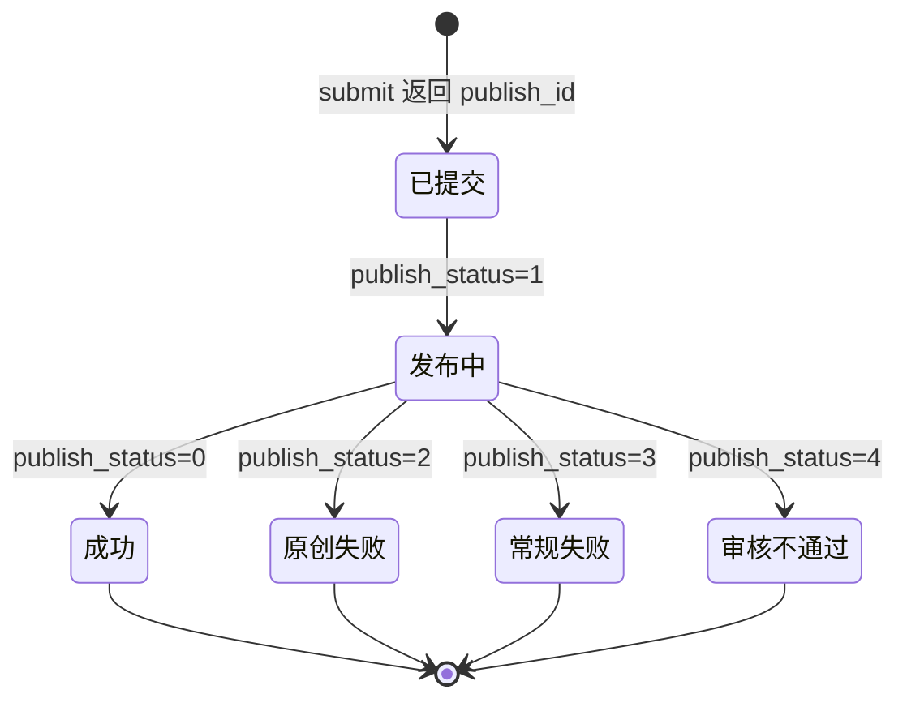

# 接口与发布：微信 API 链路

> 本文以**官方文档**为准。核对日期：2026-11-11。
> 官方原文（Markdown 版）：<https://developers.weixin.qq.com/doc/service/api/draftbox/draftmanage/api_draft_add.md>
>
> 实现见 `weixin/wechat/publish.py`，字段限制见 `weixin/wechat/posts.py`。

---

## 一、字段限制（官方 `draft/add` 字段表）

| 字段 | 必填 | 限制 |
| --- | --- | --- |
| `article_type` | 否 | `news`（图文，默认）/ `newspic`（图片消息） |
| `title` | **是** | **不超过 32 个字** |
| `author` | 否 | **不超过 16 个字** |
| `digest` | 否 | **不超过 120 个字**（仅有单图文消息才有摘要） |
| `content` | **是** | **少于 2 万字符**，**小于 1 MB**，去除 JS；图片 URL 必须来自 `media/uploadimg`，外部图片 URL 会被过滤 |
| `content_source_url` | 否 | 不超过 1 KB |
| `thumb_media_id` | `news` 时**必填** | 必须是**永久**素材 MediaID |
| `need_open_comment` | 否 | 0 不打开（默认）/ 1 打开 |
| `only_fans_can_comment` | 否 | 0 所有人（默认）/ 1 仅粉丝 |
| `cover_info.crop_percent_list` | 否 | 裁剪框，`ratio` 只支持 `2.35_1`、`1_1`，坐标是 0–1 的百分比字符串 |

> **标题 32 字这条容易踩坑**。很多二手资料写 64（那是编辑器 UI 的限制），
> API 字段表是 32。官方接口变更日志记着：
> 「2026 年 07 月 14 日 api 摘要长度限制对齐 mp 端 120 字」。
> 超长标题会被接口直接拒绝，所以本工具在预检阶段就拦下来并列出具体文章，
> 不让它们走到接口那一步才炸。

---

## 二、六个接口

| # | 接口 | 方法 | 关键点 |
| --- | --- | --- | --- |
| 1 | `/cgi-bin/stable_token` | POST | **不要用** `/cgi-bin/token`（见 §三） |
| 2 | `/cgi-bin/media/uploadimg` | POST multipart | 字段名 `media`；JPG/PNG；**单张 ≤ 1 MB**；返回 `url`（mmbiz 域名），正文图用它 |
| 3 | `/cgi-bin/material/add_material?type=image` | POST multipart | 字段名 `media`；永久素材；返回 `media_id`，封面用它 |
| 4 | `/cgi-bin/draft/add` | POST JSON | `articles[]`；返回 `media_id` |
| 5 | `/cgi-bin/freepublish/submit` | POST JSON | body `{media_id}`；返回 `publish_id`（**异步**） |
| 6 | `/cgi-bin/freepublish/get` | POST JSON | body `{publish_id}`；返回 `publish_status` + `article_id` |

### multipart 编码

`publish.py` 手写 multipart（不引入 requests）：

```text
------mavisweixin<uuid>
Content-Disposition: form-data; name="media"; filename="a.png"
Content-Type: image/png

<binary>
------mavisweixin<uuid>--
```

字段名必须是 `media`，这是微信的约定，不是 `file` 也不是 `image`。

### ⚠️ 凭据的字段名和 token 的位置，文档和实际不一致

这两处只有打真实接口才会暴露，全部按官方文档写就会中招。实测结论：

**一、`stable_token` 的凭据字段名是 `secret`，不是文档写的 `appsecret`。**

| 请求体 | 结果 |
| --- | --- |
| 只带 `secret` | ✅ 成功 |
| 只带 `appsecret` | ❌ `41004 appsecret missing` |
| 两个都带 | ✅ 成功 |

报错信息说「appsecret missing」，但服务端找的其实是 `secret` 字段——**提示语和
查找的字段名对不上**。本工具两个都发，哪种实现都能通。

**二、`media/uploadimg` 与 `material/add_material` 只认 query 参数。**

| token 放哪 | 结果 |
| --- | --- |
| 只有 `Authorization: Bearer xxx` | ❌ `41001 access_token missing` |
| 只有 `?access_token=xxx` | ✅ 成功 |
| 两个都带 | ✅ 成功 |

这两个是较老的接口，`Authorization` header 对它们无效。本工具 query 与
header 都带，覆盖所有端点风格。

### token 选型

`stable_token` 与 `token` 的区别在于**复用窗口**：

- `/cgi-bin/token` 每次调用都**作废上一个 token**（同一账号只能有一个有效 token）。
  两个任务重叠时，后一个会让前一个正在用的 token 立刻 `40001`。
- `/cgi-bin/stable_token` 有 5 分钟内的复用窗口，天然适合并发。

官方还提到 token 有效期 7200 秒、**每日调用上限约 2000 次**，所以本工具
在客户端里缓存 token，不每次请求都换。

---

## 三、`publish_status` 状态机

`freepublish/submit` 是**异步**的：它返回 `publish_id` 时文章可能还没发出去。



| `publish_status` | 含义 | 处理 |
| --- | --- | --- |
| 0 | 发布成功 | 写回状态，结束 |
| 1 | 发布中 | 继续轮询 |
| 2 | 原创失败 | 告警 + 保留草稿 |
| 3 | 常规失败 | 告警 + 保留草稿 |
| 4 | 平台审核不通过 | 人工看内容，**不要自动重试** |
| 5 | 已删除 | 人工确认 |
| 6 | 已封禁 | 人工确认 |

**轮询的三个细节**：必须有超时上限（建议 30 分钟，超时按"待人工确认"处理，
不要无限重试）；间隔别太密（1~2 分钟足够，接口有频率限制）；状态要落盘。

---

## 四、三层幂等

自动发布最容易翻车的地方是**同一篇文章发了两遍**。原因通常是 CI 重跑、
手快推了两次、轮询超时后误判为失败又重试。

| 层 | 键 | 存在哪 | 作用 |
| --- | --- | --- | --- |
| 内容层 | `sha256(正文)` | `out/state.json` 的 `fingerprint` | 正文没变就不重建草稿 |
| 草稿层 | `media_id` | 同上 | 已有草稿不重复 `draft/add` |
| 发布层 | `publish_id` + `publish_status` | 同上 | 已在发布中就不重复 `submit` |

```python
if needs_draft(post.fingerprint, state):     # 内容变了或还没有草稿
    state.media_id = client.add_draft(article)
    state.fingerprint = post.fingerprint
    state.publish_id = None
    store.save(post.slug, state)

if args.publish and needs_submit(state):     # 还没提交过
    state.publish_id = client.freepublish_submit(state.media_id)
    store.save(post.slug, state)
```

**每一个「成功」都必须是显式确认过的成功**，不能是「没报错就算成功」。
`publish.py` 里所有 `errcode != 0` 一律抛 `WeChatError`，不吞异常。

---

## 五、IP 白名单：为什么在本地跑

微信后台要求**调用服务器的出口 IP** 加进「IP 白名单」，否则报
`40164` / `61004`。

GitHub 托管 runner 的出口 IP 是动态的，每次可能不同 → 调不通。三个解法：

1. 固定 IP 的自建 runner
2. 固定出口的云函数
3. **把发布动作放在有固定 IP 的机器上**（本工具的方案）

第三种最省事：发布频率是每天一次，不需要 CI 的弹性。本地执行时，
把本机出口 IP 加进后台即可。

---

## 六、错误码

| 错误码 | 含义 | 处理 |
| --- | --- | --- |
| `40001` | access_token 无效 | 重新取 token；检查是不是被别的服务刷新覆盖了 |
| `40004` | 不合法的媒体文件类型 | 封面/正文图必须是 jpg/png |
| `40007` | 无效的 media_id | 封面必须是**永久**素材 ID，重新上传 |
| `40013` | 无效的 appid | 检查 AppID |
| `40009` | 图片大小超限 | 封面 ≤ 10 MB，正文图 ≤ 1 MB |
| `40125` | AppSecret 无效 | 重置 AppSecret |
| `45009` | 接口调用超频率限制 | 等到次日重置 |
| `45166` | 正文含非法链接/敏感词/受限标签 | 检查外链、`<script>`/`<iframe>`、敏感词 |
| `48001` | api 未授权 | 见 §七 |
| `53503` | 草稿未通过发布检查 | 检查草稿内容 |
| `44002` | POST 数据包为空 | content 为空 |
| `53402` | 封面裁剪比例不匹配 | `crop_percent_list` 的 ratio 只能是 `2.35_1` / `1_1` |

---

## 七、发表接口：能不能用，取决于账号类型

**2025 年 7 月起，官方收回了部分账号类型的「发布能力」接口权限**：
`freepublish/submit` 对**个人主体、不支持认证的企业、未认证企业**这类账号
会返回：

```text
errcode: 48001
errmsg: api unauthorized
```

同时**草稿接口 `draft/add` 仍然可用**。

| 你的公众号类型 | 自动进草稿箱 | 自动发表 |
| --- | --- | --- |
| 订阅号 · 个人主体 | 能 | **不能**（48001） |
| 订阅号 · 企业主体 · 已认证 | 能 | 能 |
| 服务号 · 已认证 | 能 | 能 |

### 本号实测结论（2026-11-11）

```text
$ python3 -m wechat.cli publish dpdk/vpp与dpdk的关系 --publish
微信接口报错: /cgi-bin/freepublish/submit failed: [48001] api unauthorized
```

**该账号没有发表接口权限。** 草稿接口全部正常——
`stable_token` / `media/uploadimg` / `material/add_material` / `draft/add`
全部实测通过，草稿已成功进草稿箱。

所以本号的自动化边界是「**自动生成 + 自动进草稿箱**」，最后「点一下发表」
由人完成。这仍然值 90% 的工：原来从「一篇文档」到「一篇公众号草稿」要手工
改格式、传图、调样式，30~60 分钟；自动化之后是 **0 分钟人工 + 5 秒点击**。

而且**草稿箱天然是一个审批闸门**——这反而是好事。

> 结论只对本号成立。**不要照抄任何教程，包括这篇**——这里给的是链路，
> 不是你这个号的结论。换号要重新实测。

---

## 八、环境变量

| 变量 | 说明 |
| --- | --- |
| `WX_APPID` | 公众号 AppID |
| `WX_APPSECRET` | 公众号 AppSecret（**secret，别进仓库**） |
| `WX_SOURCE_URL` | 站点根 URL，用于拼「阅读原文」，默认 `https://growdu.cn` |
| `WX_COVER` | 封面图路径（未指定时取文章首图） |

AppSecret 泄露 = 账号被接管。`weixin/.gitignore` 已经挡掉 `secrets.json`
和 `.env`。

凭据也可以放进 `weixin/secrets.json`（同样被 gitignore），这样 secret 不会
留在 shell 历史里：

```json
{
  "appid": "wx1234567890abcdef",
  "appsecret": "你的 AppSecret"
}
```

优先级：**命令行参数 > 环境变量 > `secrets.json`**。

### 凭据和 IP 白名单从哪来

登录 [微信公众平台](https://mp.weixin.qq.com/) → 左侧「**设置与开发**」→
「**基本配置**」。三样东西都在这一页：

| 要的东西 | 在哪 | 注意 |
| --- | --- | --- |
| 开发者 ID (AppID) | 页面右侧「开发者ID」 | 直接可见，`wx` 开头 |
| 开发者密码 (AppSecret) | AppID 下方，点「重置」（首次是「启用」） | 管理员扫码确认，**只显示一次** |
| IP 白名单 | **在 AppSecret 下方** | 必须先启用 AppSecret，这个入口才会出现 |

**顺序有依赖**：很多人翻遍后台找不到「IP 白名单」，是因为还没启用
AppSecret——白名单入口是跟着 AppSecret 一起出现的。

白名单里填的是**调用接口这台机器的公网出口 IP**，不是微信的服务器 IP。
本机查法：

```bash
curl ifconfig.me
```

填错会报 `40164 invalid ip not in whitelist`。报错信息里会带上**微信实际看到
的那个 IP**（有些运营商做 NAT 时两边看到的地址不一致），把它原样加进白名单
就行，不用猜。

> 如果这台机器的出口 IP 是动态的（家用宽带、容器、弹性 IP 未绑定），
> 白名单要跟着换。本工具的发布动作设计成在本地跑，IP 变了重跑一次
> `publish` 之前记得更新白名单。

### ⚠️ 走了代理的话，`curl` 查到的 IP 未必是微信看到的那个

这是实测踩到的坑。机器上有本地代理时（`HTTP(S)_PROXY=http://127.0.0.1:7897`
这类分流代理），**代理对不同目标会用不同的出口 IP**：

```text
curl https://api.ipify.org          → 43.166.8.75      ← 代理对第三方服务的出口
微信报 40164 invalid ip 171.213.162.214  ← 微信 API 实际看到的出口
```

两个都是真实出口，但对微信来说只有后者算数。而且本机**没有直连能力**
（`curl --noproxy '*'` 直接连接失败），所以「让微信 API 绕过代理」这条路
走不通——只能把微信报出来的那个 IP 加进白名单。

**正确做法：先跑一次拿 token，报 40164 就照抄报错里的 IP。** 别猜，也别只
信 `curl ifconfig.me`。想确认稳不稳，就多跑几次：

```bash
for i in 1 2 3; do python3 -m wechat.cli publish <slug>; done
```

报错里的 IP 每次都一样，说明出口稳定，加一次就够；每次都变，说明出口是
动态的，得换固定 IP 的机器或者每次改白名单。

---

## 九、封面裁剪

官方新格式是 `cover_info.crop_percent_list`（旧的 `pic_crop_235_1` /
`pic_crop_1_1` 字段是像素坐标，已不推荐）：

```json
"cover_info": {
  "crop_percent_list": [
    {"ratio": "2.35_1", "x1": "0.000000", "y1": "0.000000", "x2": "1.000000", "y2": "0.425532"},
    {"ratio": "1_1",     "x1": "0.287234", "y1": "0.000000", "x2": "0.712766", "y2": "1.000000"}
  ]
}
```

坐标以图片左上角 `(0,0)`、右下角 `(1,1)` 建立平面坐标系。
`assets.cover_crop_list()` 按图片真实宽高算**最大的居中裁剪框**，
六位小数。

> 注意：裁剪框**不回显**在 `draft/get` 的 `news_item` 里——微信会把它归一化后
> 放进 `cover_info.crop_percent_list`，`ratio` 用下划线写法（`2.35_1` / `1_1`）。
> 在 `news_item[0]` 里查 `pic_crop_235_1` 只会得到 `None`，别据此得出
> 「微信忽略了裁剪框」的结论。
